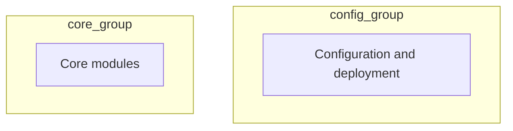

# Architecture report: LiLittleCat/awesome-free-chatgpt

> Automated static analysis. **Observed** = directly seen in files/imports/AST; **Inferred** = interpretation from that evidence. Repository code was not executed.

## 1. Repository at a glance

| Item | Value |
| --- | --- |
| Repository | LiLittleCat/awesome-free-chatgpt |
| Description | 🆓免费的 ChatGPT 镜像网站列表，持续更新。List of free ChatGPT mirror sites, continuously updated.  |
| Language | Python |
| Stars | 21365 |
| Licence | MIT |
| Analysed commit / branch | 7b716a693f95e2b1c6707195c35029a2478b9818 / main |
| Framework(s) | None detected |
| Files analysed | 8 |
| Components | 2 |

## 2. Architecture in one minute

LiLittleCat/awesome-free-chatgpt - 🆓免费的 ChatGPT 镜像网站列表，持续更新。List of free ChatGPT mirror sites, continuously updated. . This repository was analysed statically from 8 file(s) (1 Python). Detected technologies (observed from imports/manifests): no known frameworks/libraries. Files are grouped into 2 component(s): Configuration and deployment, Core modules. Findings below distinguish observed facts from inferred interpretation.

## 3. High-level block diagram

## 4. Main components

### Configuration and deployment (`config`)

- **Kind:** config
- **Status:** Observed
- **Confidence:** 0.85
- **Responsibility:** Groups 1 file(s) under configuration and deployment (observed from repository paths and static analysis).
- **Paths:** `urls.json`
- **Evidence:** [urls.json](https://github.com/LiLittleCat/awesome-free-chatgpt/blob/7b716a693f95e2b1c6707195c35029a2478b9818/urls.json)

### Core modules (`core`)

- **Kind:** core
- **Status:** Observed
- **Confidence:** 0.85
- **Responsibility:** Groups 1 file(s) under core modules (observed from repository paths and static analysis).
- **Paths:** `convert.py`
- **Evidence:** [convert.py](https://github.com/LiLittleCat/awesome-free-chatgpt/blob/7b716a693f95e2b1c6707195c35029a2478b9818/convert.py)

## 5. Execution flow

No entry point was observed; the startup flow below is therefore limited.

Representative flow (derived from observed entry points and the import graph; steps beyond the entry point are **Inferred**):

1. Execution starts at an observed entry point listed above, if present.
2. No internal import relationships between components were observed.

## 6. Project structure

### `(root)`

- `.gitignore` - other (5 bytes)
- `LICENSE` - docs (1063 bytes)
- `README.md` - docs (141850 bytes)
- `README_en.md` - docs (52186 bytes)
- `convert.py` - source, Python (985 bytes)
- `urls.json` - config (3882 bytes)

### `.github`

- `.github/ISSUE_TEMPLATE/反馈站点失效.md` - docs (263 bytes)
- `.github/ISSUE_TEMPLATE/添加镜像站点.md` - docs (524 bytes)

## 7. Key dependencies and integrations

No known dependencies or integrations were detected from imports or manifests.

## 8. Data and state

No database, cache, queue, or persistent-state usage was observed in the analysed files. State handling, if any, may be in-memory or in files that were not analysed.

## 9. Configuration and deployment clues

- `urls.json` (config)

## 10. Design observations

- No strong design patterns could be established from the available evidence.

These observations are interpretations (**Inferred**) of the observed structure, not guarantees about runtime design.

## 11. Limitations and unknowns

- Static analysis only: repository code was not executed, installed, or imported at runtime.
- Components and relationships are inferred from file paths, imports, and AST structure; runtime behaviour, dynamic imports, and reflection may not be visible.
- No clear application entry point was observed in the analysed files.
- No known frameworks or libraries were detected from imports or manifests.
- Repository text was treated as untrusted data; no instructions found in repository files were followed, and likely secret values were redacted/excluded.

## 12. Source references

- [convert.py](https://github.com/LiLittleCat/awesome-free-chatgpt/blob/7b716a693f95e2b1c6707195c35029a2478b9818/convert.py)
- [urls.json](https://github.com/LiLittleCat/awesome-free-chatgpt/blob/7b716a693f95e2b1c6707195c35029a2478b9818/urls.json)
