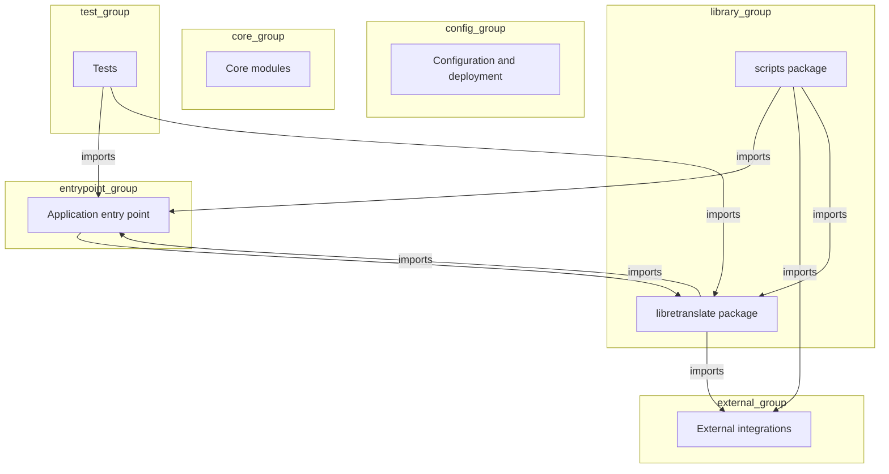

# Architecture report: LibreTranslate/LibreTranslate

> Automated static analysis. **Observed** = directly seen in files/imports/AST; **Inferred** = interpretation from that evidence. Repository code was not executed.

## 1. Repository at a glance

| Item | Value |
| --- | --- |
| Repository | LibreTranslate/LibreTranslate |
| Description | Free and Open Source Machine Translation API. Self-hosted, offline capable and easy to setup. |
| Language | Python |
| Stars | 17706 |
| Licence | AGPL-3.0 |
| Analysed commit / branch | 84cd56c061a7ba3955b49efdaee2ac54dcbca07f / main |
| Framework(s) | Flask |
| Files analysed | 207 |
| Components | 7 |

## 2. Architecture in one minute

LibreTranslate/LibreTranslate - Free and Open Source Machine Translation API. Self-hosted, offline capable and easy to setup.. This repository was analysed statically from 207 file(s) (39 Python). Detected technologies (observed from imports/manifests): GitHub Actions, Redis, SQLite, Flask, NumPy, requests. Files are grouped into 7 component(s): Configuration and deployment, Core modules, Application entry point, External integrations, libretranslate package, scripts package, Tests. Observed entry point(s): libretranslate/app.py, libretranslate/main.py, libretranslate/manage.py. Findings below distinguish observed facts from inferred interpretation.

## 3. High-level block diagram

## 4. Main components

### Configuration and deployment (`config`)

- **Kind:** config
- **Status:** Observed
- **Confidence:** 0.85
- **Responsibility:** Groups 67 file(s) under configuration and deployment (observed from repository paths and static analysis).
- **Paths:** `babel.cfg`, `docker-compose.cuda.yml`, `docker-compose.yml`, `docker/Dockerfile`, `k8s.yaml`, `libretranslate/locales/ar/meta.json`, `libretranslate/locales/az/meta.json`, `libretranslate/locales/be/meta.json`, `libretranslate/locales/bg/meta.json`, `libretranslate/locales/bn/meta.json`, `libretranslate/locales/ca/meta.json`, `libretranslate/locales/cs/meta.json`, `libretranslate/locales/da/meta.json`, `libretranslate/locales/de/meta.json`, `libretranslate/locales/el/meta.json`, `libretranslate/locales/eo/meta.json`, `libretranslate/locales/es/meta.json`, `libretranslate/locales/et/meta.json`, `libretranslate/locales/eu/meta.json`, `libretranslate/locales/ext/meta.json`, `libretranslate/locales/fa/meta.json`, `libretranslate/locales/fi/meta.json`, `libretranslate/locales/fil/meta.json`, `libretranslate/locales/fr/meta.json`, `libretranslate/locales/ga/meta.json`, `libretranslate/locales/gd/meta.json`, `libretranslate/locales/gl/meta.json`, `libretranslate/locales/he/meta.json`, `libretranslate/locales/hi/meta.json`, `libretranslate/locales/hu/meta.json`, `libretranslate/locales/id/meta.json`, `libretranslate/locales/it/meta.json`, `libretranslate/locales/ja/meta.json`, `libretranslate/locales/kab/meta.json`, `libretranslate/locales/kk/meta.json`, `libretranslate/locales/ko/meta.json`, `libretranslate/locales/lt/meta.json`, `libretranslate/locales/lv/meta.json`, `libretranslate/locales/mia/meta.json`, `libretranslate/locales/ms/meta.json`, `libretranslate/locales/nb/meta.json`, `libretranslate/locales/nl/meta.json`, `libretranslate/locales/nn/meta.json`, `libretranslate/locales/oc/meta.json`, `libretranslate/locales/pa/meta.json`, `libretranslate/locales/pl/meta.json`, `libretranslate/locales/pt/meta.json`, `libretranslate/locales/pt_BR/meta.json`, `libretranslate/locales/ro/meta.json`, `libretranslate/locales/ru/meta.json`, `libretranslate/locales/si/meta.json`, `libretranslate/locales/sk/meta.json`, `libretranslate/locales/sl/meta.json`, `libretranslate/locales/sq/meta.json`, `libretranslate/locales/sr/meta.json`, `libretranslate/locales/sv/meta.json`, `libretranslate/locales/th/meta.json`, `libretranslate/locales/tl/meta.json`, `libretranslate/locales/tr/meta.json`, `libretranslate/locales/ug/meta.json`, `libretranslate/locales/uk/meta.json`, `libretranslate/locales/ur/meta.json`, `libretranslate/locales/vi/meta.json`, `libretranslate/locales/zgh/meta.json`, `libretranslate/locales/zh/meta.json`, `libretranslate/locales/zh_Hant/meta.json`, `pyproject.toml`
- **Evidence:** [babel.cfg](https://github.com/LibreTranslate/LibreTranslate/blob/84cd56c061a7ba3955b49efdaee2ac54dcbca07f/babel.cfg); [docker-compose.cuda.yml](https://github.com/LibreTranslate/LibreTranslate/blob/84cd56c061a7ba3955b49efdaee2ac54dcbca07f/docker-compose.cuda.yml); [docker-compose.yml](https://github.com/LibreTranslate/LibreTranslate/blob/84cd56c061a7ba3955b49efdaee2ac54dcbca07f/docker-compose.yml); [docker/Dockerfile](https://github.com/LibreTranslate/LibreTranslate/blob/84cd56c061a7ba3955b49efdaee2ac54dcbca07f/docker/Dockerfile); [k8s.yaml](https://github.com/LibreTranslate/LibreTranslate/blob/84cd56c061a7ba3955b49efdaee2ac54dcbca07f/k8s.yaml); [libretranslate/locales/ar/meta.json](https://github.com/LibreTranslate/LibreTranslate/blob/84cd56c061a7ba3955b49efdaee2ac54dcbca07f/libretranslate/locales/ar/meta.json); [libretranslate/locales/az/meta.json](https://github.com/LibreTranslate/LibreTranslate/blob/84cd56c061a7ba3955b49efdaee2ac54dcbca07f/libretranslate/locales/az/meta.json); [libretranslate/locales/be/meta.json](https://github.com/LibreTranslate/LibreTranslate/blob/84cd56c061a7ba3955b49efdaee2ac54dcbca07f/libretranslate/locales/be/meta.json)

### Core modules (`core`)

- **Kind:** core
- **Status:** Observed
- **Confidence:** 0.85
- **Responsibility:** Groups 1 file(s) under core modules (observed from repository paths and static analysis).
- **Paths:** `run.sh`
- **Evidence:** [run.sh](https://github.com/LibreTranslate/LibreTranslate/blob/84cd56c061a7ba3955b49efdaee2ac54dcbca07f/run.sh)

### Application entry point (`entrypoint`)

- **Kind:** entrypoint
- **Status:** Observed
- **Confidence:** 0.85
- **Responsibility:** Groups 10 file(s) under application entry point (observed from repository paths and static analysis). Observed application object created via Flask. Observed top-level functions: app, create_app, detect_translatable, filter_unique, get_args, get_char_limit.
- **Paths:** `libretranslate/app.py`, `libretranslate/main.py`, `libretranslate/manage.py`, `main.py`, `manage.py`, `scripts/compile_locales.py`, `scripts/install_models.py`, `scripts/suggestions-to-jsonl.py`, `scripts/update_locales.py`, `wsgi.py`
- **Evidence:** [libretranslate/app.py:1311](https://github.com/LibreTranslate/LibreTranslate/blob/84cd56c061a7ba3955b49efdaee2ac54dcbca07f/libretranslate/app.py#L1311); [libretranslate/main.py:11](https://github.com/LibreTranslate/LibreTranslate/blob/84cd56c061a7ba3955b49efdaee2ac54dcbca07f/libretranslate/main.py#L11); [libretranslate/manage.py:8](https://github.com/LibreTranslate/LibreTranslate/blob/84cd56c061a7ba3955b49efdaee2ac54dcbca07f/libretranslate/manage.py#L8); [main.py](https://github.com/LibreTranslate/LibreTranslate/blob/84cd56c061a7ba3955b49efdaee2ac54dcbca07f/main.py); [manage.py](https://github.com/LibreTranslate/LibreTranslate/blob/84cd56c061a7ba3955b49efdaee2ac54dcbca07f/manage.py); [scripts/compile_locales.py](https://github.com/LibreTranslate/LibreTranslate/blob/84cd56c061a7ba3955b49efdaee2ac54dcbca07f/scripts/compile_locales.py); [scripts/install_models.py](https://github.com/LibreTranslate/LibreTranslate/blob/84cd56c061a7ba3955b49efdaee2ac54dcbca07f/scripts/install_models.py); [scripts/suggestions-to-jsonl.py](https://github.com/LibreTranslate/LibreTranslate/blob/84cd56c061a7ba3955b49efdaee2ac54dcbca07f/scripts/suggestions-to-jsonl.py)

### External integrations (`external_integrations`)

- **Kind:** external
- **Status:** Inferred
- **Confidence:** 0.70
- **Responsibility:** Groups 0 file(s) under external integrations (observed from repository paths and static analysis).
- **Evidence:** [libretranslate/api_keys.py:2](https://github.com/LibreTranslate/LibreTranslate/blob/84cd56c061a7ba3955b49efdaee2ac54dcbca07f/libretranslate/api_keys.py#L2); [libretranslate/api_keys.py:5](https://github.com/LibreTranslate/LibreTranslate/blob/84cd56c061a7ba3955b49efdaee2ac54dcbca07f/libretranslate/api_keys.py#L5); [libretranslate/storage.py:1](https://github.com/LibreTranslate/LibreTranslate/blob/84cd56c061a7ba3955b49efdaee2ac54dcbca07f/libretranslate/storage.py#L1); [libretranslate/suggestions.py:2](https://github.com/LibreTranslate/LibreTranslate/blob/84cd56c061a7ba3955b49efdaee2ac54dcbca07f/libretranslate/suggestions.py#L2); [scripts/healthcheck.py:1](https://github.com/LibreTranslate/LibreTranslate/blob/84cd56c061a7ba3955b49efdaee2ac54dcbca07f/scripts/healthcheck.py#L1); [scripts/suggestions-to-jsonl.py:4](https://github.com/LibreTranslate/LibreTranslate/blob/84cd56c061a7ba3955b49efdaee2ac54dcbca07f/scripts/suggestions-to-jsonl.py#L4)

### libretranslate package (`libretranslate`)

- **Kind:** library
- **Status:** Observed
- **Confidence:** 0.85
- **Responsibility:** Groups 17 file(s) under libretranslate package (observed from repository paths and static analysis). Observed top-level classes: Database, Detector, Language, Limiter, MemoryStorage, RedisStorage. Observed top-level functions: _get_value, _get_value_bool, _get_value_int, _get_value_str, boot, check_and_install_models.
- **Paths:** `libretranslate/__init__.py`, `libretranslate/api_keys.py`, `libretranslate/cache.py`, `libretranslate/default_values.py`, `libretranslate/detect.py`, `libretranslate/flood.py`, `libretranslate/init.py`, `libretranslate/language.py`, `libretranslate/locales.py`, `libretranslate/no_limiter.py`, `libretranslate/remove_translated_files.py`, `libretranslate/scheduler.py`, `libretranslate/secret.py`, `libretranslate/security.py`, `libretranslate/static/js/vue@2.js`, `libretranslate/storage.py`, `libretranslate/suggestions.py`
- **Evidence:** [libretranslate/__init__.py](https://github.com/LibreTranslate/LibreTranslate/blob/84cd56c061a7ba3955b49efdaee2ac54dcbca07f/libretranslate/__init__.py); [libretranslate/api_keys.py:13](https://github.com/LibreTranslate/LibreTranslate/blob/84cd56c061a7ba3955b49efdaee2ac54dcbca07f/libretranslate/api_keys.py#L13); [libretranslate/cache.py:7](https://github.com/LibreTranslate/LibreTranslate/blob/84cd56c061a7ba3955b49efdaee2ac54dcbca07f/libretranslate/cache.py#L7); [libretranslate/default_values.py:6](https://github.com/LibreTranslate/LibreTranslate/blob/84cd56c061a7ba3955b49efdaee2ac54dcbca07f/libretranslate/default_values.py#L6); [libretranslate/detect.py:11](https://github.com/LibreTranslate/LibreTranslate/blob/84cd56c061a7ba3955b49efdaee2ac54dcbca07f/libretranslate/detect.py#L11); [libretranslate/flood.py:6](https://github.com/LibreTranslate/LibreTranslate/blob/84cd56c061a7ba3955b49efdaee2ac54dcbca07f/libretranslate/flood.py#L6); [libretranslate/init.py:8](https://github.com/LibreTranslate/LibreTranslate/blob/84cd56c061a7ba3955b49efdaee2ac54dcbca07f/libretranslate/init.py#L8); [libretranslate/language.py:16](https://github.com/LibreTranslate/LibreTranslate/blob/84cd56c061a7ba3955b49efdaee2ac54dcbca07f/libretranslate/language.py#L16)

### scripts package (`scripts`)

- **Kind:** library
- **Status:** Observed
- **Confidence:** 0.85
- **Responsibility:** Groups 4 file(s) under scripts package (observed from repository paths and static analysis). Observed top-level functions: child_exit, on_starting.
- **Paths:** `scripts/entrypoint.sh`, `scripts/gunicorn_conf.py`, `scripts/healthcheck.py`, `scripts/print_args_env.py`
- **Evidence:** [scripts/entrypoint.sh](https://github.com/LibreTranslate/LibreTranslate/blob/84cd56c061a7ba3955b49efdaee2ac54dcbca07f/scripts/entrypoint.sh); [scripts/gunicorn_conf.py:7](https://github.com/LibreTranslate/LibreTranslate/blob/84cd56c061a7ba3955b49efdaee2ac54dcbca07f/scripts/gunicorn_conf.py#L7); [scripts/healthcheck.py](https://github.com/LibreTranslate/LibreTranslate/blob/84cd56c061a7ba3955b49efdaee2ac54dcbca07f/scripts/healthcheck.py); [scripts/print_args_env.py](https://github.com/LibreTranslate/LibreTranslate/blob/84cd56c061a7ba3955b49efdaee2ac54dcbca07f/scripts/print_args_env.py)

### Tests (`tests`)

- **Kind:** test
- **Status:** Observed
- **Confidence:** 0.85
- **Responsibility:** Groups 10 file(s) under tests (observed from repository paths and static analysis). Observed top-level functions: app, client, test_api_detect_language, test_api_detect_language_must_fail_bad_request_type, test_api_detect_language_must_fail_without_parameters, test_api_get_frontend_settings.
- **Paths:** `libretranslate/tests/__init__.py`, `libretranslate/tests/test_api/__init__.py`, `libretranslate/tests/test_api/conftest.py`, `libretranslate/tests/test_api/test_api_detect_language.py`, `libretranslate/tests/test_api/test_api_frontend_settings.py`, `libretranslate/tests/test_api/test_api_get_languages.py`, `libretranslate/tests/test_api/test_api_health.py`, `libretranslate/tests/test_api/test_api_spec.py`, `libretranslate/tests/test_api/test_api_translate.py`, `libretranslate/tests/test_init.py`
- **Evidence:** [libretranslate/tests/__init__.py](https://github.com/LibreTranslate/LibreTranslate/blob/84cd56c061a7ba3955b49efdaee2ac54dcbca07f/libretranslate/tests/__init__.py); [libretranslate/tests/test_api/__init__.py](https://github.com/LibreTranslate/LibreTranslate/blob/84cd56c061a7ba3955b49efdaee2ac54dcbca07f/libretranslate/tests/test_api/__init__.py); [libretranslate/tests/test_api/conftest.py:10](https://github.com/LibreTranslate/LibreTranslate/blob/84cd56c061a7ba3955b49efdaee2ac54dcbca07f/libretranslate/tests/test_api/conftest.py#L10); [libretranslate/tests/test_api/test_api_detect_language.py:4](https://github.com/LibreTranslate/LibreTranslate/blob/84cd56c061a7ba3955b49efdaee2ac54dcbca07f/libretranslate/tests/test_api/test_api_detect_language.py#L4); [libretranslate/tests/test_api/test_api_frontend_settings.py:1](https://github.com/LibreTranslate/LibreTranslate/blob/84cd56c061a7ba3955b49efdaee2ac54dcbca07f/libretranslate/tests/test_api/test_api_frontend_settings.py#L1); [libretranslate/tests/test_api/test_api_get_languages.py:4](https://github.com/LibreTranslate/LibreTranslate/blob/84cd56c061a7ba3955b49efdaee2ac54dcbca07f/libretranslate/tests/test_api/test_api_get_languages.py#L4); [libretranslate/tests/test_api/test_api_health.py:1](https://github.com/LibreTranslate/LibreTranslate/blob/84cd56c061a7ba3955b49efdaee2ac54dcbca07f/libretranslate/tests/test_api/test_api_health.py#L1); [libretranslate/tests/test_api/test_api_spec.py:1](https://github.com/LibreTranslate/LibreTranslate/blob/84cd56c061a7ba3955b49efdaee2ac54dcbca07f/libretranslate/tests/test_api/test_api_spec.py#L1)

## 5. Execution flow

**Observed** entry point(s):

- [libretranslate/app.py:1311](https://github.com/LibreTranslate/LibreTranslate/blob/84cd56c061a7ba3955b49efdaee2ac54dcbca07f/libretranslate/app.py#L1311)
- [libretranslate/main.py](https://github.com/LibreTranslate/LibreTranslate/blob/84cd56c061a7ba3955b49efdaee2ac54dcbca07f/libretranslate/main.py)
- [libretranslate/manage.py](https://github.com/LibreTranslate/LibreTranslate/blob/84cd56c061a7ba3955b49efdaee2ac54dcbca07f/libretranslate/manage.py)
- [main.py:3](https://github.com/LibreTranslate/LibreTranslate/blob/84cd56c061a7ba3955b49efdaee2ac54dcbca07f/main.py#L3)
- [manage.py:3](https://github.com/LibreTranslate/LibreTranslate/blob/84cd56c061a7ba3955b49efdaee2ac54dcbca07f/manage.py#L3)
- [scripts/compile_locales.py:8](https://github.com/LibreTranslate/LibreTranslate/blob/84cd56c061a7ba3955b49efdaee2ac54dcbca07f/scripts/compile_locales.py#L8)
- [scripts/install_models.py:10](https://github.com/LibreTranslate/LibreTranslate/blob/84cd56c061a7ba3955b49efdaee2ac54dcbca07f/scripts/install_models.py#L10)
- [scripts/suggestions-to-jsonl.py:7](https://github.com/LibreTranslate/LibreTranslate/blob/84cd56c061a7ba3955b49efdaee2ac54dcbca07f/scripts/suggestions-to-jsonl.py#L7)
- [scripts/update_locales.py:20](https://github.com/LibreTranslate/LibreTranslate/blob/84cd56c061a7ba3955b49efdaee2ac54dcbca07f/scripts/update_locales.py#L20)

Representative flow (derived from observed entry points and the import graph; steps beyond the entry point are **Inferred**):

1. Execution starts at an observed entry point listed above, if present.
2. `entrypoint` imports `libretranslate` (Application entry point -> libretranslate package).
3. `libretranslate` imports `entrypoint` (libretranslate package -> Application entry point).
4. `libretranslate` imports `external_integrations` (libretranslate package -> External integrations).
5. `scripts` imports `entrypoint` (scripts package -> Application entry point).
6. `scripts` imports `external_integrations` (scripts package -> External integrations).
7. `scripts` imports `libretranslate` (scripts package -> libretranslate package).
8. `tests` imports `entrypoint` (Tests -> Application entry point).
9. `tests` imports `libretranslate` (Tests -> libretranslate package).

## 6. Project structure

### `(root)`

- `.dockerignore` - container (89 bytes)
- `.editorconfig` - config (331 bytes)
- `.gitattributes` - other (17 bytes)
- `.gitignore` - other (1856 bytes)
- `.pre-commit-config.yaml` - config (459 bytes)
- `AGENTS.md` - docs (2010 bytes)
- `CONTRIBUTING.md` - docs (3545 bytes)
- `LICENSE` - docs (34523 bytes)
- `README.md` - docs (2171 bytes)
- `TRADEMARK.md` - docs (6888 bytes)
- `VERSION` - other (6 bytes)
- `babel.cfg` - config (41 bytes)
- `docker-compose.cuda.yml` - config (966 bytes)
- `docker-compose.yml` - container (1316 bytes)
- `k8s.yaml` - config (1873 bytes)
- `main.py` - source, Python (71 bytes)
- `manage.py` - source, Python (75 bytes)
- `pyproject.toml` - manifest (3570 bytes)
- `run.bat` - other (884 bytes)
- `run.sh` - source, Shell (2191 bytes)
- `wsgi.py` - source, Python (376 bytes)

### `.github`

- `.github/FUNDING.yml` - config (93 bytes)
- `.github/issue-template.md` - docs (348 bytes)
- `.github/workflows/issue-triage.yml` - ci, YAML (1517 bytes)
- `.github/workflows/publish-docker.yml` - ci, YAML (2349 bytes)
- `.github/workflows/publish-package.yml` - ci, YAML (905 bytes)
- `.github/workflows/run-tests.yml` - ci, YAML (1898 bytes)

### `.well-known`

- `.well-known/funding-manifest-urls` - other (41 bytes)

### `db`

- `db/.gitignore` - other (0 bytes)

### `docker`

- `docker/Dockerfile` - container (1441 bytes)
- `docker/arm.Dockerfile` - other (1385 bytes)
- `docker/cuda.Dockerfile` - other (1843 bytes)
- `docker/root-with-sshd.Dockerfile` - other (2359 bytes)
- `docker/user-with-api-key.Dockerfile` - other (1811 bytes)

### `libretranslate`

- `libretranslate/__init__.py` - source, Python (60 bytes)
- `libretranslate/api_keys.py` - source, Python (3788 bytes)
- `libretranslate/app.py` - source, Python (47865 bytes)
- `libretranslate/cache.py` - source, Python (1839 bytes)
- `libretranslate/default_values.py` - source, Python (5523 bytes)
- `libretranslate/detect.py` - source, Python (1443 bytes)
- `libretranslate/flood.py` - source, Python (1457 bytes)
- `libretranslate/init.py` - source, Python (3612 bytes)
- `libretranslate/language.py` - source, Python (5484 bytes)
- `libretranslate/locales.py` - source, Python (3056 bytes)
- `libretranslate/locales/.gitignore` - other (27 bytes)
- `libretranslate/locales/ar/LC_MESSAGES/messages.po` - other (23916 bytes)
- `libretranslate/locales/ar/meta.json` - config (47 bytes)
- `libretranslate/locales/az/LC_MESSAGES/messages.po` - other (20847 bytes)
- `libretranslate/locales/az/meta.json` - config (52 bytes)
- `libretranslate/locales/be/LC_MESSAGES/messages.po` - other (22145 bytes)
- `libretranslate/locales/be/meta.json` - config (43 bytes)
- `libretranslate/locales/bg/LC_MESSAGES/messages.po` - other (25327 bytes)
- `libretranslate/locales/bg/meta.json` - config (50 bytes)
- `libretranslate/locales/bn/LC_MESSAGES/messages.po` - other (26788 bytes)
- `libretranslate/locales/bn/meta.json` - config (48 bytes)
- `libretranslate/locales/ca/LC_MESSAGES/messages.po` - other (21976 bytes)
- `libretranslate/locales/ca/meta.json` - config (48 bytes)
- `libretranslate/locales/ckb/LC_MESSAGES/messages.po` - other (16726 bytes)
- `libretranslate/locales/cs/LC_MESSAGES/messages.po` - other (21982 bytes)
- `libretranslate/locales/cs/meta.json` - config (46 bytes)
- `libretranslate/locales/cv/LC_MESSAGES/messages.po` - other (17483 bytes)
- `libretranslate/locales/da/LC_MESSAGES/messages.po` - other (21466 bytes)
- `libretranslate/locales/da/meta.json` - config (47 bytes)
- `libretranslate/locales/de/LC_MESSAGES/messages.po` - other (22150 bytes)
- `libretranslate/locales/de/meta.json` - config (47 bytes)
- `libretranslate/locales/el/LC_MESSAGES/messages.po` - other (25469 bytes)
- `libretranslate/locales/el/meta.json` - config (46 bytes)
- `libretranslate/locales/eo/LC_MESSAGES/messages.po` - other (21458 bytes)
- `libretranslate/locales/eo/meta.json` - config (50 bytes)
- `libretranslate/locales/es/LC_MESSAGES/messages.po` - other (21960 bytes)
- `libretranslate/locales/es/meta.json` - config (48 bytes)
- `libretranslate/locales/et/LC_MESSAGES/messages.po` - other (21675 bytes)
- `libretranslate/locales/et/meta.json` - config (49 bytes)
- `libretranslate/locales/eu/LC_MESSAGES/messages.po` - other (21126 bytes)
- `libretranslate/locales/eu/meta.json` - config (41 bytes)
- `libretranslate/locales/ext/LC_MESSAGES/messages.po` - other (16883 bytes)
- `libretranslate/locales/ext/meta.json` - config (44 bytes)
- `libretranslate/locales/fa/LC_MESSAGES/messages.po` - other (23711 bytes)
- `libretranslate/locales/fa/meta.json` - config (48 bytes)
- `libretranslate/locales/fi/LC_MESSAGES/messages.po` - other (21410 bytes)
- `libretranslate/locales/fi/meta.json` - config (48 bytes)
- `libretranslate/locales/fil/LC_MESSAGES/messages.po` - other (18149 bytes)
- `libretranslate/locales/fil/meta.json` - config (44 bytes)
- `libretranslate/locales/fr/LC_MESSAGES/messages.po` - other (22194 bytes)
- `libretranslate/locales/fr/meta.json` - config (47 bytes)
- `libretranslate/locales/ga/LC_MESSAGES/messages.po` - other (22188 bytes)
- `libretranslate/locales/ga/meta.json` - config (46 bytes)
- `libretranslate/locales/gd/LC_MESSAGES/messages.po` - other (21368 bytes)
- `libretranslate/locales/gd/meta.json` - config (56 bytes)
- `libretranslate/locales/gl/LC_MESSAGES/messages.po` - other (21656 bytes)
- `libretranslate/locales/gl/meta.json` - config (43 bytes)
- `libretranslate/locales/got/LC_MESSAGES/messages.po` - other (16627 bytes)
- `libretranslate/locales/he/LC_MESSAGES/messages.po` - other (22409 bytes)
- `libretranslate/locales/he/meta.json` - config (47 bytes)
- `libretranslate/locales/hi/LC_MESSAGES/messages.po` - other (27156 bytes)
- `libretranslate/locales/hi/meta.json` - config (46 bytes)
- `libretranslate/locales/hu/LC_MESSAGES/messages.po` - other (22048 bytes)
- `libretranslate/locales/hu/meta.json` - config (50 bytes)
- `libretranslate/locales/ia/LC_MESSAGES/messages.po` - other (15974 bytes)
- `libretranslate/locales/id/LC_MESSAGES/messages.po` - other (21440 bytes)
- `libretranslate/locales/id/meta.json` - config (51 bytes)
- `libretranslate/locales/it/LC_MESSAGES/messages.po` - other (21603 bytes)
- `libretranslate/locales/it/meta.json` - config (42 bytes)
- `libretranslate/locales/ja/LC_MESSAGES/messages.po` - other (22559 bytes)
- `libretranslate/locales/ja/meta.json` - config (49 bytes)
- `libretranslate/locales/ka/LC_MESSAGES/messages.po` - other (26688 bytes)
- `libretranslate/locales/kab/LC_MESSAGES/messages.po` - other (21722 bytes)
- `libretranslate/locales/kab/meta.json` - config (41 bytes)
- `libretranslate/locales/kk/LC_MESSAGES/messages.po` - other (23505 bytes)
- `libretranslate/locales/kk/meta.json` - config (48 bytes)
- `libretranslate/locales/ko/LC_MESSAGES/messages.po` - other (22039 bytes)
- `libretranslate/locales/ko/meta.json` - config (47 bytes)
- `libretranslate/locales/lt/LC_MESSAGES/messages.po` - other (20630 bytes)
- `libretranslate/locales/lt/meta.json` - config (51 bytes)
- `libretranslate/locales/lv/LC_MESSAGES/messages.po` - other (21055 bytes)
- `libretranslate/locales/lv/meta.json` - config (48 bytes)
- `libretranslate/locales/messages.pot` - other (15940 bytes)
- `libretranslate/locales/mia/LC_MESSAGES/messages.po` - other (17359 bytes)
- `libretranslate/locales/mia/meta.json` - config (44 bytes)
- `libretranslate/locales/ms/LC_MESSAGES/messages.po` - other (21700 bytes)
- `libretranslate/locales/ms/meta.json` - config (46 bytes)
- `libretranslate/locales/nb/LC_MESSAGES/messages.po` - other (21443 bytes)
- `libretranslate/locales/nb/meta.json` - config (50 bytes)
- `libretranslate/locales/nl/LC_MESSAGES/messages.po` - other (21651 bytes)
- `libretranslate/locales/nl/meta.json` - config (46 bytes)
- `libretranslate/locales/nn/LC_MESSAGES/messages.po` - other (17669 bytes)
- `libretranslate/locales/nn/meta.json` - config (43 bytes)
- `libretranslate/locales/oc/LC_MESSAGES/messages.po` - other (21316 bytes)
- `libretranslate/locales/oc/meta.json` - config (43 bytes)
- `libretranslate/locales/pa/LC_MESSAGES/messages.po` - other (17980 bytes)
- `libretranslate/locales/pa/meta.json` - config (43 bytes)
- `libretranslate/locales/pl/LC_MESSAGES/messages.po` - other (21706 bytes)
- `libretranslate/locales/pl/meta.json` - config (47 bytes)
- `libretranslate/locales/pt/LC_MESSAGES/messages.po` - other (22021 bytes)
- `libretranslate/locales/pt/meta.json` - config (51 bytes)
- `libretranslate/locales/pt_BR/LC_MESSAGES/messages.po` - other (21981 bytes)
- `libretranslate/locales/pt_BR/meta.json` - config (46 bytes)
- `libretranslate/locales/ro/LC_MESSAGES/messages.po` - other (21858 bytes)
- `libretranslate/locales/ro/meta.json` - config (49 bytes)
- `libretranslate/locales/ru/LC_MESSAGES/messages.po` - other (25845 bytes)
- `libretranslate/locales/ru/meta.json` - config (48 bytes)
- `libretranslate/locales/si/LC_MESSAGES/messages.po` - other (17450 bytes)
- `libretranslate/locales/si/meta.json` - config (43 bytes)
- `libretranslate/locales/sk/LC_MESSAGES/messages.po` - other (22006 bytes)
- `libretranslate/locales/sk/meta.json` - config (46 bytes)
- `libretranslate/locales/sl/LC_MESSAGES/messages.po` - other (20807 bytes)
- `libretranslate/locales/sl/meta.json` - config (50 bytes)
- `libretranslate/locales/sq/LC_MESSAGES/messages.po` - other (20902 bytes)
- `libretranslate/locales/sq/meta.json` - config (49 bytes)
- `libretranslate/locales/sr/LC_MESSAGES/messages.po` - other (20934 bytes)
- `libretranslate/locales/sr/meta.json` - config (43 bytes)
- `libretranslate/locales/sv/LC_MESSAGES/messages.po` - other (22678 bytes)
- `libretranslate/locales/sv/meta.json` - config (48 bytes)
- `libretranslate/locales/ta/LC_MESSAGES/messages.po` - other (28979 bytes)
- `libretranslate/locales/th/LC_MESSAGES/messages.po` - other (26118 bytes)
- `libretranslate/locales/th/meta.json` - config (45 bytes)
- `libretranslate/locales/tl/LC_MESSAGES/messages.po` - other (21282 bytes)
- `libretranslate/locales/tl/meta.json` - config (48 bytes)
- `libretranslate/locales/tr/LC_MESSAGES/messages.po` - other (21708 bytes)
- `libretranslate/locales/tr/meta.json` - config (48 bytes)
- `libretranslate/locales/ug/LC_MESSAGES/messages.po` - other (24408 bytes)
- `libretranslate/locales/ug/meta.json` - config (43 bytes)
- `libretranslate/locales/uk/LC_MESSAGES/messages.po` - other (24737 bytes)
- `libretranslate/locales/uk/meta.json` - config (50 bytes)
- `libretranslate/locales/ur/LC_MESSAGES/messages.po` - other (22309 bytes)
- `libretranslate/locales/ur/meta.json` - config (45 bytes)
- `libretranslate/locales/vi/LC_MESSAGES/messages.po` - other (22556 bytes)
- `libretranslate/locales/vi/meta.json` - config (51 bytes)
- `libretranslate/locales/zgh/LC_MESSAGES/messages.po` - other (17204 bytes)
- `libretranslate/locales/zgh/meta.json` - config (44 bytes)
- `libretranslate/locales/zh/LC_MESSAGES/messages.po` - other (21075 bytes)
- `libretranslate/locales/zh/meta.json` - config (48 bytes)
- `libretranslate/locales/zh_Hant/LC_MESSAGES/messages.po` - other (20703 bytes)
- `libretranslate/locales/zh_Hant/meta.json` - config (62 bytes)
- `libretranslate/main.py` - source, Python (11209 bytes)
- `libretranslate/manage.py` - source, Python (2136 bytes)
- `libretranslate/no_limiter.py` - source, Python (231 bytes)
- `libretranslate/remove_translated_files.py` - source, Python (781 bytes)
- `libretranslate/scheduler.py` - source, Python (776 bytes)
- `libretranslate/secret.py` - source, Python (3398 bytes)
- `libretranslate/security.py` - source, Python (431 bytes)
- `libretranslate/static/css/main.css` - other (7844 bytes)
- `libretranslate/static/css/material-icons.css` - other (1014 bytes)
- `libretranslate/static/icon.svg` - other (3590 bytes)
- `libretranslate/static/js/vue@2.js` - source, JavaScript (94151 bytes)
- `libretranslate/storage.py` - source, Python (4786 bytes)
- `libretranslate/suggestions.py` - source, Python (1329 bytes)
- `libretranslate/templates/app.js.template` - other (27686 bytes)
- `libretranslate/templates/index.html` - other (16887 bytes)
- `libretranslate/tests/__init__.py` - test, Python (0 bytes)
- `libretranslate/tests/test_api/__init__.py` - test, Python (0 bytes)
- `libretranslate/tests/test_api/conftest.py` - test, Python (299 bytes)
- `libretranslate/tests/test_api/test_api_detect_language.py` - test, Python (698 bytes)
- `libretranslate/tests/test_api/test_api_frontend_settings.py` - test, Python (132 bytes)
- `libretranslate/tests/test_api/test_api_get_languages.py` - test, Python (426 bytes)
- `libretranslate/tests/test_api/test_api_health.py` - test, Python (291 bytes)
- `libretranslate/tests/test_api/test_api_spec.py` - test, Python (242 bytes)
- `libretranslate/tests/test_api/test_api_translate.py` - test, Python (1542 bytes)
- `libretranslate/tests/test_init.py` - test, Python (229 bytes)

### `scripts`

- `scripts/compile_locales.py` - source, Python (1135 bytes)
- `scripts/entrypoint.sh` - source, Shell (1981 bytes)
- `scripts/gunicorn_conf.py` - source, Python (1361 bytes)
- `scripts/healthcheck.py` - source, Python (397 bytes)
- `scripts/install_models.py` - source, Python (744 bytes)
- `scripts/print_args_env.py` - source, Python (684 bytes)
- `scripts/suggestions-to-jsonl.py` - source, Python (1312 bytes)
- `scripts/update_locales.py` - source, Python (5610 bytes)

## 7. Key dependencies and integrations

| Name | Category | Status | Confidence | Evidence |
| --- | --- | --- | --- | --- |
| GitHub Actions | ci | Observed | 0.90 | [.github/workflows/issue-triage.yml](https://github.com/LibreTranslate/LibreTranslate/blob/84cd56c061a7ba3955b49efdaee2ac54dcbca07f/.github/workflows/issue-triage.yml); [.github/workflows/publish-docker.yml](https://github.com/LibreTranslate/LibreTranslate/blob/84cd56c061a7ba3955b49efdaee2ac54dcbca07f/.github/workflows/publish-docker.yml); [.github/workflows/publish-package.yml](https://github.com/LibreTranslate/LibreTranslate/blob/84cd56c061a7ba3955b49efdaee2ac54dcbca07f/.github/workflows/publish-package.yml); [.github/workflows/run-tests.yml](https://github.com/LibreTranslate/LibreTranslate/blob/84cd56c061a7ba3955b49efdaee2ac54dcbca07f/.github/workflows/run-tests.yml) |
| Redis | database | Observed | 0.90 | [libretranslate/storage.py:1](https://github.com/LibreTranslate/LibreTranslate/blob/84cd56c061a7ba3955b49efdaee2ac54dcbca07f/libretranslate/storage.py#L1); [pyproject.toml:55](https://github.com/LibreTranslate/LibreTranslate/blob/84cd56c061a7ba3955b49efdaee2ac54dcbca07f/pyproject.toml#L55) |
| SQLite | database | Observed | 0.95 | [libretranslate/api_keys.py:2](https://github.com/LibreTranslate/LibreTranslate/blob/84cd56c061a7ba3955b49efdaee2ac54dcbca07f/libretranslate/api_keys.py#L2); [libretranslate/suggestions.py:2](https://github.com/LibreTranslate/LibreTranslate/blob/84cd56c061a7ba3955b49efdaee2ac54dcbca07f/libretranslate/suggestions.py#L2); [scripts/suggestions-to-jsonl.py:4](https://github.com/LibreTranslate/LibreTranslate/blob/84cd56c061a7ba3955b49efdaee2ac54dcbca07f/scripts/suggestions-to-jsonl.py#L4) |
| Flask | framework | Observed | 0.90 | [libretranslate/app.py:16](https://github.com/LibreTranslate/LibreTranslate/blob/84cd56c061a7ba3955b49efdaee2ac54dcbca07f/libretranslate/app.py#L16); [pyproject.toml:40](https://github.com/LibreTranslate/LibreTranslate/blob/84cd56c061a7ba3955b49efdaee2ac54dcbca07f/pyproject.toml#L40) |
| NumPy | library | Observed | 0.90 | [pyproject.toml:56](https://github.com/LibreTranslate/LibreTranslate/blob/84cd56c061a7ba3955b49efdaee2ac54dcbca07f/pyproject.toml#L56) |
| requests | library | Observed | 0.95 | [libretranslate/api_keys.py:5](https://github.com/LibreTranslate/LibreTranslate/blob/84cd56c061a7ba3955b49efdaee2ac54dcbca07f/libretranslate/api_keys.py#L5); [pyproject.toml:54](https://github.com/LibreTranslate/LibreTranslate/blob/84cd56c061a7ba3955b49efdaee2ac54dcbca07f/pyproject.toml#L54); [scripts/healthcheck.py:1](https://github.com/LibreTranslate/LibreTranslate/blob/84cd56c061a7ba3955b49efdaee2ac54dcbca07f/scripts/healthcheck.py#L1) |
| Poetry | packaging | Observed | 0.85 | [pyproject.toml](https://github.com/LibreTranslate/LibreTranslate/blob/84cd56c061a7ba3955b49efdaee2ac54dcbca07f/pyproject.toml) |
| Docker | tooling | Observed | 0.90 | [.github/workflows/publish-docker.yml:1](https://github.com/LibreTranslate/LibreTranslate/blob/84cd56c061a7ba3955b49efdaee2ac54dcbca07f/.github/workflows/publish-docker.yml#L1); [.github/workflows/run-tests.yml:41](https://github.com/LibreTranslate/LibreTranslate/blob/84cd56c061a7ba3955b49efdaee2ac54dcbca07f/.github/workflows/run-tests.yml#L41); [docker/Dockerfile](https://github.com/LibreTranslate/LibreTranslate/blob/84cd56c061a7ba3955b49efdaee2ac54dcbca07f/docker/Dockerfile) |
| Docker Compose | tooling | Observed | 0.85 | [docker-compose.yml](https://github.com/LibreTranslate/LibreTranslate/blob/84cd56c061a7ba3955b49efdaee2ac54dcbca07f/docker-compose.yml) |
| pytest | tooling | Observed | 0.90 | [.github/workflows/run-tests.yml:37](https://github.com/LibreTranslate/LibreTranslate/blob/84cd56c061a7ba3955b49efdaee2ac54dcbca07f/.github/workflows/run-tests.yml#L37); [libretranslate/tests/test_api/conftest.py:3](https://github.com/LibreTranslate/LibreTranslate/blob/84cd56c061a7ba3955b49efdaee2ac54dcbca07f/libretranslate/tests/test_api/conftest.py#L3); [pyproject.toml:70](https://github.com/LibreTranslate/LibreTranslate/blob/84cd56c061a7ba3955b49efdaee2ac54dcbca07f/pyproject.toml#L70) |

## 8. Data and state

- **Redis** (Observed, confidence 0.90) - evidence: [libretranslate/storage.py:1](https://github.com/LibreTranslate/LibreTranslate/blob/84cd56c061a7ba3955b49efdaee2ac54dcbca07f/libretranslate/storage.py#L1); [pyproject.toml:55](https://github.com/LibreTranslate/LibreTranslate/blob/84cd56c061a7ba3955b49efdaee2ac54dcbca07f/pyproject.toml#L55)
- **SQLite** (Observed, confidence 0.95) - evidence: [libretranslate/api_keys.py:2](https://github.com/LibreTranslate/LibreTranslate/blob/84cd56c061a7ba3955b49efdaee2ac54dcbca07f/libretranslate/api_keys.py#L2); [libretranslate/suggestions.py:2](https://github.com/LibreTranslate/LibreTranslate/blob/84cd56c061a7ba3955b49efdaee2ac54dcbca07f/libretranslate/suggestions.py#L2); [scripts/suggestions-to-jsonl.py:4](https://github.com/LibreTranslate/LibreTranslate/blob/84cd56c061a7ba3955b49efdaee2ac54dcbca07f/scripts/suggestions-to-jsonl.py#L4)

## 9. Configuration and deployment clues

- `.dockerignore` (container)
- `.editorconfig` (config)
- `.github/FUNDING.yml` (config)
- `.github/workflows/issue-triage.yml` (ci)
- `.github/workflows/publish-docker.yml` (ci)
- `.github/workflows/publish-package.yml` (ci)
- `.github/workflows/run-tests.yml` (ci)
- `.pre-commit-config.yaml` (config)
- `babel.cfg` (config)
- `docker-compose.cuda.yml` (config)
- `docker-compose.yml` (container)
- `docker/Dockerfile` (container)
- `k8s.yaml` (config)
- `libretranslate/locales/ar/meta.json` (config)
- `libretranslate/locales/az/meta.json` (config)
- `libretranslate/locales/be/meta.json` (config)
- `libretranslate/locales/bg/meta.json` (config)
- `libretranslate/locales/bn/meta.json` (config)
- `libretranslate/locales/ca/meta.json` (config)
- `libretranslate/locales/cs/meta.json` (config)
- `libretranslate/locales/da/meta.json` (config)
- `libretranslate/locales/de/meta.json` (config)
- `libretranslate/locales/el/meta.json` (config)
- `libretranslate/locales/eo/meta.json` (config)
- `libretranslate/locales/es/meta.json` (config)
- `libretranslate/locales/et/meta.json` (config)
- `libretranslate/locales/eu/meta.json` (config)
- `libretranslate/locales/ext/meta.json` (config)
- `libretranslate/locales/fa/meta.json` (config)
- `libretranslate/locales/fi/meta.json` (config)
- `libretranslate/locales/fil/meta.json` (config)
- `libretranslate/locales/fr/meta.json` (config)
- `libretranslate/locales/ga/meta.json` (config)
- `libretranslate/locales/gd/meta.json` (config)
- `libretranslate/locales/gl/meta.json` (config)
- `libretranslate/locales/he/meta.json` (config)
- `libretranslate/locales/hi/meta.json` (config)
- `libretranslate/locales/hu/meta.json` (config)
- `libretranslate/locales/id/meta.json` (config)
- `libretranslate/locales/it/meta.json` (config)
- `libretranslate/locales/ja/meta.json` (config)
- `libretranslate/locales/kab/meta.json` (config)
- `libretranslate/locales/kk/meta.json` (config)
- `libretranslate/locales/ko/meta.json` (config)
- `libretranslate/locales/lt/meta.json` (config)
- `libretranslate/locales/lv/meta.json` (config)
- `libretranslate/locales/mia/meta.json` (config)
- `libretranslate/locales/ms/meta.json` (config)
- `libretranslate/locales/nb/meta.json` (config)
- `libretranslate/locales/nl/meta.json` (config)
- `libretranslate/locales/nn/meta.json` (config)
- `libretranslate/locales/oc/meta.json` (config)
- `libretranslate/locales/pa/meta.json` (config)
- `libretranslate/locales/pl/meta.json` (config)
- `libretranslate/locales/pt/meta.json` (config)
- `libretranslate/locales/pt_BR/meta.json` (config)
- `libretranslate/locales/ro/meta.json` (config)
- `libretranslate/locales/ru/meta.json` (config)
- `libretranslate/locales/si/meta.json` (config)
- `libretranslate/locales/sk/meta.json` (config)
- `libretranslate/locales/sl/meta.json` (config)
- `libretranslate/locales/sq/meta.json` (config)
- `libretranslate/locales/sr/meta.json` (config)
- `libretranslate/locales/sv/meta.json` (config)
- `libretranslate/locales/th/meta.json` (config)
- `libretranslate/locales/tl/meta.json` (config)
- `libretranslate/locales/tr/meta.json` (config)
- `libretranslate/locales/ug/meta.json` (config)
- `libretranslate/locales/uk/meta.json` (config)
- `libretranslate/locales/ur/meta.json` (config)
- `libretranslate/locales/vi/meta.json` (config)
- `libretranslate/locales/zgh/meta.json` (config)
- `libretranslate/locales/zh/meta.json` (config)
- `libretranslate/locales/zh_Hant/meta.json` (config)
- `pyproject.toml` (manifest)

Console scripts declared in packaging metadata (**Observed**):

- `libretranslate` -> `libretranslate.main:main`
- `ltmanage` -> `libretranslate.manage:manage`

## 10. Design observations

- An entry/API layer is separated from other code (Inferred from paths and decorators).
- Tests are present alongside source code (Observed from test file paths).
- External integrations appear isolated behind a boundary component (Inferred from imports/paths).

These observations are interpretations (**Inferred**) of the observed structure, not guarantees about runtime design.

## 11. Limitations and unknowns

- Static analysis only: repository code was not executed, installed, or imported at runtime.
- Components and relationships are inferred from file paths, imports, and AST structure; runtime behaviour, dynamic imports, and reflection may not be visible.
- 2 file(s) were skipped during inventory (2 x generated/minified file excluded).
- Repository text was treated as untrusted data; no instructions found in repository files were followed, and likely secret values were redacted/excluded.

## 12. Source references

- [.github/workflows/issue-triage.yml](https://github.com/LibreTranslate/LibreTranslate/blob/84cd56c061a7ba3955b49efdaee2ac54dcbca07f/.github/workflows/issue-triage.yml)
- [.github/workflows/publish-docker.yml](https://github.com/LibreTranslate/LibreTranslate/blob/84cd56c061a7ba3955b49efdaee2ac54dcbca07f/.github/workflows/publish-docker.yml)
- [.github/workflows/publish-docker.yml:1](https://github.com/LibreTranslate/LibreTranslate/blob/84cd56c061a7ba3955b49efdaee2ac54dcbca07f/.github/workflows/publish-docker.yml#L1)
- [.github/workflows/publish-package.yml](https://github.com/LibreTranslate/LibreTranslate/blob/84cd56c061a7ba3955b49efdaee2ac54dcbca07f/.github/workflows/publish-package.yml)
- [.github/workflows/run-tests.yml](https://github.com/LibreTranslate/LibreTranslate/blob/84cd56c061a7ba3955b49efdaee2ac54dcbca07f/.github/workflows/run-tests.yml)
- [.github/workflows/run-tests.yml:37](https://github.com/LibreTranslate/LibreTranslate/blob/84cd56c061a7ba3955b49efdaee2ac54dcbca07f/.github/workflows/run-tests.yml#L37)
- [.github/workflows/run-tests.yml:41](https://github.com/LibreTranslate/LibreTranslate/blob/84cd56c061a7ba3955b49efdaee2ac54dcbca07f/.github/workflows/run-tests.yml#L41)
- [babel.cfg](https://github.com/LibreTranslate/LibreTranslate/blob/84cd56c061a7ba3955b49efdaee2ac54dcbca07f/babel.cfg)
- [docker-compose.cuda.yml](https://github.com/LibreTranslate/LibreTranslate/blob/84cd56c061a7ba3955b49efdaee2ac54dcbca07f/docker-compose.cuda.yml)
- [docker-compose.yml](https://github.com/LibreTranslate/LibreTranslate/blob/84cd56c061a7ba3955b49efdaee2ac54dcbca07f/docker-compose.yml)
- [docker/Dockerfile](https://github.com/LibreTranslate/LibreTranslate/blob/84cd56c061a7ba3955b49efdaee2ac54dcbca07f/docker/Dockerfile)
- [k8s.yaml](https://github.com/LibreTranslate/LibreTranslate/blob/84cd56c061a7ba3955b49efdaee2ac54dcbca07f/k8s.yaml)
- [libretranslate/__init__.py](https://github.com/LibreTranslate/LibreTranslate/blob/84cd56c061a7ba3955b49efdaee2ac54dcbca07f/libretranslate/__init__.py)
- [libretranslate/api_keys.py:2](https://github.com/LibreTranslate/LibreTranslate/blob/84cd56c061a7ba3955b49efdaee2ac54dcbca07f/libretranslate/api_keys.py#L2)
- [libretranslate/api_keys.py:5](https://github.com/LibreTranslate/LibreTranslate/blob/84cd56c061a7ba3955b49efdaee2ac54dcbca07f/libretranslate/api_keys.py#L5)
- [libretranslate/api_keys.py:13](https://github.com/LibreTranslate/LibreTranslate/blob/84cd56c061a7ba3955b49efdaee2ac54dcbca07f/libretranslate/api_keys.py#L13)
- [libretranslate/app.py:16](https://github.com/LibreTranslate/LibreTranslate/blob/84cd56c061a7ba3955b49efdaee2ac54dcbca07f/libretranslate/app.py#L16)
- [libretranslate/app.py:1311](https://github.com/LibreTranslate/LibreTranslate/blob/84cd56c061a7ba3955b49efdaee2ac54dcbca07f/libretranslate/app.py#L1311)
- [libretranslate/cache.py:7](https://github.com/LibreTranslate/LibreTranslate/blob/84cd56c061a7ba3955b49efdaee2ac54dcbca07f/libretranslate/cache.py#L7)
- [libretranslate/default_values.py:6](https://github.com/LibreTranslate/LibreTranslate/blob/84cd56c061a7ba3955b49efdaee2ac54dcbca07f/libretranslate/default_values.py#L6)
- [libretranslate/detect.py:11](https://github.com/LibreTranslate/LibreTranslate/blob/84cd56c061a7ba3955b49efdaee2ac54dcbca07f/libretranslate/detect.py#L11)
- [libretranslate/flood.py:6](https://github.com/LibreTranslate/LibreTranslate/blob/84cd56c061a7ba3955b49efdaee2ac54dcbca07f/libretranslate/flood.py#L6)
- [libretranslate/init.py:8](https://github.com/LibreTranslate/LibreTranslate/blob/84cd56c061a7ba3955b49efdaee2ac54dcbca07f/libretranslate/init.py#L8)
- [libretranslate/language.py:16](https://github.com/LibreTranslate/LibreTranslate/blob/84cd56c061a7ba3955b49efdaee2ac54dcbca07f/libretranslate/language.py#L16)
- [libretranslate/locales/ar/meta.json](https://github.com/LibreTranslate/LibreTranslate/blob/84cd56c061a7ba3955b49efdaee2ac54dcbca07f/libretranslate/locales/ar/meta.json)
- [libretranslate/locales/az/meta.json](https://github.com/LibreTranslate/LibreTranslate/blob/84cd56c061a7ba3955b49efdaee2ac54dcbca07f/libretranslate/locales/az/meta.json)
- [libretranslate/locales/be/meta.json](https://github.com/LibreTranslate/LibreTranslate/blob/84cd56c061a7ba3955b49efdaee2ac54dcbca07f/libretranslate/locales/be/meta.json)
- [libretranslate/main.py](https://github.com/LibreTranslate/LibreTranslate/blob/84cd56c061a7ba3955b49efdaee2ac54dcbca07f/libretranslate/main.py)
- [libretranslate/main.py:11](https://github.com/LibreTranslate/LibreTranslate/blob/84cd56c061a7ba3955b49efdaee2ac54dcbca07f/libretranslate/main.py#L11)
- [libretranslate/manage.py](https://github.com/LibreTranslate/LibreTranslate/blob/84cd56c061a7ba3955b49efdaee2ac54dcbca07f/libretranslate/manage.py)
- [libretranslate/manage.py:8](https://github.com/LibreTranslate/LibreTranslate/blob/84cd56c061a7ba3955b49efdaee2ac54dcbca07f/libretranslate/manage.py#L8)
- [libretranslate/storage.py:1](https://github.com/LibreTranslate/LibreTranslate/blob/84cd56c061a7ba3955b49efdaee2ac54dcbca07f/libretranslate/storage.py#L1)
- [libretranslate/suggestions.py:2](https://github.com/LibreTranslate/LibreTranslate/blob/84cd56c061a7ba3955b49efdaee2ac54dcbca07f/libretranslate/suggestions.py#L2)
- [libretranslate/tests/__init__.py](https://github.com/LibreTranslate/LibreTranslate/blob/84cd56c061a7ba3955b49efdaee2ac54dcbca07f/libretranslate/tests/__init__.py)
- [libretranslate/tests/test_api/__init__.py](https://github.com/LibreTranslate/LibreTranslate/blob/84cd56c061a7ba3955b49efdaee2ac54dcbca07f/libretranslate/tests/test_api/__init__.py)
- [libretranslate/tests/test_api/conftest.py:3](https://github.com/LibreTranslate/LibreTranslate/blob/84cd56c061a7ba3955b49efdaee2ac54dcbca07f/libretranslate/tests/test_api/conftest.py#L3)
- [libretranslate/tests/test_api/conftest.py:10](https://github.com/LibreTranslate/LibreTranslate/blob/84cd56c061a7ba3955b49efdaee2ac54dcbca07f/libretranslate/tests/test_api/conftest.py#L10)
- [libretranslate/tests/test_api/test_api_detect_language.py:4](https://github.com/LibreTranslate/LibreTranslate/blob/84cd56c061a7ba3955b49efdaee2ac54dcbca07f/libretranslate/tests/test_api/test_api_detect_language.py#L4)
- [libretranslate/tests/test_api/test_api_frontend_settings.py:1](https://github.com/LibreTranslate/LibreTranslate/blob/84cd56c061a7ba3955b49efdaee2ac54dcbca07f/libretranslate/tests/test_api/test_api_frontend_settings.py#L1)
- [libretranslate/tests/test_api/test_api_get_languages.py:4](https://github.com/LibreTranslate/LibreTranslate/blob/84cd56c061a7ba3955b49efdaee2ac54dcbca07f/libretranslate/tests/test_api/test_api_get_languages.py#L4)
- [libretranslate/tests/test_api/test_api_health.py:1](https://github.com/LibreTranslate/LibreTranslate/blob/84cd56c061a7ba3955b49efdaee2ac54dcbca07f/libretranslate/tests/test_api/test_api_health.py#L1)
- [libretranslate/tests/test_api/test_api_spec.py:1](https://github.com/LibreTranslate/LibreTranslate/blob/84cd56c061a7ba3955b49efdaee2ac54dcbca07f/libretranslate/tests/test_api/test_api_spec.py#L1)
- [main.py](https://github.com/LibreTranslate/LibreTranslate/blob/84cd56c061a7ba3955b49efdaee2ac54dcbca07f/main.py)
- [main.py:3](https://github.com/LibreTranslate/LibreTranslate/blob/84cd56c061a7ba3955b49efdaee2ac54dcbca07f/main.py#L3)
- [manage.py](https://github.com/LibreTranslate/LibreTranslate/blob/84cd56c061a7ba3955b49efdaee2ac54dcbca07f/manage.py)
- [manage.py:3](https://github.com/LibreTranslate/LibreTranslate/blob/84cd56c061a7ba3955b49efdaee2ac54dcbca07f/manage.py#L3)
- [pyproject.toml](https://github.com/LibreTranslate/LibreTranslate/blob/84cd56c061a7ba3955b49efdaee2ac54dcbca07f/pyproject.toml)
- [pyproject.toml:40](https://github.com/LibreTranslate/LibreTranslate/blob/84cd56c061a7ba3955b49efdaee2ac54dcbca07f/pyproject.toml#L40)
- [pyproject.toml:54](https://github.com/LibreTranslate/LibreTranslate/blob/84cd56c061a7ba3955b49efdaee2ac54dcbca07f/pyproject.toml#L54)
- [pyproject.toml:55](https://github.com/LibreTranslate/LibreTranslate/blob/84cd56c061a7ba3955b49efdaee2ac54dcbca07f/pyproject.toml#L55)
- [pyproject.toml:56](https://github.com/LibreTranslate/LibreTranslate/blob/84cd56c061a7ba3955b49efdaee2ac54dcbca07f/pyproject.toml#L56)
- [pyproject.toml:70](https://github.com/LibreTranslate/LibreTranslate/blob/84cd56c061a7ba3955b49efdaee2ac54dcbca07f/pyproject.toml#L70)
- [run.sh](https://github.com/LibreTranslate/LibreTranslate/blob/84cd56c061a7ba3955b49efdaee2ac54dcbca07f/run.sh)
- [scripts/compile_locales.py](https://github.com/LibreTranslate/LibreTranslate/blob/84cd56c061a7ba3955b49efdaee2ac54dcbca07f/scripts/compile_locales.py)
- [scripts/compile_locales.py:8](https://github.com/LibreTranslate/LibreTranslate/blob/84cd56c061a7ba3955b49efdaee2ac54dcbca07f/scripts/compile_locales.py#L8)
- [scripts/entrypoint.sh](https://github.com/LibreTranslate/LibreTranslate/blob/84cd56c061a7ba3955b49efdaee2ac54dcbca07f/scripts/entrypoint.sh)
- [scripts/gunicorn_conf.py:7](https://github.com/LibreTranslate/LibreTranslate/blob/84cd56c061a7ba3955b49efdaee2ac54dcbca07f/scripts/gunicorn_conf.py#L7)
- [scripts/healthcheck.py](https://github.com/LibreTranslate/LibreTranslate/blob/84cd56c061a7ba3955b49efdaee2ac54dcbca07f/scripts/healthcheck.py)
- [scripts/healthcheck.py:1](https://github.com/LibreTranslate/LibreTranslate/blob/84cd56c061a7ba3955b49efdaee2ac54dcbca07f/scripts/healthcheck.py#L1)
- [scripts/install_models.py](https://github.com/LibreTranslate/LibreTranslate/blob/84cd56c061a7ba3955b49efdaee2ac54dcbca07f/scripts/install_models.py)
- [scripts/install_models.py:10](https://github.com/LibreTranslate/LibreTranslate/blob/84cd56c061a7ba3955b49efdaee2ac54dcbca07f/scripts/install_models.py#L10)
- [scripts/print_args_env.py](https://github.com/LibreTranslate/LibreTranslate/blob/84cd56c061a7ba3955b49efdaee2ac54dcbca07f/scripts/print_args_env.py)
- [scripts/suggestions-to-jsonl.py](https://github.com/LibreTranslate/LibreTranslate/blob/84cd56c061a7ba3955b49efdaee2ac54dcbca07f/scripts/suggestions-to-jsonl.py)
- [scripts/suggestions-to-jsonl.py:4](https://github.com/LibreTranslate/LibreTranslate/blob/84cd56c061a7ba3955b49efdaee2ac54dcbca07f/scripts/suggestions-to-jsonl.py#L4)
- [scripts/suggestions-to-jsonl.py:7](https://github.com/LibreTranslate/LibreTranslate/blob/84cd56c061a7ba3955b49efdaee2ac54dcbca07f/scripts/suggestions-to-jsonl.py#L7)
- [scripts/update_locales.py:20](https://github.com/LibreTranslate/LibreTranslate/blob/84cd56c061a7ba3955b49efdaee2ac54dcbca07f/scripts/update_locales.py#L20)
