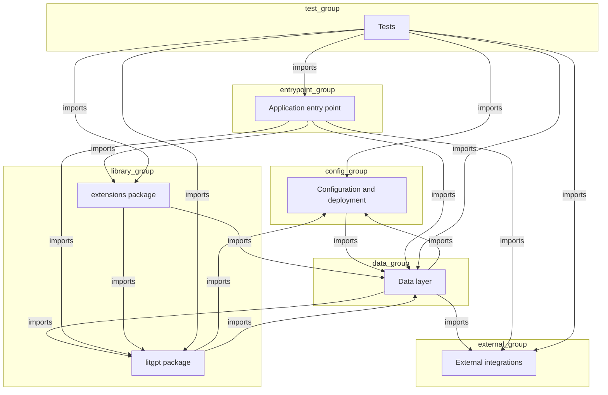

# Architecture report: Lightning-AI/litgpt

> Automated static analysis. **Observed** = directly seen in files/imports/AST; **Inferred** = interpretation from that evidence. Repository code was not executed.

## 1. Repository at a glance

| Item | Value |
| --- | --- |
| Repository | Lightning-AI/litgpt |
| Description | 20+ high-performance LLMs with recipes to pretrain, finetune and deploy at scale. |
| Language | Python |
| Stars | 13748 |
| Licence | Apache-2.0 |
| Analysed commit / branch | 5341568a65e918a85cb284fac038de2157eebf3f / main |
| Framework(s) | None detected |
| Files analysed | 237 |
| Components | 7 |

## 2. Architecture in one minute

Lightning-AI/litgpt - 20+ high-performance LLMs with recipes to pretrain, finetune and deploy at scale.. This repository was analysed statically from 237 file(s) (137 Python). Detected technologies (observed from imports/manifests): GitHub Actions, NumPy, pandas, requests, Poetry, setuptools. Files are grouped into 7 component(s): Configuration and deployment, Data layer, Application entry point, extensions package, External integrations, litgpt package, Tests. Observed entry point(s): extensions/thunder/pretrain.py, extensions/xla/finetune/adapter.py, extensions/xla/generate/adapter.py. Findings below distinguish observed facts from inferred interpretation.

## 3. High-level block diagram

## 4. Main components

### Configuration and deployment (`config`)

- **Kind:** config
- **Status:** Observed
- **Confidence:** 0.85
- **Responsibility:** Groups 49 file(s) under configuration and deployment (observed from repository paths and static analysis). Observed top-level classes: Config. Observed top-level functions: check_indicator_and_length, find_multiple.
- **Paths:** `config_hub/finetune/falcon-7b/lora.yaml`, `config_hub/finetune/falcon-7b/qlora.yaml`, `config_hub/finetune/gemma-2b/full.yaml`, `config_hub/finetune/gemma-2b/lora.yaml`, `config_hub/finetune/gemma-2b/qlora.yaml`, `config_hub/finetune/gemma-7b/lora.yaml`, `config_hub/finetune/gemma-7b/qlora.yaml`, `config_hub/finetune/gemma2-2b/lora.yaml`, `config_hub/finetune/gemma2-2b/qlora.yaml`, `config_hub/finetune/gemma2-9b/lora.yaml`, `config_hub/finetune/gemma2-9b/qlora.yaml`, `config_hub/finetune/llama-2-7b/full.yaml`, `config_hub/finetune/llama-2-7b/lora.yaml`, `config_hub/finetune/llama-2-7b/qlora.yaml`, `config_hub/finetune/llama-3-8b/full.yaml`, `config_hub/finetune/llama-3-8b/lora.yaml`, `config_hub/finetune/llama-3-8b/qlora.yaml`, `config_hub/finetune/llama-3.1-8b/full.yaml`, `config_hub/finetune/llama-3.1-8b/lora.yaml`, `config_hub/finetune/llama-3.1-8b/qlora.yaml`, `config_hub/finetune/llama-3.2-1B/full.yaml`, `config_hub/finetune/llama-3.2-1B/lora.yaml`, `config_hub/finetune/llama-3.2-1B/qlora.yaml`, `config_hub/finetune/llama-3.2-3B/full.yaml`, `config_hub/finetune/llama-3.2-3B/lora.yaml`, `config_hub/finetune/llama-3.2-3B/qlora.yaml`, `config_hub/finetune/mistral-7b-v0.2/lora.yaml`, `config_hub/finetune/mistral-7b-v0.2/qlora.yaml`, `config_hub/finetune/mistral-7b/lora.yaml`, `config_hub/finetune/mistral-7b/qlora.yaml`, `config_hub/finetune/phi-2/full.yaml`, `config_hub/finetune/phi-2/lora.yaml`, `config_hub/finetune/phi-2/qlora.yaml`, `config_hub/finetune/phi-3/full.yaml`, `config_hub/finetune/phi-3/lora.yaml`, `config_hub/finetune/phi-3/qlora.yaml`, `config_hub/finetune/stablelm-base-alpha-3b/full.yaml`, `config_hub/finetune/stablelm-base-alpha-3b/lora.yaml`, `config_hub/finetune/stablelm-base-alpha-3b/qlora.yaml`, `config_hub/finetune/tiny-llama/full.yaml`, `config_hub/finetune/tiny-llama/lora.yaml`, `config_hub/finetune/tiny-llama/qlora.yaml`, `config_hub/pretrain/debug.yaml`, `config_hub/pretrain/microllama.yaml`, `config_hub/pretrain/tinyllama.yaml`, `config_hub/pretrain/tinystories.yaml`, `litgpt/config.py`, `pyproject.toml`, `tutorials/mkdocs.yml`
- **Evidence:** [config_hub/finetune/falcon-7b/lora.yaml](https://github.com/Lightning-AI/litgpt/blob/5341568a65e918a85cb284fac038de2157eebf3f/config_hub/finetune/falcon-7b/lora.yaml); [config_hub/finetune/falcon-7b/qlora.yaml](https://github.com/Lightning-AI/litgpt/blob/5341568a65e918a85cb284fac038de2157eebf3f/config_hub/finetune/falcon-7b/qlora.yaml); [config_hub/finetune/gemma-2b/full.yaml](https://github.com/Lightning-AI/litgpt/blob/5341568a65e918a85cb284fac038de2157eebf3f/config_hub/finetune/gemma-2b/full.yaml); [config_hub/finetune/gemma-2b/lora.yaml](https://github.com/Lightning-AI/litgpt/blob/5341568a65e918a85cb284fac038de2157eebf3f/config_hub/finetune/gemma-2b/lora.yaml); [config_hub/finetune/gemma-2b/qlora.yaml](https://github.com/Lightning-AI/litgpt/blob/5341568a65e918a85cb284fac038de2157eebf3f/config_hub/finetune/gemma-2b/qlora.yaml); [config_hub/finetune/gemma-7b/lora.yaml](https://github.com/Lightning-AI/litgpt/blob/5341568a65e918a85cb284fac038de2157eebf3f/config_hub/finetune/gemma-7b/lora.yaml); [config_hub/finetune/gemma-7b/qlora.yaml](https://github.com/Lightning-AI/litgpt/blob/5341568a65e918a85cb284fac038de2157eebf3f/config_hub/finetune/gemma-7b/qlora.yaml); [config_hub/finetune/gemma2-2b/lora.yaml](https://github.com/Lightning-AI/litgpt/blob/5341568a65e918a85cb284fac038de2157eebf3f/config_hub/finetune/gemma2-2b/lora.yaml)

### Data layer (`data_layer`)

- **Kind:** data
- **Status:** Observed
- **Confidence:** 0.85
- **Responsibility:** Groups 17 file(s) under data layer (observed from repository paths and static analysis). Observed top-level classes: Alpaca, Alpaca2k, AlpacaGPT4, Block, CausalSelfAttention, DataModule. Observed top-level functions: _sft_collate_fn, _supported_subsets, _transform, apply_rope, apply_rope_interleave, batched_index_copy_.
- **Paths:** `litgpt/data/__init__.py`, `litgpt/data/alpaca.py`, `litgpt/data/alpaca_2k.py`, `litgpt/data/alpaca_gpt4.py`, `litgpt/data/base.py`, `litgpt/data/deita.py`, `litgpt/data/flan.py`, `litgpt/data/json_data.py`, `litgpt/data/lima.py`, `litgpt/data/lit_data.py`, `litgpt/data/longform.py`, `litgpt/data/microllama.py`, `litgpt/data/openwebtext.py`, `litgpt/data/text_files.py`, `litgpt/data/tinyllama.py`, `litgpt/data/tinystories.py`, `litgpt/model.py`
- **Evidence:** [litgpt/data/__init__.py](https://github.com/Lightning-AI/litgpt/blob/5341568a65e918a85cb284fac038de2157eebf3f/litgpt/data/__init__.py); [litgpt/data/alpaca.py:20](https://github.com/Lightning-AI/litgpt/blob/5341568a65e918a85cb284fac038de2157eebf3f/litgpt/data/alpaca.py#L20); [litgpt/data/alpaca_2k.py:12](https://github.com/Lightning-AI/litgpt/blob/5341568a65e918a85cb284fac038de2157eebf3f/litgpt/data/alpaca_2k.py#L12); [litgpt/data/alpaca_gpt4.py:13](https://github.com/Lightning-AI/litgpt/blob/5341568a65e918a85cb284fac038de2157eebf3f/litgpt/data/alpaca_gpt4.py#L13); [litgpt/data/base.py:16](https://github.com/Lightning-AI/litgpt/blob/5341568a65e918a85cb284fac038de2157eebf3f/litgpt/data/base.py#L16); [litgpt/data/deita.py:16](https://github.com/Lightning-AI/litgpt/blob/5341568a65e918a85cb284fac038de2157eebf3f/litgpt/data/deita.py#L16); [litgpt/data/flan.py:21](https://github.com/Lightning-AI/litgpt/blob/5341568a65e918a85cb284fac038de2157eebf3f/litgpt/data/flan.py#L21); [litgpt/data/json_data.py:18](https://github.com/Lightning-AI/litgpt/blob/5341568a65e918a85cb284fac038de2157eebf3f/litgpt/data/json_data.py#L18)

### Application entry point (`entrypoint`)

- **Kind:** entrypoint
- **Status:** Observed
- **Confidence:** 0.85
- **Responsibility:** Groups 11 file(s) under application entry point (observed from repository paths and static analysis). Observed top-level classes: LitLLM, SlimPajamaDataRecipe, StarcoderDataRecipe. Observed top-level functions: _check_commands, download_if_missing, fit, forward_and_loss, generate, generate_prompt.
- **Paths:** `extensions/thunder/pretrain.py`, `extensions/xla/finetune/adapter.py`, `extensions/xla/generate/adapter.py`, `extensions/xla/generate/base.py`, `extensions/xla/scripts/prepare_alpaca.py`, `litgpt/__main__.py`, `litgpt/data/prepare_slimpajama.py`, `litgpt/data/prepare_starcoder.py`, `tutorials/examples/ptl-trainer/litgpt_ptl_medium.py`, `tutorials/examples/ptl-trainer/litgpt_ptl_small.py`, `tutorials/full_finetune_example.py`
- **Evidence:** [extensions/thunder/pretrain.py:49](https://github.com/Lightning-AI/litgpt/blob/5341568a65e918a85cb284fac038de2157eebf3f/extensions/thunder/pretrain.py#L49); [extensions/xla/finetune/adapter.py:53](https://github.com/Lightning-AI/litgpt/blob/5341568a65e918a85cb284fac038de2157eebf3f/extensions/xla/finetune/adapter.py#L53); [extensions/xla/generate/adapter.py:24](https://github.com/Lightning-AI/litgpt/blob/5341568a65e918a85cb284fac038de2157eebf3f/extensions/xla/generate/adapter.py#L24); [extensions/xla/generate/base.py:26](https://github.com/Lightning-AI/litgpt/blob/5341568a65e918a85cb284fac038de2157eebf3f/extensions/xla/generate/base.py#L26); [extensions/xla/scripts/prepare_alpaca.py:18](https://github.com/Lightning-AI/litgpt/blob/5341568a65e918a85cb284fac038de2157eebf3f/extensions/xla/scripts/prepare_alpaca.py#L18); [litgpt/__main__.py:59](https://github.com/Lightning-AI/litgpt/blob/5341568a65e918a85cb284fac038de2157eebf3f/litgpt/__main__.py#L59); [litgpt/data/prepare_slimpajama.py:13](https://github.com/Lightning-AI/litgpt/blob/5341568a65e918a85cb284fac038de2157eebf3f/litgpt/data/prepare_slimpajama.py#L13); [litgpt/data/prepare_starcoder.py:18](https://github.com/Lightning-AI/litgpt/blob/5341568a65e918a85cb284fac038de2157eebf3f/litgpt/data/prepare_starcoder.py#L18)

### extensions package (`extensions`)

- **Kind:** library
- **Status:** Observed
- **Confidence:** 0.85
- **Responsibility:** Groups 12 file(s) under extensions package (observed from repository paths and static analysis). Observed top-level classes: ThunderDDPStrategy, ThunderFSDPStrategy, ThunderLLaMAMLP, _SyncGradsContextManager, _ThunderDataParalellBackwardSyncControl. Observed top-level functions: _DWf_DW_dfg_kernel, _chunked_cross_entropy_forward, _cross_entropy_backward, _cross_entropy_backward_impl, _cross_entropy_forward, _cross_entropy_forward_impl.
- **Paths:** `extensions/thunder/__init__.py`, `extensions/thunder/strategies/__init__.py`, `extensions/thunder/strategies/thunder_ddp.py`, `extensions/thunder/strategies/thunder_fsdp.py`, `extensions/thunder/unsloth/__init__.py`, `extensions/thunder/unsloth/executor.py`, `extensions/thunder/unsloth/kernels/__init__.py`, `extensions/thunder/unsloth/kernels/cross_entropy_loss.py`, `extensions/thunder/unsloth/kernels/rope_embedding.py`, `extensions/thunder/unsloth/kernels/swiglu.py`, `extensions/thunder/unsloth/kernels/utils.py`, `extensions/xla/utils.py`
- **Evidence:** [extensions/thunder/__init__.py](https://github.com/Lightning-AI/litgpt/blob/5341568a65e918a85cb284fac038de2157eebf3f/extensions/thunder/__init__.py); [extensions/thunder/strategies/__init__.py](https://github.com/Lightning-AI/litgpt/blob/5341568a65e918a85cb284fac038de2157eebf3f/extensions/thunder/strategies/__init__.py); [extensions/thunder/strategies/thunder_ddp.py:36](https://github.com/Lightning-AI/litgpt/blob/5341568a65e918a85cb284fac038de2157eebf3f/extensions/thunder/strategies/thunder_ddp.py#L36); [extensions/thunder/strategies/thunder_fsdp.py:47](https://github.com/Lightning-AI/litgpt/blob/5341568a65e918a85cb284fac038de2157eebf3f/extensions/thunder/strategies/thunder_fsdp.py#L47); [extensions/thunder/unsloth/__init__.py](https://github.com/Lightning-AI/litgpt/blob/5341568a65e918a85cb284fac038de2157eebf3f/extensions/thunder/unsloth/__init__.py); [extensions/thunder/unsloth/executor.py:35](https://github.com/Lightning-AI/litgpt/blob/5341568a65e918a85cb284fac038de2157eebf3f/extensions/thunder/unsloth/executor.py#L35); [extensions/thunder/unsloth/kernels/__init__.py](https://github.com/Lightning-AI/litgpt/blob/5341568a65e918a85cb284fac038de2157eebf3f/extensions/thunder/unsloth/kernels/__init__.py); [extensions/thunder/unsloth/kernels/cross_entropy_loss.py:27](https://github.com/Lightning-AI/litgpt/blob/5341568a65e918a85cb284fac038de2157eebf3f/extensions/thunder/unsloth/kernels/cross_entropy_loss.py#L27)

### External integrations (`external_integrations`)

- **Kind:** external
- **Status:** Inferred
- **Confidence:** 0.70
- **Responsibility:** Groups 0 file(s) under external integrations (observed from repository paths and static analysis).
- **Evidence:** [extensions/xla/scripts/prepare_alpaca.py:92](https://github.com/Lightning-AI/litgpt/blob/5341568a65e918a85cb284fac038de2157eebf3f/extensions/xla/scripts/prepare_alpaca.py#L92); [litgpt/data/alpaca.py:119](https://github.com/Lightning-AI/litgpt/blob/5341568a65e918a85cb284fac038de2157eebf3f/litgpt/data/alpaca.py#L119); [tests/test_readme.py:13](https://github.com/Lightning-AI/litgpt/blob/5341568a65e918a85cb284fac038de2157eebf3f/tests/test_readme.py#L13); [tests/test_readme.py:14](https://github.com/Lightning-AI/litgpt/blob/5341568a65e918a85cb284fac038de2157eebf3f/tests/test_readme.py#L14); [tests/test_serve.py:6](https://github.com/Lightning-AI/litgpt/blob/5341568a65e918a85cb284fac038de2157eebf3f/tests/test_serve.py#L6); [tests/test_serve.py:15](https://github.com/Lightning-AI/litgpt/blob/5341568a65e918a85cb284fac038de2157eebf3f/tests/test_serve.py#L15)

### litgpt package (`litgpt`)

- **Kind:** library
- **Status:** Observed
- **Confidence:** 0.85
- **Responsibility:** Groups 39 file(s) under litgpt package (observed from repository paths and static analysis). Observed top-level classes: AdapterV2Linear, Alpaca, BaseLitAPI, Block, CausalSelfAttention, ChatML. Observed top-level functions: CLI, _RunIf, _check_amd_connectivity, _check_nvidia_connectivity, adapter_filter, all_reduce_output.
- **Paths:** `litgpt/__init__.py`, `litgpt/adapter.py`, `litgpt/adapter_v2.py`, `litgpt/api.py`, `litgpt/args.py`, `litgpt/chat/__init__.py`, `litgpt/chat/base.py`, `litgpt/constants.py`, `litgpt/deploy/__init__.py`, `litgpt/deploy/serve.py`, `litgpt/eval/evaluate.py`, `litgpt/finetune/__init__.py`, `litgpt/finetune/adapter.py`, `litgpt/finetune/adapter_v2.py`, `litgpt/finetune/full.py`, `litgpt/finetune/lora.py`, `litgpt/finetune/lora_legacy.py`, `litgpt/generate/__init__.py`, `litgpt/generate/adapter.py`, `litgpt/generate/adapter_v2.py`, `litgpt/generate/base.py`, `litgpt/generate/full.py`, `litgpt/generate/sequentially.py`, `litgpt/generate/speculative_decoding.py`, `litgpt/generate/tp.py`, `litgpt/lora.py`, `litgpt/parser_config.py`, `litgpt/pretrain.py`, `litgpt/prompts.py`, `litgpt/scripts/__init__.py`, `litgpt/scripts/convert_hf_checkpoint.py`, `litgpt/scripts/convert_lit_checkpoint.py`, `litgpt/scripts/convert_pretrained_checkpoint.py`, `litgpt/scripts/download.py`, `litgpt/scripts/merge_lora.py`, `litgpt/scripts/validate.py`, `litgpt/tokenizer.py`, `litgpt/types.py`, `litgpt/utils.py`
- **Evidence:** [litgpt/__init__.py](https://github.com/Lightning-AI/litgpt/blob/5341568a65e918a85cb284fac038de2157eebf3f/litgpt/__init__.py); [litgpt/adapter.py:25](https://github.com/Lightning-AI/litgpt/blob/5341568a65e918a85cb284fac038de2157eebf3f/litgpt/adapter.py#L25); [litgpt/adapter_v2.py:28](https://github.com/Lightning-AI/litgpt/blob/5341568a65e918a85cb284fac038de2157eebf3f/litgpt/adapter_v2.py#L28); [litgpt/api.py:38](https://github.com/Lightning-AI/litgpt/blob/5341568a65e918a85cb284fac038de2157eebf3f/litgpt/api.py#L38); [litgpt/args.py:8](https://github.com/Lightning-AI/litgpt/blob/5341568a65e918a85cb284fac038de2157eebf3f/litgpt/args.py#L8); [litgpt/chat/__init__.py](https://github.com/Lightning-AI/litgpt/blob/5341568a65e918a85cb284fac038de2157eebf3f/litgpt/chat/__init__.py); [litgpt/chat/base.py:29](https://github.com/Lightning-AI/litgpt/blob/5341568a65e918a85cb284fac038de2157eebf3f/litgpt/chat/base.py#L29); [litgpt/constants.py](https://github.com/Lightning-AI/litgpt/blob/5341568a65e918a85cb284fac038de2157eebf3f/litgpt/constants.py)

### Tests (`tests`)

- **Kind:** test
- **Status:** Observed
- **Confidence:** 0.85
- **Responsibility:** Groups 61 file(s) under tests (observed from repository paths and static analysis). Observed routes: PATCH litgpt.data.deita.format_dataset, PATCH datasets.load_dataset, PATCH litgpt.data.lit_data.LitData._dataloader, PATCH litdata.streaming.StreamingDataset, PATCH litdata.streaming.StreamingDataLoader. Observed top-level classes: CustomPromptStyle, FloatLike, LitLLM, MockTokenizer, MyModel, StatefulThing. Observed top-level functions: _find_free_port, _is_hf_skip_error, _log_tail, _prepare_checkpoint, _serve, _terminate.
- **Paths:** `tests/conftest.py`, `tests/convert/__init__.py`, `tests/convert/test_hf_checkpoint.py`, `tests/convert/test_lit_checkpoint.py`, `tests/convert/test_pretrained_checkpoint.py`, `tests/data/__init__.py`, `tests/data/_fixtures/alpaca.json`, `tests/data/_fixtures/dolly.json`, `tests/data/_fixtures/longform_train.json`, `tests/data/_fixtures/longform_val.json`, `tests/data/test_alpaca.py`, `tests/data/test_base.py`, `tests/data/test_deita.py`, `tests/data/test_json.py`, `tests/data/test_lit_data.py`, `tests/data/test_longform.py`, `tests/data/test_openwebtext.py`, `tests/data/test_textfiles.py`, `tests/data/test_tinyllama.py`, `tests/data/test_tinystories.py`, `tests/ext_thunder/__init__.py`, `tests/ext_thunder/test_thunder_distributed.py`, `tests/ext_thunder/test_thunder_networks.py`, `tests/ext_thunder/test_thunder_pretrain.py`, `tests/ext_thunder/test_unsloth_executor.py`, `tests/generate/__init__.py`, `tests/generate/test_adapter.py`, `tests/generate/test_main.py`, `tests/generate/test_sequentially.py`, `tests/generate/test_tp.py`, `tests/generate/utils.py`, `tests/test_adapter.py`, `tests/test_adapter_v2.py`, `tests/test_api.py`, `tests/test_args.py`, `tests/test_batch.py`, `tests/test_chat.py`, `tests/test_ci.py`, `tests/test_cli.py`, `tests/test_config.py`, `tests/test_config_hub.py`, `tests/test_deepseek_moe.py`, `tests/test_distributed.py`, `tests/test_evaluate.py`, `tests/test_full.py`, `tests/test_generate_speculatively.py`, `tests/test_lora.py`, `tests/test_merge_lora.py`, `tests/test_model.py`, `tests/test_multihead_latent_attention.py`, `tests/test_pretrain.py`, `tests/test_prompts.py`, `tests/test_readme.py`, `tests/test_rope.py`, `tests/test_serve.py`, `tests/test_tokenizer.py`, `tests/test_trainer_support.py`, `tests/test_types.py`, `tests/test_utils.py`, `tests/test_validate.py`, `tests/test_yarn.py`
- **Evidence:** [tests/conftest.py:23](https://github.com/Lightning-AI/litgpt/blob/5341568a65e918a85cb284fac038de2157eebf3f/tests/conftest.py#L23); [tests/convert/__init__.py](https://github.com/Lightning-AI/litgpt/blob/5341568a65e918a85cb284fac038de2157eebf3f/tests/convert/__init__.py); [tests/convert/test_hf_checkpoint.py:12](https://github.com/Lightning-AI/litgpt/blob/5341568a65e918a85cb284fac038de2157eebf3f/tests/convert/test_hf_checkpoint.py#L12); [tests/convert/test_lit_checkpoint.py:42](https://github.com/Lightning-AI/litgpt/blob/5341568a65e918a85cb284fac038de2157eebf3f/tests/convert/test_lit_checkpoint.py#L42); [tests/convert/test_pretrained_checkpoint.py:10](https://github.com/Lightning-AI/litgpt/blob/5341568a65e918a85cb284fac038de2157eebf3f/tests/convert/test_pretrained_checkpoint.py#L10); [tests/data/__init__.py](https://github.com/Lightning-AI/litgpt/blob/5341568a65e918a85cb284fac038de2157eebf3f/tests/data/__init__.py); [tests/data/_fixtures/alpaca.json](https://github.com/Lightning-AI/litgpt/blob/5341568a65e918a85cb284fac038de2157eebf3f/tests/data/_fixtures/alpaca.json); [tests/data/_fixtures/dolly.json](https://github.com/Lightning-AI/litgpt/blob/5341568a65e918a85cb284fac038de2157eebf3f/tests/data/_fixtures/dolly.json)

## 5. Execution flow

**Observed** entry point(s):

- [extensions/thunder/pretrain.py:517](https://github.com/Lightning-AI/litgpt/blob/5341568a65e918a85cb284fac038de2157eebf3f/extensions/thunder/pretrain.py#L517)
- [extensions/xla/finetune/adapter.py:281](https://github.com/Lightning-AI/litgpt/blob/5341568a65e918a85cb284fac038de2157eebf3f/extensions/xla/finetune/adapter.py#L281)
- [extensions/xla/generate/adapter.py:129](https://github.com/Lightning-AI/litgpt/blob/5341568a65e918a85cb284fac038de2157eebf3f/extensions/xla/generate/adapter.py#L129)
- [extensions/xla/generate/base.py:181](https://github.com/Lightning-AI/litgpt/blob/5341568a65e918a85cb284fac038de2157eebf3f/extensions/xla/generate/base.py#L181)
- [extensions/xla/scripts/prepare_alpaca.py:145](https://github.com/Lightning-AI/litgpt/blob/5341568a65e918a85cb284fac038de2157eebf3f/extensions/xla/scripts/prepare_alpaca.py#L145)
- [litgpt/__main__.py](https://github.com/Lightning-AI/litgpt/blob/5341568a65e918a85cb284fac038de2157eebf3f/litgpt/__main__.py)
- [litgpt/data/prepare_slimpajama.py:62](https://github.com/Lightning-AI/litgpt/blob/5341568a65e918a85cb284fac038de2157eebf3f/litgpt/data/prepare_slimpajama.py#L62)
- [litgpt/data/prepare_starcoder.py:78](https://github.com/Lightning-AI/litgpt/blob/5341568a65e918a85cb284fac038de2157eebf3f/litgpt/data/prepare_starcoder.py#L78)
- [tutorials/full_finetune_example.py:114](https://github.com/Lightning-AI/litgpt/blob/5341568a65e918a85cb284fac038de2157eebf3f/tutorials/full_finetune_example.py#L114)

**Observed** routes (from decorators):

- `PATCH litgpt.data.deita.format_dataset` -> `test_deita` in `tests/data/test_deita.py:47`
- `PATCH datasets.load_dataset` -> `test_deita` in `tests/data/test_deita.py:47`
- `PATCH litgpt.data.lit_data.LitData._dataloader` -> `test_input_dir_and_splits` in `tests/data/test_lit_data.py:13`
- `PATCH litdata.streaming.StreamingDataset` -> `test_dataset_args` in `tests/data/test_lit_data.py:42`
- `PATCH litdata.streaming.StreamingDataLoader` -> `test_dataset_args` in `tests/data/test_lit_data.py:42`
- `PATCH litdata.optimize` -> `test_openwebtext` in `tests/data/test_openwebtext.py:17`
- `PATCH litdata.streaming.dataset.subsample_streaming_dataset` -> `test_openwebtext` in `tests/data/test_openwebtext.py:17`
- `PATCH datasets.load_dataset` -> `test_openwebtext` in `tests/data/test_openwebtext.py:17`
- `PATCH litdata.streaming.dataset.subsample_streaming_dataset` -> `test_tinyllama` in `tests/data/test_tinyllama.py:12`
- `PATCH litgpt.chat.base.input` -> `test_main` in `tests/test_chat.py:94`
- `PATCH litgpt.chat.base.input` -> `test_merge_lora_if_needed` in `tests/test_chat.py:144`
- `PATCH litgpt.chat.base.merge_lora` -> `test_merge_lora_if_needed` in `tests/test_chat.py:144`
- `PATCH litgpt.pretrain.save_hyperparameters` -> `test_optimizer_args` in `tests/test_pretrain.py:23`
- `PATCH litgpt.pretrain.save_hyperparameters` -> `test_pretrain` in `tests/test_pretrain.py:49`
- `PATCH litgpt.pretrain.L.Fabric.load_raw` -> `test_initial_checkpoint_dir` in `tests/test_pretrain.py:93`
- `PATCH litgpt.pretrain.save_hyperparameters` -> `test_initial_checkpoint_dir` in `tests/test_pretrain.py:93`
- `PATCH subprocess.run` -> `test_all_nvlink_connected` in `tests/test_utils.py:527`
- `PATCH subprocess.run` -> `test_nvlink_partially_connected_output` in `tests/test_utils.py:554`
- `PATCH subprocess.run` -> `test_nvlink_not_connected_output` in `tests/test_utils.py:589`
- `PATCH subprocess.run` -> `test_nvlink_all_gpu_connected_but_other_connected_output` in `tests/test_utils.py:653`
- `PATCH subprocess.run` -> `test_check_nvlink_connectivity__returns_fully_connected_when_nvidia_all_nvlink_…` in `tests/test_utils.py:688`
- `PATCH subprocess.run` -> `test_check_nvlink_connectivity__returns_fully_connected_when_amd_all_xgmi_8_gpus` in `tests/test_utils.py:722`
- `PATCH subprocess.run` -> `test_check_nvlink_connectivity__returns_no_gpus_when_no_gpus` in `tests/test_utils.py:732`
- `PATCH subprocess.run` -> `test_check_nvlink_connectivity__returns_unrecognized_vendor_when_unrecognized_v…` in `tests/test_utils.py:740`

Representative flow (derived from observed entry points and the import graph; steps beyond the entry point are **Inferred**):

1. Execution starts at an observed entry point listed above, if present.
2. `config` imports `data_layer` (Configuration and deployment -> Data layer).
3. `data_layer` imports `config` (Data layer -> Configuration and deployment).
4. `data_layer` imports `external_integrations` (Data layer -> External integrations).
5. `data_layer` imports `litgpt` (Data layer -> litgpt package).
6. `entrypoint` imports `data_layer` (Application entry point -> Data layer).
7. `entrypoint` imports `extensions` (Application entry point -> extensions package).
8. `entrypoint` imports `external_integrations` (Application entry point -> External integrations).
9. `entrypoint` imports `litgpt` (Application entry point -> litgpt package).

## 6. Project structure

### `(root)`

- `.gitignore` - other (294 bytes)
- `.pre-commit-config.yaml` - config (2554 bytes)
- `CITATION.cff` - other (335 bytes)
- `CODE_OF_CONDUCT.md` - docs (3356 bytes)
- `CONTRIBUTING.md` - docs (1665 bytes)
- `LICENSE.md` - docs (11344 bytes)
- `README.md` - docs (31447 bytes)
- `pyproject.toml` - manifest (4014 bytes)

### `.devcontainer`

- `.devcontainer/Dockerfile` - container (803 bytes)
- `.devcontainer/devcontainer.json` - config (4042 bytes)

### `.github`

- `.github/CODEOWNERS` - other (762 bytes)
- `.github/ISSUE_TEMPLATE/ask-a-question.md` - docs (144 bytes)
- `.github/ISSUE_TEMPLATE/bug-report.yaml` - config (1792 bytes)
- `.github/ISSUE_TEMPLATE/feature-request.md` - docs (184 bytes)
- `.github/dependabot.yml` - config (1283 bytes)
- `.github/workflows/check-links.yml` - ci, YAML (918 bytes)
- `.github/workflows/cpu-tests.yml` - ci, YAML (4740 bytes)
- `.github/workflows/mkdocs-deploy.yml` - ci, YAML (975 bytes)
- `.github/workflows/publish-pkg.yml` - ci, YAML (2246 bytes)

### `.lightning`

- `.lightning/workflows/tests.yaml` - config (2986 bytes)

### `config_hub`

- `config_hub/finetune/README.md` - docs (17392 bytes)
- `config_hub/finetune/falcon-7b/lora.yaml` - config (4228 bytes)
- `config_hub/finetune/falcon-7b/qlora.yaml` - config (4280 bytes)
- `config_hub/finetune/gemma-2b/full.yaml` - config (3217 bytes)
- `config_hub/finetune/gemma-2b/lora.yaml` - config (4252 bytes)
- `config_hub/finetune/gemma-2b/qlora.yaml` - config (4262 bytes)
- `config_hub/finetune/gemma-7b/lora.yaml` - config (4254 bytes)
- `config_hub/finetune/gemma-7b/qlora.yaml` - config (4262 bytes)
- `config_hub/finetune/gemma2-2b/lora.yaml` - config (4256 bytes)
- `config_hub/finetune/gemma2-2b/qlora.yaml` - config (4266 bytes)
- `config_hub/finetune/gemma2-9b/lora.yaml` - config (4257 bytes)
- `config_hub/finetune/gemma2-9b/qlora.yaml` - config (4266 bytes)
- `config_hub/finetune/llama-2-7b/full.yaml` - config (3573 bytes)
- `config_hub/finetune/llama-2-7b/lora.yaml` - config (4236 bytes)
- `config_hub/finetune/llama-2-7b/qlora.yaml` - config (4288 bytes)
- `config_hub/finetune/llama-3-8b/full.yaml` - config (3576 bytes)
- `config_hub/finetune/llama-3-8b/lora.yaml` - config (4239 bytes)
- `config_hub/finetune/llama-3-8b/qlora.yaml` - config (4290 bytes)
- `config_hub/finetune/llama-3.1-8b/full.yaml` - config (3580 bytes)
- `config_hub/finetune/llama-3.1-8b/lora.yaml` - config (4243 bytes)
- `config_hub/finetune/llama-3.1-8b/qlora.yaml` - config (4294 bytes)
- `config_hub/finetune/llama-3.2-1B/full.yaml` - config (3577 bytes)
- `config_hub/finetune/llama-3.2-1B/lora.yaml` - config (4238 bytes)
- `config_hub/finetune/llama-3.2-1B/qlora.yaml` - config (4289 bytes)
- `config_hub/finetune/llama-3.2-3B/full.yaml` - config (3577 bytes)
- `config_hub/finetune/llama-3.2-3B/lora.yaml` - config (4238 bytes)
- `config_hub/finetune/llama-3.2-3B/qlora.yaml` - config (4289 bytes)
- `config_hub/finetune/mistral-7b-v0.2/lora.yaml` - config (4236 bytes)
- `config_hub/finetune/mistral-7b-v0.2/qlora.yaml` - config (4288 bytes)
- `config_hub/finetune/mistral-7b/lora.yaml` - config (4238 bytes)
- `config_hub/finetune/mistral-7b/qlora.yaml` - config (4290 bytes)
- `config_hub/finetune/phi-2/full.yaml` - config (3189 bytes)
- `config_hub/finetune/phi-2/lora.yaml` - config (4250 bytes)
- `config_hub/finetune/phi-2/qlora.yaml` - config (4259 bytes)
- `config_hub/finetune/phi-3/full.yaml` - config (3139 bytes)
- `config_hub/finetune/phi-3/lora.yaml` - config (4204 bytes)
- `config_hub/finetune/phi-3/qlora.yaml` - config (4213 bytes)
- `config_hub/finetune/stablelm-base-alpha-3b/full.yaml` - config (3247 bytes)
- `config_hub/finetune/stablelm-base-alpha-3b/lora.yaml` - config (4259 bytes)
- `config_hub/finetune/stablelm-base-alpha-3b/qlora.yaml` - config (4311 bytes)
- `config_hub/finetune/tiny-llama/full.yaml` - config (3258 bytes)
- `config_hub/finetune/tiny-llama/lora.yaml` - config (4297 bytes)
- `config_hub/finetune/tiny-llama/qlora.yaml` - config (4306 bytes)
- `config_hub/pretrain/debug.yaml` - config (4129 bytes)
- `config_hub/pretrain/microllama.yaml` - config (4281 bytes)
- `config_hub/pretrain/tinyllama.yaml` - config (4153 bytes)
- `config_hub/pretrain/tinystories.yaml` - config (4498 bytes)

### `extensions`

- `extensions/thunder/README.md` - docs (30716 bytes)
- `extensions/thunder/__init__.py` - source, Python (194 bytes)
- `extensions/thunder/pretrain.py` - source, Python (20360 bytes)
- `extensions/thunder/strategies/__init__.py` - source, Python (118 bytes)
- `extensions/thunder/strategies/thunder_ddp.py` - source, Python (10115 bytes)
- `extensions/thunder/strategies/thunder_fsdp.py` - source, Python (20966 bytes)
- `extensions/thunder/unsloth/__init__.py` - source, Python (0 bytes)
- `extensions/thunder/unsloth/executor.py` - source, Python (8720 bytes)
- `extensions/thunder/unsloth/kernels/__init__.py` - source, Python (352 bytes)
- `extensions/thunder/unsloth/kernels/cross_entropy_loss.py` - source, Python (8170 bytes)
- `extensions/thunder/unsloth/kernels/rope_embedding.py` - source, Python (4531 bytes)
- `extensions/thunder/unsloth/kernels/swiglu.py` - source, Python (3465 bytes)
- `extensions/thunder/unsloth/kernels/utils.py` - source, Python (1255 bytes)
- `extensions/xla/README.md` - docs (7758 bytes)
- `extensions/xla/__init__` - other (194 bytes)
- `extensions/xla/finetune/__init__` - other (0 bytes)
- `extensions/xla/finetune/adapter.py` - source, Python (11867 bytes)
- `extensions/xla/generate/__init__` - other (0 bytes)
- `extensions/xla/generate/adapter.py` - source, Python (4820 bytes)
- `extensions/xla/generate/base.py` - source, Python (6823 bytes)
- `extensions/xla/scripts/__init__` - other (0 bytes)
- `extensions/xla/scripts/prepare_alpaca.py` - source, Python (5628 bytes)
- `extensions/xla/utils.py` - source, Python (5158 bytes)

### `litgpt`

- `litgpt/__init__.py` - source, Python (1091 bytes)
- `litgpt/__main__.py` - source, Python (3450 bytes)
- `litgpt/adapter.py` - source, Python (5330 bytes)
- `litgpt/adapter_v2.py` - source, Python (8905 bytes)
- `litgpt/api.py` - source, Python (31289 bytes)
- `litgpt/args.py` - source, Python (4926 bytes)
- `litgpt/chat/__init__.py` - source, Python (0 bytes)
- `litgpt/chat/base.py` - source, Python (10772 bytes)
- `litgpt/config.py` - source, Python (102207 bytes)
- `litgpt/constants.py` - source, Python (1387 bytes)
- `litgpt/data/__init__.py` - source, Python (1036 bytes)
- `litgpt/data/alpaca.py` - source, Python (5743 bytes)
- `litgpt/data/alpaca_2k.py` - source, Python (2013 bytes)
- `litgpt/data/alpaca_gpt4.py` - source, Python (950 bytes)
- `litgpt/data/base.py` - source, Python (6298 bytes)
- `litgpt/data/deita.py` - source, Python (4602 bytes)
- `litgpt/data/flan.py` - source, Python (6875 bytes)
- `litgpt/data/json_data.py` - source, Python (6481 bytes)
- `litgpt/data/lima.py` - source, Python (5388 bytes)
- `litgpt/data/lit_data.py` - source, Python (2831 bytes)
- `litgpt/data/longform.py` - source, Python (3429 bytes)
- `litgpt/data/microllama.py` - source, Python (508 bytes)
- `litgpt/data/openwebtext.py` - source, Python (4339 bytes)
- `litgpt/data/prepare_slimpajama.py` - source, Python (2087 bytes)
- `litgpt/data/prepare_starcoder.py` - source, Python (2401 bytes)
- `litgpt/data/text_files.py` - source, Python (6176 bytes)
- `litgpt/data/tinyllama.py` - source, Python (4263 bytes)
- `litgpt/data/tinystories.py` - source, Python (5648 bytes)
- `litgpt/deploy/__init__.py` - source, Python (0 bytes)
- `litgpt/deploy/serve.py` - source, Python (11952 bytes)
- `litgpt/eval/evaluate.py` - source, Python (4738 bytes)
- `litgpt/finetune/__init__.py` - source, Python (0 bytes)
- `litgpt/finetune/adapter.py` - source, Python (20409 bytes)
- `litgpt/finetune/adapter_v2.py` - source, Python (21432 bytes)
- `litgpt/finetune/full.py` - source, Python (18875 bytes)
- `litgpt/finetune/lora.py` - source, Python (23243 bytes)
- `litgpt/finetune/lora_legacy.py` - source, Python (21380 bytes)
- `litgpt/generate/__init__.py` - source, Python (0 bytes)
- `litgpt/generate/adapter.py` - source, Python (6488 bytes)
- `litgpt/generate/adapter_v2.py` - source, Python (6509 bytes)
- `litgpt/generate/base.py` - source, Python (24053 bytes)
- `litgpt/generate/full.py` - source, Python (6265 bytes)
- `litgpt/generate/sequentially.py` - source, Python (13237 bytes)
- `litgpt/generate/speculative_decoding.py` - source, Python (20460 bytes)
- `litgpt/generate/tp.py` - source, Python (11653 bytes)
- `litgpt/lora.py` - source, Python (31166 bytes)
- `litgpt/model.py` - source, Python (60984 bytes)
- `litgpt/parser_config.py` - source, Python (1614 bytes)
- `litgpt/pretrain.py` - source, Python (21068 bytes)
- `litgpt/prompts.py` - source, Python (23484 bytes)
- `litgpt/scripts/__init__.py` - source, Python (0 bytes)
- `litgpt/scripts/convert_hf_checkpoint.py` - source, Python (41519 bytes)
- `litgpt/scripts/convert_lit_checkpoint.py` - source, Python (27224 bytes)
- `litgpt/scripts/convert_pretrained_checkpoint.py` - source, Python (2202 bytes)
- `litgpt/scripts/download.py` - source, Python (6067 bytes)
- `litgpt/scripts/merge_lora.py` - source, Python (4636 bytes)
- `litgpt/scripts/validate.py` - source, Python (5710 bytes)
- `litgpt/tokenizer.py` - source, Python (8683 bytes)
- `litgpt/types.py` - source, Python (583 bytes)
- `litgpt/utils.py` - source, Python (44369 bytes)

### `tests`

- `tests/conftest.py` - test, Python (6854 bytes)
- `tests/convert/__init__.py` - test, Python (0 bytes)
- `tests/convert/test_hf_checkpoint.py` - test, Python (9887 bytes)
- `tests/convert/test_lit_checkpoint.py` - test, Python (29296 bytes)
- `tests/convert/test_pretrained_checkpoint.py` - test, Python (1076 bytes)
- `tests/data/__init__.py` - test, Python (0 bytes)
- `tests/data/_fixtures/alpaca.json` - test (11762 bytes)
- `tests/data/_fixtures/dolly.json` - test (16066 bytes)
- `tests/data/_fixtures/longform_train.json` - test (26457 bytes)
- `tests/data/_fixtures/longform_val.json` - test (31861 bytes)
- `tests/data/test_alpaca.py` - test, Python (1349 bytes)
- `tests/data/test_base.py` - test, Python (3950 bytes)
- `tests/data/test_deita.py` - test, Python (2773 bytes)
- `tests/data/test_json.py` - test, Python (5114 bytes)
- `tests/data/test_lit_data.py` - test, Python (2175 bytes)
- `tests/data/test_longform.py` - test, Python (1326 bytes)
- `tests/data/test_openwebtext.py` - test, Python (2202 bytes)
- `tests/data/test_textfiles.py` - test, Python (3738 bytes)
- `tests/data/test_tinyllama.py` - test, Python (1470 bytes)
- `tests/data/test_tinystories.py` - test, Python (2961 bytes)
- `tests/ext_thunder/__init__.py` - test, Python (314 bytes)
- `tests/ext_thunder/test_thunder_distributed.py` - test, Python (16100 bytes)
- `tests/ext_thunder/test_thunder_networks.py` - test, Python (255 bytes)
- `tests/ext_thunder/test_thunder_pretrain.py` - test, Python (1983 bytes)
- `tests/ext_thunder/test_unsloth_executor.py` - test, Python (5102 bytes)
- `tests/generate/__init__.py` - test, Python (0 bytes)
- `tests/generate/test_adapter.py` - test, Python (2882 bytes)
- `tests/generate/test_main.py` - test, Python (6336 bytes)
- `tests/generate/test_sequentially.py` - test, Python (11936 bytes)
- `tests/generate/test_tp.py` - test, Python (5470 bytes)
- `tests/generate/utils.py` - test, Python (558 bytes)
- `tests/test_adapter.py` - test, Python (18030 bytes)
- `tests/test_adapter_v2.py` - test, Python (22912 bytes)
- `tests/test_api.py` - test, Python (16260 bytes)
- `tests/test_args.py` - test, Python (1953 bytes)
- `tests/test_batch.py` - test, Python (9929 bytes)
- `tests/test_chat.py` - test, Python (7826 bytes)
- `tests/test_ci.py` - test, Python (334 bytes)
- `tests/test_cli.py` - test, Python (2736 bytes)
- `tests/test_config.py` - test, Python (4190 bytes)
- `tests/test_config_hub.py` - test, Python (2614 bytes)
- `tests/test_deepseek_moe.py` - test, Python (4059 bytes)
- `tests/test_distributed.py` - test, Python (1657 bytes)
- `tests/test_evaluate.py` - test, Python (2750 bytes)
- `tests/test_full.py` - test, Python (2937 bytes)
- `tests/test_generate_speculatively.py` - test, Python (8197 bytes)
- `tests/test_lora.py` - test, Python (45072 bytes)
- `tests/test_merge_lora.py` - test, Python (3924 bytes)
- `tests/test_model.py` - test, Python (65305 bytes)
- `tests/test_multihead_latent_attention.py` - test, Python (4998 bytes)
- `tests/test_pretrain.py` - test, Python (5161 bytes)
- `tests/test_prompts.py` - test, Python (7731 bytes)
- `tests/test_readme.py` - test, Python (8846 bytes)
- `tests/test_rope.py` - test, Python (11814 bytes)
- `tests/test_serve.py` - test, Python (8477 bytes)
- `tests/test_tokenizer.py` - test, Python (6851 bytes)
- `tests/test_trainer_support.py` - test, Python (5130 bytes)
- `tests/test_types.py` - test, Python (664 bytes)
- `tests/test_utils.py` - test, Python (33821 bytes)
- `tests/test_validate.py` - test, Python (12347 bytes)
- `tests/test_yarn.py` - test, Python (7950 bytes)

### `tutorials`

- `tutorials/0_to_litgpt.md` - docs (24465 bytes)
- `tutorials/convert_hf_checkpoint.md` - docs (1569 bytes)
- `tutorials/convert_lit_models.md` - docs (4139 bytes)
- `tutorials/deploy.md` - docs (3877 bytes)
- `tutorials/developer-docs/README.md` - docs (38 bytes)
- `tutorials/developer-docs/adding-models.md` - docs (8001 bytes)
- `tutorials/developer-docs/python-api.md` - docs (1831 bytes)
- `tutorials/download_model_weights.md` - docs (19979 bytes)
- `tutorials/evaluation.md` - docs (6723 bytes)
- `tutorials/examples/ptl-trainer/README.md` - docs (598 bytes)
- `tutorials/examples/ptl-trainer/litgpt_ptl_medium.py` - source, Python (1875 bytes)
- `tutorials/examples/ptl-trainer/litgpt_ptl_small.py` - source, Python (5049 bytes)
- `tutorials/finetune.md` - docs (2880 bytes)
- `tutorials/finetune_adapter.md` - docs (5804 bytes)
- `tutorials/finetune_full.md` - docs (3487 bytes)
- `tutorials/finetune_lora.md` - docs (7085 bytes)
- `tutorials/full_finetune_example.py` - source, Python (4242 bytes)
- `tutorials/inference.md` - docs (4709 bytes)
- `tutorials/mkdocs.yml` - config (76 bytes)
- `tutorials/oom.md` - docs (4742 bytes)
- `tutorials/prepare_dataset.md` - docs (23398 bytes)
- `tutorials/pretrain.md` - docs (10224 bytes)
- `tutorials/pretrain_tinyllama.md` - docs (12161 bytes)
- `tutorials/python-api.md` - docs (16457 bytes)
- `tutorials/quantize.md` - docs (4807 bytes)
- `tutorials/resource-tables.md` - docs (13497 bytes)

## 7. Key dependencies and integrations

| Name | Category | Status | Confidence | Evidence |
| --- | --- | --- | --- | --- |
| GitHub Actions | ci | Observed | 0.90 | [.github/workflows/check-links.yml](https://github.com/Lightning-AI/litgpt/blob/5341568a65e918a85cb284fac038de2157eebf3f/.github/workflows/check-links.yml); [.github/workflows/cpu-tests.yml](https://github.com/Lightning-AI/litgpt/blob/5341568a65e918a85cb284fac038de2157eebf3f/.github/workflows/cpu-tests.yml); [.github/workflows/mkdocs-deploy.yml](https://github.com/Lightning-AI/litgpt/blob/5341568a65e918a85cb284fac038de2157eebf3f/.github/workflows/mkdocs-deploy.yml); [.github/workflows/publish-pkg.yml](https://github.com/Lightning-AI/litgpt/blob/5341568a65e918a85cb284fac038de2157eebf3f/.github/workflows/publish-pkg.yml) |
| NumPy | library | Observed | 0.90 | [litgpt/api.py:11](https://github.com/Lightning-AI/litgpt/blob/5341568a65e918a85cb284fac038de2157eebf3f/litgpt/api.py#L11) |
| pandas | library | Observed | 0.85 | [pyproject.toml:64](https://github.com/Lightning-AI/litgpt/blob/5341568a65e918a85cb284fac038de2157eebf3f/pyproject.toml#L64) |
| requests | library | Observed | 0.95 | [extensions/xla/scripts/prepare_alpaca.py:92](https://github.com/Lightning-AI/litgpt/blob/5341568a65e918a85cb284fac038de2157eebf3f/extensions/xla/scripts/prepare_alpaca.py#L92); [litgpt/data/alpaca.py:119](https://github.com/Lightning-AI/litgpt/blob/5341568a65e918a85cb284fac038de2157eebf3f/litgpt/data/alpaca.py#L119); [pyproject.toml:32](https://github.com/Lightning-AI/litgpt/blob/5341568a65e918a85cb284fac038de2157eebf3f/pyproject.toml#L32); [tests/test_readme.py:13](https://github.com/Lightning-AI/litgpt/blob/5341568a65e918a85cb284fac038de2157eebf3f/tests/test_readme.py#L13) |
| Poetry | packaging | Observed | 0.85 | [pyproject.toml](https://github.com/Lightning-AI/litgpt/blob/5341568a65e918a85cb284fac038de2157eebf3f/pyproject.toml) |
| setuptools | packaging | Observed | 0.85 | [pyproject.toml:2](https://github.com/Lightning-AI/litgpt/blob/5341568a65e918a85cb284fac038de2157eebf3f/pyproject.toml#L2) |
| Docker | tooling | Observed | 0.85 | [.devcontainer/Dockerfile](https://github.com/Lightning-AI/litgpt/blob/5341568a65e918a85cb284fac038de2157eebf3f/.devcontainer/Dockerfile) |
| pytest | tooling | Observed | 0.95 | [.github/workflows/check-links.yml:27](https://github.com/Lightning-AI/litgpt/blob/5341568a65e918a85cb284fac038de2157eebf3f/.github/workflows/check-links.yml#L27); [.github/workflows/cpu-tests.yml:77](https://github.com/Lightning-AI/litgpt/blob/5341568a65e918a85cb284fac038de2157eebf3f/.github/workflows/cpu-tests.yml#L77); [litgpt/utils.py:899](https://github.com/Lightning-AI/litgpt/blob/5341568a65e918a85cb284fac038de2157eebf3f/litgpt/utils.py#L899); [pyproject.toml:80](https://github.com/Lightning-AI/litgpt/blob/5341568a65e918a85cb284fac038de2157eebf3f/pyproject.toml#L80) |
| unittest | tooling | Observed | 0.95 | [tests/convert/test_hf_checkpoint.py:3](https://github.com/Lightning-AI/litgpt/blob/5341568a65e918a85cb284fac038de2157eebf3f/tests/convert/test_hf_checkpoint.py#L3); [tests/convert/test_lit_checkpoint.py:5](https://github.com/Lightning-AI/litgpt/blob/5341568a65e918a85cb284fac038de2157eebf3f/tests/convert/test_lit_checkpoint.py#L5); [tests/data/test_deita.py:2](https://github.com/Lightning-AI/litgpt/blob/5341568a65e918a85cb284fac038de2157eebf3f/tests/data/test_deita.py#L2); [tests/data/test_lit_data.py:3](https://github.com/Lightning-AI/litgpt/blob/5341568a65e918a85cb284fac038de2157eebf3f/tests/data/test_lit_data.py#L3) |

## 8. Data and state

- Data component `data_layer` (Observed): Groups 17 file(s) under data layer (observed from repository paths and static analysis). Observed top-level classes: Alpaca, Alpaca2k, AlpacaGPT4, Block, CausalSelfAttention, DataModule. Observed top-level functions: _sft_collate_fn, _supported_subsets, _transform, apply_rope, apply_rope_interleave…

## 9. Configuration and deployment clues

- `.devcontainer/Dockerfile` (container)
- `.devcontainer/devcontainer.json` (config)
- `.github/ISSUE_TEMPLATE/bug-report.yaml` (config)
- `.github/dependabot.yml` (config)
- `.github/workflows/check-links.yml` (ci)
- `.github/workflows/cpu-tests.yml` (ci)
- `.github/workflows/mkdocs-deploy.yml` (ci)
- `.github/workflows/publish-pkg.yml` (ci)
- `.lightning/workflows/tests.yaml` (config)
- `.pre-commit-config.yaml` (config)
- `config_hub/finetune/falcon-7b/lora.yaml` (config)
- `config_hub/finetune/falcon-7b/qlora.yaml` (config)
- `config_hub/finetune/gemma-2b/full.yaml` (config)
- `config_hub/finetune/gemma-2b/lora.yaml` (config)
- `config_hub/finetune/gemma-2b/qlora.yaml` (config)
- `config_hub/finetune/gemma-7b/lora.yaml` (config)
- `config_hub/finetune/gemma-7b/qlora.yaml` (config)
- `config_hub/finetune/gemma2-2b/lora.yaml` (config)
- `config_hub/finetune/gemma2-2b/qlora.yaml` (config)
- `config_hub/finetune/gemma2-9b/lora.yaml` (config)
- `config_hub/finetune/gemma2-9b/qlora.yaml` (config)
- `config_hub/finetune/llama-2-7b/full.yaml` (config)
- `config_hub/finetune/llama-2-7b/lora.yaml` (config)
- `config_hub/finetune/llama-2-7b/qlora.yaml` (config)
- `config_hub/finetune/llama-3-8b/full.yaml` (config)
- `config_hub/finetune/llama-3-8b/lora.yaml` (config)
- `config_hub/finetune/llama-3-8b/qlora.yaml` (config)
- `config_hub/finetune/llama-3.1-8b/full.yaml` (config)
- `config_hub/finetune/llama-3.1-8b/lora.yaml` (config)
- `config_hub/finetune/llama-3.1-8b/qlora.yaml` (config)
- `config_hub/finetune/llama-3.2-1B/full.yaml` (config)
- `config_hub/finetune/llama-3.2-1B/lora.yaml` (config)
- `config_hub/finetune/llama-3.2-1B/qlora.yaml` (config)
- `config_hub/finetune/llama-3.2-3B/full.yaml` (config)
- `config_hub/finetune/llama-3.2-3B/lora.yaml` (config)
- `config_hub/finetune/llama-3.2-3B/qlora.yaml` (config)
- `config_hub/finetune/mistral-7b-v0.2/lora.yaml` (config)
- `config_hub/finetune/mistral-7b-v0.2/qlora.yaml` (config)
- `config_hub/finetune/mistral-7b/lora.yaml` (config)
- `config_hub/finetune/mistral-7b/qlora.yaml` (config)
- `config_hub/finetune/phi-2/full.yaml` (config)
- `config_hub/finetune/phi-2/lora.yaml` (config)
- `config_hub/finetune/phi-2/qlora.yaml` (config)
- `config_hub/finetune/phi-3/full.yaml` (config)
- `config_hub/finetune/phi-3/lora.yaml` (config)
- `config_hub/finetune/phi-3/qlora.yaml` (config)
- `config_hub/finetune/stablelm-base-alpha-3b/full.yaml` (config)
- `config_hub/finetune/stablelm-base-alpha-3b/lora.yaml` (config)
- `config_hub/finetune/stablelm-base-alpha-3b/qlora.yaml` (config)
- `config_hub/finetune/tiny-llama/full.yaml` (config)
- `config_hub/finetune/tiny-llama/lora.yaml` (config)
- `config_hub/finetune/tiny-llama/qlora.yaml` (config)
- `config_hub/pretrain/debug.yaml` (config)
- `config_hub/pretrain/microllama.yaml` (config)
- `config_hub/pretrain/tinyllama.yaml` (config)
- `config_hub/pretrain/tinystories.yaml` (config)
- `pyproject.toml` (manifest)
- `tutorials/mkdocs.yml` (config)

Console scripts declared in packaging metadata (**Observed**):

- `litgpt` -> `litgpt.__main__:main`

## 10. Design observations

- An entry/API layer is separated from other code (Inferred from paths and decorators).
- Data-related code is grouped separately, suggesting a data-layer boundary (Inferred).
- Tests are present alongside source code (Observed from test file paths).
- External integrations appear isolated behind a boundary component (Inferred from imports/paths).

These observations are interpretations (**Inferred**) of the observed structure, not guarantees about runtime design.

## 11. Limitations and unknowns

- Static analysis only: repository code was not executed, installed, or imported at runtime.
- Components and relationships are inferred from file paths, imports, and AST structure; runtime behaviour, dynamic imports, and reflection may not be visible.
- Repository text was treated as untrusted data; no instructions found in repository files were followed, and likely secret values were redacted/excluded.

## 12. Source references

- [.devcontainer/Dockerfile](https://github.com/Lightning-AI/litgpt/blob/5341568a65e918a85cb284fac038de2157eebf3f/.devcontainer/Dockerfile)
- [.github/workflows/check-links.yml](https://github.com/Lightning-AI/litgpt/blob/5341568a65e918a85cb284fac038de2157eebf3f/.github/workflows/check-links.yml)
- [.github/workflows/check-links.yml:27](https://github.com/Lightning-AI/litgpt/blob/5341568a65e918a85cb284fac038de2157eebf3f/.github/workflows/check-links.yml#L27)
- [.github/workflows/cpu-tests.yml](https://github.com/Lightning-AI/litgpt/blob/5341568a65e918a85cb284fac038de2157eebf3f/.github/workflows/cpu-tests.yml)
- [.github/workflows/cpu-tests.yml:77](https://github.com/Lightning-AI/litgpt/blob/5341568a65e918a85cb284fac038de2157eebf3f/.github/workflows/cpu-tests.yml#L77)
- [.github/workflows/mkdocs-deploy.yml](https://github.com/Lightning-AI/litgpt/blob/5341568a65e918a85cb284fac038de2157eebf3f/.github/workflows/mkdocs-deploy.yml)
- [.github/workflows/publish-pkg.yml](https://github.com/Lightning-AI/litgpt/blob/5341568a65e918a85cb284fac038de2157eebf3f/.github/workflows/publish-pkg.yml)
- [config_hub/finetune/falcon-7b/lora.yaml](https://github.com/Lightning-AI/litgpt/blob/5341568a65e918a85cb284fac038de2157eebf3f/config_hub/finetune/falcon-7b/lora.yaml)
- [config_hub/finetune/falcon-7b/qlora.yaml](https://github.com/Lightning-AI/litgpt/blob/5341568a65e918a85cb284fac038de2157eebf3f/config_hub/finetune/falcon-7b/qlora.yaml)
- [config_hub/finetune/gemma-2b/full.yaml](https://github.com/Lightning-AI/litgpt/blob/5341568a65e918a85cb284fac038de2157eebf3f/config_hub/finetune/gemma-2b/full.yaml)
- [config_hub/finetune/gemma-2b/lora.yaml](https://github.com/Lightning-AI/litgpt/blob/5341568a65e918a85cb284fac038de2157eebf3f/config_hub/finetune/gemma-2b/lora.yaml)
- [config_hub/finetune/gemma-2b/qlora.yaml](https://github.com/Lightning-AI/litgpt/blob/5341568a65e918a85cb284fac038de2157eebf3f/config_hub/finetune/gemma-2b/qlora.yaml)
- [config_hub/finetune/gemma-7b/lora.yaml](https://github.com/Lightning-AI/litgpt/blob/5341568a65e918a85cb284fac038de2157eebf3f/config_hub/finetune/gemma-7b/lora.yaml)
- [config_hub/finetune/gemma-7b/qlora.yaml](https://github.com/Lightning-AI/litgpt/blob/5341568a65e918a85cb284fac038de2157eebf3f/config_hub/finetune/gemma-7b/qlora.yaml)
- [config_hub/finetune/gemma2-2b/lora.yaml](https://github.com/Lightning-AI/litgpt/blob/5341568a65e918a85cb284fac038de2157eebf3f/config_hub/finetune/gemma2-2b/lora.yaml)
- [extensions/thunder/__init__.py](https://github.com/Lightning-AI/litgpt/blob/5341568a65e918a85cb284fac038de2157eebf3f/extensions/thunder/__init__.py)
- [extensions/thunder/pretrain.py:49](https://github.com/Lightning-AI/litgpt/blob/5341568a65e918a85cb284fac038de2157eebf3f/extensions/thunder/pretrain.py#L49)
- [extensions/thunder/pretrain.py:517](https://github.com/Lightning-AI/litgpt/blob/5341568a65e918a85cb284fac038de2157eebf3f/extensions/thunder/pretrain.py#L517)
- [extensions/thunder/strategies/__init__.py](https://github.com/Lightning-AI/litgpt/blob/5341568a65e918a85cb284fac038de2157eebf3f/extensions/thunder/strategies/__init__.py)
- [extensions/thunder/strategies/thunder_ddp.py:36](https://github.com/Lightning-AI/litgpt/blob/5341568a65e918a85cb284fac038de2157eebf3f/extensions/thunder/strategies/thunder_ddp.py#L36)
- [extensions/thunder/strategies/thunder_fsdp.py:47](https://github.com/Lightning-AI/litgpt/blob/5341568a65e918a85cb284fac038de2157eebf3f/extensions/thunder/strategies/thunder_fsdp.py#L47)
- [extensions/thunder/unsloth/__init__.py](https://github.com/Lightning-AI/litgpt/blob/5341568a65e918a85cb284fac038de2157eebf3f/extensions/thunder/unsloth/__init__.py)
- [extensions/thunder/unsloth/executor.py:35](https://github.com/Lightning-AI/litgpt/blob/5341568a65e918a85cb284fac038de2157eebf3f/extensions/thunder/unsloth/executor.py#L35)
- [extensions/thunder/unsloth/kernels/__init__.py](https://github.com/Lightning-AI/litgpt/blob/5341568a65e918a85cb284fac038de2157eebf3f/extensions/thunder/unsloth/kernels/__init__.py)
- [extensions/thunder/unsloth/kernels/cross_entropy_loss.py:27](https://github.com/Lightning-AI/litgpt/blob/5341568a65e918a85cb284fac038de2157eebf3f/extensions/thunder/unsloth/kernels/cross_entropy_loss.py#L27)
- [extensions/xla/finetune/adapter.py:53](https://github.com/Lightning-AI/litgpt/blob/5341568a65e918a85cb284fac038de2157eebf3f/extensions/xla/finetune/adapter.py#L53)
- [extensions/xla/finetune/adapter.py:281](https://github.com/Lightning-AI/litgpt/blob/5341568a65e918a85cb284fac038de2157eebf3f/extensions/xla/finetune/adapter.py#L281)
- [extensions/xla/generate/adapter.py:24](https://github.com/Lightning-AI/litgpt/blob/5341568a65e918a85cb284fac038de2157eebf3f/extensions/xla/generate/adapter.py#L24)
- [extensions/xla/generate/adapter.py:129](https://github.com/Lightning-AI/litgpt/blob/5341568a65e918a85cb284fac038de2157eebf3f/extensions/xla/generate/adapter.py#L129)
- [extensions/xla/generate/base.py:26](https://github.com/Lightning-AI/litgpt/blob/5341568a65e918a85cb284fac038de2157eebf3f/extensions/xla/generate/base.py#L26)
- [extensions/xla/generate/base.py:181](https://github.com/Lightning-AI/litgpt/blob/5341568a65e918a85cb284fac038de2157eebf3f/extensions/xla/generate/base.py#L181)
- [extensions/xla/scripts/prepare_alpaca.py:18](https://github.com/Lightning-AI/litgpt/blob/5341568a65e918a85cb284fac038de2157eebf3f/extensions/xla/scripts/prepare_alpaca.py#L18)
- [extensions/xla/scripts/prepare_alpaca.py:92](https://github.com/Lightning-AI/litgpt/blob/5341568a65e918a85cb284fac038de2157eebf3f/extensions/xla/scripts/prepare_alpaca.py#L92)
- [extensions/xla/scripts/prepare_alpaca.py:145](https://github.com/Lightning-AI/litgpt/blob/5341568a65e918a85cb284fac038de2157eebf3f/extensions/xla/scripts/prepare_alpaca.py#L145)
- [litgpt/__init__.py](https://github.com/Lightning-AI/litgpt/blob/5341568a65e918a85cb284fac038de2157eebf3f/litgpt/__init__.py)
- [litgpt/__main__.py](https://github.com/Lightning-AI/litgpt/blob/5341568a65e918a85cb284fac038de2157eebf3f/litgpt/__main__.py)
- [litgpt/__main__.py:59](https://github.com/Lightning-AI/litgpt/blob/5341568a65e918a85cb284fac038de2157eebf3f/litgpt/__main__.py#L59)
- [litgpt/adapter.py:25](https://github.com/Lightning-AI/litgpt/blob/5341568a65e918a85cb284fac038de2157eebf3f/litgpt/adapter.py#L25)
- [litgpt/adapter_v2.py:28](https://github.com/Lightning-AI/litgpt/blob/5341568a65e918a85cb284fac038de2157eebf3f/litgpt/adapter_v2.py#L28)
- [litgpt/api.py:11](https://github.com/Lightning-AI/litgpt/blob/5341568a65e918a85cb284fac038de2157eebf3f/litgpt/api.py#L11)
- [litgpt/api.py:38](https://github.com/Lightning-AI/litgpt/blob/5341568a65e918a85cb284fac038de2157eebf3f/litgpt/api.py#L38)
- [litgpt/args.py:8](https://github.com/Lightning-AI/litgpt/blob/5341568a65e918a85cb284fac038de2157eebf3f/litgpt/args.py#L8)
- [litgpt/chat/__init__.py](https://github.com/Lightning-AI/litgpt/blob/5341568a65e918a85cb284fac038de2157eebf3f/litgpt/chat/__init__.py)
- [litgpt/chat/base.py:29](https://github.com/Lightning-AI/litgpt/blob/5341568a65e918a85cb284fac038de2157eebf3f/litgpt/chat/base.py#L29)
- [litgpt/constants.py](https://github.com/Lightning-AI/litgpt/blob/5341568a65e918a85cb284fac038de2157eebf3f/litgpt/constants.py)
- [litgpt/data/__init__.py](https://github.com/Lightning-AI/litgpt/blob/5341568a65e918a85cb284fac038de2157eebf3f/litgpt/data/__init__.py)
- [litgpt/data/alpaca.py:20](https://github.com/Lightning-AI/litgpt/blob/5341568a65e918a85cb284fac038de2157eebf3f/litgpt/data/alpaca.py#L20)
- [litgpt/data/alpaca.py:119](https://github.com/Lightning-AI/litgpt/blob/5341568a65e918a85cb284fac038de2157eebf3f/litgpt/data/alpaca.py#L119)
- [litgpt/data/alpaca_2k.py:12](https://github.com/Lightning-AI/litgpt/blob/5341568a65e918a85cb284fac038de2157eebf3f/litgpt/data/alpaca_2k.py#L12)
- [litgpt/data/alpaca_gpt4.py:13](https://github.com/Lightning-AI/litgpt/blob/5341568a65e918a85cb284fac038de2157eebf3f/litgpt/data/alpaca_gpt4.py#L13)
- [litgpt/data/base.py:16](https://github.com/Lightning-AI/litgpt/blob/5341568a65e918a85cb284fac038de2157eebf3f/litgpt/data/base.py#L16)
- [litgpt/data/deita.py:16](https://github.com/Lightning-AI/litgpt/blob/5341568a65e918a85cb284fac038de2157eebf3f/litgpt/data/deita.py#L16)
- [litgpt/data/flan.py:21](https://github.com/Lightning-AI/litgpt/blob/5341568a65e918a85cb284fac038de2157eebf3f/litgpt/data/flan.py#L21)
- [litgpt/data/json_data.py:18](https://github.com/Lightning-AI/litgpt/blob/5341568a65e918a85cb284fac038de2157eebf3f/litgpt/data/json_data.py#L18)
- [litgpt/data/prepare_slimpajama.py:13](https://github.com/Lightning-AI/litgpt/blob/5341568a65e918a85cb284fac038de2157eebf3f/litgpt/data/prepare_slimpajama.py#L13)
- [litgpt/data/prepare_slimpajama.py:62](https://github.com/Lightning-AI/litgpt/blob/5341568a65e918a85cb284fac038de2157eebf3f/litgpt/data/prepare_slimpajama.py#L62)
- [litgpt/data/prepare_starcoder.py:18](https://github.com/Lightning-AI/litgpt/blob/5341568a65e918a85cb284fac038de2157eebf3f/litgpt/data/prepare_starcoder.py#L18)
- [litgpt/data/prepare_starcoder.py:78](https://github.com/Lightning-AI/litgpt/blob/5341568a65e918a85cb284fac038de2157eebf3f/litgpt/data/prepare_starcoder.py#L78)
- [litgpt/utils.py:899](https://github.com/Lightning-AI/litgpt/blob/5341568a65e918a85cb284fac038de2157eebf3f/litgpt/utils.py#L899)
- [pyproject.toml](https://github.com/Lightning-AI/litgpt/blob/5341568a65e918a85cb284fac038de2157eebf3f/pyproject.toml)
- [pyproject.toml:2](https://github.com/Lightning-AI/litgpt/blob/5341568a65e918a85cb284fac038de2157eebf3f/pyproject.toml#L2)
- [pyproject.toml:32](https://github.com/Lightning-AI/litgpt/blob/5341568a65e918a85cb284fac038de2157eebf3f/pyproject.toml#L32)
- [pyproject.toml:64](https://github.com/Lightning-AI/litgpt/blob/5341568a65e918a85cb284fac038de2157eebf3f/pyproject.toml#L64)
- [pyproject.toml:80](https://github.com/Lightning-AI/litgpt/blob/5341568a65e918a85cb284fac038de2157eebf3f/pyproject.toml#L80)
- [tests/conftest.py:9](https://github.com/Lightning-AI/litgpt/blob/5341568a65e918a85cb284fac038de2157eebf3f/tests/conftest.py#L9)
- [tests/conftest.py:23](https://github.com/Lightning-AI/litgpt/blob/5341568a65e918a85cb284fac038de2157eebf3f/tests/conftest.py#L23)
- [tests/convert/__init__.py](https://github.com/Lightning-AI/litgpt/blob/5341568a65e918a85cb284fac038de2157eebf3f/tests/convert/__init__.py)
- [tests/convert/test_hf_checkpoint.py:3](https://github.com/Lightning-AI/litgpt/blob/5341568a65e918a85cb284fac038de2157eebf3f/tests/convert/test_hf_checkpoint.py#L3)
- [tests/convert/test_hf_checkpoint.py:5](https://github.com/Lightning-AI/litgpt/blob/5341568a65e918a85cb284fac038de2157eebf3f/tests/convert/test_hf_checkpoint.py#L5)
- [tests/convert/test_hf_checkpoint.py:12](https://github.com/Lightning-AI/litgpt/blob/5341568a65e918a85cb284fac038de2157eebf3f/tests/convert/test_hf_checkpoint.py#L12)
- [tests/convert/test_lit_checkpoint.py:5](https://github.com/Lightning-AI/litgpt/blob/5341568a65e918a85cb284fac038de2157eebf3f/tests/convert/test_lit_checkpoint.py#L5)
- [tests/convert/test_lit_checkpoint.py:7](https://github.com/Lightning-AI/litgpt/blob/5341568a65e918a85cb284fac038de2157eebf3f/tests/convert/test_lit_checkpoint.py#L7)
- [tests/convert/test_lit_checkpoint.py:42](https://github.com/Lightning-AI/litgpt/blob/5341568a65e918a85cb284fac038de2157eebf3f/tests/convert/test_lit_checkpoint.py#L42)
- [tests/convert/test_pretrained_checkpoint.py:10](https://github.com/Lightning-AI/litgpt/blob/5341568a65e918a85cb284fac038de2157eebf3f/tests/convert/test_pretrained_checkpoint.py#L10)
- [tests/data/__init__.py](https://github.com/Lightning-AI/litgpt/blob/5341568a65e918a85cb284fac038de2157eebf3f/tests/data/__init__.py)
- [tests/data/_fixtures/alpaca.json](https://github.com/Lightning-AI/litgpt/blob/5341568a65e918a85cb284fac038de2157eebf3f/tests/data/_fixtures/alpaca.json)
- [tests/data/_fixtures/dolly.json](https://github.com/Lightning-AI/litgpt/blob/5341568a65e918a85cb284fac038de2157eebf3f/tests/data/_fixtures/dolly.json)
- [tests/data/test_base.py:4](https://github.com/Lightning-AI/litgpt/blob/5341568a65e918a85cb284fac038de2157eebf3f/tests/data/test_base.py#L4)
- [tests/data/test_deita.py:2](https://github.com/Lightning-AI/litgpt/blob/5341568a65e918a85cb284fac038de2157eebf3f/tests/data/test_deita.py#L2)
- [tests/data/test_lit_data.py:3](https://github.com/Lightning-AI/litgpt/blob/5341568a65e918a85cb284fac038de2157eebf3f/tests/data/test_lit_data.py#L3)
- [tests/data/test_lit_data.py:4](https://github.com/Lightning-AI/litgpt/blob/5341568a65e918a85cb284fac038de2157eebf3f/tests/data/test_lit_data.py#L4)
- [tests/data/test_openwebtext.py:3](https://github.com/Lightning-AI/litgpt/blob/5341568a65e918a85cb284fac038de2157eebf3f/tests/data/test_openwebtext.py#L3)
- [tests/data/test_openwebtext.py:4](https://github.com/Lightning-AI/litgpt/blob/5341568a65e918a85cb284fac038de2157eebf3f/tests/data/test_openwebtext.py#L4)
- [tests/data/test_tinyllama.py:2](https://github.com/Lightning-AI/litgpt/blob/5341568a65e918a85cb284fac038de2157eebf3f/tests/data/test_tinyllama.py#L2)
- [tests/test_readme.py:13](https://github.com/Lightning-AI/litgpt/blob/5341568a65e918a85cb284fac038de2157eebf3f/tests/test_readme.py#L13)
- [tests/test_readme.py:14](https://github.com/Lightning-AI/litgpt/blob/5341568a65e918a85cb284fac038de2157eebf3f/tests/test_readme.py#L14)
- [tests/test_serve.py:6](https://github.com/Lightning-AI/litgpt/blob/5341568a65e918a85cb284fac038de2157eebf3f/tests/test_serve.py#L6)
- [tests/test_serve.py:15](https://github.com/Lightning-AI/litgpt/blob/5341568a65e918a85cb284fac038de2157eebf3f/tests/test_serve.py#L15)
- [tutorials/full_finetune_example.py:114](https://github.com/Lightning-AI/litgpt/blob/5341568a65e918a85cb284fac038de2157eebf3f/tutorials/full_finetune_example.py#L114)
