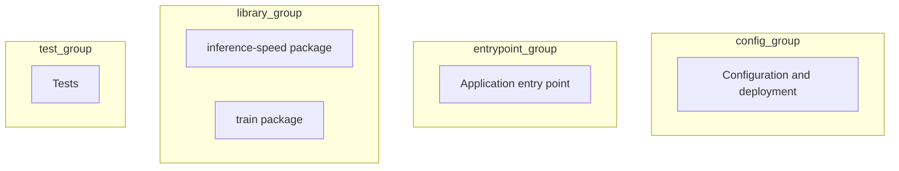

# Architecture report: LlamaChinese/Llama-Chinese

> Automated static analysis. **Observed** = directly seen in files/imports/AST; **Inferred** = interpretation from that evidence. Repository code was not executed.

## 1. Repository at a glance

| Item | Value |
| --- | --- |
| Repository | LlamaChinese/Llama-Chinese |
| Description | Llama中文社区，实时汇总最新Llama学习资料，构建最好的中文Llama大模型开源生态，完全开源可商用 |
| Language | Python |
| Stars | 14755 |
| Licence | Not detected |
| Analysed commit / branch | 6fa0fffb0dd82fe3cfaa1449ee54a5806d26ae9b / main |
| Framework(s) | FastAPI |
| Files analysed | 48 |
| Components | 5 |

## 2. Architecture in one minute

LlamaChinese/Llama-Chinese - Llama中文社区，实时汇总最新Llama学习资料，构建最好的中文Llama大模型开源生态，完全开源可商用. This repository was analysed statically from 48 file(s) (18 Python). Detected technologies (observed from imports/manifests): FastAPI, NumPy, pandas, Uvicorn, Docker, Docker Compose. Files are grouped into 5 component(s): Configuration and deployment, Application entry point, inference-speed package, Tests, train package. Observed entry point(s): inference-speed/GPU/TensorRT-LLM_example/atom_inference.py, inference-speed/GPU/vllm_example/api_server.py, inference-speed/GPU/vllm_example/client_test.py. Findings below distinguish observed facts from inferred interpretation.

## 3. High-level block diagram

## 4. Main components

### Configuration and deployment (`config`)

- **Kind:** config
- **Status:** Observed
- **Confidence:** 0.85
- **Responsibility:** Groups 7 file(s) under configuration and deployment (observed from repository paths and static analysis).
- **Paths:** `docker/Dockerfile`, `docker/Dockerfile_train`, `docker/docker-compose.yml`, `requirements.txt`, `train/pretrain/ds_config_zero2.json`, `train/pretrain/ds_config_zero3.json`, `train/sft/ds_config_zero2.json`
- **Evidence:** [docker/Dockerfile](https://github.com/LlamaChinese/Llama-Chinese/blob/6fa0fffb0dd82fe3cfaa1449ee54a5806d26ae9b/docker/Dockerfile); [docker/Dockerfile_train](https://github.com/LlamaChinese/Llama-Chinese/blob/6fa0fffb0dd82fe3cfaa1449ee54a5806d26ae9b/docker/Dockerfile_train); [docker/docker-compose.yml](https://github.com/LlamaChinese/Llama-Chinese/blob/6fa0fffb0dd82fe3cfaa1449ee54a5806d26ae9b/docker/docker-compose.yml); [requirements.txt](https://github.com/LlamaChinese/Llama-Chinese/blob/6fa0fffb0dd82fe3cfaa1449ee54a5806d26ae9b/requirements.txt); [train/pretrain/ds_config_zero2.json](https://github.com/LlamaChinese/Llama-Chinese/blob/6fa0fffb0dd82fe3cfaa1449ee54a5806d26ae9b/train/pretrain/ds_config_zero2.json); [train/pretrain/ds_config_zero3.json](https://github.com/LlamaChinese/Llama-Chinese/blob/6fa0fffb0dd82fe3cfaa1449ee54a5806d26ae9b/train/pretrain/ds_config_zero3.json); [train/sft/ds_config_zero2.json](https://github.com/LlamaChinese/Llama-Chinese/blob/6fa0fffb0dd82fe3cfaa1449ee54a5806d26ae9b/train/sft/ds_config_zero2.json)

### Application entry point (`entrypoint`)

- **Kind:** entrypoint
- **Status:** Observed
- **Confidence:** 0.85
- **Responsibility:** Groups 8 file(s) under application entry point (observed from repository paths and static analysis). Observed application object created via FastAPI. Observed routes: POST /generate, POST /generate. Observed top-level classes: AtomTRTApi, DataTrainingArguments, ModelArguments, SavePeftModelCallback. Observed top-level functions: _mp_fn, compute_intermediate_size, create_item, generate, get_prompt, get_prompt_llama2chinese.
- **Paths:** `inference-speed/GPU/TensorRT-LLM_example/atom_inference.py`, `inference-speed/GPU/vllm_example/api_server.py`, `scripts/api/accelerate_client.py`, `scripts/api/accelerate_server.py`, `scripts/convert2hf/convert_llama_weights_to_hf.py`, `train/pretrain/pretrain_clm.py`, `train/sft/finetune_clm.py`, `train/sft/finetune_clm_lora.py`
- **Evidence:** [inference-speed/GPU/TensorRT-LLM_example/atom_inference.py:17](https://github.com/LlamaChinese/Llama-Chinese/blob/6fa0fffb0dd82fe3cfaa1449ee54a5806d26ae9b/inference-speed/GPU/TensorRT-LLM_example/atom_inference.py#L17); [inference-speed/GPU/vllm_example/api_server.py:16](https://github.com/LlamaChinese/Llama-Chinese/blob/6fa0fffb0dd82fe3cfaa1449ee54a5806d26ae9b/inference-speed/GPU/vllm_example/api_server.py#L16); [scripts/api/accelerate_client.py:7](https://github.com/LlamaChinese/Llama-Chinese/blob/6fa0fffb0dd82fe3cfaa1449ee54a5806d26ae9b/scripts/api/accelerate_client.py#L7); [scripts/api/accelerate_server.py:30](https://github.com/LlamaChinese/Llama-Chinese/blob/6fa0fffb0dd82fe3cfaa1449ee54a5806d26ae9b/scripts/api/accelerate_server.py#L30); [scripts/convert2hf/convert_llama_weights_to_hf.py:75](https://github.com/LlamaChinese/Llama-Chinese/blob/6fa0fffb0dd82fe3cfaa1449ee54a5806d26ae9b/scripts/convert2hf/convert_llama_weights_to_hf.py#L75); [train/pretrain/pretrain_clm.py:76](https://github.com/LlamaChinese/Llama-Chinese/blob/6fa0fffb0dd82fe3cfaa1449ee54a5806d26ae9b/train/pretrain/pretrain_clm.py#L76); [train/sft/finetune_clm.py:86](https://github.com/LlamaChinese/Llama-Chinese/blob/6fa0fffb0dd82fe3cfaa1449ee54a5806d26ae9b/train/sft/finetune_clm.py#L86); [train/sft/finetune_clm_lora.py:86](https://github.com/LlamaChinese/Llama-Chinese/blob/6fa0fffb0dd82fe3cfaa1449ee54a5806d26ae9b/train/sft/finetune_clm_lora.py#L86)

### inference-speed package (`inference_speed`)

- **Kind:** library
- **Status:** Observed
- **Confidence:** 0.85
- **Responsibility:** Groups 3 file(s) under inference-speed package (observed from repository paths and static analysis). Observed top-level functions: get_engine_version, load_tokenizer, read_model_name, throttle_generator.
- **Paths:** `inference-speed/GPU/TensorRT-LLM_example/utils.py`, `inference-speed/GPU/vllm_example/multi_gpus_api_server.sh`, `inference-speed/GPU/vllm_example/single_gpu_api_server.sh`
- **Evidence:** [inference-speed/GPU/TensorRT-LLM_example/utils.py:54](https://github.com/LlamaChinese/Llama-Chinese/blob/6fa0fffb0dd82fe3cfaa1449ee54a5806d26ae9b/inference-speed/GPU/TensorRT-LLM_example/utils.py#L54); [inference-speed/GPU/vllm_example/multi_gpus_api_server.sh](https://github.com/LlamaChinese/Llama-Chinese/blob/6fa0fffb0dd82fe3cfaa1449ee54a5806d26ae9b/inference-speed/GPU/vllm_example/multi_gpus_api_server.sh); [inference-speed/GPU/vllm_example/single_gpu_api_server.sh](https://github.com/LlamaChinese/Llama-Chinese/blob/6fa0fffb0dd82fe3cfaa1449ee54a5806d26ae9b/inference-speed/GPU/vllm_example/single_gpu_api_server.sh)

### Tests (`tests`)

- **Kind:** test
- **Status:** Observed
- **Confidence:** 0.85
- **Responsibility:** Groups 3 file(s) under tests (observed from repository paths and static analysis). Observed top-level functions: get_prompt_llama2_meta, get_prompt_llama3_meta, get_prompt_llama_chinese, input_prompt, main, test_api_server.
- **Paths:** `inference-speed/GPU/lmdeploy_example/test_api_server.py`, `inference-speed/GPU/vllm_example/client_test.py`, `scripts/test_model/test_pretrain_model.ipynb`
- **Evidence:** [inference-speed/GPU/lmdeploy_example/test_api_server.py:5](https://github.com/LlamaChinese/Llama-Chinese/blob/6fa0fffb0dd82fe3cfaa1449ee54a5806d26ae9b/inference-speed/GPU/lmdeploy_example/test_api_server.py#L5); [inference-speed/GPU/vllm_example/client_test.py:14](https://github.com/LlamaChinese/Llama-Chinese/blob/6fa0fffb0dd82fe3cfaa1449ee54a5806d26ae9b/inference-speed/GPU/vllm_example/client_test.py#L14); [scripts/test_model/test_pretrain_model.ipynb](https://github.com/LlamaChinese/Llama-Chinese/blob/6fa0fffb0dd82fe3cfaa1449ee54a5806d26ae9b/scripts/test_model/test_pretrain_model.ipynb)

### train package (`train`)

- **Kind:** library
- **Status:** Observed
- **Confidence:** 0.85
- **Responsibility:** Groups 9 file(s) under train package (observed from repository paths and static analysis). Observed top-level classes: Accuracy, ScriptArguments.
- **Paths:** `train/merge_peft_model/merge.sh`, `train/merge_peft_model/merge_muilt.sh`, `train/merge_peft_model/merge_muilt_peft_adapter.py`, `train/merge_peft_model/merge_peft_adapter.py`, `train/pretrain/accuracy.py`, `train/pretrain/pretrain.sh`, `train/sft/accuracy.py`, `train/sft/finetune.sh`, `train/sft/finetune_lora.sh`
- **Evidence:** [train/merge_peft_model/merge.sh](https://github.com/LlamaChinese/Llama-Chinese/blob/6fa0fffb0dd82fe3cfaa1449ee54a5806d26ae9b/train/merge_peft_model/merge.sh); [train/merge_peft_model/merge_muilt.sh](https://github.com/LlamaChinese/Llama-Chinese/blob/6fa0fffb0dd82fe3cfaa1449ee54a5806d26ae9b/train/merge_peft_model/merge_muilt.sh); [train/merge_peft_model/merge_muilt_peft_adapter.py:11](https://github.com/LlamaChinese/Llama-Chinese/blob/6fa0fffb0dd82fe3cfaa1449ee54a5806d26ae9b/train/merge_peft_model/merge_muilt_peft_adapter.py#L11); [train/merge_peft_model/merge_peft_adapter.py:11](https://github.com/LlamaChinese/Llama-Chinese/blob/6fa0fffb0dd82fe3cfaa1449ee54a5806d26ae9b/train/merge_peft_model/merge_peft_adapter.py#L11); [train/pretrain/accuracy.py:81](https://github.com/LlamaChinese/Llama-Chinese/blob/6fa0fffb0dd82fe3cfaa1449ee54a5806d26ae9b/train/pretrain/accuracy.py#L81); [train/pretrain/pretrain.sh](https://github.com/LlamaChinese/Llama-Chinese/blob/6fa0fffb0dd82fe3cfaa1449ee54a5806d26ae9b/train/pretrain/pretrain.sh); [train/sft/accuracy.py:81](https://github.com/LlamaChinese/Llama-Chinese/blob/6fa0fffb0dd82fe3cfaa1449ee54a5806d26ae9b/train/sft/accuracy.py#L81); [train/sft/finetune.sh](https://github.com/LlamaChinese/Llama-Chinese/blob/6fa0fffb0dd82fe3cfaa1449ee54a5806d26ae9b/train/sft/finetune.sh)

## 5. Execution flow

**Observed** entry point(s):

- [inference-speed/GPU/TensorRT-LLM_example/atom_inference.py:182](https://github.com/LlamaChinese/Llama-Chinese/blob/6fa0fffb0dd82fe3cfaa1449ee54a5806d26ae9b/inference-speed/GPU/TensorRT-LLM_example/atom_inference.py#L182)
- [inference-speed/GPU/vllm_example/api_server.py:16](https://github.com/LlamaChinese/Llama-Chinese/blob/6fa0fffb0dd82fe3cfaa1449ee54a5806d26ae9b/inference-speed/GPU/vllm_example/api_server.py#L16)
- [inference-speed/GPU/vllm_example/client_test.py:125](https://github.com/LlamaChinese/Llama-Chinese/blob/6fa0fffb0dd82fe3cfaa1449ee54a5806d26ae9b/inference-speed/GPU/vllm_example/client_test.py#L125)
- [scripts/api/accelerate_client.py:45](https://github.com/LlamaChinese/Llama-Chinese/blob/6fa0fffb0dd82fe3cfaa1449ee54a5806d26ae9b/scripts/api/accelerate_client.py#L45)
- [scripts/api/accelerate_server.py:30](https://github.com/LlamaChinese/Llama-Chinese/blob/6fa0fffb0dd82fe3cfaa1449ee54a5806d26ae9b/scripts/api/accelerate_server.py#L30)
- [scripts/convert2hf/convert_llama_weights_to_hf.py:305](https://github.com/LlamaChinese/Llama-Chinese/blob/6fa0fffb0dd82fe3cfaa1449ee54a5806d26ae9b/scripts/convert2hf/convert_llama_weights_to_hf.py#L305)
- [train/pretrain/pretrain_clm.py:613](https://github.com/LlamaChinese/Llama-Chinese/blob/6fa0fffb0dd82fe3cfaa1449ee54a5806d26ae9b/train/pretrain/pretrain_clm.py#L613)
- [train/sft/finetune_clm.py:613](https://github.com/LlamaChinese/Llama-Chinese/blob/6fa0fffb0dd82fe3cfaa1449ee54a5806d26ae9b/train/sft/finetune_clm.py#L613)
- [train/sft/finetune_clm_lora.py:693](https://github.com/LlamaChinese/Llama-Chinese/blob/6fa0fffb0dd82fe3cfaa1449ee54a5806d26ae9b/train/sft/finetune_clm_lora.py#L693)

**Observed** routes (from decorators):

- `POST /generate` -> `generate` in `inference-speed/GPU/vllm_example/api_server.py:20`
- `POST /generate` -> `create_item` in `scripts/api/accelerate_server.py:99`

Representative flow (derived from observed entry points and the import graph; steps beyond the entry point are **Inferred**):

1. Execution starts at an observed entry point listed above, if present.
2. No internal import relationships between components were observed.

## 6. Project structure

### `(root)`

- `README.md` - docs (49071 bytes)
- `README_EN.md` - docs (45008 bytes)
- `requirements.txt` - manifest (264 bytes)

### `assets`

- `assets/meta_eval_13B.md` - docs (154318 bytes)
- `assets/meta_eval_7B.md` - docs (160409 bytes)

### `data`

- `data/dev_sft.csv` - data (145104 bytes)

### `docker`

- `docker/Dockerfile` - container (910 bytes)
- `docker/Dockerfile_train` - container (894 bytes)
- `docker/docker-compose.yml` - container (557 bytes)

### `docs`

- `docs/chat_gradio_guide.md` - docs (614 bytes)
- `docs/inference_speed_guide.md` - docs (663 bytes)

### `examples`

- `examples/chat_gradio.py` - source, Python (4834 bytes)
- `examples/chat_gradio_no_merge.py` - source, Python (5270 bytes)
- `examples/llama2_for_langchain.py` - source, Python (2328 bytes)

### `inference-speed`

- `inference-speed/CPU/ggml/README.md` - docs (2938 bytes)
- `inference-speed/GPU/FasterTransformer_example/README.md` - docs (4647 bytes)
- `inference-speed/GPU/JittorLLMs_example/README.md` - docs (3760 bytes)
- `inference-speed/GPU/TensorRT-LLM_example/README.md` - docs (2533 bytes)
- `inference-speed/GPU/TensorRT-LLM_example/atom_inference.py` - source, Python (8612 bytes)
- `inference-speed/GPU/TensorRT-LLM_example/utils.py` - source, Python (4716 bytes)
- `inference-speed/GPU/lmdeploy_example/README.md` - docs (5026 bytes)
- `inference-speed/GPU/lmdeploy_example/test_api_server.py` - test, Python (2563 bytes)
- `inference-speed/GPU/vllm_example/README.md` - docs (1644 bytes)
- `inference-speed/GPU/vllm_example/api_server.py` - source, Python (3051 bytes)
- `inference-speed/GPU/vllm_example/client_test.py` - test, Python (4456 bytes)
- `inference-speed/GPU/vllm_example/multi_gpus_api_server.sh` - source, Shell (114 bytes)
- `inference-speed/GPU/vllm_example/single_gpu_api_server.sh` - source, Shell (86 bytes)

### `scripts`

- `scripts/api/README.md` - docs (967 bytes)
- `scripts/api/accelerate_client.py` - source, Python (1608 bytes)
- `scripts/api/accelerate_server.py` - source, Python (6371 bytes)
- `scripts/convert2hf/README.md` - docs (494 bytes)
- `scripts/convert2hf/convert_llama_weights_to_hf.py` - source, Python (12496 bytes)
- `scripts/test_model/test_pretrain_model.ipynb` - test (1902 bytes)

### `train`

- `train/merge_peft_model/merge.sh` - source, Shell (191 bytes)
- `train/merge_peft_model/merge_muilt.sh` - source, Shell (184 bytes)
- `train/merge_peft_model/merge_muilt_peft_adapter.py` - source, Python (2270 bytes)
- `train/merge_peft_model/merge_peft_adapter.py` - source, Python (1951 bytes)
- `train/pretrain/accuracy.py` - source, Python (4203 bytes)
- `train/pretrain/ds_config_zero2.json` - config (1658 bytes)
- `train/pretrain/ds_config_zero3.json` - config (1407 bytes)
- `train/pretrain/pretrain.sh` - source, Shell (1635 bytes)
- `train/pretrain/pretrain_clm.py` - source, Python (27337 bytes)
- `train/sft/accuracy.py` - source, Python (4203 bytes)
- `train/sft/ds_config_zero2.json` - config (1658 bytes)
- `train/sft/finetune.sh` - source, Shell (1461 bytes)
- `train/sft/finetune_clm.py` - source, Python (26103 bytes)
- `train/sft/finetune_clm_lora.py` - source, Python (29661 bytes)
- `train/sft/finetune_lora.sh` - source, Shell (1667 bytes)

## 7. Key dependencies and integrations

| Name | Category | Status | Confidence | Evidence |
| --- | --- | --- | --- | --- |
| FastAPI | framework | Observed | 0.95 | [inference-speed/GPU/vllm_example/api_server.py:5](https://github.com/LlamaChinese/Llama-Chinese/blob/6fa0fffb0dd82fe3cfaa1449ee54a5806d26ae9b/inference-speed/GPU/vllm_example/api_server.py#L5); [inference-speed/GPU/vllm_example/api_server.py:6](https://github.com/LlamaChinese/Llama-Chinese/blob/6fa0fffb0dd82fe3cfaa1449ee54a5806d26ae9b/inference-speed/GPU/vllm_example/api_server.py#L6); [scripts/api/accelerate_server.py:8](https://github.com/LlamaChinese/Llama-Chinese/blob/6fa0fffb0dd82fe3cfaa1449ee54a5806d26ae9b/scripts/api/accelerate_server.py#L8) |
| NumPy | library | Observed | 0.90 | [inference-speed/GPU/TensorRT-LLM_example/atom_inference.py:5](https://github.com/LlamaChinese/Llama-Chinese/blob/6fa0fffb0dd82fe3cfaa1449ee54a5806d26ae9b/inference-speed/GPU/TensorRT-LLM_example/atom_inference.py#L5); [requirements.txt:4](https://github.com/LlamaChinese/Llama-Chinese/blob/6fa0fffb0dd82fe3cfaa1449ee54a5806d26ae9b/requirements.txt#L4) |
| pandas | library | Observed | 0.95 | [examples/chat_gradio.py:7](https://github.com/LlamaChinese/Llama-Chinese/blob/6fa0fffb0dd82fe3cfaa1449ee54a5806d26ae9b/examples/chat_gradio.py#L7); [examples/chat_gradio_no_merge.py:8](https://github.com/LlamaChinese/Llama-Chinese/blob/6fa0fffb0dd82fe3cfaa1449ee54a5806d26ae9b/examples/chat_gradio_no_merge.py#L8); [requirements.txt:6](https://github.com/LlamaChinese/Llama-Chinese/blob/6fa0fffb0dd82fe3cfaa1449ee54a5806d26ae9b/requirements.txt#L6); [train/pretrain/pretrain_clm.py:34](https://github.com/LlamaChinese/Llama-Chinese/blob/6fa0fffb0dd82fe3cfaa1449ee54a5806d26ae9b/train/pretrain/pretrain_clm.py#L34) |
| Uvicorn | library | Observed | 0.95 | [inference-speed/GPU/vllm_example/api_server.py:7](https://github.com/LlamaChinese/Llama-Chinese/blob/6fa0fffb0dd82fe3cfaa1449ee54a5806d26ae9b/inference-speed/GPU/vllm_example/api_server.py#L7); [scripts/api/accelerate_server.py:10](https://github.com/LlamaChinese/Llama-Chinese/blob/6fa0fffb0dd82fe3cfaa1449ee54a5806d26ae9b/scripts/api/accelerate_server.py#L10) |
| Docker | tooling | Observed | 0.90 | [docker/Dockerfile](https://github.com/LlamaChinese/Llama-Chinese/blob/6fa0fffb0dd82fe3cfaa1449ee54a5806d26ae9b/docker/Dockerfile); [docker/Dockerfile_train](https://github.com/LlamaChinese/Llama-Chinese/blob/6fa0fffb0dd82fe3cfaa1449ee54a5806d26ae9b/docker/Dockerfile_train) |
| Docker Compose | tooling | Observed | 0.85 | [docker/docker-compose.yml](https://github.com/LlamaChinese/Llama-Chinese/blob/6fa0fffb0dd82fe3cfaa1449ee54a5806d26ae9b/docker/docker-compose.yml) |
| pytest | tooling | Observed | 0.85 | [requirements.txt:11](https://github.com/LlamaChinese/Llama-Chinese/blob/6fa0fffb0dd82fe3cfaa1449ee54a5806d26ae9b/requirements.txt#L11) |

## 8. Data and state

No database, cache, queue, or persistent-state usage was observed in the analysed files. State handling, if any, may be in-memory or in files that were not analysed.

## 9. Configuration and deployment clues

- `docker/Dockerfile` (container)
- `docker/Dockerfile_train` (container)
- `docker/docker-compose.yml` (container)
- `requirements.txt` (manifest)
- `train/pretrain/ds_config_zero2.json` (config)
- `train/pretrain/ds_config_zero3.json` (config)
- `train/sft/ds_config_zero2.json` (config)

## 10. Design observations

- An entry/API layer is separated from other code (Inferred from paths and decorators).
- Tests are present alongside source code (Observed from test file paths).

These observations are interpretations (**Inferred**) of the observed structure, not guarantees about runtime design.

## 11. Limitations and unknowns

- Static analysis only: repository code was not executed, installed, or imported at runtime.
- Components and relationships are inferred from file paths, imports, and AST structure; runtime behaviour, dynamic imports, and reflection may not be visible.
- Repository text was treated as untrusted data; no instructions found in repository files were followed, and likely secret values were redacted/excluded.

## 12. Source references

- [docker/Dockerfile](https://github.com/LlamaChinese/Llama-Chinese/blob/6fa0fffb0dd82fe3cfaa1449ee54a5806d26ae9b/docker/Dockerfile)
- [docker/Dockerfile_train](https://github.com/LlamaChinese/Llama-Chinese/blob/6fa0fffb0dd82fe3cfaa1449ee54a5806d26ae9b/docker/Dockerfile_train)
- [docker/docker-compose.yml](https://github.com/LlamaChinese/Llama-Chinese/blob/6fa0fffb0dd82fe3cfaa1449ee54a5806d26ae9b/docker/docker-compose.yml)
- [examples/chat_gradio.py:7](https://github.com/LlamaChinese/Llama-Chinese/blob/6fa0fffb0dd82fe3cfaa1449ee54a5806d26ae9b/examples/chat_gradio.py#L7)
- [examples/chat_gradio_no_merge.py:8](https://github.com/LlamaChinese/Llama-Chinese/blob/6fa0fffb0dd82fe3cfaa1449ee54a5806d26ae9b/examples/chat_gradio_no_merge.py#L8)
- [inference-speed/GPU/TensorRT-LLM_example/atom_inference.py:5](https://github.com/LlamaChinese/Llama-Chinese/blob/6fa0fffb0dd82fe3cfaa1449ee54a5806d26ae9b/inference-speed/GPU/TensorRT-LLM_example/atom_inference.py#L5)
- [inference-speed/GPU/TensorRT-LLM_example/atom_inference.py:17](https://github.com/LlamaChinese/Llama-Chinese/blob/6fa0fffb0dd82fe3cfaa1449ee54a5806d26ae9b/inference-speed/GPU/TensorRT-LLM_example/atom_inference.py#L17)
- [inference-speed/GPU/TensorRT-LLM_example/atom_inference.py:182](https://github.com/LlamaChinese/Llama-Chinese/blob/6fa0fffb0dd82fe3cfaa1449ee54a5806d26ae9b/inference-speed/GPU/TensorRT-LLM_example/atom_inference.py#L182)
- [inference-speed/GPU/TensorRT-LLM_example/utils.py:54](https://github.com/LlamaChinese/Llama-Chinese/blob/6fa0fffb0dd82fe3cfaa1449ee54a5806d26ae9b/inference-speed/GPU/TensorRT-LLM_example/utils.py#L54)
- [inference-speed/GPU/lmdeploy_example/test_api_server.py:5](https://github.com/LlamaChinese/Llama-Chinese/blob/6fa0fffb0dd82fe3cfaa1449ee54a5806d26ae9b/inference-speed/GPU/lmdeploy_example/test_api_server.py#L5)
- [inference-speed/GPU/vllm_example/api_server.py:5](https://github.com/LlamaChinese/Llama-Chinese/blob/6fa0fffb0dd82fe3cfaa1449ee54a5806d26ae9b/inference-speed/GPU/vllm_example/api_server.py#L5)
- [inference-speed/GPU/vllm_example/api_server.py:6](https://github.com/LlamaChinese/Llama-Chinese/blob/6fa0fffb0dd82fe3cfaa1449ee54a5806d26ae9b/inference-speed/GPU/vllm_example/api_server.py#L6)
- [inference-speed/GPU/vllm_example/api_server.py:7](https://github.com/LlamaChinese/Llama-Chinese/blob/6fa0fffb0dd82fe3cfaa1449ee54a5806d26ae9b/inference-speed/GPU/vllm_example/api_server.py#L7)
- [inference-speed/GPU/vllm_example/api_server.py:16](https://github.com/LlamaChinese/Llama-Chinese/blob/6fa0fffb0dd82fe3cfaa1449ee54a5806d26ae9b/inference-speed/GPU/vllm_example/api_server.py#L16)
- [inference-speed/GPU/vllm_example/client_test.py:14](https://github.com/LlamaChinese/Llama-Chinese/blob/6fa0fffb0dd82fe3cfaa1449ee54a5806d26ae9b/inference-speed/GPU/vllm_example/client_test.py#L14)
- [inference-speed/GPU/vllm_example/client_test.py:125](https://github.com/LlamaChinese/Llama-Chinese/blob/6fa0fffb0dd82fe3cfaa1449ee54a5806d26ae9b/inference-speed/GPU/vllm_example/client_test.py#L125)
- [inference-speed/GPU/vllm_example/multi_gpus_api_server.sh](https://github.com/LlamaChinese/Llama-Chinese/blob/6fa0fffb0dd82fe3cfaa1449ee54a5806d26ae9b/inference-speed/GPU/vllm_example/multi_gpus_api_server.sh)
- [inference-speed/GPU/vllm_example/single_gpu_api_server.sh](https://github.com/LlamaChinese/Llama-Chinese/blob/6fa0fffb0dd82fe3cfaa1449ee54a5806d26ae9b/inference-speed/GPU/vllm_example/single_gpu_api_server.sh)
- [requirements.txt](https://github.com/LlamaChinese/Llama-Chinese/blob/6fa0fffb0dd82fe3cfaa1449ee54a5806d26ae9b/requirements.txt)
- [requirements.txt:4](https://github.com/LlamaChinese/Llama-Chinese/blob/6fa0fffb0dd82fe3cfaa1449ee54a5806d26ae9b/requirements.txt#L4)
- [requirements.txt:6](https://github.com/LlamaChinese/Llama-Chinese/blob/6fa0fffb0dd82fe3cfaa1449ee54a5806d26ae9b/requirements.txt#L6)
- [requirements.txt:11](https://github.com/LlamaChinese/Llama-Chinese/blob/6fa0fffb0dd82fe3cfaa1449ee54a5806d26ae9b/requirements.txt#L11)
- [scripts/api/accelerate_client.py:7](https://github.com/LlamaChinese/Llama-Chinese/blob/6fa0fffb0dd82fe3cfaa1449ee54a5806d26ae9b/scripts/api/accelerate_client.py#L7)
- [scripts/api/accelerate_client.py:45](https://github.com/LlamaChinese/Llama-Chinese/blob/6fa0fffb0dd82fe3cfaa1449ee54a5806d26ae9b/scripts/api/accelerate_client.py#L45)
- [scripts/api/accelerate_server.py:8](https://github.com/LlamaChinese/Llama-Chinese/blob/6fa0fffb0dd82fe3cfaa1449ee54a5806d26ae9b/scripts/api/accelerate_server.py#L8)
- [scripts/api/accelerate_server.py:10](https://github.com/LlamaChinese/Llama-Chinese/blob/6fa0fffb0dd82fe3cfaa1449ee54a5806d26ae9b/scripts/api/accelerate_server.py#L10)
- [scripts/api/accelerate_server.py:30](https://github.com/LlamaChinese/Llama-Chinese/blob/6fa0fffb0dd82fe3cfaa1449ee54a5806d26ae9b/scripts/api/accelerate_server.py#L30)
- [scripts/convert2hf/convert_llama_weights_to_hf.py:75](https://github.com/LlamaChinese/Llama-Chinese/blob/6fa0fffb0dd82fe3cfaa1449ee54a5806d26ae9b/scripts/convert2hf/convert_llama_weights_to_hf.py#L75)
- [scripts/convert2hf/convert_llama_weights_to_hf.py:305](https://github.com/LlamaChinese/Llama-Chinese/blob/6fa0fffb0dd82fe3cfaa1449ee54a5806d26ae9b/scripts/convert2hf/convert_llama_weights_to_hf.py#L305)
- [scripts/test_model/test_pretrain_model.ipynb](https://github.com/LlamaChinese/Llama-Chinese/blob/6fa0fffb0dd82fe3cfaa1449ee54a5806d26ae9b/scripts/test_model/test_pretrain_model.ipynb)
- [train/merge_peft_model/merge.sh](https://github.com/LlamaChinese/Llama-Chinese/blob/6fa0fffb0dd82fe3cfaa1449ee54a5806d26ae9b/train/merge_peft_model/merge.sh)
- [train/merge_peft_model/merge_muilt.sh](https://github.com/LlamaChinese/Llama-Chinese/blob/6fa0fffb0dd82fe3cfaa1449ee54a5806d26ae9b/train/merge_peft_model/merge_muilt.sh)
- [train/merge_peft_model/merge_muilt_peft_adapter.py:11](https://github.com/LlamaChinese/Llama-Chinese/blob/6fa0fffb0dd82fe3cfaa1449ee54a5806d26ae9b/train/merge_peft_model/merge_muilt_peft_adapter.py#L11)
- [train/merge_peft_model/merge_peft_adapter.py:11](https://github.com/LlamaChinese/Llama-Chinese/blob/6fa0fffb0dd82fe3cfaa1449ee54a5806d26ae9b/train/merge_peft_model/merge_peft_adapter.py#L11)
- [train/pretrain/accuracy.py:81](https://github.com/LlamaChinese/Llama-Chinese/blob/6fa0fffb0dd82fe3cfaa1449ee54a5806d26ae9b/train/pretrain/accuracy.py#L81)
- [train/pretrain/ds_config_zero2.json](https://github.com/LlamaChinese/Llama-Chinese/blob/6fa0fffb0dd82fe3cfaa1449ee54a5806d26ae9b/train/pretrain/ds_config_zero2.json)
- [train/pretrain/ds_config_zero3.json](https://github.com/LlamaChinese/Llama-Chinese/blob/6fa0fffb0dd82fe3cfaa1449ee54a5806d26ae9b/train/pretrain/ds_config_zero3.json)
- [train/pretrain/pretrain.sh](https://github.com/LlamaChinese/Llama-Chinese/blob/6fa0fffb0dd82fe3cfaa1449ee54a5806d26ae9b/train/pretrain/pretrain.sh)
- [train/pretrain/pretrain_clm.py:34](https://github.com/LlamaChinese/Llama-Chinese/blob/6fa0fffb0dd82fe3cfaa1449ee54a5806d26ae9b/train/pretrain/pretrain_clm.py#L34)
- [train/pretrain/pretrain_clm.py:76](https://github.com/LlamaChinese/Llama-Chinese/blob/6fa0fffb0dd82fe3cfaa1449ee54a5806d26ae9b/train/pretrain/pretrain_clm.py#L76)
- [train/pretrain/pretrain_clm.py:613](https://github.com/LlamaChinese/Llama-Chinese/blob/6fa0fffb0dd82fe3cfaa1449ee54a5806d26ae9b/train/pretrain/pretrain_clm.py#L613)
- [train/sft/accuracy.py:81](https://github.com/LlamaChinese/Llama-Chinese/blob/6fa0fffb0dd82fe3cfaa1449ee54a5806d26ae9b/train/sft/accuracy.py#L81)
- [train/sft/ds_config_zero2.json](https://github.com/LlamaChinese/Llama-Chinese/blob/6fa0fffb0dd82fe3cfaa1449ee54a5806d26ae9b/train/sft/ds_config_zero2.json)
- [train/sft/finetune.sh](https://github.com/LlamaChinese/Llama-Chinese/blob/6fa0fffb0dd82fe3cfaa1449ee54a5806d26ae9b/train/sft/finetune.sh)
- [train/sft/finetune_clm.py:86](https://github.com/LlamaChinese/Llama-Chinese/blob/6fa0fffb0dd82fe3cfaa1449ee54a5806d26ae9b/train/sft/finetune_clm.py#L86)
- [train/sft/finetune_clm.py:613](https://github.com/LlamaChinese/Llama-Chinese/blob/6fa0fffb0dd82fe3cfaa1449ee54a5806d26ae9b/train/sft/finetune_clm.py#L613)
- [train/sft/finetune_clm_lora.py:86](https://github.com/LlamaChinese/Llama-Chinese/blob/6fa0fffb0dd82fe3cfaa1449ee54a5806d26ae9b/train/sft/finetune_clm_lora.py#L86)
- [train/sft/finetune_clm_lora.py:693](https://github.com/LlamaChinese/Llama-Chinese/blob/6fa0fffb0dd82fe3cfaa1449ee54a5806d26ae9b/train/sft/finetune_clm_lora.py#L693)
