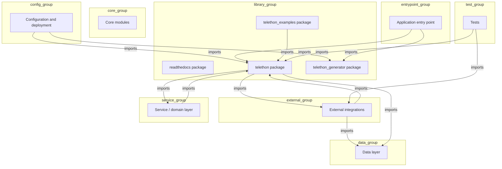

# Architecture report: LonamiWebs/Telethon

> Automated static analysis. **Observed** = directly seen in files/imports/AST; **Inferred** = interpretation from that evidence. Repository code was not executed.

## 1. Repository at a glance

| Item | Value |
| --- | --- |
| Repository | LonamiWebs/Telethon |
| Description | Pure Python 3 MTProto API Telegram client library, for bots too! |
| Language | Python |
| Stars | 12066 |
| Licence | MIT |
| Analysed commit / branch | dab6bc4d4fc0c7815f6f19c6f643d9f75d2d930c / v1 |
| Framework(s) | None detected |
| Files analysed | 225 |
| Components | 11 |

## 2. Architecture in one minute

LonamiWebs/Telethon - Pure Python 3 MTProto API Telegram client library, for bots too!. This repository was analysed statically from 225 file(s) (150 Python). Detected technologies (observed from imports/manifests): GitHub Actions, SQLite, aiohttp, Poetry, setuptools, pytest. Files are grouped into 11 component(s): Configuration and deployment, Core modules, Data layer, Application entry point, External integrations, readthedocs package, Service / domain layer, telethon package. Observed entry point(s): setup.py, telethon_examples/assistant.py, telethon_examples/gui.py. Findings below distinguish observed facts from inferred interpretation.

## 3. High-level block diagram

## 4. Main components

### Configuration and deployment (`config`)

- **Kind:** config
- **Status:** Observed
- **Confidence:** 0.85
- **Responsibility:** Groups 4 file(s) under configuration and deployment (observed from repository paths and static analysis). Observed top-level classes: TempWorkDir. Observed top-level functions: generate, main.
- **Paths:** `pyproject.toml`, `readthedocs/requirements.txt`, `requirements.txt`, `setup.py`
- **Evidence:** [pyproject.toml](https://github.com/LonamiWebs/Telethon/blob/dab6bc4d4fc0c7815f6f19c6f643d9f75d2d930c/pyproject.toml); [readthedocs/requirements.txt](https://github.com/LonamiWebs/Telethon/blob/dab6bc4d4fc0c7815f6f19c6f643d9f75d2d930c/readthedocs/requirements.txt); [requirements.txt](https://github.com/LonamiWebs/Telethon/blob/dab6bc4d4fc0c7815f6f19c6f643d9f75d2d930c/requirements.txt); [setup.py:28](https://github.com/LonamiWebs/Telethon/blob/dab6bc4d4fc0c7815f6f19c6f643d9f75d2d930c/setup.py#L28)

### Core modules (`core`)

- **Kind:** core
- **Status:** Observed
- **Confidence:** 0.85
- **Responsibility:** Groups 1 file(s) under core modules (observed from repository paths and static analysis).
- **Paths:** `update-docs.sh`
- **Evidence:** [update-docs.sh](https://github.com/LonamiWebs/Telethon/blob/dab6bc4d4fc0c7815f6f19c6f643d9f75d2d930c/update-docs.sh)

### Data layer (`data_layer`)

- **Kind:** data
- **Status:** Observed
- **Confidence:** 0.85
- **Responsibility:** Groups 1 file(s) under data layer (observed from repository paths and static analysis).
- **Paths:** `telethon_generator/data/html/js/search.js`
- **Evidence:** [telethon_generator/data/html/js/search.js](https://github.com/LonamiWebs/Telethon/blob/dab6bc4d4fc0c7815f6f19c6f643d9f75d2d930c/telethon_generator/data/html/js/search.js)

### Application entry point (`entrypoint`)

- **Kind:** entrypoint
- **Status:** Observed
- **Confidence:** 0.85
- **Responsibility:** Groups 6 file(s) under application entry point (observed from repository paths and static analysis). Observed routes: ROUTE /. Observed top-level classes: App, InteractiveTelegramClient. Observed top-level functions: allow_copy, async_input, bytes_to_string, callback, cleanup, format_message.
- **Paths:** `telethon_examples/assistant.py`, `telethon_examples/gui.py`, `telethon_examples/interactive_telegram_client.py`, `telethon_examples/payment.py`, `telethon_examples/quart_login.py`, `telethon_generator/syncerrors.py`
- **Evidence:** [telethon_examples/assistant.py:39](https://github.com/LonamiWebs/Telethon/blob/dab6bc4d4fc0c7815f6f19c6f643d9f75d2d930c/telethon_examples/assistant.py#L39); [telethon_examples/gui.py:24](https://github.com/LonamiWebs/Telethon/blob/dab6bc4d4fc0c7815f6f19c6f643d9f75d2d930c/telethon_examples/gui.py#L24); [telethon_examples/interactive_telegram_client.py:13](https://github.com/LonamiWebs/Telethon/blob/dab6bc4d4fc0c7815f6f19c6f643d9f75d2d930c/telethon_examples/interactive_telegram_client.py#L13); [telethon_examples/payment.py:24](https://github.com/LonamiWebs/Telethon/blob/dab6bc4d4fc0c7815f6f19c6f643d9f75d2d930c/telethon_examples/payment.py#L24); [telethon_examples/quart_login.py:10](https://github.com/LonamiWebs/Telethon/blob/dab6bc4d4fc0c7815f6f19c6f643d9f75d2d930c/telethon_examples/quart_login.py#L10); [telethon_generator/syncerrors.py:18](https://github.com/LonamiWebs/Telethon/blob/dab6bc4d4fc0c7815f6f19c6f643d9f75d2d930c/telethon_generator/syncerrors.py#L18)

### External integrations (`external_integrations`)

- **Kind:** external
- **Status:** Observed
- **Confidence:** 0.85
- **Responsibility:** Groups 15 file(s) under external integrations (observed from repository paths and static analysis). Observed top-level classes: AccountMethods, AuthMethods, BotMethods, ButtonMethods, ChatMethods, DialogMethods. Observed top-level functions: _dialog_message_key, _fmt_flood, _resize_photo_if_needed.
- **Paths:** `telethon/client/__init__.py`, `telethon/client/account.py`, `telethon/client/auth.py`, `telethon/client/bots.py`, `telethon/client/buttons.py`, `telethon/client/chats.py`, `telethon/client/dialogs.py`, `telethon/client/downloads.py`, `telethon/client/messageparse.py`, `telethon/client/messages.py`, `telethon/client/telegrambaseclient.py`, `telethon/client/telegramclient.py`, `telethon/client/updates.py`, `telethon/client/uploads.py`, `telethon/client/users.py`
- **Evidence:** [telethon/client/__init__.py](https://github.com/LonamiWebs/Telethon/blob/dab6bc4d4fc0c7815f6f19c6f643d9f75d2d930c/telethon/client/__init__.py); [telethon/client/account.py:15](https://github.com/LonamiWebs/Telethon/blob/dab6bc4d4fc0c7815f6f19c6f643d9f75d2d930c/telethon/client/account.py#L15); [telethon/client/auth.py:16](https://github.com/LonamiWebs/Telethon/blob/dab6bc4d4fc0c7815f6f19c6f643d9f75d2d930c/telethon/client/auth.py#L16); [telethon/client/bots.py:10](https://github.com/LonamiWebs/Telethon/blob/dab6bc4d4fc0c7815f6f19c6f643d9f75d2d930c/telethon/client/bots.py#L10); [telethon/client/buttons.py:7](https://github.com/LonamiWebs/Telethon/blob/dab6bc4d4fc0c7815f6f19c6f643d9f75d2d930c/telethon/client/buttons.py#L7); [telethon/client/chats.py:19](https://github.com/LonamiWebs/Telethon/blob/dab6bc4d4fc0c7815f6f19c6f643d9f75d2d930c/telethon/client/chats.py#L19); [telethon/client/dialogs.py:16](https://github.com/LonamiWebs/Telethon/blob/dab6bc4d4fc0c7815f6f19c6f643d9f75d2d930c/telethon/client/dialogs.py#L16); [telethon/client/downloads.py:31](https://github.com/LonamiWebs/Telethon/blob/dab6bc4d4fc0c7815f6f19c6f643d9f75d2d930c/telethon/client/downloads.py#L31)

### readthedocs package (`readthedocs`)

- **Kind:** library
- **Status:** Observed
- **Confidence:** 0.85
- **Responsibility:** Groups 2 file(s) under readthedocs package (observed from repository paths and static analysis). Observed top-level functions: make_link_node, setup, skip, tl_role.
- **Paths:** `readthedocs/conf.py`, `readthedocs/custom_roles.py`
- **Evidence:** [readthedocs/conf.py:102](https://github.com/LonamiWebs/Telethon/blob/dab6bc4d4fc0c7815f6f19c6f643d9f75d2d930c/readthedocs/conf.py#L102); [readthedocs/custom_roles.py:5](https://github.com/LonamiWebs/Telethon/blob/dab6bc4d4fc0c7815f6f19c6f643d9f75d2d930c/readthedocs/custom_roles.py#L5)

### Service / domain layer (`service_layer`)

- **Kind:** service
- **Status:** Observed
- **Confidence:** 0.85
- **Responsibility:** Groups 5 file(s) under service / domain layer (observed from repository paths and static analysis). Observed top-level classes: GzipPacked, MessageContainer, RpcResult, TLMessage.
- **Paths:** `telethon/tl/core/__init__.py`, `telethon/tl/core/gzippacked.py`, `telethon/tl/core/messagecontainer.py`, `telethon/tl/core/rpcresult.py`, `telethon/tl/core/tlmessage.py`
- **Evidence:** [telethon/tl/core/__init__.py](https://github.com/LonamiWebs/Telethon/blob/dab6bc4d4fc0c7815f6f19c6f643d9f75d2d930c/telethon/tl/core/__init__.py); [telethon/tl/core/gzippacked.py:10](https://github.com/LonamiWebs/Telethon/blob/dab6bc4d4fc0c7815f6f19c6f643d9f75d2d930c/telethon/tl/core/gzippacked.py#L10); [telethon/tl/core/messagecontainer.py:5](https://github.com/LonamiWebs/Telethon/blob/dab6bc4d4fc0c7815f6f19c6f643d9f75d2d930c/telethon/tl/core/messagecontainer.py#L5); [telethon/tl/core/rpcresult.py:6](https://github.com/LonamiWebs/Telethon/blob/dab6bc4d4fc0c7815f6f19c6f643d9f75d2d930c/telethon/tl/core/rpcresult.py#L6); [telethon/tl/core/tlmessage.py:4](https://github.com/LonamiWebs/Telethon/blob/dab6bc4d4fc0c7815f6f19c6f643d9f75d2d930c/telethon/tl/core/tlmessage.py#L4)

### telethon package (`telethon`)

- **Kind:** library
- **Status:** Observed
- **Confidence:** 0.85
- **Responsibility:** Groups 83 file(s) under telethon package (observed from repository paths and static analysis). Observed top-level classes: AES, AESModeCTR, AbridgedPacketCodec, AdminLogEvent, Album, AlbumHack. Observed top-level functions: _admin_prop, _cancel, _checks_cancelled, _compute_fingerprint, _datetime_to_timestamp, _decode_telegram_base64.
- **Paths:** `telethon/__init__.py`, `telethon/_updates/__init__.py`, `telethon/_updates/entitycache.py`, `telethon/_updates/messagebox.py`, `telethon/_updates/session.py`, `telethon/crypto/__init__.py`, `telethon/crypto/aes.py`, `telethon/crypto/aesctr.py`, `telethon/crypto/authkey.py`, `telethon/crypto/cdndecrypter.py`, `telethon/crypto/factorization.py`, `telethon/crypto/libssl.py`, `telethon/crypto/rsa.py`, `telethon/custom.py`, `telethon/errors/__init__.py`, `telethon/errors/common.py`, `telethon/errors/rpcbaseerrors.py`, `telethon/events/__init__.py`, `telethon/events/album.py`, `telethon/events/callbackquery.py`, `telethon/events/chataction.py`, `telethon/events/common.py`, `telethon/events/inlinequery.py`, `telethon/events/messagedeleted.py`, `telethon/events/messageedited.py`, `telethon/events/messageread.py`, `telethon/events/newmessage.py`, `telethon/events/raw.py`, `telethon/events/userupdate.py`, `telethon/extensions/__init__.py`, `telethon/extensions/binaryreader.py`, `telethon/extensions/html.py`, `telethon/extensions/markdown.py`, `telethon/extensions/messagepacker.py`, `telethon/functions.py`, `telethon/helpers.py`, `telethon/hints.py`, `telethon/network/__init__.py`, `telethon/network/authenticator.py`, `telethon/network/connection/__init__.py`, `telethon/network/connection/connection.py`, `telethon/network/connection/http.py`, `telethon/network/connection/tcpabridged.py`, `telethon/network/connection/tcpfull.py`, `telethon/network/connection/tcpintermediate.py`, `telethon/network/connection/tcpmtproxy.py`, `telethon/network/connection/tcpobfuscated.py`, `telethon/network/mtprotoplainsender.py`, `telethon/network/mtprotosender.py`, `telethon/network/mtprotostate.py`, `telethon/network/requeststate.py`, `telethon/password.py`, `telethon/requestiter.py`, `telethon/sessions/__init__.py`, `telethon/sessions/abstract.py`, `telethon/sessions/memory.py`, `telethon/sessions/sqlite.py`, `telethon/sessions/string.py`, `telethon/sync.py`, `telethon/tl/__init__.py`, `telethon/tl/custom/__init__.py`, `telethon/tl/custom/adminlogevent.py`, `telethon/tl/custom/button.py`, `telethon/tl/custom/chatgetter.py`, `telethon/tl/custom/conversation.py`, `telethon/tl/custom/dialog.py`, `telethon/tl/custom/draft.py`, `telethon/tl/custom/file.py`, `telethon/tl/custom/forward.py`, `telethon/tl/custom/inlinebuilder.py`, `telethon/tl/custom/inlineresult.py`, `telethon/tl/custom/inlineresults.py`, `telethon/tl/custom/inputsizedfile.py`, `telethon/tl/custom/message.py`, `telethon/tl/custom/messagebutton.py`, `telethon/tl/custom/participantpermissions.py`, `telethon/tl/custom/qrlogin.py`, `telethon/tl/custom/sendergetter.py`, `telethon/tl/patched/__init__.py`, `telethon/tl/tlobject.py`, `telethon/types.py`, `telethon/utils.py`, `telethon/version.py`
- **Evidence:** [telethon/__init__.py](https://github.com/LonamiWebs/Telethon/blob/dab6bc4d4fc0c7815f6f19c6f643d9f75d2d930c/telethon/__init__.py); [telethon/_updates/__init__.py](https://github.com/LonamiWebs/Telethon/blob/dab6bc4d4fc0c7815f6f19c6f643d9f75d2d930c/telethon/_updates/__init__.py); [telethon/_updates/entitycache.py:7](https://github.com/LonamiWebs/Telethon/blob/dab6bc4d4fc0c7815f6f19c6f643d9f75d2d930c/telethon/_updates/entitycache.py#L7); [telethon/_updates/messagebox.py:49](https://github.com/LonamiWebs/Telethon/blob/dab6bc4d4fc0c7815f6f19c6f643d9f75d2d930c/telethon/_updates/messagebox.py#L49); [telethon/_updates/session.py:6](https://github.com/LonamiWebs/Telethon/blob/dab6bc4d4fc0c7815f6f19c6f643d9f75d2d930c/telethon/_updates/session.py#L6); [telethon/crypto/__init__.py](https://github.com/LonamiWebs/Telethon/blob/dab6bc4d4fc0c7815f6f19c6f643d9f75d2d930c/telethon/crypto/__init__.py); [telethon/crypto/aes.py:29](https://github.com/LonamiWebs/Telethon/blob/dab6bc4d4fc0c7815f6f19c6f643d9f75d2d930c/telethon/crypto/aes.py#L29); [telethon/crypto/aesctr.py:7](https://github.com/LonamiWebs/Telethon/blob/dab6bc4d4fc0c7815f6f19c6f643d9f75d2d930c/telethon/crypto/aesctr.py#L7)

### telethon_examples package (`telethon_examples`)

- **Kind:** library
- **Status:** Observed
- **Confidence:** 0.85
- **Responsibility:** Groups 3 file(s) under telethon_examples package (observed from repository paths and static analysis). Observed top-level functions: can_react, get_env, handler.
- **Paths:** `telethon_examples/print_messages.py`, `telethon_examples/print_updates.py`, `telethon_examples/replier.py`
- **Evidence:** [telethon_examples/print_messages.py:10](https://github.com/LonamiWebs/Telethon/blob/dab6bc4d4fc0c7815f6f19c6f643d9f75d2d930c/telethon_examples/print_messages.py#L10); [telethon_examples/print_updates.py:14](https://github.com/LonamiWebs/Telethon/blob/dab6bc4d4fc0c7815f6f19c6f643d9f75d2d930c/telethon_examples/print_updates.py#L14); [telethon_examples/replier.py:22](https://github.com/LonamiWebs/Telethon/blob/dab6bc4d4fc0c7815f6f19c6f643d9f75d2d930c/telethon_examples/replier.py#L22)

### telethon_generator package (`telethon_generator`)

- **Kind:** library
- **Status:** Observed
- **Confidence:** 0.85
- **Responsibility:** Groups 15 file(s) under telethon_generator package (observed from repository paths and static analysis). Observed top-level classes: DocsWriter, Error, MethodInfo, SourceBuilder, TLArg, TLObject. Observed top-level functions: _build_menu, _copy_replace, _copy_resources, _create_structure, _find_title, _fmt_strings.
- **Paths:** `telethon_generator/__init__.py`, `telethon_generator/docswriter.py`, `telethon_generator/generators/__init__.py`, `telethon_generator/generators/docs.py`, `telethon_generator/generators/errors.py`, `telethon_generator/generators/tlobject.py`, `telethon_generator/parsers/__init__.py`, `telethon_generator/parsers/errors.py`, `telethon_generator/parsers/methods.py`, `telethon_generator/parsers/tlobject/__init__.py`, `telethon_generator/parsers/tlobject/parser.py`, `telethon_generator/parsers/tlobject/tlarg.py`, `telethon_generator/parsers/tlobject/tlobject.py`, `telethon_generator/sourcebuilder.py`, `telethon_generator/utils.py`
- **Evidence:** [telethon_generator/__init__.py](https://github.com/LonamiWebs/Telethon/blob/dab6bc4d4fc0c7815f6f19c6f643d9f75d2d930c/telethon_generator/__init__.py); [telethon_generator/docswriter.py:5](https://github.com/LonamiWebs/Telethon/blob/dab6bc4d4fc0c7815f6f19c6f643d9f75d2d930c/telethon_generator/docswriter.py#L5); [telethon_generator/generators/__init__.py](https://github.com/LonamiWebs/Telethon/blob/dab6bc4d4fc0c7815f6f19c6f643d9f75d2d930c/telethon_generator/generators/__init__.py); [telethon_generator/generators/docs.py:20](https://github.com/LonamiWebs/Telethon/blob/dab6bc4d4fc0c7815f6f19c6f643d9f75d2d930c/telethon_generator/generators/docs.py#L20); [telethon_generator/generators/errors.py:1](https://github.com/LonamiWebs/Telethon/blob/dab6bc4d4fc0c7815f6f19c6f643d9f75d2d930c/telethon_generator/generators/errors.py#L1); [telethon_generator/generators/tlobject.py:54](https://github.com/LonamiWebs/Telethon/blob/dab6bc4d4fc0c7815f6f19c6f643d9f75d2d930c/telethon_generator/generators/tlobject.py#L54); [telethon_generator/parsers/__init__.py](https://github.com/LonamiWebs/Telethon/blob/dab6bc4d4fc0c7815f6f19c6f643d9f75d2d930c/telethon_generator/parsers/__init__.py); [telethon_generator/parsers/errors.py:20](https://github.com/LonamiWebs/Telethon/blob/dab6bc4d4fc0c7815f6f19c6f643d9f75d2d930c/telethon_generator/parsers/errors.py#L20)

### Tests (`tests`)

- **Kind:** test
- **Status:** Observed
- **Confidence:** 0.85
- **Responsibility:** Groups 20 file(s) under tests (observed from repository paths and static analysis). Observed top-level classes: TestMessageMethods, TestSyncifyAsyncContext. Observed top-level functions: _assert_equality, docs_dir, get_client, get_user_456, server_key_fp, test_all_methods_present.
- **Paths:** `tests/__init__.py`, `tests/readthedocs/__init__.py`, `tests/readthedocs/conftest.py`, `tests/readthedocs/quick_references/__init__.py`, `tests/readthedocs/quick_references/test_client_reference.py`, `tests/telethon/__init__.py`, `tests/telethon/client/__init__.py`, `tests/telethon/client/test_messages.py`, `tests/telethon/crypto/__init__.py`, `tests/telethon/crypto/test_rsa.py`, `tests/telethon/events/__init__.py`, `tests/telethon/events/test_chataction.py`, `tests/telethon/extensions/__init__.py`, `tests/telethon/extensions/test_html.py`, `tests/telethon/extensions/test_markdown.py`, `tests/telethon/test_helpers.py`, `tests/telethon/test_pickle.py`, `tests/telethon/test_utils.py`, `tests/telethon/tl/__init__.py`, `tests/telethon/tl/test_serialization.py`
- **Evidence:** [tests/__init__.py](https://github.com/LonamiWebs/Telethon/blob/dab6bc4d4fc0c7815f6f19c6f643d9f75d2d930c/tests/__init__.py); [tests/readthedocs/__init__.py](https://github.com/LonamiWebs/Telethon/blob/dab6bc4d4fc0c7815f6f19c6f643d9f75d2d930c/tests/readthedocs/__init__.py); [tests/readthedocs/conftest.py:7](https://github.com/LonamiWebs/Telethon/blob/dab6bc4d4fc0c7815f6f19c6f643d9f75d2d930c/tests/readthedocs/conftest.py#L7); [tests/readthedocs/quick_references/__init__.py](https://github.com/LonamiWebs/Telethon/blob/dab6bc4d4fc0c7815f6f19c6f643d9f75d2d930c/tests/readthedocs/quick_references/__init__.py); [tests/readthedocs/quick_references/test_client_reference.py:6](https://github.com/LonamiWebs/Telethon/blob/dab6bc4d4fc0c7815f6f19c6f643d9f75d2d930c/tests/readthedocs/quick_references/test_client_reference.py#L6); [tests/telethon/__init__.py](https://github.com/LonamiWebs/Telethon/blob/dab6bc4d4fc0c7815f6f19c6f643d9f75d2d930c/tests/telethon/__init__.py); [tests/telethon/client/__init__.py](https://github.com/LonamiWebs/Telethon/blob/dab6bc4d4fc0c7815f6f19c6f643d9f75d2d930c/tests/telethon/client/__init__.py); [tests/telethon/client/test_messages.py:13](https://github.com/LonamiWebs/Telethon/blob/dab6bc4d4fc0c7815f6f19c6f643d9f75d2d930c/tests/telethon/client/test_messages.py#L13)

## 5. Execution flow

**Observed** entry point(s):

- [setup.py:262](https://github.com/LonamiWebs/Telethon/blob/dab6bc4d4fc0c7815f6f19c6f643d9f75d2d930c/setup.py#L262)
- [telethon_examples/assistant.py:69](https://github.com/LonamiWebs/Telethon/blob/dab6bc4d4fc0c7815f6f19c6f643d9f75d2d930c/telethon_examples/assistant.py#L69)
- [telethon_examples/gui.py:371](https://github.com/LonamiWebs/Telethon/blob/dab6bc4d4fc0c7815f6f19c6f643d9f75d2d930c/telethon_examples/gui.py#L371)
- [telethon_examples/interactive_telegram_client.py:402](https://github.com/LonamiWebs/Telethon/blob/dab6bc4d4fc0c7815f6f19c6f643d9f75d2d930c/telethon_examples/interactive_telegram_client.py#L402)
- [telethon_examples/payment.py:177](https://github.com/LonamiWebs/Telethon/blob/dab6bc4d4fc0c7815f6f19c6f643d9f75d2d930c/telethon_examples/payment.py#L177)
- [telethon_examples/quart_login.py:139](https://github.com/LonamiWebs/Telethon/blob/dab6bc4d4fc0c7815f6f19c6f643d9f75d2d930c/telethon_examples/quart_login.py#L139)
- [telethon_generator/syncerrors.py:54](https://github.com/LonamiWebs/Telethon/blob/dab6bc4d4fc0c7815f6f19c6f643d9f75d2d930c/telethon_generator/syncerrors.py#L54)

**Observed** routes (from decorators):

- `ROUTE /` -> `root` in `telethon_examples/quart_login.py:96`

Representative flow (derived from observed entry points and the import graph; steps beyond the entry point are **Inferred**):

1. Execution starts at an observed entry point listed above, if present.
2. `config` imports `telethon` (Configuration and deployment -> telethon package).
3. `config` imports `telethon_generator` (Configuration and deployment -> telethon_generator package).
4. `entrypoint` imports `telethon` (Application entry point -> telethon package).
5. `entrypoint` imports `telethon_generator` (Application entry point -> telethon_generator package).
6. `external_integrations` imports `data_layer` (External integrations -> Data layer).
7. `external_integrations` imports `telethon` (External integrations -> telethon package).
8. `service_layer` imports `telethon` (Service / domain layer -> telethon package).
9. `telethon` imports `data_layer` (telethon package -> Data layer).

## 6. Project structure

### `(root)`

- `.coveragerc` - other (82 bytes)
- `.gitignore` - other (360 bytes)
- `.pre-commit-config.yaml` - config (658 bytes)
- `.readthedocs.yaml` - config (268 bytes)
- `LICENSE` - docs (1075 bytes)
- `README.rst` - docs (2665 bytes)
- `dev-requirements.txt` - docs (33 bytes)
- `logo.svg` - other (405 bytes)
- `optional-requirements.txt` - docs (49 bytes)
- `pyproject.toml` - manifest (1166 bytes)
- `requirements.txt` - manifest (10 bytes)
- `setup.py` - manifest, Python (8904 bytes)
- `update-docs.sh` - source, Shell (352 bytes)

### `.github`

- `.github/ISSUE_TEMPLATE/bug-report.yml` - config (2710 bytes)
- `.github/ISSUE_TEMPLATE/config.yml` - config (470 bytes)
- `.github/ISSUE_TEMPLATE/documentation-issue.yml` - config (711 bytes)
- `.github/ISSUE_TEMPLATE/feature-request.yml` - config (805 bytes)
- `.github/pull_request_template.md` - docs (196 bytes)
- `.github/workflows.disabled/python.yml` - ci, YAML (654 bytes)

### `readthedocs`

- `readthedocs/Makefile` - other (605 bytes)
- `readthedocs/basic/installation.rst` - docs (3145 bytes)
- `readthedocs/basic/next-steps.rst` - docs (2126 bytes)
- `readthedocs/basic/quick-start.rst` - docs (4040 bytes)
- `readthedocs/basic/signing-in.rst` - docs (6149 bytes)
- `readthedocs/basic/updates.rst` - docs (4767 bytes)
- `readthedocs/concepts/asyncio.rst` - docs (11742 bytes)
- `readthedocs/concepts/botapi-vs-mtproto.rst` - docs (10333 bytes)
- `readthedocs/concepts/chats-vs-channels.rst` - docs (5835 bytes)
- `readthedocs/concepts/entities.rst` - docs (12348 bytes)
- `readthedocs/concepts/errors.rst` - docs (5325 bytes)
- `readthedocs/concepts/full-api.rst` - docs (14935 bytes)
- `readthedocs/concepts/sessions.rst` - docs (6549 bytes)
- `readthedocs/concepts/strings.rst` - docs (2779 bytes)
- `readthedocs/concepts/updates.rst` - docs (7423 bytes)
- `readthedocs/conf.py` - source, Python (6243 bytes)
- `readthedocs/custom_roles.py` - source, Python (2096 bytes)
- `readthedocs/developing/coding-style.rst` - docs (894 bytes)
- `readthedocs/developing/philosophy.rst` - docs (1104 bytes)
- `readthedocs/developing/project-structure.rst` - docs (2218 bytes)
- `readthedocs/developing/telegram-api-in-other-languages.rst` - docs (647 bytes)
- `readthedocs/developing/test-servers.rst` - docs (1438 bytes)
- `readthedocs/developing/testing.rst` - docs (3861 bytes)
- `readthedocs/developing/tips-for-porting-the-project.rst` - docs (697 bytes)
- `readthedocs/developing/understanding-the-type-language.rst` - docs (1413 bytes)
- `readthedocs/examples/chats-and-channels.rst` - docs (4034 bytes)
- `readthedocs/examples/users.rst` - docs (1587 bytes)
- `readthedocs/examples/word-of-warning.rst` - docs (762 bytes)
- `readthedocs/examples/working-with-messages.rst` - docs (477 bytes)
- `readthedocs/index.rst` - docs (2938 bytes)
- `readthedocs/make.bat` - other (776 bytes)
- `readthedocs/misc/changelog.rst` - docs (170953 bytes)
- `readthedocs/misc/compatibility-and-convenience.rst` - docs (6228 bytes)
- `readthedocs/modules/client.rst` - docs (2328 bytes)
- `readthedocs/modules/custom.rst` - docs (2632 bytes)
- `readthedocs/modules/errors.rst` - docs (463 bytes)
- `readthedocs/modules/events.rst` - docs (1430 bytes)
- `readthedocs/modules/helpers.rst` - docs (115 bytes)
- `readthedocs/modules/network.rst` - docs (757 bytes)
- `readthedocs/modules/sessions.rst` - docs (522 bytes)
- `readthedocs/modules/utils.rst` - docs (196 bytes)
- `readthedocs/quick-references/client-reference.rst` - docs (3158 bytes)
- `readthedocs/quick-references/events-reference.rst` - docs (5187 bytes)
- `readthedocs/quick-references/faq.rst` - docs (16986 bytes)
- `readthedocs/quick-references/objects-reference.rst` - docs (6898 bytes)
- `readthedocs/requirements.txt` - manifest (27 bytes)

### `telethon`

- `telethon/__init__.py` - source, Python (407 bytes)
- `telethon/_updates/__init__.py` - source, Python (170 bytes)
- `telethon/_updates/entitycache.py` - source, Python (1738 bytes)
- `telethon/_updates/messagebox.py` - source, Python (34424 bytes)
- `telethon/_updates/session.py` - source, Python (6179 bytes)
- `telethon/client/__init__.py` - source, Python (1200 bytes)
- `telethon/client/account.py` - source, Python (9572 bytes)
- `telethon/client/auth.py` - source, Python (25668 bytes)
- `telethon/client/bots.py` - source, Python (2453 bytes)
- `telethon/client/buttons.py` - source, Python (3339 bytes)
- `telethon/client/chats.py` - source, Python (51481 bytes)
- `telethon/client/dialogs.py` - source, Python (23008 bytes)
- `telethon/client/downloads.py` - source, Python (42059 bytes)
- `telethon/client/messageparse.py` - source, Python (9387 bytes)
- `telethon/client/messages.py` - source, Python (64972 bytes)
- `telethon/client/telegrambaseclient.py` - source, Python (40037 bytes)
- `telethon/client/telegramclient.py` - source, Python (478 bytes)
- `telethon/client/updates.py` - source, Python (31996 bytes)
- `telethon/client/uploads.py` - source, Python (38533 bytes)
- `telethon/client/users.py` - source, Python (25847 bytes)
- `telethon/crypto/__init__.py` - source, Python (349 bytes)
- `telethon/crypto/aes.py` - source, Python (3138 bytes)
- `telethon/crypto/aesctr.py` - source, Python (1216 bytes)
- `telethon/crypto/authkey.py` - source, Python (1887 bytes)
- `telethon/crypto/cdndecrypter.py` - source, Python (3844 bytes)
- `telethon/crypto/factorization.py` - source, Python (1633 bytes)
- `telethon/crypto/libssl.py` - source, Python (4528 bytes)
- `telethon/crypto/rsa.py` - source, Python (6525 bytes)
- `telethon/custom.py` - source, Python (25 bytes)
- `telethon/errors/__init__.py` - source, Python (1659 bytes)
- `telethon/errors/common.py` - source, Python (6485 bytes)
- `telethon/errors/rpcbaseerrors.py` - source, Python (3470 bytes)
- `telethon/events/__init__.py` - source, Python (4275 bytes)
- `telethon/events/album.py` - source, Python (12890 bytes)
- `telethon/events/callbackquery.py` - source, Python (13651 bytes)
- `telethon/events/chataction.py` - source, Python (17966 bytes)
- `telethon/events/common.py` - source, Python (6315 bytes)
- `telethon/events/inlinequery.py` - source, Python (8974 bytes)
- `telethon/events/messagedeleted.py` - source, Python (2128 bytes)
- `telethon/events/messageedited.py` - source, Python (1886 bytes)
- `telethon/events/messageread.py` - source, Python (5470 bytes)
- `telethon/events/newmessage.py` - source, Python (9161 bytes)
- `telethon/events/raw.py` - source, Python (1651 bytes)
- `telethon/events/userupdate.py` - source, Python (10620 bytes)
- `telethon/extensions/__init__.py` - source, Python (280 bytes)
- `telethon/extensions/binaryreader.py` - source, Python (6270 bytes)
- `telethon/extensions/html.py` - source, Python (7120 bytes)
- `telethon/extensions/markdown.py` - source, Python (6910 bytes)
- `telethon/extensions/messagepacker.py` - source, Python (4075 bytes)
- `telethon/functions.py` - source, Python (28 bytes)
- `telethon/helpers.py` - source, Python (14651 bytes)
- `telethon/hints.py` - source, Python (1688 bytes)
- `telethon/network/__init__.py` - source, Python (585 bytes)
- `telethon/network/authenticator.py` - source, Python (7869 bytes)
- `telethon/network/connection/__init__.py` - source, Python (423 bytes)
- `telethon/network/connection/connection.py` - source, Python (16161 bytes)
- `telethon/network/connection/http.py` - source, Python (1220 bytes)
- `telethon/network/connection/tcpabridged.py` - source, Python (961 bytes)
- `telethon/network/connection/tcpfull.py` - source, Python (2152 bytes)
- `telethon/network/connection/tcpintermediate.py` - source, Python (1374 bytes)
- `telethon/network/connection/tcpmtproxy.py` - source, Python (5755 bytes)
- `telethon/network/connection/tcpobfuscated.py` - source, Python (2003 bytes)
- `telethon/network/mtprotoplainsender.py` - source, Python (2019 bytes)
- `telethon/network/mtprotosender.py` - source, Python (38797 bytes)
- `telethon/network/mtprotostate.py` - source, Python (11377 bytes)
- `telethon/network/requeststate.py` - source, Python (644 bytes)
- `telethon/password.py` - source, Python (7194 bytes)
- `telethon/requestiter.py` - source, Python (4386 bytes)
- `telethon/sessions/__init__.py` - source, Python (132 bytes)
- `telethon/sessions/abstract.py` - source, Python (5091 bytes)
- `telethon/sessions/memory.py` - source, Python (8531 bytes)
- `telethon/sessions/sqlite.py` - source, Python (13309 bytes)
- `telethon/sessions/string.py` - source, Python (1990 bytes)
- `telethon/sync.py` - source, Python (2609 bytes)
- `telethon/tl/__init__.py` - source, Python (42 bytes)
- `telethon/tl/core/__init__.py` - source, Python (1104 bytes)
- `telethon/tl/core/gzippacked.py` - source, Python (1380 bytes)
- `telethon/tl/core/messagecontainer.py` - source, Python (1763 bytes)
- `telethon/tl/core/rpcresult.py` - source, Python (1157 bytes)
- `telethon/tl/core/tlmessage.py` - source, Python (1070 bytes)
- `telethon/tl/custom/__init__.py` - source, Python (510 bytes)
- `telethon/tl/custom/adminlogevent.py` - source, Python (16228 bytes)
- `telethon/tl/custom/button.py` - source, Python (13475 bytes)
- `telethon/tl/custom/chatgetter.py` - source, Python (5276 bytes)
- `telethon/tl/custom/conversation.py` - source, Python (19403 bytes)
- `telethon/tl/custom/dialog.py` - source, Python (5630 bytes)
- `telethon/tl/custom/draft.py` - source, Python (5978 bytes)
- `telethon/tl/custom/file.py` - source, Python (4229 bytes)
- `telethon/tl/custom/forward.py` - source, Python (2129 bytes)
- `telethon/tl/custom/inlinebuilder.py` - source, Python (16993 bytes)
- `telethon/tl/custom/inlineresult.py` - source, Python (6304 bytes)
- `telethon/tl/custom/inlineresults.py` - source, Python (2754 bytes)
- `telethon/tl/custom/inputsizedfile.py` - source, Python (310 bytes)
- `telethon/tl/custom/message.py` - source, Python (47083 bytes)
- `telethon/tl/custom/messagebutton.py` - source, Python (6275 bytes)
- `telethon/tl/custom/participantpermissions.py` - source, Python (4131 bytes)
- `telethon/tl/custom/qrlogin.py` - source, Python (4205 bytes)
- `telethon/tl/custom/sendergetter.py` - source, Python (3854 bytes)
- `telethon/tl/patched/__init__.py` - source, Python (552 bytes)
- `telethon/tl/tlobject.py` - source, Python (7390 bytes)
- `telethon/types.py` - source, Python (24 bytes)
- `telethon/utils.py` - source, Python (55012 bytes)
- `telethon/version.py` - source, Python (96 bytes)

### `telethon_examples`

- `telethon_examples/LICENSE` - docs (6555 bytes)
- `telethon_examples/README.md` - docs (7171 bytes)
- `telethon_examples/assistant.py` - source, Python (1736 bytes)
- `telethon_examples/gui.py` - source, Python (13099 bytes)
- `telethon_examples/interactive_telegram_client.py` - source, Python (16392 bytes)
- `telethon_examples/payment.py` - source, Python (6399 bytes)
- `telethon_examples/print_messages.py` - source, Python (1513 bytes)
- `telethon_examples/print_updates.py` - source, Python (1421 bytes)
- `telethon_examples/quart_login.py` - source, Python (4326 bytes)
- `telethon_examples/replier.py` - source, Python (3123 bytes)

### `telethon_generator`

- `telethon_generator/__init__.py` - source, Python (1 bytes)
- `telethon_generator/data/errors.csv` - data (40226 bytes)
- `telethon_generator/data/friendly.csv` - data (1882 bytes)
- `telethon_generator/data/html/404.html` - other (1109 bytes)
- `telethon_generator/data/html/core.html` - other (7730 bytes)
- `telethon_generator/data/html/css/docs.dark.css` - other (2812 bytes)
- `telethon_generator/data/html/css/docs.h4x0r.css` - other (4022 bytes)
- `telethon_generator/data/html/css/docs.light.css` - other (2777 bytes)
- `telethon_generator/data/html/img/arrow.svg` - other (1060 bytes)
- `telethon_generator/data/html/js/search.js` - source, JavaScript (7489 bytes)
- `telethon_generator/data/methods.csv` - data (24617 bytes)
- `telethon_generator/data/mtproto.tl` - other (5415 bytes)
- `telethon_generator/docswriter.py` - source, Python (9711 bytes)
- `telethon_generator/generators/__init__.py` - source, Python (126 bytes)
- `telethon_generator/generators/docs.py` - source, Python (24850 bytes)
- `telethon_generator/generators/errors.py` - source, Python (2295 bytes)
- `telethon_generator/generators/tlobject.py` - source, Python (26723 bytes)
- `telethon_generator/parsers/__init__.py` - source, Python (151 bytes)
- `telethon_generator/parsers/errors.py` - source, Python (2956 bytes)
- `telethon_generator/parsers/methods.py` - source, Python (2100 bytes)
- `telethon_generator/parsers/tlobject/__init__.py` - source, Python (97 bytes)
- `telethon_generator/parsers/tlobject/parser.py` - source, Python (4613 bytes)
- `telethon_generator/parsers/tlobject/tlarg.py` - source, Python (8590 bytes)
- `telethon_generator/parsers/tlobject/tlobject.py` - source, Python (5210 bytes)
- `telethon_generator/sourcebuilder.py` - source, Python (2162 bytes)
- `telethon_generator/syncerrors.py` - source, Python (2309 bytes)
- `telethon_generator/utils.py` - source, Python (298 bytes)

### `tests`

- `tests/__init__.py` - test, Python (0 bytes)
- `tests/readthedocs/__init__.py` - test, Python (0 bytes)
- `tests/readthedocs/conftest.py` - test, Python (103 bytes)
- `tests/readthedocs/quick_references/__init__.py` - test, Python (0 bytes)
- `tests/readthedocs/quick_references/test_client_reference.py` - test, Python (519 bytes)
- `tests/telethon/__init__.py` - test, Python (0 bytes)
- `tests/telethon/client/__init__.py` - test, Python (0 bytes)
- `tests/telethon/client/test_messages.py` - test, Python (2973 bytes)
- `tests/telethon/crypto/__init__.py` - test, Python (0 bytes)
- `tests/telethon/crypto/test_rsa.py` - test, Python (1167 bytes)
- `tests/telethon/events/__init__.py` - test, Python (0 bytes)
- `tests/telethon/events/test_chataction.py` - test, Python (1597 bytes)
- `tests/telethon/extensions/__init__.py` - test, Python (0 bytes)
- `tests/telethon/extensions/test_html.py` - test, Python (2834 bytes)
- `tests/telethon/extensions/test_markdown.py` - test, Python (2715 bytes)
- `tests/telethon/test_helpers.py` - test, Python (2710 bytes)
- `tests/telethon/test_pickle.py` - test, Python (1160 bytes)
- `tests/telethon/test_utils.py` - test, Python (1897 bytes)
- `tests/telethon/tl/__init__.py` - test, Python (0 bytes)
- `tests/telethon/tl/test_serialization.py` - test, Python (357 bytes)

## 7. Key dependencies and integrations

| Name | Category | Status | Confidence | Evidence |
| --- | --- | --- | --- | --- |
| GitHub Actions | ci | Observed | 0.85 | [.github/workflows.disabled/python.yml](https://github.com/LonamiWebs/Telethon/blob/dab6bc4d4fc0c7815f6f19c6f643d9f75d2d930c/.github/workflows.disabled/python.yml) |
| SQLite | database | Observed | 0.95 | [telethon/client/updates.py:14](https://github.com/LonamiWebs/Telethon/blob/dab6bc4d4fc0c7815f6f19c6f643d9f75d2d930c/telethon/client/updates.py#L14); [telethon/sessions/sqlite.py:14](https://github.com/LonamiWebs/Telethon/blob/dab6bc4d4fc0c7815f6f19c6f643d9f75d2d930c/telethon/sessions/sqlite.py#L14) |
| aiohttp | library | Observed | 0.90 | [telethon/client/downloads.py:16](https://github.com/LonamiWebs/Telethon/blob/dab6bc4d4fc0c7815f6f19c6f643d9f75d2d930c/telethon/client/downloads.py#L16) |
| Poetry | packaging | Observed | 0.85 | [pyproject.toml](https://github.com/LonamiWebs/Telethon/blob/dab6bc4d4fc0c7815f6f19c6f643d9f75d2d930c/pyproject.toml) |
| setuptools | packaging | Observed | 0.90 | [pyproject.toml:3](https://github.com/LonamiWebs/Telethon/blob/dab6bc4d4fc0c7815f6f19c6f643d9f75d2d930c/pyproject.toml#L3); [setup.py:23](https://github.com/LonamiWebs/Telethon/blob/dab6bc4d4fc0c7815f6f19c6f643d9f75d2d930c/setup.py#L23) |
| pytest | tooling | Observed | 0.95 | [.github/workflows.disabled/python.yml:25](https://github.com/LonamiWebs/Telethon/blob/dab6bc4d4fc0c7815f6f19c6f643d9f75d2d930c/.github/workflows.disabled/python.yml#L25); [tests/readthedocs/conftest.py:3](https://github.com/LonamiWebs/Telethon/blob/dab6bc4d4fc0c7815f6f19c6f643d9f75d2d930c/tests/readthedocs/conftest.py#L3); [tests/telethon/client/test_messages.py:5](https://github.com/LonamiWebs/Telethon/blob/dab6bc4d4fc0c7815f6f19c6f643d9f75d2d930c/tests/telethon/client/test_messages.py#L5); [tests/telethon/crypto/test_rsa.py:4](https://github.com/LonamiWebs/Telethon/blob/dab6bc4d4fc0c7815f6f19c6f643d9f75d2d930c/tests/telethon/crypto/test_rsa.py#L4) |
| unittest | tooling | Observed | 0.95 | [tests/telethon/client/test_messages.py:2](https://github.com/LonamiWebs/Telethon/blob/dab6bc4d4fc0c7815f6f19c6f643d9f75d2d930c/tests/telethon/client/test_messages.py#L2); [tests/telethon/client/test_messages.py:3](https://github.com/LonamiWebs/Telethon/blob/dab6bc4d4fc0c7815f6f19c6f643d9f75d2d930c/tests/telethon/client/test_messages.py#L3) |

## 8. Data and state

- **SQLite** (Observed, confidence 0.95) - evidence: [telethon/client/updates.py:14](https://github.com/LonamiWebs/Telethon/blob/dab6bc4d4fc0c7815f6f19c6f643d9f75d2d930c/telethon/client/updates.py#L14); [telethon/sessions/sqlite.py:14](https://github.com/LonamiWebs/Telethon/blob/dab6bc4d4fc0c7815f6f19c6f643d9f75d2d930c/telethon/sessions/sqlite.py#L14)
- Data component `data_layer` (Observed): Groups 1 file(s) under data layer (observed from repository paths and static analysis).

## 9. Configuration and deployment clues

- `.github/ISSUE_TEMPLATE/bug-report.yml` (config)
- `.github/ISSUE_TEMPLATE/config.yml` (config)
- `.github/ISSUE_TEMPLATE/documentation-issue.yml` (config)
- `.github/ISSUE_TEMPLATE/feature-request.yml` (config)
- `.github/workflows.disabled/python.yml` (ci)
- `.pre-commit-config.yaml` (config)
- `.readthedocs.yaml` (config)
- `pyproject.toml` (manifest)
- `readthedocs/requirements.txt` (manifest)
- `requirements.txt` (manifest)
- `setup.py` (manifest)

## 10. Design observations

- An entry/API layer is separated from other code (Inferred from paths and decorators).
- Data-related code is grouped separately, suggesting a data-layer boundary (Inferred).
- Service/domain code is distinct from entry and data code, suggesting layered separation (Inferred).
- Tests are present alongside source code (Observed from test file paths).
- External integrations appear isolated behind a boundary component (Inferred from imports/paths).

These observations are interpretations (**Inferred**) of the observed structure, not guarantees about runtime design.

## 11. Limitations and unknowns

- Static analysis only: repository code was not executed, installed, or imported at runtime.
- Components and relationships are inferred from file paths, imports, and AST structure; runtime behaviour, dynamic imports, and reflection may not be visible.
- Repository text was treated as untrusted data; no instructions found in repository files were followed, and likely secret values were redacted/excluded.
- The GitHub repository was marked archived at selection time.

## 12. Source references

- [.github/workflows.disabled/python.yml](https://github.com/LonamiWebs/Telethon/blob/dab6bc4d4fc0c7815f6f19c6f643d9f75d2d930c/.github/workflows.disabled/python.yml)
- [.github/workflows.disabled/python.yml:25](https://github.com/LonamiWebs/Telethon/blob/dab6bc4d4fc0c7815f6f19c6f643d9f75d2d930c/.github/workflows.disabled/python.yml#L25)
- [pyproject.toml](https://github.com/LonamiWebs/Telethon/blob/dab6bc4d4fc0c7815f6f19c6f643d9f75d2d930c/pyproject.toml)
- [pyproject.toml:3](https://github.com/LonamiWebs/Telethon/blob/dab6bc4d4fc0c7815f6f19c6f643d9f75d2d930c/pyproject.toml#L3)
- [readthedocs/conf.py:102](https://github.com/LonamiWebs/Telethon/blob/dab6bc4d4fc0c7815f6f19c6f643d9f75d2d930c/readthedocs/conf.py#L102)
- [readthedocs/custom_roles.py:5](https://github.com/LonamiWebs/Telethon/blob/dab6bc4d4fc0c7815f6f19c6f643d9f75d2d930c/readthedocs/custom_roles.py#L5)
- [readthedocs/requirements.txt](https://github.com/LonamiWebs/Telethon/blob/dab6bc4d4fc0c7815f6f19c6f643d9f75d2d930c/readthedocs/requirements.txt)
- [requirements.txt](https://github.com/LonamiWebs/Telethon/blob/dab6bc4d4fc0c7815f6f19c6f643d9f75d2d930c/requirements.txt)
- [setup.py:23](https://github.com/LonamiWebs/Telethon/blob/dab6bc4d4fc0c7815f6f19c6f643d9f75d2d930c/setup.py#L23)
- [setup.py:28](https://github.com/LonamiWebs/Telethon/blob/dab6bc4d4fc0c7815f6f19c6f643d9f75d2d930c/setup.py#L28)
- [setup.py:262](https://github.com/LonamiWebs/Telethon/blob/dab6bc4d4fc0c7815f6f19c6f643d9f75d2d930c/setup.py#L262)
- [telethon/__init__.py](https://github.com/LonamiWebs/Telethon/blob/dab6bc4d4fc0c7815f6f19c6f643d9f75d2d930c/telethon/__init__.py)
- [telethon/_updates/__init__.py](https://github.com/LonamiWebs/Telethon/blob/dab6bc4d4fc0c7815f6f19c6f643d9f75d2d930c/telethon/_updates/__init__.py)
- [telethon/_updates/entitycache.py:7](https://github.com/LonamiWebs/Telethon/blob/dab6bc4d4fc0c7815f6f19c6f643d9f75d2d930c/telethon/_updates/entitycache.py#L7)
- [telethon/_updates/messagebox.py:49](https://github.com/LonamiWebs/Telethon/blob/dab6bc4d4fc0c7815f6f19c6f643d9f75d2d930c/telethon/_updates/messagebox.py#L49)
- [telethon/_updates/session.py:6](https://github.com/LonamiWebs/Telethon/blob/dab6bc4d4fc0c7815f6f19c6f643d9f75d2d930c/telethon/_updates/session.py#L6)
- [telethon/client/__init__.py](https://github.com/LonamiWebs/Telethon/blob/dab6bc4d4fc0c7815f6f19c6f643d9f75d2d930c/telethon/client/__init__.py)
- [telethon/client/account.py:15](https://github.com/LonamiWebs/Telethon/blob/dab6bc4d4fc0c7815f6f19c6f643d9f75d2d930c/telethon/client/account.py#L15)
- [telethon/client/auth.py:16](https://github.com/LonamiWebs/Telethon/blob/dab6bc4d4fc0c7815f6f19c6f643d9f75d2d930c/telethon/client/auth.py#L16)
- [telethon/client/bots.py:10](https://github.com/LonamiWebs/Telethon/blob/dab6bc4d4fc0c7815f6f19c6f643d9f75d2d930c/telethon/client/bots.py#L10)
- [telethon/client/buttons.py:7](https://github.com/LonamiWebs/Telethon/blob/dab6bc4d4fc0c7815f6f19c6f643d9f75d2d930c/telethon/client/buttons.py#L7)
- [telethon/client/chats.py:19](https://github.com/LonamiWebs/Telethon/blob/dab6bc4d4fc0c7815f6f19c6f643d9f75d2d930c/telethon/client/chats.py#L19)
- [telethon/client/dialogs.py:16](https://github.com/LonamiWebs/Telethon/blob/dab6bc4d4fc0c7815f6f19c6f643d9f75d2d930c/telethon/client/dialogs.py#L16)
- [telethon/client/downloads.py:16](https://github.com/LonamiWebs/Telethon/blob/dab6bc4d4fc0c7815f6f19c6f643d9f75d2d930c/telethon/client/downloads.py#L16)
- [telethon/client/downloads.py:31](https://github.com/LonamiWebs/Telethon/blob/dab6bc4d4fc0c7815f6f19c6f643d9f75d2d930c/telethon/client/downloads.py#L31)
- [telethon/client/updates.py:14](https://github.com/LonamiWebs/Telethon/blob/dab6bc4d4fc0c7815f6f19c6f643d9f75d2d930c/telethon/client/updates.py#L14)
- [telethon/crypto/__init__.py](https://github.com/LonamiWebs/Telethon/blob/dab6bc4d4fc0c7815f6f19c6f643d9f75d2d930c/telethon/crypto/__init__.py)
- [telethon/crypto/aes.py:29](https://github.com/LonamiWebs/Telethon/blob/dab6bc4d4fc0c7815f6f19c6f643d9f75d2d930c/telethon/crypto/aes.py#L29)
- [telethon/crypto/aesctr.py:7](https://github.com/LonamiWebs/Telethon/blob/dab6bc4d4fc0c7815f6f19c6f643d9f75d2d930c/telethon/crypto/aesctr.py#L7)
- [telethon/sessions/sqlite.py:14](https://github.com/LonamiWebs/Telethon/blob/dab6bc4d4fc0c7815f6f19c6f643d9f75d2d930c/telethon/sessions/sqlite.py#L14)
- [telethon/tl/core/__init__.py](https://github.com/LonamiWebs/Telethon/blob/dab6bc4d4fc0c7815f6f19c6f643d9f75d2d930c/telethon/tl/core/__init__.py)
- [telethon/tl/core/gzippacked.py:10](https://github.com/LonamiWebs/Telethon/blob/dab6bc4d4fc0c7815f6f19c6f643d9f75d2d930c/telethon/tl/core/gzippacked.py#L10)
- [telethon/tl/core/messagecontainer.py:5](https://github.com/LonamiWebs/Telethon/blob/dab6bc4d4fc0c7815f6f19c6f643d9f75d2d930c/telethon/tl/core/messagecontainer.py#L5)
- [telethon/tl/core/rpcresult.py:6](https://github.com/LonamiWebs/Telethon/blob/dab6bc4d4fc0c7815f6f19c6f643d9f75d2d930c/telethon/tl/core/rpcresult.py#L6)
- [telethon/tl/core/tlmessage.py:4](https://github.com/LonamiWebs/Telethon/blob/dab6bc4d4fc0c7815f6f19c6f643d9f75d2d930c/telethon/tl/core/tlmessage.py#L4)
- [telethon_examples/assistant.py:39](https://github.com/LonamiWebs/Telethon/blob/dab6bc4d4fc0c7815f6f19c6f643d9f75d2d930c/telethon_examples/assistant.py#L39)
- [telethon_examples/assistant.py:69](https://github.com/LonamiWebs/Telethon/blob/dab6bc4d4fc0c7815f6f19c6f643d9f75d2d930c/telethon_examples/assistant.py#L69)
- [telethon_examples/gui.py:24](https://github.com/LonamiWebs/Telethon/blob/dab6bc4d4fc0c7815f6f19c6f643d9f75d2d930c/telethon_examples/gui.py#L24)
- [telethon_examples/gui.py:371](https://github.com/LonamiWebs/Telethon/blob/dab6bc4d4fc0c7815f6f19c6f643d9f75d2d930c/telethon_examples/gui.py#L371)
- [telethon_examples/interactive_telegram_client.py:13](https://github.com/LonamiWebs/Telethon/blob/dab6bc4d4fc0c7815f6f19c6f643d9f75d2d930c/telethon_examples/interactive_telegram_client.py#L13)
- [telethon_examples/interactive_telegram_client.py:402](https://github.com/LonamiWebs/Telethon/blob/dab6bc4d4fc0c7815f6f19c6f643d9f75d2d930c/telethon_examples/interactive_telegram_client.py#L402)
- [telethon_examples/payment.py:24](https://github.com/LonamiWebs/Telethon/blob/dab6bc4d4fc0c7815f6f19c6f643d9f75d2d930c/telethon_examples/payment.py#L24)
- [telethon_examples/payment.py:177](https://github.com/LonamiWebs/Telethon/blob/dab6bc4d4fc0c7815f6f19c6f643d9f75d2d930c/telethon_examples/payment.py#L177)
- [telethon_examples/print_messages.py:10](https://github.com/LonamiWebs/Telethon/blob/dab6bc4d4fc0c7815f6f19c6f643d9f75d2d930c/telethon_examples/print_messages.py#L10)
- [telethon_examples/print_updates.py:14](https://github.com/LonamiWebs/Telethon/blob/dab6bc4d4fc0c7815f6f19c6f643d9f75d2d930c/telethon_examples/print_updates.py#L14)
- [telethon_examples/quart_login.py:10](https://github.com/LonamiWebs/Telethon/blob/dab6bc4d4fc0c7815f6f19c6f643d9f75d2d930c/telethon_examples/quart_login.py#L10)
- [telethon_examples/quart_login.py:139](https://github.com/LonamiWebs/Telethon/blob/dab6bc4d4fc0c7815f6f19c6f643d9f75d2d930c/telethon_examples/quart_login.py#L139)
- [telethon_examples/replier.py:22](https://github.com/LonamiWebs/Telethon/blob/dab6bc4d4fc0c7815f6f19c6f643d9f75d2d930c/telethon_examples/replier.py#L22)
- [telethon_generator/__init__.py](https://github.com/LonamiWebs/Telethon/blob/dab6bc4d4fc0c7815f6f19c6f643d9f75d2d930c/telethon_generator/__init__.py)
- [telethon_generator/data/html/js/search.js](https://github.com/LonamiWebs/Telethon/blob/dab6bc4d4fc0c7815f6f19c6f643d9f75d2d930c/telethon_generator/data/html/js/search.js)
- [telethon_generator/docswriter.py:5](https://github.com/LonamiWebs/Telethon/blob/dab6bc4d4fc0c7815f6f19c6f643d9f75d2d930c/telethon_generator/docswriter.py#L5)
- [telethon_generator/generators/__init__.py](https://github.com/LonamiWebs/Telethon/blob/dab6bc4d4fc0c7815f6f19c6f643d9f75d2d930c/telethon_generator/generators/__init__.py)
- [telethon_generator/generators/docs.py:20](https://github.com/LonamiWebs/Telethon/blob/dab6bc4d4fc0c7815f6f19c6f643d9f75d2d930c/telethon_generator/generators/docs.py#L20)
- [telethon_generator/generators/errors.py:1](https://github.com/LonamiWebs/Telethon/blob/dab6bc4d4fc0c7815f6f19c6f643d9f75d2d930c/telethon_generator/generators/errors.py#L1)
- [telethon_generator/generators/tlobject.py:54](https://github.com/LonamiWebs/Telethon/blob/dab6bc4d4fc0c7815f6f19c6f643d9f75d2d930c/telethon_generator/generators/tlobject.py#L54)
- [telethon_generator/parsers/__init__.py](https://github.com/LonamiWebs/Telethon/blob/dab6bc4d4fc0c7815f6f19c6f643d9f75d2d930c/telethon_generator/parsers/__init__.py)
- [telethon_generator/parsers/errors.py:20](https://github.com/LonamiWebs/Telethon/blob/dab6bc4d4fc0c7815f6f19c6f643d9f75d2d930c/telethon_generator/parsers/errors.py#L20)
- [telethon_generator/syncerrors.py:18](https://github.com/LonamiWebs/Telethon/blob/dab6bc4d4fc0c7815f6f19c6f643d9f75d2d930c/telethon_generator/syncerrors.py#L18)
- [telethon_generator/syncerrors.py:54](https://github.com/LonamiWebs/Telethon/blob/dab6bc4d4fc0c7815f6f19c6f643d9f75d2d930c/telethon_generator/syncerrors.py#L54)
- [tests/__init__.py](https://github.com/LonamiWebs/Telethon/blob/dab6bc4d4fc0c7815f6f19c6f643d9f75d2d930c/tests/__init__.py)
- [tests/readthedocs/__init__.py](https://github.com/LonamiWebs/Telethon/blob/dab6bc4d4fc0c7815f6f19c6f643d9f75d2d930c/tests/readthedocs/__init__.py)
- [tests/readthedocs/conftest.py:3](https://github.com/LonamiWebs/Telethon/blob/dab6bc4d4fc0c7815f6f19c6f643d9f75d2d930c/tests/readthedocs/conftest.py#L3)
- [tests/readthedocs/conftest.py:7](https://github.com/LonamiWebs/Telethon/blob/dab6bc4d4fc0c7815f6f19c6f643d9f75d2d930c/tests/readthedocs/conftest.py#L7)
- [tests/readthedocs/quick_references/__init__.py](https://github.com/LonamiWebs/Telethon/blob/dab6bc4d4fc0c7815f6f19c6f643d9f75d2d930c/tests/readthedocs/quick_references/__init__.py)
- [tests/readthedocs/quick_references/test_client_reference.py:6](https://github.com/LonamiWebs/Telethon/blob/dab6bc4d4fc0c7815f6f19c6f643d9f75d2d930c/tests/readthedocs/quick_references/test_client_reference.py#L6)
- [tests/telethon/__init__.py](https://github.com/LonamiWebs/Telethon/blob/dab6bc4d4fc0c7815f6f19c6f643d9f75d2d930c/tests/telethon/__init__.py)
- [tests/telethon/client/__init__.py](https://github.com/LonamiWebs/Telethon/blob/dab6bc4d4fc0c7815f6f19c6f643d9f75d2d930c/tests/telethon/client/__init__.py)
- [tests/telethon/client/test_messages.py:2](https://github.com/LonamiWebs/Telethon/blob/dab6bc4d4fc0c7815f6f19c6f643d9f75d2d930c/tests/telethon/client/test_messages.py#L2)
- [tests/telethon/client/test_messages.py:3](https://github.com/LonamiWebs/Telethon/blob/dab6bc4d4fc0c7815f6f19c6f643d9f75d2d930c/tests/telethon/client/test_messages.py#L3)
- [tests/telethon/client/test_messages.py:5](https://github.com/LonamiWebs/Telethon/blob/dab6bc4d4fc0c7815f6f19c6f643d9f75d2d930c/tests/telethon/client/test_messages.py#L5)
- [tests/telethon/client/test_messages.py:13](https://github.com/LonamiWebs/Telethon/blob/dab6bc4d4fc0c7815f6f19c6f643d9f75d2d930c/tests/telethon/client/test_messages.py#L13)
- [tests/telethon/crypto/test_rsa.py:4](https://github.com/LonamiWebs/Telethon/blob/dab6bc4d4fc0c7815f6f19c6f643d9f75d2d930c/tests/telethon/crypto/test_rsa.py#L4)
- [tests/telethon/events/test_chataction.py:1](https://github.com/LonamiWebs/Telethon/blob/dab6bc4d4fc0c7815f6f19c6f643d9f75d2d930c/tests/telethon/events/test_chataction.py#L1)
- [tests/telethon/test_helpers.py:8](https://github.com/LonamiWebs/Telethon/blob/dab6bc4d4fc0c7815f6f19c6f643d9f75d2d930c/tests/telethon/test_helpers.py#L8)
- [tests/telethon/test_utils.py:4](https://github.com/LonamiWebs/Telethon/blob/dab6bc4d4fc0c7815f6f19c6f643d9f75d2d930c/tests/telethon/test_utils.py#L4)
- [tests/telethon/tl/test_serialization.py:1](https://github.com/LonamiWebs/Telethon/blob/dab6bc4d4fc0c7815f6f19c6f643d9f75d2d930c/tests/telethon/tl/test_serialization.py#L1)
- [update-docs.sh](https://github.com/LonamiWebs/Telethon/blob/dab6bc4d4fc0c7815f6f19c6f643d9f75d2d930c/update-docs.sh)
