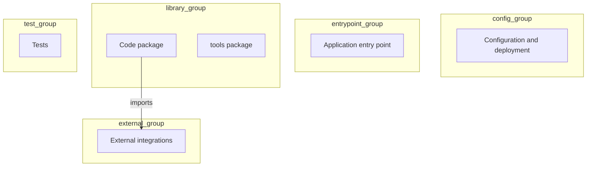

# Architecture report: MLEveryday/100-Days-Of-ML-Code

> Automated static analysis. **Observed** = directly seen in files/imports/AST; **Inferred** = interpretation from that evidence. Repository code was not executed.

## 1. Repository at a glance

| Item | Value |
| --- | --- |
| Repository | MLEveryday/100-Days-Of-ML-Code |
| Description | 100-Days-Of-ML-Code中文版 |
| Language | Python |
| Stars | 22233 |
| Licence | MIT |
| Analysed commit / branch | a6474a20a1cd8bb3fa3c7fab12ffadf70858810c / master |
| Framework(s) | None detected |
| Files analysed | 187 |
| Components | 6 |

## 2. Architecture in one minute

MLEveryday/100-Days-Of-ML-Code - 100-Days-Of-ML-Code中文版. This repository was analysed statically from 187 file(s) (33 Python). Detected technologies (observed from imports/manifests): GitHub Actions, Kafka, NumPy, pandas, unittest. Files are grouped into 6 component(s): Code package, Configuration and deployment, Application entry point, External integrations, Tests, tools package. Observed entry point(s): tools/check_docs.py, tools/check_lessons.py, tools/sync_lessons.py. Findings below distinguish observed facts from inferred interpretation.

## 3. High-level block diagram

## 4. Main components

### Code package (`code`)

- **Kind:** library
- **Status:** Observed
- **Confidence:** 0.85
- **Responsibility:** Groups 25 file(s) under code package (observed from repository paths and static analysis). Observed top-level functions: array_dataset, bounded_dataset, build_model, classification_summary, configure, decision_plot.
- **Paths:** `Code/Day 11_k-NN.py`, `Code/Day 13_SVM.py`, `Code/Day 14_SVM_Margin.py`, `Code/Day 15_Naive_Bayes.py`, `Code/Day 16_Kernel_SVM.py`, `Code/Day 18_Numpy_Neural_Network.py`, `Code/Day 1_Data_Preprocessing.py`, `Code/Day 21_HTML_Data_Collection.py`, `Code/Day 25_Decision_Tree.py`, `Code/Day 2_Simple_Linear_Regression.py`, `Code/Day 34_Random_Forests.py`, `Code/Day 39.py`, `Code/Day 3_Multiple_Linear_Regression.py`, `Code/Day 40.py`, `Code/Day 41.py`, `Code/Day 42.py`, `Code/Day 44_KMeans.py`, `Code/Day 54_Hierarchical_Clustering.py`, `Code/Day 6_Logistic_Regression.py`, `Code/KafkaProducer.py`, `Code/TestKafka.py`, `Code/course_utils.py`, `Code/deep_utils.py`, `Code/experiments.py`, `Code/my/LinerTest.py`
- **Evidence:** [Code/Day 11_k-NN.py](https://github.com/MLEveryday/100-Days-Of-ML-Code/blob/a6474a20a1cd8bb3fa3c7fab12ffadf70858810c/Code/Day%2011_k-NN.py); [Code/Day 13_SVM.py](https://github.com/MLEveryday/100-Days-Of-ML-Code/blob/a6474a20a1cd8bb3fa3c7fab12ffadf70858810c/Code/Day%2013_SVM.py); [Code/Day 14_SVM_Margin.py](https://github.com/MLEveryday/100-Days-Of-ML-Code/blob/a6474a20a1cd8bb3fa3c7fab12ffadf70858810c/Code/Day%2014_SVM_Margin.py); [Code/Day 15_Naive_Bayes.py](https://github.com/MLEveryday/100-Days-Of-ML-Code/blob/a6474a20a1cd8bb3fa3c7fab12ffadf70858810c/Code/Day%2015_Naive_Bayes.py); [Code/Day 16_Kernel_SVM.py](https://github.com/MLEveryday/100-Days-Of-ML-Code/blob/a6474a20a1cd8bb3fa3c7fab12ffadf70858810c/Code/Day%2016_Kernel_SVM.py); [Code/Day 18_Numpy_Neural_Network.py:49](https://github.com/MLEveryday/100-Days-Of-ML-Code/blob/a6474a20a1cd8bb3fa3c7fab12ffadf70858810c/Code/Day%2018_Numpy_Neural_Network.py#L49); [Code/Day 1_Data_Preprocessing.py](https://github.com/MLEveryday/100-Days-Of-ML-Code/blob/a6474a20a1cd8bb3fa3c7fab12ffadf70858810c/Code/Day%201_Data_Preprocessing.py); [Code/Day 21_HTML_Data_Collection.py](https://github.com/MLEveryday/100-Days-Of-ML-Code/blob/a6474a20a1cd8bb3fa3c7fab12ffadf70858810c/Code/Day%2021_HTML_Data_Collection.py)

### Configuration and deployment (`config`)

- **Kind:** config
- **Status:** Observed
- **Confidence:** 0.85
- **Responsibility:** Groups 2 file(s) under configuration and deployment (observed from repository paths and static analysis).
- **Paths:** `requirements-deep.txt`, `requirements.txt`
- **Evidence:** [requirements-deep.txt](https://github.com/MLEveryday/100-Days-Of-ML-Code/blob/a6474a20a1cd8bb3fa3c7fab12ffadf70858810c/requirements-deep.txt); [requirements.txt](https://github.com/MLEveryday/100-Days-Of-ML-Code/blob/a6474a20a1cd8bb3fa3c7fab12ffadf70858810c/requirements.txt)

### Application entry point (`entrypoint`)

- **Kind:** entrypoint
- **Status:** Observed
- **Confidence:** 0.85
- **Responsibility:** Groups 3 file(s) under application entry point (observed from repository paths and static analysis). Observed top-level functions: fixtures, main, render.
- **Paths:** `tools/check_docs.py`, `tools/check_lessons.py`, `tools/sync_lessons.py`
- **Evidence:** [tools/check_docs.py:14](https://github.com/MLEveryday/100-Days-Of-ML-Code/blob/a6474a20a1cd8bb3fa3c7fab12ffadf70858810c/tools/check_docs.py#L14); [tools/check_lessons.py:14](https://github.com/MLEveryday/100-Days-Of-ML-Code/blob/a6474a20a1cd8bb3fa3c7fab12ffadf70858810c/tools/check_lessons.py#L14); [tools/sync_lessons.py:11](https://github.com/MLEveryday/100-Days-Of-ML-Code/blob/a6474a20a1cd8bb3fa3c7fab12ffadf70858810c/tools/sync_lessons.py#L11)

### External integrations (`external_integrations`)

- **Kind:** external
- **Status:** Inferred
- **Confidence:** 0.70
- **Responsibility:** Groups 0 file(s) under external integrations (observed from repository paths and static analysis).
- **Evidence:** [Code/KafkaProducer.py:3](https://github.com/MLEveryday/100-Days-Of-ML-Code/blob/a6474a20a1cd8bb3fa3c7fab12ffadf70858810c/Code/KafkaProducer.py#L3); [Code/TestKafka.py:3](https://github.com/MLEveryday/100-Days-Of-ML-Code/blob/a6474a20a1cd8bb3fa3c7fab12ffadf70858810c/Code/TestKafka.py#L3)

### Tests (`tests`)

- **Kind:** test
- **Status:** Observed
- **Confidence:** 0.85
- **Responsibility:** Groups 4 file(s) under tests (observed from repository paths and static analysis). Observed top-level classes: CourseGuidance, ExperimentHistory, LearningInvariants, PetSplits. Observed top-level functions: run_lesson.
- **Paths:** `tests/test_course_guidance.py`, `tests/test_experiments.py`, `tests/test_learning_invariants.py`, `tests/test_pet_splits.py`
- **Evidence:** [tests/test_course_guidance.py:11](https://github.com/MLEveryday/100-Days-Of-ML-Code/blob/a6474a20a1cd8bb3fa3c7fab12ffadf70858810c/tests/test_course_guidance.py#L11); [tests/test_experiments.py:15](https://github.com/MLEveryday/100-Days-Of-ML-Code/blob/a6474a20a1cd8bb3fa3c7fab12ffadf70858810c/tests/test_experiments.py#L15); [tests/test_learning_invariants.py:14](https://github.com/MLEveryday/100-Days-Of-ML-Code/blob/a6474a20a1cd8bb3fa3c7fab12ffadf70858810c/tests/test_learning_invariants.py#L14); [tests/test_pet_splits.py:16](https://github.com/MLEveryday/100-Days-Of-ML-Code/blob/a6474a20a1cd8bb3fa3c7fab12ffadf70858810c/tests/test_pet_splits.py#L16)

### tools package (`tools`)

- **Kind:** library
- **Status:** Observed
- **Confidence:** 0.85
- **Responsibility:** Groups 1 file(s) under tools package (observed from repository paths and static analysis). Observed top-level functions: link, navigation, theory_outputs.
- **Paths:** `tools/course_guidance.py`
- **Evidence:** [tools/course_guidance.py:21](https://github.com/MLEveryday/100-Days-Of-ML-Code/blob/a6474a20a1cd8bb3fa3c7fab12ffadf70858810c/tools/course_guidance.py#L21)

## 5. Execution flow

**Observed** entry point(s):

- [tools/check_docs.py:63](https://github.com/MLEveryday/100-Days-Of-ML-Code/blob/a6474a20a1cd8bb3fa3c7fab12ffadf70858810c/tools/check_docs.py#L63)
- [tools/check_lessons.py:88](https://github.com/MLEveryday/100-Days-Of-ML-Code/blob/a6474a20a1cd8bb3fa3c7fab12ffadf70858810c/tools/check_lessons.py#L88)
- [tools/sync_lessons.py:60](https://github.com/MLEveryday/100-Days-Of-ML-Code/blob/a6474a20a1cd8bb3fa3c7fab12ffadf70858810c/tools/sync_lessons.py#L60)

Representative flow (derived from observed entry points and the import graph; steps beyond the entry point are **Inferred**):

1. Execution starts at an observed entry point listed above, if present.
2. `code` imports `external_integrations` (Code package -> External integrations).

## 6. Project structure

### `(root)`

- `.gitignore` - other (1332 bytes)
- `FAQ.MD` - docs (2819 bytes)
- `LICENSE` - docs (1075 bytes)
- `README.md` - docs (2347 bytes)
- `Translation specification.MD` - docs (2048 bytes)
- `requirements-deep.txt` - manifest (109 bytes)
- `requirements.txt` - manifest (240 bytes)

### `.github`

- `.github/workflows/course-checks.yml` - ci, YAML (1212 bytes)

### `Code`

- `Code/Day 11_K-NN.ipynb` - other (5889 bytes)
- `Code/Day 11_K-NN.md` - docs (4289 bytes)
- `Code/Day 11_k-NN.py` - source, Python (3828 bytes)
- `Code/Day 13_SVM.ipynb` - other (5243 bytes)
- `Code/Day 13_SVM.md` - docs (3725 bytes)
- `Code/Day 13_SVM.py` - source, Python (3268 bytes)
- `Code/Day 14_SVM_Margin.ipynb` - other (4473 bytes)
- `Code/Day 14_SVM_Margin.md` - docs (3312 bytes)
- `Code/Day 14_SVM_Margin.py` - source, Python (2963 bytes)
- `Code/Day 15_Naive_Bayes.ipynb` - other (3853 bytes)
- `Code/Day 15_Naive_Bayes.md` - docs (2831 bytes)
- `Code/Day 15_Naive_Bayes.py` - source, Python (2473 bytes)
- `Code/Day 16_Kernel_SVM.ipynb` - other (3983 bytes)
- `Code/Day 16_Kernel_SVM.md` - docs (2904 bytes)
- `Code/Day 16_Kernel_SVM.py` - source, Python (2484 bytes)
- `Code/Day 18_Numpy_Neural_Network.ipynb` - other (7209 bytes)
- `Code/Day 18_Numpy_Neural_Network.md` - docs (5343 bytes)
- `Code/Day 18_Numpy_Neural_Network.py` - source, Python (4689 bytes)
- `Code/Day 1_Data_Preprocessing.ipynb` - other (5505 bytes)
- `Code/Day 1_Data_Preprocessing.md` - docs (4073 bytes)
- `Code/Day 1_Data_Preprocessing.py` - source, Python (3631 bytes)
- `Code/Day 21_HTML_Data_Collection.ipynb` - other (3981 bytes)
- `Code/Day 21_HTML_Data_Collection.md` - docs (2899 bytes)
- `Code/Day 21_HTML_Data_Collection.py` - source, Python (2504 bytes)
- `Code/Day 25_Decision_Tree.ipynb` - other (5749 bytes)
- `Code/Day 25_Decision_Tree.md` - docs (4149 bytes)
- `Code/Day 25_Decision_Tree.py` - source, Python (3667 bytes)
- `Code/Day 2_Simple_Linear_Regression.ipynb` - other (5165 bytes)
- `Code/Day 2_Simple_Linear_Regression.md` - docs (3777 bytes)
- `Code/Day 2_Simple_Linear_Regression.py` - source, Python (3330 bytes)
- `Code/Day 34_Random_Forests.ipynb` - other (5671 bytes)
- `Code/Day 34_Random_Forests.md` - docs (4119 bytes)
- `Code/Day 34_Random_Forests.py` - source, Python (3702 bytes)
- `Code/Day 39.ipynb` - other (7727 bytes)
- `Code/Day 39.md` - docs (5808 bytes)
- `Code/Day 39.py` - source, Python (5328 bytes)
- `Code/Day 3_Multiple_Linear_Regression.ipynb` - other (5125 bytes)
- `Code/Day 3_Multiple_Linear_Regression.md` - docs (3730 bytes)
- `Code/Day 3_Multiple_Linear_Regression.py` - source, Python (3274 bytes)
- `Code/Day 40.ipynb` - other (5680 bytes)
- `Code/Day 40.md` - docs (4292 bytes)
- `Code/Day 40.py` - source, Python (3971 bytes)
- `Code/Day 41.ipynb` - other (7638 bytes)
- `Code/Day 41.md` - docs (5733 bytes)
- `Code/Day 41.py` - source, Python (5378 bytes)
- `Code/Day 42.ipynb` - other (7492 bytes)
- `Code/Day 42.md` - docs (5614 bytes)
- `Code/Day 42.py` - source, Python (5241 bytes)
- `Code/Day 44_KMeans.ipynb` - other (5108 bytes)
- `Code/Day 44_KMeans.md` - docs (3773 bytes)
- `Code/Day 44_KMeans.py` - source, Python (3359 bytes)
- `Code/Day 54_Hierarchical_Clustering.ipynb` - other (4214 bytes)
- `Code/Day 54_Hierarchical_Clustering.md` - docs (3144 bytes)
- `Code/Day 54_Hierarchical_Clustering.py` - source, Python (2684 bytes)
- `Code/Day 6_Logistic_Regression.ipynb` - other (5340 bytes)
- `Code/Day 6_Logistic_Regression.md` - docs (3806 bytes)
- `Code/Day 6_Logistic_Regression.py` - source, Python (3314 bytes)
- `Code/KafkaProducer.py` - source, Python (341 bytes)
- `Code/TestKafka.py` - source, Python (822 bytes)
- `Code/course_utils.py` - source, Python (3537 bytes)
- `Code/deep_utils.py` - source, Python (7162 bytes)
- `Code/experiments.py` - source, Python (2390 bytes)
- `Code/my/Data_age_salary.csv` - data (101 bytes)
- `Code/my/LinerTest.py` - source, Python (134 bytes)

### `Other Docs`

- `Other Docs/README.md` - docs (13 bytes)
- `Other Docs/速查手册/README.md` - docs (6477 bytes)

### `datasets`

- `datasets/50_Startups.csv` - data (2436 bytes)
- `datasets/Data.csv` - data (226 bytes)
- `datasets/Social_Network_Ads.csv` - data (10926 bytes)
- `datasets/readme.md` - docs (2941 bytes)
- `datasets/studentscores.csv` - data (236 bytes)

### `docs`

- `docs/course-map.json` - config (8211 bytes)
- `docs/curriculum.md` - docs (5375 bytes)
- `docs/day-by-day-review.md` - docs (31410 bytes)
- `docs/experiments.md` - docs (3495 bytes)
- `docs/learning-paths.md` - docs (6830 bytes)
- `docs/lessons/day-04.md` - docs (1357 bytes)
- `docs/lessons/day-05.md` - docs (1523 bytes)
- `docs/lessons/day-07.md` - docs (1475 bytes)
- `docs/lessons/day-08.md` - docs (1506 bytes)
- `docs/lessons/day-09.md` - docs (1468 bytes)
- `docs/lessons/day-10.md` - docs (1839 bytes)
- `docs/lessons/day-12.md` - docs (1395 bytes)
- `docs/lessons/day-17.md` - docs (1492 bytes)
- `docs/lessons/day-19.md` - docs (1505 bytes)
- `docs/lessons/day-20.md` - docs (1784 bytes)
- `docs/lessons/day-22.md` - docs (1399 bytes)
- `docs/lessons/day-23.md` - docs (1431 bytes)
- `docs/lessons/day-24.md` - docs (1539 bytes)
- `docs/lessons/day-26.md` - docs (1210 bytes)
- `docs/lessons/day-27.md` - docs (1303 bytes)
- `docs/lessons/day-28.md` - docs (1142 bytes)
- `docs/lessons/day-29.md` - docs (1474 bytes)
- `docs/lessons/day-30.md` - docs (1249 bytes)
- `docs/lessons/day-31.md` - docs (1099 bytes)
- `docs/lessons/day-32.md` - docs (1131 bytes)
- `docs/lessons/day-33.md` - docs (1436 bytes)
- `docs/lessons/day-35.md` - docs (1310 bytes)
- `docs/lessons/day-36.md` - docs (1255 bytes)
- `docs/lessons/day-37.md` - docs (1179 bytes)
- `docs/lessons/day-38.md` - docs (1501 bytes)
- `docs/lessons/day-43.md` - docs (1455 bytes)
- `docs/lessons/day-45.md` - docs (1366 bytes)
- `docs/lessons/day-46.md` - docs (1301 bytes)
- `docs/lessons/day-47.md` - docs (1403 bytes)
- `docs/lessons/day-48.md` - docs (1496 bytes)
- `docs/lessons/day-49.md` - docs (1482 bytes)
- `docs/lessons/day-50.md` - docs (1489 bytes)
- `docs/lessons/day-51.md` - docs (1640 bytes)
- `docs/lessons/day-52.md` - docs (1647 bytes)
- `docs/lessons/day-53.md` - docs (1744 bytes)
- `docs/modernization.md` - docs (7129 bytes)
- `docs/original-roadmap.md` - docs (18130 bytes)
- `docs/readings.md` - docs (2045 bytes)
- `docs/review-handbook-checks.json` - config (7365 bytes)
- `docs/review-link-checks.json` - config (24203 bytes)
- `docs/setup.md` - docs (4730 bytes)
- `docs/solutions/day-01.md` - docs (927 bytes)
- `docs/solutions/day-02.md` - docs (944 bytes)
- `docs/solutions/day-03.md` - docs (1016 bytes)
- `docs/solutions/day-04.md` - docs (713 bytes)
- `docs/solutions/day-05.md` - docs (1458 bytes)
- `docs/solutions/day-06.md` - docs (865 bytes)
- `docs/solutions/day-07.md` - docs (869 bytes)
- `docs/solutions/day-08.md` - docs (723 bytes)
- `docs/solutions/day-09.md` - docs (748 bytes)
- `docs/solutions/day-10.md` - docs (859 bytes)
- `docs/solutions/day-11.md` - docs (909 bytes)
- `docs/solutions/day-12.md` - docs (783 bytes)
- `docs/solutions/day-13.md` - docs (837 bytes)
- `docs/solutions/day-14.md` - docs (886 bytes)
- `docs/solutions/day-15.md` - docs (906 bytes)
- `docs/solutions/day-16.md` - docs (889 bytes)
- `docs/solutions/day-17.md` - docs (736 bytes)
- `docs/solutions/day-18.md` - docs (850 bytes)
- `docs/solutions/day-19.md` - docs (876 bytes)
- `docs/solutions/day-20.md` - docs (897 bytes)
- `docs/solutions/day-21.md` - docs (879 bytes)
- `docs/solutions/day-22.md` - docs (921 bytes)
- `docs/solutions/day-23.md` - docs (774 bytes)
- `docs/solutions/day-24.md` - docs (815 bytes)
- `docs/solutions/day-25.md` - docs (810 bytes)
- `docs/solutions/day-26.md` - docs (784 bytes)
- `docs/solutions/day-27.md` - docs (782 bytes)
- `docs/solutions/day-28.md` - docs (712 bytes)
- `docs/solutions/day-29.md` - docs (822 bytes)
- `docs/solutions/day-30.md` - docs (800 bytes)
- `docs/solutions/day-31.md` - docs (783 bytes)
- `docs/solutions/day-32.md` - docs (765 bytes)
- `docs/solutions/day-33.md` - docs (804 bytes)
- `docs/solutions/day-34.md` - docs (880 bytes)
- `docs/solutions/day-35.md` - docs (856 bytes)
- `docs/solutions/day-36.md` - docs (776 bytes)
- `docs/solutions/day-37.md` - docs (683 bytes)
- `docs/solutions/day-38.md` - docs (819 bytes)
- `docs/solutions/day-39.md` - docs (874 bytes)
- `docs/solutions/day-40.md` - docs (836 bytes)
- `docs/solutions/day-41.md` - docs (1010 bytes)
- `docs/solutions/day-42.md` - docs (876 bytes)
- `docs/solutions/day-43.md` - docs (768 bytes)
- `docs/solutions/day-44.md` - docs (862 bytes)
- `docs/solutions/day-45.md` - docs (818 bytes)
- `docs/solutions/day-46.md` - docs (723 bytes)
- `docs/solutions/day-47.md` - docs (770 bytes)
- `docs/solutions/day-48.md` - docs (753 bytes)
- `docs/solutions/day-49.md` - docs (833 bytes)
- `docs/solutions/day-50.md` - docs (815 bytes)
- `docs/solutions/day-51.md` - docs (832 bytes)
- `docs/solutions/day-52.md` - docs (804 bytes)
- `docs/solutions/day-53.md` - docs (766 bytes)
- `docs/solutions/day-54.md` - docs (937 bytes)

### `tests`

- `tests/test_course_guidance.py` - test, Python (1092 bytes)
- `tests/test_experiments.py` - test, Python (2723 bytes)
- `tests/test_learning_invariants.py` - test, Python (4265 bytes)
- `tests/test_pet_splits.py` - test, Python (9028 bytes)

### `tools`

- `tools/check_docs.py` - source, Python (3049 bytes)
- `tools/check_lessons.py` - source, Python (4848 bytes)
- `tools/course_guidance.py` - source, Python (4406 bytes)
- `tools/sync_lessons.py` - source, Python (3115 bytes)

## 7. Key dependencies and integrations

| Name | Category | Status | Confidence | Evidence |
| --- | --- | --- | --- | --- |
| GitHub Actions | ci | Observed | 0.85 | [.github/workflows/course-checks.yml](https://github.com/MLEveryday/100-Days-Of-ML-Code/blob/a6474a20a1cd8bb3fa3c7fab12ffadf70858810c/.github/workflows/course-checks.yml) |
| Kafka | library | Observed | 0.95 | [Code/KafkaProducer.py:3](https://github.com/MLEveryday/100-Days-Of-ML-Code/blob/a6474a20a1cd8bb3fa3c7fab12ffadf70858810c/Code/KafkaProducer.py#L3); [Code/TestKafka.py:3](https://github.com/MLEveryday/100-Days-Of-ML-Code/blob/a6474a20a1cd8bb3fa3c7fab12ffadf70858810c/Code/TestKafka.py#L3) |
| NumPy | library | Observed | 0.95 | [Code/Day 14_SVM_Margin.py:34](https://github.com/MLEveryday/100-Days-Of-ML-Code/blob/a6474a20a1cd8bb3fa3c7fab12ffadf70858810c/Code/Day%2014_SVM_Margin.py#L34); [Code/Day 18_Numpy_Neural_Network.py:31](https://github.com/MLEveryday/100-Days-Of-ML-Code/blob/a6474a20a1cd8bb3fa3c7fab12ffadf70858810c/Code/Day%2018_Numpy_Neural_Network.py#L31); [Code/Day 1_Data_Preprocessing.py:31](https://github.com/MLEveryday/100-Days-Of-ML-Code/blob/a6474a20a1cd8bb3fa3c7fab12ffadf70858810c/Code/Day%201_Data_Preprocessing.py#L31); [Code/Day 39.py:33](https://github.com/MLEveryday/100-Days-Of-ML-Code/blob/a6474a20a1cd8bb3fa3c7fab12ffadf70858810c/Code/Day%2039.py#L33) |
| pandas | library | Observed | 0.95 | [Code/Day 11_k-NN.py:31](https://github.com/MLEveryday/100-Days-Of-ML-Code/blob/a6474a20a1cd8bb3fa3c7fab12ffadf70858810c/Code/Day%2011_k-NN.py#L31); [Code/Day 13_SVM.py:31](https://github.com/MLEveryday/100-Days-Of-ML-Code/blob/a6474a20a1cd8bb3fa3c7fab12ffadf70858810c/Code/Day%2013_SVM.py#L31); [Code/Day 1_Data_Preprocessing.py:32](https://github.com/MLEveryday/100-Days-Of-ML-Code/blob/a6474a20a1cd8bb3fa3c7fab12ffadf70858810c/Code/Day%201_Data_Preprocessing.py#L32); [Code/Day 21_HTML_Data_Collection.py:31](https://github.com/MLEveryday/100-Days-Of-ML-Code/blob/a6474a20a1cd8bb3fa3c7fab12ffadf70858810c/Code/Day%2021_HTML_Data_Collection.py#L31) |
| unittest | tooling | Observed | 0.95 | [tests/test_course_guidance.py:4](https://github.com/MLEveryday/100-Days-Of-ML-Code/blob/a6474a20a1cd8bb3fa3c7fab12ffadf70858810c/tests/test_course_guidance.py#L4); [tests/test_experiments.py:7](https://github.com/MLEveryday/100-Days-Of-ML-Code/blob/a6474a20a1cd8bb3fa3c7fab12ffadf70858810c/tests/test_experiments.py#L7); [tests/test_experiments.py:8](https://github.com/MLEveryday/100-Days-Of-ML-Code/blob/a6474a20a1cd8bb3fa3c7fab12ffadf70858810c/tests/test_experiments.py#L8); [tests/test_learning_invariants.py:8](https://github.com/MLEveryday/100-Days-Of-ML-Code/blob/a6474a20a1cd8bb3fa3c7fab12ffadf70858810c/tests/test_learning_invariants.py#L8) |

## 8. Data and state

No database, cache, queue, or persistent-state usage was observed in the analysed files. State handling, if any, may be in-memory or in files that were not analysed.

## 9. Configuration and deployment clues

- `.github/workflows/course-checks.yml` (ci)
- `docs/course-map.json` (config)
- `docs/review-handbook-checks.json` (config)
- `docs/review-link-checks.json` (config)
- `requirements-deep.txt` (manifest)
- `requirements.txt` (manifest)

## 10. Design observations

- An entry/API layer is separated from other code (Inferred from paths and decorators).
- Tests are present alongside source code (Observed from test file paths).
- External integrations appear isolated behind a boundary component (Inferred from imports/paths).

These observations are interpretations (**Inferred**) of the observed structure, not guarantees about runtime design.

## 11. Limitations and unknowns

- Static analysis only: repository code was not executed, installed, or imported at runtime.
- Components and relationships are inferred from file paths, imports, and AST structure; runtime behaviour, dynamic imports, and reflection may not be visible.
- Repository text was treated as untrusted data; no instructions found in repository files were followed, and likely secret values were redacted/excluded.

## 12. Source references

- [.github/workflows/course-checks.yml](https://github.com/MLEveryday/100-Days-Of-ML-Code/blob/a6474a20a1cd8bb3fa3c7fab12ffadf70858810c/.github/workflows/course-checks.yml)
- [Code/Day 11_k-NN.py](https://github.com/MLEveryday/100-Days-Of-ML-Code/blob/a6474a20a1cd8bb3fa3c7fab12ffadf70858810c/Code/Day%2011_k-NN.py)
- [Code/Day 11_k-NN.py:31](https://github.com/MLEveryday/100-Days-Of-ML-Code/blob/a6474a20a1cd8bb3fa3c7fab12ffadf70858810c/Code/Day%2011_k-NN.py#L31)
- [Code/Day 13_SVM.py](https://github.com/MLEveryday/100-Days-Of-ML-Code/blob/a6474a20a1cd8bb3fa3c7fab12ffadf70858810c/Code/Day%2013_SVM.py)
- [Code/Day 13_SVM.py:31](https://github.com/MLEveryday/100-Days-Of-ML-Code/blob/a6474a20a1cd8bb3fa3c7fab12ffadf70858810c/Code/Day%2013_SVM.py#L31)
- [Code/Day 14_SVM_Margin.py](https://github.com/MLEveryday/100-Days-Of-ML-Code/blob/a6474a20a1cd8bb3fa3c7fab12ffadf70858810c/Code/Day%2014_SVM_Margin.py)
- [Code/Day 14_SVM_Margin.py:34](https://github.com/MLEveryday/100-Days-Of-ML-Code/blob/a6474a20a1cd8bb3fa3c7fab12ffadf70858810c/Code/Day%2014_SVM_Margin.py#L34)
- [Code/Day 15_Naive_Bayes.py](https://github.com/MLEveryday/100-Days-Of-ML-Code/blob/a6474a20a1cd8bb3fa3c7fab12ffadf70858810c/Code/Day%2015_Naive_Bayes.py)
- [Code/Day 16_Kernel_SVM.py](https://github.com/MLEveryday/100-Days-Of-ML-Code/blob/a6474a20a1cd8bb3fa3c7fab12ffadf70858810c/Code/Day%2016_Kernel_SVM.py)
- [Code/Day 18_Numpy_Neural_Network.py:31](https://github.com/MLEveryday/100-Days-Of-ML-Code/blob/a6474a20a1cd8bb3fa3c7fab12ffadf70858810c/Code/Day%2018_Numpy_Neural_Network.py#L31)
- [Code/Day 18_Numpy_Neural_Network.py:49](https://github.com/MLEveryday/100-Days-Of-ML-Code/blob/a6474a20a1cd8bb3fa3c7fab12ffadf70858810c/Code/Day%2018_Numpy_Neural_Network.py#L49)
- [Code/Day 1_Data_Preprocessing.py](https://github.com/MLEveryday/100-Days-Of-ML-Code/blob/a6474a20a1cd8bb3fa3c7fab12ffadf70858810c/Code/Day%201_Data_Preprocessing.py)
- [Code/Day 1_Data_Preprocessing.py:31](https://github.com/MLEveryday/100-Days-Of-ML-Code/blob/a6474a20a1cd8bb3fa3c7fab12ffadf70858810c/Code/Day%201_Data_Preprocessing.py#L31)
- [Code/Day 1_Data_Preprocessing.py:32](https://github.com/MLEveryday/100-Days-Of-ML-Code/blob/a6474a20a1cd8bb3fa3c7fab12ffadf70858810c/Code/Day%201_Data_Preprocessing.py#L32)
- [Code/Day 21_HTML_Data_Collection.py](https://github.com/MLEveryday/100-Days-Of-ML-Code/blob/a6474a20a1cd8bb3fa3c7fab12ffadf70858810c/Code/Day%2021_HTML_Data_Collection.py)
- [Code/Day 21_HTML_Data_Collection.py:31](https://github.com/MLEveryday/100-Days-Of-ML-Code/blob/a6474a20a1cd8bb3fa3c7fab12ffadf70858810c/Code/Day%2021_HTML_Data_Collection.py#L31)
- [Code/Day 25_Decision_Tree.py:31](https://github.com/MLEveryday/100-Days-Of-ML-Code/blob/a6474a20a1cd8bb3fa3c7fab12ffadf70858810c/Code/Day%2025_Decision_Tree.py#L31)
- [Code/Day 2_Simple_Linear_Regression.py:31](https://github.com/MLEveryday/100-Days-Of-ML-Code/blob/a6474a20a1cd8bb3fa3c7fab12ffadf70858810c/Code/Day%202_Simple_Linear_Regression.py#L31)
- [Code/Day 34_Random_Forests.py:31](https://github.com/MLEveryday/100-Days-Of-ML-Code/blob/a6474a20a1cd8bb3fa3c7fab12ffadf70858810c/Code/Day%2034_Random_Forests.py#L31)
- [Code/Day 39.py:33](https://github.com/MLEveryday/100-Days-Of-ML-Code/blob/a6474a20a1cd8bb3fa3c7fab12ffadf70858810c/Code/Day%2039.py#L33)
- [Code/Day 3_Multiple_Linear_Regression.py:31](https://github.com/MLEveryday/100-Days-Of-ML-Code/blob/a6474a20a1cd8bb3fa3c7fab12ffadf70858810c/Code/Day%203_Multiple_Linear_Regression.py#L31)
- [Code/Day 41.py:33](https://github.com/MLEveryday/100-Days-Of-ML-Code/blob/a6474a20a1cd8bb3fa3c7fab12ffadf70858810c/Code/Day%2041.py#L33)
- [Code/KafkaProducer.py:3](https://github.com/MLEveryday/100-Days-Of-ML-Code/blob/a6474a20a1cd8bb3fa3c7fab12ffadf70858810c/Code/KafkaProducer.py#L3)
- [Code/TestKafka.py:3](https://github.com/MLEveryday/100-Days-Of-ML-Code/blob/a6474a20a1cd8bb3fa3c7fab12ffadf70858810c/Code/TestKafka.py#L3)
- [Code/course_utils.py:4](https://github.com/MLEveryday/100-Days-Of-ML-Code/blob/a6474a20a1cd8bb3fa3c7fab12ffadf70858810c/Code/course_utils.py#L4)
- [Code/deep_utils.py:6](https://github.com/MLEveryday/100-Days-Of-ML-Code/blob/a6474a20a1cd8bb3fa3c7fab12ffadf70858810c/Code/deep_utils.py#L6)
- [Code/my/LinerTest.py:2](https://github.com/MLEveryday/100-Days-Of-ML-Code/blob/a6474a20a1cd8bb3fa3c7fab12ffadf70858810c/Code/my/LinerTest.py#L2)
- [requirements-deep.txt](https://github.com/MLEveryday/100-Days-Of-ML-Code/blob/a6474a20a1cd8bb3fa3c7fab12ffadf70858810c/requirements-deep.txt)
- [requirements.txt](https://github.com/MLEveryday/100-Days-Of-ML-Code/blob/a6474a20a1cd8bb3fa3c7fab12ffadf70858810c/requirements.txt)
- [tests/test_course_guidance.py:4](https://github.com/MLEveryday/100-Days-Of-ML-Code/blob/a6474a20a1cd8bb3fa3c7fab12ffadf70858810c/tests/test_course_guidance.py#L4)
- [tests/test_course_guidance.py:11](https://github.com/MLEveryday/100-Days-Of-ML-Code/blob/a6474a20a1cd8bb3fa3c7fab12ffadf70858810c/tests/test_course_guidance.py#L11)
- [tests/test_experiments.py:7](https://github.com/MLEveryday/100-Days-Of-ML-Code/blob/a6474a20a1cd8bb3fa3c7fab12ffadf70858810c/tests/test_experiments.py#L7)
- [tests/test_experiments.py:8](https://github.com/MLEveryday/100-Days-Of-ML-Code/blob/a6474a20a1cd8bb3fa3c7fab12ffadf70858810c/tests/test_experiments.py#L8)
- [tests/test_experiments.py:15](https://github.com/MLEveryday/100-Days-Of-ML-Code/blob/a6474a20a1cd8bb3fa3c7fab12ffadf70858810c/tests/test_experiments.py#L15)
- [tests/test_learning_invariants.py:8](https://github.com/MLEveryday/100-Days-Of-ML-Code/blob/a6474a20a1cd8bb3fa3c7fab12ffadf70858810c/tests/test_learning_invariants.py#L8)
- [tests/test_learning_invariants.py:14](https://github.com/MLEveryday/100-Days-Of-ML-Code/blob/a6474a20a1cd8bb3fa3c7fab12ffadf70858810c/tests/test_learning_invariants.py#L14)
- [tests/test_learning_invariants.py:70](https://github.com/MLEveryday/100-Days-Of-ML-Code/blob/a6474a20a1cd8bb3fa3c7fab12ffadf70858810c/tests/test_learning_invariants.py#L70)
- [tests/test_pet_splits.py:7](https://github.com/MLEveryday/100-Days-Of-ML-Code/blob/a6474a20a1cd8bb3fa3c7fab12ffadf70858810c/tests/test_pet_splits.py#L7)
- [tests/test_pet_splits.py:16](https://github.com/MLEveryday/100-Days-Of-ML-Code/blob/a6474a20a1cd8bb3fa3c7fab12ffadf70858810c/tests/test_pet_splits.py#L16)
- [tests/test_pet_splits.py:157](https://github.com/MLEveryday/100-Days-Of-ML-Code/blob/a6474a20a1cd8bb3fa3c7fab12ffadf70858810c/tests/test_pet_splits.py#L157)
- [tools/check_docs.py:14](https://github.com/MLEveryday/100-Days-Of-ML-Code/blob/a6474a20a1cd8bb3fa3c7fab12ffadf70858810c/tools/check_docs.py#L14)
- [tools/check_docs.py:63](https://github.com/MLEveryday/100-Days-Of-ML-Code/blob/a6474a20a1cd8bb3fa3c7fab12ffadf70858810c/tools/check_docs.py#L63)
- [tools/check_lessons.py:14](https://github.com/MLEveryday/100-Days-Of-ML-Code/blob/a6474a20a1cd8bb3fa3c7fab12ffadf70858810c/tools/check_lessons.py#L14)
- [tools/check_lessons.py:88](https://github.com/MLEveryday/100-Days-Of-ML-Code/blob/a6474a20a1cd8bb3fa3c7fab12ffadf70858810c/tools/check_lessons.py#L88)
- [tools/course_guidance.py:21](https://github.com/MLEveryday/100-Days-Of-ML-Code/blob/a6474a20a1cd8bb3fa3c7fab12ffadf70858810c/tools/course_guidance.py#L21)
- [tools/sync_lessons.py:11](https://github.com/MLEveryday/100-Days-Of-ML-Code/blob/a6474a20a1cd8bb3fa3c7fab12ffadf70858810c/tools/sync_lessons.py#L11)
- [tools/sync_lessons.py:60](https://github.com/MLEveryday/100-Days-Of-ML-Code/blob/a6474a20a1cd8bb3fa3c7fab12ffadf70858810c/tools/sync_lessons.py#L60)
