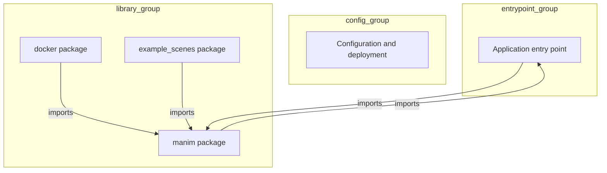

# Architecture report: ManimCommunity/manim

> Automated static analysis. **Observed** = directly seen in files/imports/AST; **Inferred** = interpretation from that evidence. Repository code was not executed.

## 1. Repository at a glance

| Item | Value |
| --- | --- |
| Repository | ManimCommunity/manim |
| Description | A community-maintained Python framework for creating mathematical animations.  |
| Language | Python |
| Stars | 42506 |
| Licence | MIT |
| Analysed commit / branch | e8afc6398bc7ac4d4beaa2debd79325f9167d374 / main |
| Framework(s) | None detected |
| Files analysed | 800 |
| Components | 5 |

## 2. Architecture in one minute

ManimCommunity/manim - A community-maintained Python framework for creating mathematical animations. . This repository was analysed statically from 800 file(s) (105 Python). Detected technologies (observed from imports/manifests): GitHub Actions, Click, NumPy, Docker, pytest. Files are grouped into 5 component(s): Configuration and deployment, docker package, Application entry point, example_scenes package, manim package. Observed entry point(s): .github/scripts/ci_build_cairo.py, benchmarks/bench_lissajous.py, manim/__main__.py. Findings below distinguish observed facts from inferred interpretation.

## 3. High-level block diagram

## 4. Main components

### Configuration and deployment (`config`)

- **Kind:** config
- **Status:** Observed
- **Confidence:** 0.85
- **Responsibility:** Groups 5 file(s) under configuration and deployment (observed from repository paths and static analysis).
- **Paths:** `crowdin.yml`, `docker/Dockerfile`, `example_scenes/manim.cfg`, `lgtm.yml`, `manim/_config/default.cfg`
- **Evidence:** [crowdin.yml](https://github.com/ManimCommunity/manim/blob/e8afc6398bc7ac4d4beaa2debd79325f9167d374/crowdin.yml); [docker/Dockerfile](https://github.com/ManimCommunity/manim/blob/e8afc6398bc7ac4d4beaa2debd79325f9167d374/docker/Dockerfile); [example_scenes/manim.cfg](https://github.com/ManimCommunity/manim/blob/e8afc6398bc7ac4d4beaa2debd79325f9167d374/example_scenes/manim.cfg); [lgtm.yml](https://github.com/ManimCommunity/manim/blob/e8afc6398bc7ac4d4beaa2debd79325f9167d374/lgtm.yml); [manim/_config/default.cfg](https://github.com/ManimCommunity/manim/blob/e8afc6398bc7ac4d4beaa2debd79325f9167d374/manim/_config/default.cfg)

### docker package (`docker`)

- **Kind:** library
- **Status:** Observed
- **Confidence:** 0.85
- **Responsibility:** Groups 1 file(s) under docker package (observed from repository paths and static analysis). Observed top-level classes: VerifyImage.
- **Paths:** `docker/verify_image.py`
- **Evidence:** [docker/verify_image.py:23](https://github.com/ManimCommunity/manim/blob/e8afc6398bc7ac4d4beaa2debd79325f9167d374/docker/verify_image.py#L23)

### Application entry point (`entrypoint`)

- **Kind:** entrypoint
- **Status:** Observed
- **Confidence:** 0.85
- **Responsibility:** Groups 5 file(s) under application entry point (observed from repository paths and static analysis). Observed application object created via Group. Observed top-level classes: AddTextLetterByLetter, AddTextWordByWord, ApplyComplexFunction, ApplyFunction, ApplyMatrix, ApplyMethod. Observed top-level functions: bench_scene, color_map, get_circles, get_intersection_point, main, print_version_and_exit.
- **Paths:** `benchmarks/bench_lissajous.py`, `manim/__main__.py`, `manim/animation/creation.py`, `manim/animation/transform.py`, `manim/mobject/geometry/shape_matchers.py`
- **Evidence:** [benchmarks/bench_lissajous.py:29](https://github.com/ManimCommunity/manim/blob/e8afc6398bc7ac4d4beaa2debd79325f9167d374/benchmarks/bench_lissajous.py#L29); [manim/__main__.py:18](https://github.com/ManimCommunity/manim/blob/e8afc6398bc7ac4d4beaa2debd79325f9167d374/manim/__main__.py#L18); [manim/animation/creation.py:642](https://github.com/ManimCommunity/manim/blob/e8afc6398bc7ac4d4beaa2debd79325f9167d374/manim/animation/creation.py#L642); [manim/animation/transform.py:871](https://github.com/ManimCommunity/manim/blob/e8afc6398bc7ac4d4beaa2debd79325f9167d374/manim/animation/transform.py#L871); [manim/mobject/geometry/shape_matchers.py:71](https://github.com/ManimCommunity/manim/blob/e8afc6398bc7ac4d4beaa2debd79325f9167d374/manim/mobject/geometry/shape_matchers.py#L71)

### example_scenes package (`example_scenes`)

- **Kind:** library
- **Status:** Observed
- **Confidence:** 0.85
- **Responsibility:** Groups 4 file(s) under example_scenes package (observed from repository paths and static analysis). Observed top-level classes: GuiTest, GuiTest2, InCodeTexTemplate, InlineFullScreenQuad, InlineShaderExample, InteractiveDevelopment. Observed top-level functions: FrenchCursive, get_plane_mesh.
- **Paths:** `example_scenes/advanced_tex_fonts.py`, `example_scenes/basic.py`, `example_scenes/customtex.py`, `example_scenes/opengl.py`
- **Evidence:** [example_scenes/advanced_tex_fonts.py:20](https://github.com/ManimCommunity/manim/blob/e8afc6398bc7ac4d4beaa2debd79325f9167d374/example_scenes/advanced_tex_fonts.py#L20); [example_scenes/basic.py:18](https://github.com/ManimCommunity/manim/blob/e8afc6398bc7ac4d4beaa2debd79325f9167d374/example_scenes/basic.py#L18); [example_scenes/customtex.py:4](https://github.com/ManimCommunity/manim/blob/e8afc6398bc7ac4d4beaa2debd79325f9167d374/example_scenes/customtex.py#L4); [example_scenes/opengl.py:11](https://github.com/ManimCommunity/manim/blob/e8afc6398bc7ac4d4beaa2debd79325f9167d374/example_scenes/opengl.py#L11)

### manim package (`manim`)

- **Kind:** library
- **Status:** Observed
- **Confidence:** 0.85
- **Responsibility:** Groups 93 file(s) under manim package (observed from repository paths and static analysis). Observed top-level classes: Add, Angle, AnimatedBoundary, Animation, AnimationGroup, AnnotationDot. Observed top-level functions: _absolute_lexical, _add_artifact_extension, _convert_point_to_3d, _default_profile, _determine_graph_layout, _determine_quality.
- **Paths:** `manim/__init__.py`, `manim/_config/__init__.py`, `manim/_config/cli_colors.py`, `manim/_config/logger_utils.py`, `manim/_config/output.py`, `manim/_config/output_plan.py`, `manim/_config/render_session.py`, `manim/_config/utils.py`, `manim/_config/video_encoder.py`, `manim/_run/__init__.py`, `manim/_run/cache.py`, `manim/_run/frames.py`, `manim/_run/listeners.py`, `manim/_run/loop.py`, `manim/_run/mode.py`, `manim/_run/record.py`, `manim/_run/selection.py`, `manim/animation/__init__.py`, `manim/animation/animation.py`, `manim/animation/changing.py`, `manim/animation/composition.py`, `manim/animation/fading.py`, `manim/animation/growing.py`, `manim/animation/indication.py`, `manim/animation/movement.py`, `manim/animation/numbers.py`, `manim/animation/rotation.py`, `manim/animation/specialized.py`, `manim/animation/speedmodifier.py`, `manim/animation/transform_matching_parts.py`, `manim/animation/updaters/__init__.py`, `manim/animation/updaters/mobject_update_utils.py`, `manim/animation/updaters/update.py`, `manim/cli/__init__.py`, `manim/cli/cache/__init__.py`, `manim/cli/cache/commands.py`, `manim/cli/cfg/__init__.py`, `manim/cli/cfg/group.py`, `manim/cli/checkhealth/__init__.py`, `manim/cli/checkhealth/checks.py`, `manim/cli/checkhealth/commands.py`, `manim/cli/default_group.py`, `manim/cli/init/__init__.py`, `manim/cli/init/commands.py`, `manim/cli/plugins/__init__.py`, `manim/cli/plugins/commands.py`, `manim/cli/render/__init__.py`, `manim/cli/render/commands.py`, `manim/cli/render/ease_of_access_options.py`, `manim/cli/render/global_options.py`, `manim/cli/render/output_options.py`, `manim/cli/render/render_options.py`, `manim/constants.py`, `manim/data_structures.py`, `manim/manager.py`, `manim/mobject/__init__.py`, `manim/mobject/frame.py`, `manim/mobject/geometry/__init__.py`, `manim/mobject/geometry/arc.py`, `manim/mobject/geometry/boolean_ops.py`, `manim/mobject/geometry/labeled.py`, `manim/mobject/geometry/line.py`, `manim/mobject/geometry/polygram.py`, `manim/mobject/geometry/tips.py`, `manim/mobject/graph.py`, `manim/mobject/graphing/__init__.py`, `manim/mobject/graphing/coordinate_systems.py`, `manim/mobject/graphing/functions.py`, `manim/mobject/graphing/number_line.py`, `manim/mobject/graphing/probability.py`, `manim/mobject/graphing/scale.py`, `manim/mobject/logo.py`, `manim/mobject/matrix.py`, `manim/mobject/mobject.py`, `manim/mobject/opengl/__init__.py`, `manim/mobject/opengl/dot_cloud.py`, `manim/mobject/opengl/opengl_compatibility.py`, `manim/mobject/opengl/opengl_geometry.py`, `manim/mobject/opengl/opengl_image_mobject.py`, `manim/mobject/opengl/opengl_mobject.py`, `manim/mobject/opengl/opengl_point_cloud_mobject.py`, `manim/mobject/opengl/opengl_surface.py`, `manim/mobject/opengl/opengl_three_dimensions.py`, `manim/mobject/opengl/opengl_vectorized_mobject.py`, `manim/mobject/svg/__init__.py`, `manim/mobject/svg/brace.py`, `manim/mobject/svg/svg_mobject.py`, `manim/mobject/table.py`, `manim/mobject/text/__init__.py`, `manim/mobject/text/code_mobject.py`, `manim/mobject/text/numbers.py`, `manim/mobject/text/tex_mobject.py`, `manim/mobject/text/text_mobject.py`
- **Evidence:** [manim/__init__.py](https://github.com/ManimCommunity/manim/blob/e8afc6398bc7ac4d4beaa2debd79325f9167d374/manim/__init__.py); [manim/_config/__init__.py:46](https://github.com/ManimCommunity/manim/blob/e8afc6398bc7ac4d4beaa2debd79325f9167d374/manim/_config/__init__.py#L46); [manim/_config/cli_colors.py:17](https://github.com/ManimCommunity/manim/blob/e8afc6398bc7ac4d4beaa2debd79325f9167d374/manim/_config/cli_colors.py#L17); [manim/_config/logger_utils.py:54](https://github.com/ManimCommunity/manim/blob/e8afc6398bc7ac4d4beaa2debd79325f9167d374/manim/_config/logger_utils.py#L54); [manim/_config/output.py:11](https://github.com/ManimCommunity/manim/blob/e8afc6398bc7ac4d4beaa2debd79325f9167d374/manim/_config/output.py#L11); [manim/_config/output_plan.py:17](https://github.com/ManimCommunity/manim/blob/e8afc6398bc7ac4d4beaa2debd79325f9167d374/manim/_config/output_plan.py#L17); [manim/_config/render_session.py:21](https://github.com/ManimCommunity/manim/blob/e8afc6398bc7ac4d4beaa2debd79325f9167d374/manim/_config/render_session.py#L21); [manim/_config/utils.py:46](https://github.com/ManimCommunity/manim/blob/e8afc6398bc7ac4d4beaa2debd79325f9167d374/manim/_config/utils.py#L46)

## 5. Execution flow

**Observed** entry point(s):

- [.github/scripts/ci_build_cairo.py:222](https://github.com/ManimCommunity/manim/blob/e8afc6398bc7ac4d4beaa2debd79325f9167d374/.github/scripts/ci_build_cairo.py#L222)
- [benchmarks/bench_lissajous.py:423](https://github.com/ManimCommunity/manim/blob/e8afc6398bc7ac4d4beaa2debd79325f9167d374/benchmarks/bench_lissajous.py#L423)
- [manim/__main__.py:102](https://github.com/ManimCommunity/manim/blob/e8afc6398bc7ac4d4beaa2debd79325f9167d374/manim/__main__.py#L102)
- [manim/animation/creation.py:642](https://github.com/ManimCommunity/manim/blob/e8afc6398bc7ac4d4beaa2debd79325f9167d374/manim/animation/creation.py#L642)
- [manim/animation/transform.py:871](https://github.com/ManimCommunity/manim/blob/e8afc6398bc7ac4d4beaa2debd79325f9167d374/manim/animation/transform.py#L871)
- [manim/mobject/geometry/shape_matchers.py:71](https://github.com/ManimCommunity/manim/blob/e8afc6398bc7ac4d4beaa2debd79325f9167d374/manim/mobject/geometry/shape_matchers.py#L71)

Representative flow (derived from observed entry points and the import graph; steps beyond the entry point are **Inferred**):

1. Execution starts at an observed entry point listed above, if present.
2. `docker` imports `manim` (docker package -> manim package).
3. `entrypoint` imports `manim` (Application entry point -> manim package).
4. `example_scenes` imports `manim` (example_scenes package -> manim package).
5. `manim` imports `entrypoint` (manim package -> Application entry point).

## 6. Project structure

### `(root)`

- `.codecov.yml` - config (234 bytes)
- `.codespell_ignorewords` - other (37 bytes)
- `.codespellrc` - other (150 bytes)
- `.dockerignore` - container (227 bytes)
- `.flake8` - other (1465 bytes)
- `.git-blame-ignore-revs` - other (68 bytes)
- `.gitattributes` - other (247 bytes)
- `.gitignore` - other (1940 bytes)
- `.pre-commit-config.yaml` - config (1124 bytes)
- `.pylintrc` - other (18117 bytes)
- `.readthedocs.yml` - config (316 bytes)
- `CITATION.cff` - other (480 bytes)
- `CODE_OF_CONDUCT.md` - docs (13833 bytes)
- `CONTRIBUTING.md` - docs (162 bytes)
- `LICENSE` - docs (1072 bytes)
- `LICENSE.community` - other (1088 bytes)
- `README.md` - docs (8378 bytes)
- `crowdin.yml` - config (124 bytes)
- `lgtm.yml` - config (211 bytes)

### `.github`

- `.github/ISSUE_TEMPLATE/bug_report.md` - docs (1671 bytes)
- `.github/ISSUE_TEMPLATE/feature_request.md` - docs (472 bytes)
- `.github/ISSUE_TEMPLATE/installation_issue.md` - docs (1624 bytes)
- `.github/PULL_REQUEST_TEMPLATE.md` - docs (1253 bytes)
- `.github/PULL_REQUEST_TEMPLATE/bugfix.md` - docs (1006 bytes)
- `.github/PULL_REQUEST_TEMPLATE/documentation.md` - docs (1106 bytes)
- `.github/PULL_REQUEST_TEMPLATE/hackathon.md` - docs (684 bytes)
- `.github/codeql.yml` - config (525 bytes)
- `.github/dependabot.yml` - config (266 bytes)
- `.github/manimdependency.json` - config (1289 bytes)
- `.github/release.yml` - config (1422 bytes)
- `.github/scripts/ci_build_cairo.py` - source, Python (8600 bytes)
- `.github/workflows/cffconvert.yml` - ci, YAML (410 bytes)
- `.github/workflows/ci.yml` - ci, YAML (6052 bytes)
- `.github/workflows/codeql.yml` - ci, YAML (878 bytes)
- `.github/workflows/dependent-issues.yml` - ci, YAML (895 bytes)
- `.github/workflows/publish-docker.yml` - ci, YAML (4527 bytes)
- `.github/workflows/python-publish.yml` - ci, YAML (1051 bytes)
- `.github/workflows/release-publish-documentation.yml` - ci, YAML (2794 bytes)

### `benchmarks`

- `benchmarks/bench_lissajous.py` - source, Python (14965 bytes)

### `docker`

- `docker/Dockerfile` - container (5849 bytes)
- `docker/readme.md` - docs (1779 bytes)
- `docker/texlive-packages.txt` - docs (438 bytes)
- `docker/texlive-profile.txt` - docs (370 bytes)
- `docker/verify_image.py` - source, Python (1276 bytes)

### `docs`

- `docs/Makefile` - docs (1108 bytes)
- `docs/html` - docs (0 bytes)
- `docs/i18n/fr/LC_MESSAGES/index.po` - docs (4282 bytes)
- `docs/i18n/fr/LC_MESSAGES/installation.po` - docs (7875 bytes)
- `docs/i18n/gettext/changelog.pot` - docs (155 bytes)
- `docs/i18n/gettext/changelog/0.1.0-changelog.pot` - docs (11211 bytes)
- `docs/i18n/gettext/changelog/0.1.1-changelog.pot` - docs (4753 bytes)
- `docs/i18n/gettext/changelog/0.10.0-changelog.pot` - docs (16002 bytes)
- `docs/i18n/gettext/changelog/0.11.0-changelog.pot` - docs (14369 bytes)
- `docs/i18n/gettext/changelog/0.12.0-changelog.pot` - docs (15018 bytes)
- `docs/i18n/gettext/changelog/0.13.0-changelog.pot` - docs (11051 bytes)
- `docs/i18n/gettext/changelog/0.13.1-changelog.pot` - docs (1475 bytes)
- `docs/i18n/gettext/changelog/0.14.0-changelog.pot` - docs (9723 bytes)
- `docs/i18n/gettext/changelog/0.15.0-changelog.pot` - docs (17345 bytes)
- `docs/i18n/gettext/changelog/0.15.1-changelog.pot` - docs (3444 bytes)
- `docs/i18n/gettext/changelog/0.15.2-changelog.pot` - docs (12962 bytes)
- `docs/i18n/gettext/changelog/0.16.0-changelog.pot` - docs (15663 bytes)
- `docs/i18n/gettext/changelog/0.2.0-changelog.pot` - docs (8286 bytes)
- `docs/i18n/gettext/changelog/0.3.0-changelog.pot` - docs (7003 bytes)
- `docs/i18n/gettext/changelog/0.4.0-changelog.pot` - docs (6665 bytes)
- `docs/i18n/gettext/changelog/0.5.0-changelog.pot` - docs (22834 bytes)
- `docs/i18n/gettext/changelog/0.6.0-changelog.pot` - docs (32166 bytes)
- `docs/i18n/gettext/changelog/0.7.0-changelog.pot` - docs (24399 bytes)
- `docs/i18n/gettext/changelog/0.8.0-changelog.pot` - docs (18593 bytes)
- `docs/i18n/gettext/changelog/0.9.0-changelog.pot` - docs (18476 bytes)
- `docs/i18n/gettext/conduct.pot` - docs (19458 bytes)
- `docs/i18n/gettext/contributing.pot` - docs (2465 bytes)
- `docs/i18n/gettext/contributing/admonitions.pot` - docs (2080 bytes)
- `docs/i18n/gettext/contributing/development.pot` - docs (14370 bytes)
- `docs/i18n/gettext/contributing/docstrings.pot` - docs (4306 bytes)
- `docs/i18n/gettext/contributing/examples.pot` - docs (4716 bytes)
- `docs/i18n/gettext/contributing/internationalization.pot` - docs (5801 bytes)
- `docs/i18n/gettext/contributing/performance.pot` - docs (2438 bytes)
- `docs/i18n/gettext/contributing/references.pot` - docs (7614 bytes)
- `docs/i18n/gettext/contributing/testing.pot` - docs (9582 bytes)
- `docs/i18n/gettext/contributing/typings.pot` - docs (3350 bytes)
- `docs/i18n/gettext/examples.pot` - docs (1739 bytes)
- `docs/i18n/gettext/faq/general.pot` - docs (9386 bytes)
- `docs/i18n/gettext/faq/help.pot` - docs (7146 bytes)
- `docs/i18n/gettext/faq/index.pot` - docs (256 bytes)
- `docs/i18n/gettext/faq/installation.pot` - docs (10455 bytes)
- `docs/i18n/gettext/faq/internals.pot` - docs (474 bytes)
- `docs/i18n/gettext/faq/opengl.pot` - docs (1217 bytes)
- `docs/i18n/gettext/guides/configuration.pot` - docs (14602 bytes)
- `docs/i18n/gettext/guides/deep_dive.pot` - docs (56444 bytes)
- `docs/i18n/gettext/guides/index.pot` - docs (262 bytes)
- `docs/i18n/gettext/guides/using_text.pot` - docs (11981 bytes)
- `docs/i18n/gettext/index.pot` - docs (5672 bytes)
- `docs/i18n/gettext/installation.pot` - docs (4526 bytes)
- `docs/i18n/gettext/installation/docker.pot` - docs (2935 bytes)
- `docs/i18n/gettext/installation/jupyter.pot` - docs (3945 bytes)
- `docs/i18n/gettext/installation/linux.pot` - docs (4438 bytes)
- `docs/i18n/gettext/installation/macos.pot` - docs (3889 bytes)
- `docs/i18n/gettext/installation/troubleshooting.pot` - docs (1 bytes)
- `docs/i18n/gettext/installation/versions.pot` - docs (1 bytes)
- `docs/i18n/gettext/installation/windows.pot` - docs (6482 bytes)
- `docs/i18n/gettext/internals.pot` - docs (1 bytes)
- `docs/i18n/gettext/plugins.pot` - docs (3871 bytes)
- `docs/i18n/gettext/reference.pot` - docs (957 bytes)
- `docs/i18n/gettext/reference/manim._config.logger_utils.JSONFormatter.pot` - docs (2509 bytes)
- `docs/i18n/gettext/reference/manim._config.logger_utils.pot` - docs (3941 bytes)
- `docs/i18n/gettext/reference/manim._config.pot` - docs (1335 bytes)
- `docs/i18n/gettext/reference/manim._config.utils.ManimConfig.pot` - docs (37021 bytes)
- `docs/i18n/gettext/reference/manim._config.utils.ManimFrame.pot` - docs (822 bytes)
- `docs/i18n/gettext/reference/manim._config.utils.pot` - docs (4850 bytes)
- `docs/i18n/gettext/reference/manim.animation.animation.Animation.pot` - docs (18341 bytes)
- `docs/i18n/gettext/reference/manim.animation.animation.Wait.pot` - docs (5370 bytes)
- `docs/i18n/gettext/reference/manim.animation.animation.pot` - docs (2498 bytes)
- `docs/i18n/gettext/reference/manim.animation.changing.AnimatedBoundary.pot` - docs (1737 bytes)
- `docs/i18n/gettext/reference/manim.animation.changing.TracedPath.pot` - docs (2387 bytes)
- `docs/i18n/gettext/reference/manim.animation.changing.pot` - docs (633 bytes)
- `docs/i18n/gettext/reference/manim.animation.composition.AnimationGroup.pot` - docs (5761 bytes)
- `docs/i18n/gettext/reference/manim.animation.composition.LaggedStart.pot` - docs (588 bytes)
- `docs/i18n/gettext/reference/manim.animation.composition.LaggedStartMap.pot` - docs (600 bytes)
- `docs/i18n/gettext/reference/manim.animation.composition.Succession.pot` - docs (3262 bytes)
- `docs/i18n/gettext/reference/manim.animation.composition.pot` - docs (489 bytes)
- `docs/i18n/gettext/reference/manim.animation.creation.AddTextLetterByLetter.pot` - docs (1297 bytes)
- `docs/i18n/gettext/reference/manim.animation.creation.AddTextWordByWord.pot` - docs (790 bytes)
- `docs/i18n/gettext/reference/manim.animation.creation.Create.pot` - docs (1319 bytes)
- `docs/i18n/gettext/reference/manim.animation.creation.DrawBorderThenFill.pot` - docs (2445 bytes)
- `docs/i18n/gettext/reference/manim.animation.creation.ShowIncreasingSubsets.pot` - docs (1899 bytes)
- `docs/i18n/gettext/reference/manim.animation.creation.ShowPartial.pot` - docs (1125 bytes)
- `docs/i18n/gettext/reference/manim.animation.creation.ShowSubmobjectsOneByOne.pot` - docs (952 bytes)
- `docs/i18n/gettext/reference/manim.animation.creation.SpiralIn.pot` - docs (2301 bytes)
- `docs/i18n/gettext/reference/manim.animation.creation.Uncreate.pot` - docs (809 bytes)
- `docs/i18n/gettext/reference/manim.animation.creation.Unwrite.pot` - docs (1135 bytes)
- `docs/i18n/gettext/reference/manim.animation.creation.Write.pot` - docs (1899 bytes)
- `docs/i18n/gettext/reference/manim.animation.creation.pot` - docs (1995 bytes)
- `docs/i18n/gettext/reference/manim.animation.fading.FadeIn.pot` - docs (1818 bytes)
- `docs/i18n/gettext/reference/manim.animation.fading.FadeOut.pot` - docs (2551 bytes)
- `docs/i18n/gettext/reference/manim.animation.fading.pot` - docs (562 bytes)
- `docs/i18n/gettext/reference/manim.animation.growing.GrowArrow.pot` - docs (1498 bytes)
- `docs/i18n/gettext/reference/manim.animation.growing.GrowFromCenter.pot` - docs (1553 bytes)
- `docs/i18n/gettext/reference/manim.animation.growing.GrowFromEdge.pot` - docs (1710 bytes)
- `docs/i18n/gettext/reference/manim.animation.growing.GrowFromPoint.pot` - docs (1687 bytes)
- `docs/i18n/gettext/reference/manim.animation.growing.SpinInFromNothing.pot` - docs (1861 bytes)
- `docs/i18n/gettext/reference/manim.animation.growing.pot` - docs (1140 bytes)
- `docs/i18n/gettext/reference/manim.animation.indication.ApplyWave.pot` - docs (2084 bytes)
- `docs/i18n/gettext/reference/manim.animation.indication.Circumscribe.pot` - docs (2667 bytes)
- `docs/i18n/gettext/reference/manim.animation.indication.Flash.pot` - docs (2477 bytes)
- `docs/i18n/gettext/reference/manim.animation.indication.FocusOn.pot` - docs (1955 bytes)
- `docs/i18n/gettext/reference/manim.animation.indication.Indicate.pot` - docs (2001 bytes)
- `docs/i18n/gettext/reference/manim.animation.indication.ShowCreationThenFadeOut.pot` - docs (938 bytes)
- `docs/i18n/gettext/reference/manim.animation.indication.ShowPassingFlash.pot` - docs (2370 bytes)
- `docs/i18n/gettext/reference/manim.animation.indication.ShowPassingFlashWithThinningStrokeWidth.pot` - docs (723 bytes)
- `docs/i18n/gettext/reference/manim.animation.indication.Wiggle.pot` - docs (2035 bytes)
- `docs/i18n/gettext/reference/manim.animation.indication.pot` - docs (1558 bytes)
- `docs/i18n/gettext/reference/manim.animation.movement.ComplexHomotopy.pot` - docs (741 bytes)
- `docs/i18n/gettext/reference/manim.animation.movement.Homotopy.pot` - docs (2263 bytes)
- `docs/i18n/gettext/reference/manim.animation.movement.MoveAlongPath.pot` - docs (1680 bytes)
- `docs/i18n/gettext/reference/manim.animation.movement.PhaseFlow.pot` - docs (1450 bytes)
- `docs/i18n/gettext/reference/manim.animation.movement.SmoothedVectorizedHomotopy.pot` - docs (751 bytes)
- `docs/i18n/gettext/reference/manim.animation.movement.pot` - docs (846 bytes)
- `docs/i18n/gettext/reference/manim.animation.numbers.ChangeDecimalToValue.pot` - docs (610 bytes)
- `docs/i18n/gettext/reference/manim.animation.numbers.ChangingDecimal.pot` - docs (1496 bytes)
- `docs/i18n/gettext/reference/manim.animation.numbers.pot` - docs (452 bytes)
- `docs/i18n/gettext/reference/manim.animation.rotation.Rotate.pot` - docs (1867 bytes)
- `docs/i18n/gettext/reference/manim.animation.rotation.Rotating.pot` - docs (1440 bytes)
- `docs/i18n/gettext/reference/manim.animation.rotation.pot` - docs (583 bytes)
- `docs/i18n/gettext/reference/manim.animation.specialized.Broadcast.pot` - docs (2824 bytes)
- `docs/i18n/gettext/reference/manim.animation.specialized.pot` - docs (334 bytes)
- `docs/i18n/gettext/reference/manim.animation.speedmodifier.ChangeSpeed.pot` - docs (7521 bytes)
- `docs/i18n/gettext/reference/manim.animation.speedmodifier.pot` - docs (515 bytes)
- `docs/i18n/gettext/reference/manim.animation.transform.ApplyComplexFunction.pot` - docs (835 bytes)
- `docs/i18n/gettext/reference/manim.animation.transform.ApplyFunction.pot` - docs (784 bytes)
- `docs/i18n/gettext/reference/manim.animation.transform.ApplyMatrix.pot` - docs (1825 bytes)
- `docs/i18n/gettext/reference/manim.animation.transform.ApplyMethod.pot` - docs (1876 bytes)
- `docs/i18n/gettext/reference/manim.animation.transform.ApplyPointwiseFunction.pot` - docs (1164 bytes)
- `docs/i18n/gettext/reference/manim.animation.transform.ApplyPointwiseFunctionToCenter.pot` - docs (1476 bytes)
- `docs/i18n/gettext/reference/manim.animation.transform.ClockwiseTransform.pot` - docs (1135 bytes)
- `docs/i18n/gettext/reference/manim.animation.transform.CounterclockwiseTransform.pot` - docs (1205 bytes)
- `docs/i18n/gettext/reference/manim.animation.transform.CyclicReplace.pot` - docs (784 bytes)
- `docs/i18n/gettext/reference/manim.animation.transform.FadeToColor.pot` - docs (1050 bytes)
- `docs/i18n/gettext/reference/manim.animation.transform.FadeTransform.pot` - docs (4784 bytes)
- `docs/i18n/gettext/reference/manim.animation.transform.FadeTransformPieces.pot` - docs (1712 bytes)
- `docs/i18n/gettext/reference/manim.animation.transform.MoveToTarget.pot` - docs (1506 bytes)
- `docs/i18n/gettext/reference/manim.animation.transform.ReplacementTransform.pot` - docs (1767 bytes)
- `docs/i18n/gettext/reference/manim.animation.transform.Restore.pot` - docs (1203 bytes)
- `docs/i18n/gettext/reference/manim.animation.transform.ScaleInPlace.pot` - docs (1069 bytes)
- `docs/i18n/gettext/reference/manim.animation.transform.ShrinkToCenter.pot` - docs (1084 bytes)
- `docs/i18n/gettext/reference/manim.animation.transform.Swap.pot` - docs (725 bytes)
- `docs/i18n/gettext/reference/manim.animation.transform.Transform.pot` - docs (6532 bytes)
- `docs/i18n/gettext/reference/manim.animation.transform.TransformAnimations.pot` - docs (1636 bytes)
- `docs/i18n/gettext/reference/manim.animation.transform.TransformFromCopy.pot` - docs (1761 bytes)
- `docs/i18n/gettext/reference/manim.animation.transform.pot` - docs (2547 bytes)
- `docs/i18n/gettext/reference/manim.animation.transform_matching_parts.TransformMatchingAbstractBase.pot` - docs (5293 bytes)
- `docs/i18n/gettext/reference/manim.animation.transform_matching_parts.TransformMatchingShapes.pot` - docs (1653 bytes)
- `docs/i18n/gettext/reference/manim.animation.transform_matching_parts.TransformMatchingTex.pot` - docs (1433 bytes)
- `docs/i18n/gettext/reference/manim.animation.transform_matching_parts.pot` - docs (967 bytes)
- `docs/i18n/gettext/reference/manim.animation.update.MaintainPositionRelativeTo.pot` - docs (1 bytes)
- `docs/i18n/gettext/reference/manim.animation.update.UpdateFromAlphaFunc.pot` - docs (1 bytes)
- `docs/i18n/gettext/reference/manim.animation.update.UpdateFromFunc.pot` - docs (1 bytes)
- `docs/i18n/gettext/reference/manim.animation.update.pot` - docs (1 bytes)
- `docs/i18n/gettext/reference/manim.animation.updaters.mobject_update_utils.pot` - docs (1140 bytes)
- `docs/i18n/gettext/reference/manim.animation.updaters.pot` - docs (706 bytes)
- `docs/i18n/gettext/reference/manim.animation.updaters.update.MaintainPositionRelativeTo.pot` - docs (1718 bytes)
- `docs/i18n/gettext/reference/manim.animation.updaters.update.UpdateFromAlphaFunc.pot` - docs (1659 bytes)
- `docs/i18n/gettext/reference/manim.animation.updaters.update.UpdateFromFunc.pot` - docs (1877 bytes)
- `docs/i18n/gettext/reference/manim.animation.updaters.update.pot` - docs (483 bytes)
- `docs/i18n/gettext/reference/manim.camera.camera.BackgroundColoredVMobjectDisplayer.pot` - docs (5893 bytes)
- `docs/i18n/gettext/reference/manim.camera.camera.Camera.pot` - docs (36237 bytes)
- `docs/i18n/gettext/reference/manim.camera.camera.pot` - docs (690 bytes)
- `docs/i18n/gettext/reference/manim.camera.mapping_camera.MappingCamera.pot` - docs (2744 bytes)
- `docs/i18n/gettext/reference/manim.camera.mapping_camera.OldMultiCamera.pot` - docs (4684 bytes)
- `docs/i18n/gettext/reference/manim.camera.mapping_camera.SplitScreenCamera.pot` - docs (1463 bytes)
- `docs/i18n/gettext/reference/manim.camera.mapping_camera.pot` - docs (834 bytes)
- `docs/i18n/gettext/reference/manim.camera.moving_camera.CameraFrame.pot` - docs (1 bytes)
- `docs/i18n/gettext/reference/manim.camera.moving_camera.MovingCamera.pot` - docs (7720 bytes)
- `docs/i18n/gettext/reference/manim.camera.moving_camera.pot` - docs (478 bytes)
- `docs/i18n/gettext/reference/manim.camera.multi_camera.MultiCamera.pot` - docs (5194 bytes)
- `docs/i18n/gettext/reference/manim.camera.multi_camera.pot` - docs (477 bytes)
- `docs/i18n/gettext/reference/manim.camera.three_d_camera.ThreeDCamera.pot` - docs (20956 bytes)
- `docs/i18n/gettext/reference/manim.camera.three_d_camera.pot` - docs (519 bytes)
- `docs/i18n/gettext/reference/manim.constants.pot` - docs (2060 bytes)
- `docs/i18n/gettext/reference/manim.mobject.boolean_ops.Difference.pot` - docs (1 bytes)
- `docs/i18n/gettext/reference/manim.mobject.boolean_ops.Exclusion.pot` - docs (1 bytes)
- `docs/i18n/gettext/reference/manim.mobject.boolean_ops.Intersection.pot` - docs (1 bytes)
- `docs/i18n/gettext/reference/manim.mobject.boolean_ops.Union.pot` - docs (1 bytes)
- `docs/i18n/gettext/reference/manim.mobject.boolean_ops.pot` - docs (1 bytes)
- `docs/i18n/gettext/reference/manim.mobject.changing.AnimatedBoundary.pot` - docs (1 bytes)
- `docs/i18n/gettext/reference/manim.mobject.changing.TracedPath.pot` - docs (1 bytes)
- `docs/i18n/gettext/reference/manim.mobject.changing.pot` - docs (1 bytes)
- `docs/i18n/gettext/reference/manim.mobject.coordinate_systems.Axes.pot` - docs (1 bytes)
- `docs/i18n/gettext/reference/manim.mobject.coordinate_systems.ComplexPlane.pot` - docs (1 bytes)
- `docs/i18n/gettext/reference/manim.mobject.coordinate_systems.CoordinateSystem.pot` - docs (1 bytes)
- `docs/i18n/gettext/reference/manim.mobject.coordinate_systems.NumberPlane.pot` - docs (1 bytes)
- `docs/i18n/gettext/reference/manim.mobject.coordinate_systems.PolarPlane.pot` - docs (1 bytes)
- `docs/i18n/gettext/reference/manim.mobject.coordinate_systems.ThreeDAxes.pot` - docs (1 bytes)
- `docs/i18n/gettext/reference/manim.mobject.coordinate_systems.pot` - docs (1 bytes)
- `docs/i18n/gettext/reference/manim.mobject.frame.FullScreenFadeRectangle.pot` - docs (1 bytes)
- `docs/i18n/gettext/reference/manim.mobject.frame.FullScreenRectangle.pot` - docs (1529 bytes)
- `docs/i18n/gettext/reference/manim.mobject.frame.PictureInPictureFrame.pot` - docs (1 bytes)
- `docs/i18n/gettext/reference/manim.mobject.frame.ScreenRectangle.pot` - docs (1896 bytes)
- `docs/i18n/gettext/reference/manim.mobject.frame.pot` - docs (421 bytes)
- `docs/i18n/gettext/reference/manim.mobject.functions.FunctionGraph.pot` - docs (1 bytes)
- `docs/i18n/gettext/reference/manim.mobject.functions.ImplicitFunction.pot` - docs (1 bytes)
- `docs/i18n/gettext/reference/manim.mobject.functions.ParametricFunction.pot` - docs (1 bytes)
- `docs/i18n/gettext/reference/manim.mobject.functions.pot` - docs (1 bytes)
- `docs/i18n/gettext/reference/manim.mobject.geometry.Angle.pot` - docs (1 bytes)
- `docs/i18n/gettext/reference/manim.mobject.geometry.AnnotationDot.pot` - docs (1 bytes)
- `docs/i18n/gettext/reference/manim.mobject.geometry.AnnularSector.pot` - docs (1 bytes)
- `docs/i18n/gettext/reference/manim.mobject.geometry.Annulus.pot` - docs (1 bytes)
- `docs/i18n/gettext/reference/manim.mobject.geometry.ArcBetweenPoints.pot` - docs (1 bytes)
- `docs/i18n/gettext/reference/manim.mobject.geometry.ArcPolygon.pot` - docs (1 bytes)
- `docs/i18n/gettext/reference/manim.mobject.geometry.ArcPolygonFromArcs.pot` - docs (1 bytes)
- `docs/i18n/gettext/reference/manim.mobject.geometry.Arrow.pot` - docs (1 bytes)
- `docs/i18n/gettext/reference/manim.mobject.geometry.ArrowCircleFilledTip.pot` - docs (1 bytes)
- `docs/i18n/gettext/reference/manim.mobject.geometry.ArrowCircleTip.pot` - docs (1 bytes)
- `docs/i18n/gettext/reference/manim.mobject.geometry.ArrowSquareFilledTip.pot` - docs (1 bytes)
- `docs/i18n/gettext/reference/manim.mobject.geometry.ArrowSquareTip.pot` - docs (1 bytes)
- `docs/i18n/gettext/reference/manim.mobject.geometry.ArrowTip.pot` - docs (1 bytes)
- `docs/i18n/gettext/reference/manim.mobject.geometry.ArrowTriangleFilledTip.pot` - docs (1 bytes)
- `docs/i18n/gettext/reference/manim.mobject.geometry.ArrowTriangleTip.pot` - docs (1 bytes)
- `docs/i18n/gettext/reference/manim.mobject.geometry.Circle.pot` - docs (1 bytes)
- `docs/i18n/gettext/reference/manim.mobject.geometry.CubicBezier.pot` - docs (1 bytes)
- `docs/i18n/gettext/reference/manim.mobject.geometry.CurvedArrow.pot` - docs (1 bytes)
- `docs/i18n/gettext/reference/manim.mobject.geometry.CurvedDoubleArrow.pot` - docs (1 bytes)
- `docs/i18n/gettext/reference/manim.mobject.geometry.Cutout.pot` - docs (1 bytes)
- `docs/i18n/gettext/reference/manim.mobject.geometry.DashedLine.pot` - docs (1 bytes)
- `docs/i18n/gettext/reference/manim.mobject.geometry.Dot.pot` - docs (1 bytes)
- `docs/i18n/gettext/reference/manim.mobject.geometry.DoubleArrow.pot` - docs (1 bytes)
- `docs/i18n/gettext/reference/manim.mobject.geometry.Elbow.pot` - docs (1 bytes)
- `docs/i18n/gettext/reference/manim.mobject.geometry.Ellipse.pot` - docs (1 bytes)
- `docs/i18n/gettext/reference/manim.mobject.geometry.LabeledDot.pot` - docs (1 bytes)
- `docs/i18n/gettext/reference/manim.mobject.geometry.Polygon.pot` - docs (1 bytes)
- `docs/i18n/gettext/reference/manim.mobject.geometry.Rectangle.pot` - docs (1 bytes)
- `docs/i18n/gettext/reference/manim.mobject.geometry.RegularPolygon.pot` - docs (1 bytes)
- `docs/i18n/gettext/reference/manim.mobject.geometry.RegularPolygram.pot` - docs (1 bytes)
- `docs/i18n/gettext/reference/manim.mobject.geometry.RightAngle.pot` - docs (1 bytes)
- `docs/i18n/gettext/reference/manim.mobject.geometry.RoundedRectangle.pot` - docs (1 bytes)
- `docs/i18n/gettext/reference/manim.mobject.geometry.Sector.pot` - docs (1 bytes)
- `docs/i18n/gettext/reference/manim.mobject.geometry.Square.pot` - docs (1 bytes)
- `docs/i18n/gettext/reference/manim.mobject.geometry.Star.pot` - docs (1 bytes)
- `docs/i18n/gettext/reference/manim.mobject.geometry.TangentLine.pot` - docs (1 bytes)
- `docs/i18n/gettext/reference/manim.mobject.geometry.TipableVMobject.pot` - docs (1 bytes)
- `docs/i18n/gettext/reference/manim.mobject.geometry.Triangle.pot` - docs (1 bytes)
- `docs/i18n/gettext/reference/manim.mobject.geometry.Vector.pot` - docs (1 bytes)
- `docs/i18n/gettext/reference/manim.mobject.geometry.arc.AnnotationDot.pot` - docs (1722 bytes)
- `docs/i18n/gettext/reference/manim.mobject.geometry.arc.AnnularSector.pot` - docs (3612 bytes)
- `docs/i18n/gettext/reference/manim.mobject.geometry.arc.Annulus.pot` - docs (3010 bytes)
- `docs/i18n/gettext/reference/manim.mobject.geometry.arc.Arc.pot` - docs (2666 bytes)
- `docs/i18n/gettext/reference/manim.mobject.geometry.arc.ArcBetweenPoints.pot` - docs (1774 bytes)
- `docs/i18n/gettext/reference/manim.mobject.geometry.arc.ArcPolygon.pot` - docs (4609 bytes)
- `docs/i18n/gettext/reference/manim.mobject.geometry.arc.ArcPolygonFromArcs.pot` - docs (5475 bytes)
- `docs/i18n/gettext/reference/manim.mobject.geometry.arc.Circle.pot` - docs (4797 bytes)
- `docs/i18n/gettext/reference/manim.mobject.geometry.arc.CubicBezier.pot` - docs (1527 bytes)
- `docs/i18n/gettext/reference/manim.mobject.geometry.arc.CurvedArrow.pot` - docs (1400 bytes)
- `docs/i18n/gettext/reference/manim.mobject.geometry.arc.CurvedDoubleArrow.pot` - docs (1461 bytes)
- `docs/i18n/gettext/reference/manim.mobject.geometry.arc.Dot.pot` - docs (2522 bytes)
- `docs/i18n/gettext/reference/manim.mobject.geometry.arc.Ellipse.pot` - docs (2191 bytes)
- `docs/i18n/gettext/reference/manim.mobject.geometry.arc.LabeledDot.pot` - docs (2490 bytes)
- `docs/i18n/gettext/reference/manim.mobject.geometry.arc.Sector.pot` - docs (1461 bytes)
- `docs/i18n/gettext/reference/manim.mobject.geometry.arc.TipableVMobject.pot` - docs (5614 bytes)
- `docs/i18n/gettext/reference/manim.mobject.geometry.arc.pot` - docs (2339 bytes)
- `docs/i18n/gettext/reference/manim.mobject.geometry.boolean_ops.Difference.pot` - docs (2402 bytes)
- `docs/i18n/gettext/reference/manim.mobject.geometry.boolean_ops.Exclusion.pot` - docs (2475 bytes)
- `docs/i18n/gettext/reference/manim.mobject.geometry.boolean_ops.Intersection.pot` - docs (2674 bytes)
- `docs/i18n/gettext/reference/manim.mobject.geometry.boolean_ops.Union.pot` - docs (2541 bytes)
- `docs/i18n/gettext/reference/manim.mobject.geometry.boolean_ops.pot` - docs (977 bytes)
- `docs/i18n/gettext/reference/manim.mobject.geometry.line.Angle.pot` - docs (8604 bytes)
- `docs/i18n/gettext/reference/manim.mobject.geometry.line.Arrow.pot` - docs (4960 bytes)
- `docs/i18n/gettext/reference/manim.mobject.geometry.line.DashedLine.pot` - docs (4192 bytes)
- `docs/i18n/gettext/reference/manim.mobject.geometry.line.DoubleArrow.pot` - docs (2299 bytes)
- `docs/i18n/gettext/reference/manim.mobject.geometry.line.Elbow.pot` - docs (2216 bytes)
- `docs/i18n/gettext/reference/manim.mobject.geometry.line.Line.pot` - docs (3499 bytes)
- `docs/i18n/gettext/reference/manim.mobject.geometry.line.RightAngle.pot` - docs (2427 bytes)
- `docs/i18n/gettext/reference/manim.mobject.geometry.line.TangentLine.pot` - docs (2646 bytes)
- `docs/i18n/gettext/reference/manim.mobject.geometry.line.Vector.pot` - docs (4153 bytes)
- `docs/i18n/gettext/reference/manim.mobject.geometry.line.pot` - docs (1494 bytes)
- `docs/i18n/gettext/reference/manim.mobject.geometry.polygram.Cutout.pot` - docs (2697 bytes)
- `docs/i18n/gettext/reference/manim.mobject.geometry.polygram.Polygon.pot` - docs (2159 bytes)
- `docs/i18n/gettext/reference/manim.mobject.geometry.polygram.Polygram.pot` - docs (5645 bytes)
- `docs/i18n/gettext/reference/manim.mobject.geometry.polygram.Rectangle.pot` - docs (3080 bytes)
- `docs/i18n/gettext/reference/manim.mobject.geometry.polygram.RegularPolygon.pot` - docs (2278 bytes)
- `docs/i18n/gettext/reference/manim.mobject.geometry.polygram.RegularPolygram.pot` - docs (3384 bytes)
- `docs/i18n/gettext/reference/manim.mobject.geometry.polygram.RoundedRectangle.pot` - docs (2315 bytes)
- `docs/i18n/gettext/reference/manim.mobject.geometry.polygram.Square.pot` - docs (2151 bytes)
- `docs/i18n/gettext/reference/manim.mobject.geometry.polygram.Star.pot` - docs (4248 bytes)
- `docs/i18n/gettext/reference/manim.mobject.geometry.polygram.Triangle.pot` - docs (2019 bytes)
- `docs/i18n/gettext/reference/manim.mobject.geometry.polygram.pot` - docs (1809 bytes)
- `docs/i18n/gettext/reference/manim.mobject.geometry.pot` - docs (1303 bytes)
- `docs/i18n/gettext/reference/manim.mobject.geometry.shape_matchers.BackgroundRectangle.pot` - docs (4752 bytes)
- `docs/i18n/gettext/reference/manim.mobject.geometry.shape_matchers.Cross.pot` - docs (2671 bytes)
- `docs/i18n/gettext/reference/manim.mobject.geometry.shape_matchers.SurroundingRectangle.pot` - docs (1973 bytes)
- `docs/i18n/gettext/reference/manim.mobject.geometry.shape_matchers.Underline.pot` - docs (2087 bytes)
- `docs/i18n/gettext/reference/manim.mobject.geometry.shape_matchers.pot` - docs (939 bytes)
- `docs/i18n/gettext/reference/manim.mobject.geometry.tips.ArrowCircleFilledTip.pot` - docs (2436 bytes)
- `docs/i18n/gettext/reference/manim.mobject.geometry.tips.ArrowCircleTip.pot` - docs (2359 bytes)
- `docs/i18n/gettext/reference/manim.mobject.geometry.tips.ArrowSquareFilledTip.pot` - docs (2434 bytes)
- `docs/i18n/gettext/reference/manim.mobject.geometry.tips.ArrowSquareTip.pot` - docs (2362 bytes)
- `docs/i18n/gettext/reference/manim.mobject.geometry.tips.ArrowTip.pot` - docs (4905 bytes)
- `docs/i18n/gettext/reference/manim.mobject.geometry.tips.ArrowTriangleFilledTip.pot` - docs (2639 bytes)
- `docs/i18n/gettext/reference/manim.mobject.geometry.tips.ArrowTriangleTip.pot` - docs (2402 bytes)
- `docs/i18n/gettext/reference/manim.mobject.geometry.tips.pot` - docs (1251 bytes)
- `docs/i18n/gettext/reference/manim.mobject.graph.Graph.pot` - docs (15080 bytes)
- `docs/i18n/gettext/reference/manim.mobject.graph.pot` - docs (484 bytes)
- `docs/i18n/gettext/reference/manim.mobject.graphing.coordinate_systems.Axes.pot` - docs (11615 bytes)
- `docs/i18n/gettext/reference/manim.mobject.graphing.coordinate_systems.ComplexPlane.pot` - docs (8105 bytes)
- `docs/i18n/gettext/reference/manim.mobject.graphing.coordinate_systems.CoordinateSystem.pot` - docs (63382 bytes)
- `docs/i18n/gettext/reference/manim.mobject.graphing.coordinate_systems.NumberPlane.pot` - docs (4242 bytes)
- `docs/i18n/gettext/reference/manim.mobject.graphing.coordinate_systems.PolarPlane.pot` - docs (11573 bytes)
- `docs/i18n/gettext/reference/manim.mobject.graphing.coordinate_systems.ThreeDAxes.pot` - docs (6993 bytes)
- `docs/i18n/gettext/reference/manim.mobject.graphing.coordinate_systems.pot` - docs (1328 bytes)
- `docs/i18n/gettext/reference/manim.mobject.graphing.functions.FunctionGraph.pot` - docs (1840 bytes)
- `docs/i18n/gettext/reference/manim.mobject.graphing.functions.ImplicitFunction.pot` - docs (4633 bytes)
- `docs/i18n/gettext/reference/manim.mobject.graphing.functions.ParametricFunction.pot` - docs (4868 bytes)
- `docs/i18n/gettext/reference/manim.mobject.graphing.functions.pot` - docs (797 bytes)
- `docs/i18n/gettext/reference/manim.mobject.graphing.number_line.NumberLine.pot` - docs (18045 bytes)
- `docs/i18n/gettext/reference/manim.mobject.graphing.number_line.UnitInterval.pot` - docs (1503 bytes)
- `docs/i18n/gettext/reference/manim.mobject.graphing.number_line.pot` - docs (647 bytes)
- `docs/i18n/gettext/reference/manim.mobject.graphing.pot` - docs (1186 bytes)
- `docs/i18n/gettext/reference/manim.mobject.graphing.probability.BarChart.pot` - docs (6692 bytes)
- `docs/i18n/gettext/reference/manim.mobject.graphing.probability.SampleSpace.pot` - docs (1626 bytes)
- `docs/i18n/gettext/reference/manim.mobject.graphing.probability.pot` - docs (661 bytes)
- `docs/i18n/gettext/reference/manim.mobject.graphing.scale.LinearBase.pot` - docs (2428 bytes)
- `docs/i18n/gettext/reference/manim.mobject.graphing.scale.LogBase.pot` - docs (3527 bytes)
- `docs/i18n/gettext/reference/manim.mobject.graphing.scale.pot` - docs (454 bytes)
- `docs/i18n/gettext/reference/manim.mobject.logo.ManimBanner.pot` - docs (5635 bytes)
- `docs/i18n/gettext/reference/manim.mobject.logo.pot` - docs (435 bytes)
- `docs/i18n/gettext/reference/manim.mobject.matrix.DecimalMatrix.pot` - docs (2381 bytes)
- `docs/i18n/gettext/reference/manim.mobject.matrix.IntegerMatrix.pot` - docs (2186 bytes)
- `docs/i18n/gettext/reference/manim.mobject.matrix.Matrix.pot` - docs (10431 bytes)
- `docs/i18n/gettext/reference/manim.mobject.matrix.MobjectMatrix.pot` - docs (4165 bytes)
- `docs/i18n/gettext/reference/manim.mobject.matrix.pot` - docs (2518 bytes)
- `docs/i18n/gettext/reference/manim.mobject.mobject.Group.pot` - docs (1616 bytes)
- `docs/i18n/gettext/reference/manim.mobject.mobject.Mobject.pot` - docs (65940 bytes)
- `docs/i18n/gettext/reference/manim.mobject.mobject.pot` - docs (1550 bytes)
- `docs/i18n/gettext/reference/manim.mobject.mobject_update_utils.pot` - docs (1 bytes)
- `docs/i18n/gettext/reference/manim.mobject.number_line.NumberLine.pot` - docs (1 bytes)
- `docs/i18n/gettext/reference/manim.mobject.number_line.UnitInterval.pot` - docs (1 bytes)
- `docs/i18n/gettext/reference/manim.mobject.number_line.pot` - docs (1 bytes)
- `docs/i18n/gettext/reference/manim.mobject.numbers.DecimalNumber.pot` - docs (1 bytes)
- `docs/i18n/gettext/reference/manim.mobject.numbers.Integer.pot` - docs (1 bytes)
- `docs/i18n/gettext/reference/manim.mobject.numbers.Variable.pot` - docs (1 bytes)
- `docs/i18n/gettext/reference/manim.mobject.numbers.pot` - docs (1 bytes)
- `docs/i18n/gettext/reference/manim.mobject.polyhedra.Dodecahedron.pot` - docs (1 bytes)
- `docs/i18n/gettext/reference/manim.mobject.polyhedra.Icosahedron.pot` - docs (1 bytes)
- `docs/i18n/gettext/reference/manim.mobject.polyhedra.Octahedron.pot` - docs (1 bytes)
- `docs/i18n/gettext/reference/manim.mobject.polyhedra.Polyhedron.pot` - docs (1 bytes)
- `docs/i18n/gettext/reference/manim.mobject.polyhedra.Tetrahedron.pot` - docs (1 bytes)
- `docs/i18n/gettext/reference/manim.mobject.polyhedra.pot` - docs (1 bytes)
- `docs/i18n/gettext/reference/manim.mobject.probability.BarChart.pot` - docs (1 bytes)
- `docs/i18n/gettext/reference/manim.mobject.probability.SampleSpace.pot` - docs (1 bytes)
- `docs/i18n/gettext/reference/manim.mobject.probability.pot` - docs (1 bytes)
- `docs/i18n/gettext/reference/manim.mobject.shape_matchers.BackgroundRectangle.pot` - docs (1 bytes)
- `docs/i18n/gettext/reference/manim.mobject.shape_matchers.Cross.pot` - docs (1 bytes)
- `docs/i18n/gettext/reference/manim.mobject.shape_matchers.SurroundingRectangle.pot` - docs (1 bytes)
- `docs/i18n/gettext/reference/manim.mobject.shape_matchers.Underline.pot` - docs (1 bytes)
- `docs/i18n/gettext/reference/manim.mobject.shape_matchers.pot` - docs (1 bytes)
- `docs/i18n/gettext/reference/manim.mobject.svg.brace.ArcBrace.pot` - docs (3031 bytes)
- `docs/i18n/gettext/reference/manim.mobject.svg.brace.Brace.pot` - docs (3663 bytes)
- `docs/i18n/gettext/reference/manim.mobject.svg.brace.BraceBetweenPoints.pot` - docs (2663 bytes)
- `docs/i18n/gettext/reference/manim.mobject.svg.brace.BraceLabel.pot` - docs (1360 bytes)
- `docs/i18n/gettext/reference/manim.mobject.svg.brace.BraceText.pot` - docs (1336 bytes)
- `docs/i18n/gettext/reference/manim.mobject.svg.brace.pot` - docs (928 bytes)
- `docs/i18n/gettext/reference/manim.mobject.svg.code_mobject.Code.pot` - docs (1 bytes)
- `docs/i18n/gettext/reference/manim.mobject.svg.code_mobject.pot` - docs (1 bytes)
- `docs/i18n/gettext/reference/manim.mobject.svg.pot` - docs (903 bytes)
- `docs/i18n/gettext/reference/manim.mobject.svg.style_utils.pot` - docs (4941 bytes)
- `docs/i18n/gettext/reference/manim.mobject.svg.svg_mobject.SVGMobject.pot` - docs (5040 bytes)
- `docs/i18n/gettext/reference/manim.mobject.svg.svg_mobject.pot` - docs (486 bytes)
- `docs/i18n/gettext/reference/manim.mobject.svg.svg_path.SVGPathMobject.pot` - docs (5174 bytes)
- `docs/i18n/gettext/reference/manim.mobject.svg.svg_path.pot` - docs (3028 bytes)
- `docs/i18n/gettext/reference/manim.mobject.svg.tex_mobject.BulletedList.pot` - docs (1 bytes)
- `docs/i18n/gettext/reference/manim.mobject.svg.tex_mobject.MathTex.pot` - docs (1 bytes)
- `docs/i18n/gettext/reference/manim.mobject.svg.tex_mobject.SingleStringMathTex.pot` - docs (1 bytes)
- `docs/i18n/gettext/reference/manim.mobject.svg.tex_mobject.Tex.pot` - docs (1 bytes)
- `docs/i18n/gettext/reference/manim.mobject.svg.tex_mobject.TexSymbol.pot` - docs (1 bytes)
- `docs/i18n/gettext/reference/manim.mobject.svg.tex_mobject.Title.pot` - docs (1 bytes)
- `docs/i18n/gettext/reference/manim.mobject.svg.tex_mobject.pot` - docs (1 bytes)
- `docs/i18n/gettext/reference/manim.mobject.svg.text_mobject.MarkupText.pot` - docs (1 bytes)
- `docs/i18n/gettext/reference/manim.mobject.svg.text_mobject.Paragraph.pot` - docs (1 bytes)
- `docs/i18n/gettext/reference/manim.mobject.svg.text_mobject.Text.pot` - docs (1 bytes)
- `docs/i18n/gettext/reference/manim.mobject.svg.text_mobject.pot` - docs (1 bytes)
- `docs/i18n/gettext/reference/manim.mobject.table.DecimalTable.pot` - docs (2814 bytes)
- `docs/i18n/gettext/reference/manim.mobject.table.IntegerTable.pot` - docs (2503 bytes)
- `docs/i18n/gettext/reference/manim.mobject.table.MathTable.pot` - docs (2445 bytes)
- `docs/i18n/gettext/reference/manim.mobject.table.MobjectTable.pot` - docs (2532 bytes)
- `docs/i18n/gettext/reference/manim.mobject.table.Table.pot` - docs (19750 bytes)
- `docs/i18n/gettext/reference/manim.mobject.table.pot` - docs (1189 bytes)
- `docs/i18n/gettext/reference/manim.mobject.text.code_mobject.Code.pot` - docs (8263 bytes)
- `docs/i18n/gettext/reference/manim.mobject.text.code_mobject.pot` - docs (513 bytes)
- `docs/i18n/gettext/reference/manim.mobject.text.numbers.DecimalNumber.pot` - docs (2817 bytes)
- `docs/i18n/gettext/reference/manim.mobject.text.numbers.Integer.pot` - docs (1754 bytes)
- `docs/i18n/gettext/reference/manim.mobject.text.numbers.Variable.pot` - docs (4141 bytes)
- `docs/i18n/gettext/reference/manim.mobject.text.numbers.pot` - docs (727 bytes)
- `docs/i18n/gettext/reference/manim.mobject.text.pot` - docs (956 bytes)
- `docs/i18n/gettext/reference/manim.mobject.text.tex_mobject.BulletedList.pot` - docs (1727 bytes)
- `docs/i18n/gettext/reference/manim.mobject.text.tex_mobject.MathTex.pot` - docs (2446 bytes)
- `docs/i18n/gettext/reference/manim.mobject.text.tex_mobject.SingleStringMathTex.pot` - docs (3112 bytes)
- `docs/i18n/gettext/reference/manim.mobject.text.tex_mobject.Tex.pot` - docs (1931 bytes)
- `docs/i18n/gettext/reference/manim.mobject.text.tex_mobject.TexSymbol.pot` - docs (1580 bytes)
- `docs/i18n/gettext/reference/manim.mobject.text.tex_mobject.Title.pot` - docs (1636 bytes)
- `docs/i18n/gettext/reference/manim.mobject.text.tex_mobject.pot` - docs (1686 bytes)
- `docs/i18n/gettext/reference/manim.mobject.text.text_mobject.MarkupText.pot` - docs (12347 bytes)
- `docs/i18n/gettext/reference/manim.mobject.text.text_mobject.Paragraph.pot` - docs (3062 bytes)
- `docs/i18n/gettext/reference/manim.mobject.text.text_mobject.Text.pot` - docs (3740 bytes)
- `docs/i18n/gettext/reference/manim.mobject.text.text_mobject.pot` - docs (5411 bytes)
- `docs/i18n/gettext/reference/manim.mobject.three_d.polyhedra.Dodecahedron.pot` - docs (2131 bytes)
- `docs/i18n/gettext/reference/manim.mobject.three_d.polyhedra.Icosahedron.pot` - docs (2116 bytes)
- `docs/i18n/gettext/reference/manim.mobject.three_d.polyhedra.Octahedron.pot` - docs (2098 bytes)
- `docs/i18n/gettext/reference/manim.mobject.three_d.polyhedra.Polyhedron.pot` - docs (6139 bytes)
- `docs/i18n/gettext/reference/manim.mobject.three_d.polyhedra.Tetrahedron.pot` - docs (2113 bytes)
- `docs/i18n/gettext/reference/manim.mobject.three_d.polyhedra.pot` - docs (1074 bytes)
- `docs/i18n/gettext/reference/manim.mobject.three_d.pot` - docs (912 bytes)
- `docs/i18n/gettext/reference/manim.mobject.three_d.three_d_utils.pot` - docs (431 bytes)
- `docs/i18n/gettext/reference/manim.mobject.three_d.three_dimensions.Arrow3D.pot` - docs (2817 bytes)
- `docs/i18n/gettext/reference/manim.mobject.three_d.three_dimensions.Cone.pot` - docs (5480 bytes)
- `docs/i18n/gettext/reference/manim.mobject.three_d.three_dimensions.Cube.pot` - docs (2374 bytes)
- `docs/i18n/gettext/reference/manim.mobject.three_d.three_dimensions.Cylinder.pot` - docs (4019 bytes)
- `docs/i18n/gettext/reference/manim.mobject.three_d.three_dimensions.Dot3D.pot` - docs (2388 bytes)
- `docs/i18n/gettext/reference/manim.mobject.three_d.three_dimensions.Line3D.pot` - docs (5877 bytes)
- `docs/i18n/gettext/reference/manim.mobject.three_d.three_dimensions.Prism.pot` - docs (2449 bytes)
- `docs/i18n/gettext/reference/manim.mobject.three_d.three_dimensions.Sphere.pot` - docs (1812 bytes)
- `docs/i18n/gettext/reference/manim.mobject.three_d.three_dimensions.Surface.pot` - docs (5283 bytes)
- `docs/i18n/gettext/reference/manim.mobject.three_d.three_dimensions.ThreeDVMobject.pot` - docs (1573 bytes)
- `docs/i18n/gettext/reference/manim.mobject.three_d.three_dimensions.Torus.pot` - docs (2254 bytes)
- `docs/i18n/gettext/reference/manim.mobject.three_d.three_dimensions.pot` - docs (1688 bytes)
- `docs/i18n/gettext/reference/manim.mobject.three_d_utils.pot` - docs (1 bytes)
- `docs/i18n/gettext/reference/manim.mobject.three_dimensions.Arrow3D.pot` - docs (1 bytes)
- `docs/i18n/gettext/reference/manim.mobject.three_dimensions.Cone.pot` - docs (1 bytes)
- `docs/i18n/gettext/reference/manim.mobject.three_dimensions.Cube.pot` - docs (1 bytes)
- `docs/i18n/gettext/reference/manim.mobject.three_dimensions.Cylinder.pot` - docs (1 bytes)
- `docs/i18n/gettext/reference/manim.mobject.three_dimensions.Dot3D.pot` - docs (1 bytes)
- `docs/i18n/gettext/reference/manim.mobject.three_dimensions.Line3D.pot` - docs (1 bytes)
- `docs/i18n/gettext/reference/manim.mobject.three_dimensions.ParametricSurface.pot` - docs (1 bytes)
- `docs/i18n/gettext/reference/manim.mobject.three_dimensions.Prism.pot` - docs (1 bytes)
- `docs/i18n/gettext/reference/manim.mobject.three_dimensions.Sphere.pot` - docs (1 bytes)
- `docs/i18n/gettext/reference/manim.mobject.three_dimensions.Surface.pot` - docs (1 bytes)
- `docs/i18n/gettext/reference/manim.mobject.three_dimensions.ThreeDVMobject.pot` - docs (1 bytes)
- `docs/i18n/gettext/reference/manim.mobject.three_dimensions.Torus.pot` - docs (1 bytes)
- `docs/i18n/gettext/reference/manim.mobject.three_dimensions.pot` - docs (1 bytes)
- `docs/i18n/gettext/reference/manim.mobject.types.image_mobject.AbstractImageMobject.pot` - docs (5271 bytes)
- `docs/i18n/gettext/reference/manim.mobject.types.image_mobject.ImageMobject.pot` - docs (5664 bytes)
- `docs/i18n/gettext/reference/manim.mobject.types.image_mobject.ImageMobjectFromCamera.pot` - docs (1415 bytes)
- `docs/i18n/gettext/reference/manim.mobject.types.image_mobject.pot` - docs (795 bytes)
- `docs/i18n/gettext/reference/manim.mobject.types.point_cloud_mobject.Mobject1D.pot` - docs (1341 bytes)
- `docs/i18n/gettext/reference/manim.mobject.types.point_cloud_mobject.Mobject2D.pot` - docs (1341 bytes)
- `docs/i18n/gettext/reference/manim.mobject.types.point_cloud_mobject.PGroup.pot` - docs (1456 bytes)
- `docs/i18n/gettext/reference/manim.mobject.types.point_cloud_mobject.PMobject.pot` - docs (4240 bytes)
- `docs/i18n/gettext/reference/manim.mobject.types.point_cloud_mobject.Point.pot` - docs (2095 bytes)
- `docs/i18n/gettext/reference/manim.mobject.types.point_cloud_mobject.PointCloudDot.pot` - docs (2251 bytes)
- `docs/i18n/gettext/reference/manim.mobject.types.point_cloud_mobject.pot` - docs (880 bytes)
- `docs/i18n/gettext/reference/manim.mobject.types.pot` - docs (773 bytes)
- `docs/i18n/gettext/reference/manim.mobject.types.vectorized_mobject.CurvesAsSubmobjects.pot` - docs (1970 bytes)
- `docs/i18n/gettext/reference/manim.mobject.types.vectorized_mobject.DashedVMobject.pot` - docs (3115 bytes)
- `docs/i18n/gettext/reference/manim.mobject.types.vectorized_mobject.VDict.pot` - docs (9580 bytes)
- `docs/i18n/gettext/reference/manim.mobject.types.vectorized_mobject.VGroup.pot` - docs (4255 bytes)
- `docs/i18n/gettext/reference/manim.mobject.types.vectorized_mobject.VMobject.pot` - docs (52822 bytes)
- `docs/i18n/gettext/reference/manim.mobject.types.vectorized_mobject.VectorizedPoint.pot` - docs (2718 bytes)
- `docs/i18n/gettext/reference/manim.mobject.types.vectorized_mobject.pot` - docs (1296 bytes)
- `docs/i18n/gettext/reference/manim.mobject.value_tracker.ComplexValueTracker.pot` - docs (2724 bytes)
- `docs/i18n/gettext/reference/manim.mobject.value_tracker.ValueTracker.pot` - docs (3909 bytes)
- `docs/i18n/gettext/reference/manim.mobject.value_tracker.pot` - docs (643 bytes)
- `docs/i18n/gettext/reference/manim.mobject.vector_field.ArrowVectorField.pot` - docs (6376 bytes)
- `docs/i18n/gettext/reference/manim.mobject.vector_field.StreamLines.pot` - docs (10743 bytes)
- `docs/i18n/gettext/reference/manim.mobject.vector_field.VectorField.pot` - docs (16845 bytes)
- `docs/i18n/gettext/reference/manim.mobject.vector_field.pot` - docs (819 bytes)
- `docs/i18n/gettext/reference/manim.scene.moving_camera_scene.MovingCameraScene.pot` - docs (1640 bytes)
- `docs/i18n/gettext/reference/manim.scene.moving_camera_scene.pot` - docs (631 bytes)
- `docs/i18n/gettext/reference/manim.scene.reconfigurable_scene.ReconfigurableScene.pot` - docs (1 bytes)
- `docs/i18n/gettext/reference/manim.scene.reconfigurable_scene.pot` - docs (1 bytes)
- `docs/i18n/gettext/reference/manim.scene.sample_space_scene.SampleSpaceScene.pot` - docs (1 bytes)
- `docs/i18n/gettext/reference/manim.scene.sample_space_scene.pot` - docs (1 bytes)
- `docs/i18n/gettext/reference/manim.scene.scene.RerunSceneHandler.pot` - docs (1231 bytes)
- `docs/i18n/gettext/reference/manim.scene.scene.Scene.pot` - docs (34673 bytes)
- `docs/i18n/gettext/reference/manim.scene.scene.pot` - docs (578 bytes)
- `docs/i18n/gettext/reference/manim.scene.scene_file_writer.SceneFileWriter.pot` - docs (16754 bytes)
- `docs/i18n/gettext/reference/manim.scene.scene_file_writer.pot` - docs (498 bytes)
- `docs/i18n/gettext/reference/manim.scene.section.DefaultSectionType.pot` - docs (1187 bytes)
- `docs/i18n/gettext/reference/manim.scene.section.Section.pot` - docs (3421 bytes)
- `docs/i18n/gettext/reference/manim.scene.section.pot` - docs (594 bytes)
- `docs/i18n/gettext/reference/manim.scene.three_d_scene.SpecialThreeDScene.pot` - docs (4337 bytes)
- `docs/i18n/gettext/reference/manim.scene.three_d_scene.ThreeDScene.pot` - docs (11731 bytes)
- `docs/i18n/gettext/reference/manim.scene.three_d_scene.pot` - docs (661 bytes)
- `docs/i18n/gettext/reference/manim.scene.vector_space_scene.LinearTransformationScene.pot` - docs (28612 bytes)
- `docs/i18n/gettext/reference/manim.scene.vector_space_scene.VectorScene.pot` - docs (19377 bytes)
- `docs/i18n/gettext/reference/manim.scene.vector_space_scene.pot` - docs (702 bytes)
- `docs/i18n/gettext/reference/manim.scene.zoomed_scene.ZoomedScene.pot` - docs (4185 bytes)
- `docs/i18n/gettext/reference/manim.scene.zoomed_scene.pot` - docs (592 bytes)
- `docs/i18n/gettext/reference/manim.utils.bezier.pot` - docs (11891 bytes)
- `docs/i18n/gettext/reference/manim.utils.color.Colors.pot` - docs (1589 bytes)
- `docs/i18n/gettext/reference/manim.utils.color.pot` - docs (2979 bytes)
- `docs/i18n/gettext/reference/manim.utils.commands.pot` - docs (716 bytes)
- `docs/i18n/gettext/reference/manim.utils.config_ops.DictAsObject.pot` - docs (534 bytes)
- `docs/i18n/gettext/reference/manim.utils.config_ops.pot` - docs (1001 bytes)
- `docs/i18n/gettext/reference/manim.utils.debug.pot` - docs (1776 bytes)
- `docs/i18n/gettext/reference/manim.utils.deprecation.pot` - docs (7697 bytes)
- `docs/i18n/gettext/reference/manim.utils.docbuild.manim_directive.ManimDirective.pot` - docs (1 bytes)
- `docs/i18n/gettext/reference/manim.utils.docbuild.manim_directive.pot` - docs (1 bytes)
- `docs/i18n/gettext/reference/manim.utils.docbuild.manim_directive.skip_manim_node.pot` - docs (1 bytes)
- `docs/i18n/gettext/reference/manim.utils.docbuild.pot` - docs (155 bytes)
- `docs/i18n/gettext/reference/manim.utils.hashing.pot` - docs (2377 bytes)
- `docs/i18n/gettext/reference/manim.utils.images.pot` - docs (892 bytes)
- `docs/i18n/gettext/reference/manim.utils.ipython_magic.ManimMagic.pot` - docs (6312 bytes)
- `docs/i18n/gettext/reference/manim.utils.ipython_magic.pot` - docs (509 bytes)
- `docs/i18n/gettext/reference/manim.utils.iterables.pot` - docs (12103 bytes)
- `docs/i18n/gettext/reference/manim.utils.paths.pot` - docs (3833 bytes)
- `docs/i18n/gettext/reference/manim.utils.rate_functions.pot` - docs (5951 bytes)
- `docs/i18n/gettext/reference/manim.utils.scale.LinearBase.pot` - docs (1 bytes)
- `docs/i18n/gettext/reference/manim.utils.scale.LogBase.pot` - docs (1 bytes)
- `docs/i18n/gettext/reference/manim.utils.scale.pot` - docs (1 bytes)
- `docs/i18n/gettext/reference/manim.utils.simple_functions.pot` - docs (4908 bytes)
- `docs/i18n/gettext/reference/manim.utils.sounds.pot` - docs (352 bytes)
- `docs/i18n/gettext/reference/manim.utils.space_ops.pot` - docs (24019 bytes)
- `docs/i18n/gettext/reference/manim.utils.strings.pot` - docs (1 bytes)
- `docs/i18n/gettext/reference/manim.utils.tex.TexTemplate.pot` - docs (6533 bytes)
- `docs/i18n/gettext/reference/manim.utils.tex.TexTemplateFromFile.pot` - docs (4482 bytes)
- `docs/i18n/gettext/reference/manim.utils.tex.pot` - docs (574 bytes)
- `docs/i18n/gettext/reference/manim.utils.tex_file_writing.pot` - docs (6372 bytes)
- `docs/i18n/gettext/reference/manim.utils.tex_templates.TexFontTemplates.pot` - docs (16235 bytes)
- `docs/i18n/gettext/reference/manim.utils.tex_templates.TexTemplateLibrary.pot` - docs (2167 bytes)
- `docs/i18n/gettext/reference/manim.utils.tex_templates.pot` - docs (655 bytes)
- `docs/i18n/gettext/reference/manim_directive.ManimDirective.pot` - docs (1 bytes)
- `docs/i18n/gettext/reference/manim_directive.pot` - docs (1 bytes)
- `docs/i18n/gettext/reference/manim_directive.skip_manim_node.pot` - docs (1 bytes)
- `docs/i18n/gettext/reference_index/animations.pot` - docs (1968 bytes)
- `docs/i18n/gettext/reference_index/cameras.pot` - docs (761 bytes)
- `docs/i18n/gettext/reference_index/configuration.pot` - docs (574 bytes)
- `docs/i18n/gettext/reference_index/mobjects.pot` - docs (1863 bytes)
- `docs/i18n/gettext/reference_index/scenes.pot` - docs (972 bytes)
- `docs/i18n/gettext/reference_index/utilities_misc.pot` - docs (2641 bytes)
- `docs/i18n/gettext/reporting_bugs.pot` - docs (1 bytes)
- `docs/i18n/gettext/tutorials.pot` - docs (1 bytes)
- `docs/i18n/gettext/tutorials/a_deeper_look.pot` - docs (1 bytes)
- `docs/i18n/gettext/tutorials/building_blocks.pot` - docs (15112 bytes)
- `docs/i18n/gettext/tutorials/configuration.pot` - docs (1 bytes)
- `docs/i18n/gettext/tutorials/index.pot` - docs (268 bytes)
- `docs/i18n/gettext/tutorials/output_and_config.pot` - docs (7033 bytes)
- `docs/i18n/gettext/tutorials/quickstart.pot` - docs (10556 bytes)
- `docs/i18n/gettext/tutorials/using_text.pot` - docs (1 bytes)
- `docs/i18n/gettext/tutorials_guides.pot` - docs (270 bytes)
- `docs/i18n/hi/LC_MESSAGES/index.po` - docs (6203 bytes)
- `docs/i18n/pt/LC_MESSAGES/index.po` - docs (4301 bytes)
- `docs/i18n/readyForTranslation` - docs (371 bytes)
- `docs/i18n/stripUntranslatable.awk` - docs (3338 bytes)
- `docs/i18n/stripUntranslatable.sh` - docs (379 bytes)
- `docs/i18n/sv/LC_MESSAGES/contributing.po` - docs (3082 bytes)
- `docs/i18n/sv/LC_MESSAGES/examples.po` - docs (3303 bytes)
- `docs/i18n/sv/LC_MESSAGES/index.po` - docs (4262 bytes)
- `docs/i18n/sv/LC_MESSAGES/installation.po` - docs (7493 bytes)
- `docs/i18n/sv/LC_MESSAGES/plugins.po` - docs (7061 bytes)
- `docs/i18n/sv/LC_MESSAGES/reference.po` - docs (1753 bytes)
- `docs/i18n/sv/LC_MESSAGES/reporting_bugs.po` - docs (3848 bytes)
- `docs/i18n/sv/LC_MESSAGES/tutorials.po` - docs (655 bytes)
- `docs/i18n/sv/LC_MESSAGES/tutorials/building_blocks.po` - docs (27275 bytes)
- `docs/i18n/sv/LC_MESSAGES/tutorials/quickstart.po` - docs (8955 bytes)
- `docs/make.bat` - docs (857 bytes)
- `docs/requirements.txt` - manifest (112 bytes)
- `docs/rtd-requirements.txt` - docs (51 bytes)
- `docs/skip-manim` - docs (0 bytes)
- `docs/source/_static/crowdin-badge.svg` - docs (20293 bytes)
- `docs/source/_static/custom.css` - docs (1810 bytes)
- `docs/source/_static/manim-binder.min.js.LICENSE.txt` - docs (160 bytes)
- `docs/source/_static/manim-logo-sidebar-dark.svg` - docs (4373 bytes)
- `docs/source/_static/manim-logo-sidebar.svg` - docs (4316 bytes)
- `docs/source/_static/responsiveSvg.js` - docs (2732 bytes)
- `docs/source/_templates/autosummary/class.rst` - docs (713 bytes)
- `docs/source/_templates/autosummary/module.rst` - docs (1084 bytes)
- `docs/source/_templates/logo-text.html` - docs (193 bytes)
- `docs/source/changelog.rst` - docs (1204 bytes)
- `docs/source/changelog/0.1.0-changelog.rst` - docs (6231 bytes)
- `docs/source/changelog/0.1.1-changelog.rst` - docs (2844 bytes)
- `docs/source/changelog/0.10.0-changelog.rst` - docs (7534 bytes)
- `docs/source/changelog/0.11.0-changelog.rst` - docs (7007 bytes)
- `docs/source/changelog/0.12.0-changelog.rst` - docs (7164 bytes)
- `docs/source/changelog/0.13.0-changelog.rst` - docs (4897 bytes)
- `docs/source/changelog/0.13.1-changelog.rst` - docs (573 bytes)
- `docs/source/changelog/0.14.0-changelog.rst` - docs (4295 bytes)
- `docs/source/changelog/0.15.0-changelog.rst` - docs (8135 bytes)
- `docs/source/changelog/0.15.1-changelog.rst` - docs (1429 bytes)
- `docs/source/changelog/0.15.2-changelog.rst` - docs (5976 bytes)
- `docs/source/changelog/0.16.0-changelog.rst` - docs (7490 bytes)
- `docs/source/changelog/0.17.0-changelog.rst` - docs (7187 bytes)
- `docs/source/changelog/0.17.1-changelog.rst` - docs (1111 bytes)
- `docs/source/changelog/0.17.2-changelog.rst` - docs (1091 bytes)
- `docs/source/changelog/0.17.3-changelog.rst` - docs (4762 bytes)
- `docs/source/changelog/0.18.0-changelog.rst` - docs (7989 bytes)
- `docs/source/changelog/0.18.0.post0-changelog.rst` - docs (268 bytes)
- `docs/source/changelog/0.18.1-changelog.md` - docs (10960 bytes)
- `docs/source/changelog/0.19.0-changelog.rst` - docs (15048 bytes)
- `docs/source/changelog/0.19.1-changelog.md` - docs (15469 bytes)
- `docs/source/changelog/0.19.2-changelog.md` - docs (1582 bytes)
- `docs/source/changelog/0.2.0-changelog.rst` - docs (4638 bytes)
- `docs/source/changelog/0.20.0-changelog.md` - docs (4422 bytes)
- `docs/source/changelog/0.20.1-changelog.md` - docs (1771 bytes)
- `docs/source/changelog/0.21.0-changelog.md` - docs (10336 bytes)
- `docs/source/changelog/0.22.0-changelog.md` - docs (14075 bytes)
- `docs/source/changelog/0.22.1-changelog.md` - docs (1632 bytes)
- `docs/source/changelog/0.3.0-changelog.rst` - docs (3442 bytes)
- `docs/source/changelog/0.4.0-changelog.rst` - docs (3626 bytes)
- `docs/source/changelog/0.5.0-changelog.rst` - docs (12666 bytes)
- `docs/source/changelog/0.6.0-changelog.rst` - docs (16897 bytes)
- `docs/source/changelog/0.7.0-changelog.rst` - docs (11604 bytes)
- `docs/source/changelog/0.8.0-changelog.rst` - docs (8846 bytes)
- `docs/source/changelog/0.9.0-changelog.rst` - docs (9423 bytes)
- `docs/source/conf.py` - docs (6158 bytes)
- `docs/source/contributing.rst` - docs (1922 bytes)
- `docs/source/contributing/development.md` - docs (9655 bytes)
- `docs/source/contributing/docs.rst` - docs (2855 bytes)
- `docs/source/contributing/docs/admonitions.rst` - docs (1743 bytes)
- `docs/source/contributing/docs/docstrings.rst` - docs (5567 bytes)
- `docs/source/contributing/docs/examples.rst` - docs (3882 bytes)
- `docs/source/contributing/docs/references.rst` - docs (6130 bytes)
- `docs/source/contributing/docs/types.rst` - docs (6052 bytes)
- `docs/source/contributing/docs/typings.rst` - docs (5170 bytes)
- `docs/source/contributing/internationalization.rst` - docs (3985 bytes)
- `docs/source/contributing/performance.rst` - docs (2349 bytes)
- `docs/source/contributing/testing.rst` - docs (9183 bytes)
- `docs/source/examples.rst` - docs (30721 bytes)
- `docs/source/faq/general.md` - docs (9090 bytes)
- `docs/source/faq/help.md` - docs (6655 bytes)
- `docs/source/faq/index.rst` - docs (131 bytes)
- `docs/source/faq/installation.md` - docs (9325 bytes)
- `docs/source/faq/internals.md` - docs (496 bytes)
- `docs/source/faq/opengl.md` - docs (1037 bytes)
- `docs/source/guides/add_voiceovers.rst` - docs (2788 bytes)
- `docs/source/guides/cameras.rst` - docs (10619 bytes)
- `docs/source/guides/configuration.rst` - docs (15560 bytes)
- `docs/source/guides/deep_dive.rst` - docs (60122 bytes)
- `docs/source/guides/evaluation.rst` - docs (4562 bytes)
- `docs/source/guides/index.rst` - docs (203 bytes)
- `docs/source/guides/timeline.rst` - docs (7258 bytes)
- `docs/source/guides/using_text.rst` - docs (18365 bytes)
- `docs/source/index.rst` - docs (6219 bytes)
- `docs/source/installation.rst` - docs (4448 bytes)
- `docs/source/installation/conda.rst` - docs (1564 bytes)
- `docs/source/installation/docker.rst` - docs (2937 bytes)
- `docs/source/installation/jupyter.rst` - docs (3705 bytes)
- `docs/source/installation/uv.md` - docs (11807 bytes)
- `docs/source/plugins.rst` - docs (3986 bytes)
- `docs/source/reference.rst` - docs (3024 bytes)
- `docs/source/reference_index/animations.rst` - docs (465 bytes)
- `docs/source/reference_index/cameras.rst` - docs (140 bytes)
- `docs/source/reference_index/configuration.rst` - docs (181 bytes)
- `docs/source/reference_index/mobjects.rst` - docs (381 bytes)
- `docs/source/reference_index/renderers.rst` - docs (148 bytes)
- `docs/source/reference_index/scenes.rst` - docs (276 bytes)
- `docs/source/reference_index/utilities_misc.rst` - docs (600 bytes)
- `docs/source/robots.txt` - docs (96 bytes)
- `docs/source/tutorials/building_blocks.rst` - docs (19675 bytes)
- `docs/source/tutorials/index.rst` - docs (136 bytes)
- `docs/source/tutorials/output_and_config.rst` - docs (15090 bytes)
- `docs/source/tutorials/quickstart.rst` - docs (15473 bytes)
- `docs/source/tutorials_guides.rst` - docs (148 bytes)

### `example_scenes`

- `example_scenes/advanced_tex_fonts.py` - source, Python (6758 bytes)
- `example_scenes/basic.py` - source, Python (5357 bytes)
- `example_scenes/custom_template.tex` - other (178 bytes)
- `example_scenes/customtex.py` - source, Python (1458 bytes)
- `example_scenes/manim.cfg` - config (333 bytes)
- `example_scenes/manim_jupyter_example.ipynb` - other (1541 bytes)
- `example_scenes/opengl.py` - source, Python (15568 bytes)

### `logo`

- `logo/dark/dark_background.svg` - other (5505 bytes)
- `logo/dark/transparent_background.svg` - other (5149 bytes)
- `logo/light/light_background.svg` - other (5507 bytes)
- `logo/light/transparent_background.svg` - other (5260 bytes)
- `logo/monochromatic/monochromatic_black.svg` - other (13047 bytes)
- `logo/monochromatic/monochromatic_white.svg` - other (13045 bytes)

### `manim`

- `manim/__init__.py` - source, Python (3929 bytes)
- `manim/__main__.py` - source, Python (2644 bytes)
- `manim/_config/__init__.py` - source, Python (2687 bytes)
- `manim/_config/cli_colors.py` - source, Python (2204 bytes)
- `manim/_config/default.cfg` - config (5115 bytes)
- `manim/_config/logger_utils.py` - source, Python (5915 bytes)
- `manim/_config/output.py` - source, Python (3869 bytes)
- `manim/_config/output_plan.py` - source, Python (12365 bytes)
- `manim/_config/render_session.py` - source, Python (3900 bytes)
- `manim/_config/utils.py` - source, Python (64392 bytes)
- `manim/_config/video_encoder.py` - source, Python (7196 bytes)
- `manim/_run/__init__.py` - source, Python (165 bytes)
- `manim/_run/cache.py` - source, Python (2908 bytes)
- `manim/_run/frames.py` - source, Python (607 bytes)
- `manim/_run/listeners.py` - source, Python (8249 bytes)
- `manim/_run/loop.py` - source, Python (14521 bytes)
- `manim/_run/mode.py` - source, Python (3299 bytes)
- `manim/_run/record.py` - source, Python (9451 bytes)
- `manim/_run/selection.py` - source, Python (2029 bytes)
- `manim/animation/__init__.py` - source, Python (0 bytes)
- `manim/animation/animation.py` - source, Python (24907 bytes)
- `manim/animation/changing.py` - source, Python (5905 bytes)
- `manim/animation/composition.py` - source, Python (16434 bytes)
- `manim/animation/creation.py` - source, Python (25694 bytes)
- `manim/animation/fading.py` - source, Python (5915 bytes)
- `manim/animation/growing.py` - source, Python (7623 bytes)
- `manim/animation/indication.py` - source, Python (23217 bytes)
- `manim/animation/movement.py` - source, Python (6089 bytes)
- `manim/animation/numbers.py` - source, Python (3079 bytes)
- `manim/animation/rotation.py` - source, Python (5929 bytes)
- `manim/animation/specialized.py` - source, Python (2945 bytes)
- `manim/animation/speedmodifier.py` - source, Python (9909 bytes)
- `manim/animation/transform.py` - source, Python (31783 bytes)
- `manim/animation/transform_matching_parts.py` - source, Python (10966 bytes)
- `manim/animation/updaters/__init__.py` - source, Python (169 bytes)
- `manim/animation/updaters/mobject_update_utils.py` - source, Python (7211 bytes)
- `manim/animation/updaters/update.py` - source, Python (2224 bytes)
- `manim/cli/__init__.py` - source, Python (343 bytes)
- `manim/cli/cache/__init__.py` - source, Python (54 bytes)
- `manim/cli/cache/commands.py` - source, Python (3388 bytes)
- `manim/cli/cfg/__init__.py` - source, Python (0 bytes)
- `manim/cli/cfg/group.py` - source, Python (10647 bytes)
- `manim/cli/checkhealth/__init__.py` - source, Python (0 bytes)
- `manim/cli/checkhealth/checks.py` - source, Python (6616 bytes)
- `manim/cli/checkhealth/commands.py` - source, Python (3151 bytes)
- `manim/cli/default_group.py` - source, Python (6995 bytes)
- `manim/cli/init/__init__.py` - source, Python (0 bytes)
- `manim/cli/init/commands.py` - source, Python (6167 bytes)
- `manim/cli/plugins/__init__.py` - source, Python (0 bytes)
- `manim/cli/plugins/commands.py` - source, Python (1080 bytes)
- `manim/cli/render/__init__.py` - source, Python (0 bytes)
- `manim/cli/render/commands.py` - source, Python (6012 bytes)
- `manim/cli/render/ease_of_access_options.py` - source, Python (1140 bytes)
- `manim/cli/render/global_options.py` - source, Python (3380 bytes)
- `manim/cli/render/output_options.py` - source, Python (897 bytes)
- `manim/cli/render/render_options.py` - source, Python (7690 bytes)
- `manim/constants.py` - source, Python (8331 bytes)
- `manim/data_structures.py` - source, Python (828 bytes)
- `manim/manager.py` - source, Python (38689 bytes)
- `manim/mobject/__init__.py` - source, Python (0 bytes)
- `manim/mobject/frame.py` - source, Python (983 bytes)
- `manim/mobject/geometry/__init__.py` - source, Python (191 bytes)
- `manim/mobject/geometry/arc.py` - source, Python (47761 bytes)
- `manim/mobject/geometry/boolean_ops.py` - source, Python (10288 bytes)
- `manim/mobject/geometry/labeled.py` - source, Python (12847 bytes)
- `manim/mobject/geometry/line.py` - source, Python (42491 bytes)
- `manim/mobject/geometry/polygram.py` - source, Python (27820 bytes)
- `manim/mobject/geometry/shape_matchers.py` - source, Python (6725 bytes)
- `manim/mobject/geometry/tips.py` - source, Python (10430 bytes)
- `manim/mobject/graph.py` - source, Python (66305 bytes)
- `manim/mobject/graphing/__init__.py` - source, Python (213 bytes)
- `manim/mobject/graphing/coordinate_systems.py` - source, Python (121916 bytes)
- `manim/mobject/graphing/functions.py` - source, Python (11422 bytes)
- `manim/mobject/graphing/number_line.py` - source, Python (25776 bytes)
- `manim/mobject/graphing/probability.py` - source, Python (19238 bytes)
- `manim/mobject/graphing/scale.py` - source, Python (5614 bytes)
- `manim/mobject/logo.py` - source, Python (15082 bytes)
- `manim/mobject/matrix.py` - source, Python (20221 bytes)
- `manim/mobject/mobject.py` - source, Python (125936 bytes)
- `manim/mobject/opengl/__init__.py` - source, Python (0 bytes)
- `manim/mobject/opengl/dot_cloud.py` - source, Python (1763 bytes)
- `manim/mobject/opengl/opengl_compatibility.py` - source, Python (1713 bytes)
- `manim/mobject/opengl/opengl_geometry.py` - source, Python (30511 bytes)
- `manim/mobject/opengl/opengl_image_mobject.py` - source, Python (3412 bytes)
- `manim/mobject/opengl/opengl_mobject.py` - source, Python (113550 bytes)
- `manim/mobject/opengl/opengl_point_cloud_mobject.py` - source, Python (6930 bytes)
- `manim/mobject/opengl/opengl_surface.py` - source, Python (16617 bytes)
- `manim/mobject/opengl/opengl_three_dimensions.py` - source, Python (1927 bytes)
- `manim/mobject/opengl/opengl_vectorized_mobject.py` - source, Python (65512 bytes)
- `manim/mobject/svg/__init__.py` - source, Python (130 bytes)
- `manim/mobject/svg/brace.py` - source, Python (15632 bytes)
- `manim/mobject/svg/svg_mobject.py` - source, Python (24483 bytes)
- `manim/mobject/table.py` - source, Python (43697 bytes)
- `manim/mobject/text/__init__.py` - source, Python (215 bytes)
- `manim/mobject/text/code_mobject.py` - source, Python (13463 bytes)
- `manim/mobject/text/numbers.py` - source, Python (17245 bytes)
- `manim/mobject/text/tex_mobject.py` - source, Python (27240 bytes)
- `manim/mobject/text/text_mobject.py` - source, Python (60534 bytes)

## 7. Key dependencies and integrations

| Name | Category | Status | Confidence | Evidence |
| --- | --- | --- | --- | --- |
| GitHub Actions | ci | Observed | 0.90 | [.github/workflows/cffconvert.yml](https://github.com/ManimCommunity/manim/blob/e8afc6398bc7ac4d4beaa2debd79325f9167d374/.github/workflows/cffconvert.yml); [.github/workflows/ci.yml](https://github.com/ManimCommunity/manim/blob/e8afc6398bc7ac4d4beaa2debd79325f9167d374/.github/workflows/ci.yml); [.github/workflows/codeql.yml](https://github.com/ManimCommunity/manim/blob/e8afc6398bc7ac4d4beaa2debd79325f9167d374/.github/workflows/codeql.yml); [.github/workflows/dependent-issues.yml](https://github.com/ManimCommunity/manim/blob/e8afc6398bc7ac4d4beaa2debd79325f9167d374/.github/workflows/dependent-issues.yml) |
| Click | library | Observed | 0.95 | [manim/__main__.py:3](https://github.com/ManimCommunity/manim/blob/e8afc6398bc7ac4d4beaa2debd79325f9167d374/manim/__main__.py#L3); [manim/cli/checkhealth/commands.py:11](https://github.com/ManimCommunity/manim/blob/e8afc6398bc7ac4d4beaa2debd79325f9167d374/manim/cli/checkhealth/commands.py#L11); [manim/cli/default_group.py:26](https://github.com/ManimCommunity/manim/blob/e8afc6398bc7ac4d4beaa2debd79325f9167d374/manim/cli/default_group.py#L26); [manim/cli/init/commands.py:15](https://github.com/ManimCommunity/manim/blob/e8afc6398bc7ac4d4beaa2debd79325f9167d374/manim/cli/init/commands.py#L15) |
| NumPy | library | Observed | 0.95 | [benchmarks/bench_lissajous.py:21](https://github.com/ManimCommunity/manim/blob/e8afc6398bc7ac4d4beaa2debd79325f9167d374/benchmarks/bench_lissajous.py#L21); [manim/__init__.py:28](https://github.com/ManimCommunity/manim/blob/e8afc6398bc7ac4d4beaa2debd79325f9167d374/manim/__init__.py#L28); [manim/_config/utils.py:27](https://github.com/ManimCommunity/manim/blob/e8afc6398bc7ac4d4beaa2debd79325f9167d374/manim/_config/utils.py#L27); [manim/_run/loop.py:8](https://github.com/ManimCommunity/manim/blob/e8afc6398bc7ac4d4beaa2debd79325f9167d374/manim/_run/loop.py#L8) |
| Docker | tooling | Observed | 0.90 | [.github/workflows/publish-docker.yml:1](https://github.com/ManimCommunity/manim/blob/e8afc6398bc7ac4d4beaa2debd79325f9167d374/.github/workflows/publish-docker.yml#L1); [docker/Dockerfile](https://github.com/ManimCommunity/manim/blob/e8afc6398bc7ac4d4beaa2debd79325f9167d374/docker/Dockerfile) |
| pytest | tooling | Observed | 0.75 | [.github/workflows/ci.yml:20](https://github.com/ManimCommunity/manim/blob/e8afc6398bc7ac4d4beaa2debd79325f9167d374/.github/workflows/ci.yml#L20) |

## 8. Data and state

No database, cache, queue, or persistent-state usage was observed in the analysed files. State handling, if any, may be in-memory or in files that were not analysed.

## 9. Configuration and deployment clues

- `.codecov.yml` (config)
- `.dockerignore` (container)
- `.github/codeql.yml` (config)
- `.github/dependabot.yml` (config)
- `.github/manimdependency.json` (config)
- `.github/release.yml` (config)
- `.github/workflows/cffconvert.yml` (ci)
- `.github/workflows/ci.yml` (ci)
- `.github/workflows/codeql.yml` (ci)
- `.github/workflows/dependent-issues.yml` (ci)
- `.github/workflows/publish-docker.yml` (ci)
- `.github/workflows/python-publish.yml` (ci)
- `.github/workflows/release-publish-documentation.yml` (ci)
- `.pre-commit-config.yaml` (config)
- `.readthedocs.yml` (config)
- `crowdin.yml` (config)
- `docker/Dockerfile` (container)
- `docs/requirements.txt` (manifest)
- `example_scenes/manim.cfg` (config)
- `lgtm.yml` (config)
- `manim/_config/default.cfg` (config)

## 10. Design observations

- An entry/API layer is separated from other code (Inferred from paths and decorators).

These observations are interpretations (**Inferred**) of the observed structure, not guarantees about runtime design.

## 11. Limitations and unknowns

- Static analysis only: repository code was not executed, installed, or imported at runtime.
- Components and relationships are inferred from file paths, imports, and AST structure; runtime behaviour, dynamic imports, and reflection may not be visible.
- Repository text was treated as untrusted data; no instructions found in repository files were followed, and likely secret values were redacted/excluded.

## 12. Source references

- [.github/scripts/ci_build_cairo.py:222](https://github.com/ManimCommunity/manim/blob/e8afc6398bc7ac4d4beaa2debd79325f9167d374/.github/scripts/ci_build_cairo.py#L222)
- [.github/workflows/cffconvert.yml](https://github.com/ManimCommunity/manim/blob/e8afc6398bc7ac4d4beaa2debd79325f9167d374/.github/workflows/cffconvert.yml)
- [.github/workflows/ci.yml](https://github.com/ManimCommunity/manim/blob/e8afc6398bc7ac4d4beaa2debd79325f9167d374/.github/workflows/ci.yml)
- [.github/workflows/ci.yml:20](https://github.com/ManimCommunity/manim/blob/e8afc6398bc7ac4d4beaa2debd79325f9167d374/.github/workflows/ci.yml#L20)
- [.github/workflows/codeql.yml](https://github.com/ManimCommunity/manim/blob/e8afc6398bc7ac4d4beaa2debd79325f9167d374/.github/workflows/codeql.yml)
- [.github/workflows/dependent-issues.yml](https://github.com/ManimCommunity/manim/blob/e8afc6398bc7ac4d4beaa2debd79325f9167d374/.github/workflows/dependent-issues.yml)
- [.github/workflows/publish-docker.yml](https://github.com/ManimCommunity/manim/blob/e8afc6398bc7ac4d4beaa2debd79325f9167d374/.github/workflows/publish-docker.yml)
- [.github/workflows/publish-docker.yml:1](https://github.com/ManimCommunity/manim/blob/e8afc6398bc7ac4d4beaa2debd79325f9167d374/.github/workflows/publish-docker.yml#L1)
- [.github/workflows/python-publish.yml](https://github.com/ManimCommunity/manim/blob/e8afc6398bc7ac4d4beaa2debd79325f9167d374/.github/workflows/python-publish.yml)
- [.github/workflows/release-publish-documentation.yml](https://github.com/ManimCommunity/manim/blob/e8afc6398bc7ac4d4beaa2debd79325f9167d374/.github/workflows/release-publish-documentation.yml)
- [benchmarks/bench_lissajous.py:21](https://github.com/ManimCommunity/manim/blob/e8afc6398bc7ac4d4beaa2debd79325f9167d374/benchmarks/bench_lissajous.py#L21)
- [benchmarks/bench_lissajous.py:29](https://github.com/ManimCommunity/manim/blob/e8afc6398bc7ac4d4beaa2debd79325f9167d374/benchmarks/bench_lissajous.py#L29)
- [benchmarks/bench_lissajous.py:423](https://github.com/ManimCommunity/manim/blob/e8afc6398bc7ac4d4beaa2debd79325f9167d374/benchmarks/bench_lissajous.py#L423)
- [crowdin.yml](https://github.com/ManimCommunity/manim/blob/e8afc6398bc7ac4d4beaa2debd79325f9167d374/crowdin.yml)
- [docker/Dockerfile](https://github.com/ManimCommunity/manim/blob/e8afc6398bc7ac4d4beaa2debd79325f9167d374/docker/Dockerfile)
- [docker/verify_image.py:23](https://github.com/ManimCommunity/manim/blob/e8afc6398bc7ac4d4beaa2debd79325f9167d374/docker/verify_image.py#L23)
- [example_scenes/advanced_tex_fonts.py:20](https://github.com/ManimCommunity/manim/blob/e8afc6398bc7ac4d4beaa2debd79325f9167d374/example_scenes/advanced_tex_fonts.py#L20)
- [example_scenes/basic.py:18](https://github.com/ManimCommunity/manim/blob/e8afc6398bc7ac4d4beaa2debd79325f9167d374/example_scenes/basic.py#L18)
- [example_scenes/customtex.py:4](https://github.com/ManimCommunity/manim/blob/e8afc6398bc7ac4d4beaa2debd79325f9167d374/example_scenes/customtex.py#L4)
- [example_scenes/manim.cfg](https://github.com/ManimCommunity/manim/blob/e8afc6398bc7ac4d4beaa2debd79325f9167d374/example_scenes/manim.cfg)
- [example_scenes/opengl.py:11](https://github.com/ManimCommunity/manim/blob/e8afc6398bc7ac4d4beaa2debd79325f9167d374/example_scenes/opengl.py#L11)
- [lgtm.yml](https://github.com/ManimCommunity/manim/blob/e8afc6398bc7ac4d4beaa2debd79325f9167d374/lgtm.yml)
- [manim/__init__.py](https://github.com/ManimCommunity/manim/blob/e8afc6398bc7ac4d4beaa2debd79325f9167d374/manim/__init__.py)
- [manim/__init__.py:28](https://github.com/ManimCommunity/manim/blob/e8afc6398bc7ac4d4beaa2debd79325f9167d374/manim/__init__.py#L28)
- [manim/__main__.py:3](https://github.com/ManimCommunity/manim/blob/e8afc6398bc7ac4d4beaa2debd79325f9167d374/manim/__main__.py#L3)
- [manim/__main__.py:18](https://github.com/ManimCommunity/manim/blob/e8afc6398bc7ac4d4beaa2debd79325f9167d374/manim/__main__.py#L18)
- [manim/__main__.py:102](https://github.com/ManimCommunity/manim/blob/e8afc6398bc7ac4d4beaa2debd79325f9167d374/manim/__main__.py#L102)
- [manim/_config/__init__.py:46](https://github.com/ManimCommunity/manim/blob/e8afc6398bc7ac4d4beaa2debd79325f9167d374/manim/_config/__init__.py#L46)
- [manim/_config/cli_colors.py:17](https://github.com/ManimCommunity/manim/blob/e8afc6398bc7ac4d4beaa2debd79325f9167d374/manim/_config/cli_colors.py#L17)
- [manim/_config/default.cfg](https://github.com/ManimCommunity/manim/blob/e8afc6398bc7ac4d4beaa2debd79325f9167d374/manim/_config/default.cfg)
- [manim/_config/logger_utils.py:54](https://github.com/ManimCommunity/manim/blob/e8afc6398bc7ac4d4beaa2debd79325f9167d374/manim/_config/logger_utils.py#L54)
- [manim/_config/output.py:11](https://github.com/ManimCommunity/manim/blob/e8afc6398bc7ac4d4beaa2debd79325f9167d374/manim/_config/output.py#L11)
- [manim/_config/output_plan.py:17](https://github.com/ManimCommunity/manim/blob/e8afc6398bc7ac4d4beaa2debd79325f9167d374/manim/_config/output_plan.py#L17)
- [manim/_config/render_session.py:21](https://github.com/ManimCommunity/manim/blob/e8afc6398bc7ac4d4beaa2debd79325f9167d374/manim/_config/render_session.py#L21)
- [manim/_config/utils.py:27](https://github.com/ManimCommunity/manim/blob/e8afc6398bc7ac4d4beaa2debd79325f9167d374/manim/_config/utils.py#L27)
- [manim/_config/utils.py:46](https://github.com/ManimCommunity/manim/blob/e8afc6398bc7ac4d4beaa2debd79325f9167d374/manim/_config/utils.py#L46)
- [manim/_run/loop.py:8](https://github.com/ManimCommunity/manim/blob/e8afc6398bc7ac4d4beaa2debd79325f9167d374/manim/_run/loop.py#L8)
- [manim/_run/record.py:12](https://github.com/ManimCommunity/manim/blob/e8afc6398bc7ac4d4beaa2debd79325f9167d374/manim/_run/record.py#L12)
- [manim/animation/composition.py:8](https://github.com/ManimCommunity/manim/blob/e8afc6398bc7ac4d4beaa2debd79325f9167d374/manim/animation/composition.py#L8)
- [manim/animation/creation.py:82](https://github.com/ManimCommunity/manim/blob/e8afc6398bc7ac4d4beaa2debd79325f9167d374/manim/animation/creation.py#L82)
- [manim/animation/creation.py:642](https://github.com/ManimCommunity/manim/blob/e8afc6398bc7ac4d4beaa2debd79325f9167d374/manim/animation/creation.py#L642)
- [manim/animation/fading.py:24](https://github.com/ManimCommunity/manim/blob/e8afc6398bc7ac4d4beaa2debd79325f9167d374/manim/animation/fading.py#L24)
- [manim/animation/transform.py:871](https://github.com/ManimCommunity/manim/blob/e8afc6398bc7ac4d4beaa2debd79325f9167d374/manim/animation/transform.py#L871)
- [manim/cli/checkhealth/commands.py:11](https://github.com/ManimCommunity/manim/blob/e8afc6398bc7ac4d4beaa2debd79325f9167d374/manim/cli/checkhealth/commands.py#L11)
- [manim/cli/default_group.py:26](https://github.com/ManimCommunity/manim/blob/e8afc6398bc7ac4d4beaa2debd79325f9167d374/manim/cli/default_group.py#L26)
- [manim/cli/init/commands.py:15](https://github.com/ManimCommunity/manim/blob/e8afc6398bc7ac4d4beaa2debd79325f9167d374/manim/cli/init/commands.py#L15)
- [manim/cli/render/global_options.py:11](https://github.com/ManimCommunity/manim/blob/e8afc6398bc7ac4d4beaa2debd79325f9167d374/manim/cli/render/global_options.py#L11)
- [manim/cli/render/render_options.py:8](https://github.com/ManimCommunity/manim/blob/e8afc6398bc7ac4d4beaa2debd79325f9167d374/manim/cli/render/render_options.py#L8)
- [manim/cli/render/render_options.py:14](https://github.com/ManimCommunity/manim/blob/e8afc6398bc7ac4d4beaa2debd79325f9167d374/manim/cli/render/render_options.py#L14)
- [manim/mobject/geometry/shape_matchers.py:71](https://github.com/ManimCommunity/manim/blob/e8afc6398bc7ac4d4beaa2debd79325f9167d374/manim/mobject/geometry/shape_matchers.py#L71)
