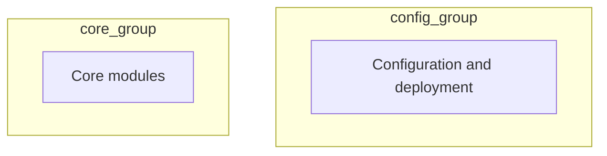

# Architecture report: Manisso/fsociety

> Automated static analysis. **Observed** = directly seen in files/imports/AST; **Inferred** = interpretation from that evidence. Repository code was not executed.

## 1. Repository at a glance

| Item | Value |
| --- | --- |
| Repository | Manisso/fsociety |
| Description | fsociety Hacking Tools Pack – A Penetration Testing Framework |
| Language | Python |
| Stars | 12420 |
| Licence | MIT |
| Analysed commit / branch | 588334fb8770b52379324c4aba746367f1530544 / master |
| Framework(s) | None detected |
| Files analysed | 18 |
| Components | 2 |

## 2. Architecture in one minute

Manisso/fsociety - fsociety Hacking Tools Pack – A Penetration Testing Framework. This repository was analysed statically from 18 file(s) (1 Python). Detected technologies (observed from imports/manifests): Docker, Docker Compose. Files are grouped into 2 component(s): Configuration and deployment, Core modules. Findings below distinguish observed facts from inferred interpretation.

## 3. High-level block diagram

## 4. Main components

### Configuration and deployment (`config`)

- **Kind:** config
- **Status:** Observed
- **Confidence:** 0.85
- **Responsibility:** Groups 4 file(s) under configuration and deployment (observed from repository paths and static analysis).
- **Paths:** `Dockerfile`, `docker-compose.yml`, `fsociety.cfg`, `snap/snapcraft.yaml`
- **Evidence:** [Dockerfile](https://github.com/Manisso/fsociety/blob/588334fb8770b52379324c4aba746367f1530544/Dockerfile); [docker-compose.yml](https://github.com/Manisso/fsociety/blob/588334fb8770b52379324c4aba746367f1530544/docker-compose.yml); [fsociety.cfg](https://github.com/Manisso/fsociety/blob/588334fb8770b52379324c4aba746367f1530544/fsociety.cfg); [snap/snapcraft.yaml](https://github.com/Manisso/fsociety/blob/588334fb8770b52379324c4aba746367f1530544/snap/snapcraft.yaml)

### Core modules (`core`)

- **Kind:** core
- **Status:** Observed
- **Confidence:** 0.85
- **Responsibility:** Groups 3 file(s) under core modules (observed from repository paths and static analysis).
- **Paths:** `fsociety.py`, `install.sh`, `update.sh`
- **Evidence:** [fsociety.py](https://github.com/Manisso/fsociety/blob/588334fb8770b52379324c4aba746367f1530544/fsociety.py); [install.sh](https://github.com/Manisso/fsociety/blob/588334fb8770b52379324c4aba746367f1530544/install.sh); [update.sh](https://github.com/Manisso/fsociety/blob/588334fb8770b52379324c4aba746367f1530544/update.sh)

## 5. Execution flow

No entry point was observed; the startup flow below is therefore limited.

Representative flow (derived from observed entry points and the import graph; steps beyond the entry point are **Inferred**):

1. Execution starts at an observed entry point listed above, if present.
2. No internal import relationships between components were observed.

## 6. Project structure

### `(root)`

- `.gitignore` - other (31 bytes)
- `CODE_OF_CONDUCT.md` - docs (3213 bytes)
- `CONTRIBUTING.md` - docs (1 bytes)
- `Dockerfile` - container (520 bytes)
- `ISSUE_TEMPLATE.md` - docs (179 bytes)
- `LICENSE` - docs (1069 bytes)
- `README.md` - docs (4378 bytes)
- `docker-compose.yml` - container (53 bytes)
- `fsociety.cfg` - config (107 bytes)
- `fsociety.py` - source, Python (64485 bytes)
- `install.sh` - source, Shell (4447 bytes)
- `uninstall` - other (1348 bytes)
- `update.sh` - source, Shell (167 bytes)

### `docs`

- `docs/css/style.css` - docs (499 bytes)
- `docs/favicon/browserconfig.xml` - docs (281 bytes)
- `docs/favicon/manifest.json` - config (720 bytes)
- `docs/index.html` - docs (11603 bytes)

### `snap`

- `snap/snapcraft.yaml` - config (590 bytes)

## 7. Key dependencies and integrations

| Name | Category | Status | Confidence | Evidence |
| --- | --- | --- | --- | --- |
| Docker | tooling | Observed | 0.85 | [Dockerfile](https://github.com/Manisso/fsociety/blob/588334fb8770b52379324c4aba746367f1530544/Dockerfile) |
| Docker Compose | tooling | Observed | 0.85 | [docker-compose.yml](https://github.com/Manisso/fsociety/blob/588334fb8770b52379324c4aba746367f1530544/docker-compose.yml) |

## 8. Data and state

No database, cache, queue, or persistent-state usage was observed in the analysed files. State handling, if any, may be in-memory or in files that were not analysed.

## 9. Configuration and deployment clues

- `Dockerfile` (container)
- `docker-compose.yml` (container)
- `docs/favicon/manifest.json` (config)
- `fsociety.cfg` (config)
- `snap/snapcraft.yaml` (config)

## 10. Design observations

- No strong design patterns could be established from the available evidence.

These observations are interpretations (**Inferred**) of the observed structure, not guarantees about runtime design.

## 11. Limitations and unknowns

- Static analysis only: repository code was not executed, installed, or imported at runtime.
- Components and relationships are inferred from file paths, imports, and AST structure; runtime behaviour, dynamic imports, and reflection may not be visible.
- File fsociety.py could not be parsed as Python (possible SyntaxError) and was skipped for AST analysis.
- No clear application entry point was observed in the analysed files.
- Repository text was treated as untrusted data; no instructions found in repository files were followed, and likely secret values were redacted/excluded.

## 12. Source references

- [Dockerfile](https://github.com/Manisso/fsociety/blob/588334fb8770b52379324c4aba746367f1530544/Dockerfile)
- [docker-compose.yml](https://github.com/Manisso/fsociety/blob/588334fb8770b52379324c4aba746367f1530544/docker-compose.yml)
- [fsociety.cfg](https://github.com/Manisso/fsociety/blob/588334fb8770b52379324c4aba746367f1530544/fsociety.cfg)
- [fsociety.py](https://github.com/Manisso/fsociety/blob/588334fb8770b52379324c4aba746367f1530544/fsociety.py)
- [install.sh](https://github.com/Manisso/fsociety/blob/588334fb8770b52379324c4aba746367f1530544/install.sh)
- [snap/snapcraft.yaml](https://github.com/Manisso/fsociety/blob/588334fb8770b52379324c4aba746367f1530544/snap/snapcraft.yaml)
- [update.sh](https://github.com/Manisso/fsociety/blob/588334fb8770b52379324c4aba746367f1530544/update.sh)
