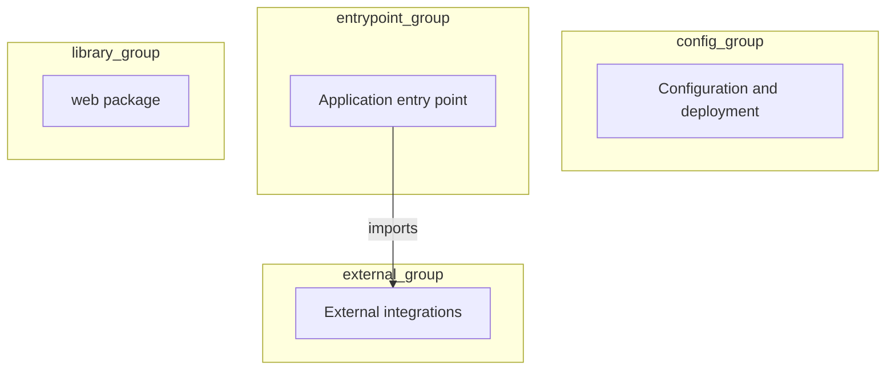

# Architecture report: MatrixTM/MHDDoS

> Automated static analysis. **Observed** = directly seen in files/imports/AST; **Inferred** = interpretation from that evidence. Repository code was not executed.

## 1. Repository at a glance

| Item | Value |
| --- | --- |
| Repository | MatrixTM/MHDDoS |
| Description | Best DDoS Attack Script  Python3, (Cyber / DDos) Attack With 60 Methods |
| Language | Python |
| Stars | 17022 |
| Licence | MIT |
| Analysed commit / branch | bf66ccc3bbadd50dc5fed6955ba315fa8a1721b9 / main |
| Framework(s) | Express, Flask |
| Files analysed | 54 |
| Components | 4 |

## 2. Architecture in one minute

MatrixTM/MHDDoS - Best DDoS Attack Script  Python3, (Cyber / DDos) Attack With 60 Methods. This repository was analysed statically from 54 file(s) (2 Python). Detected technologies (observed from imports/manifests): GitHub Actions, Express, Flask, requests, Poetry, Docker. Files are grouped into 4 component(s): Configuration and deployment, Application entry point, External integrations, web package. Observed entry point(s): start.py, web/app.py. Findings below distinguish observed facts from inferred interpretation.

## 3. High-level block diagram

## 4. Main components

### Configuration and deployment (`config`)

- **Kind:** config
- **Status:** Observed
- **Confidence:** 0.85
- **Responsibility:** Groups 10 file(s) under configuration and deployment (observed from repository paths and static analysis).
- **Paths:** `Dockerfile`, `config.json`, `docker-compose.yml`, `pyproject.toml`, `requirements.txt`, `web/.env.example`, `web/package.json`, `web/public/locales/manifest.json`, `web/requirements.txt`, `web/tsconfig.json`
- **Evidence:** [Dockerfile](https://github.com/MatrixTM/MHDDoS/blob/bf66ccc3bbadd50dc5fed6955ba315fa8a1721b9/Dockerfile); [config.json](https://github.com/MatrixTM/MHDDoS/blob/bf66ccc3bbadd50dc5fed6955ba315fa8a1721b9/config.json); [docker-compose.yml](https://github.com/MatrixTM/MHDDoS/blob/bf66ccc3bbadd50dc5fed6955ba315fa8a1721b9/docker-compose.yml); [pyproject.toml](https://github.com/MatrixTM/MHDDoS/blob/bf66ccc3bbadd50dc5fed6955ba315fa8a1721b9/pyproject.toml); [requirements.txt](https://github.com/MatrixTM/MHDDoS/blob/bf66ccc3bbadd50dc5fed6955ba315fa8a1721b9/requirements.txt); [web/.env.example](https://github.com/MatrixTM/MHDDoS/blob/bf66ccc3bbadd50dc5fed6955ba315fa8a1721b9/web/.env.example); [web/package.json](https://github.com/MatrixTM/MHDDoS/blob/bf66ccc3bbadd50dc5fed6955ba315fa8a1721b9/web/package.json); [web/public/locales/manifest.json](https://github.com/MatrixTM/MHDDoS/blob/bf66ccc3bbadd50dc5fed6955ba315fa8a1721b9/web/public/locales/manifest.json)

### Application entry point (`entrypoint`)

- **Kind:** entrypoint
- **Status:** Observed
- **Confidence:** 0.85
- **Responsibility:** Groups 2 file(s) under application entry point (observed from repository paths and static analysis). Observed application object created via Flask. Observed routes: ROUTE /, ROUTE /api/methods, ROUTE /api/system/stats, ROUTE /api/files/info, ROUTE /api/attacks/start. Observed top-level classes: Color, CommandParser, Counter, FloodWorker, HttpFlood, Layer4. Observed top-level functions: _is_private_or_loopback, _run_web_attack, _safe_int, _validate_hostname, _validate_public_url, _wrap_tls.
- **Paths:** `start.py`, `web/app.py`
- **Evidence:** [start.py:96](https://github.com/MatrixTM/MHDDoS/blob/bf66ccc3bbadd50dc5fed6955ba315fa8a1721b9/start.py#L96); [web/app.py:38](https://github.com/MatrixTM/MHDDoS/blob/bf66ccc3bbadd50dc5fed6955ba315fa8a1721b9/web/app.py#L38)

### External integrations (`external_integrations`)

- **Kind:** external
- **Status:** Inferred
- **Confidence:** 0.70
- **Responsibility:** Groups 0 file(s) under external integrations (observed from repository paths and static analysis).
- **Evidence:** [start.py:27](https://github.com/MatrixTM/MHDDoS/blob/bf66ccc3bbadd50dc5fed6955ba315fa8a1721b9/start.py#L27); [start.py:66](https://github.com/MatrixTM/MHDDoS/blob/bf66ccc3bbadd50dc5fed6955ba315fa8a1721b9/start.py#L66); [web/app.py:9](https://github.com/MatrixTM/MHDDoS/blob/bf66ccc3bbadd50dc5fed6955ba315fa8a1721b9/web/app.py#L9); [web/app.py:570](https://github.com/MatrixTM/MHDDoS/blob/bf66ccc3bbadd50dc5fed6955ba315fa8a1721b9/web/app.py#L570); [web/app.py:612](https://github.com/MatrixTM/MHDDoS/blob/bf66ccc3bbadd50dc5fed6955ba315fa8a1721b9/web/app.py#L612)

### web package (`web`)

- **Kind:** library
- **Status:** Observed
- **Confidence:** 0.85
- **Responsibility:** Groups 6 file(s) under web package (observed from repository paths and static analysis).
- **Paths:** `web/public/app.js`, `web/public/i18n.js`, `web/scripts/install.sh`, `web/scripts/start.sh`, `web/src/server.ts`, `web/static/js/app.js`
- **Evidence:** [web/public/app.js](https://github.com/MatrixTM/MHDDoS/blob/bf66ccc3bbadd50dc5fed6955ba315fa8a1721b9/web/public/app.js); [web/public/i18n.js](https://github.com/MatrixTM/MHDDoS/blob/bf66ccc3bbadd50dc5fed6955ba315fa8a1721b9/web/public/i18n.js); [web/scripts/install.sh](https://github.com/MatrixTM/MHDDoS/blob/bf66ccc3bbadd50dc5fed6955ba315fa8a1721b9/web/scripts/install.sh); [web/scripts/start.sh](https://github.com/MatrixTM/MHDDoS/blob/bf66ccc3bbadd50dc5fed6955ba315fa8a1721b9/web/scripts/start.sh); [web/src/server.ts](https://github.com/MatrixTM/MHDDoS/blob/bf66ccc3bbadd50dc5fed6955ba315fa8a1721b9/web/src/server.ts); [web/static/js/app.js](https://github.com/MatrixTM/MHDDoS/blob/bf66ccc3bbadd50dc5fed6955ba315fa8a1721b9/web/static/js/app.js)

## 5. Execution flow

**Observed** entry point(s):

- [start.py:2301](https://github.com/MatrixTM/MHDDoS/blob/bf66ccc3bbadd50dc5fed6955ba315fa8a1721b9/start.py#L2301)
- [web/app.py:38](https://github.com/MatrixTM/MHDDoS/blob/bf66ccc3bbadd50dc5fed6955ba315fa8a1721b9/web/app.py#L38)
- [web/public/app.js](https://github.com/MatrixTM/MHDDoS/blob/bf66ccc3bbadd50dc5fed6955ba315fa8a1721b9/web/public/app.js)
- [web/src/server.ts](https://github.com/MatrixTM/MHDDoS/blob/bf66ccc3bbadd50dc5fed6955ba315fa8a1721b9/web/src/server.ts)
- [web/static/js/app.js](https://github.com/MatrixTM/MHDDoS/blob/bf66ccc3bbadd50dc5fed6955ba315fa8a1721b9/web/static/js/app.js)

**Observed** routes (from decorators):

- `ROUTE /` -> `index` in `web/app.py:194`
- `ROUTE /api/methods` -> `get_methods` in `web/app.py:199`
- `ROUTE /api/system/stats` -> `get_system_stats` in `web/app.py:217`
- `ROUTE /api/files/info` -> `get_files_info` in `web/app.py:241`
- `ROUTE /api/attacks/start` -> `start_attack` in `web/app.py:268`
- `ROUTE /api/attacks/active` -> `get_active_attacks` in `web/app.py:382`
- `ROUTE /api/attacks/stop` -> `stop_attack` in `web/app.py:408`
- `ROUTE /api/tools/ping` -> `tool_ping` in `web/app.py:429`
- `ROUTE /api/auth/token` -> `auth_token` in `web/app.py:504`
- `ROUTE /api/auth/verify` -> `auth_verify` in `web/app.py:516`
- `ROUTE /api/tools/check` -> `tool_check` in `web/app.py:559`
- `ROUTE /api/tools/info` -> `tool_info` in `web/app.py:600`
- `ROUTE /api/tools/dns` -> `tool_dns` in `web/app.py:637`
- `ROUTE /api/logs/stream` -> `stream_logs` in `web/app.py:670`

Representative flow (derived from observed entry points and the import graph; steps beyond the entry point are **Inferred**):

1. Execution starts at an observed entry point listed above, if present.
2. `entrypoint` imports `external_integrations` (Application entry point -> External integrations).

## 6. Project structure

### `(root)`

- `.dockerignore` - container (272 bytes)
- `.gitignore` - other (937 bytes)
- `CODE_OF_CONDUCT.md` - docs (1248 bytes)
- `CONTRIBUTING.md` - docs (2383 bytes)
- `Dockerfile` - container (995 bytes)
- `LICENSE` - docs (1065 bytes)
- `README.md` - docs (19169 bytes)
- `SECURITY.md` - docs (1217 bytes)
- `SUPPORT.md` - docs (1191 bytes)
- `config.json` - config (522 bytes)
- `docker-compose.yml` - container (531 bytes)
- `pyproject.toml` - manifest (272 bytes)
- `requirements.txt` - manifest (255 bytes)
- `start.py` - source, Python (80580 bytes)

### `.github`

- `.github/DISCUSSION_TEMPLATE/announcements.yml` - config (627 bytes)
- `.github/DISCUSSION_TEMPLATE/general.yml` - config (717 bytes)
- `.github/DISCUSSION_TEMPLATE/ideas.yml` - config (1187 bytes)
- `.github/DISCUSSION_TEMPLATE/q-a.yml` - config (1686 bytes)
- `.github/DISCUSSION_TEMPLATE/show-and-tell.yml` - config (868 bytes)
- `.github/ISSUE_TEMPLATE/bug_report.yml` - config (3184 bytes)
- `.github/ISSUE_TEMPLATE/bypass_request.yml` - config (1800 bytes)
- `.github/ISSUE_TEMPLATE/config.yml` - config (536 bytes)
- `.github/ISSUE_TEMPLATE/documentation.yml` - config (1083 bytes)
- `.github/ISSUE_TEMPLATE/feature_request.yml` - config (1891 bytes)
- `.github/ISSUE_TEMPLATE/method_request.yml` - config (2078 bytes)
- `.github/PULL_REQUEST_TEMPLATE.md` - docs (804 bytes)
- `.github/dependabot.yml` - config (827 bytes)
- `.github/workflows/codeql-analysis.yml` - ci, YAML (803 bytes)
- `.github/workflows/docker-image.yml` - ci, YAML (1591 bytes)
- `.github/workflows/release.yml` - ci, YAML (2498 bytes)

### `files`

- `files/proxies/http.txt` - docs (1 bytes)
- `files/referers.txt` - docs (42017 bytes)
- `files/useragent.txt` - docs (82670 bytes)

### `web`

- `web/.env.example` - config (365 bytes)
- `web/app.py` - source, Python (22433 bytes)
- `web/package.json` - manifest (712 bytes)
- `web/public/app.js` - source, JavaScript (23657 bytes)
- `web/public/i18n.js` - source, JavaScript (2966 bytes)
- `web/public/index.html` - other (20274 bytes)
- `web/public/locales/en.xml` - other (4489 bytes)
- `web/public/locales/es.xml` - other (4740 bytes)
- `web/public/locales/manifest.json` - config (320 bytes)
- `web/public/locales/pt.xml` - other (4660 bytes)
- `web/public/style.css` - other (21146 bytes)
- `web/requirements.txt` - manifest (36 bytes)
- `web/scripts/install.bat` - other (1100 bytes)
- `web/scripts/install.sh` - source, Shell (1143 bytes)
- `web/scripts/start.bat` - other (372 bytes)
- `web/scripts/start.sh` - source, Shell (488 bytes)
- `web/src/server.ts` - source, TypeScript (18305 bytes)
- `web/static/css/style.css` - other (13639 bytes)
- `web/static/js/app.js` - source, JavaScript (15405 bytes)
- `web/templates/index.html` - other (19598 bytes)
- `web/tsconfig.json` - config (509 bytes)

## 7. Key dependencies and integrations

| Name | Category | Status | Confidence | Evidence |
| --- | --- | --- | --- | --- |
| GitHub Actions | ci | Observed | 0.90 | [.github/workflows/codeql-analysis.yml](https://github.com/MatrixTM/MHDDoS/blob/bf66ccc3bbadd50dc5fed6955ba315fa8a1721b9/.github/workflows/codeql-analysis.yml); [.github/workflows/docker-image.yml](https://github.com/MatrixTM/MHDDoS/blob/bf66ccc3bbadd50dc5fed6955ba315fa8a1721b9/.github/workflows/docker-image.yml); [.github/workflows/release.yml](https://github.com/MatrixTM/MHDDoS/blob/bf66ccc3bbadd50dc5fed6955ba315fa8a1721b9/.github/workflows/release.yml) |
| Express | framework | Observed | 0.85 | [web/package.json:16](https://github.com/MatrixTM/MHDDoS/blob/bf66ccc3bbadd50dc5fed6955ba315fa8a1721b9/web/package.json#L16) |
| Flask | framework | Observed | 0.90 | [web/app.py:18](https://github.com/MatrixTM/MHDDoS/blob/bf66ccc3bbadd50dc5fed6955ba315fa8a1721b9/web/app.py#L18); [web/requirements.txt:2](https://github.com/MatrixTM/MHDDoS/blob/bf66ccc3bbadd50dc5fed6955ba315fa8a1721b9/web/requirements.txt#L2) |
| requests | library | Observed | 0.95 | [requirements.txt:10](https://github.com/MatrixTM/MHDDoS/blob/bf66ccc3bbadd50dc5fed6955ba315fa8a1721b9/requirements.txt#L10); [start.py:66](https://github.com/MatrixTM/MHDDoS/blob/bf66ccc3bbadd50dc5fed6955ba315fa8a1721b9/start.py#L66); [web/app.py:570](https://github.com/MatrixTM/MHDDoS/blob/bf66ccc3bbadd50dc5fed6955ba315fa8a1721b9/web/app.py#L570); [web/app.py:612](https://github.com/MatrixTM/MHDDoS/blob/bf66ccc3bbadd50dc5fed6955ba315fa8a1721b9/web/app.py#L612) |
| Poetry | packaging | Observed | 0.85 | [pyproject.toml](https://github.com/MatrixTM/MHDDoS/blob/bf66ccc3bbadd50dc5fed6955ba315fa8a1721b9/pyproject.toml) |
| Docker | tooling | Observed | 0.90 | [.github/workflows/docker-image.yml:1](https://github.com/MatrixTM/MHDDoS/blob/bf66ccc3bbadd50dc5fed6955ba315fa8a1721b9/.github/workflows/docker-image.yml#L1); [.github/workflows/release.yml:49](https://github.com/MatrixTM/MHDDoS/blob/bf66ccc3bbadd50dc5fed6955ba315fa8a1721b9/.github/workflows/release.yml#L49); [Dockerfile](https://github.com/MatrixTM/MHDDoS/blob/bf66ccc3bbadd50dc5fed6955ba315fa8a1721b9/Dockerfile) |
| Docker Compose | tooling | Observed | 0.85 | [docker-compose.yml](https://github.com/MatrixTM/MHDDoS/blob/bf66ccc3bbadd50dc5fed6955ba315fa8a1721b9/docker-compose.yml) |
| pytest | tooling | Observed | 0.75 | [.github/workflows/release.yml:58](https://github.com/MatrixTM/MHDDoS/blob/bf66ccc3bbadd50dc5fed6955ba315fa8a1721b9/.github/workflows/release.yml#L58) |
| TypeScript | tooling | Observed | 0.85 | [web/package.json:26](https://github.com/MatrixTM/MHDDoS/blob/bf66ccc3bbadd50dc5fed6955ba315fa8a1721b9/web/package.json#L26) |

## 8. Data and state

No database, cache, queue, or persistent-state usage was observed in the analysed files. State handling, if any, may be in-memory or in files that were not analysed.

## 9. Configuration and deployment clues

- `.dockerignore` (container)
- `.github/DISCUSSION_TEMPLATE/announcements.yml` (config)
- `.github/DISCUSSION_TEMPLATE/general.yml` (config)
- `.github/DISCUSSION_TEMPLATE/ideas.yml` (config)
- `.github/DISCUSSION_TEMPLATE/q-a.yml` (config)
- `.github/DISCUSSION_TEMPLATE/show-and-tell.yml` (config)
- `.github/ISSUE_TEMPLATE/bug_report.yml` (config)
- `.github/ISSUE_TEMPLATE/bypass_request.yml` (config)
- `.github/ISSUE_TEMPLATE/config.yml` (config)
- `.github/ISSUE_TEMPLATE/documentation.yml` (config)
- `.github/ISSUE_TEMPLATE/feature_request.yml` (config)
- `.github/ISSUE_TEMPLATE/method_request.yml` (config)
- `.github/dependabot.yml` (config)
- `.github/workflows/codeql-analysis.yml` (ci)
- `.github/workflows/docker-image.yml` (ci)
- `.github/workflows/release.yml` (ci)
- `Dockerfile` (container)
- `config.json` (config)
- `docker-compose.yml` (container)
- `pyproject.toml` (manifest)
- `requirements.txt` (manifest)
- `web/.env.example` (config)
- `web/package.json` (manifest)
- `web/public/locales/manifest.json` (config)
- `web/requirements.txt` (manifest)
- `web/tsconfig.json` (config)

Environment variable *names* seen in example env files (values never recorded):

- `web/.env.example`: `JWT_SECRET`, `WEB_HOST`, `WEB_PORT`

## 10. Design observations

- An entry/API layer is separated from other code (Inferred from paths and decorators).
- External integrations appear isolated behind a boundary component (Inferred from imports/paths).

These observations are interpretations (**Inferred**) of the observed structure, not guarantees about runtime design.

## 11. Limitations and unknowns

- Static analysis only: repository code was not executed, installed, or imported at runtime.
- Components and relationships are inferred from file paths, imports, and AST structure; runtime behaviour, dynamic imports, and reflection may not be visible.
- 1 file(s) were skipped during inventory (1 x lockfile excluded).
- Repository text was treated as untrusted data; no instructions found in repository files were followed, and likely secret values were redacted/excluded.

## 12. Source references

- [.github/workflows/codeql-analysis.yml](https://github.com/MatrixTM/MHDDoS/blob/bf66ccc3bbadd50dc5fed6955ba315fa8a1721b9/.github/workflows/codeql-analysis.yml)
- [.github/workflows/docker-image.yml](https://github.com/MatrixTM/MHDDoS/blob/bf66ccc3bbadd50dc5fed6955ba315fa8a1721b9/.github/workflows/docker-image.yml)
- [.github/workflows/docker-image.yml:1](https://github.com/MatrixTM/MHDDoS/blob/bf66ccc3bbadd50dc5fed6955ba315fa8a1721b9/.github/workflows/docker-image.yml#L1)
- [.github/workflows/release.yml](https://github.com/MatrixTM/MHDDoS/blob/bf66ccc3bbadd50dc5fed6955ba315fa8a1721b9/.github/workflows/release.yml)
- [.github/workflows/release.yml:49](https://github.com/MatrixTM/MHDDoS/blob/bf66ccc3bbadd50dc5fed6955ba315fa8a1721b9/.github/workflows/release.yml#L49)
- [.github/workflows/release.yml:58](https://github.com/MatrixTM/MHDDoS/blob/bf66ccc3bbadd50dc5fed6955ba315fa8a1721b9/.github/workflows/release.yml#L58)
- [Dockerfile](https://github.com/MatrixTM/MHDDoS/blob/bf66ccc3bbadd50dc5fed6955ba315fa8a1721b9/Dockerfile)
- [config.json](https://github.com/MatrixTM/MHDDoS/blob/bf66ccc3bbadd50dc5fed6955ba315fa8a1721b9/config.json)
- [docker-compose.yml](https://github.com/MatrixTM/MHDDoS/blob/bf66ccc3bbadd50dc5fed6955ba315fa8a1721b9/docker-compose.yml)
- [pyproject.toml](https://github.com/MatrixTM/MHDDoS/blob/bf66ccc3bbadd50dc5fed6955ba315fa8a1721b9/pyproject.toml)
- [requirements.txt](https://github.com/MatrixTM/MHDDoS/blob/bf66ccc3bbadd50dc5fed6955ba315fa8a1721b9/requirements.txt)
- [requirements.txt:10](https://github.com/MatrixTM/MHDDoS/blob/bf66ccc3bbadd50dc5fed6955ba315fa8a1721b9/requirements.txt#L10)
- [start.py:27](https://github.com/MatrixTM/MHDDoS/blob/bf66ccc3bbadd50dc5fed6955ba315fa8a1721b9/start.py#L27)
- [start.py:66](https://github.com/MatrixTM/MHDDoS/blob/bf66ccc3bbadd50dc5fed6955ba315fa8a1721b9/start.py#L66)
- [start.py:96](https://github.com/MatrixTM/MHDDoS/blob/bf66ccc3bbadd50dc5fed6955ba315fa8a1721b9/start.py#L96)
- [start.py:2301](https://github.com/MatrixTM/MHDDoS/blob/bf66ccc3bbadd50dc5fed6955ba315fa8a1721b9/start.py#L2301)
- [web/.env.example](https://github.com/MatrixTM/MHDDoS/blob/bf66ccc3bbadd50dc5fed6955ba315fa8a1721b9/web/.env.example)
- [web/app.py:9](https://github.com/MatrixTM/MHDDoS/blob/bf66ccc3bbadd50dc5fed6955ba315fa8a1721b9/web/app.py#L9)
- [web/app.py:18](https://github.com/MatrixTM/MHDDoS/blob/bf66ccc3bbadd50dc5fed6955ba315fa8a1721b9/web/app.py#L18)
- [web/app.py:38](https://github.com/MatrixTM/MHDDoS/blob/bf66ccc3bbadd50dc5fed6955ba315fa8a1721b9/web/app.py#L38)
- [web/app.py:570](https://github.com/MatrixTM/MHDDoS/blob/bf66ccc3bbadd50dc5fed6955ba315fa8a1721b9/web/app.py#L570)
- [web/app.py:612](https://github.com/MatrixTM/MHDDoS/blob/bf66ccc3bbadd50dc5fed6955ba315fa8a1721b9/web/app.py#L612)
- [web/package.json](https://github.com/MatrixTM/MHDDoS/blob/bf66ccc3bbadd50dc5fed6955ba315fa8a1721b9/web/package.json)
- [web/package.json:16](https://github.com/MatrixTM/MHDDoS/blob/bf66ccc3bbadd50dc5fed6955ba315fa8a1721b9/web/package.json#L16)
- [web/package.json:26](https://github.com/MatrixTM/MHDDoS/blob/bf66ccc3bbadd50dc5fed6955ba315fa8a1721b9/web/package.json#L26)
- [web/public/app.js](https://github.com/MatrixTM/MHDDoS/blob/bf66ccc3bbadd50dc5fed6955ba315fa8a1721b9/web/public/app.js)
- [web/public/i18n.js](https://github.com/MatrixTM/MHDDoS/blob/bf66ccc3bbadd50dc5fed6955ba315fa8a1721b9/web/public/i18n.js)
- [web/public/locales/manifest.json](https://github.com/MatrixTM/MHDDoS/blob/bf66ccc3bbadd50dc5fed6955ba315fa8a1721b9/web/public/locales/manifest.json)
- [web/requirements.txt:2](https://github.com/MatrixTM/MHDDoS/blob/bf66ccc3bbadd50dc5fed6955ba315fa8a1721b9/web/requirements.txt#L2)
- [web/scripts/install.sh](https://github.com/MatrixTM/MHDDoS/blob/bf66ccc3bbadd50dc5fed6955ba315fa8a1721b9/web/scripts/install.sh)
- [web/scripts/start.sh](https://github.com/MatrixTM/MHDDoS/blob/bf66ccc3bbadd50dc5fed6955ba315fa8a1721b9/web/scripts/start.sh)
- [web/src/server.ts](https://github.com/MatrixTM/MHDDoS/blob/bf66ccc3bbadd50dc5fed6955ba315fa8a1721b9/web/src/server.ts)
- [web/static/js/app.js](https://github.com/MatrixTM/MHDDoS/blob/bf66ccc3bbadd50dc5fed6955ba315fa8a1721b9/web/static/js/app.js)
