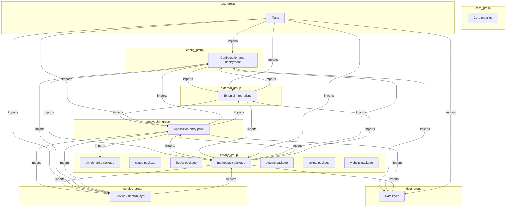

# Architecture report: MemPalace/mempalace

> Automated static analysis. **Observed** = directly seen in files/imports/AST; **Inferred** = interpretation from that evidence. Repository code was not executed.

## 1. Repository at a glance

| Item | Value |
| --- | --- |
| Repository | MemPalace/mempalace |
| Description | The best-benchmarked open-source AI memory system. And it's free. |
| Language | Python |
| Stars | 60556 |
| Licence | MIT |
| Analysed commit / branch | 9fc486dc0ce259131da20179847314cabcbb9e15 / develop |
| Framework(s) | None detected |
| Files analysed | 561 |
| Components | 14 |

## 2. Architecture in one minute

MemPalace/mempalace - The best-benchmarked open-source AI memory system. And it's free.. This repository was analysed statically from 561 file(s) (269 Python). Detected technologies (observed from imports/manifests): GitHub Actions, PostgreSQL, SQLite, NumPy, requests, Poetry. Files are grouped into 14 component(s): benchmarks package, Configuration and deployment, Core modules, crates package, Data layer, Application entry point, External integrations, hooks package. Observed entry point(s): benchmarks/convomem_bench.py, benchmarks/lean_mempalace/bench_python.py, benchmarks/lean_mempalace/runner.py. Findings below distinguish observed facts from inferred interpretation.

## 3. High-level block diagram

## 4. Main components

### benchmarks package (`benchmarks`)

- **Kind:** library
- **Status:** Observed
- **Confidence:** 0.85
- **Responsibility:** Groups 18 file(s) under benchmarks package (observed from repository paths and static analysis). Observed top-level classes: HostInfo, TimingAggregate, TimingSample, VRAMPoller. Observed top-level functions: _is_valid, _is_valid_empty, _norm, _p, _parse, _read_file.
- **Paths:** `benchmarks/lean_mempalace/go/main.go`, `benchmarks/lean_mempalace/rust/src/main.rs`, `benchmarks/lean_mempalace/ts_bun/bench.ts`, `benchmarks/model_eval/__init__.py`, `benchmarks/model_eval/metrics.py`, `benchmarks/model_eval/tasks/__init__.py`, `benchmarks/model_eval/tasks/calibration/__init__.py`, `benchmarks/model_eval/tasks/calibration/prompts.py`, `benchmarks/model_eval/tasks/calibration/score.py`, `benchmarks/model_eval/tasks/entity_extraction/__init__.py`, `benchmarks/model_eval/tasks/entity_extraction/prompts.py`, `benchmarks/model_eval/tasks/entity_extraction/score.py`, `benchmarks/model_eval/tasks/memory_extraction/__init__.py`, `benchmarks/model_eval/tasks/memory_extraction/prompts.py`, `benchmarks/model_eval/tasks/memory_extraction/score.py`, `benchmarks/model_eval/tasks/room_classification/__init__.py`, `benchmarks/model_eval/tasks/room_classification/prompts.py`, `benchmarks/model_eval/tasks/room_classification/score.py`
- **Evidence:** [benchmarks/lean_mempalace/go/main.go](https://github.com/MemPalace/mempalace/blob/9fc486dc0ce259131da20179847314cabcbb9e15/benchmarks/lean_mempalace/go/main.go); [benchmarks/lean_mempalace/rust/src/main.rs](https://github.com/MemPalace/mempalace/blob/9fc486dc0ce259131da20179847314cabcbb9e15/benchmarks/lean_mempalace/rust/src/main.rs); [benchmarks/lean_mempalace/ts_bun/bench.ts](https://github.com/MemPalace/mempalace/blob/9fc486dc0ce259131da20179847314cabcbb9e15/benchmarks/lean_mempalace/ts_bun/bench.ts); [benchmarks/model_eval/__init__.py](https://github.com/MemPalace/mempalace/blob/9fc486dc0ce259131da20179847314cabcbb9e15/benchmarks/model_eval/__init__.py); [benchmarks/model_eval/metrics.py:32](https://github.com/MemPalace/mempalace/blob/9fc486dc0ce259131da20179847314cabcbb9e15/benchmarks/model_eval/metrics.py#L32); [benchmarks/model_eval/tasks/__init__.py](https://github.com/MemPalace/mempalace/blob/9fc486dc0ce259131da20179847314cabcbb9e15/benchmarks/model_eval/tasks/__init__.py); [benchmarks/model_eval/tasks/calibration/__init__.py](https://github.com/MemPalace/mempalace/blob/9fc486dc0ce259131da20179847314cabcbb9e15/benchmarks/model_eval/tasks/calibration/__init__.py); [benchmarks/model_eval/tasks/calibration/prompts.py:13](https://github.com/MemPalace/mempalace/blob/9fc486dc0ce259131da20179847314cabcbb9e15/benchmarks/model_eval/tasks/calibration/prompts.py#L13)

### Configuration and deployment (`config`)

- **Kind:** config
- **Status:** Observed
- **Confidence:** 0.85
- **Responsibility:** Groups 42 file(s) under configuration and deployment (observed from repository paths and static analysis). Observed top-level classes: MempalaceConfig. Observed top-level functions: _cursor_wing_slug, _is_wal_without_sidecars, _json_type_name, _make_config_dir, _validate_iso_temporal_calendar, _warn_unusable_config_once.
- **Paths:** `Cargo.toml`, `Dockerfile`, `Dockerfile.gpu`, `benchmarks/lean_mempalace/benchmark_results.json`, `benchmarks/lean_mempalace/go/go.mod`, `benchmarks/lean_mempalace/rust/Cargo.toml`, `benchmarks/lme_split_50_450.json`, `benchmarks/model_eval/candidates.yaml`, `benchmarks/results_convomem_raw_top10_20260414_1649.json`, `benchmarks/results_high_sensitivity_stress.json`, `benchmarks/results_ninfer_qwen27b.json`, `benchmarks/results_ollama_medical_palace.json`, `benchmarks/results_ollama_ornith_routine.json`, `crates/mempalace-cli/Cargo.toml`, `crates/mempalace-core/Cargo.toml`, `crates/mempalace-py/Cargo.toml`, `crates/mempalace-py/pyproject.toml`, `deploy/docker-compose.server.yml`, `docker-compose.yml`, `mcp.json`, `mempalace/config.py`, `mempalace/data/coca_content_words.json`, `mempalace/data/known_systems.json`, `mempalace/i18n/be.json`, `mempalace/i18n/de.json`, `mempalace/i18n/en.json`, `mempalace/i18n/es.json`, `mempalace/i18n/fr.json`, `mempalace/i18n/hi.json`, `mempalace/i18n/id.json`, `mempalace/i18n/it.json`, `mempalace/i18n/ja.json`, `mempalace/i18n/ko.json`, `mempalace/i18n/pt-br.json`, `mempalace/i18n/ru.json`, `mempalace/i18n/zh-CN.json`, `mempalace/i18n/zh-TW.json`, `plugins/mempalace/hooks.json`, `plugins/mempalace/mcp_config.json`, `plugins/mempalace/plugin.json`, `plugins/mempalace/sidecars/palace/sidecar.json`, `pyproject.toml`
- **Evidence:** [Cargo.toml](https://github.com/MemPalace/mempalace/blob/9fc486dc0ce259131da20179847314cabcbb9e15/Cargo.toml); [Dockerfile](https://github.com/MemPalace/mempalace/blob/9fc486dc0ce259131da20179847314cabcbb9e15/Dockerfile); [Dockerfile.gpu](https://github.com/MemPalace/mempalace/blob/9fc486dc0ce259131da20179847314cabcbb9e15/Dockerfile.gpu); [benchmarks/lean_mempalace/benchmark_results.json](https://github.com/MemPalace/mempalace/blob/9fc486dc0ce259131da20179847314cabcbb9e15/benchmarks/lean_mempalace/benchmark_results.json); [benchmarks/lean_mempalace/go/go.mod](https://github.com/MemPalace/mempalace/blob/9fc486dc0ce259131da20179847314cabcbb9e15/benchmarks/lean_mempalace/go/go.mod); [benchmarks/lean_mempalace/rust/Cargo.toml](https://github.com/MemPalace/mempalace/blob/9fc486dc0ce259131da20179847314cabcbb9e15/benchmarks/lean_mempalace/rust/Cargo.toml); [benchmarks/lme_split_50_450.json](https://github.com/MemPalace/mempalace/blob/9fc486dc0ce259131da20179847314cabcbb9e15/benchmarks/lme_split_50_450.json); [benchmarks/model_eval/candidates.yaml](https://github.com/MemPalace/mempalace/blob/9fc486dc0ce259131da20179847314cabcbb9e15/benchmarks/model_eval/candidates.yaml)

### Core modules (`core`)

- **Kind:** core
- **Status:** Observed
- **Confidence:** 0.85
- **Responsibility:** Groups 1 file(s) under core modules (observed from repository paths and static analysis).
- **Paths:** `docker-entrypoint.sh`
- **Evidence:** [docker-entrypoint.sh](https://github.com/MemPalace/mempalace/blob/9fc486dc0ce259131da20179847314cabcbb9e15/docker-entrypoint.sh)

### crates package (`crates`)

- **Kind:** library
- **Status:** Observed
- **Confidence:** 0.85
- **Responsibility:** Groups 3 file(s) under crates package (observed from repository paths and static analysis).
- **Paths:** `crates/mempalace-cli/src/main.rs`, `crates/mempalace-core/src/lib.rs`, `crates/mempalace-py/src/lib.rs`
- **Evidence:** [crates/mempalace-cli/src/main.rs](https://github.com/MemPalace/mempalace/blob/9fc486dc0ce259131da20179847314cabcbb9e15/crates/mempalace-cli/src/main.rs); [crates/mempalace-core/src/lib.rs](https://github.com/MemPalace/mempalace/blob/9fc486dc0ce259131da20179847314cabcbb9e15/crates/mempalace-core/src/lib.rs); [crates/mempalace-py/src/lib.rs](https://github.com/MemPalace/mempalace/blob/9fc486dc0ce259131da20179847314cabcbb9e15/crates/mempalace-py/src/lib.rs)

### Data layer (`data_layer`)

- **Kind:** data
- **Status:** Observed
- **Confidence:** 0.85
- **Responsibility:** Groups 1 file(s) under data layer (observed from repository paths and static analysis).
- **Paths:** `mempalace/mcp_server/schemas.py`
- **Evidence:** [mempalace/mcp_server/schemas.py](https://github.com/MemPalace/mempalace/blob/9fc486dc0ce259131da20179847314cabcbb9e15/mempalace/mcp_server/schemas.py)

### Application entry point (`entrypoint`)

- **Kind:** entrypoint
- **Status:** Observed
- **Confidence:** 0.85
- **Responsibility:** Groups 36 file(s) under application entry point (observed from repository paths and static analysis). Observed top-level classes: BenchmarkCase, DaemonClient, DaemonError, DaemonRuntime, DaemonWaitTimeout, Dialect. Observed top-level functions: _aggregate_accuracy, _alias_args_for_handler, _allowlisted_tool, _apply_corpus_origin, _apply_known_systems_prepass, _apply_max_seq_id_plan.
- **Paths:** `benchmarks/convomem_bench.py`, `benchmarks/lean_mempalace/bench_python.py`, `benchmarks/lean_mempalace/runner.py`, `benchmarks/locomo_bench.py`, `benchmarks/longmemeval_bench.py`, `benchmarks/membench_bench.py`, `benchmarks/mine_bench.py`, `benchmarks/model_eval/orchestrator.py`, `benchmarks/model_eval/runner.py`, `benchmarks/model_eval/summarize.py`, `benchmarks/model_eval/translate_datasets.py`, `benchmarks/private_palace_bench.py`, `benchmarks/search_benchmark.py`, `benchmarks/soak_test_rust_exact.py`, `hooks/antigravity/export_standalone.py`, `mempalace/__main__.py`, `mempalace/_mine_exit_watchdog.py`, `mempalace/cli/__main__.py`, `mempalace/closet_llm.py`, `mempalace/daemon.py`, `mempalace/dialect.py`, `mempalace/diary_ingest.py`, `mempalace/entity_detector.py`, `mempalace/fact_checker.py`, `mempalace/general_extractor.py`, `mempalace/layers.py`, `mempalace/mcp_light_server.py`, `mempalace/mcp_server/__main__.py`, `mempalace/normalize.py`, `mempalace/project_scanner.py`, `mempalace/repair.py`, `mempalace/split_mega_files.py`, `plugins/mempalace/sidecars/palace/bridge.py`, `scripts/backfill_authored_at.py`, `scripts/check_versions.py`, `scripts/mempalace_repair_encoding.py`
- **Evidence:** [benchmarks/convomem_bench.py:66](https://github.com/MemPalace/mempalace/blob/9fc486dc0ce259131da20179847314cabcbb9e15/benchmarks/convomem_bench.py#L66); [benchmarks/lean_mempalace/bench_python.py:8](https://github.com/MemPalace/mempalace/blob/9fc486dc0ce259131da20179847314cabcbb9e15/benchmarks/lean_mempalace/bench_python.py#L8); [benchmarks/lean_mempalace/runner.py:8](https://github.com/MemPalace/mempalace/blob/9fc486dc0ce259131da20179847314cabcbb9e15/benchmarks/lean_mempalace/runner.py#L8); [benchmarks/locomo_bench.py:45](https://github.com/MemPalace/mempalace/blob/9fc486dc0ce259131da20179847314cabcbb9e15/benchmarks/locomo_bench.py#L45); [benchmarks/longmemeval_bench.py:53](https://github.com/MemPalace/mempalace/blob/9fc486dc0ce259131da20179847314cabcbb9e15/benchmarks/longmemeval_bench.py#L53); [benchmarks/membench_bench.py:48](https://github.com/MemPalace/mempalace/blob/9fc486dc0ce259131da20179847314cabcbb9e15/benchmarks/membench_bench.py#L48); [benchmarks/mine_bench.py:47](https://github.com/MemPalace/mempalace/blob/9fc486dc0ce259131da20179847314cabcbb9e15/benchmarks/mine_bench.py#L47); [benchmarks/model_eval/orchestrator.py:66](https://github.com/MemPalace/mempalace/blob/9fc486dc0ce259131da20179847314cabcbb9e15/benchmarks/model_eval/orchestrator.py#L66)

### External integrations (`external_integrations`)

- **Kind:** external
- **Status:** Observed
- **Confidence:** 0.85
- **Responsibility:** Groups 4 file(s) under external integrations (observed from repository paths and static analysis). Observed top-level classes: AnthropicProvider, HubClient, LLMError, LLMProvider, LLMResponse, MempalaceProvider. Observed top-level functions: _bridge_palace_env, _clear_stale_palace_bridge, _is_private_address, _json_candidates, _l1_story_from_collection, _match_wing_by_keywords.
- **Paths:** `mempalace/hub_client.py`, `mempalace/integrations/__init__.py`, `mempalace/integrations/hermes/__init__.py`, `mempalace/llm_client.py`
- **Evidence:** [mempalace/hub_client.py:93](https://github.com/MemPalace/mempalace/blob/9fc486dc0ce259131da20179847314cabcbb9e15/mempalace/hub_client.py#L93); [mempalace/integrations/__init__.py](https://github.com/MemPalace/mempalace/blob/9fc486dc0ce259131da20179847314cabcbb9e15/mempalace/integrations/__init__.py); [mempalace/integrations/hermes/__init__.py:112](https://github.com/MemPalace/mempalace/blob/9fc486dc0ce259131da20179847314cabcbb9e15/mempalace/integrations/hermes/__init__.py#L112); [mempalace/llm_client.py:61](https://github.com/MemPalace/mempalace/blob/9fc486dc0ce259131da20179847314cabcbb9e15/mempalace/llm_client.py#L61)

### hooks package (`hooks`)

- **Kind:** library
- **Status:** Observed
- **Confidence:** 0.85
- **Responsibility:** Groups 13 file(s) under hooks package (observed from repository paths and static analysis).
- **Paths:** `hooks/antigravity/install.sh`, `hooks/antigravity/lib/common.sh`, `hooks/antigravity/mempal_save_hook_antigravity.sh`, `hooks/antigravity/mempal_wake_hook_antigravity.sh`, `hooks/cursor/install.sh`, `hooks/cursor/lib/common.sh`, `hooks/cursor/mempal_precompact_hook_cursor.sh`, `hooks/cursor/mempal_save_hook_cursor.sh`, `hooks/cursor/mempal_wake_hook_cursor.sh`, `hooks/mempal_hook_run.sh`, `hooks/mempal_precompact_hook.sh`, `hooks/mempal_save_hook.sh`, `hooks/mempal_session_end_hook.sh`
- **Evidence:** [hooks/antigravity/install.sh](https://github.com/MemPalace/mempalace/blob/9fc486dc0ce259131da20179847314cabcbb9e15/hooks/antigravity/install.sh); [hooks/antigravity/lib/common.sh](https://github.com/MemPalace/mempalace/blob/9fc486dc0ce259131da20179847314cabcbb9e15/hooks/antigravity/lib/common.sh); [hooks/antigravity/mempal_save_hook_antigravity.sh](https://github.com/MemPalace/mempalace/blob/9fc486dc0ce259131da20179847314cabcbb9e15/hooks/antigravity/mempal_save_hook_antigravity.sh); [hooks/antigravity/mempal_wake_hook_antigravity.sh](https://github.com/MemPalace/mempalace/blob/9fc486dc0ce259131da20179847314cabcbb9e15/hooks/antigravity/mempal_wake_hook_antigravity.sh); [hooks/cursor/install.sh](https://github.com/MemPalace/mempalace/blob/9fc486dc0ce259131da20179847314cabcbb9e15/hooks/cursor/install.sh); [hooks/cursor/lib/common.sh](https://github.com/MemPalace/mempalace/blob/9fc486dc0ce259131da20179847314cabcbb9e15/hooks/cursor/lib/common.sh); [hooks/cursor/mempal_precompact_hook_cursor.sh](https://github.com/MemPalace/mempalace/blob/9fc486dc0ce259131da20179847314cabcbb9e15/hooks/cursor/mempal_precompact_hook_cursor.sh); [hooks/cursor/mempal_save_hook_cursor.sh](https://github.com/MemPalace/mempalace/blob/9fc486dc0ce259131da20179847314cabcbb9e15/hooks/cursor/mempal_save_hook_cursor.sh)

### mempalace package (`mempalace`)

- **Kind:** library
- **Status:** Observed
- **Confidence:** 0.85
- **Responsibility:** Groups 136 file(s) under mempalace package (observed from repository paths and static analysis). Observed top-level classes: AdapterClosedError, AdapterSchema, AuthRequiredError, BackendClosedError, BackendError, BackendMismatchError. Observed top-level functions: _acquire_mcp_writer_lock, _acquire_mine_lock_file, _acquire_open_mine_lock_file, _acquire_writer_lease_for_http_startup, _active_tunnel_batch, _advisory_objid.
- **Paths:** `mempalace/__init__.py`, `mempalace/_env.py`, `mempalace/_net.py`, `mempalace/_once.py`, `mempalace/_proc.py`, `mempalace/_stdio.py`, `mempalace/backends/__init__.py`, `mempalace/backends/_filters.py`, `mempalace/backends/_inproc_sqlite.py`, `mempalace/backends/_magic.py`, `mempalace/backends/_remote_common.py`, `mempalace/backends/_sidecar.py`, `mempalace/backends/base.py`, `mempalace/backends/chroma.py`, `mempalace/backends/chroma_sqlite.py`, `mempalace/backends/embedding_wrapper.py`, `mempalace/backends/milvus.py`, `mempalace/backends/pgvector.py`, `mempalace/backends/qdrant.py`, `mempalace/backends/registry.py`, `mempalace/backends/rust_exact.py`, `mempalace/backends/sqlite_exact.py`, `mempalace/backups.py`, `mempalace/cli/__init__.py`, `mempalace/cli/_common.py`, `mempalace/cli/_hub.py`, `mempalace/cli/cmd_audit.py`, `mempalace/cli/cmd_coord.py`, `mempalace/cli/cmd_init.py`, `mempalace/cli/cmd_kg.py`, `mempalace/cli/cmd_mine.py`, `mempalace/cli/cmd_query.py`, `mempalace/cli/cmd_repair.py`, `mempalace/cli/cmd_rooms.py`, `mempalace/cli/cmd_serve.py`, `mempalace/cli/cmd_sync.py`, `mempalace/cli/cmd_tunnels.py`, `mempalace/cli/cmd_update.py`, `mempalace/cli/cmd_wings.py`, `mempalace/cli/parser.py`, `mempalace/cli_write_routing.py`, `mempalace/collision_scan.py`, `mempalace/convo_miner.py`, `mempalace/convo_scanner.py`, `mempalace/corpus_origin.py`, `mempalace/date_window.py`, `mempalace/dynamics.py`, `mempalace/embedding.py`, `mempalace/embeddinggemma2.py`, `mempalace/encoding_repair.py`, `mempalace/entities.py`, `mempalace/entity_registry.py`, `mempalace/exporter.py`, `mempalace/format_miner.py`, `mempalace/fsio.py`, `mempalace/hallways.py`, `mempalace/hlc.py`, `mempalace/hooks_cli.py`, `mempalace/i18n/__init__.py`, `mempalace/ids.py`, `mempalace/instructions_cli.py`, `mempalace/kg_normalize.py`, `mempalace/knowledge_graph.py`, `mempalace/lexical.py`, `mempalace/llm_refine.py`, `mempalace/logstream.py`, `mempalace/logsync.py`, `mempalace/maintenance_paths.py`, `mempalace/mcp_proxy.py`, `mempalace/mcp_server/__init__.py`, `mempalace/mcp_server/_guards.py`, `mempalace/mcp_server/_logging.py`, `mempalace/mcp_server/_session.py`, `mempalace/mcp_server/http.py`, `mempalace/mcp_server/protocol.py`, `mempalace/mcp_server/runtime.py`, `mempalace/mcp_server/tools_coord.py`, `mempalace/mcp_server/tools_diary.py`, `mempalace/mcp_server/tools_kg.py`, `mempalace/mcp_server/tools_read.py`, `mempalace/mcp_server/tools_write.py`, `mempalace/media.py`, `mempalace/metadata_types.py`, `mempalace/migrate.py`, `mempalace/miner.py`, `mempalace/onnx_graph.py`, `mempalace/palace/__init__.py`, `mempalace/palace/backend.py`, `mempalace/palace/closets.py`, `mempalace/palace/collection.py`, `mempalace/palace/mine_lock.py`, `mempalace/palace/mined.py`, `mempalace/palace/palace_lock.py`, `mempalace/palace/writes.py`, `mempalace/palace_audit.py`, `mempalace/palace_graph.py`, `mempalace/paths.py`, `mempalace/project_config.py`, `mempalace/query_parser.py`, `mempalace/query_sanitizer.py`, `mempalace/replica.py`, `mempalace/revisions.py`, `mempalace/room_detector_local.py`, `mempalace/rooms.py`, `mempalace/search_util.py`, `mempalace/searcher/__init__.py`, `mempalace/searcher/candidates.py`, `mempalace/searcher/cli_search.py`, `mempalace/searcher/filters.py`, `mempalace/searcher/media_search.py`, `mempalace/searcher/query.py`, `mempalace/searcher/ranking.py`, `mempalace/searcher/render.py`, `mempalace/searcher/sqlite_bm25.py`, `mempalace/server_registry.py`, `mempalace/source_identity.py`, `mempalace/sources/__init__.py`, `mempalace/sources/base.py`, `mempalace/sources/context.py`, `mempalace/sources/media.py`, `mempalace/sources/registry.py`, `mempalace/sources/transforms.py`, `mempalace/spellcheck.py`, `mempalace/stored_text.py`, `mempalace/sweeper.py`, `mempalace/sync.py`, `mempalace/tasks.py`, `mempalace/timeutil.py`, `mempalace/tool_capabilities.py`, `mempalace/transport.py`, `mempalace/tunnels_tool.py`, `mempalace/update_awareness.py`, `mempalace/version.py`, `mempalace/wal.py`, `mempalace/wing_split.py`, `mempalace/write_routing.py`
- **Evidence:** [mempalace/__init__.py:8](https://github.com/MemPalace/mempalace/blob/9fc486dc0ce259131da20179847314cabcbb9e15/mempalace/__init__.py#L8); [mempalace/_env.py:22](https://github.com/MemPalace/mempalace/blob/9fc486dc0ce259131da20179847314cabcbb9e15/mempalace/_env.py#L22); [mempalace/_net.py:24](https://github.com/MemPalace/mempalace/blob/9fc486dc0ce259131da20179847314cabcbb9e15/mempalace/_net.py#L24); [mempalace/_once.py:14](https://github.com/MemPalace/mempalace/blob/9fc486dc0ce259131da20179847314cabcbb9e15/mempalace/_once.py#L14); [mempalace/_proc.py:28](https://github.com/MemPalace/mempalace/blob/9fc486dc0ce259131da20179847314cabcbb9e15/mempalace/_proc.py#L28); [mempalace/_stdio.py:31](https://github.com/MemPalace/mempalace/blob/9fc486dc0ce259131da20179847314cabcbb9e15/mempalace/_stdio.py#L31); [mempalace/backends/__init__.py](https://github.com/MemPalace/mempalace/blob/9fc486dc0ce259131da20179847314cabcbb9e15/mempalace/backends/__init__.py); [mempalace/backends/_filters.py:27](https://github.com/MemPalace/mempalace/blob/9fc486dc0ce259131da20179847314cabcbb9e15/mempalace/backends/_filters.py#L27)

### plugins package (`plugins`)

- **Kind:** library
- **Status:** Observed
- **Confidence:** 0.85
- **Responsibility:** Groups 5 file(s) under plugins package (observed from repository paths and static analysis).
- **Paths:** `plugins/mempalace/scripts/hook-common.mjs`, `plugins/mempalace/scripts/save-hook.mjs`, `plugins/mempalace/scripts/wake-hook.mjs`, `plugins/mempalace/sidecars/palace/app.js`, `plugins/mempalace/sidecars/palace/main.mjs`
- **Evidence:** [plugins/mempalace/scripts/hook-common.mjs](https://github.com/MemPalace/mempalace/blob/9fc486dc0ce259131da20179847314cabcbb9e15/plugins/mempalace/scripts/hook-common.mjs); [plugins/mempalace/scripts/save-hook.mjs](https://github.com/MemPalace/mempalace/blob/9fc486dc0ce259131da20179847314cabcbb9e15/plugins/mempalace/scripts/save-hook.mjs); [plugins/mempalace/scripts/wake-hook.mjs](https://github.com/MemPalace/mempalace/blob/9fc486dc0ce259131da20179847314cabcbb9e15/plugins/mempalace/scripts/wake-hook.mjs); [plugins/mempalace/sidecars/palace/app.js](https://github.com/MemPalace/mempalace/blob/9fc486dc0ce259131da20179847314cabcbb9e15/plugins/mempalace/sidecars/palace/app.js); [plugins/mempalace/sidecars/palace/main.mjs](https://github.com/MemPalace/mempalace/blob/9fc486dc0ce259131da20179847314cabcbb9e15/plugins/mempalace/sidecars/palace/main.mjs)

### scripts package (`scripts`)

- **Kind:** library
- **Status:** Observed
- **Confidence:** 0.85
- **Responsibility:** Groups 1 file(s) under scripts package (observed from repository paths and static analysis).
- **Paths:** `scripts/docker-smoke.sh`
- **Evidence:** [scripts/docker-smoke.sh](https://github.com/MemPalace/mempalace/blob/9fc486dc0ce259131da20179847314cabcbb9e15/scripts/docker-smoke.sh)

### Service / domain layer (`service_layer`)

- **Kind:** service
- **Status:** Observed
- **Confidence:** 0.85
- **Responsibility:** Groups 1 file(s) under service / domain layer (observed from repository paths and static analysis). Observed top-level functions: _apply_backend, _capture, _daemon_result_from_mcp_refusal, _restores_palace_env, execute_job, print_job_result.
- **Paths:** `mempalace/service.py`
- **Evidence:** [mempalace/service.py:25](https://github.com/MemPalace/mempalace/blob/9fc486dc0ce259131da20179847314cabcbb9e15/mempalace/service.py#L25)

### Tests (`tests`)

- **Kind:** test
- **Status:** Observed
- **Confidence:** 0.85
- **Responsibility:** Groups 86 file(s) under tests (observed from repository paths and static analysis). Observed routes: PATCH mempalace.cli.MempalaceConfig, PATCH mempalace.cli.MempalaceConfig, PATCH mempalace.cli.MempalaceConfig, PATCH mempalace.cli.MempalaceConfig, PATCH mempalace.cli.MempalaceConfig. Observed top-level classes: BenchmarkResults, Embedder, FakeRawCollection, HighSensitivityPalaceEnvironment, MedicalPalaceEnvironment, MedicalTestCase. Observed top-level functions: _add, _append_args, _assert_install_layout, _assert_palace_lock_free, _backdate, _bind_socket.
- **Paths:** `.dsh-plugin/test/agent-created.test.mjs`, `.dsh-plugin/test/autosave.test.mjs`, `.dsh-plugin/test/host.mjs`, `.dsh-plugin/test/manifest.test.mjs`, `.dsh-plugin/test/palace.test.mjs`, `.dsh-plugin/test/read-retry.test.mjs`, `.dsh-plugin/test/recall.test.mjs`, `benchmarks/lean_mempalace/go/test_db.go`, `benchmarks/lean_mempalace/go/test_gc.go`, `benchmarks/lean_mempalace/ts_bun/test_blob.ts`, `benchmarks/lean_mempalace/ts_bun/test_iterate.ts`, `benchmarks/lean_mempalace/ts_bun/test_sqlite.ts`, `benchmarks/test_ninfer_qwen27b.py`, `benchmarks/test_ollama_high_sensitivity.py`, `benchmarks/test_ollama_medical_private_palace.py`, `benchmarks/test_ollama_ornith_routine.py`, `crates/mempalace-cli/tests/search.rs`, `tests/_backend_conformance.py`, `tests/_chroma_palace_helper.py`, `tests/_mcp_server_helpers.py`, `tests/benchmarks/README.md`, `tests/benchmarks/__init__.py`, `tests/benchmarks/benchmark_dialect.py`, `tests/benchmarks/conftest.py`, `tests/benchmarks/data_generator.py`, `tests/benchmarks/report.py`, `tests/benchmarks/test_chromadb_stress.py`, `tests/benchmarks/test_ingest_bench.py`, `tests/benchmarks/test_knowledge_graph_bench.py`, `tests/benchmarks/test_layers_bench.py`, `tests/benchmarks/test_mcp_bench.py`, `tests/benchmarks/test_mcp_light_bench.py`, `tests/benchmarks/test_memory_profile.py`, `tests/benchmarks/test_palace_boost.py`, `tests/benchmarks/test_performance_budgets.py`, `tests/benchmarks/test_recall_threshold.py`, `tests/benchmarks/test_search_bench.py`, `tests/conftest.py`, `tests/coverage_gate.py`, `tests/mcp/__init__.py`, `tests/mcp/test_argument_validation.py`, `tests/mcp/test_diary.py`, `tests/mcp/test_guards.py`, `tests/mcp/test_kg.py`, `tests/mcp/test_protocol.py`, `tests/mcp/test_read_tools.py`, `tests/mcp/test_search.py`, `tests/mcp/test_stale_library.py`, `tests/mcp/test_tool_capabilities.py`, `tests/mcp/test_wing_aliases.py`, `tests/mcp/test_write_tools.py`, `tests/test_aaak_collection.py`, `tests/test_al_ps1_readable_extensions.py`, `tests/test_antigravity_hooks_install.py`, `tests/test_antigravity_hooks_shell.py`, `tests/test_antigravity_node_hooks.py`, `tests/test_antigravity_plugin_manifest.py`, `tests/test_antigravity_sidecar_pagination.py`, `tests/test_audit_skill_wiring.py`, `tests/test_backend_conformance.py`, `tests/test_backend_header_probe_locks.py`, `tests/test_backends.py`, `tests/test_backfill_authored_at.py`, `tests/test_backups.py`, `tests/test_bookkeeping_rows.py`, `tests/test_bulk_drawer_tools.py`, `tests/test_chroma_caller_vectors.py`, `tests/test_chroma_collection_lock.py`, `tests/test_chroma_listing_snapshot.py`, `tests/test_chroma_metadata_contracts.py`, `tests/test_chroma_metadata_queue.py`, `tests/test_chroma_recovery_logging.py`, `tests/test_chroma_sqlite_readers.py`, `tests/test_chroma_uri_hydrate_regressions.py`, `tests/test_claude_marketplace_skills.py`, `tests/test_claude_plugin_hook_config.py`, `tests/test_claude_plugin_hook_wrappers.py`, `tests/test_clean_lone_surrogates.py`, `tests/test_clean_nul_bytes.py`, `tests/test_cli.py`, `tests/test_cli_hallways.py`, `tests/test_cli_logstream.py`, `tests/test_cli_package.py`, `tests/test_cli_palace_flag.py`, `tests/test_cli_rules.py`, `tests/test_cpp_readable_extensions.py`
- **Evidence:** [.dsh-plugin/test/agent-created.test.mjs](https://github.com/MemPalace/mempalace/blob/9fc486dc0ce259131da20179847314cabcbb9e15/.dsh-plugin/test/agent-created.test.mjs); [.dsh-plugin/test/autosave.test.mjs](https://github.com/MemPalace/mempalace/blob/9fc486dc0ce259131da20179847314cabcbb9e15/.dsh-plugin/test/autosave.test.mjs); [.dsh-plugin/test/host.mjs](https://github.com/MemPalace/mempalace/blob/9fc486dc0ce259131da20179847314cabcbb9e15/.dsh-plugin/test/host.mjs); [.dsh-plugin/test/manifest.test.mjs](https://github.com/MemPalace/mempalace/blob/9fc486dc0ce259131da20179847314cabcbb9e15/.dsh-plugin/test/manifest.test.mjs); [.dsh-plugin/test/palace.test.mjs](https://github.com/MemPalace/mempalace/blob/9fc486dc0ce259131da20179847314cabcbb9e15/.dsh-plugin/test/palace.test.mjs); [.dsh-plugin/test/read-retry.test.mjs](https://github.com/MemPalace/mempalace/blob/9fc486dc0ce259131da20179847314cabcbb9e15/.dsh-plugin/test/read-retry.test.mjs); [.dsh-plugin/test/recall.test.mjs](https://github.com/MemPalace/mempalace/blob/9fc486dc0ce259131da20179847314cabcbb9e15/.dsh-plugin/test/recall.test.mjs); [benchmarks/lean_mempalace/go/test_db.go](https://github.com/MemPalace/mempalace/blob/9fc486dc0ce259131da20179847314cabcbb9e15/benchmarks/lean_mempalace/go/test_db.go)

### website package (`website`)

- **Kind:** library
- **Status:** Observed
- **Confidence:** 0.85
- **Responsibility:** Groups 1 file(s) under website package (observed from repository paths and static analysis).
- **Paths:** `website/.vitepress/theme/index.ts`
- **Evidence:** [website/.vitepress/theme/index.ts](https://github.com/MemPalace/mempalace/blob/9fc486dc0ce259131da20179847314cabcbb9e15/website/.vitepress/theme/index.ts)

## 5. Execution flow

**Observed** entry point(s):

- [benchmarks/convomem_bench.py:314](https://github.com/MemPalace/mempalace/blob/9fc486dc0ce259131da20179847314cabcbb9e15/benchmarks/convomem_bench.py#L314)
- [benchmarks/lean_mempalace/bench_python.py:202](https://github.com/MemPalace/mempalace/blob/9fc486dc0ce259131da20179847314cabcbb9e15/benchmarks/lean_mempalace/bench_python.py#L202)
- [benchmarks/lean_mempalace/runner.py:76](https://github.com/MemPalace/mempalace/blob/9fc486dc0ce259131da20179847314cabcbb9e15/benchmarks/lean_mempalace/runner.py#L76)
- [benchmarks/locomo_bench.py:960](https://github.com/MemPalace/mempalace/blob/9fc486dc0ce259131da20179847314cabcbb9e15/benchmarks/locomo_bench.py#L960)
- [benchmarks/longmemeval_bench.py:3265](https://github.com/MemPalace/mempalace/blob/9fc486dc0ce259131da20179847314cabcbb9e15/benchmarks/longmemeval_bench.py#L3265)
- [benchmarks/membench_bench.py:431](https://github.com/MemPalace/mempalace/blob/9fc486dc0ce259131da20179847314cabcbb9e15/benchmarks/membench_bench.py#L431)
- [benchmarks/mine_bench.py:297](https://github.com/MemPalace/mempalace/blob/9fc486dc0ce259131da20179847314cabcbb9e15/benchmarks/mine_bench.py#L297)
- [benchmarks/model_eval/orchestrator.py:299](https://github.com/MemPalace/mempalace/blob/9fc486dc0ce259131da20179847314cabcbb9e15/benchmarks/model_eval/orchestrator.py#L299)
- [benchmarks/model_eval/runner.py:508](https://github.com/MemPalace/mempalace/blob/9fc486dc0ce259131da20179847314cabcbb9e15/benchmarks/model_eval/runner.py#L508)
- [benchmarks/model_eval/summarize.py:334](https://github.com/MemPalace/mempalace/blob/9fc486dc0ce259131da20179847314cabcbb9e15/benchmarks/model_eval/summarize.py#L334)
- [benchmarks/model_eval/translate_datasets.py:212](https://github.com/MemPalace/mempalace/blob/9fc486dc0ce259131da20179847314cabcbb9e15/benchmarks/model_eval/translate_datasets.py#L212)
- [benchmarks/private_palace_bench.py:7](https://github.com/MemPalace/mempalace/blob/9fc486dc0ce259131da20179847314cabcbb9e15/benchmarks/private_palace_bench.py#L7)

**Observed** routes (from decorators):

- `PATCH mempalace.cli.MempalaceConfig` -> `test_cmd_status_default_palace` in `tests/test_cli.py:120`
- `PATCH mempalace.cli.MempalaceConfig` -> `test_cmd_status_custom_palace` in `tests/test_cli.py:130`
- `PATCH mempalace.cli.MempalaceConfig` -> `test_cmd_export_writes_the_configured_palace` in `tests/test_cli.py:145`
- `PATCH mempalace.cli.MempalaceConfig` -> `test_cmd_search_calls_search` in `tests/test_cli.py:167`
- `PATCH mempalace.cli.MempalaceConfig` -> `test_cmd_search_sanitizes_a_contaminated_query_and_says_so` in `tests/test_cli.py:192`
- `PATCH mempalace.cli.MempalaceConfig` -> `test_cmd_search_error_exits` in `tests/test_cli.py:210`
- `PATCH mempalace.cli.MempalaceConfig` -> `test_cmd_init_no_entities` in `tests/test_cli.py:254`
- `PATCH mempalace.cli.MempalaceConfig` -> `test_cmd_init_with_entities` in `tests/test_cli.py:355`
- `PATCH mempalace.cli.MempalaceConfig` -> `test_cmd_init_normalizes_wing_name_for_topics_registry` in `tests/test_cli.py:377`
- `PATCH mempalace.cli.MempalaceConfig` -> `test_cmd_init_does_not_report_a_registry_update_that_did_not_happen` in `tests/test_cli.py:414`
- `PATCH mempalace.cli.MempalaceConfig` -> `test_cmd_init_with_entities_zero_total` in `tests/test_cli.py:587`
- `PATCH mempalace.cli.MempalaceConfig` -> `test_cmd_mine_projects_mode` in `tests/test_cli.py:832`
- `PATCH mempalace.cli.MempalaceConfig` -> `test_cmd_mine_convos_mode` in `tests/test_cli.py:862`
- `PATCH mempalace.cli.MempalaceConfig` -> `test_cmd_mine_convos_mode_threads_include_subagents_flag` in `tests/test_cli.py:892`
- `PATCH mempalace.cli.MempalaceConfig` -> `test_cmd_mine_include_ignored_comma_split` in `tests/test_cli.py:914`
- `PATCH mempalace.cli.MempalaceConfig` -> `test_cmd_mine_daemon_background_submits_job` in `tests/test_cli.py:936`
- `PATCH mempalace.cli.MempalaceConfig` -> `test_cmd_mine_daemon_payload_carries_include_subagents` in `tests/test_cli.py:972`
- `PATCH mempalace.cli.MempalaceConfig` -> `test_cmd_mine_daemon_resolves_relative_source_against_caller_cwd` in `tests/test_cli.py:1004`
- `PATCH mempalace.cli.MempalaceConfig` -> `test_cmd_mine_daemon_lock_deferral_reports_a_runnable_command` in `tests/test_cli.py:1042`
- `PATCH mempalace.cli.MempalaceConfig` -> `test_cmd_mine_background_requires_daemon` in `tests/test_cli.py:1090`
- `PATCH mempalace.cli.MempalaceConfig` -> `test_cmd_mine_exits_nonzero_on_lock_holder` in `tests/test_cli.py:1113`
- `PATCH mempalace.cli.MempalaceConfig` -> `test_cmd_mine_prints_model_mismatch_cleanly` in `tests/test_cli.py:1176`
- `PATCH mempalace.cli.MempalaceConfig` -> `test_cmd_mine_refuses_a_misspelled_model_before_the_banner` in `tests/test_cli.py:1204`
- `PATCH mempalace.cli.MempalaceConfig` -> `test_cmd_wakeup` in `tests/test_cli.py:1241`
- `PATCH mempalace.cli.MempalaceConfig` -> `test_cmd_repair_no_palace` in `tests/test_cli.py:1564`
- `PATCH mempalace.cli.MempalaceConfig` -> `test_cmd_repair_requires_palace_database` in `tests/test_cli.py:1574`
- `PATCH mempalace.cli.MempalaceConfig` -> `test_cmd_repair_error_reading` in `tests/test_cli.py:1586`
- `PATCH mempalace.cli.MempalaceConfig` -> `test_cmd_repair_error_reading_points_to_from_sqlite_not_remine` in `tests/test_cli.py:1602`
- `PATCH mempalace.cli.MempalaceConfig` -> `test_cmd_repair_zero_drawers` in `tests/test_cli.py:1631`
- `PATCH mempalace.cli.MempalaceConfig` -> `test_cmd_repair_success` in `tests/test_cli.py:1648`
- `PATCH mempalace.cli.MempalaceConfig` -> `test_cmd_repair_interactive_uses_fresh_backend_after_prompt` in `tests/test_cli.py:1684`
- `PATCH mempalace.cli.MempalaceConfig` -> `test_cmd_repair_survives_a_socket_in_the_palace_directory` in `tests/test_cli.py:1733`
- `PATCH mempalace.cli.MempalaceConfig` -> `test_cmd_repair_uses_configured_collection` in `tests/test_cli.py:1802`
- `PATCH mempalace.cli.MempalaceConfig` -> `test_cmd_repair_default_mode_dry_run_writes_nothing` in `tests/test_cli.py:1841`
- `PATCH mempalace.cli.MempalaceConfig` -> `test_cmd_repair_default_mode_dry_run_honours_custom_collection` in `tests/test_cli.py:1887`
- `PATCH mempalace.cli.MempalaceConfig` -> `test_cmd_repair_default_mode_dry_run_reports_healable_fts5_and_continues` in `tests/test_cli.py:1909`
- `PATCH mempalace.cli.MempalaceConfig` -> `test_cmd_repair_default_mode_dry_run_still_aborts_on_broad_corruption` in `tests/test_cli.py:1943`
- `PATCH mempalace.cli.MempalaceConfig` -> `test_cmd_repair_non_dry_run_still_autoheals_fts5` in `tests/test_cli.py:1971`
- `PATCH mempalace.cli.MempalaceConfig` -> `test_cmd_repair_default_mode_dry_run_refuses_to_invent_zero` in `tests/test_cli.py:2000`
- `PATCH mempalace.cli.MempalaceConfig` -> `test_cmd_repair_restores_backup_on_live_rebuild_failure` in `tests/test_cli.py:2030`
- `PATCH mempalace.cli.MempalaceConfig` -> `test_cmd_repair_closes_handles_then_rebuilds_fts5` in `tests/test_cli.py:2102`
- `PATCH mempalace.cli.MempalaceConfig` -> `test_cmd_repair_success_rebuilds_fts5_and_vacuums` in `tests/test_cli.py:2138`
- `PATCH mempalace.cli.MempalaceConfig` -> `test_cmd_repair_does_not_vacuum_when_rebuild_fails` in `tests/test_cli.py:2173`
- `PATCH mempalace.cli.MempalaceConfig` -> `test_cmd_repair_aborts_without_confirmation` in `tests/test_cli.py:2200`
- `PATCH mempalace.cli.MempalaceConfig` -> `test_cmd_sync_no_palace_dir` in `tests/test_cli.py:2224`
- `PATCH mempalace.cli.MempalaceConfig` -> `test_cmd_sync_palace_dir_no_db` in `tests/test_cli.py:2237`
- `PATCH mempalace.cli.MempalaceConfig` -> `test_cmd_sync_daemon_background_submits_job` in `tests/test_cli.py:2252`
- `PATCH mempalace.cli.MempalaceConfig` -> `test_cmd_daemon_jobs_reads_durable_queue_when_stopped` in `tests/test_cli.py:2282`
- `PATCH mempalace.cli.MempalaceConfig` -> `test_cmd_daemon_wait_reads_finished_job_when_stopped` in `tests/test_cli.py:2311`
- `PATCH mempalace.cli.MempalaceConfig` -> `test_cmd_compress_no_palace` in `tests/test_cli.py:2343`
- `PATCH mempalace.cli.MempalaceConfig` -> `test_cmd_compress_no_drawers` in `tests/test_cli.py:2357`
- `PATCH mempalace.cli.MempalaceConfig` -> `test_cmd_compress_dry_run` in `tests/test_cli.py:2382`
- `PATCH mempalace.cli.MempalaceConfig` -> `test_cmd_compress_with_config` in `tests/test_cli.py:2421`
- `PATCH mempalace.cli.MempalaceConfig` -> `test_cmd_compress_stores_results` in `tests/test_cli.py:2444`
- `PATCH mempalace.cli.MempalaceConfig` -> `test_cmd_repair_from_sqlite_validation_refusal_exits_nonzero` in `tests/test_cli.py:2605`
- `PATCH mempalace.cli.MempalaceConfig` -> `test_cmd_repair_from_sqlite_success_does_not_exit` in `tests/test_cli.py:2634`
- `PATCH mempalace.cli.MempalaceConfig` -> `test_cmd_repair_from_sqlite_dry_run_passes_through_and_skips_confirm` in `tests/test_cli.py:2663`
- `PATCH mempalace.cli.MempalaceConfig` -> `test_cmd_repair_from_sqlite_cleanup_failure_exits_nonzero` in `tests/test_cli.py:2692`
- `PATCH mempalace.cli.MempalaceConfig` -> `test_cmd_repair_rebuild_index_alias_uses_sqlite_archive` in `tests/test_cli.py:2720`
- `PATCH mempalace.cli.MempalaceConfig` -> `test_cmd_repair_holds_the_palace_lock_before_extracting` in `tests/test_cli.py:2783`
- `PATCH mempalace.cli.MempalaceConfig` -> `test_cmd_repair_confirms_after_releasing_the_palace_lock` in `tests/test_cli.py:2813`
- `PATCH mempalace.cli.MempalaceConfig` -> `test_cmd_repair_refuses_to_extract_when_the_lock_is_taken` in `tests/test_cli.py:2843`

Representative flow (derived from observed entry points and the import graph; steps beyond the entry point are **Inferred**):

1. Execution starts at an observed entry point listed above, if present.
2. `config` imports `data_layer` (Configuration and deployment -> Data layer).
3. `config` imports `external_integrations` (Configuration and deployment -> External integrations).
4. `config` imports `mempalace` (Configuration and deployment -> mempalace package).
5. `entrypoint` imports `benchmarks` (Application entry point -> benchmarks package).
6. `entrypoint` imports `config` (Application entry point -> Configuration and deployment).
7. `entrypoint` imports `data_layer` (Application entry point -> Data layer).
8. `entrypoint` imports `external_integrations` (Application entry point -> External integrations).
9. `entrypoint` imports `mempalace` (Application entry point -> mempalace package).

## 6. Project structure

### `(root)`

- `.dockerignore` - container (640 bytes)
- `.gitattributes` - other (146 bytes)
- `.gitignore` - other (415 bytes)
- `.mcp.json` - config (84 bytes)
- `.pre-commit-config.yaml` - config (448 bytes)
- `.python-version` - other (5 bytes)
- `CLAUDE.md` - docs (8387 bytes)
- `CONTRIBUTING.md` - docs (6884 bytes)
- `Cargo.toml` - manifest (402 bytes)
- `Dockerfile` - container (4091 bytes)
- `Dockerfile.gpu` - container (4432 bytes)
- `LICENSE` - docs (1079 bytes)
- `MISSION.md` - docs (4467 bytes)
- `README.md` - docs (17494 bytes)
- `ROADMAP.md` - docs (3299 bytes)
- `SECURITY.md` - docs (2165 bytes)
- `docker-compose.yml` - container (1386 bytes)
- `docker-entrypoint.sh` - source, Shell (888 bytes)
- `mcp.json` - config (84 bytes)
- `openarena-claim.txt` - docs (80 bytes)
- `pyproject.toml` - manifest (12570 bytes)

### `.agents`

- `.agents/plugins/marketplace.json` - config (343 bytes)

### `.claude-plugin`

- `.claude-plugin/.mcp.json` - config (56 bytes)
- `.claude-plugin/README.md` - docs (2086 bytes)
- `.claude-plugin/commands/audit.md` - docs (271 bytes)
- `.claude-plugin/commands/help.md` - docs (267 bytes)
- `.claude-plugin/commands/init.md` - docs (300 bytes)
- `.claude-plugin/commands/mine.md` - docs (372 bytes)
- `.claude-plugin/commands/search.md` - docs (317 bytes)
- `.claude-plugin/commands/status.md` - docs (258 bytes)
- `.claude-plugin/hooks/hooks.json` - config (797 bytes)
- `.claude-plugin/hooks/mempal-precompact-hook.sh` - source, Shell (418 bytes)
- `.claude-plugin/hooks/mempal-session-end-hook.sh` - source, Shell (1188 bytes)
- `.claude-plugin/hooks/mempal-stop-hook.sh` - source, Shell (406 bytes)
- `.claude-plugin/hooks/mempal_hook_run.sh` - source, Shell (2143 bytes)
- `.claude-plugin/marketplace.json` - config (445 bytes)
- `.claude-plugin/plugin.json` - config (537 bytes)
- `.claude-plugin/skills/mempalace-recall/SKILL.md` - docs (6892 bytes)
- `.claude-plugin/skills/mempalace-task/SKILL.md` - docs (7432 bytes)
- `.claude-plugin/skills/mempalace/SKILL.md` - docs (8647 bytes)

### `.codex-plugin`

- `.codex-plugin/README.md` - docs (2229 bytes)
- `.codex-plugin/hooks.json` - config (712 bytes)
- `.codex-plugin/hooks/mempal-hook.sh` - source, Shell (482 bytes)
- `.codex-plugin/hooks/mempal_hook_run.sh` - source, Shell (2143 bytes)
- `.codex-plugin/plugin.json` - config (1391 bytes)
- `.codex-plugin/skills/audit/SKILL.md` - docs (309 bytes)
- `.codex-plugin/skills/help/SKILL.md` - docs (281 bytes)
- `.codex-plugin/skills/init/SKILL.md` - docs (301 bytes)
- `.codex-plugin/skills/mine/SKILL.md` - docs (310 bytes)
- `.codex-plugin/skills/search/SKILL.md` - docs (299 bytes)
- `.codex-plugin/skills/status/SKILL.md` - docs (274 bytes)

### `.cursor-plugin`

- `.cursor-plugin/README.md` - docs (6622 bytes)
- `.cursor-plugin/marketplace.json` - config (418 bytes)
- `.cursor-plugin/mcp.json` - config (84 bytes)
- `.cursor-plugin/plugin.json` - config (482 bytes)

### `.devcontainer`

- `.devcontainer/devcontainer.json` - config (752 bytes)
- `.devcontainer/post-create.sh` - source, Shell (595 bytes)

### `.dsh-plugin`

- `.dsh-plugin/README.md` - docs (8649 bytes)
- `.dsh-plugin/cordis.patch.yml` - config (1275 bytes)
- `.dsh-plugin/lib/autosave.js` - source, JavaScript (5725 bytes)
- `.dsh-plugin/lib/palace.js` - source, JavaScript (9828 bytes)
- `.dsh-plugin/lib/recall.js` - source, JavaScript (13829 bytes)
- `.dsh-plugin/lib/transcript.js` - source, JavaScript (4827 bytes)
- `.dsh-plugin/package.json` - manifest (1021 bytes)
- `.dsh-plugin/test/agent-created.test.mjs` - test, JavaScript (1964 bytes)
- `.dsh-plugin/test/autosave.test.mjs` - test, JavaScript (12748 bytes)
- `.dsh-plugin/test/host.mjs` - test, JavaScript (5613 bytes)
- `.dsh-plugin/test/manifest.test.mjs` - test, JavaScript (2115 bytes)
- `.dsh-plugin/test/palace.test.mjs` - test, JavaScript (2282 bytes)
- `.dsh-plugin/test/read-retry.test.mjs` - test, JavaScript (3472 bytes)
- `.dsh-plugin/test/recall.test.mjs` - test, JavaScript (15719 bytes)

### `.github`

- `.github/CODEOWNERS` - other (513 bytes)
- `.github/ISSUE_TEMPLATE/bug_report.md` - docs (255 bytes)
- `.github/ISSUE_TEMPLATE/feature_request.md` - docs (180 bytes)
- `.github/PULL_REQUEST_TEMPLATE.md` - docs (165 bytes)
- `.github/coverage-milvus.toml` - config (715 bytes)
- `.github/dependabot.yml` - config (269 bytes)
- `.github/workflows/bump-plugin-version.yml.disabled` - ci, YAML (2019 bytes)
- `.github/workflows/ci.yml` - ci, YAML (6682 bytes)
- `.github/workflows/deploy-docs.yml` - ci, YAML (1696 bytes)
- `.github/workflows/docker-publish.yml` - ci, YAML (5821 bytes)
- `.github/workflows/publish.yml` - ci, YAML (5254 bytes)
- `.github/workflows/release-native.yml` - ci, YAML (3836 bytes)
- `.github/workflows/version-guard.yml` - ci, YAML (2476 bytes)

### `benchmarks`

- `benchmarks/BENCHMARKS.md` - docs (39832 bytes)
- `benchmarks/HYBRID_MODE.md` - docs (26023 bytes)
- `benchmarks/PRIVATE_PALACE.md` - docs (5684 bytes)
- `benchmarks/README.md` - docs (5157 bytes)
- `benchmarks/convomem_bench.py` - source, Python (12041 bytes)
- `benchmarks/lean_mempalace/README.md` - docs (823 bytes)
- `benchmarks/lean_mempalace/bench_python.py` - source, Python (7925 bytes)
- `benchmarks/lean_mempalace/benchmark_results.json` - config (14524 bytes)
- `benchmarks/lean_mempalace/go/go.mod` - manifest (519 bytes)
- `benchmarks/lean_mempalace/go/go.sum` - other (1710 bytes)
- `benchmarks/lean_mempalace/go/main.go` - source, Go (11350 bytes)
- `benchmarks/lean_mempalace/go/test_db.go` - test, Go (1592 bytes)
- `benchmarks/lean_mempalace/go/test_gc.go` - test, Go (2473 bytes)
- `benchmarks/lean_mempalace/runner.py` - source, Python (3465 bytes)
- `benchmarks/lean_mempalace/rust/Cargo.toml` - manifest (504 bytes)
- `benchmarks/lean_mempalace/rust/src/main.rs` - source, Rust (12117 bytes)
- `benchmarks/lean_mempalace/ts_bun/bench.ts` - source, TypeScript (11895 bytes)
- `benchmarks/lean_mempalace/ts_bun/test_blob.ts` - test, TypeScript (695 bytes)
- `benchmarks/lean_mempalace/ts_bun/test_iterate.ts` - test, TypeScript (1199 bytes)
- `benchmarks/lean_mempalace/ts_bun/test_sqlite.ts` - test, TypeScript (269 bytes)
- `benchmarks/lme_split_50_450.json` - config (8724 bytes)
- `benchmarks/locomo_bench.py` - source, Python (37379 bytes)
- `benchmarks/longmemeval_bench.py` - source, Python (121237 bytes)
- `benchmarks/membench_bench.py` - source, Python (15024 bytes)
- `benchmarks/mine_bench.py` - source, Python (10446 bytes)
- `benchmarks/model_eval/README.md` - docs (13171 bytes)
- `benchmarks/model_eval/__init__.py` - source, Python (0 bytes)
- `benchmarks/model_eval/candidates.yaml` - config (9275 bytes)
- `benchmarks/model_eval/datasets/README.md` - docs (8775 bytes)
- `benchmarks/model_eval/datasets/calibration/dataset.de.jsonl` - data (2864 bytes)
- `benchmarks/model_eval/datasets/calibration/dataset.es.jsonl` - data (2871 bytes)
- `benchmarks/model_eval/datasets/calibration/dataset.fr.jsonl` - data (2919 bytes)
- `benchmarks/model_eval/datasets/calibration/dataset.hi.jsonl` - data (3689 bytes)
- `benchmarks/model_eval/datasets/calibration/dataset.it.jsonl` - data (2800 bytes)
- `benchmarks/model_eval/datasets/calibration/dataset.jsonl` - data (2759 bytes)
- `benchmarks/model_eval/datasets/calibration/dataset.ko.jsonl` - data (2950 bytes)
- `benchmarks/model_eval/datasets/calibration/dataset.pt-BR.jsonl` - data (2847 bytes)
- `benchmarks/model_eval/datasets/calibration/dataset.ru.jsonl` - data (3312 bytes)
- `benchmarks/model_eval/datasets/calibration/dataset.zh.jsonl` - data (2737 bytes)
- `benchmarks/model_eval/datasets/calibration/labels.jsonl` - data (792 bytes)
- `benchmarks/model_eval/datasets/entity_extraction/dataset.de.jsonl` - data (22185 bytes)
- `benchmarks/model_eval/datasets/entity_extraction/dataset.es.jsonl` - data (21416 bytes)
- `benchmarks/model_eval/datasets/entity_extraction/dataset.fr.jsonl` - data (22412 bytes)
- `benchmarks/model_eval/datasets/entity_extraction/dataset.hi.jsonl` - data (40001 bytes)
- `benchmarks/model_eval/datasets/entity_extraction/dataset.it.jsonl` - data (21585 bytes)
- `benchmarks/model_eval/datasets/entity_extraction/dataset.jsonl` - data (18909 bytes)
- `benchmarks/model_eval/datasets/entity_extraction/dataset.ko.jsonl` - data (22845 bytes)
- `benchmarks/model_eval/datasets/entity_extraction/dataset.pt-BR.jsonl` - data (20915 bytes)
- `benchmarks/model_eval/datasets/entity_extraction/dataset.ru.jsonl` - data (31263 bytes)
- `benchmarks/model_eval/datasets/entity_extraction/dataset.zh.jsonl` - data (17512 bytes)
- `benchmarks/model_eval/datasets/entity_extraction/labels.jsonl` - data (13139 bytes)
- `benchmarks/model_eval/datasets/memory_extraction/dataset.de.jsonl` - data (11571 bytes)
- `benchmarks/model_eval/datasets/memory_extraction/dataset.es.jsonl` - data (11767 bytes)
- `benchmarks/model_eval/datasets/memory_extraction/dataset.fr.jsonl` - data (12105 bytes)
- `benchmarks/model_eval/datasets/memory_extraction/dataset.hi.jsonl` - data (24146 bytes)
- `benchmarks/model_eval/datasets/memory_extraction/dataset.it.jsonl` - data (11609 bytes)
- `benchmarks/model_eval/datasets/memory_extraction/dataset.jsonl` - data (9867 bytes)
- `benchmarks/model_eval/datasets/memory_extraction/dataset.ko.jsonl` - data (12134 bytes)
- `benchmarks/model_eval/datasets/memory_extraction/dataset.pt-BR.jsonl` - data (11357 bytes)
- `benchmarks/model_eval/datasets/memory_extraction/dataset.ru.jsonl` - data (17872 bytes)
- `benchmarks/model_eval/datasets/memory_extraction/dataset.zh.jsonl` - data (9325 bytes)
- `benchmarks/model_eval/datasets/memory_extraction/labels.jsonl` - data (9015 bytes)
- `benchmarks/model_eval/datasets/memory_extraction/labels.ko.jsonl` - data (10292 bytes)
- `benchmarks/model_eval/datasets/room_classification/dataset.de.jsonl` - data (49535 bytes)
- `benchmarks/model_eval/datasets/room_classification/dataset.es.jsonl` - data (52504 bytes)
- `benchmarks/model_eval/datasets/room_classification/dataset.fr.jsonl` - data (51229 bytes)
- `benchmarks/model_eval/datasets/room_classification/dataset.hi.jsonl` - data (89702 bytes)
- `benchmarks/model_eval/datasets/room_classification/dataset.it.jsonl` - data (48383 bytes)
- `benchmarks/model_eval/datasets/room_classification/dataset.jsonl` - data (42149 bytes)
- `benchmarks/model_eval/datasets/room_classification/dataset.ko.jsonl` - data (50612 bytes)
- `benchmarks/model_eval/datasets/room_classification/dataset.pt-BR.jsonl` - data (50996 bytes)
- `benchmarks/model_eval/datasets/room_classification/dataset.ru.jsonl` - data (71879 bytes)
- `benchmarks/model_eval/datasets/room_classification/dataset.zh.jsonl` - data (42720 bytes)
- `benchmarks/model_eval/datasets/room_classification/labels.jsonl` - data (9872 bytes)
- `benchmarks/model_eval/datasets/room_classification/room_lists.jsonl` - data (14427 bytes)
- `benchmarks/model_eval/metrics.py` - source, Python (12721 bytes)
- `benchmarks/model_eval/orchestrator.py` - source, Python (12081 bytes)
- `benchmarks/model_eval/reports/2026-05-10-analysis.md` - docs (23964 bytes)
- `benchmarks/model_eval/reports/2026-05-10-z690-ex-glacial.md` - docs (9962 bytes)
- `benchmarks/model_eval/reports/2026-05-13-multilingual.md` - docs (9487 bytes)
- `benchmarks/model_eval/reports/README.md` - docs (322 bytes)
- `benchmarks/model_eval/results/.gitignore` - other (439 bytes)
- `benchmarks/model_eval/results/2026-05-10-cloud-z690-ex-glacial.csv` - data (7218 bytes)
- `benchmarks/model_eval/results/2026-05-10-spotcheck-qwen3.csv` - data (1617 bytes)
- `benchmarks/model_eval/results/2026-05-10-z690-ex-glacial.csv` - data (21991 bytes)
- `benchmarks/model_eval/results/2026-05-11-cloud-z690-ex-glacial.csv` - data (9983 bytes)
- `benchmarks/model_eval/results/2026-05-11-modern-z690-ex-glacial.csv` - data (7206 bytes)
- `benchmarks/model_eval/results/README.md` - docs (298 bytes)
- `benchmarks/model_eval/runner.py` - source, Python (20829 bytes)
- `benchmarks/model_eval/summarize.py` - source, Python (13310 bytes)
- `benchmarks/model_eval/tasks/__init__.py` - source, Python (0 bytes)
- `benchmarks/model_eval/tasks/calibration/__init__.py` - source, Python (0 bytes)
- `benchmarks/model_eval/tasks/calibration/prompts.py` - source, Python (551 bytes)
- `benchmarks/model_eval/tasks/calibration/score.py` - source, Python (683 bytes)
- `benchmarks/model_eval/tasks/entity_extraction/__init__.py` - source, Python (0 bytes)
- `benchmarks/model_eval/tasks/entity_extraction/prompts.py` - source, Python (523 bytes)
- `benchmarks/model_eval/tasks/entity_extraction/score.py` - source, Python (2026 bytes)
- `benchmarks/model_eval/tasks/memory_extraction/__init__.py` - source, Python (0 bytes)
- `benchmarks/model_eval/tasks/memory_extraction/prompts.py` - source, Python (748 bytes)
- `benchmarks/model_eval/tasks/memory_extraction/score.py` - source, Python (3888 bytes)
- `benchmarks/model_eval/tasks/room_classification/__init__.py` - source, Python (0 bytes)
- `benchmarks/model_eval/tasks/room_classification/prompts.py` - source, Python (1271 bytes)
- `benchmarks/model_eval/tasks/room_classification/score.py` - source, Python (1205 bytes)
- `benchmarks/model_eval/translate_datasets.py` - source, Python (8528 bytes)
- `benchmarks/private_palace_bench.py` - source, Python (180 bytes)
- `benchmarks/results_convomem_raw_top10_20260414_1649.json` - config (139748 bytes)
- `benchmarks/results_high_sensitivity_stress.json` - config (6433 bytes)
- `benchmarks/results_ninfer_qwen27b.json` - config (34996 bytes)
- `benchmarks/results_ollama_medical_palace.json` - config (10693 bytes)
- `benchmarks/results_ollama_ornith_routine.json` - config (26705 bytes)
- `benchmarks/search_benchmark.py` - source, Python (39390 bytes)
- `benchmarks/soak_test_rust_exact.py` - source, Python (4953 bytes)
- `benchmarks/test_ninfer_qwen27b.py` - test, Python (15912 bytes)
- `benchmarks/test_ollama_high_sensitivity.py` - test, Python (23024 bytes)
- `benchmarks/test_ollama_medical_private_palace.py` - test, Python (24109 bytes)
- `benchmarks/test_ollama_ornith_routine.py` - test, Python (27150 bytes)

### `commands`

- `commands/mempalace-audit.md` - docs (328 bytes)
- `commands/mempalace-help.md` - docs (323 bytes)
- `commands/mempalace-init.md` - docs (695 bytes)
- `commands/mempalace-mine.md` - docs (340 bytes)
- `commands/mempalace-search.md` - docs (396 bytes)
- `commands/mempalace-status.md` - docs (316 bytes)

### `crates`

- `crates/README.md` - docs (3043 bytes)
- `crates/mempalace-cli/Cargo.toml` - manifest (497 bytes)
- `crates/mempalace-cli/src/main.rs` - source, Rust (6841 bytes)
- `crates/mempalace-cli/tests/search.rs` - test, Rust (2414 bytes)
- `crates/mempalace-core/Cargo.toml` - manifest (377 bytes)
- `crates/mempalace-core/src/lib.rs` - source, Rust (21837 bytes)
- `crates/mempalace-py/Cargo.toml` - manifest (436 bytes)
- `crates/mempalace-py/pyproject.toml` - manifest (318 bytes)
- `crates/mempalace-py/src/lib.rs` - source, Rust (3294 bytes)

### `deploy`

- `deploy/docker-compose.server.yml` - config (2693 bytes)
- `deploy/mempalace-server.service` - other (2874 bytes)
- `deploy/server.env.example` - other (1807 bytes)

### `docs`

- `docs/CLOSETS.md` - docs (6282 bytes)
- `docs/HISTORY.md` - docs (7259 bytes)
- `docs/RELEASING.md` - docs (5312 bytes)
- `docs/authored-at.md` - docs (5098 bytes)
- `docs/cli-write-routing.md` - docs (3681 bytes)
- `docs/embeddinggemma2.md` - docs (11005 bytes)
- `docs/format-coverage.md` - docs (12407 bytes)
- `docs/hook-write-routing.md` - docs (3421 bytes)
- `docs/recovery/index-metadata-recovery.md` - docs (7252 bytes)
- `docs/recovery/wing-name-migration.md` - docs (2368 bytes)
- `docs/rfcs/001-storage-backend-plugin-spec.md` - docs (46513 bytes)
- `docs/rfcs/002-source-adapter-plugin-spec.md` - docs (53597 bytes)
- `docs/rfcs/003-agent-logstream-coordination.md` - docs (15219 bytes)
- `docs/rfcs/004-replicated-palace.md` - docs (36159 bytes)
- `docs/rfcs/005-agent-identity-routing.md` - docs (14390 bytes)
- `docs/rfcs/007-source-revision-publication.md` - docs (61139 bytes)
- `docs/schema.sql` - docs (1007 bytes)
- `docs/virtual-line-numbering.md` - docs (7289 bytes)
- `docs/write-routing-policy.md` - docs (4970 bytes)

### `examples`

- `examples/HOOKS_TUTORIAL.md` - docs (2346 bytes)
- `examples/antigravity/README.md` - docs (2570 bytes)
- `examples/antigravity/hooks.json` - config (436 bytes)
- `examples/antigravity/mcp_config.json` - config (84 bytes)
- `examples/basic_mining.py` - source, Python (423 bytes)
- `examples/convo_import.py` - source, Python (427 bytes)
- `examples/cursor/README.md` - docs (5326 bytes)
- `examples/cursor/hooks.json` - config (426 bytes)
- `examples/cursor/hooks.minimal.json` - config (176 bytes)
- `examples/cursor/rules/README.md` - docs (2638 bytes)
- `examples/cursor/rules/mempalace-recall-always.mdc` - other (1127 bytes)
- `examples/cursor/rules/mempalace-recall.mdc` - other (1069 bytes)
- `examples/gemini_cli_setup.md` - docs (2808 bytes)
- `examples/mcp_setup.md` - docs (583 bytes)
- `examples/mx3_public_shim_embeddings_rerank.md` - docs (2853 bytes)
- `examples/mx3_public_shim_embeddings_rerank.py` - source, Python (2541 bytes)

### `hooks`

- `hooks/README.md` - docs (9261 bytes)
- `hooks/antigravity/INVESTIGATION.md` - docs (16764 bytes)
- `hooks/antigravity/README.md` - docs (7212 bytes)
- `hooks/antigravity/STDIN_SHAPE.md` - docs (9292 bytes)
- `hooks/antigravity/export_standalone.py` - source, Python (8062 bytes)
- `hooks/antigravity/hooks.json.tmpl` - other (385 bytes)
- `hooks/antigravity/install.sh` - source, Shell (15269 bytes)
- `hooks/antigravity/lib/common.sh` - source, Shell (25411 bytes)
- `hooks/antigravity/mempal_save_hook_antigravity.sh` - source, Shell (11874 bytes)
- `hooks/antigravity/mempal_wake_hook_antigravity.sh` - source, Shell (7475 bytes)
- `hooks/cursor/README.md` - docs (9606 bytes)
- `hooks/cursor/STDIN_SHAPE.md` - docs (6785 bytes)
- `hooks/cursor/install.sh` - source, Shell (13792 bytes)
- `hooks/cursor/lib/common.sh` - source, Shell (20465 bytes)
- `hooks/cursor/mempal_precompact_hook_cursor.sh` - source, Shell (5497 bytes)
- `hooks/cursor/mempal_save_hook_cursor.sh` - source, Shell (11278 bytes)
- `hooks/cursor/mempal_wake_hook_cursor.sh` - source, Shell (2894 bytes)
- `hooks/mempal_hook_run.sh` - source, Shell (2143 bytes)
- `hooks/mempal_precompact_hook.sh` - source, Shell (309 bytes)
- `hooks/mempal_save_hook.sh` - source, Shell (318 bytes)
- `hooks/mempal_session_end_hook.sh` - source, Shell (1131 bytes)

### `integrations`

- `integrations/openclaw/SKILL.md` - docs (5045 bytes)
- `integrations/openclaw/references/setup.md` - docs (4976 bytes)
- `integrations/openclaw/references/tool-selection.md` - docs (2997 bytes)
- `integrations/shared/coordination-protocol.md` - docs (22557 bytes)
- `integrations/shared/recall-protocol.md` - docs (9213 bytes)

### `landing`

- `landing/index.html` - other (72274 bytes)

### `mempalace`

- `mempalace/README.md` - docs (2543 bytes)
- `mempalace/__init__.py` - source, Python (3278 bytes)
- `mempalace/__main__.py` - source, Python (75 bytes)
- `mempalace/_env.py` - source, Python (3235 bytes)
- `mempalace/_mine_exit_watchdog.py` - source, Python (3513 bytes)
- `mempalace/_net.py` - source, Python (2576 bytes)
- `mempalace/_once.py` - source, Python (635 bytes)
- `mempalace/_proc.py` - source, Python (4441 bytes)
- `mempalace/_stdio.py` - source, Python (2804 bytes)
- `mempalace/backends/__init__.py` - source, Python (2902 bytes)
- `mempalace/backends/_filters.py` - source, Python (4496 bytes)
- `mempalace/backends/_inproc_sqlite.py` - source, Python (24369 bytes)
- `mempalace/backends/_magic.py` - source, Python (8297 bytes)
- `mempalace/backends/_remote_common.py` - source, Python (5564 bytes)
- `mempalace/backends/_sidecar.py` - source, Python (4972 bytes)
- `mempalace/backends/base.py` - source, Python (39123 bytes)
- `mempalace/backends/chroma.py` - source, Python (147204 bytes)
- `mempalace/backends/chroma_sqlite.py` - source, Python (58174 bytes)
- `mempalace/backends/embedding_wrapper.py` - source, Python (18616 bytes)
- `mempalace/backends/milvus.py` - source, Python (46140 bytes)
- `mempalace/backends/pgvector.py` - source, Python (78478 bytes)
- `mempalace/backends/qdrant.py` - source, Python (57044 bytes)
- `mempalace/backends/registry.py` - source, Python (8387 bytes)
- `mempalace/backends/rust_exact.py` - source, Python (8224 bytes)
- `mempalace/backends/sqlite_exact.py` - source, Python (98295 bytes)
- `mempalace/backups.py` - source, Python (11957 bytes)
- `mempalace/cli/__init__.py` - source, Python (4544 bytes)
- `mempalace/cli/__main__.py` - source, Python (69 bytes)
- `mempalace/cli/_common.py` - source, Python (11508 bytes)
- `mempalace/cli/_hub.py` - source, Python (17664 bytes)
- `mempalace/cli/cmd_audit.py` - source, Python (2260 bytes)
- `mempalace/cli/cmd_coord.py` - source, Python (31217 bytes)
- `mempalace/cli/cmd_init.py` - source, Python (16754 bytes)
- `mempalace/cli/cmd_kg.py` - source, Python (5978 bytes)
- `mempalace/cli/cmd_mine.py` - source, Python (19510 bytes)
- `mempalace/cli/cmd_query.py` - source, Python (7095 bytes)
- `mempalace/cli/cmd_repair.py` - source, Python (19105 bytes)
- `mempalace/cli/cmd_rooms.py` - source, Python (10177 bytes)
- `mempalace/cli/cmd_serve.py` - source, Python (13824 bytes)
- `mempalace/cli/cmd_sync.py` - source, Python (11344 bytes)
- `mempalace/cli/cmd_tunnels.py` - source, Python (4890 bytes)
- `mempalace/cli/cmd_update.py` - source, Python (1129 bytes)
- `mempalace/cli/cmd_wings.py` - source, Python (5316 bytes)
- `mempalace/cli/parser.py` - source, Python (48104 bytes)
- `mempalace/cli_write_routing.py` - source, Python (4224 bytes)
- `mempalace/closet_llm.py` - source, Python (16485 bytes)
- `mempalace/collision_scan.py` - source, Python (5871 bytes)
- `mempalace/config.py` - source, Python (73526 bytes)
- `mempalace/convo_miner.py` - source, Python (44225 bytes)
- `mempalace/convo_scanner.py` - source, Python (5252 bytes)
- `mempalace/corpus_origin.py` - source, Python (15986 bytes)
- `mempalace/daemon.py` - source, Python (71504 bytes)
- `mempalace/data/coca_content_words.json` - config (11080 bytes)
- `mempalace/data/known_systems.json` - config (2567 bytes)
- `mempalace/date_window.py` - source, Python (3676 bytes)
- `mempalace/dialect.py` - source, Python (34744 bytes)
- `mempalace/diary_ingest.py` - source, Python (12029 bytes)
- `mempalace/dynamics.py` - source, Python (13644 bytes)
- `mempalace/embedding.py` - source, Python (67914 bytes)
- `mempalace/embeddinggemma2.py` - source, Python (31471 bytes)
- `mempalace/encoding_repair.py` - source, Python (16914 bytes)
- `mempalace/entities.py` - source, Python (3239 bytes)
- `mempalace/entity_detector.py` - source, Python (37166 bytes)
- `mempalace/entity_registry.py` - source, Python (14533 bytes)
- `mempalace/exporter.py` - source, Python (8182 bytes)
- `mempalace/fact_checker.py` - source, Python (13872 bytes)
- `mempalace/format_miner.py` - source, Python (42620 bytes)
- `mempalace/fsio.py` - source, Python (21911 bytes)
- `mempalace/general_extractor.py` - source, Python (15428 bytes)
- `mempalace/hallways.py` - source, Python (58867 bytes)
- `mempalace/hlc.py` - source, Python (3487 bytes)
- `mempalace/hooks_cli.py` - source, Python (76690 bytes)
- `mempalace/hub_client.py` - source, Python (13711 bytes)
- `mempalace/i18n/__init__.py` - source, Python (11675 bytes)
- `mempalace/i18n/be.json` - config (6573 bytes)
- `mempalace/i18n/de.json` - config (5772 bytes)
- `mempalace/i18n/en.json` - config (7358 bytes)
- `mempalace/i18n/es.json` - config (5715 bytes)
- `mempalace/i18n/fr.json` - config (5700 bytes)
- `mempalace/i18n/hi.json` - config (6312 bytes)
- `mempalace/i18n/id.json` - config (7529 bytes)
- `mempalace/i18n/it.json` - config (5192 bytes)
- `mempalace/i18n/ja.json` - config (1998 bytes)
- `mempalace/i18n/ko.json` - config (1940 bytes)
- `mempalace/i18n/pt-br.json` - config (6699 bytes)
- `mempalace/i18n/ru.json` - config (6164 bytes)
- `mempalace/i18n/zh-CN.json` - config (5128 bytes)
- `mempalace/i18n/zh-TW.json` - config (5252 bytes)
- `mempalace/ids.py` - source, Python (6222 bytes)
- `mempalace/instructions/audit.md` - docs (11386 bytes)
- `mempalace/instructions/help.md` - docs (3866 bytes)
- `mempalace/instructions/init.md` - docs (3189 bytes)
- `mempalace/instructions/mine.md` - docs (1732 bytes)
- `mempalace/instructions/search.md` - docs (3875 bytes)
- `mempalace/instructions/shared_brain_rules.md` - docs (4929 bytes)
- `mempalace/instructions/status.md` - docs (1649 bytes)
- `mempalace/instructions_cli.py` - source, Python (4735 bytes)
- `mempalace/integrations/__init__.py` - source, Python (0 bytes)
- `mempalace/integrations/hermes/__init__.py` - source, Python (69943 bytes)
- `mempalace/kg_normalize.py` - source, Python (8272 bytes)
- `mempalace/knowledge_graph.py` - source, Python (54905 bytes)
- `mempalace/layers.py` - source, Python (30829 bytes)
- `mempalace/lexical.py` - source, Python (2215 bytes)
- `mempalace/llm_client.py` - source, Python (29092 bytes)
- `mempalace/llm_refine.py` - source, Python (16986 bytes)
- `mempalace/logstream.py` - source, Python (60122 bytes)
- `mempalace/logsync.py` - source, Python (8225 bytes)
- `mempalace/maintenance_paths.py` - source, Python (5509 bytes)
- `mempalace/mcp_light_server.py` - source, Python (43531 bytes)
- `mempalace/mcp_proxy.py` - source, Python (16602 bytes)
- `mempalace/mcp_server/__init__.py` - source, Python (7581 bytes)
- `mempalace/mcp_server/__main__.py` - source, Python (76 bytes)
- `mempalace/mcp_server/_guards.py` - source, Python (51874 bytes)
- `mempalace/mcp_server/_logging.py` - source, Python (6256 bytes)
- `mempalace/mcp_server/_session.py` - source, Python (33407 bytes)
- `mempalace/mcp_server/http.py` - source, Python (68811 bytes)
- `mempalace/mcp_server/protocol.py` - source, Python (65607 bytes)
- `mempalace/mcp_server/runtime.py` - source, Python (16735 bytes)
- `mempalace/mcp_server/schemas.py` - source, Python (55533 bytes)
- `mempalace/mcp_server/tools_coord.py` - source, Python (10136 bytes)
- `mempalace/mcp_server/tools_diary.py` - source, Python (26583 bytes)
- `mempalace/mcp_server/tools_kg.py` - source, Python (9640 bytes)
- `mempalace/mcp_server/tools_read.py` - source, Python (40807 bytes)
- `mempalace/mcp_server/tools_write.py` - source, Python (62757 bytes)
- `mempalace/media.py` - source, Python (14073 bytes)
- `mempalace/metadata_types.py` - source, Python (4422 bytes)
- `mempalace/migrate.py` - source, Python (24054 bytes)
- `mempalace/miner.py` - source, Python (106649 bytes)
- `mempalace/normalize.py` - source, Python (49139 bytes)
- `mempalace/onnx_graph.py` - source, Python (14715 bytes)
- `mempalace/palace/__init__.py` - source, Python (4973 bytes)
- `mempalace/palace/backend.py` - source, Python (9633 bytes)
- `mempalace/palace/closets.py` - source, Python (16003 bytes)
- `mempalace/palace/collection.py` - source, Python (24236 bytes)
- `mempalace/palace/mine_lock.py` - source, Python (12183 bytes)
- `mempalace/palace/mined.py` - source, Python (20520 bytes)
- `mempalace/palace/palace_lock.py` - source, Python (22414 bytes)
- `mempalace/palace/writes.py` - source, Python (9090 bytes)
- `mempalace/palace_audit.py` - source, Python (33273 bytes)
- `mempalace/palace_graph.py` - source, Python (52842 bytes)
- `mempalace/paths.py` - source, Python (6807 bytes)
- `mempalace/project_config.py` - source, Python (2017 bytes)
- `mempalace/project_scanner.py` - source, Python (28759 bytes)
- `mempalace/py.typed` - other (0 bytes)
- `mempalace/query_parser.py` - source, Python (65665 bytes)
- `mempalace/query_sanitizer.py` - source, Python (7393 bytes)
- `mempalace/repair.py` - source, Python (151568 bytes)
- `mempalace/replica.py` - source, Python (2486 bytes)
- `mempalace/revisions.py` - source, Python (5155 bytes)
- `mempalace/room_detector_local.py` - source, Python (15529 bytes)
- `mempalace/rooms.py` - source, Python (36285 bytes)
- `mempalace/search_util.py` - source, Python (7920 bytes)
- `mempalace/searcher/__init__.py` - source, Python (2907 bytes)
- `mempalace/searcher/candidates.py` - source, Python (19264 bytes)
- `mempalace/searcher/cli_search.py` - source, Python (12797 bytes)
- `mempalace/searcher/filters.py` - source, Python (4022 bytes)
- `mempalace/searcher/media_search.py` - source, Python (7661 bytes)
- `mempalace/searcher/query.py` - source, Python (22852 bytes)
- `mempalace/searcher/ranking.py` - source, Python (9975 bytes)
- `mempalace/searcher/render.py` - source, Python (1737 bytes)
- `mempalace/searcher/sqlite_bm25.py` - source, Python (19113 bytes)
- `mempalace/server_registry.py` - source, Python (9772 bytes)
- `mempalace/service.py` - source, Python (22694 bytes)
- `mempalace/source_identity.py` - source, Python (6118 bytes)
- `mempalace/sources/__init__.py` - source, Python (1983 bytes)
- `mempalace/sources/base.py` - source, Python (8485 bytes)
- `mempalace/sources/context.py` - source, Python (7713 bytes)
- `mempalace/sources/media.py` - source, Python (8028 bytes)
- `mempalace/sources/registry.py` - source, Python (5369 bytes)
- `mempalace/sources/transforms.py` - source, Python (8790 bytes)
- `mempalace/spellcheck.py` - source, Python (8162 bytes)
- `mempalace/split_mega_files.py` - source, Python (14426 bytes)
- `mempalace/stored_text.py` - source, Python (10426 bytes)
- `mempalace/sweeper.py` - source, Python (16487 bytes)
- `mempalace/sync.py` - source, Python (45636 bytes)
- `mempalace/tasks.py` - source, Python (3803 bytes)
- `mempalace/timeutil.py` - source, Python (4324 bytes)
- `mempalace/tool_capabilities.py` - source, Python (6384 bytes)
- `mempalace/transport.py` - source, Python (6816 bytes)
- `mempalace/tunnels_tool.py` - source, Python (16649 bytes)
- `mempalace/update_awareness.py` - source, Python (8784 bytes)
- `mempalace/version.py` - source, Python (88 bytes)
- `mempalace/wal.py` - source, Python (6196 bytes)
- `mempalace/wing_split.py` - source, Python (15817 bytes)
- `mempalace/write_routing.py` - source, Python (5897 bytes)

### `plugins`

- `plugins/mempalace/LICENSE` - docs (1079 bytes)
- `plugins/mempalace/README.md` - docs (4676 bytes)
- `plugins/mempalace/assets/logo.svg` - other (2125 bytes)
- `plugins/mempalace/hooks.json` - config (379 bytes)
- `plugins/mempalace/mcp_config.json` - config (84 bytes)
- `plugins/mempalace/plugin.json` - config (930 bytes)
- `plugins/mempalace/rules/mempalace-recall.md` - docs (849 bytes)
- `plugins/mempalace/scripts/hook-common.mjs` - source, JavaScript (13863 bytes)
- `plugins/mempalace/scripts/save-hook.mjs` - source, JavaScript (6928 bytes)
- `plugins/mempalace/scripts/wake-hook.mjs` - source, JavaScript (3008 bytes)
- `plugins/mempalace/sidecars/palace/app.js` - source, JavaScript (76405 bytes)
- `plugins/mempalace/sidecars/palace/bridge.py` - source, Python (24239 bytes)
- `plugins/mempalace/sidecars/palace/index.html` - other (17925 bytes)
- `plugins/mempalace/sidecars/palace/main.mjs` - source, JavaScript (14805 bytes)
- `plugins/mempalace/sidecars/palace/sidecar.json` - config (480 bytes)
- `plugins/mempalace/sidecars/palace/styles.css` - other (21655 bytes)
- `plugins/mempalace/skills/mempalace-recall/SKILL.md` - docs (6278 bytes)
- `plugins/mempalace/skills/mempalace/SKILL.md` - docs (6210 bytes)

### `rules`

- `rules/mempalace-recall.mdc` - other (1174 bytes)

### `scripts`

- `scripts/backfill_authored_at.py` - source, Python (5127 bytes)
- `scripts/check_versions.py` - source, Python (11423 bytes)
- `scripts/docker-smoke.sh` - source, Shell (6939 bytes)
- `scripts/mempalace_repair_encoding.py` - source, Python (7730 bytes)

### `skills`

- `skills/mempalace-recall/SKILL.md` - docs (6892 bytes)
- `skills/mempalace-task/SKILL.md` - docs (7432 bytes)
- `skills/mempalace/SKILL.md` - docs (8647 bytes)

### `tests`

- `tests/_backend_conformance.py` - test, Python (7744 bytes)
- `tests/_chroma_palace_helper.py` - test, Python (1945 bytes)
- `tests/_mcp_server_helpers.py` - test, Python (4868 bytes)
- `tests/benchmarks/README.md` - test (5477 bytes)
- `tests/benchmarks/__init__.py` - test, Python (34 bytes)
- `tests/benchmarks/benchmark_dialect.py` - test, Python (603 bytes)
- `tests/benchmarks/conftest.py` - test, Python (4112 bytes)
- `tests/benchmarks/data_generator.py` - test, Python (20671 bytes)
- `tests/benchmarks/report.py` - test, Python (3912 bytes)
- `tests/benchmarks/test_chromadb_stress.py` - test, Python (7931 bytes)
- `tests/benchmarks/test_ingest_bench.py` - test, Python (5972 bytes)
- `tests/benchmarks/test_knowledge_graph_bench.py` - test, Python (10495 bytes)
- `tests/benchmarks/test_layers_bench.py` - test, Python (7563 bytes)
- `tests/benchmarks/test_mcp_bench.py` - test, Python (8639 bytes)
- `tests/benchmarks/test_mcp_light_bench.py` - test, Python (1524 bytes)
- `tests/benchmarks/test_memory_profile.py` - test, Python (6780 bytes)
- `tests/benchmarks/test_palace_boost.py` - test, Python (7162 bytes)
- `tests/benchmarks/test_performance_budgets.py` - test, Python (3555 bytes)
- `tests/benchmarks/test_recall_threshold.py` - test, Python (6698 bytes)
- `tests/benchmarks/test_search_bench.py` - test, Python (9075 bytes)
- `tests/conftest.py` - test, Python (23153 bytes)
- `tests/coverage_gate.py` - test, Python (3131 bytes)
- `tests/mcp/__init__.py` - test, Python (0 bytes)
- `tests/mcp/test_argument_validation.py` - test, Python (6881 bytes)
- `tests/mcp/test_diary.py` - test, Python (17871 bytes)
- `tests/mcp/test_guards.py` - test, Python (67681 bytes)
- `tests/mcp/test_kg.py` - test, Python (25061 bytes)
- `tests/mcp/test_protocol.py` - test, Python (100029 bytes)
- `tests/mcp/test_read_tools.py` - test, Python (53333 bytes)
- `tests/mcp/test_search.py` - test, Python (28378 bytes)
- `tests/mcp/test_stale_library.py` - test, Python (69299 bytes)
- `tests/mcp/test_tool_capabilities.py` - test, Python (2579 bytes)
- `tests/mcp/test_wing_aliases.py` - test, Python (6902 bytes)
- `tests/mcp/test_write_tools.py` - test, Python (82817 bytes)
- `tests/test_aaak_collection.py` - test, Python (12511 bytes)
- `tests/test_al_ps1_readable_extensions.py` - test, Python (1707 bytes)
- `tests/test_antigravity_hooks_install.py` - test, Python (12735 bytes)
- `tests/test_antigravity_hooks_shell.py` - test, Python (56912 bytes)
- `tests/test_antigravity_node_hooks.py` - test, Python (14806 bytes)
- `tests/test_antigravity_plugin_manifest.py` - test, Python (23294 bytes)
- `tests/test_antigravity_sidecar_pagination.py` - test, Python (13397 bytes)
- `tests/test_audit_skill_wiring.py` - test, Python (1983 bytes)
- `tests/test_backend_conformance.py` - test, Python (5582 bytes)
- `tests/test_backend_header_probe_locks.py` - test, Python (12133 bytes)
- `tests/test_backends.py` - test, Python (111773 bytes)
- `tests/test_backfill_authored_at.py` - test, Python (4296 bytes)
- `tests/test_backups.py` - test, Python (31956 bytes)
- `tests/test_bookkeeping_rows.py` - test, Python (9312 bytes)
- `tests/test_bulk_drawer_tools.py` - test, Python (19169 bytes)
- `tests/test_chroma_caller_vectors.py` - test, Python (12240 bytes)
- `tests/test_chroma_collection_lock.py` - test, Python (13209 bytes)
- `tests/test_chroma_listing_snapshot.py` - test, Python (8615 bytes)
- `tests/test_chroma_metadata_contracts.py` - test, Python (10963 bytes)
- `tests/test_chroma_metadata_queue.py` - test, Python (5115 bytes)
- `tests/test_chroma_recovery_logging.py` - test, Python (2014 bytes)
- `tests/test_chroma_sqlite_readers.py` - test, Python (19922 bytes)
- `tests/test_chroma_uri_hydrate_regressions.py` - test, Python (1223 bytes)
- `tests/test_claude_marketplace_skills.py` - test, Python (935 bytes)
- `tests/test_claude_plugin_hook_config.py` - test, Python (5031 bytes)
- `tests/test_claude_plugin_hook_wrappers.py` - test, Python (5896 bytes)
- `tests/test_clean_lone_surrogates.py` - test, Python (11591 bytes)
- `tests/test_clean_nul_bytes.py` - test, Python (6578 bytes)
- `tests/test_cli.py` - test, Python (112024 bytes)
- `tests/test_cli_hallways.py` - test, Python (5338 bytes)
- `tests/test_cli_logstream.py` - test, Python (54137 bytes)
- `tests/test_cli_package.py` - test, Python (1467 bytes)
- `tests/test_cli_palace_flag.py` - test, Python (3041 bytes)
- `tests/test_cli_rules.py` - test, Python (7759 bytes)
- `tests/test_cpp_readable_extensions.py` - test, Python (837 bytes)

### `website`

- `website/.vitepress/theme/index.ts` - source, TypeScript (212 bytes)

## 7. Key dependencies and integrations

| Name | Category | Status | Confidence | Evidence |
| --- | --- | --- | --- | --- |
| GitHub Actions | ci | Observed | 0.90 | [.github/workflows/bump-plugin-version.yml.disabled](https://github.com/MemPalace/mempalace/blob/9fc486dc0ce259131da20179847314cabcbb9e15/.github/workflows/bump-plugin-version.yml.disabled); [.github/workflows/ci.yml](https://github.com/MemPalace/mempalace/blob/9fc486dc0ce259131da20179847314cabcbb9e15/.github/workflows/ci.yml); [.github/workflows/deploy-docs.yml](https://github.com/MemPalace/mempalace/blob/9fc486dc0ce259131da20179847314cabcbb9e15/.github/workflows/deploy-docs.yml); [.github/workflows/docker-publish.yml](https://github.com/MemPalace/mempalace/blob/9fc486dc0ce259131da20179847314cabcbb9e15/.github/workflows/docker-publish.yml) |
| PostgreSQL | database | Observed | 0.90 | [mempalace/backends/pgvector.py:448](https://github.com/MemPalace/mempalace/blob/9fc486dc0ce259131da20179847314cabcbb9e15/mempalace/backends/pgvector.py#L448); [pyproject.toml:115](https://github.com/MemPalace/mempalace/blob/9fc486dc0ce259131da20179847314cabcbb9e15/pyproject.toml#L115) |
| SQLite | database | Observed | 0.95 | [benchmarks/lean_mempalace/bench_python.py:5](https://github.com/MemPalace/mempalace/blob/9fc486dc0ce259131da20179847314cabcbb9e15/benchmarks/lean_mempalace/bench_python.py#L5); [mempalace/backends/_inproc_sqlite.py:68](https://github.com/MemPalace/mempalace/blob/9fc486dc0ce259131da20179847314cabcbb9e15/mempalace/backends/_inproc_sqlite.py#L68); [mempalace/backends/_magic.py:52](https://github.com/MemPalace/mempalace/blob/9fc486dc0ce259131da20179847314cabcbb9e15/mempalace/backends/_magic.py#L52); [mempalace/backends/chroma.py:10](https://github.com/MemPalace/mempalace/blob/9fc486dc0ce259131da20179847314cabcbb9e15/mempalace/backends/chroma.py#L10) |
| NumPy | library | Observed | 0.95 | [benchmarks/lean_mempalace/bench_python.py:6](https://github.com/MemPalace/mempalace/blob/9fc486dc0ce259131da20179847314cabcbb9e15/benchmarks/lean_mempalace/bench_python.py#L6); [mempalace/backends/_remote_common.py:15](https://github.com/MemPalace/mempalace/blob/9fc486dc0ce259131da20179847314cabcbb9e15/mempalace/backends/_remote_common.py#L15); [mempalace/backends/pgvector.py:48](https://github.com/MemPalace/mempalace/blob/9fc486dc0ce259131da20179847314cabcbb9e15/mempalace/backends/pgvector.py#L48); [mempalace/backends/qdrant.py:22](https://github.com/MemPalace/mempalace/blob/9fc486dc0ce259131da20179847314cabcbb9e15/mempalace/backends/qdrant.py#L22) |
| requests | library | Observed | 0.90 | [benchmarks/model_eval/translate_datasets.py:32](https://github.com/MemPalace/mempalace/blob/9fc486dc0ce259131da20179847314cabcbb9e15/benchmarks/model_eval/translate_datasets.py#L32) |
| Poetry | packaging | Observed | 0.90 | [crates/mempalace-py/pyproject.toml](https://github.com/MemPalace/mempalace/blob/9fc486dc0ce259131da20179847314cabcbb9e15/crates/mempalace-py/pyproject.toml); [pyproject.toml](https://github.com/MemPalace/mempalace/blob/9fc486dc0ce259131da20179847314cabcbb9e15/pyproject.toml) |
| Docker | tooling | Observed | 0.90 | [.github/workflows/docker-publish.yml:1](https://github.com/MemPalace/mempalace/blob/9fc486dc0ce259131da20179847314cabcbb9e15/.github/workflows/docker-publish.yml#L1); [Dockerfile](https://github.com/MemPalace/mempalace/blob/9fc486dc0ce259131da20179847314cabcbb9e15/Dockerfile); [Dockerfile.gpu](https://github.com/MemPalace/mempalace/blob/9fc486dc0ce259131da20179847314cabcbb9e15/Dockerfile.gpu) |
| Docker Compose | tooling | Observed | 0.85 | [docker-compose.yml](https://github.com/MemPalace/mempalace/blob/9fc486dc0ce259131da20179847314cabcbb9e15/docker-compose.yml) |
| pytest | tooling | Observed | 0.95 | [.github/workflows/ci.yml:34](https://github.com/MemPalace/mempalace/blob/9fc486dc0ce259131da20179847314cabcbb9e15/.github/workflows/ci.yml#L34); [pyproject.toml:74](https://github.com/MemPalace/mempalace/blob/9fc486dc0ce259131da20179847314cabcbb9e15/pyproject.toml#L74); [tests/_backend_conformance.py:106](https://github.com/MemPalace/mempalace/blob/9fc486dc0ce259131da20179847314cabcbb9e15/tests/_backend_conformance.py#L106); [tests/_mcp_server_helpers.py:7](https://github.com/MemPalace/mempalace/blob/9fc486dc0ce259131da20179847314cabcbb9e15/tests/_mcp_server_helpers.py#L7) |
| unittest | tooling | Observed | 0.95 | [tests/mcp/test_protocol.py:8](https://github.com/MemPalace/mempalace/blob/9fc486dc0ce259131da20179847314cabcbb9e15/tests/mcp/test_protocol.py#L8); [tests/mcp/test_protocol.py:960](https://github.com/MemPalace/mempalace/blob/9fc486dc0ce259131da20179847314cabcbb9e15/tests/mcp/test_protocol.py#L960); [tests/mcp/test_read_tools.py:10](https://github.com/MemPalace/mempalace/blob/9fc486dc0ce259131da20179847314cabcbb9e15/tests/mcp/test_read_tools.py#L10); [tests/mcp/test_read_tools.py:393](https://github.com/MemPalace/mempalace/blob/9fc486dc0ce259131da20179847314cabcbb9e15/tests/mcp/test_read_tools.py#L393) |

## 8. Data and state

- **PostgreSQL** (Observed, confidence 0.90) - evidence: [mempalace/backends/pgvector.py:448](https://github.com/MemPalace/mempalace/blob/9fc486dc0ce259131da20179847314cabcbb9e15/mempalace/backends/pgvector.py#L448); [pyproject.toml:115](https://github.com/MemPalace/mempalace/blob/9fc486dc0ce259131da20179847314cabcbb9e15/pyproject.toml#L115)
- **SQLite** (Observed, confidence 0.95) - evidence: [benchmarks/lean_mempalace/bench_python.py:5](https://github.com/MemPalace/mempalace/blob/9fc486dc0ce259131da20179847314cabcbb9e15/benchmarks/lean_mempalace/bench_python.py#L5); [mempalace/backends/_inproc_sqlite.py:68](https://github.com/MemPalace/mempalace/blob/9fc486dc0ce259131da20179847314cabcbb9e15/mempalace/backends/_inproc_sqlite.py#L68); [mempalace/backends/_magic.py:52](https://github.com/MemPalace/mempalace/blob/9fc486dc0ce259131da20179847314cabcbb9e15/mempalace/backends/_magic.py#L52); [mempalace/backends/chroma.py:10](https://github.com/MemPalace/mempalace/blob/9fc486dc0ce259131da20179847314cabcbb9e15/mempalace/backends/chroma.py#L10)
- Data component `data_layer` (Observed): Groups 1 file(s) under data layer (observed from repository paths and static analysis).

## 9. Configuration and deployment clues

- `.agents/plugins/marketplace.json` (config)
- `.claude-plugin/.mcp.json` (config)
- `.claude-plugin/hooks/hooks.json` (config)
- `.claude-plugin/marketplace.json` (config)
- `.claude-plugin/plugin.json` (config)
- `.codex-plugin/hooks.json` (config)
- `.codex-plugin/plugin.json` (config)
- `.cursor-plugin/marketplace.json` (config)
- `.cursor-plugin/mcp.json` (config)
- `.cursor-plugin/plugin.json` (config)
- `.devcontainer/devcontainer.json` (config)
- `.dockerignore` (container)
- `.dsh-plugin/cordis.patch.yml` (config)
- `.dsh-plugin/package.json` (manifest)
- `.github/coverage-milvus.toml` (config)
- `.github/dependabot.yml` (config)
- `.github/workflows/bump-plugin-version.yml.disabled` (ci)
- `.github/workflows/ci.yml` (ci)
- `.github/workflows/deploy-docs.yml` (ci)
- `.github/workflows/docker-publish.yml` (ci)
- `.github/workflows/publish.yml` (ci)
- `.github/workflows/release-native.yml` (ci)
- `.github/workflows/version-guard.yml` (ci)
- `.mcp.json` (config)
- `.pre-commit-config.yaml` (config)
- `Cargo.toml` (manifest)
- `Dockerfile` (container)
- `Dockerfile.gpu` (container)
- `benchmarks/lean_mempalace/benchmark_results.json` (config)
- `benchmarks/lean_mempalace/go/go.mod` (manifest)
- `benchmarks/lean_mempalace/rust/Cargo.toml` (manifest)
- `benchmarks/lme_split_50_450.json` (config)
- `benchmarks/model_eval/candidates.yaml` (config)
- `benchmarks/results_convomem_raw_top10_20260414_1649.json` (config)
- `benchmarks/results_high_sensitivity_stress.json` (config)
- `benchmarks/results_ninfer_qwen27b.json` (config)
- `benchmarks/results_ollama_medical_palace.json` (config)
- `benchmarks/results_ollama_ornith_routine.json` (config)
- `crates/mempalace-cli/Cargo.toml` (manifest)
- `crates/mempalace-core/Cargo.toml` (manifest)
- `crates/mempalace-py/Cargo.toml` (manifest)
- `crates/mempalace-py/pyproject.toml` (manifest)
- `deploy/docker-compose.server.yml` (config)
- `docker-compose.yml` (container)
- `examples/antigravity/hooks.json` (config)
- `examples/antigravity/mcp_config.json` (config)
- `examples/cursor/hooks.json` (config)
- `examples/cursor/hooks.minimal.json` (config)
- `mcp.json` (config)
- `mempalace/data/coca_content_words.json` (config)
- `mempalace/data/known_systems.json` (config)
- `mempalace/i18n/be.json` (config)
- `mempalace/i18n/de.json` (config)
- `mempalace/i18n/en.json` (config)
- `mempalace/i18n/es.json` (config)
- `mempalace/i18n/fr.json` (config)
- `mempalace/i18n/hi.json` (config)
- `mempalace/i18n/id.json` (config)
- `mempalace/i18n/it.json` (config)
- `mempalace/i18n/ja.json` (config)
- `mempalace/i18n/ko.json` (config)
- `mempalace/i18n/pt-br.json` (config)
- `mempalace/i18n/ru.json` (config)
- `mempalace/i18n/zh-CN.json` (config)
- `mempalace/i18n/zh-TW.json` (config)
- `plugins/mempalace/hooks.json` (config)
- `plugins/mempalace/mcp_config.json` (config)
- `plugins/mempalace/plugin.json` (config)
- `plugins/mempalace/sidecars/palace/sidecar.json` (config)
- `pyproject.toml` (manifest)

Console scripts declared in packaging metadata (**Observed**):

- `mempalace` -> `mempalace.cli:main`
- `mempalace-light-mcp` -> `mempalace.mcp_light_server:main`
- `mempalace-mcp` -> `mempalace.mcp_proxy:main`

## 10. Design observations

- An entry/API layer is separated from other code (Inferred from paths and decorators).
- Data-related code is grouped separately, suggesting a data-layer boundary (Inferred).
- Service/domain code is distinct from entry and data code, suggesting layered separation (Inferred).
- Tests are present alongside source code (Observed from test file paths).
- External integrations appear isolated behind a boundary component (Inferred from imports/paths).

These observations are interpretations (**Inferred**) of the observed structure, not guarantees about runtime design.

## 11. Limitations and unknowns

- Static analysis only: repository code was not executed, installed, or imported at runtime.
- Components and relationships are inferred from file paths, imports, and AST structure; runtime behaviour, dynamic imports, and reflection may not be visible.
- 2 file(s) were skipped during inventory (2 x lockfile excluded).
- Repository text was treated as untrusted data; no instructions found in repository files were followed, and likely secret values were redacted/excluded.

## 12. Source references

- [.dsh-plugin/test/agent-created.test.mjs](https://github.com/MemPalace/mempalace/blob/9fc486dc0ce259131da20179847314cabcbb9e15/.dsh-plugin/test/agent-created.test.mjs)
- [.dsh-plugin/test/autosave.test.mjs](https://github.com/MemPalace/mempalace/blob/9fc486dc0ce259131da20179847314cabcbb9e15/.dsh-plugin/test/autosave.test.mjs)
- [.dsh-plugin/test/host.mjs](https://github.com/MemPalace/mempalace/blob/9fc486dc0ce259131da20179847314cabcbb9e15/.dsh-plugin/test/host.mjs)
- [.dsh-plugin/test/manifest.test.mjs](https://github.com/MemPalace/mempalace/blob/9fc486dc0ce259131da20179847314cabcbb9e15/.dsh-plugin/test/manifest.test.mjs)
- [.dsh-plugin/test/palace.test.mjs](https://github.com/MemPalace/mempalace/blob/9fc486dc0ce259131da20179847314cabcbb9e15/.dsh-plugin/test/palace.test.mjs)
- [.dsh-plugin/test/read-retry.test.mjs](https://github.com/MemPalace/mempalace/blob/9fc486dc0ce259131da20179847314cabcbb9e15/.dsh-plugin/test/read-retry.test.mjs)
- [.dsh-plugin/test/recall.test.mjs](https://github.com/MemPalace/mempalace/blob/9fc486dc0ce259131da20179847314cabcbb9e15/.dsh-plugin/test/recall.test.mjs)
- [.github/workflows/bump-plugin-version.yml.disabled](https://github.com/MemPalace/mempalace/blob/9fc486dc0ce259131da20179847314cabcbb9e15/.github/workflows/bump-plugin-version.yml.disabled)
- [.github/workflows/ci.yml](https://github.com/MemPalace/mempalace/blob/9fc486dc0ce259131da20179847314cabcbb9e15/.github/workflows/ci.yml)
- [.github/workflows/ci.yml:34](https://github.com/MemPalace/mempalace/blob/9fc486dc0ce259131da20179847314cabcbb9e15/.github/workflows/ci.yml#L34)
- [.github/workflows/deploy-docs.yml](https://github.com/MemPalace/mempalace/blob/9fc486dc0ce259131da20179847314cabcbb9e15/.github/workflows/deploy-docs.yml)
- [.github/workflows/docker-publish.yml](https://github.com/MemPalace/mempalace/blob/9fc486dc0ce259131da20179847314cabcbb9e15/.github/workflows/docker-publish.yml)
- [.github/workflows/docker-publish.yml:1](https://github.com/MemPalace/mempalace/blob/9fc486dc0ce259131da20179847314cabcbb9e15/.github/workflows/docker-publish.yml#L1)
- [.github/workflows/publish.yml](https://github.com/MemPalace/mempalace/blob/9fc486dc0ce259131da20179847314cabcbb9e15/.github/workflows/publish.yml)
- [.github/workflows/release-native.yml](https://github.com/MemPalace/mempalace/blob/9fc486dc0ce259131da20179847314cabcbb9e15/.github/workflows/release-native.yml)
- [.github/workflows/version-guard.yml](https://github.com/MemPalace/mempalace/blob/9fc486dc0ce259131da20179847314cabcbb9e15/.github/workflows/version-guard.yml)
- [Cargo.toml](https://github.com/MemPalace/mempalace/blob/9fc486dc0ce259131da20179847314cabcbb9e15/Cargo.toml)
- [Dockerfile](https://github.com/MemPalace/mempalace/blob/9fc486dc0ce259131da20179847314cabcbb9e15/Dockerfile)
- [Dockerfile.gpu](https://github.com/MemPalace/mempalace/blob/9fc486dc0ce259131da20179847314cabcbb9e15/Dockerfile.gpu)
- [benchmarks/convomem_bench.py:66](https://github.com/MemPalace/mempalace/blob/9fc486dc0ce259131da20179847314cabcbb9e15/benchmarks/convomem_bench.py#L66)
- [benchmarks/convomem_bench.py:314](https://github.com/MemPalace/mempalace/blob/9fc486dc0ce259131da20179847314cabcbb9e15/benchmarks/convomem_bench.py#L314)
- [benchmarks/lean_mempalace/bench_python.py:5](https://github.com/MemPalace/mempalace/blob/9fc486dc0ce259131da20179847314cabcbb9e15/benchmarks/lean_mempalace/bench_python.py#L5)
- [benchmarks/lean_mempalace/bench_python.py:6](https://github.com/MemPalace/mempalace/blob/9fc486dc0ce259131da20179847314cabcbb9e15/benchmarks/lean_mempalace/bench_python.py#L6)
- [benchmarks/lean_mempalace/bench_python.py:8](https://github.com/MemPalace/mempalace/blob/9fc486dc0ce259131da20179847314cabcbb9e15/benchmarks/lean_mempalace/bench_python.py#L8)
- [benchmarks/lean_mempalace/bench_python.py:202](https://github.com/MemPalace/mempalace/blob/9fc486dc0ce259131da20179847314cabcbb9e15/benchmarks/lean_mempalace/bench_python.py#L202)
- [benchmarks/lean_mempalace/benchmark_results.json](https://github.com/MemPalace/mempalace/blob/9fc486dc0ce259131da20179847314cabcbb9e15/benchmarks/lean_mempalace/benchmark_results.json)
- [benchmarks/lean_mempalace/go/go.mod](https://github.com/MemPalace/mempalace/blob/9fc486dc0ce259131da20179847314cabcbb9e15/benchmarks/lean_mempalace/go/go.mod)
- [benchmarks/lean_mempalace/go/main.go](https://github.com/MemPalace/mempalace/blob/9fc486dc0ce259131da20179847314cabcbb9e15/benchmarks/lean_mempalace/go/main.go)
- [benchmarks/lean_mempalace/go/test_db.go](https://github.com/MemPalace/mempalace/blob/9fc486dc0ce259131da20179847314cabcbb9e15/benchmarks/lean_mempalace/go/test_db.go)
- [benchmarks/lean_mempalace/runner.py:8](https://github.com/MemPalace/mempalace/blob/9fc486dc0ce259131da20179847314cabcbb9e15/benchmarks/lean_mempalace/runner.py#L8)
- [benchmarks/lean_mempalace/runner.py:76](https://github.com/MemPalace/mempalace/blob/9fc486dc0ce259131da20179847314cabcbb9e15/benchmarks/lean_mempalace/runner.py#L76)
- [benchmarks/lean_mempalace/rust/Cargo.toml](https://github.com/MemPalace/mempalace/blob/9fc486dc0ce259131da20179847314cabcbb9e15/benchmarks/lean_mempalace/rust/Cargo.toml)
- [benchmarks/lean_mempalace/rust/src/main.rs](https://github.com/MemPalace/mempalace/blob/9fc486dc0ce259131da20179847314cabcbb9e15/benchmarks/lean_mempalace/rust/src/main.rs)
- [benchmarks/lean_mempalace/ts_bun/bench.ts](https://github.com/MemPalace/mempalace/blob/9fc486dc0ce259131da20179847314cabcbb9e15/benchmarks/lean_mempalace/ts_bun/bench.ts)
- [benchmarks/lme_split_50_450.json](https://github.com/MemPalace/mempalace/blob/9fc486dc0ce259131da20179847314cabcbb9e15/benchmarks/lme_split_50_450.json)
- [benchmarks/locomo_bench.py:45](https://github.com/MemPalace/mempalace/blob/9fc486dc0ce259131da20179847314cabcbb9e15/benchmarks/locomo_bench.py#L45)
- [benchmarks/locomo_bench.py:960](https://github.com/MemPalace/mempalace/blob/9fc486dc0ce259131da20179847314cabcbb9e15/benchmarks/locomo_bench.py#L960)
- [benchmarks/longmemeval_bench.py:53](https://github.com/MemPalace/mempalace/blob/9fc486dc0ce259131da20179847314cabcbb9e15/benchmarks/longmemeval_bench.py#L53)
- [benchmarks/longmemeval_bench.py:3265](https://github.com/MemPalace/mempalace/blob/9fc486dc0ce259131da20179847314cabcbb9e15/benchmarks/longmemeval_bench.py#L3265)
- [benchmarks/membench_bench.py:48](https://github.com/MemPalace/mempalace/blob/9fc486dc0ce259131da20179847314cabcbb9e15/benchmarks/membench_bench.py#L48)
- [benchmarks/membench_bench.py:431](https://github.com/MemPalace/mempalace/blob/9fc486dc0ce259131da20179847314cabcbb9e15/benchmarks/membench_bench.py#L431)
- [benchmarks/mine_bench.py:47](https://github.com/MemPalace/mempalace/blob/9fc486dc0ce259131da20179847314cabcbb9e15/benchmarks/mine_bench.py#L47)
- [benchmarks/mine_bench.py:297](https://github.com/MemPalace/mempalace/blob/9fc486dc0ce259131da20179847314cabcbb9e15/benchmarks/mine_bench.py#L297)
- [benchmarks/model_eval/__init__.py](https://github.com/MemPalace/mempalace/blob/9fc486dc0ce259131da20179847314cabcbb9e15/benchmarks/model_eval/__init__.py)
- [benchmarks/model_eval/candidates.yaml](https://github.com/MemPalace/mempalace/blob/9fc486dc0ce259131da20179847314cabcbb9e15/benchmarks/model_eval/candidates.yaml)
- [benchmarks/model_eval/metrics.py:32](https://github.com/MemPalace/mempalace/blob/9fc486dc0ce259131da20179847314cabcbb9e15/benchmarks/model_eval/metrics.py#L32)
- [benchmarks/model_eval/orchestrator.py:66](https://github.com/MemPalace/mempalace/blob/9fc486dc0ce259131da20179847314cabcbb9e15/benchmarks/model_eval/orchestrator.py#L66)
- [benchmarks/model_eval/orchestrator.py:299](https://github.com/MemPalace/mempalace/blob/9fc486dc0ce259131da20179847314cabcbb9e15/benchmarks/model_eval/orchestrator.py#L299)
- [benchmarks/model_eval/runner.py:508](https://github.com/MemPalace/mempalace/blob/9fc486dc0ce259131da20179847314cabcbb9e15/benchmarks/model_eval/runner.py#L508)
- [benchmarks/model_eval/summarize.py:334](https://github.com/MemPalace/mempalace/blob/9fc486dc0ce259131da20179847314cabcbb9e15/benchmarks/model_eval/summarize.py#L334)
- [benchmarks/model_eval/tasks/__init__.py](https://github.com/MemPalace/mempalace/blob/9fc486dc0ce259131da20179847314cabcbb9e15/benchmarks/model_eval/tasks/__init__.py)
- [benchmarks/model_eval/tasks/calibration/__init__.py](https://github.com/MemPalace/mempalace/blob/9fc486dc0ce259131da20179847314cabcbb9e15/benchmarks/model_eval/tasks/calibration/__init__.py)
- [benchmarks/model_eval/tasks/calibration/prompts.py:13](https://github.com/MemPalace/mempalace/blob/9fc486dc0ce259131da20179847314cabcbb9e15/benchmarks/model_eval/tasks/calibration/prompts.py#L13)
- [benchmarks/model_eval/translate_datasets.py:32](https://github.com/MemPalace/mempalace/blob/9fc486dc0ce259131da20179847314cabcbb9e15/benchmarks/model_eval/translate_datasets.py#L32)
- [benchmarks/model_eval/translate_datasets.py:212](https://github.com/MemPalace/mempalace/blob/9fc486dc0ce259131da20179847314cabcbb9e15/benchmarks/model_eval/translate_datasets.py#L212)
- [benchmarks/private_palace_bench.py:7](https://github.com/MemPalace/mempalace/blob/9fc486dc0ce259131da20179847314cabcbb9e15/benchmarks/private_palace_bench.py#L7)
- [crates/mempalace-cli/src/main.rs](https://github.com/MemPalace/mempalace/blob/9fc486dc0ce259131da20179847314cabcbb9e15/crates/mempalace-cli/src/main.rs)
- [crates/mempalace-core/src/lib.rs](https://github.com/MemPalace/mempalace/blob/9fc486dc0ce259131da20179847314cabcbb9e15/crates/mempalace-core/src/lib.rs)
- [crates/mempalace-py/pyproject.toml](https://github.com/MemPalace/mempalace/blob/9fc486dc0ce259131da20179847314cabcbb9e15/crates/mempalace-py/pyproject.toml)
- [crates/mempalace-py/src/lib.rs](https://github.com/MemPalace/mempalace/blob/9fc486dc0ce259131da20179847314cabcbb9e15/crates/mempalace-py/src/lib.rs)
- [docker-compose.yml](https://github.com/MemPalace/mempalace/blob/9fc486dc0ce259131da20179847314cabcbb9e15/docker-compose.yml)
- [docker-entrypoint.sh](https://github.com/MemPalace/mempalace/blob/9fc486dc0ce259131da20179847314cabcbb9e15/docker-entrypoint.sh)
- [hooks/antigravity/install.sh](https://github.com/MemPalace/mempalace/blob/9fc486dc0ce259131da20179847314cabcbb9e15/hooks/antigravity/install.sh)
- [hooks/antigravity/lib/common.sh](https://github.com/MemPalace/mempalace/blob/9fc486dc0ce259131da20179847314cabcbb9e15/hooks/antigravity/lib/common.sh)
- [hooks/antigravity/mempal_save_hook_antigravity.sh](https://github.com/MemPalace/mempalace/blob/9fc486dc0ce259131da20179847314cabcbb9e15/hooks/antigravity/mempal_save_hook_antigravity.sh)
- [hooks/antigravity/mempal_wake_hook_antigravity.sh](https://github.com/MemPalace/mempalace/blob/9fc486dc0ce259131da20179847314cabcbb9e15/hooks/antigravity/mempal_wake_hook_antigravity.sh)
- [hooks/cursor/install.sh](https://github.com/MemPalace/mempalace/blob/9fc486dc0ce259131da20179847314cabcbb9e15/hooks/cursor/install.sh)
- [hooks/cursor/lib/common.sh](https://github.com/MemPalace/mempalace/blob/9fc486dc0ce259131da20179847314cabcbb9e15/hooks/cursor/lib/common.sh)
- [hooks/cursor/mempal_precompact_hook_cursor.sh](https://github.com/MemPalace/mempalace/blob/9fc486dc0ce259131da20179847314cabcbb9e15/hooks/cursor/mempal_precompact_hook_cursor.sh)
- [hooks/cursor/mempal_save_hook_cursor.sh](https://github.com/MemPalace/mempalace/blob/9fc486dc0ce259131da20179847314cabcbb9e15/hooks/cursor/mempal_save_hook_cursor.sh)
- [mempalace/__init__.py:8](https://github.com/MemPalace/mempalace/blob/9fc486dc0ce259131da20179847314cabcbb9e15/mempalace/__init__.py#L8)
- [mempalace/_env.py:22](https://github.com/MemPalace/mempalace/blob/9fc486dc0ce259131da20179847314cabcbb9e15/mempalace/_env.py#L22)
- [mempalace/_net.py:24](https://github.com/MemPalace/mempalace/blob/9fc486dc0ce259131da20179847314cabcbb9e15/mempalace/_net.py#L24)
- [mempalace/_once.py:14](https://github.com/MemPalace/mempalace/blob/9fc486dc0ce259131da20179847314cabcbb9e15/mempalace/_once.py#L14)
- [mempalace/_proc.py:28](https://github.com/MemPalace/mempalace/blob/9fc486dc0ce259131da20179847314cabcbb9e15/mempalace/_proc.py#L28)
- [mempalace/_stdio.py:31](https://github.com/MemPalace/mempalace/blob/9fc486dc0ce259131da20179847314cabcbb9e15/mempalace/_stdio.py#L31)
- [mempalace/backends/__init__.py](https://github.com/MemPalace/mempalace/blob/9fc486dc0ce259131da20179847314cabcbb9e15/mempalace/backends/__init__.py)
- [mempalace/backends/_filters.py:27](https://github.com/MemPalace/mempalace/blob/9fc486dc0ce259131da20179847314cabcbb9e15/mempalace/backends/_filters.py#L27)
- [mempalace/backends/_inproc_sqlite.py:68](https://github.com/MemPalace/mempalace/blob/9fc486dc0ce259131da20179847314cabcbb9e15/mempalace/backends/_inproc_sqlite.py#L68)
- [mempalace/backends/_magic.py:52](https://github.com/MemPalace/mempalace/blob/9fc486dc0ce259131da20179847314cabcbb9e15/mempalace/backends/_magic.py#L52)
- [mempalace/backends/_remote_common.py:15](https://github.com/MemPalace/mempalace/blob/9fc486dc0ce259131da20179847314cabcbb9e15/mempalace/backends/_remote_common.py#L15)
- [mempalace/backends/chroma.py:10](https://github.com/MemPalace/mempalace/blob/9fc486dc0ce259131da20179847314cabcbb9e15/mempalace/backends/chroma.py#L10)
- [mempalace/backends/chroma_sqlite.py:14](https://github.com/MemPalace/mempalace/blob/9fc486dc0ce259131da20179847314cabcbb9e15/mempalace/backends/chroma_sqlite.py#L14)
- [mempalace/backends/pgvector.py:48](https://github.com/MemPalace/mempalace/blob/9fc486dc0ce259131da20179847314cabcbb9e15/mempalace/backends/pgvector.py#L48)
- [mempalace/backends/pgvector.py:448](https://github.com/MemPalace/mempalace/blob/9fc486dc0ce259131da20179847314cabcbb9e15/mempalace/backends/pgvector.py#L448)
- [mempalace/backends/qdrant.py:22](https://github.com/MemPalace/mempalace/blob/9fc486dc0ce259131da20179847314cabcbb9e15/mempalace/backends/qdrant.py#L22)
- [mempalace/backends/sqlite_exact.py:18](https://github.com/MemPalace/mempalace/blob/9fc486dc0ce259131da20179847314cabcbb9e15/mempalace/backends/sqlite_exact.py#L18)
- [mempalace/backends/sqlite_exact.py:23](https://github.com/MemPalace/mempalace/blob/9fc486dc0ce259131da20179847314cabcbb9e15/mempalace/backends/sqlite_exact.py#L23)
- [mempalace/config.py:394](https://github.com/MemPalace/mempalace/blob/9fc486dc0ce259131da20179847314cabcbb9e15/mempalace/config.py#L394)
- [mempalace/daemon.py:16](https://github.com/MemPalace/mempalace/blob/9fc486dc0ce259131da20179847314cabcbb9e15/mempalace/daemon.py#L16)
- [mempalace/embedding.py:627](https://github.com/MemPalace/mempalace/blob/9fc486dc0ce259131da20179847314cabcbb9e15/mempalace/embedding.py#L627)
- [mempalace/embedding.py:908](https://github.com/MemPalace/mempalace/blob/9fc486dc0ce259131da20179847314cabcbb9e15/mempalace/embedding.py#L908)
- [mempalace/embeddinggemma2.py:377](https://github.com/MemPalace/mempalace/blob/9fc486dc0ce259131da20179847314cabcbb9e15/mempalace/embeddinggemma2.py#L377)
- [mempalace/hub_client.py:93](https://github.com/MemPalace/mempalace/blob/9fc486dc0ce259131da20179847314cabcbb9e15/mempalace/hub_client.py#L93)
- [mempalace/integrations/__init__.py](https://github.com/MemPalace/mempalace/blob/9fc486dc0ce259131da20179847314cabcbb9e15/mempalace/integrations/__init__.py)
- [mempalace/integrations/hermes/__init__.py:112](https://github.com/MemPalace/mempalace/blob/9fc486dc0ce259131da20179847314cabcbb9e15/mempalace/integrations/hermes/__init__.py#L112)
- [mempalace/llm_client.py:61](https://github.com/MemPalace/mempalace/blob/9fc486dc0ce259131da20179847314cabcbb9e15/mempalace/llm_client.py#L61)
- [mempalace/mcp_server/schemas.py](https://github.com/MemPalace/mempalace/blob/9fc486dc0ce259131da20179847314cabcbb9e15/mempalace/mcp_server/schemas.py)
- [mempalace/service.py:25](https://github.com/MemPalace/mempalace/blob/9fc486dc0ce259131da20179847314cabcbb9e15/mempalace/service.py#L25)
- [plugins/mempalace/scripts/hook-common.mjs](https://github.com/MemPalace/mempalace/blob/9fc486dc0ce259131da20179847314cabcbb9e15/plugins/mempalace/scripts/hook-common.mjs)
- [plugins/mempalace/scripts/save-hook.mjs](https://github.com/MemPalace/mempalace/blob/9fc486dc0ce259131da20179847314cabcbb9e15/plugins/mempalace/scripts/save-hook.mjs)
- [plugins/mempalace/scripts/wake-hook.mjs](https://github.com/MemPalace/mempalace/blob/9fc486dc0ce259131da20179847314cabcbb9e15/plugins/mempalace/scripts/wake-hook.mjs)
- [plugins/mempalace/sidecars/palace/app.js](https://github.com/MemPalace/mempalace/blob/9fc486dc0ce259131da20179847314cabcbb9e15/plugins/mempalace/sidecars/palace/app.js)
- [plugins/mempalace/sidecars/palace/main.mjs](https://github.com/MemPalace/mempalace/blob/9fc486dc0ce259131da20179847314cabcbb9e15/plugins/mempalace/sidecars/palace/main.mjs)
- [pyproject.toml](https://github.com/MemPalace/mempalace/blob/9fc486dc0ce259131da20179847314cabcbb9e15/pyproject.toml)
- [pyproject.toml:74](https://github.com/MemPalace/mempalace/blob/9fc486dc0ce259131da20179847314cabcbb9e15/pyproject.toml#L74)
- [pyproject.toml:115](https://github.com/MemPalace/mempalace/blob/9fc486dc0ce259131da20179847314cabcbb9e15/pyproject.toml#L115)
- [scripts/docker-smoke.sh](https://github.com/MemPalace/mempalace/blob/9fc486dc0ce259131da20179847314cabcbb9e15/scripts/docker-smoke.sh)
- [tests/_backend_conformance.py:106](https://github.com/MemPalace/mempalace/blob/9fc486dc0ce259131da20179847314cabcbb9e15/tests/_backend_conformance.py#L106)
- [tests/_mcp_server_helpers.py:7](https://github.com/MemPalace/mempalace/blob/9fc486dc0ce259131da20179847314cabcbb9e15/tests/_mcp_server_helpers.py#L7)
- [tests/benchmarks/benchmark_dialect.py:1](https://github.com/MemPalace/mempalace/blob/9fc486dc0ce259131da20179847314cabcbb9e15/tests/benchmarks/benchmark_dialect.py#L1)
- [tests/benchmarks/conftest.py:7](https://github.com/MemPalace/mempalace/blob/9fc486dc0ce259131da20179847314cabcbb9e15/tests/benchmarks/conftest.py#L7)
- [tests/benchmarks/test_chromadb_stress.py:14](https://github.com/MemPalace/mempalace/blob/9fc486dc0ce259131da20179847314cabcbb9e15/tests/benchmarks/test_chromadb_stress.py#L14)
- [tests/benchmarks/test_ingest_bench.py:14](https://github.com/MemPalace/mempalace/blob/9fc486dc0ce259131da20179847314cabcbb9e15/tests/benchmarks/test_ingest_bench.py#L14)
- [tests/mcp/test_protocol.py:8](https://github.com/MemPalace/mempalace/blob/9fc486dc0ce259131da20179847314cabcbb9e15/tests/mcp/test_protocol.py#L8)
- [tests/mcp/test_protocol.py:960](https://github.com/MemPalace/mempalace/blob/9fc486dc0ce259131da20179847314cabcbb9e15/tests/mcp/test_protocol.py#L960)
- [tests/mcp/test_read_tools.py:10](https://github.com/MemPalace/mempalace/blob/9fc486dc0ce259131da20179847314cabcbb9e15/tests/mcp/test_read_tools.py#L10)
- [tests/mcp/test_read_tools.py:393](https://github.com/MemPalace/mempalace/blob/9fc486dc0ce259131da20179847314cabcbb9e15/tests/mcp/test_read_tools.py#L393)
- [tests/mcp/test_read_tools.py:893](https://github.com/MemPalace/mempalace/blob/9fc486dc0ce259131da20179847314cabcbb9e15/tests/mcp/test_read_tools.py#L893)
- [tests/mcp/test_read_tools.py:902](https://github.com/MemPalace/mempalace/blob/9fc486dc0ce259131da20179847314cabcbb9e15/tests/mcp/test_read_tools.py#L902)
- [tests/mcp/test_search.py:7](https://github.com/MemPalace/mempalace/blob/9fc486dc0ce259131da20179847314cabcbb9e15/tests/mcp/test_search.py#L7)
- [tests/mcp/test_write_tools.py:4](https://github.com/MemPalace/mempalace/blob/9fc486dc0ce259131da20179847314cabcbb9e15/tests/mcp/test_write_tools.py#L4)
- [website/.vitepress/theme/index.ts](https://github.com/MemPalace/mempalace/blob/9fc486dc0ce259131da20179847314cabcbb9e15/website/.vitepress/theme/index.ts)
