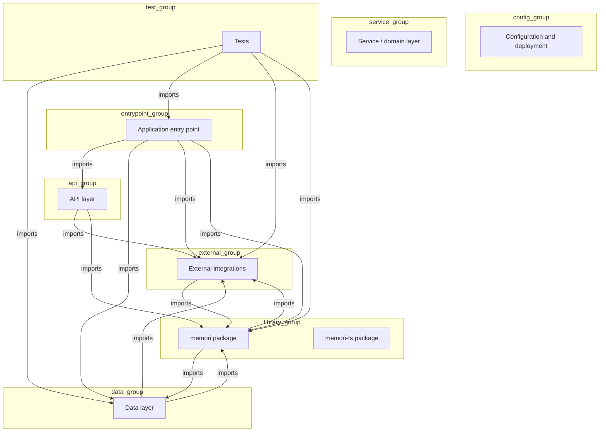

# Architecture report: MemoriLabs/Memori

> Automated static analysis. **Observed** = directly seen in files/imports/AST; **Inferred** = interpretation from that evidence. Repository code was not executed.

## 1. Repository at a glance

| Item | Value |
| --- | --- |
| Repository | MemoriLabs/Memori |
| Description | Memori is agent-native memory infrastructure. A LLM-agnostic layer that turns agent execution and conversation into structured, persistent state for production systems. Built for enterprise, Memori works with the data infrastructure you already run, no rip-and-replace, and deploys across managed cl… |
| Language | Python |
| Stars | 17575 |
| Licence | Other |
| Analysed commit / branch | 574b1ea3e876f100ef82c37817d603eb7e258e59 / main |
| Framework(s) | None detected |
| Files analysed | 658 |
| Components | 9 |

## 2. Architecture in one minute

MemoriLabs/Memori - Memori is agent-native memory infrastructure. A LLM-agnostic layer that turns agent execution and conversation into structured, persistent state for production systems. Built for enterprise, Memori w…. This repository was analysed statically from 658 file(s) (303 Python). Detected technologies (observed from imports/manifests): GitHub Actions, MongoDB, MySQL, PostgreSQL, aiohttp, NumPy. Files are grouped into 9 component(s): API layer, Configuration and deployment, Data layer, Application entry point, External integrations, memori package, memori-ts package, Service / domain layer. Observed entry point(s): integrations/hermes/src/memori_hermes/install.py, memori/__main__.py. Findings below distinguish observed facts from inferred interpretation.

## 3. High-level block diagram

## 4. Main components

### API layer (`api_layer`)

- **Kind:** api
- **Status:** Observed
- **Confidence:** 0.85
- **Responsibility:** Groups 3 file(s) under api layer (observed from repository paths and static analysis). Observed top-level classes: Manager.
- **Paths:** `integrations/openclaw/src/handlers/augmentation.ts`, `memori/api/_quota.py`, `memori/api/_sign_up.py`
- **Evidence:** [integrations/openclaw/src/handlers/augmentation.ts](https://github.com/MemoriLabs/Memori/blob/574b1ea3e876f100ef82c37817d603eb7e258e59/integrations/openclaw/src/handlers/augmentation.ts); [memori/api/_quota.py:16](https://github.com/MemoriLabs/Memori/blob/574b1ea3e876f100ef82c37817d603eb7e258e59/memori/api/_quota.py#L16); [memori/api/_sign_up.py:19](https://github.com/MemoriLabs/Memori/blob/574b1ea3e876f100ef82c37817d603eb7e258e59/memori/api/_sign_up.py#L19)

### Configuration and deployment (`config`)

- **Kind:** config
- **Status:** Observed
- **Confidence:** 0.85
- **Responsibility:** Groups 32 file(s) under configuration and deployment (observed from repository paths and static analysis).
- **Paths:** `Dockerfile`, `MANIFEST.in`, `benchmarks/.env.example`, `benchmarks/pyproject.toml`, `core/.cargo/config.toml`, `core/Cargo.toml`, `core/bindings/node/Cargo.toml`, `core/bindings/node/package.json`, `core/bindings/python/Cargo.toml`, `core/clippy.toml`, `core/rust-toolchain.toml`, `docker-compose.yml`, `integrations/claude-code/.env.example`, `integrations/hermes/plugin.yaml`, `integrations/hermes/pyproject.toml`, `integrations/hermes/src/memori_hermes/plugin.yaml`, `integrations/openclaw/.prettierrc.json`, `integrations/openclaw/openclaw.plugin.json`, `integrations/openclaw/package.json`, `integrations/openclaw/tsconfig.json`, `memori-ts/.prettierrc.json`, `memori-ts/examples/cockroachdb/.env.example`, `memori-ts/examples/mysql/.env.example`, `memori-ts/examples/postgres/.env.example`, `memori-ts/examples/sqlite/.env.example`, `memori-ts/package.json`, `memori-ts/src/native/package.json`, `memori-ts/tsconfig.build.json`, `memori-ts/tsconfig.json`, `pyproject.toml`, `setup.cfg`, `setup.py`
- **Evidence:** [Dockerfile](https://github.com/MemoriLabs/Memori/blob/574b1ea3e876f100ef82c37817d603eb7e258e59/Dockerfile); [MANIFEST.in](https://github.com/MemoriLabs/Memori/blob/574b1ea3e876f100ef82c37817d603eb7e258e59/MANIFEST.in); [benchmarks/.env.example](https://github.com/MemoriLabs/Memori/blob/574b1ea3e876f100ef82c37817d603eb7e258e59/benchmarks/.env.example); [benchmarks/pyproject.toml](https://github.com/MemoriLabs/Memori/blob/574b1ea3e876f100ef82c37817d603eb7e258e59/benchmarks/pyproject.toml); [core/.cargo/config.toml](https://github.com/MemoriLabs/Memori/blob/574b1ea3e876f100ef82c37817d603eb7e258e59/core/.cargo/config.toml); [core/Cargo.toml](https://github.com/MemoriLabs/Memori/blob/574b1ea3e876f100ef82c37817d603eb7e258e59/core/Cargo.toml); [core/bindings/node/Cargo.toml](https://github.com/MemoriLabs/Memori/blob/574b1ea3e876f100ef82c37817d603eb7e258e59/core/bindings/node/Cargo.toml); [core/bindings/node/package.json](https://github.com/MemoriLabs/Memori/blob/574b1ea3e876f100ef82c37817d603eb7e258e59/core/bindings/node/package.json)

### Data layer (`data_layer`)

- **Kind:** data
- **Status:** Observed
- **Confidence:** 0.85
- **Responsibility:** Groups 60 file(s) under data layer (observed from repository paths and static analysis). Observed top-level classes: Adapter, AttributionData, AugmentationInputData, BaseConversation, BaseConversationMessage, BaseConversationMessages. Observed top-level functions: _import_optional_module, connection_context, is_dbapi_connection, is_django_connection.
- **Paths:** `core/src/storage/bridge.rs`, `core/src/storage/builder.rs`, `core/src/storage/connection.rs`, `core/src/storage/dialect.rs`, `core/src/storage/drivers/mod.rs`, `core/src/storage/drivers/mysql.rs`, `core/src/storage/drivers/postgresql.rs`, `core/src/storage/drivers/sqlite.rs`, `core/src/storage/manager.rs`, `core/src/storage/migrations/mod.rs`, `core/src/storage/migrations/mysql.rs`, `core/src/storage/migrations/postgresql.rs`, `core/src/storage/migrations/sqlite.rs`, `core/src/storage/mod.rs`, `core/src/storage/models.rs`, `memori-ts/src/storage/adapters/mysql.ts`, `memori-ts/src/storage/adapters/postgresql.ts`, `memori-ts/src/storage/adapters/sqlite.ts`, `memori-ts/src/storage/base.ts`, `memori-ts/src/storage/manager.ts`, `memori-ts/src/storage/registry.ts`, `memori/memory/augmentation/augmentations/memori/models.py`, `memori/storage/__init__.py`, `memori/storage/_base.py`, `memori/storage/_builder.py`, `memori/storage/_connection.py`, `memori/storage/_manager.py`, `memori/storage/_registry.py`, `memori/storage/adapters/dbapi/__init__.py`, `memori/storage/adapters/dbapi/_adapter.py`, `memori/storage/adapters/django/__init__.py`, `memori/storage/adapters/django/_adapter.py`, `memori/storage/adapters/mongodb/__init__.py`, `memori/storage/adapters/mongodb/_adapter.py`, `memori/storage/adapters/sqlalchemy/__init__.py`, `memori/storage/adapters/sqlalchemy/_adapter.py`, `memori/storage/cockroachdb/_cluster_manager.py`, `memori/storage/cockroachdb/_display.py`, `memori/storage/cockroachdb/_files.py`, `memori/storage/drivers/mongodb/__init__.py`, `memori/storage/drivers/mongodb/_driver.py`, `memori/storage/drivers/mysql/__init__.py`, `memori/storage/drivers/mysql/_driver.py`, `memori/storage/drivers/oceanbase/__init__.py`, `memori/storage/drivers/oceanbase/_driver.py`, `memori/storage/drivers/oracle/__init__.py`, `memori/storage/drivers/oracle/_driver.py`, `memori/storage/drivers/postgresql/__init__.py`, `memori/storage/drivers/postgresql/_driver.py`, `memori/storage/drivers/sqlite/__init__.py`, `memori/storage/drivers/sqlite/_driver.py`, `memori/storage/drivers/tidb/__init__.py`, `memori/storage/drivers/tidb/_driver.py`, `memori/storage/migrations/_mongodb.py`, `memori/storage/migrations/_mysql.py`, `memori/storage/migrations/_oceanbase.py`, `memori/storage/migrations/_oracle.py`, `memori/storage/migrations/_postgresql.py`, `memori/storage/migrations/_sqlite.py`, `memori/storage/migrations/_tidb.py`
- **Evidence:** [core/src/storage/bridge.rs](https://github.com/MemoriLabs/Memori/blob/574b1ea3e876f100ef82c37817d603eb7e258e59/core/src/storage/bridge.rs); [core/src/storage/builder.rs](https://github.com/MemoriLabs/Memori/blob/574b1ea3e876f100ef82c37817d603eb7e258e59/core/src/storage/builder.rs); [core/src/storage/connection.rs](https://github.com/MemoriLabs/Memori/blob/574b1ea3e876f100ef82c37817d603eb7e258e59/core/src/storage/connection.rs); [core/src/storage/dialect.rs](https://github.com/MemoriLabs/Memori/blob/574b1ea3e876f100ef82c37817d603eb7e258e59/core/src/storage/dialect.rs); [core/src/storage/drivers/mod.rs](https://github.com/MemoriLabs/Memori/blob/574b1ea3e876f100ef82c37817d603eb7e258e59/core/src/storage/drivers/mod.rs); [core/src/storage/drivers/mysql.rs](https://github.com/MemoriLabs/Memori/blob/574b1ea3e876f100ef82c37817d603eb7e258e59/core/src/storage/drivers/mysql.rs); [core/src/storage/drivers/postgresql.rs](https://github.com/MemoriLabs/Memori/blob/574b1ea3e876f100ef82c37817d603eb7e258e59/core/src/storage/drivers/postgresql.rs); [core/src/storage/drivers/sqlite.rs](https://github.com/MemoriLabs/Memori/blob/574b1ea3e876f100ef82c37817d603eb7e258e59/core/src/storage/drivers/sqlite.rs)

### Application entry point (`entrypoint`)

- **Kind:** entrypoint
- **Status:** Observed
- **Confidence:** 0.85
- **Responsibility:** Groups 2 file(s) under application entry point (observed from repository paths and static analysis). Observed top-level classes: _PathsModule. Observed top-level functions: _ignore_copy_names, _load_direct_paths_module, _load_env_file, _parser, hermes_home, install_plugin.
- **Paths:** `integrations/hermes/src/memori_hermes/install.py`, `memori/__main__.py`
- **Evidence:** [integrations/hermes/src/memori_hermes/install.py:14](https://github.com/MemoriLabs/Memori/blob/574b1ea3e876f100ef82c37817d603eb7e258e59/integrations/hermes/src/memori_hermes/install.py#L14); [memori/__main__.py:27](https://github.com/MemoriLabs/Memori/blob/574b1ea3e876f100ef82c37817d603eb7e258e59/memori/__main__.py#L27)

### External integrations (`external_integrations`)

- **Kind:** external
- **Status:** Observed
- **Confidence:** 0.85
- **Responsibility:** Groups 45 file(s) under external integrations (observed from repository paths and static analysis). Observed top-level classes: Adapter, Agno, Anthropic, Google, LangChain, LiteLLM. Observed top-level functions: _config_path, _content_text, _current_turn_messages, _derive_trace_from_messages, _detect_platform, _embed_texts.
- **Paths:** `integrations/claude-code/index.ts`, `integrations/hermes/src/memori_hermes/__init__.py`, `integrations/hermes/src/memori_hermes/_paths.py`, `integrations/hermes/src/memori_hermes/client.py`, `integrations/hermes/src/memori_hermes/tools.py`, `integrations/openclaw/eslint.config.js`, `integrations/openclaw/src/cli/commands.ts`, `integrations/openclaw/src/cli/config-file.ts`, `integrations/openclaw/src/constants.ts`, `integrations/openclaw/src/index.ts`, `integrations/openclaw/src/sanitizer.ts`, `integrations/openclaw/src/tools/index.ts`, `integrations/openclaw/src/tools/memori-compaction.ts`, `integrations/openclaw/src/tools/memori-feedback.ts`, `integrations/openclaw/src/tools/memori-quota.ts`, `integrations/openclaw/src/tools/memori-recall-summary.ts`, `integrations/openclaw/src/tools/memori-recall.ts`, `integrations/openclaw/src/tools/memori-signup.ts`, `integrations/openclaw/src/tools/types.ts`, `integrations/openclaw/src/types.ts`, `integrations/openclaw/src/utils/context.ts`, `integrations/openclaw/src/utils/index.ts`, `integrations/openclaw/src/utils/logger.ts`, `integrations/openclaw/src/utils/memori-client.ts`, `integrations/openclaw/src/utils/skills-loader.ts`, `integrations/openclaw/src/version.ts`, `integrations/openclaw/vitest.config.ts`, `memori-ts/src/integrations/base.ts`, `memori-ts/src/integrations/index.ts`, `memori-ts/src/integrations/openclaw.ts`, `memori/embeddings/_api.py`, `memori/llm/adapters/anthropic/__init__.py`, `memori/llm/adapters/anthropic/_adapter.py`, `memori/llm/adapters/bedrock/__init__.py`, `memori/llm/adapters/bedrock/_adapter.py`, `memori/llm/adapters/google/__init__.py`, `memori/llm/adapters/google/_adapter.py`, `memori/llm/adapters/openai/__init__.py`, `memori/llm/adapters/openai/_adapter.py`, `memori/llm/adapters/xai/__init__.py`, `memori/llm/adapters/xai/_adapter.py`, `memori/llm/clients/__init__.py`, `memori/llm/clients/direct.py`, `memori/llm/clients/frameworks.py`, `memori/search/_api.py`
- **Evidence:** [integrations/claude-code/index.ts](https://github.com/MemoriLabs/Memori/blob/574b1ea3e876f100ef82c37817d603eb7e258e59/integrations/claude-code/index.ts); [integrations/hermes/src/memori_hermes/__init__.py:32](https://github.com/MemoriLabs/Memori/blob/574b1ea3e876f100ef82c37817d603eb7e258e59/integrations/hermes/src/memori_hermes/__init__.py#L32); [integrations/hermes/src/memori_hermes/_paths.py:13](https://github.com/MemoriLabs/Memori/blob/574b1ea3e876f100ef82c37817d603eb7e258e59/integrations/hermes/src/memori_hermes/_paths.py#L13); [integrations/hermes/src/memori_hermes/client.py:12](https://github.com/MemoriLabs/Memori/blob/574b1ea3e876f100ef82c37817d603eb7e258e59/integrations/hermes/src/memori_hermes/client.py#L12); [integrations/hermes/src/memori_hermes/tools.py](https://github.com/MemoriLabs/Memori/blob/574b1ea3e876f100ef82c37817d603eb7e258e59/integrations/hermes/src/memori_hermes/tools.py); [integrations/openclaw/eslint.config.js](https://github.com/MemoriLabs/Memori/blob/574b1ea3e876f100ef82c37817d603eb7e258e59/integrations/openclaw/eslint.config.js); [integrations/openclaw/src/cli/commands.ts](https://github.com/MemoriLabs/Memori/blob/574b1ea3e876f100ef82c37817d603eb7e258e59/integrations/openclaw/src/cli/commands.ts); [integrations/openclaw/src/cli/config-file.ts](https://github.com/MemoriLabs/Memori/blob/574b1ea3e876f100ef82c37817d603eb7e258e59/integrations/openclaw/src/cli/config-file.ts)

### memori package (`memori`)

- **Kind:** library
- **Status:** Observed
- **Confidence:** 0.85
- **Responsibility:** Groups 78 file(s) under memori package (observed from repository paths and static analysis). Observed top-level classes: AdvancedAugmentation, Agent, Agno, Anthropic, Api, ApiSubdomain. Observed top-level functions: _acquire_cache_lock, _android_abi_for_machine, _apply_write_op, _attach_top_level_summaries_to_facts, _build_fact_rows, _build_meta.
- **Paths:** `memori/__init__.py`, `memori/_cli.py`, `memori/_config.py`, `memori/_embedding_input.py`, `memori/_exceptions.py`, `memori/_logging.py`, `memori/_network.py`, `memori/_rust_core.py`, `memori/_setup.py`, `memori/_utils.py`, `memori/agent.py`, `memori/embeddings/__init__.py`, `memori/embeddings/_chunking.py`, `memori/embeddings/_format.py`, `memori/embeddings/_tei.py`, `memori/embeddings/_tei_embed.py`, `memori/embeddings/_utils.py`, `memori/llm/__init__.py`, `memori/llm/_base.py`, `memori/llm/_constants.py`, `memori/llm/_providers.py`, `memori/llm/_registry.py`, `memori/llm/_utils.py`, `memori/llm/_xai_wrappers.py`, `memori/llm/helpers/__init__.py`, `memori/llm/helpers/google_system_instruction.py`, `memori/llm/helpers/query_extraction.py`, `memori/llm/helpers/serialization.py`, `memori/llm/invoke/__init__.py`, `memori/llm/invoke/invoke.py`, `memori/llm/invoke/iterable.py`, `memori/llm/invoke/iterator.py`, `memori/llm/invoke/streaming.py`, `memori/llm/pipelines/__init__.py`, `memori/llm/pipelines/conversation_injection.py`, `memori/llm/pipelines/post_invoke.py`, `memori/llm/pipelines/recall_injection.py`, `memori/memory/_collector.py`, `memori/memory/_conversation_messages.py`, `memori/memory/_manager.py`, `memori/memory/_struct.py`, `memori/memory/_writer.py`, `memori/memory/augmentation/__init__.py`, `memori/memory/augmentation/_base.py`, `memori/memory/augmentation/_db_writer.py`, `memori/memory/augmentation/_handler.py`, `memori/memory/augmentation/_manager.py`, `memori/memory/augmentation/_message.py`, `memori/memory/augmentation/_models.py`, `memori/memory/augmentation/_registry.py`, `memori/memory/augmentation/_runtime.py`, `memori/memory/augmentation/augmentations/memori/__init__.py`, `memori/memory/augmentation/augmentations/memori/_augmentation.py`, `memori/memory/augmentation/input.py`, `memori/memory/augmentation/memories/_conversation.py`, `memori/memory/augmentation/memories/_entity.py`, `memori/memory/augmentation/memories/_process.py`, `memori/memory/recall.py`, `memori/native/__init__.py`, `memori/native/_adapter.py`, `memori/native/_embeddings.py`, `memori/native/_errors.py`, `memori/native/_loader.py`, `memori/native/_onnxruntime.py`, `memori/provisioning/__init__.py`, `memori/provisioning/_cache.py`, `memori/provisioning/_manager.py`, `memori/provisioning/_models.py`, `memori/provisioning/_registry.py`, `memori/provisioning/_utils.py`, `memori/provisioning/providers/__init__.py`, `memori/provisioning/providers/tidb_zero.py`, `memori/search/__init__.py`, `memori/search/_core.py`, `memori/search/_faiss.py`, `memori/search/_lexical.py`, `memori/search/_parsing.py`, `memori/search/_types.py`
- **Evidence:** [memori/__init__.py:46](https://github.com/MemoriLabs/Memori/blob/574b1ea3e876f100ef82c37817d603eb7e258e59/memori/__init__.py#L46); [memori/_cli.py:16](https://github.com/MemoriLabs/Memori/blob/574b1ea3e876f100ef82c37817d603eb7e258e59/memori/_cli.py#L16); [memori/_config.py:22](https://github.com/MemoriLabs/Memori/blob/574b1ea3e876f100ef82c37817d603eb7e258e59/memori/_config.py#L22); [memori/_embedding_input.py:7](https://github.com/MemoriLabs/Memori/blob/574b1ea3e876f100ef82c37817d603eb7e258e59/memori/_embedding_input.py#L7); [memori/_exceptions.py:15](https://github.com/MemoriLabs/Memori/blob/574b1ea3e876f100ef82c37817d603eb7e258e59/memori/_exceptions.py#L15); [memori/_logging.py:20](https://github.com/MemoriLabs/Memori/blob/574b1ea3e876f100ef82c37817d603eb7e258e59/memori/_logging.py#L20); [memori/_network.py:35](https://github.com/MemoriLabs/Memori/blob/574b1ea3e876f100ef82c37817d603eb7e258e59/memori/_network.py#L35); [memori/_rust_core.py](https://github.com/MemoriLabs/Memori/blob/574b1ea3e876f100ef82c37817d603eb7e258e59/memori/_rust_core.py)

### memori-ts package (`memori_ts`)

- **Kind:** library
- **Status:** Observed
- **Confidence:** 0.85
- **Responsibility:** Groups 29 file(s) under memori-ts package (observed from repository paths and static analysis).
- **Paths:** `memori-ts/eslint.config.js`, `memori-ts/examples/cloud/main.ts`, `memori-ts/examples/cockroachdb/main.ts`, `memori-ts/examples/mysql/main.ts`, `memori-ts/examples/postgres/main.ts`, `memori-ts/examples/sqlite/main.ts`, `memori-ts/examples/sqlite/rust_core_main.ts`, `memori-ts/scripts/bump-versions.js`, `memori-ts/scripts/sync-native.js`, `memori-ts/src/bin/cli.ts`, `memori-ts/src/cli/commands/help.ts`, `memori-ts/src/cli/commands/quota.ts`, `memori-ts/src/cli/commands/signup.ts`, `memori-ts/src/cli/router.ts`, `memori-ts/src/cli/utils.ts`, `memori-ts/src/engines/augmentation.ts`, `memori-ts/src/engines/persistence.ts`, `memori-ts/src/engines/recall.ts`, `memori-ts/src/index.ts`, `memori-ts/src/memori.ts`, `memori-ts/src/native/build.js`, `memori-ts/src/native/index.d.ts`, `memori-ts/src/native/index.js`, `memori-ts/src/types/api.ts`, `memori-ts/src/types/integrations.ts`, `memori-ts/src/types/storage.ts`, `memori-ts/src/utils/utils.ts`, `memori-ts/src/version.ts`, `memori-ts/vitest.config.ts`
- **Evidence:** [memori-ts/eslint.config.js](https://github.com/MemoriLabs/Memori/blob/574b1ea3e876f100ef82c37817d603eb7e258e59/memori-ts/eslint.config.js); [memori-ts/examples/cloud/main.ts](https://github.com/MemoriLabs/Memori/blob/574b1ea3e876f100ef82c37817d603eb7e258e59/memori-ts/examples/cloud/main.ts); [memori-ts/examples/cockroachdb/main.ts](https://github.com/MemoriLabs/Memori/blob/574b1ea3e876f100ef82c37817d603eb7e258e59/memori-ts/examples/cockroachdb/main.ts); [memori-ts/examples/mysql/main.ts](https://github.com/MemoriLabs/Memori/blob/574b1ea3e876f100ef82c37817d603eb7e258e59/memori-ts/examples/mysql/main.ts); [memori-ts/examples/postgres/main.ts](https://github.com/MemoriLabs/Memori/blob/574b1ea3e876f100ef82c37817d603eb7e258e59/memori-ts/examples/postgres/main.ts); [memori-ts/examples/sqlite/main.ts](https://github.com/MemoriLabs/Memori/blob/574b1ea3e876f100ef82c37817d603eb7e258e59/memori-ts/examples/sqlite/main.ts); [memori-ts/examples/sqlite/rust_core_main.ts](https://github.com/MemoriLabs/Memori/blob/574b1ea3e876f100ef82c37817d603eb7e258e59/memori-ts/examples/sqlite/rust_core_main.ts); [memori-ts/scripts/bump-versions.js](https://github.com/MemoriLabs/Memori/blob/574b1ea3e876f100ef82c37817d603eb7e258e59/memori-ts/scripts/bump-versions.js)

### Service / domain layer (`service_layer`)

- **Kind:** service
- **Status:** Observed
- **Confidence:** 0.85
- **Responsibility:** Groups 40 file(s) under service / domain layer (observed from repository paths and static analysis).
- **Paths:** `core/bindings/node/build.js`, `core/bindings/node/build.rs`, `core/bindings/node/src/bridge.rs`, `core/bindings/node/src/engine.rs`, `core/bindings/node/src/lib.rs`, `core/bindings/node/src/types.rs`, `core/bindings/python/src/lib.rs`, `core/src/augmentation/mod.rs`, `core/src/augmentation/models.rs`, `core/src/augmentation/pipeline.rs`, `core/src/embeddings/api.rs`, `core/src/embeddings/chunking.rs`, `core/src/embeddings/mod.rs`, `core/src/embeddings/models.rs`, `core/src/embeddings/utils.rs`, `core/src/error.rs`, `core/src/lib.rs`, `core/src/models.rs`, `core/src/network/client.rs`, `core/src/network/error.rs`, `core/src/network/mod.rs`, `core/src/retrieval/mod.rs`, `core/src/retrieval/models.rs`, `core/src/retrieval/pipeline.rs`, `core/src/runtime/config.rs`, `core/src/runtime/errors.rs`, `core/src/runtime/mod.rs`, `core/src/runtime/state.rs`, `core/src/runtime/worker.rs`, `core/src/search/api.rs`, `core/src/search/lexical.rs`, `core/src/search/mod.rs`, `core/src/search/models.rs`, `core/src/search/similarity.rs`, `memori-ts/src/core/config.ts`, `memori-ts/src/core/engine.ts`, `memori-ts/src/core/errors.ts`, `memori-ts/src/core/network.ts`, `memori-ts/src/core/project.ts`, `memori-ts/src/core/session.ts`
- **Evidence:** [core/bindings/node/build.js](https://github.com/MemoriLabs/Memori/blob/574b1ea3e876f100ef82c37817d603eb7e258e59/core/bindings/node/build.js); [core/bindings/node/build.rs](https://github.com/MemoriLabs/Memori/blob/574b1ea3e876f100ef82c37817d603eb7e258e59/core/bindings/node/build.rs); [core/bindings/node/src/bridge.rs](https://github.com/MemoriLabs/Memori/blob/574b1ea3e876f100ef82c37817d603eb7e258e59/core/bindings/node/src/bridge.rs); [core/bindings/node/src/engine.rs](https://github.com/MemoriLabs/Memori/blob/574b1ea3e876f100ef82c37817d603eb7e258e59/core/bindings/node/src/engine.rs); [core/bindings/node/src/lib.rs](https://github.com/MemoriLabs/Memori/blob/574b1ea3e876f100ef82c37817d603eb7e258e59/core/bindings/node/src/lib.rs); [core/bindings/node/src/types.rs](https://github.com/MemoriLabs/Memori/blob/574b1ea3e876f100ef82c37817d603eb7e258e59/core/bindings/node/src/types.rs); [core/bindings/python/src/lib.rs](https://github.com/MemoriLabs/Memori/blob/574b1ea3e876f100ef82c37817d603eb7e258e59/core/bindings/python/src/lib.rs); [core/src/augmentation/mod.rs](https://github.com/MemoriLabs/Memori/blob/574b1ea3e876f100ef82c37817d603eb7e258e59/core/src/augmentation/mod.rs)

### Tests (`tests`)

- **Kind:** test
- **Status:** Observed
- **Confidence:** 0.85
- **Responsibility:** Groups 197 file(s) under tests (observed from repository paths and static analysis). Observed routes: PATCH memori.llm.invoke.iterator.MemoryManager, PATCH memori.llm.invoke.iterator.format_payload, PATCH memori.llm.invoke.iterator.MemoryManager, PATCH memori.llm.invoke.iterator.format_payload, PATCH memori.llm.invoke.iterator.MemoryManager. Observed top-level classes: CapturedPayload, Color, FakeClient, FakeConnection, FakeCursor, MockEvent. Observed top-level functions: MongoTestDBSession, OracleTestDBSession, _fake_connection_context, _get_timeout_error, _is_payload_ready, _litellm_config.
- **Paths:** `conftest.py`, `core/tests/orchestrator_contract.rs`, `core/tests/retrieval_aa_contract.rs`, `core/tests/storage_sqlite_integration.rs`, `core/tests/worker_runtime_contract.rs`, `integrations/hermes/tests/test_client.py`, `integrations/hermes/tests/test_install.py`, `integrations/hermes/tests/test_provider.py`, `integrations/openclaw/tests/cli/config-file.test.ts`, `integrations/openclaw/tests/handlers/augmentation.test.ts`, `integrations/openclaw/tests/index.test.ts`, `integrations/openclaw/tests/sanitizer.test.ts`, `integrations/openclaw/tests/tools/memori-compaction.test.ts`, `integrations/openclaw/tests/tools/memori-feedback.test.ts`, `integrations/openclaw/tests/tools/memori-quota.test.ts`, `integrations/openclaw/tests/tools/memori-recall-summary.test.ts`, `integrations/openclaw/tests/tools/memori-recall.test.ts`, `integrations/openclaw/tests/tools/memori-signup.test.ts`, `integrations/openclaw/tests/utils/context.test.ts`, `integrations/openclaw/tests/utils/logger.test.ts`, `integrations/openclaw/tests/utils/memori-client.test.ts`, `integrations/openclaw/tests/utils/skills-loader.test.ts`, `memori-ts/tests/cli/bin/cli.test.ts`, `memori-ts/tests/cli/bin/router.test.ts`, `memori-ts/tests/cli/commands/help.test.ts`, `memori-ts/tests/cli/commands/quota.test.ts`, `memori-ts/tests/cli/commands/signup.test.ts`, `memori-ts/tests/cli/utils.test.ts`, `memori-ts/tests/core/config.test.ts`, `memori-ts/tests/core/engine.test.ts`, `memori-ts/tests/core/network.test.ts`, `memori-ts/tests/core/project.test.ts`, `memori-ts/tests/core/session.test.ts`, `memori-ts/tests/engines/augmentation.test.ts`, `memori-ts/tests/engines/persistence.test.ts`, `memori-ts/tests/engines/recall.test.ts`, `memori-ts/tests/integrations/base.test.ts`, `memori-ts/tests/integrations/cloud/anthropic.test.ts`, `memori-ts/tests/integrations/cloud/cloud-helpers.ts`, `memori-ts/tests/integrations/cloud/gemini.test.ts`, `memori-ts/tests/integrations/cloud/openai.test.ts`, `memori-ts/tests/integrations/openclaw.test.ts`, `memori-ts/tests/memori.test.ts`, `memori-ts/tests/setup.ts`, `memori-ts/tests/storage/adapters.test.ts`, `memori-ts/tests/storage/manager.test.ts`, `memori-ts/tests/storage/registry.test.ts`, `memori-ts/tests/storage/storageCall.mysql.test.ts`, `memori-ts/tests/storage/storageCall.sqlite.test.ts`, `memori-ts/tests/utils/utils.test.ts`, `tests/database/core.py`, `tests/database/init_db.py`, `tests/embeddings/test_embedding_utils.py`, `tests/embeddings/test_tei_chunking.py`, `tests/integration/__init__.py`, `tests/integration/cloud/__init__.py`, `tests/integration/cloud/conftest.py`, `tests/integration/cloud/test_cloud_anthropic.py`, `tests/integration/cloud/test_cloud_bedrock.py`, `tests/integration/cloud/test_cloud_gemini.py`, `tests/integration/cloud/test_cloud_openai.py`, `tests/integration/cloud/test_cloud_xai.py`, `tests/integration/conftest.py`, `tests/integration/databases/__init__.py`, `tests/integration/databases/conftest.py`, `tests/integration/databases/test_database_storage.py`, `tests/integration/providers/__init__.py`, `tests/integration/providers/test_anthropic.py`, `tests/integration/providers/test_bedrock.py`, `tests/integration/providers/test_google.py`, `tests/integration/providers/test_openai.py`, `tests/integration/providers/test_xai.py`, `tests/integration/test_aa_payload.py`, `tests/integration_v2/cloud_v2/__init__.py`, `tests/integration_v2/cloud_v2/cloud_helpers.py`, `tests/integration_v2/cloud_v2/conftest.py`, `tests/integration_v2/cloud_v2/test_cloud_anthropic.py`, `tests/integration_v2/cloud_v2/test_cloud_gemini.py`, `tests/integration_v2/cloud_v2/test_cloud_openai.py`, `tests/llm/adapters/anthropic/test_llm_adapters_anthropic_adapter.py`, `tests/llm/adapters/bedrock/test_llm_adapters_bedrock_adapter.py`, `tests/llm/adapters/google/test_llm_adapters_google_adapter.py`, `tests/llm/adapters/openai/test_llm_adapters_openai_adapter.py`, `tests/llm/adapters/xai/test_llm_adapters_xai_adapter.py`, `tests/llm/clients/oss/agno/anthropic_async.py`, `tests/llm/clients/oss/agno/anthropic_sync.py`, `tests/llm/clients/oss/agno/gemini_async.py`, `tests/llm/clients/oss/agno/gemini_streaming.py`, `tests/llm/clients/oss/agno/gemini_sync.py`, `tests/llm/clients/oss/agno/openai_async.py`, `tests/llm/clients/oss/agno/openai_streaming.py`, `tests/llm/clients/oss/agno/openai_sync.py`, `tests/llm/clients/oss/agno/xai_async.py`, `tests/llm/clients/oss/agno/xai_streaming.py`, `tests/llm/clients/oss/agno/xai_sync.py`, `tests/llm/clients/oss/anthropic/async.py`, `tests/llm/clients/oss/anthropic/sync.py`, `tests/llm/clients/oss/gemini/async.py`, `tests/llm/clients/oss/gemini/async_streaming.py`, `tests/llm/clients/oss/gemini/sync.py`, `tests/llm/clients/oss/langchain/chatbedrock/async_runnable.py`, `tests/llm/clients/oss/langchain/chatgooglegenai/async_runnable.py`, `tests/llm/clients/oss/langchain/chatgooglegenai/async_streaming.py`, `tests/llm/clients/oss/langchain/chatgooglegenai/sync.py`, `tests/llm/clients/oss/langchain/chatgooglegenai/sync_runnable.py`, `tests/llm/clients/oss/langchain/chatgooglegenai/sync_runnable_structured_output.py`, `tests/llm/clients/oss/langchain/chatopenai/async_ainvoke.py`, `tests/llm/clients/oss/langchain/chatopenai/async_runnable.py`, `tests/llm/clients/oss/langchain/chatopenai/async_streaming.py`, `tests/llm/clients/oss/langchain/chatopenai/sync.py`, `tests/llm/clients/oss/langchain/chatopenai/sync_runnable.py`, `tests/llm/clients/oss/langchain/chatopenai/sync_runnable_structured_output.py`, `tests/llm/clients/oss/langchain/chatvertexai/sync.py`, `tests/llm/clients/oss/openai/async.py`, `tests/llm/clients/oss/openai/async_streaming.py`, `tests/llm/clients/oss/openai/sync.py`, `tests/llm/clients/oss/xai/async.py`, `tests/llm/clients/oss/xai/async_stream.py`, `tests/llm/clients/oss/xai/sync.py`, `tests/llm/helpers/test_query_extraction.py`, `tests/llm/helpers/test_serialization.py`, `tests/llm/pipelines/__init__.py`, `tests/llm/pipelines/test_conversation_injection.py`, `tests/llm/pipelines/test_recall_injection.py`, `tests/llm/providers/__init__.py`, `tests/llm/providers/azure_openai/__init__.py`, `tests/llm/providers/azure_openai/test_azure_openai.py`, `tests/llm/providers/google_genai/__init__.py`, `tests/llm/providers/google_genai/test_google_genai.py`, `tests/llm/test_llm_base.py`, `tests/llm/test_llm_clients.py`, `tests/llm/test_llm_deprecation_warnings.py`, `tests/llm/test_llm_embeddings.py`, `tests/llm/test_llm_provider_sdk_version.py`, `tests/llm/test_llm_registry.py`, `tests/llm/test_llm_utils.py`, `tests/llm/test_llm_xai_wrappers.py`, `tests/llm/unit_test_objects.py`, `tests/memory/augmentation/test_aa_payload_unit.py`, `tests/memory/augmentation/test_advanced_augmentation.py`, `tests/memory/augmentation/test_base.py`, `tests/memory/augmentation/test_handler.py`, `tests/memory/augmentation/test_manager.py`, `tests/memory/augmentation/test_manager_quota.py`, `tests/memory/augmentation/test_models.py`, `tests/memory/augmentation/test_quota_propagation.py`, `tests/memory/augmentation/test_registry.py`, `tests/memory/test_conversation_messages.py`, `tests/memory/test_manager_enterprise_retry.py`, `tests/memory/test_memory_augmentation_db_writer.py`, `tests/memory/test_memory_struct.py`, `tests/memory/test_memory_struct_triples.py`, `tests/memory/test_memory_writer.py`, `tests/memory/test_recall.py`, `tests/memory/test_recall_eval_harness.py`, `tests/provisioning/test_memori_provision.py`, `tests/provisioning/test_provisioning_cache.py`, `tests/provisioning/test_provisioning_flow.py`, `tests/provisioning/test_provisioning_models.py`, `tests/provisioning/test_provisioning_registry.py`, `tests/provisioning/test_provisioning_utils.py`, `tests/provisioning/test_tidb_zero_provider.py`, `tests/storage/adapters/conftest.py`, `tests/storage/adapters/dbapi/test_dbapi_no_conflicts.py`, `tests/storage/adapters/dbapi/test_storage_adapters_dbapi_adapter.py`, `tests/storage/adapters/django/test_storage_adapters_django_adapter.py`, `tests/storage/adapters/mongodb/__init__.py`, `tests/storage/adapters/mongodb/test_mongodb_adapter.py`, `tests/storage/adapters/sqlalchemy/test_storage_adaptors_sqlalchemy_adapter.py`, `tests/storage/cockroachdb/test_storage_cockroachdb_cluster_manager.py`, `tests/storage/cockroachdb/test_storage_cockroachdb_display.py`, `tests/storage/cockroachdb/test_storage_cockroachdb_files.py`, `tests/storage/drivers/conftest.py`, `tests/storage/drivers/test_mongodb_driver.py`, `tests/storage/drivers/test_mysql_driver.py`, `tests/storage/drivers/test_oceanbase_driver.py`, `tests/storage/drivers/test_oracle_driver.py`, `tests/storage/drivers/test_postgresql_driver.py`, `tests/storage/drivers/test_sqlite_driver.py`, `tests/storage/test_connection.py`, `tests/storage/test_connection_factory.py`, `tests/storage/test_storage_builder.py`, `tests/storage/test_storage_init.py`, `tests/storage/test_storage_manager.py`, `tests/storage/test_storage_registry.py`, `tests/test_agent.py`, `tests/test_cli.py`, `tests/test_config.py`, `tests/test_init.py`, `tests/test_legacy_package_warning.py`, `tests/test_litellm_client.py`, `tests/test_llm_auto_registration.py`, `tests/test_network.py`, `tests/test_rust_core.py`, `tests/test_search.py`, `tests/test_typing_dx.py`, `tests/test_utils.py`
- **Evidence:** [conftest.py:9](https://github.com/MemoriLabs/Memori/blob/574b1ea3e876f100ef82c37817d603eb7e258e59/conftest.py#L9); [core/tests/orchestrator_contract.rs](https://github.com/MemoriLabs/Memori/blob/574b1ea3e876f100ef82c37817d603eb7e258e59/core/tests/orchestrator_contract.rs); [core/tests/retrieval_aa_contract.rs](https://github.com/MemoriLabs/Memori/blob/574b1ea3e876f100ef82c37817d603eb7e258e59/core/tests/retrieval_aa_contract.rs); [core/tests/storage_sqlite_integration.rs](https://github.com/MemoriLabs/Memori/blob/574b1ea3e876f100ef82c37817d603eb7e258e59/core/tests/storage_sqlite_integration.rs); [core/tests/worker_runtime_contract.rs](https://github.com/MemoriLabs/Memori/blob/574b1ea3e876f100ef82c37817d603eb7e258e59/core/tests/worker_runtime_contract.rs); [integrations/hermes/tests/test_client.py:14](https://github.com/MemoriLabs/Memori/blob/574b1ea3e876f100ef82c37817d603eb7e258e59/integrations/hermes/tests/test_client.py#L14); [integrations/hermes/tests/test_install.py:22](https://github.com/MemoriLabs/Memori/blob/574b1ea3e876f100ef82c37817d603eb7e258e59/integrations/hermes/tests/test_install.py#L22); [integrations/hermes/tests/test_provider.py:14](https://github.com/MemoriLabs/Memori/blob/574b1ea3e876f100ef82c37817d603eb7e258e59/integrations/hermes/tests/test_provider.py#L14)

## 5. Execution flow

**Observed** entry point(s):

- [integrations/claude-code/index.ts](https://github.com/MemoriLabs/Memori/blob/574b1ea3e876f100ef82c37817d603eb7e258e59/integrations/claude-code/index.ts)
- [integrations/hermes/src/memori_hermes/install.py:187](https://github.com/MemoriLabs/Memori/blob/574b1ea3e876f100ef82c37817d603eb7e258e59/integrations/hermes/src/memori_hermes/install.py#L187)
- [integrations/openclaw/src/index.ts](https://github.com/MemoriLabs/Memori/blob/574b1ea3e876f100ef82c37817d603eb7e258e59/integrations/openclaw/src/index.ts)
- [memori-ts/src/index.ts](https://github.com/MemoriLabs/Memori/blob/574b1ea3e876f100ef82c37817d603eb7e258e59/memori-ts/src/index.ts)
- [memori-ts/src/integrations/index.ts](https://github.com/MemoriLabs/Memori/blob/574b1ea3e876f100ef82c37817d603eb7e258e59/memori-ts/src/integrations/index.ts)
- [memori-ts/src/native/index.js](https://github.com/MemoriLabs/Memori/blob/574b1ea3e876f100ef82c37817d603eb7e258e59/memori-ts/src/native/index.js)
- [memori/__main__.py:115](https://github.com/MemoriLabs/Memori/blob/574b1ea3e876f100ef82c37817d603eb7e258e59/memori/__main__.py#L115)

**Observed** routes (from decorators):

- `PATCH memori.llm.invoke.iterator.MemoryManager` -> `test_iterator_yields_all_events` in `tests/llm/adapters/openai/test_llm_adapters_openai_adapter.py:238`
- `PATCH memori.llm.invoke.iterator.format_payload` -> `test_iterator_yields_all_events` in `tests/llm/adapters/openai/test_llm_adapters_openai_adapter.py:238`
- `PATCH memori.llm.invoke.iterator.MemoryManager` -> `test_iterator_captures_response_on_completed_event` in `tests/llm/adapters/openai/test_llm_adapters_openai_adapter.py:261`
- `PATCH memori.llm.invoke.iterator.format_payload` -> `test_iterator_captures_response_on_completed_event` in `tests/llm/adapters/openai/test_llm_adapters_openai_adapter.py:261`
- `PATCH memori.llm.invoke.iterator.MemoryManager` -> `test_async_iterator_yields_all_events` in `tests/llm/adapters/openai/test_llm_adapters_openai_adapter.py:293`
- `PATCH memori.llm.invoke.iterator.format_payload` -> `test_async_iterator_yields_all_events` in `tests/llm/adapters/openai/test_llm_adapters_openai_adapter.py:293`
- `PATCH memori.__main__.ApiQuotaManager` -> `test_cli_loads_dotenv_from_cwd` in `tests/test_cli.py:100`
- `PATCH memori.__main__.ApiQuotaManager` -> `test_cli_dotenv_does_not_override_exported_env` in `tests/test_cli.py:114`
- `PATCH memori.provisioning._manager.provision_memori` -> `test_provision_provider_dispatches_and_redacts_output` in `tests/test_cli.py:143`
- `PATCH memori.provisioning._manager.provision_memori` -> `test_provision_provider_flag_dispatches` in `tests/test_cli.py:170`
- `PATCH memori.__main__.CockroachDBClusterManager` -> `test_cockroachdb_cluster_start_dispatches_correctly` in `tests/test_cli.py:194`

Representative flow (derived from observed entry points and the import graph; steps beyond the entry point are **Inferred**):

1. Execution starts at an observed entry point listed above, if present.
2. `api_layer` imports `external_integrations` (API layer -> External integrations).
3. `api_layer` imports `memori` (API layer -> memori package).
4. `data_layer` imports `external_integrations` (Data layer -> External integrations).
5. `data_layer` imports `memori` (Data layer -> memori package).
6. `entrypoint` imports `api_layer` (Application entry point -> API layer).
7. `entrypoint` imports `data_layer` (Application entry point -> Data layer).
8. `entrypoint` imports `external_integrations` (Application entry point -> External integrations).
9. `entrypoint` imports `memori` (Application entry point -> memori package).

## 6. Project structure

### `(root)`

- `.dockerignore` - container (558 bytes)
- `.env.example` - config (593 bytes)
- `.gitignore` - other (2097 bytes)
- `.pre-commit-config.yaml` - config (1397 bytes)
- `CHANGELOG.md` - docs (6153 bytes)
- `CONTRIBUTING.md` - docs (11648 bytes)
- `Dockerfile` - container (710 bytes)
- `LICENSE` - docs (10431 bytes)
- `MANIFEST.in` - manifest (1319 bytes)
- `Makefile` - other (5933 bytes)
- `README.md` - docs (13474 bytes)
- `SECURITY.md` - docs (737 bytes)
- `conftest.py` - test, Python (1511 bytes)
- `docker-compose.yml` - container (3606 bytes)
- `pyproject.toml` - manifest (5153 bytes)
- `setup.cfg` - manifest (37 bytes)
- `setup.py` - manifest, Python (320 bytes)

### `.github`

- `.github/ISSUE_TEMPLATE/bug_report.yml` - config (2818 bytes)
- `.github/ISSUE_TEMPLATE/config.yml` - config (28 bytes)
- `.github/ISSUE_TEMPLATE/feature_request.yml` - config (1662 bytes)
- `.github/ISSUE_TEMPLATE/question.yml` - config (2026 bytes)
- `.github/pull_request_template.md` - docs (1981 bytes)
- `.github/workflows/ci.yml` - ci, YAML (3262 bytes)
- `.github/workflows/core-ci.yml` - ci, YAML (14769 bytes)
- `.github/workflows/integration.yml` - ci, YAML (8184 bytes)
- `.github/workflows/publish-hermes.yml` - ci, YAML (2124 bytes)
- `.github/workflows/publish-npm.yml` - ci, YAML (15109 bytes)
- `.github/workflows/publish-openclaw-plugin.yml` - ci, YAML (874 bytes)
- `.github/workflows/publish.yml` - ci, YAML (11739 bytes)
- `.github/workflows/python-cloud-integration.yml` - ci, YAML (908 bytes)
- `.github/workflows/ts-ci.yml` - ci, YAML (2160 bytes)
- `.github/workflows/ts-cloud-integration.yml` - ci, YAML (791 bytes)
- `.github/workflows/ts-openclaw-ci.yml` - ci, YAML (979 bytes)

### `benchmarks`

- `benchmarks/.env.example` - config (37 bytes)
- `benchmarks/01_load_indexes.ipynb` - other (11962 bytes)
- `benchmarks/02_run_benchmark.ipynb` - other (50088 bytes)
- `benchmarks/README.md` - docs (4975 bytes)
- `benchmarks/pyproject.toml` - manifest (965 bytes)

### `core`

- `core/.cargo/config.toml` - config (442 bytes)
- `core/.gitignore` - other (121 bytes)
- `core/Cargo.toml` - manifest (1720 bytes)
- `core/Makefile` - other (748 bytes)
- `core/README.md` - docs (3513 bytes)
- `core/bindings/node/Cargo.toml` - manifest (725 bytes)
- `core/bindings/node/build.js` - source, JavaScript (876 bytes)
- `core/bindings/node/build.rs` - source, Rust (39 bytes)
- `core/bindings/node/package.json` - manifest (692 bytes)
- `core/bindings/node/src/bridge.rs` - source, Rust (8779 bytes)
- `core/bindings/node/src/engine.rs` - source, Rust (10247 bytes)
- `core/bindings/node/src/lib.rs` - source, Rust (192 bytes)
- `core/bindings/node/src/types.rs` - source, Rust (3039 bytes)
- `core/bindings/python/Cargo.toml` - manifest (410 bytes)
- `core/bindings/python/src/lib.rs` - source, Rust (11866 bytes)
- `core/clippy.toml` - config (14 bytes)
- `core/docs/architecture.md` - docs (1241 bytes)
- `core/rust-toolchain.toml` - config (66 bytes)
- `core/src/augmentation/mod.rs` - source, Rust (432 bytes)
- `core/src/augmentation/models.rs` - source, Rust (3376 bytes)
- `core/src/augmentation/pipeline.rs` - source, Rust (15936 bytes)
- `core/src/embeddings/api.rs` - source, Rust (7110 bytes)
- `core/src/embeddings/chunking.rs` - source, Rust (1600 bytes)
- `core/src/embeddings/mod.rs` - source, Rust (305 bytes)
- `core/src/embeddings/models.rs` - source, Rust (5260 bytes)
- `core/src/embeddings/utils.rs` - source, Rust (3897 bytes)
- `core/src/error.rs` - source, Rust (1133 bytes)
- `core/src/lib.rs` - source, Rust (19256 bytes)
- `core/src/models.rs` - source, Rust (298 bytes)
- `core/src/network/client.rs` - source, Rust (10755 bytes)
- `core/src/network/error.rs` - source, Rust (1120 bytes)
- `core/src/network/mod.rs` - source, Rust (103 bytes)
- `core/src/retrieval/mod.rs` - source, Rust (126 bytes)
- `core/src/retrieval/models.rs` - source, Rust (259 bytes)
- `core/src/retrieval/pipeline.rs` - source, Rust (5465 bytes)
- `core/src/runtime/config.rs` - source, Rust (2374 bytes)
- `core/src/runtime/errors.rs` - source, Rust (804 bytes)
- `core/src/runtime/mod.rs` - source, Rust (1449 bytes)
- `core/src/runtime/state.rs` - source, Rust (1045 bytes)
- `core/src/runtime/worker.rs` - source, Rust (11521 bytes)
- `core/src/search/api.rs` - source, Rust (4330 bytes)
- `core/src/search/lexical.rs` - source, Rust (7764 bytes)
- `core/src/search/mod.rs` - source, Rust (309 bytes)
- `core/src/search/models.rs` - source, Rust (1480 bytes)
- `core/src/search/similarity.rs` - source, Rust (3654 bytes)
- `core/src/storage/bridge.rs` - source, Rust (775 bytes)
- `core/src/storage/builder.rs` - source, Rust (5341 bytes)
- `core/src/storage/connection.rs` - source, Rust (3092 bytes)
- `core/src/storage/dialect.rs` - source, Rust (1292 bytes)
- `core/src/storage/drivers/mod.rs` - source, Rust (1800 bytes)
- `core/src/storage/drivers/mysql.rs` - source, Rust (18230 bytes)
- `core/src/storage/drivers/postgresql.rs` - source, Rust (19058 bytes)
- `core/src/storage/drivers/sqlite.rs` - source, Rust (18732 bytes)
- `core/src/storage/manager.rs` - source, Rust (30046 bytes)
- `core/src/storage/migrations/mod.rs` - source, Rust (157 bytes)
- `core/src/storage/migrations/mysql.rs` - source, Rust (12272 bytes)
- `core/src/storage/migrations/postgresql.rs` - source, Rust (12671 bytes)
- `core/src/storage/migrations/sqlite.rs` - source, Rust (10628 bytes)
- `core/src/storage/mod.rs` - source, Rust (474 bytes)
- `core/src/storage/models.rs` - source, Rust (1837 bytes)
- `core/tests/orchestrator_contract.rs` - test, Rust (1918 bytes)
- `core/tests/retrieval_aa_contract.rs` - test, Rust (15588 bytes)
- `core/tests/storage_sqlite_integration.rs` - test, Rust (13744 bytes)
- `core/tests/worker_runtime_contract.rs` - test, Rust (5421 bytes)

### `docs`

- `docs/memori-byodb/concepts/advanced-augmentation.mdx` - docs (6710 bytes)
- `docs/memori-byodb/concepts/agent-trace-execution.mdx` - docs (2520 bytes)
- `docs/memori-byodb/concepts/architecture.mdx` - docs (2934 bytes)
- `docs/memori-byodb/concepts/async-patterns.mdx` - docs (7918 bytes)
- `docs/memori-byodb/concepts/cli-quickstart.mdx` - docs (2196 bytes)
- `docs/memori-byodb/concepts/how-memory-works.mdx` - docs (5494 bytes)
- `docs/memori-byodb/concepts/knowledge-graph.mdx` - docs (4951 bytes)
- `docs/memori-byodb/concepts/multi-user-support.mdx` - docs (5340 bytes)
- `docs/memori-byodb/contribute/development-setup.mdx` - docs (4160 bytes)
- `docs/memori-byodb/contribute/overview.mdx` - docs (3738 bytes)
- `docs/memori-byodb/dashboard/api-keys.mdx` - docs (1556 bytes)
- `docs/memori-byodb/databases/cockroachdb.mdx` - docs (5431 bytes)
- `docs/memori-byodb/databases/mongodb.mdx` - docs (2177 bytes)
- `docs/memori-byodb/databases/mysql.mdx` - docs (5344 bytes)
- `docs/memori-byodb/databases/oracle.mdx` - docs (3070 bytes)
- `docs/memori-byodb/databases/overview.mdx` - docs (7673 bytes)
- `docs/memori-byodb/databases/postgres.mdx` - docs (5706 bytes)
- `docs/memori-byodb/databases/sqlite.mdx` - docs (4620 bytes)
- `docs/memori-byodb/databases/tidb.mdx` - docs (5000 bytes)
- `docs/memori-byodb/databases/typescript-orm.mdx` - docs (6301 bytes)
- `docs/memori-byodb/getting-started/installation.mdx` - docs (6678 bytes)
- `docs/memori-byodb/getting-started/python-quickstart.mdx` - docs (4506 bytes)
- `docs/memori-byodb/getting-started/typescript-installation.mdx` - docs (6171 bytes)
- `docs/memori-byodb/getting-started/typescript-quickstart.mdx` - docs (5944 bytes)
- `docs/memori-byodb/getting-started/use-cases.mdx` - docs (8029 bytes)
- `docs/memori-byodb/index.mdx` - docs (6151 bytes)
- `docs/memori-byodb/llm/agno.mdx` - docs (4139 bytes)
- `docs/memori-byodb/llm/anthropic.mdx` - docs (6820 bytes)
- `docs/memori-byodb/llm/aws-bedrock.mdx` - docs (3070 bytes)
- `docs/memori-byodb/llm/deepseek.mdx` - docs (3027 bytes)
- `docs/memori-byodb/llm/gemini.mdx` - docs (2392 bytes)
- `docs/memori-byodb/llm/langchain.mdx` - docs (3377 bytes)
- `docs/memori-byodb/llm/nebius.mdx` - docs (3151 bytes)
- `docs/memori-byodb/llm/openai.mdx` - docs (7234 bytes)
- `docs/memori-byodb/llm/overview.mdx` - docs (4905 bytes)
- `docs/memori-byodb/llm/pydantic-ai.mdx` - docs (2294 bytes)
- `docs/memori-byodb/llm/xai-grok.mdx` - docs (2972 bytes)
- `docs/memori-byodb/support/faq.mdx` - docs (3474 bytes)
- `docs/memori-byodb/support/troubleshooting.mdx` - docs (5543 bytes)
- `docs/memori-cloud/benchmark/experiments.mdx` - docs (3295 bytes)
- `docs/memori-cloud/benchmark/overview.mdx` - docs (8485 bytes)
- `docs/memori-cloud/benchmark/results.mdx` - docs (8352 bytes)
- `docs/memori-cloud/claude-code/agent-skills.md` - docs (7953 bytes)
- `docs/memori-cloud/claude-code/overview.mdx` - docs (3442 bytes)
- `docs/memori-cloud/claude-code/quickstart.mdx` - docs (5819 bytes)
- `docs/memori-cloud/concepts/advanced-augmentation.mdx` - docs (4507 bytes)
- `docs/memori-cloud/concepts/agent-trace-execution.mdx` - docs (1840 bytes)
- `docs/memori-cloud/concepts/architecture.mdx` - docs (2909 bytes)
- `docs/memori-cloud/concepts/async-patterns.mdx` - docs (3335 bytes)
- `docs/memori-cloud/concepts/how-memory-works.mdx` - docs (6581 bytes)
- `docs/memori-cloud/concepts/knowledge-graph.mdx` - docs (3758 bytes)
- `docs/memori-cloud/concepts/multi-user-support.mdx` - docs (7465 bytes)
- `docs/memori-cloud/dashboard/analytics.mdx` - docs (2932 bytes)
- `docs/memori-cloud/dashboard/api-keys.mdx` - docs (1556 bytes)
- `docs/memori-cloud/dashboard/memories.mdx` - docs (2898 bytes)
- `docs/memori-cloud/dashboard/overview.mdx` - docs (2169 bytes)
- `docs/memori-cloud/dashboard/playground.mdx` - docs (2202 bytes)
- `docs/memori-cloud/getting-started/installation.mdx` - docs (2623 bytes)
- `docs/memori-cloud/getting-started/python-quickstart.mdx` - docs (3189 bytes)
- `docs/memori-cloud/getting-started/typescript-quickstart.mdx` - docs (3245 bytes)
- `docs/memori-cloud/getting-started/use-cases.mdx` - docs (11659 bytes)
- `docs/memori-cloud/hermes/agent-skills.md` - docs (10962 bytes)
- `docs/memori-cloud/hermes/overview.mdx` - docs (2599 bytes)
- `docs/memori-cloud/hermes/quickstart.mdx` - docs (6455 bytes)
- `docs/memori-cloud/index.mdx` - docs (6060 bytes)
- `docs/memori-cloud/llm/agno.mdx` - docs (3574 bytes)
- `docs/memori-cloud/llm/anthropic.mdx` - docs (4428 bytes)
- `docs/memori-cloud/llm/aws-bedrock.mdx` - docs (2535 bytes)
- `docs/memori-cloud/llm/deepseek.mdx` - docs (2521 bytes)
- `docs/memori-cloud/llm/gemini.mdx` - docs (4762 bytes)
- `docs/memori-cloud/llm/langchain.mdx` - docs (2890 bytes)
- `docs/memori-cloud/llm/nebius.mdx` - docs (2653 bytes)
- `docs/memori-cloud/llm/openai.mdx` - docs (5251 bytes)
- `docs/memori-cloud/llm/overview.mdx` - docs (4179 bytes)
- `docs/memori-cloud/llm/pydantic-ai.mdx` - docs (1959 bytes)
- `docs/memori-cloud/llm/xai-grok.mdx` - docs (2466 bytes)
- `docs/memori-cloud/mcp/agent-skills.mdx` - docs (5362 bytes)
- `docs/memori-cloud/mcp/client-setup.mdx` - docs (6777 bytes)
- `docs/memori-cloud/mcp/overview.mdx` - docs (6612 bytes)
- `docs/memori-cloud/mcp/skills/memori-mcp/SKILL.md` - docs (15382 bytes)
- `docs/memori-cloud/openclaw/agent-skills.md` - docs (11661 bytes)
- `docs/memori-cloud/openclaw/overview.mdx` - docs (10691 bytes)
- `docs/memori-cloud/openclaw/quickstart.mdx` - docs (4784 bytes)
- `docs/memori-cloud/support/faq.mdx` - docs (2956 bytes)
- `docs/memori-cloud/support/troubleshooting.mdx` - docs (2754 bytes)

### `examples`

- `examples/agno/.env.example` - config (43 bytes)
- `examples/agno/README.md` - docs (735 bytes)
- `examples/agno/main.py` - source, Python (1725 bytes)
- `examples/agno/pyproject.toml` - manifest (167 bytes)
- `examples/cockroachdb/.env.example` - config (143 bytes)
- `examples/cockroachdb/README.md` - docs (1671 bytes)
- `examples/cockroachdb/main.py` - source, Python (1555 bytes)
- `examples/cockroachdb/pyproject.toml` - manifest (284 bytes)
- `examples/digitalocean/.env.example` - config (278 bytes)
- `examples/digitalocean/README.md` - docs (957 bytes)
- `examples/digitalocean/main.py` - source, Python (2188 bytes)
- `examples/digitalocean/pyproject.toml` - manifest (315 bytes)
- `examples/mongodb/.env.example` - config (315 bytes)
- `examples/mongodb/README.md` - docs (878 bytes)
- `examples/mongodb/main.py` - source, Python (1574 bytes)
- `examples/mongodb/pyproject.toml` - manifest (267 bytes)
- `examples/nebius/.env.example` - config (40 bytes)
- `examples/nebius/README.md` - docs (1732 bytes)
- `examples/nebius/main.py` - source, Python (2010 bytes)
- `examples/nebius/pyproject.toml` - manifest (171 bytes)
- `examples/neon/.env.example` - config (538 bytes)
- `examples/neon/README.md` - docs (1026 bytes)
- `examples/neon/main.py` - source, Python (1772 bytes)
- `examples/neon/pyproject.toml` - manifest (404 bytes)
- `examples/oceanbase/README.md` - docs (721 bytes)
- `examples/oceanbase/main.py` - source, Python (1905 bytes)
- `examples/postgres/.env.example` - config (277 bytes)
- `examples/postgres/README.md` - docs (857 bytes)
- `examples/postgres/main.py` - source, Python (1798 bytes)
- `examples/postgres/pyproject.toml` - manifest (304 bytes)
- `examples/sqlite/.env.example` - config (124 bytes)
- `examples/sqlite/README.md` - docs (720 bytes)
- `examples/sqlite/main.py` - source, Python (1840 bytes)
- `examples/sqlite/pyproject.toml` - manifest (268 bytes)
- `examples/sqlite/rust_core_main.py` - source, Python (2230 bytes)
- `examples/tidb/README.md` - docs (1115 bytes)
- `examples/tidb/main.py` - source, Python (2059 bytes)
- `examples/tidb/pyproject.toml` - manifest (312 bytes)

### `integrations`

- `integrations/claude-code/.env.example` - config (1011 bytes)
- `integrations/claude-code/README.md` - docs (6974 bytes)
- `integrations/claude-code/SKILL.md` - docs (7908 bytes)
- `integrations/claude-code/index.ts` - source, TypeScript (15623 bytes)
- `integrations/hermes/README.md` - docs (10841 bytes)
- `integrations/hermes/plugin.yaml` - config (168 bytes)
- `integrations/hermes/pyproject.toml` - manifest (1595 bytes)
- `integrations/hermes/src/memori_hermes/__init__.py` - source, Python (15871 bytes)
- `integrations/hermes/src/memori_hermes/_paths.py` - source, Python (1908 bytes)
- `integrations/hermes/src/memori_hermes/client.py` - source, Python (5496 bytes)
- `integrations/hermes/src/memori_hermes/install.py` - source, Python (5780 bytes)
- `integrations/hermes/src/memori_hermes/plugin.yaml` - config (168 bytes)
- `integrations/hermes/src/memori_hermes/tools.py` - source, Python (5028 bytes)
- `integrations/hermes/tests/test_client.py` - test, Python (4524 bytes)
- `integrations/hermes/tests/test_install.py` - test, Python (6624 bytes)
- `integrations/hermes/tests/test_provider.py` - test, Python (6291 bytes)
- `integrations/openclaw/.prettierrc.json` - config (133 bytes)
- `integrations/openclaw/README.md` - docs (6624 bytes)
- `integrations/openclaw/eslint.config.js` - source, JavaScript (1557 bytes)
- `integrations/openclaw/openclaw.plugin.json` - config (1475 bytes)
- `integrations/openclaw/package.json` - manifest (1874 bytes)
- `integrations/openclaw/skills/clawhub/SKILL.md` - docs (8002 bytes)
- `integrations/openclaw/skills/memori/SKILL.md` - docs (11537 bytes)
- `integrations/openclaw/src/cli/commands.ts` - source, TypeScript (6514 bytes)
- `integrations/openclaw/src/cli/config-file.ts` - source, TypeScript (2749 bytes)
- `integrations/openclaw/src/constants.ts` - source, TypeScript (554 bytes)
- `integrations/openclaw/src/handlers/augmentation.ts` - source, TypeScript (7429 bytes)
- `integrations/openclaw/src/index.ts` - source, TypeScript (5312 bytes)
- `integrations/openclaw/src/sanitizer.ts` - source, TypeScript (2413 bytes)
- `integrations/openclaw/src/tools/index.ts` - source, TypeScript (938 bytes)
- `integrations/openclaw/src/tools/memori-compaction.ts` - source, TypeScript (5886 bytes)
- `integrations/openclaw/src/tools/memori-feedback.ts` - source, TypeScript (1661 bytes)
- `integrations/openclaw/src/tools/memori-quota.ts` - source, TypeScript (2372 bytes)
- `integrations/openclaw/src/tools/memori-recall-summary.ts` - source, TypeScript (2810 bytes)
- `integrations/openclaw/src/tools/memori-recall.ts` - source, TypeScript (5608 bytes)
- `integrations/openclaw/src/tools/memori-signup.ts` - source, TypeScript (3069 bytes)
- `integrations/openclaw/src/tools/types.ts` - source, TypeScript (284 bytes)
- `integrations/openclaw/src/types.ts` - source, TypeScript (1214 bytes)
- `integrations/openclaw/src/utils/context.ts` - source, TypeScript (1446 bytes)
- `integrations/openclaw/src/utils/index.ts` - source, TypeScript (251 bytes)
- `integrations/openclaw/src/utils/logger.ts` - source, TypeScript (743 bytes)
- `integrations/openclaw/src/utils/memori-client.ts` - source, TypeScript (1452 bytes)
- `integrations/openclaw/src/utils/skills-loader.ts` - source, TypeScript (431 bytes)
- `integrations/openclaw/src/version.ts` - source, TypeScript (85 bytes)
- `integrations/openclaw/tests/cli/config-file.test.ts` - test, TypeScript (5242 bytes)
- `integrations/openclaw/tests/handlers/augmentation.test.ts` - test, TypeScript (17862 bytes)
- `integrations/openclaw/tests/index.test.ts` - test, TypeScript (9341 bytes)
- `integrations/openclaw/tests/sanitizer.test.ts` - test, TypeScript (5432 bytes)
- `integrations/openclaw/tests/tools/memori-compaction.test.ts` - test, TypeScript (8425 bytes)
- `integrations/openclaw/tests/tools/memori-feedback.test.ts` - test, TypeScript (3757 bytes)
- `integrations/openclaw/tests/tools/memori-quota.test.ts` - test, TypeScript (7618 bytes)
- `integrations/openclaw/tests/tools/memori-recall-summary.test.ts` - test, TypeScript (6224 bytes)
- `integrations/openclaw/tests/tools/memori-recall.test.ts` - test, TypeScript (10416 bytes)
- `integrations/openclaw/tests/tools/memori-signup.test.ts` - test, TypeScript (9854 bytes)
- `integrations/openclaw/tests/utils/context.test.ts` - test, TypeScript (4920 bytes)
- `integrations/openclaw/tests/utils/logger.test.ts` - test, TypeScript (3580 bytes)
- `integrations/openclaw/tests/utils/memori-client.test.ts` - test, TypeScript (6617 bytes)
- `integrations/openclaw/tests/utils/skills-loader.test.ts` - test, TypeScript (1857 bytes)
- `integrations/openclaw/tsconfig.json` - config (367 bytes)
- `integrations/openclaw/vitest.config.ts` - source, TypeScript (645 bytes)

### `memori`

- `memori/__init__.py` - source, Python (13191 bytes)
- `memori/__main__.py` - source, Python (3407 bytes)
- `memori/_cli.py` - source, Python (989 bytes)
- `memori/_config.py` - source, Python (3547 bytes)
- `memori/_embedding_input.py` - source, Python (513 bytes)
- `memori/_exceptions.py` - source, Python (4237 bytes)
- `memori/_logging.py` - source, Python (1852 bytes)
- `memori/_network.py` - source, Python (12346 bytes)
- `memori/_rust_core.py` - source, Python (1869 bytes)
- `memori/_setup.py` - source, Python (812 bytes)
- `memori/_utils.py` - source, Python (2813 bytes)
- `memori/agent.py` - source, Python (6735 bytes)
- `memori/api/_quota.py` - source, Python (773 bytes)
- `memori/api/_sign_up.py` - source, Python (954 bytes)
- `memori/embeddings/__init__.py` - source, Python (569 bytes)
- `memori/embeddings/_api.py` - source, Python (3001 bytes)
- `memori/embeddings/_chunking.py` - source, Python (1059 bytes)
- `memori/embeddings/_format.py` - source, Python (891 bytes)
- `memori/embeddings/_tei.py` - source, Python (1499 bytes)
- `memori/embeddings/_tei_embed.py` - source, Python (1587 bytes)
- `memori/embeddings/_utils.py` - source, Python (601 bytes)
- `memori/llm/__init__.py` - source, Python (465 bytes)
- `memori/llm/_base.py` - source, Python (8958 bytes)
- `memori/llm/_constants.py` - source, Python (943 bytes)
- `memori/llm/_providers.py` - source, Python (5251 bytes)
- `memori/llm/_registry.py` - source, Python (6576 bytes)
- `memori/llm/_utils.py` - source, Python (4102 bytes)
- `memori/llm/_xai_wrappers.py` - source, Python (12846 bytes)
- `memori/llm/adapters/anthropic/__init__.py` - source, Python (82 bytes)
- `memori/llm/adapters/anthropic/_adapter.py` - source, Python (1914 bytes)
- `memori/llm/adapters/bedrock/__init__.py` - source, Python (80 bytes)
- `memori/llm/adapters/bedrock/_adapter.py` - source, Python (2762 bytes)
- `memori/llm/adapters/google/__init__.py` - source, Python (79 bytes)
- `memori/llm/adapters/google/_adapter.py` - source, Python (6482 bytes)
- `memori/llm/adapters/openai/__init__.py` - source, Python (79 bytes)
- `memori/llm/adapters/openai/_adapter.py` - source, Python (7245 bytes)
- `memori/llm/adapters/xai/__init__.py` - source, Python (76 bytes)
- `memori/llm/adapters/xai/_adapter.py` - source, Python (3469 bytes)
- `memori/llm/clients/__init__.py` - source, Python (310 bytes)
- `memori/llm/clients/direct.py` - source, Python (12811 bytes)
- `memori/llm/clients/frameworks.py` - source, Python (12302 bytes)
- `memori/llm/helpers/__init__.py` - source, Python (53 bytes)
- `memori/llm/helpers/google_system_instruction.py` - source, Python (4180 bytes)
- `memori/llm/helpers/query_extraction.py` - source, Python (3437 bytes)
- `memori/llm/helpers/serialization.py` - source, Python (5432 bytes)
- `memori/llm/invoke/__init__.py` - source, Python (53 bytes)
- `memori/llm/invoke/invoke.py` - source, Python (5208 bytes)
- `memori/llm/invoke/iterable.py` - source, Python (2214 bytes)
- `memori/llm/invoke/iterator.py` - source, Python (3381 bytes)
- `memori/llm/invoke/streaming.py` - source, Python (1942 bytes)
- `memori/llm/pipelines/__init__.py` - source, Python (53 bytes)
- `memori/llm/pipelines/conversation_injection.py` - source, Python (8502 bytes)
- `memori/llm/pipelines/post_invoke.py` - source, Python (4287 bytes)
- `memori/llm/pipelines/recall_injection.py` - source, Python (7951 bytes)
- `memori/memory/_collector.py` - source, Python (3398 bytes)
- `memori/memory/_conversation_messages.py` - source, Python (2466 bytes)
- `memori/memory/_manager.py` - source, Python (4569 bytes)
- `memori/memory/_struct.py` - source, Python (4278 bytes)
- `memori/memory/_writer.py` - source, Python (4019 bytes)
- `memori/memory/augmentation/__init__.py` - source, Python (421 bytes)
- `memori/memory/augmentation/_base.py` - source, Python (975 bytes)
- `memori/memory/augmentation/_db_writer.py` - source, Python (4883 bytes)
- `memori/memory/augmentation/_handler.py` - source, Python (6590 bytes)
- `memori/memory/augmentation/_manager.py` - source, Python (7848 bytes)
- `memori/memory/augmentation/_message.py` - source, Python (475 bytes)
- `memori/memory/augmentation/_models.py` - source, Python (4011 bytes)
- `memori/memory/augmentation/_registry.py` - source, Python (680 bytes)
- `memori/memory/augmentation/_runtime.py` - source, Python (1570 bytes)
- `memori/memory/augmentation/augmentations/memori/__init__.py` - source, Python (843 bytes)
- `memori/memory/augmentation/augmentations/memori/_augmentation.py` - source, Python (9336 bytes)
- `memori/memory/augmentation/augmentations/memori/models.py` - source, Python (1622 bytes)
- `memori/memory/augmentation/input.py` - source, Python (636 bytes)
- `memori/memory/augmentation/memories/_conversation.py` - source, Python (368 bytes)
- `memori/memory/augmentation/memories/_entity.py` - source, Python (365 bytes)
- `memori/memory/augmentation/memories/_process.py` - source, Python (337 bytes)
- `memori/memory/recall.py` - source, Python (13996 bytes)
- `memori/native/__init__.py` - source, Python (274 bytes)
- `memori/native/_adapter.py` - source, Python (21841 bytes)
- `memori/native/_embeddings.py` - source, Python (2313 bytes)
- `memori/native/_errors.py` - source, Python (110 bytes)
- `memori/native/_loader.py` - source, Python (3017 bytes)
- `memori/native/_onnxruntime.py` - source, Python (12344 bytes)
- `memori/provisioning/__init__.py` - source, Python (2243 bytes)
- `memori/provisioning/_cache.py` - source, Python (1942 bytes)
- `memori/provisioning/_manager.py` - source, Python (1523 bytes)
- `memori/provisioning/_models.py` - source, Python (1990 bytes)
- `memori/provisioning/_registry.py` - source, Python (968 bytes)
- `memori/provisioning/_utils.py` - source, Python (3504 bytes)
- `memori/provisioning/providers/__init__.py` - source, Python (150 bytes)
- `memori/provisioning/providers/tidb_zero.py` - source, Python (2352 bytes)
- `memori/py.typed` - other (0 bytes)
- `memori/search/__init__.py` - source, Python (764 bytes)
- `memori/search/_api.py` - source, Python (2303 bytes)
- `memori/search/_core.py` - source, Python (9734 bytes)
- `memori/search/_faiss.py` - source, Python (3651 bytes)
- `memori/search/_lexical.py` - source, Python (3415 bytes)
- `memori/search/_parsing.py` - source, Python (958 bytes)
- `memori/search/_types.py` - source, Python (1239 bytes)
- `memori/storage/__init__.py` - source, Python (992 bytes)
- `memori/storage/_base.py` - source, Python (5569 bytes)
- `memori/storage/_builder.py` - source, Python (4244 bytes)
- `memori/storage/_connection.py` - source, Python (1167 bytes)
- `memori/storage/_manager.py` - source, Python (1336 bytes)
- `memori/storage/_registry.py` - source, Python (2180 bytes)
- `memori/storage/adapters/dbapi/__init__.py` - source, Python (82 bytes)
- `memori/storage/adapters/dbapi/_adapter.py` - source, Python (3734 bytes)
- `memori/storage/adapters/django/__init__.py` - source, Python (83 bytes)
- `memori/storage/adapters/django/_adapter.py` - source, Python (2356 bytes)
- `memori/storage/adapters/mongodb/__init__.py` - source, Python (84 bytes)
- `memori/storage/adapters/mongodb/_adapter.py` - source, Python (3357 bytes)
- `memori/storage/adapters/sqlalchemy/__init__.py` - source, Python (87 bytes)
- `memori/storage/adapters/sqlalchemy/_adapter.py` - source, Python (1784 bytes)
- `memori/storage/cockroachdb/_cluster_manager.py` - source, Python (5420 bytes)
- `memori/storage/cockroachdb/_display.py` - source, Python (822 bytes)
- `memori/storage/cockroachdb/_files.py` - source, Python (1455 bytes)
- `memori/storage/drivers/mongodb/__init__.py` - source, Python (80 bytes)
- `memori/storage/drivers/mongodb/_driver.py` - source, Python (21970 bytes)
- `memori/storage/drivers/mysql/__init__.py` - source, Python (78 bytes)
- `memori/storage/drivers/mysql/_driver.py` - source, Python (22264 bytes)
- `memori/storage/drivers/oceanbase/__init__.py` - source, Python (82 bytes)
- `memori/storage/drivers/oceanbase/_driver.py` - source, Python (3774 bytes)
- `memori/storage/drivers/oracle/__init__.py` - source, Python (79 bytes)
- `memori/storage/drivers/oracle/_driver.py` - source, Python (23853 bytes)
- `memori/storage/drivers/postgresql/__init__.py` - source, Python (83 bytes)
- `memori/storage/drivers/postgresql/_driver.py` - source, Python (22552 bytes)
- `memori/storage/drivers/sqlite/__init__.py` - source, Python (79 bytes)
- `memori/storage/drivers/sqlite/_driver.py` - source, Python (21653 bytes)
- `memori/storage/drivers/tidb/__init__.py` - source, Python (77 bytes)
- `memori/storage/drivers/tidb/_driver.py` - source, Python (637 bytes)
- `memori/storage/migrations/_mongodb.py` - source, Python (11102 bytes)
- `memori/storage/migrations/_mysql.py` - source, Python (13066 bytes)
- `memori/storage/migrations/_oceanbase.py` - source, Python (13066 bytes)
- `memori/storage/migrations/_oracle.py` - source, Python (19032 bytes)
- `memori/storage/migrations/_postgresql.py` - source, Python (13892 bytes)
- `memori/storage/migrations/_sqlite.py` - source, Python (14054 bytes)
- `memori/storage/migrations/_tidb.py` - source, Python (13066 bytes)

### `memori-ts`

- `memori-ts/.gitignore` - other (110 bytes)
- `memori-ts/.npmignore` - other (275 bytes)
- `memori-ts/.prettierignore` - other (96 bytes)
- `memori-ts/.prettierrc.json` - config (133 bytes)
- `memori-ts/README.md` - docs (8898 bytes)
- `memori-ts/eslint.config.js` - source, JavaScript (1517 bytes)
- `memori-ts/examples/cloud/main.ts` - source, TypeScript (1700 bytes)
- `memori-ts/examples/cockroachdb/.env.example` - config (145 bytes)
- `memori-ts/examples/cockroachdb/README.md` - docs (575 bytes)
- `memori-ts/examples/cockroachdb/main.ts` - source, TypeScript (1945 bytes)
- `memori-ts/examples/mysql/.env.example` - config (122 bytes)
- `memori-ts/examples/mysql/README.md` - docs (709 bytes)
- `memori-ts/examples/mysql/main.ts` - source, TypeScript (1915 bytes)
- `memori-ts/examples/orm/README.md` - docs (933 bytes)
- `memori-ts/examples/postgres/.env.example` - config (261 bytes)
- `memori-ts/examples/postgres/README.md` - docs (932 bytes)
- `memori-ts/examples/postgres/main.ts` - source, TypeScript (1914 bytes)
- `memori-ts/examples/sqlite/.env.example` - config (51 bytes)
- `memori-ts/examples/sqlite/README.md` - docs (913 bytes)
- `memori-ts/examples/sqlite/main.ts` - source, TypeScript (1723 bytes)
- `memori-ts/examples/sqlite/rust_core_main.ts` - source, TypeScript (2092 bytes)
- `memori-ts/package.json` - manifest (3750 bytes)
- `memori-ts/scripts/bump-versions.js` - source, JavaScript (1794 bytes)
- `memori-ts/scripts/sync-native.js` - source, JavaScript (3395 bytes)
- `memori-ts/src/bin/cli.ts` - source, TypeScript (297 bytes)
- `memori-ts/src/cli/commands/help.ts` - source, TypeScript (380 bytes)
- `memori-ts/src/cli/commands/quota.ts` - source, TypeScript (902 bytes)
- `memori-ts/src/cli/commands/signup.ts` - source, TypeScript (1062 bytes)
- `memori-ts/src/cli/router.ts` - source, TypeScript (875 bytes)
- `memori-ts/src/cli/utils.ts` - source, TypeScript (324 bytes)
- `memori-ts/src/core/config.ts` - source, TypeScript (2079 bytes)
- `memori-ts/src/core/engine.ts` - source, TypeScript (7732 bytes)
- `memori-ts/src/core/errors.ts` - source, TypeScript (2396 bytes)
- `memori-ts/src/core/network.ts` - source, TypeScript (5069 bytes)
- `memori-ts/src/core/project.ts` - source, TypeScript (522 bytes)
- `memori-ts/src/core/session.ts` - source, TypeScript (793 bytes)
- `memori-ts/src/engines/augmentation.ts` - source, TypeScript (6177 bytes)
- `memori-ts/src/engines/persistence.ts` - source, TypeScript (2301 bytes)
- `memori-ts/src/engines/recall.ts` - source, TypeScript (9386 bytes)
- `memori-ts/src/index.ts` - source, TypeScript (260 bytes)
- `memori-ts/src/integrations/base.ts` - source, TypeScript (6273 bytes)
- `memori-ts/src/integrations/index.ts` - source, TypeScript (164 bytes)
- `memori-ts/src/integrations/openclaw.ts` - source, TypeScript (4480 bytes)
- `memori-ts/src/memori.ts` - source, TypeScript (12517 bytes)
- `memori-ts/src/native/build.js` - source, JavaScript (876 bytes)
- `memori-ts/src/native/index.d.ts` - source, TypeScript (2919 bytes)
- `memori-ts/src/native/index.js` - source, JavaScript (24397 bytes)
- `memori-ts/src/native/package.json` - manifest (25 bytes)
- `memori-ts/src/storage/adapters/mysql.ts` - source, TypeScript (4526 bytes)
- `memori-ts/src/storage/adapters/postgresql.ts` - source, TypeScript (2247 bytes)
- `memori-ts/src/storage/adapters/sqlite.ts` - source, TypeScript (1644 bytes)
- `memori-ts/src/storage/base.ts` - source, TypeScript (622 bytes)
- `memori-ts/src/storage/manager.ts` - source, TypeScript (12664 bytes)
- `memori-ts/src/storage/registry.ts` - source, TypeScript (834 bytes)
- `memori-ts/src/types/api.ts` - source, TypeScript (6057 bytes)
- `memori-ts/src/types/integrations.ts` - source, TypeScript (4813 bytes)
- `memori-ts/src/types/storage.ts` - source, TypeScript (1732 bytes)
- `memori-ts/src/utils/utils.ts` - source, TypeScript (6013 bytes)
- `memori-ts/src/version.ts` - source, TypeScript (85 bytes)
- `memori-ts/tests/cli/bin/cli.test.ts` - test, TypeScript (1776 bytes)
- `memori-ts/tests/cli/bin/router.test.ts` - test, TypeScript (2641 bytes)
- `memori-ts/tests/cli/commands/help.test.ts` - test, TypeScript (843 bytes)
- `memori-ts/tests/cli/commands/quota.test.ts` - test, TypeScript (2110 bytes)
- `memori-ts/tests/cli/commands/signup.test.ts` - test, TypeScript (3344 bytes)
- `memori-ts/tests/cli/utils.test.ts` - test, TypeScript (628 bytes)
- `memori-ts/tests/core/config.test.ts` - test, TypeScript (1250 bytes)
- `memori-ts/tests/core/engine.test.ts` - test, TypeScript (11663 bytes)
- `memori-ts/tests/core/network.test.ts` - test, TypeScript (5191 bytes)
- `memori-ts/tests/core/project.test.ts` - test, TypeScript (765 bytes)
- `memori-ts/tests/core/session.test.ts` - test, TypeScript (1084 bytes)
- `memori-ts/tests/engines/augmentation.test.ts` - test, TypeScript (8340 bytes)
- `memori-ts/tests/engines/persistence.test.ts` - test, TypeScript (4338 bytes)
- `memori-ts/tests/engines/recall.test.ts` - test, TypeScript (18892 bytes)
- `memori-ts/tests/integrations/base.test.ts` - test, TypeScript (13305 bytes)
- `memori-ts/tests/integrations/cloud/anthropic.test.ts` - test, TypeScript (3418 bytes)
- `memori-ts/tests/integrations/cloud/cloud-helpers.ts` - test, TypeScript (4026 bytes)
- `memori-ts/tests/integrations/cloud/gemini.test.ts` - test, TypeScript (3168 bytes)
- `memori-ts/tests/integrations/cloud/openai.test.ts` - test, TypeScript (3203 bytes)
- `memori-ts/tests/integrations/openclaw.test.ts` - test, TypeScript (7003 bytes)
- `memori-ts/tests/memori.test.ts` - test, TypeScript (4838 bytes)
- `memori-ts/tests/setup.ts` - test, TypeScript (1976 bytes)
- `memori-ts/tests/storage/adapters.test.ts` - test, TypeScript (14605 bytes)
- `memori-ts/tests/storage/manager.test.ts` - test, TypeScript (18351 bytes)
- `memori-ts/tests/storage/registry.test.ts` - test, TypeScript (1034 bytes)
- `memori-ts/tests/storage/storageCall.mysql.test.ts` - test, TypeScript (3468 bytes)
- `memori-ts/tests/storage/storageCall.sqlite.test.ts` - test, TypeScript (2826 bytes)
- `memori-ts/tests/utils/utils.test.ts` - test, TypeScript (7711 bytes)
- `memori-ts/tsconfig.build.json` - config (347 bytes)
- `memori-ts/tsconfig.json` - config (551 bytes)
- `memori-ts/vitest.config.ts` - source, TypeScript (978 bytes)

### `tests`

- `tests/database/core.py` - test, Python (3242 bytes)
- `tests/database/init_db.py` - test, Python (471 bytes)
- `tests/embeddings/test_embedding_utils.py` - test, Python (785 bytes)
- `tests/embeddings/test_tei_chunking.py` - test, Python (2133 bytes)
- `tests/integration/__init__.py` - test, Python (50 bytes)
- `tests/integration/cloud/__init__.py` - test, Python (47 bytes)
- `tests/integration/cloud/conftest.py` - test, Python (3785 bytes)
- `tests/integration/cloud/test_cloud_anthropic.py` - test, Python (8885 bytes)
- `tests/integration/cloud/test_cloud_bedrock.py` - test, Python (7558 bytes)
- `tests/integration/cloud/test_cloud_gemini.py` - test, Python (8497 bytes)
- `tests/integration/cloud/test_cloud_openai.py` - test, Python (10742 bytes)
- `tests/integration/cloud/test_cloud_xai.py` - test, Python (9108 bytes)
- `tests/integration/conftest.py` - test, Python (11398 bytes)
- `tests/integration/databases/__init__.py` - test, Python (37 bytes)
- `tests/integration/databases/conftest.py` - test, Python (4833 bytes)
- `tests/integration/databases/test_database_storage.py` - test, Python (14575 bytes)
- `tests/integration/providers/__init__.py` - test, Python (43 bytes)
- `tests/integration/providers/test_anthropic.py` - test, Python (19738 bytes)
- `tests/integration/providers/test_bedrock.py` - test, Python (15256 bytes)
- `tests/integration/providers/test_google.py` - test, Python (16928 bytes)
- `tests/integration/providers/test_openai.py` - test, Python (43464 bytes)
- `tests/integration/providers/test_xai.py` - test, Python (19454 bytes)
- `tests/integration/test_aa_payload.py` - test, Python (6907 bytes)
- `tests/integration_v2/cloud_v2/__init__.py` - test, Python (0 bytes)
- `tests/integration_v2/cloud_v2/cloud_helpers.py` - test, Python (5036 bytes)
- `tests/integration_v2/cloud_v2/conftest.py` - test, Python (976 bytes)
- `tests/integration_v2/cloud_v2/test_cloud_anthropic.py` - test, Python (2959 bytes)
- `tests/integration_v2/cloud_v2/test_cloud_gemini.py` - test, Python (3503 bytes)
- `tests/integration_v2/cloud_v2/test_cloud_openai.py` - test, Python (4091 bytes)
- `tests/llm/adapters/anthropic/test_llm_adapters_anthropic_adapter.py` - test, Python (2046 bytes)
- `tests/llm/adapters/bedrock/test_llm_adapters_bedrock_adapter.py` - test, Python (1901 bytes)
- `tests/llm/adapters/google/test_llm_adapters_google_adapter.py` - test, Python (2969 bytes)
- `tests/llm/adapters/openai/test_llm_adapters_openai_adapter.py` - test, Python (14132 bytes)
- `tests/llm/adapters/xai/test_llm_adapters_xai_adapter.py` - test, Python (9670 bytes)
- `tests/llm/clients/oss/agno/anthropic_async.py` - test, Python (1340 bytes)
- `tests/llm/clients/oss/agno/anthropic_sync.py` - test, Python (1081 bytes)
- `tests/llm/clients/oss/agno/gemini_async.py` - test, Python (1320 bytes)
- `tests/llm/clients/oss/agno/gemini_streaming.py` - test, Python (1390 bytes)
- `tests/llm/clients/oss/agno/gemini_sync.py` - test, Python (1117 bytes)
- `tests/llm/clients/oss/agno/openai_async.py` - test, Python (1328 bytes)
- `tests/llm/clients/oss/agno/openai_streaming.py` - test, Python (1398 bytes)
- `tests/llm/clients/oss/agno/openai_sync.py` - test, Python (1077 bytes)
- `tests/llm/clients/oss/agno/xai_async.py` - test, Python (1289 bytes)
- `tests/llm/clients/oss/agno/xai_streaming.py` - test, Python (1359 bytes)
- `tests/llm/clients/oss/agno/xai_sync.py` - test, Python (1005 bytes)
- `tests/llm/clients/oss/anthropic/async.py` - test, Python (1428 bytes)
- `tests/llm/clients/oss/anthropic/sync.py` - test, Python (1210 bytes)
- `tests/llm/clients/oss/gemini/async.py` - test, Python (1473 bytes)
- `tests/llm/clients/oss/gemini/async_streaming.py` - test, Python (2484 bytes)
- `tests/llm/clients/oss/gemini/sync.py` - test, Python (1258 bytes)
- `tests/llm/clients/oss/langchain/chatbedrock/async_runnable.py` - test, Python (1661 bytes)
- `tests/llm/clients/oss/langchain/chatgooglegenai/async_runnable.py` - test, Python (1676 bytes)
- `tests/llm/clients/oss/langchain/chatgooglegenai/async_streaming.py` - test, Python (1500 bytes)
- `tests/llm/clients/oss/langchain/chatgooglegenai/sync.py` - test, Python (1107 bytes)
- `tests/llm/clients/oss/langchain/chatgooglegenai/sync_runnable.py` - test, Python (1357 bytes)
- `tests/llm/clients/oss/langchain/chatgooglegenai/sync_runnable_structured_output.py` - test, Python (1514 bytes)
- `tests/llm/clients/oss/langchain/chatopenai/async_ainvoke.py` - test, Python (964 bytes)
- `tests/llm/clients/oss/langchain/chatopenai/async_runnable.py` - test, Python (1583 bytes)
- `tests/llm/clients/oss/langchain/chatopenai/async_streaming.py` - test, Python (1408 bytes)
- `tests/llm/clients/oss/langchain/chatopenai/sync.py` - test, Python (1026 bytes)
- `tests/llm/clients/oss/langchain/chatopenai/sync_runnable.py` - test, Python (1287 bytes)
- `tests/llm/clients/oss/langchain/chatopenai/sync_runnable_structured_output.py` - test, Python (1413 bytes)
- `tests/llm/clients/oss/langchain/chatvertexai/sync.py` - test, Python (1109 bytes)
- `tests/llm/clients/oss/openai/async.py` - test, Python (2260 bytes)
- `tests/llm/clients/oss/openai/async_streaming.py` - test, Python (1744 bytes)
- `tests/llm/clients/oss/openai/sync.py` - test, Python (1169 bytes)
- `tests/llm/clients/oss/xai/async.py` - test, Python (2291 bytes)
- `tests/llm/clients/oss/xai/async_stream.py` - test, Python (3207 bytes)
- `tests/llm/clients/oss/xai/sync.py` - test, Python (1103 bytes)
- `tests/llm/helpers/test_query_extraction.py` - test, Python (1956 bytes)
- `tests/llm/helpers/test_serialization.py` - test, Python (6396 bytes)
- `tests/llm/pipelines/__init__.py` - test, Python (0 bytes)
- `tests/llm/pipelines/test_conversation_injection.py` - test, Python (5432 bytes)
- `tests/llm/pipelines/test_recall_injection.py` - test, Python (3912 bytes)
- `tests/llm/providers/__init__.py` - test, Python (0 bytes)
- `tests/llm/providers/azure_openai/__init__.py` - test, Python (0 bytes)
- `tests/llm/providers/azure_openai/test_azure_openai.py` - test, Python (7472 bytes)
- `tests/llm/providers/google_genai/__init__.py` - test, Python (0 bytes)
- `tests/llm/providers/google_genai/test_google_genai.py` - test, Python (7855 bytes)
- `tests/llm/test_llm_base.py` - test, Python (36091 bytes)
- `tests/llm/test_llm_clients.py` - test, Python (28022 bytes)
- `tests/llm/test_llm_deprecation_warnings.py` - test, Python (6165 bytes)
- `tests/llm/test_llm_embeddings.py` - test, Python (10790 bytes)
- `tests/llm/test_llm_provider_sdk_version.py` - test, Python (9605 bytes)
- `tests/llm/test_llm_registry.py` - test, Python (2731 bytes)
- `tests/llm/test_llm_utils.py` - test, Python (4057 bytes)
- `tests/llm/test_llm_xai_wrappers.py` - test, Python (12634 bytes)
- `tests/llm/unit_test_objects.py` - test, Python (170 bytes)
- `tests/memory/augmentation/test_aa_payload_unit.py` - test, Python (21651 bytes)
- `tests/memory/augmentation/test_advanced_augmentation.py` - test, Python (15725 bytes)
- `tests/memory/augmentation/test_base.py` - test, Python (751 bytes)
- `tests/memory/augmentation/test_handler.py` - test, Python (8654 bytes)
- `tests/memory/augmentation/test_manager.py` - test, Python (5583 bytes)
- `tests/memory/augmentation/test_manager_quota.py` - test, Python (3719 bytes)
- `tests/memory/augmentation/test_models.py` - test, Python (6701 bytes)
- `tests/memory/augmentation/test_quota_propagation.py` - test, Python (2588 bytes)
- `tests/memory/augmentation/test_registry.py` - test, Python (1197 bytes)
- `tests/memory/test_conversation_messages.py` - test, Python (2904 bytes)
- `tests/memory/test_manager_enterprise_retry.py` - test, Python (1110 bytes)
- `tests/memory/test_memory_augmentation_db_writer.py` - test, Python (3295 bytes)
- `tests/memory/test_memory_struct.py` - test, Python (3399 bytes)
- `tests/memory/test_memory_struct_triples.py` - test, Python (6262 bytes)
- `tests/memory/test_memory_writer.py` - test, Python (5022 bytes)
- `tests/memory/test_recall.py` - test, Python (17702 bytes)
- `tests/memory/test_recall_eval_harness.py` - test, Python (5069 bytes)
- `tests/provisioning/test_memori_provision.py` - test, Python (2049 bytes)
- `tests/provisioning/test_provisioning_cache.py` - test, Python (2543 bytes)
- `tests/provisioning/test_provisioning_flow.py` - test, Python (3190 bytes)
- `tests/provisioning/test_provisioning_models.py` - test, Python (2798 bytes)
- `tests/provisioning/test_provisioning_registry.py` - test, Python (445 bytes)
- `tests/provisioning/test_provisioning_utils.py` - test, Python (3481 bytes)
- `tests/provisioning/test_tidb_zero_provider.py` - test, Python (2380 bytes)
- `tests/storage/adapters/conftest.py` - test, Python (1052 bytes)
- `tests/storage/adapters/dbapi/test_dbapi_no_conflicts.py` - test, Python (1949 bytes)
- `tests/storage/adapters/dbapi/test_storage_adapters_dbapi_adapter.py` - test, Python (8107 bytes)
- `tests/storage/adapters/django/test_storage_adapters_django_adapter.py` - test, Python (7774 bytes)
- `tests/storage/adapters/mongodb/__init__.py` - test, Python (0 bytes)
- `tests/storage/adapters/mongodb/test_mongodb_adapter.py` - test, Python (3430 bytes)
- `tests/storage/adapters/sqlalchemy/test_storage_adaptors_sqlalchemy_adapter.py` - test, Python (2447 bytes)
- `tests/storage/cockroachdb/test_storage_cockroachdb_cluster_manager.py` - test, Python (1933 bytes)
- `tests/storage/cockroachdb/test_storage_cockroachdb_display.py` - test, Python (586 bytes)
- `tests/storage/cockroachdb/test_storage_cockroachdb_files.py` - test, Python (2064 bytes)
- `tests/storage/drivers/conftest.py` - test, Python (1066 bytes)
- `tests/storage/drivers/test_mongodb_driver.py` - test, Python (27298 bytes)
- `tests/storage/drivers/test_mysql_driver.py` - test, Python (10841 bytes)
- `tests/storage/drivers/test_oceanbase_driver.py` - test, Python (10876 bytes)
- `tests/storage/drivers/test_oracle_driver.py` - test, Python (11431 bytes)
- `tests/storage/drivers/test_postgresql_driver.py` - test, Python (11059 bytes)
- `tests/storage/drivers/test_sqlite_driver.py` - test, Python (20341 bytes)
- `tests/storage/test_connection.py` - test, Python (3722 bytes)
- `tests/storage/test_connection_factory.py` - test, Python (3869 bytes)
- `tests/storage/test_storage_builder.py` - test, Python (6455 bytes)
- `tests/storage/test_storage_init.py` - test, Python (1502 bytes)
- `tests/storage/test_storage_manager.py` - test, Python (3437 bytes)
- `tests/storage/test_storage_registry.py` - test, Python (3156 bytes)
- `tests/test_agent.py` - test, Python (7755 bytes)
- `tests/test_cli.py` - test, Python (7104 bytes)
- `tests/test_config.py` - test, Python (2260 bytes)
- `tests/test_init.py` - test, Python (13601 bytes)
- `tests/test_legacy_package_warning.py` - test, Python (3982 bytes)
- `tests/test_litellm_client.py` - test, Python (6166 bytes)
- `tests/test_llm_auto_registration.py` - test, Python (10825 bytes)
- `tests/test_network.py` - test, Python (30877 bytes)
- `tests/test_rust_core.py` - test, Python (28080 bytes)
- `tests/test_search.py` - test, Python (15129 bytes)
- `tests/test_typing_dx.py` - test, Python (1554 bytes)
- `tests/test_utils.py` - test, Python (1580 bytes)

## 7. Key dependencies and integrations

| Name | Category | Status | Confidence | Evidence |
| --- | --- | --- | --- | --- |
| GitHub Actions | ci | Observed | 0.90 | [.github/workflows/ci.yml](https://github.com/MemoriLabs/Memori/blob/574b1ea3e876f100ef82c37817d603eb7e258e59/.github/workflows/ci.yml); [.github/workflows/core-ci.yml](https://github.com/MemoriLabs/Memori/blob/574b1ea3e876f100ef82c37817d603eb7e258e59/.github/workflows/core-ci.yml); [.github/workflows/integration.yml](https://github.com/MemoriLabs/Memori/blob/574b1ea3e876f100ef82c37817d603eb7e258e59/.github/workflows/integration.yml); [.github/workflows/publish-hermes.yml](https://github.com/MemoriLabs/Memori/blob/574b1ea3e876f100ef82c37817d603eb7e258e59/.github/workflows/publish-hermes.yml) |
| MongoDB | database | Observed | 0.95 | [docker-compose.yml:19](https://github.com/MemoriLabs/Memori/blob/574b1ea3e876f100ef82c37817d603eb7e258e59/docker-compose.yml#L19); [examples/mongodb/.env.example:3](https://github.com/MemoriLabs/Memori/blob/574b1ea3e876f100ef82c37817d603eb7e258e59/examples/mongodb/.env.example#L3); [examples/mongodb/.env.example:6](https://github.com/MemoriLabs/Memori/blob/574b1ea3e876f100ef82c37817d603eb7e258e59/examples/mongodb/.env.example#L6); [examples/mongodb/main.py:10](https://github.com/MemoriLabs/Memori/blob/574b1ea3e876f100ef82c37817d603eb7e258e59/examples/mongodb/main.py#L10) |
| MySQL | database | Observed | 0.90 | [docker-compose.yml:20](https://github.com/MemoriLabs/Memori/blob/574b1ea3e876f100ef82c37817d603eb7e258e59/docker-compose.yml#L20); [examples/tidb/pyproject.toml:11](https://github.com/MemoriLabs/Memori/blob/574b1ea3e876f100ef82c37817d603eb7e258e59/examples/tidb/pyproject.toml#L11); [memori/provisioning/_utils.py:26](https://github.com/MemoriLabs/Memori/blob/574b1ea3e876f100ef82c37817d603eb7e258e59/memori/provisioning/_utils.py#L26); [pyproject.toml:47](https://github.com/MemoriLabs/Memori/blob/574b1ea3e876f100ef82c37817d603eb7e258e59/pyproject.toml#L47) |
| PostgreSQL | database | Observed | 0.95 | [docker-compose.yml:18](https://github.com/MemoriLabs/Memori/blob/574b1ea3e876f100ef82c37817d603eb7e258e59/docker-compose.yml#L18); [examples/cockroachdb/main.py:9](https://github.com/MemoriLabs/Memori/blob/574b1ea3e876f100ef82c37817d603eb7e258e59/examples/cockroachdb/main.py#L9); [examples/neon/pyproject.toml:11](https://github.com/MemoriLabs/Memori/blob/574b1ea3e876f100ef82c37817d603eb7e258e59/examples/neon/pyproject.toml#L11); [examples/postgres/pyproject.toml:11](https://github.com/MemoriLabs/Memori/blob/574b1ea3e876f100ef82c37817d603eb7e258e59/examples/postgres/pyproject.toml#L11) |
| aiohttp | library | Observed | 0.95 | [memori/_network.py:17](https://github.com/MemoriLabs/Memori/blob/574b1ea3e876f100ef82c37817d603eb7e258e59/memori/_network.py#L17); [pyproject.toml:32](https://github.com/MemoriLabs/Memori/blob/574b1ea3e876f100ef82c37817d603eb7e258e59/pyproject.toml#L32); [tests/test_network.py:6](https://github.com/MemoriLabs/Memori/blob/574b1ea3e876f100ef82c37817d603eb7e258e59/tests/test_network.py#L6) |
| NumPy | library | Observed | 0.95 | [benchmarks/pyproject.toml:16](https://github.com/MemoriLabs/Memori/blob/574b1ea3e876f100ef82c37817d603eb7e258e59/benchmarks/pyproject.toml#L16); [memori/embeddings/_tei_embed.py:16](https://github.com/MemoriLabs/Memori/blob/574b1ea3e876f100ef82c37817d603eb7e258e59/memori/embeddings/_tei_embed.py#L16); [memori/search/_faiss.py:18](https://github.com/MemoriLabs/Memori/blob/574b1ea3e876f100ef82c37817d603eb7e258e59/memori/search/_faiss.py#L18); [memori/search/_parsing.py:16](https://github.com/MemoriLabs/Memori/blob/574b1ea3e876f100ef82c37817d603eb7e258e59/memori/search/_parsing.py#L16) |
| pandas | library | Observed | 0.85 | [benchmarks/pyproject.toml:18](https://github.com/MemoriLabs/Memori/blob/574b1ea3e876f100ef82c37817d603eb7e258e59/benchmarks/pyproject.toml#L18) |
| Pydantic | library | Observed | 0.95 | [tests/llm/clients/oss/langchain/chatgooglegenai/sync_runnable_structured_output.py:7](https://github.com/MemoriLabs/Memori/blob/574b1ea3e876f100ef82c37817d603eb7e258e59/tests/llm/clients/oss/langchain/chatgooglegenai/sync_runnable_structured_output.py#L7); [tests/llm/clients/oss/langchain/chatopenai/sync_runnable_structured_output.py:7](https://github.com/MemoriLabs/Memori/blob/574b1ea3e876f100ef82c37817d603eb7e258e59/tests/llm/clients/oss/langchain/chatopenai/sync_runnable_structured_output.py#L7) |
| requests | library | Observed | 0.95 | [memori/_network.py:19](https://github.com/MemoriLabs/Memori/blob/574b1ea3e876f100ef82c37817d603eb7e258e59/memori/_network.py#L19); [memori/_network.py:20](https://github.com/MemoriLabs/Memori/blob/574b1ea3e876f100ef82c37817d603eb7e258e59/memori/_network.py#L20); [memori/_rust_core.py:14](https://github.com/MemoriLabs/Memori/blob/574b1ea3e876f100ef82c37817d603eb7e258e59/memori/_rust_core.py#L14); [memori/api/_sign_up.py:13](https://github.com/MemoriLabs/Memori/blob/574b1ea3e876f100ef82c37817d603eb7e258e59/memori/api/_sign_up.py#L13) |
| SQLAlchemy | library | Observed | 0.95 | [conftest.py:2](https://github.com/MemoriLabs/Memori/blob/574b1ea3e876f100ef82c37817d603eb7e258e59/conftest.py#L2); [examples/agno/main.py:12](https://github.com/MemoriLabs/Memori/blob/574b1ea3e876f100ef82c37817d603eb7e258e59/examples/agno/main.py#L12); [examples/agno/main.py:13](https://github.com/MemoriLabs/Memori/blob/574b1ea3e876f100ef82c37817d603eb7e258e59/examples/agno/main.py#L13); [examples/agno/pyproject.toml:8](https://github.com/MemoriLabs/Memori/blob/574b1ea3e876f100ef82c37817d603eb7e258e59/examples/agno/pyproject.toml#L8) |
| Poetry | packaging | Observed | 0.90 | [benchmarks/pyproject.toml](https://github.com/MemoriLabs/Memori/blob/574b1ea3e876f100ef82c37817d603eb7e258e59/benchmarks/pyproject.toml); [examples/agno/pyproject.toml](https://github.com/MemoriLabs/Memori/blob/574b1ea3e876f100ef82c37817d603eb7e258e59/examples/agno/pyproject.toml); [examples/cockroachdb/pyproject.toml](https://github.com/MemoriLabs/Memori/blob/574b1ea3e876f100ef82c37817d603eb7e258e59/examples/cockroachdb/pyproject.toml); [examples/digitalocean/pyproject.toml](https://github.com/MemoriLabs/Memori/blob/574b1ea3e876f100ef82c37817d603eb7e258e59/examples/digitalocean/pyproject.toml) |
| setuptools | packaging | Observed | 0.90 | [integrations/hermes/pyproject.toml:2](https://github.com/MemoriLabs/Memori/blob/574b1ea3e876f100ef82c37817d603eb7e258e59/integrations/hermes/pyproject.toml#L2); [pyproject.toml:2](https://github.com/MemoriLabs/Memori/blob/574b1ea3e876f100ef82c37817d603eb7e258e59/pyproject.toml#L2); [setup.py:1](https://github.com/MemoriLabs/Memori/blob/574b1ea3e876f100ef82c37817d603eb7e258e59/setup.py#L1) |
| Docker | tooling | Observed | 0.90 | [.github/workflows/core-ci.yml:264](https://github.com/MemoriLabs/Memori/blob/574b1ea3e876f100ef82c37817d603eb7e258e59/.github/workflows/core-ci.yml#L264); [.github/workflows/publish-npm.yml:67](https://github.com/MemoriLabs/Memori/blob/574b1ea3e876f100ef82c37817d603eb7e258e59/.github/workflows/publish-npm.yml#L67); [Dockerfile](https://github.com/MemoriLabs/Memori/blob/574b1ea3e876f100ef82c37817d603eb7e258e59/Dockerfile) |
| Docker Compose | tooling | Observed | 0.85 | [docker-compose.yml](https://github.com/MemoriLabs/Memori/blob/574b1ea3e876f100ef82c37817d603eb7e258e59/docker-compose.yml) |
| pytest | tooling | Observed | 0.95 | [.github/workflows/ci.yml:90](https://github.com/MemoriLabs/Memori/blob/574b1ea3e876f100ef82c37817d603eb7e258e59/.github/workflows/ci.yml#L90); [.github/workflows/integration.yml:100](https://github.com/MemoriLabs/Memori/blob/574b1ea3e876f100ef82c37817d603eb7e258e59/.github/workflows/integration.yml#L100); [.github/workflows/publish-hermes.yml:36](https://github.com/MemoriLabs/Memori/blob/574b1ea3e876f100ef82c37817d603eb7e258e59/.github/workflows/publish-hermes.yml#L36); [.github/workflows/python-cloud-integration.yml:29](https://github.com/MemoriLabs/Memori/blob/574b1ea3e876f100ef82c37817d603eb7e258e59/.github/workflows/python-cloud-integration.yml#L29) |
| TypeScript | tooling | Observed | 0.90 | [integrations/openclaw/package.json:42](https://github.com/MemoriLabs/Memori/blob/574b1ea3e876f100ef82c37817d603eb7e258e59/integrations/openclaw/package.json#L42); [memori-ts/package.json:4](https://github.com/MemoriLabs/Memori/blob/574b1ea3e876f100ef82c37817d603eb7e258e59/memori-ts/package.json#L4) |
| unittest | tooling | Observed | 0.95 | [integrations/hermes/tests/test_client.py:5](https://github.com/MemoriLabs/Memori/blob/574b1ea3e876f100ef82c37817d603eb7e258e59/integrations/hermes/tests/test_client.py#L5); [tests/integration/conftest.py:4](https://github.com/MemoriLabs/Memori/blob/574b1ea3e876f100ef82c37817d603eb7e258e59/tests/integration/conftest.py#L4); [tests/integration/providers/test_bedrock.py:238](https://github.com/MemoriLabs/Memori/blob/574b1ea3e876f100ef82c37817d603eb7e258e59/tests/integration/providers/test_bedrock.py#L238); [tests/integration_v2/cloud_v2/cloud_helpers.py:4](https://github.com/MemoriLabs/Memori/blob/574b1ea3e876f100ef82c37817d603eb7e258e59/tests/integration_v2/cloud_v2/cloud_helpers.py#L4) |
| Vite | tooling | Observed | 0.85 | [memori-ts/package.json:41](https://github.com/MemoriLabs/Memori/blob/574b1ea3e876f100ef82c37817d603eb7e258e59/memori-ts/package.json#L41) |
| Vitest | tooling | Observed | 0.90 | [integrations/openclaw/package.json:22](https://github.com/MemoriLabs/Memori/blob/574b1ea3e876f100ef82c37817d603eb7e258e59/integrations/openclaw/package.json#L22); [memori-ts/package.json:41](https://github.com/MemoriLabs/Memori/blob/574b1ea3e876f100ef82c37817d603eb7e258e59/memori-ts/package.json#L41) |

## 8. Data and state

- **MongoDB** (Observed, confidence 0.95) - evidence: [docker-compose.yml:19](https://github.com/MemoriLabs/Memori/blob/574b1ea3e876f100ef82c37817d603eb7e258e59/docker-compose.yml#L19); [examples/mongodb/.env.example:3](https://github.com/MemoriLabs/Memori/blob/574b1ea3e876f100ef82c37817d603eb7e258e59/examples/mongodb/.env.example#L3); [examples/mongodb/.env.example:6](https://github.com/MemoriLabs/Memori/blob/574b1ea3e876f100ef82c37817d603eb7e258e59/examples/mongodb/.env.example#L6); [examples/mongodb/main.py:10](https://github.com/MemoriLabs/Memori/blob/574b1ea3e876f100ef82c37817d603eb7e258e59/examples/mongodb/main.py#L10)
- **MySQL** (Observed, confidence 0.90) - evidence: [docker-compose.yml:20](https://github.com/MemoriLabs/Memori/blob/574b1ea3e876f100ef82c37817d603eb7e258e59/docker-compose.yml#L20); [examples/tidb/pyproject.toml:11](https://github.com/MemoriLabs/Memori/blob/574b1ea3e876f100ef82c37817d603eb7e258e59/examples/tidb/pyproject.toml#L11); [memori/provisioning/_utils.py:26](https://github.com/MemoriLabs/Memori/blob/574b1ea3e876f100ef82c37817d603eb7e258e59/memori/provisioning/_utils.py#L26); [pyproject.toml:47](https://github.com/MemoriLabs/Memori/blob/574b1ea3e876f100ef82c37817d603eb7e258e59/pyproject.toml#L47)
- **PostgreSQL** (Observed, confidence 0.95) - evidence: [docker-compose.yml:18](https://github.com/MemoriLabs/Memori/blob/574b1ea3e876f100ef82c37817d603eb7e258e59/docker-compose.yml#L18); [examples/cockroachdb/main.py:9](https://github.com/MemoriLabs/Memori/blob/574b1ea3e876f100ef82c37817d603eb7e258e59/examples/cockroachdb/main.py#L9); [examples/neon/pyproject.toml:11](https://github.com/MemoriLabs/Memori/blob/574b1ea3e876f100ef82c37817d603eb7e258e59/examples/neon/pyproject.toml#L11); [examples/postgres/pyproject.toml:11](https://github.com/MemoriLabs/Memori/blob/574b1ea3e876f100ef82c37817d603eb7e258e59/examples/postgres/pyproject.toml#L11)
- Data component `data_layer` (Observed): Groups 60 file(s) under data layer (observed from repository paths and static analysis). Observed top-level classes: Adapter, AttributionData, AugmentationInputData, BaseConversation, BaseConversationMessage, BaseConversationMessages. Observed top-level functions: _import_optional_module, connectio…

## 9. Configuration and deployment clues

- `.dockerignore` (container)
- `.env.example` (config)
- `.github/ISSUE_TEMPLATE/bug_report.yml` (config)
- `.github/ISSUE_TEMPLATE/config.yml` (config)
- `.github/ISSUE_TEMPLATE/feature_request.yml` (config)
- `.github/ISSUE_TEMPLATE/question.yml` (config)
- `.github/workflows/ci.yml` (ci)
- `.github/workflows/core-ci.yml` (ci)
- `.github/workflows/integration.yml` (ci)
- `.github/workflows/publish-hermes.yml` (ci)
- `.github/workflows/publish-npm.yml` (ci)
- `.github/workflows/publish-openclaw-plugin.yml` (ci)
- `.github/workflows/publish.yml` (ci)
- `.github/workflows/python-cloud-integration.yml` (ci)
- `.github/workflows/ts-ci.yml` (ci)
- `.github/workflows/ts-cloud-integration.yml` (ci)
- `.github/workflows/ts-openclaw-ci.yml` (ci)
- `.pre-commit-config.yaml` (config)
- `Dockerfile` (container)
- `MANIFEST.in` (manifest)
- `benchmarks/.env.example` (config)
- `benchmarks/pyproject.toml` (manifest)
- `core/.cargo/config.toml` (config)
- `core/Cargo.toml` (manifest)
- `core/bindings/node/Cargo.toml` (manifest)
- `core/bindings/node/package.json` (manifest)
- `core/bindings/python/Cargo.toml` (manifest)
- `core/clippy.toml` (config)
- `core/rust-toolchain.toml` (config)
- `docker-compose.yml` (container)
- `examples/agno/.env.example` (config)
- `examples/agno/pyproject.toml` (manifest)
- `examples/cockroachdb/.env.example` (config)
- `examples/cockroachdb/pyproject.toml` (manifest)
- `examples/digitalocean/.env.example` (config)
- `examples/digitalocean/pyproject.toml` (manifest)
- `examples/mongodb/.env.example` (config)
- `examples/mongodb/pyproject.toml` (manifest)
- `examples/nebius/.env.example` (config)
- `examples/nebius/pyproject.toml` (manifest)
- `examples/neon/.env.example` (config)
- `examples/neon/pyproject.toml` (manifest)
- `examples/postgres/.env.example` (config)
- `examples/postgres/pyproject.toml` (manifest)
- `examples/sqlite/.env.example` (config)
- `examples/sqlite/pyproject.toml` (manifest)
- `examples/tidb/pyproject.toml` (manifest)
- `integrations/claude-code/.env.example` (config)
- `integrations/hermes/plugin.yaml` (config)
- `integrations/hermes/pyproject.toml` (manifest)
- `integrations/hermes/src/memori_hermes/plugin.yaml` (config)
- `integrations/openclaw/.prettierrc.json` (config)
- `integrations/openclaw/openclaw.plugin.json` (config)
- `integrations/openclaw/package.json` (manifest)
- `integrations/openclaw/tsconfig.json` (config)
- `memori-ts/.prettierrc.json` (config)
- `memori-ts/examples/cockroachdb/.env.example` (config)
- `memori-ts/examples/mysql/.env.example` (config)
- `memori-ts/examples/postgres/.env.example` (config)
- `memori-ts/examples/sqlite/.env.example` (config)
- `memori-ts/package.json` (manifest)
- `memori-ts/src/native/package.json` (manifest)
- `memori-ts/tsconfig.build.json` (config)
- `memori-ts/tsconfig.json` (config)
- `pyproject.toml` (manifest)
- `setup.cfg` (manifest)
- `setup.py` (manifest)

Environment variable *names* seen in example env files (values never recorded):

- `.env.example`: `ANTHROPIC_API_KEY`, `GEMINI_API_KEY`, `NEBIUS_API_KEY`, `OPENAI_API_KEY`, `XAI_API_KEY`
- `benchmarks/.env.example`: `HF_TOKEN`, `OPENAI_API_KEY`
- `examples/agno/.env.example`: `OPENAI_API_KEY`
- `examples/cockroachdb/.env.example`: `COCKROACH_CONNECTION_STRING`, `OPENAI_API_KEY`
- `examples/digitalocean/.env.example`: `AGENT_ACCESS_KEY`, `AGENT_ENDPOINT`, `DATABASE_CONNECTION_STRING`
- `examples/mongodb/.env.example`: `MONGODB_CONNECTION_STRING`, `MONGODB_DATABASE`, `OPENAI_API_KEY`
- `examples/nebius/.env.example`: `NEBIUS_API_KEY`
- `examples/neon/.env.example`: `NEON_CONNECTION_STRING`, `OPENAI_API_KEY`
- `examples/postgres/.env.example`: `DATABASE_CONNECTION_STRING`, `OPENAI_API_KEY`
- `examples/sqlite/.env.example`: `OPENAI_API_KEY`, `SQLITE_DB_PATH`
- `integrations/claude-code/.env.example`: `MEMORI_API_KEY`, `MEMORI_ENTITY_ID`
- `memori-ts/examples/cockroachdb/.env.example`: `COCKROACHDB_CONNECTION_STRING`, `OPENAI_API_KEY`
- `memori-ts/examples/mysql/.env.example`: `DATABASE_CONNECTION_STRING`, `OPENAI_API_KEY`
- `memori-ts/examples/postgres/.env.example`: `DATABASE_CONNECTION_STRING`, `OPENAI_API_KEY`
- `memori-ts/examples/sqlite/.env.example`: `OPENAI_API_KEY`

Console scripts declared in packaging metadata (**Observed**):

- `hermes-memori` -> `memori_hermes.install:main`

## 10. Design observations

- An entry/API layer is separated from other code (Inferred from paths and decorators).
- Data-related code is grouped separately, suggesting a data-layer boundary (Inferred).
- Service/domain code is distinct from entry and data code, suggesting layered separation (Inferred).
- Tests are present alongside source code (Observed from test file paths).
- External integrations appear isolated behind a boundary component (Inferred from imports/paths).

These observations are interpretations (**Inferred**) of the observed structure, not guarantees about runtime design.

## 11. Limitations and unknowns

- Static analysis only: repository code was not executed, installed, or imported at runtime.
- Components and relationships are inferred from file paths, imports, and AST structure; runtime behaviour, dynamic imports, and reflection may not be visible.
- 8 file(s) were skipped during inventory (2 x lockfile excluded; 6 x vendored/generated directory excluded).
- Repository text was treated as untrusted data; no instructions found in repository files were followed, and likely secret values were redacted/excluded.

## 12. Source references

- [.github/workflows/ci.yml](https://github.com/MemoriLabs/Memori/blob/574b1ea3e876f100ef82c37817d603eb7e258e59/.github/workflows/ci.yml)
- [.github/workflows/ci.yml:90](https://github.com/MemoriLabs/Memori/blob/574b1ea3e876f100ef82c37817d603eb7e258e59/.github/workflows/ci.yml#L90)
- [.github/workflows/core-ci.yml](https://github.com/MemoriLabs/Memori/blob/574b1ea3e876f100ef82c37817d603eb7e258e59/.github/workflows/core-ci.yml)
- [.github/workflows/core-ci.yml:264](https://github.com/MemoriLabs/Memori/blob/574b1ea3e876f100ef82c37817d603eb7e258e59/.github/workflows/core-ci.yml#L264)
- [.github/workflows/integration.yml](https://github.com/MemoriLabs/Memori/blob/574b1ea3e876f100ef82c37817d603eb7e258e59/.github/workflows/integration.yml)
- [.github/workflows/integration.yml:100](https://github.com/MemoriLabs/Memori/blob/574b1ea3e876f100ef82c37817d603eb7e258e59/.github/workflows/integration.yml#L100)
- [.github/workflows/publish-hermes.yml](https://github.com/MemoriLabs/Memori/blob/574b1ea3e876f100ef82c37817d603eb7e258e59/.github/workflows/publish-hermes.yml)
- [.github/workflows/publish-hermes.yml:36](https://github.com/MemoriLabs/Memori/blob/574b1ea3e876f100ef82c37817d603eb7e258e59/.github/workflows/publish-hermes.yml#L36)
- [.github/workflows/publish-npm.yml](https://github.com/MemoriLabs/Memori/blob/574b1ea3e876f100ef82c37817d603eb7e258e59/.github/workflows/publish-npm.yml)
- [.github/workflows/publish-npm.yml:67](https://github.com/MemoriLabs/Memori/blob/574b1ea3e876f100ef82c37817d603eb7e258e59/.github/workflows/publish-npm.yml#L67)
- [.github/workflows/publish-openclaw-plugin.yml](https://github.com/MemoriLabs/Memori/blob/574b1ea3e876f100ef82c37817d603eb7e258e59/.github/workflows/publish-openclaw-plugin.yml)
- [.github/workflows/publish.yml](https://github.com/MemoriLabs/Memori/blob/574b1ea3e876f100ef82c37817d603eb7e258e59/.github/workflows/publish.yml)
- [.github/workflows/python-cloud-integration.yml](https://github.com/MemoriLabs/Memori/blob/574b1ea3e876f100ef82c37817d603eb7e258e59/.github/workflows/python-cloud-integration.yml)
- [.github/workflows/python-cloud-integration.yml:29](https://github.com/MemoriLabs/Memori/blob/574b1ea3e876f100ef82c37817d603eb7e258e59/.github/workflows/python-cloud-integration.yml#L29)
- [Dockerfile](https://github.com/MemoriLabs/Memori/blob/574b1ea3e876f100ef82c37817d603eb7e258e59/Dockerfile)
- [MANIFEST.in](https://github.com/MemoriLabs/Memori/blob/574b1ea3e876f100ef82c37817d603eb7e258e59/MANIFEST.in)
- [benchmarks/.env.example](https://github.com/MemoriLabs/Memori/blob/574b1ea3e876f100ef82c37817d603eb7e258e59/benchmarks/.env.example)
- [benchmarks/pyproject.toml](https://github.com/MemoriLabs/Memori/blob/574b1ea3e876f100ef82c37817d603eb7e258e59/benchmarks/pyproject.toml)
- [benchmarks/pyproject.toml:16](https://github.com/MemoriLabs/Memori/blob/574b1ea3e876f100ef82c37817d603eb7e258e59/benchmarks/pyproject.toml#L16)
- [benchmarks/pyproject.toml:18](https://github.com/MemoriLabs/Memori/blob/574b1ea3e876f100ef82c37817d603eb7e258e59/benchmarks/pyproject.toml#L18)
- [conftest.py:1](https://github.com/MemoriLabs/Memori/blob/574b1ea3e876f100ef82c37817d603eb7e258e59/conftest.py#L1)
- [conftest.py:2](https://github.com/MemoriLabs/Memori/blob/574b1ea3e876f100ef82c37817d603eb7e258e59/conftest.py#L2)
- [conftest.py:9](https://github.com/MemoriLabs/Memori/blob/574b1ea3e876f100ef82c37817d603eb7e258e59/conftest.py#L9)
- [core/.cargo/config.toml](https://github.com/MemoriLabs/Memori/blob/574b1ea3e876f100ef82c37817d603eb7e258e59/core/.cargo/config.toml)
- [core/Cargo.toml](https://github.com/MemoriLabs/Memori/blob/574b1ea3e876f100ef82c37817d603eb7e258e59/core/Cargo.toml)
- [core/bindings/node/Cargo.toml](https://github.com/MemoriLabs/Memori/blob/574b1ea3e876f100ef82c37817d603eb7e258e59/core/bindings/node/Cargo.toml)
- [core/bindings/node/build.js](https://github.com/MemoriLabs/Memori/blob/574b1ea3e876f100ef82c37817d603eb7e258e59/core/bindings/node/build.js)
- [core/bindings/node/build.rs](https://github.com/MemoriLabs/Memori/blob/574b1ea3e876f100ef82c37817d603eb7e258e59/core/bindings/node/build.rs)
- [core/bindings/node/package.json](https://github.com/MemoriLabs/Memori/blob/574b1ea3e876f100ef82c37817d603eb7e258e59/core/bindings/node/package.json)
- [core/bindings/node/src/bridge.rs](https://github.com/MemoriLabs/Memori/blob/574b1ea3e876f100ef82c37817d603eb7e258e59/core/bindings/node/src/bridge.rs)
- [core/bindings/node/src/engine.rs](https://github.com/MemoriLabs/Memori/blob/574b1ea3e876f100ef82c37817d603eb7e258e59/core/bindings/node/src/engine.rs)
- [core/bindings/node/src/lib.rs](https://github.com/MemoriLabs/Memori/blob/574b1ea3e876f100ef82c37817d603eb7e258e59/core/bindings/node/src/lib.rs)
- [core/bindings/node/src/types.rs](https://github.com/MemoriLabs/Memori/blob/574b1ea3e876f100ef82c37817d603eb7e258e59/core/bindings/node/src/types.rs)
- [core/bindings/python/src/lib.rs](https://github.com/MemoriLabs/Memori/blob/574b1ea3e876f100ef82c37817d603eb7e258e59/core/bindings/python/src/lib.rs)
- [core/src/augmentation/mod.rs](https://github.com/MemoriLabs/Memori/blob/574b1ea3e876f100ef82c37817d603eb7e258e59/core/src/augmentation/mod.rs)
- [core/src/storage/bridge.rs](https://github.com/MemoriLabs/Memori/blob/574b1ea3e876f100ef82c37817d603eb7e258e59/core/src/storage/bridge.rs)
- [core/src/storage/builder.rs](https://github.com/MemoriLabs/Memori/blob/574b1ea3e876f100ef82c37817d603eb7e258e59/core/src/storage/builder.rs)
- [core/src/storage/connection.rs](https://github.com/MemoriLabs/Memori/blob/574b1ea3e876f100ef82c37817d603eb7e258e59/core/src/storage/connection.rs)
- [core/src/storage/dialect.rs](https://github.com/MemoriLabs/Memori/blob/574b1ea3e876f100ef82c37817d603eb7e258e59/core/src/storage/dialect.rs)
- [core/src/storage/drivers/mod.rs](https://github.com/MemoriLabs/Memori/blob/574b1ea3e876f100ef82c37817d603eb7e258e59/core/src/storage/drivers/mod.rs)
- [core/src/storage/drivers/mysql.rs](https://github.com/MemoriLabs/Memori/blob/574b1ea3e876f100ef82c37817d603eb7e258e59/core/src/storage/drivers/mysql.rs)
- [core/src/storage/drivers/postgresql.rs](https://github.com/MemoriLabs/Memori/blob/574b1ea3e876f100ef82c37817d603eb7e258e59/core/src/storage/drivers/postgresql.rs)
- [core/src/storage/drivers/sqlite.rs](https://github.com/MemoriLabs/Memori/blob/574b1ea3e876f100ef82c37817d603eb7e258e59/core/src/storage/drivers/sqlite.rs)
- [core/tests/orchestrator_contract.rs](https://github.com/MemoriLabs/Memori/blob/574b1ea3e876f100ef82c37817d603eb7e258e59/core/tests/orchestrator_contract.rs)
- [core/tests/retrieval_aa_contract.rs](https://github.com/MemoriLabs/Memori/blob/574b1ea3e876f100ef82c37817d603eb7e258e59/core/tests/retrieval_aa_contract.rs)
- [core/tests/storage_sqlite_integration.rs](https://github.com/MemoriLabs/Memori/blob/574b1ea3e876f100ef82c37817d603eb7e258e59/core/tests/storage_sqlite_integration.rs)
- [core/tests/worker_runtime_contract.rs](https://github.com/MemoriLabs/Memori/blob/574b1ea3e876f100ef82c37817d603eb7e258e59/core/tests/worker_runtime_contract.rs)
- [docker-compose.yml](https://github.com/MemoriLabs/Memori/blob/574b1ea3e876f100ef82c37817d603eb7e258e59/docker-compose.yml)
- [docker-compose.yml:18](https://github.com/MemoriLabs/Memori/blob/574b1ea3e876f100ef82c37817d603eb7e258e59/docker-compose.yml#L18)
- [docker-compose.yml:19](https://github.com/MemoriLabs/Memori/blob/574b1ea3e876f100ef82c37817d603eb7e258e59/docker-compose.yml#L19)
- [docker-compose.yml:20](https://github.com/MemoriLabs/Memori/blob/574b1ea3e876f100ef82c37817d603eb7e258e59/docker-compose.yml#L20)
- [examples/agno/main.py:12](https://github.com/MemoriLabs/Memori/blob/574b1ea3e876f100ef82c37817d603eb7e258e59/examples/agno/main.py#L12)
- [examples/agno/main.py:13](https://github.com/MemoriLabs/Memori/blob/574b1ea3e876f100ef82c37817d603eb7e258e59/examples/agno/main.py#L13)
- [examples/agno/pyproject.toml](https://github.com/MemoriLabs/Memori/blob/574b1ea3e876f100ef82c37817d603eb7e258e59/examples/agno/pyproject.toml)
- [examples/agno/pyproject.toml:8](https://github.com/MemoriLabs/Memori/blob/574b1ea3e876f100ef82c37817d603eb7e258e59/examples/agno/pyproject.toml#L8)
- [examples/cockroachdb/main.py:9](https://github.com/MemoriLabs/Memori/blob/574b1ea3e876f100ef82c37817d603eb7e258e59/examples/cockroachdb/main.py#L9)
- [examples/cockroachdb/pyproject.toml](https://github.com/MemoriLabs/Memori/blob/574b1ea3e876f100ef82c37817d603eb7e258e59/examples/cockroachdb/pyproject.toml)
- [examples/digitalocean/main.py:11](https://github.com/MemoriLabs/Memori/blob/574b1ea3e876f100ef82c37817d603eb7e258e59/examples/digitalocean/main.py#L11)
- [examples/digitalocean/main.py:12](https://github.com/MemoriLabs/Memori/blob/574b1ea3e876f100ef82c37817d603eb7e258e59/examples/digitalocean/main.py#L12)
- [examples/digitalocean/pyproject.toml](https://github.com/MemoriLabs/Memori/blob/574b1ea3e876f100ef82c37817d603eb7e258e59/examples/digitalocean/pyproject.toml)
- [examples/digitalocean/pyproject.toml:10](https://github.com/MemoriLabs/Memori/blob/574b1ea3e876f100ef82c37817d603eb7e258e59/examples/digitalocean/pyproject.toml#L10)
- [examples/mongodb/.env.example:3](https://github.com/MemoriLabs/Memori/blob/574b1ea3e876f100ef82c37817d603eb7e258e59/examples/mongodb/.env.example#L3)
- [examples/mongodb/.env.example:6](https://github.com/MemoriLabs/Memori/blob/574b1ea3e876f100ef82c37817d603eb7e258e59/examples/mongodb/.env.example#L6)
- [examples/mongodb/main.py:10](https://github.com/MemoriLabs/Memori/blob/574b1ea3e876f100ef82c37817d603eb7e258e59/examples/mongodb/main.py#L10)
- [examples/mongodb/pyproject.toml](https://github.com/MemoriLabs/Memori/blob/574b1ea3e876f100ef82c37817d603eb7e258e59/examples/mongodb/pyproject.toml)
- [examples/mongodb/pyproject.toml:10](https://github.com/MemoriLabs/Memori/blob/574b1ea3e876f100ef82c37817d603eb7e258e59/examples/mongodb/pyproject.toml#L10)
- [examples/nebius/main.py:12](https://github.com/MemoriLabs/Memori/blob/574b1ea3e876f100ef82c37817d603eb7e258e59/examples/nebius/main.py#L12)
- [examples/nebius/pyproject.toml](https://github.com/MemoriLabs/Memori/blob/574b1ea3e876f100ef82c37817d603eb7e258e59/examples/nebius/pyproject.toml)
- [examples/neon/pyproject.toml](https://github.com/MemoriLabs/Memori/blob/574b1ea3e876f100ef82c37817d603eb7e258e59/examples/neon/pyproject.toml)
- [examples/neon/pyproject.toml:11](https://github.com/MemoriLabs/Memori/blob/574b1ea3e876f100ef82c37817d603eb7e258e59/examples/neon/pyproject.toml#L11)
- [examples/postgres/pyproject.toml](https://github.com/MemoriLabs/Memori/blob/574b1ea3e876f100ef82c37817d603eb7e258e59/examples/postgres/pyproject.toml)
- [examples/postgres/pyproject.toml:11](https://github.com/MemoriLabs/Memori/blob/574b1ea3e876f100ef82c37817d603eb7e258e59/examples/postgres/pyproject.toml#L11)
- [examples/tidb/pyproject.toml:11](https://github.com/MemoriLabs/Memori/blob/574b1ea3e876f100ef82c37817d603eb7e258e59/examples/tidb/pyproject.toml#L11)
- [integrations/claude-code/index.ts](https://github.com/MemoriLabs/Memori/blob/574b1ea3e876f100ef82c37817d603eb7e258e59/integrations/claude-code/index.ts)
- [integrations/hermes/pyproject.toml:2](https://github.com/MemoriLabs/Memori/blob/574b1ea3e876f100ef82c37817d603eb7e258e59/integrations/hermes/pyproject.toml#L2)
- [integrations/hermes/src/memori_hermes/__init__.py:32](https://github.com/MemoriLabs/Memori/blob/574b1ea3e876f100ef82c37817d603eb7e258e59/integrations/hermes/src/memori_hermes/__init__.py#L32)
- [integrations/hermes/src/memori_hermes/_paths.py:13](https://github.com/MemoriLabs/Memori/blob/574b1ea3e876f100ef82c37817d603eb7e258e59/integrations/hermes/src/memori_hermes/_paths.py#L13)
- [integrations/hermes/src/memori_hermes/client.py:12](https://github.com/MemoriLabs/Memori/blob/574b1ea3e876f100ef82c37817d603eb7e258e59/integrations/hermes/src/memori_hermes/client.py#L12)
- [integrations/hermes/src/memori_hermes/install.py:14](https://github.com/MemoriLabs/Memori/blob/574b1ea3e876f100ef82c37817d603eb7e258e59/integrations/hermes/src/memori_hermes/install.py#L14)
- [integrations/hermes/src/memori_hermes/install.py:187](https://github.com/MemoriLabs/Memori/blob/574b1ea3e876f100ef82c37817d603eb7e258e59/integrations/hermes/src/memori_hermes/install.py#L187)
- [integrations/hermes/src/memori_hermes/tools.py](https://github.com/MemoriLabs/Memori/blob/574b1ea3e876f100ef82c37817d603eb7e258e59/integrations/hermes/src/memori_hermes/tools.py)
- [integrations/hermes/tests/test_client.py:5](https://github.com/MemoriLabs/Memori/blob/574b1ea3e876f100ef82c37817d603eb7e258e59/integrations/hermes/tests/test_client.py#L5)
- [integrations/hermes/tests/test_client.py:7](https://github.com/MemoriLabs/Memori/blob/574b1ea3e876f100ef82c37817d603eb7e258e59/integrations/hermes/tests/test_client.py#L7)
- [integrations/hermes/tests/test_client.py:14](https://github.com/MemoriLabs/Memori/blob/574b1ea3e876f100ef82c37817d603eb7e258e59/integrations/hermes/tests/test_client.py#L14)
- [integrations/hermes/tests/test_install.py:22](https://github.com/MemoriLabs/Memori/blob/574b1ea3e876f100ef82c37817d603eb7e258e59/integrations/hermes/tests/test_install.py#L22)
- [integrations/hermes/tests/test_provider.py:14](https://github.com/MemoriLabs/Memori/blob/574b1ea3e876f100ef82c37817d603eb7e258e59/integrations/hermes/tests/test_provider.py#L14)
- [integrations/openclaw/eslint.config.js](https://github.com/MemoriLabs/Memori/blob/574b1ea3e876f100ef82c37817d603eb7e258e59/integrations/openclaw/eslint.config.js)
- [integrations/openclaw/package.json:22](https://github.com/MemoriLabs/Memori/blob/574b1ea3e876f100ef82c37817d603eb7e258e59/integrations/openclaw/package.json#L22)
- [integrations/openclaw/package.json:42](https://github.com/MemoriLabs/Memori/blob/574b1ea3e876f100ef82c37817d603eb7e258e59/integrations/openclaw/package.json#L42)
- [integrations/openclaw/src/cli/commands.ts](https://github.com/MemoriLabs/Memori/blob/574b1ea3e876f100ef82c37817d603eb7e258e59/integrations/openclaw/src/cli/commands.ts)
- [integrations/openclaw/src/cli/config-file.ts](https://github.com/MemoriLabs/Memori/blob/574b1ea3e876f100ef82c37817d603eb7e258e59/integrations/openclaw/src/cli/config-file.ts)
- [integrations/openclaw/src/handlers/augmentation.ts](https://github.com/MemoriLabs/Memori/blob/574b1ea3e876f100ef82c37817d603eb7e258e59/integrations/openclaw/src/handlers/augmentation.ts)
- [integrations/openclaw/src/index.ts](https://github.com/MemoriLabs/Memori/blob/574b1ea3e876f100ef82c37817d603eb7e258e59/integrations/openclaw/src/index.ts)
- [memori-ts/eslint.config.js](https://github.com/MemoriLabs/Memori/blob/574b1ea3e876f100ef82c37817d603eb7e258e59/memori-ts/eslint.config.js)
- [memori-ts/examples/cloud/main.ts](https://github.com/MemoriLabs/Memori/blob/574b1ea3e876f100ef82c37817d603eb7e258e59/memori-ts/examples/cloud/main.ts)
- [memori-ts/examples/cockroachdb/main.ts](https://github.com/MemoriLabs/Memori/blob/574b1ea3e876f100ef82c37817d603eb7e258e59/memori-ts/examples/cockroachdb/main.ts)
- [memori-ts/examples/mysql/main.ts](https://github.com/MemoriLabs/Memori/blob/574b1ea3e876f100ef82c37817d603eb7e258e59/memori-ts/examples/mysql/main.ts)
- [memori-ts/examples/postgres/main.ts](https://github.com/MemoriLabs/Memori/blob/574b1ea3e876f100ef82c37817d603eb7e258e59/memori-ts/examples/postgres/main.ts)
- [memori-ts/examples/sqlite/main.ts](https://github.com/MemoriLabs/Memori/blob/574b1ea3e876f100ef82c37817d603eb7e258e59/memori-ts/examples/sqlite/main.ts)
- [memori-ts/examples/sqlite/rust_core_main.ts](https://github.com/MemoriLabs/Memori/blob/574b1ea3e876f100ef82c37817d603eb7e258e59/memori-ts/examples/sqlite/rust_core_main.ts)
- [memori-ts/package.json:4](https://github.com/MemoriLabs/Memori/blob/574b1ea3e876f100ef82c37817d603eb7e258e59/memori-ts/package.json#L4)
- [memori-ts/package.json:41](https://github.com/MemoriLabs/Memori/blob/574b1ea3e876f100ef82c37817d603eb7e258e59/memori-ts/package.json#L41)
- [memori-ts/scripts/bump-versions.js](https://github.com/MemoriLabs/Memori/blob/574b1ea3e876f100ef82c37817d603eb7e258e59/memori-ts/scripts/bump-versions.js)
- [memori-ts/src/index.ts](https://github.com/MemoriLabs/Memori/blob/574b1ea3e876f100ef82c37817d603eb7e258e59/memori-ts/src/index.ts)
- [memori-ts/src/integrations/index.ts](https://github.com/MemoriLabs/Memori/blob/574b1ea3e876f100ef82c37817d603eb7e258e59/memori-ts/src/integrations/index.ts)
- [memori-ts/src/native/index.js](https://github.com/MemoriLabs/Memori/blob/574b1ea3e876f100ef82c37817d603eb7e258e59/memori-ts/src/native/index.js)
- [memori/__init__.py:46](https://github.com/MemoriLabs/Memori/blob/574b1ea3e876f100ef82c37817d603eb7e258e59/memori/__init__.py#L46)
- [memori/__init__.py:173](https://github.com/MemoriLabs/Memori/blob/574b1ea3e876f100ef82c37817d603eb7e258e59/memori/__init__.py#L173)
- [memori/__main__.py:27](https://github.com/MemoriLabs/Memori/blob/574b1ea3e876f100ef82c37817d603eb7e258e59/memori/__main__.py#L27)
- [memori/__main__.py:115](https://github.com/MemoriLabs/Memori/blob/574b1ea3e876f100ef82c37817d603eb7e258e59/memori/__main__.py#L115)
- [memori/_cli.py:16](https://github.com/MemoriLabs/Memori/blob/574b1ea3e876f100ef82c37817d603eb7e258e59/memori/_cli.py#L16)
- [memori/_config.py:22](https://github.com/MemoriLabs/Memori/blob/574b1ea3e876f100ef82c37817d603eb7e258e59/memori/_config.py#L22)
- [memori/_embedding_input.py:7](https://github.com/MemoriLabs/Memori/blob/574b1ea3e876f100ef82c37817d603eb7e258e59/memori/_embedding_input.py#L7)
- [memori/_exceptions.py:15](https://github.com/MemoriLabs/Memori/blob/574b1ea3e876f100ef82c37817d603eb7e258e59/memori/_exceptions.py#L15)
- [memori/_logging.py:20](https://github.com/MemoriLabs/Memori/blob/574b1ea3e876f100ef82c37817d603eb7e258e59/memori/_logging.py#L20)
- [memori/_network.py:17](https://github.com/MemoriLabs/Memori/blob/574b1ea3e876f100ef82c37817d603eb7e258e59/memori/_network.py#L17)
- [memori/_network.py:19](https://github.com/MemoriLabs/Memori/blob/574b1ea3e876f100ef82c37817d603eb7e258e59/memori/_network.py#L19)
- [memori/_network.py:20](https://github.com/MemoriLabs/Memori/blob/574b1ea3e876f100ef82c37817d603eb7e258e59/memori/_network.py#L20)
- [memori/_network.py:35](https://github.com/MemoriLabs/Memori/blob/574b1ea3e876f100ef82c37817d603eb7e258e59/memori/_network.py#L35)
- [memori/_rust_core.py](https://github.com/MemoriLabs/Memori/blob/574b1ea3e876f100ef82c37817d603eb7e258e59/memori/_rust_core.py)
- [memori/_rust_core.py:14](https://github.com/MemoriLabs/Memori/blob/574b1ea3e876f100ef82c37817d603eb7e258e59/memori/_rust_core.py#L14)
- [memori/api/_quota.py:16](https://github.com/MemoriLabs/Memori/blob/574b1ea3e876f100ef82c37817d603eb7e258e59/memori/api/_quota.py#L16)
- [memori/api/_sign_up.py:13](https://github.com/MemoriLabs/Memori/blob/574b1ea3e876f100ef82c37817d603eb7e258e59/memori/api/_sign_up.py#L13)
- [memori/api/_sign_up.py:19](https://github.com/MemoriLabs/Memori/blob/574b1ea3e876f100ef82c37817d603eb7e258e59/memori/api/_sign_up.py#L19)
- [memori/embeddings/_tei.py:15](https://github.com/MemoriLabs/Memori/blob/574b1ea3e876f100ef82c37817d603eb7e258e59/memori/embeddings/_tei.py#L15)
- [memori/embeddings/_tei_embed.py:16](https://github.com/MemoriLabs/Memori/blob/574b1ea3e876f100ef82c37817d603eb7e258e59/memori/embeddings/_tei_embed.py#L16)
- [memori/memory/_collector.py:16](https://github.com/MemoriLabs/Memori/blob/574b1ea3e876f100ef82c37817d603eb7e258e59/memori/memory/_collector.py#L16)
- [memori/memory/_collector.py:17](https://github.com/MemoriLabs/Memori/blob/574b1ea3e876f100ef82c37817d603eb7e258e59/memori/memory/_collector.py#L17)
- [memori/native/_onnxruntime.py:15](https://github.com/MemoriLabs/Memori/blob/574b1ea3e876f100ef82c37817d603eb7e258e59/memori/native/_onnxruntime.py#L15)
- [memori/provisioning/_utils.py:26](https://github.com/MemoriLabs/Memori/blob/574b1ea3e876f100ef82c37817d603eb7e258e59/memori/provisioning/_utils.py#L26)
- [memori/search/_faiss.py:18](https://github.com/MemoriLabs/Memori/blob/574b1ea3e876f100ef82c37817d603eb7e258e59/memori/search/_faiss.py#L18)
- [memori/search/_parsing.py:16](https://github.com/MemoriLabs/Memori/blob/574b1ea3e876f100ef82c37817d603eb7e258e59/memori/search/_parsing.py#L16)
- [memori/storage/adapters/mongodb/_adapter.py:13](https://github.com/MemoriLabs/Memori/blob/574b1ea3e876f100ef82c37817d603eb7e258e59/memori/storage/adapters/mongodb/_adapter.py#L13)
- [memori/storage/adapters/mongodb/_adapter.py:14](https://github.com/MemoriLabs/Memori/blob/574b1ea3e876f100ef82c37817d603eb7e258e59/memori/storage/adapters/mongodb/_adapter.py#L14)
- [memori/storage/cockroachdb/_cluster_manager.py:141](https://github.com/MemoriLabs/Memori/blob/574b1ea3e876f100ef82c37817d603eb7e258e59/memori/storage/cockroachdb/_cluster_manager.py#L141)
- [pyproject.toml:2](https://github.com/MemoriLabs/Memori/blob/574b1ea3e876f100ef82c37817d603eb7e258e59/pyproject.toml#L2)
- [pyproject.toml:32](https://github.com/MemoriLabs/Memori/blob/574b1ea3e876f100ef82c37817d603eb7e258e59/pyproject.toml#L32)
- [pyproject.toml:36](https://github.com/MemoriLabs/Memori/blob/574b1ea3e876f100ef82c37817d603eb7e258e59/pyproject.toml#L36)
- [pyproject.toml:47](https://github.com/MemoriLabs/Memori/blob/574b1ea3e876f100ef82c37817d603eb7e258e59/pyproject.toml#L47)
- [pyproject.toml:49](https://github.com/MemoriLabs/Memori/blob/574b1ea3e876f100ef82c37817d603eb7e258e59/pyproject.toml#L49)
- [setup.py:1](https://github.com/MemoriLabs/Memori/blob/574b1ea3e876f100ef82c37817d603eb7e258e59/setup.py#L1)
- [tests/database/core.py:3](https://github.com/MemoriLabs/Memori/blob/574b1ea3e876f100ef82c37817d603eb7e258e59/tests/database/core.py#L3)
- [tests/embeddings/test_tei_chunking.py:11](https://github.com/MemoriLabs/Memori/blob/574b1ea3e876f100ef82c37817d603eb7e258e59/tests/embeddings/test_tei_chunking.py#L11)
- [tests/embeddings/test_tei_chunking.py:12](https://github.com/MemoriLabs/Memori/blob/574b1ea3e876f100ef82c37817d603eb7e258e59/tests/embeddings/test_tei_chunking.py#L12)
- [tests/integration/cloud/conftest.py:4](https://github.com/MemoriLabs/Memori/blob/574b1ea3e876f100ef82c37817d603eb7e258e59/tests/integration/cloud/conftest.py#L4)
- [tests/integration/conftest.py:4](https://github.com/MemoriLabs/Memori/blob/574b1ea3e876f100ef82c37817d603eb7e258e59/tests/integration/conftest.py#L4)
- [tests/integration/providers/test_bedrock.py:238](https://github.com/MemoriLabs/Memori/blob/574b1ea3e876f100ef82c37817d603eb7e258e59/tests/integration/providers/test_bedrock.py#L238)
- [tests/integration_v2/cloud_v2/cloud_helpers.py:4](https://github.com/MemoriLabs/Memori/blob/574b1ea3e876f100ef82c37817d603eb7e258e59/tests/integration_v2/cloud_v2/cloud_helpers.py#L4)
- [tests/integration_v2/cloud_v2/conftest.py:2](https://github.com/MemoriLabs/Memori/blob/574b1ea3e876f100ef82c37817d603eb7e258e59/tests/integration_v2/cloud_v2/conftest.py#L2)
- [tests/llm/adapters/openai/test_llm_adapters_openai_adapter.py:1](https://github.com/MemoriLabs/Memori/blob/574b1ea3e876f100ef82c37817d603eb7e258e59/tests/llm/adapters/openai/test_llm_adapters_openai_adapter.py#L1)
- [tests/llm/clients/oss/langchain/chatgooglegenai/sync_runnable_structured_output.py:7](https://github.com/MemoriLabs/Memori/blob/574b1ea3e876f100ef82c37817d603eb7e258e59/tests/llm/clients/oss/langchain/chatgooglegenai/sync_runnable_structured_output.py#L7)
- [tests/llm/clients/oss/langchain/chatopenai/sync_runnable_structured_output.py:7](https://github.com/MemoriLabs/Memori/blob/574b1ea3e876f100ef82c37817d603eb7e258e59/tests/llm/clients/oss/langchain/chatopenai/sync_runnable_structured_output.py#L7)
- [tests/llm/test_llm_base.py:2](https://github.com/MemoriLabs/Memori/blob/574b1ea3e876f100ef82c37817d603eb7e258e59/tests/llm/test_llm_base.py#L2)
- [tests/llm/test_llm_embeddings.py:12](https://github.com/MemoriLabs/Memori/blob/574b1ea3e876f100ef82c37817d603eb7e258e59/tests/llm/test_llm_embeddings.py#L12)
- [tests/test_network.py:6](https://github.com/MemoriLabs/Memori/blob/574b1ea3e876f100ef82c37817d603eb7e258e59/tests/test_network.py#L6)
- [tests/test_search.py:16](https://github.com/MemoriLabs/Memori/blob/574b1ea3e876f100ef82c37817d603eb7e258e59/tests/test_search.py#L16)
