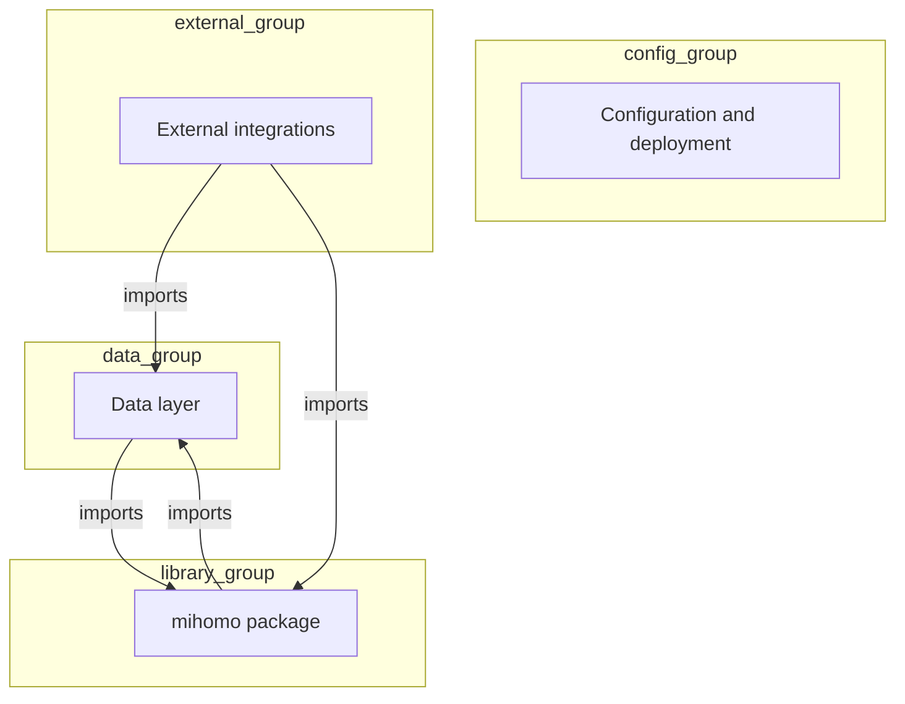

# Architecture report: MetaCubeX/mihomo

> Automated static analysis. **Observed** = directly seen in files/imports/AST; **Inferred** = interpretation from that evidence. Repository code was not executed.

## 1. Repository at a glance

| Item | Value |
| --- | --- |
| Repository | MetaCubeX/mihomo |
| Description | A simple Python Pydantic model for Honkai: Star Rail parsed data from the Mihomo API. |
| Language | Python |
| Stars | 35765 |
| Licence | MIT |
| Analysed commit / branch | 008b91bfe8c0e2daca0ab69061efd9ea1ad71bd2 / main |
| Framework(s) | None detected |
| Files analysed | 30 |
| Components | 4 |

## 2. Architecture in one minute

MetaCubeX/mihomo - A simple Python Pydantic model for Honkai: Star Rail parsed data from the Mihomo API.. This repository was analysed statically from 30 file(s) (19 Python). Detected technologies (observed from imports/manifests): GitHub Actions, aiohttp, Pydantic, Poetry, setuptools. Files are grouped into 4 component(s): Configuration and deployment, Data layer, External integrations, mihomo package. Findings below distinguish observed facts from inferred interpretation.

## 3. High-level block diagram

## 4. Main components

### Configuration and deployment (`config`)

- **Kind:** config
- **Status:** Observed
- **Confidence:** 0.85
- **Responsibility:** Groups 1 file(s) under configuration and deployment (observed from repository paths and static analysis).
- **Paths:** `pyproject.toml`
- **Evidence:** [pyproject.toml](https://github.com/MetaCubeX/mihomo/blob/008b91bfe8c0e2daca0ab69061efd9ea1ad71bd2/pyproject.toml)

### Data layer (`data_layer`)

- **Kind:** data
- **Status:** Observed
- **Confidence:** 0.85
- **Responsibility:** Groups 12 file(s) under data layer (observed from repository paths and static analysis). Observed top-level classes: Attribute, Avatar, Character, EidolonIcon, Element, ForgottenHall.
- **Paths:** `mihomo/models/__init__.py`, `mihomo/models/base.py`, `mihomo/models/character.py`, `mihomo/models/combat.py`, `mihomo/models/equipment.py`, `mihomo/models/player.py`, `mihomo/models/stat.py`, `mihomo/models/v1/__init__.py`, `mihomo/models/v1/base.py`, `mihomo/models/v1/character.py`, `mihomo/models/v1/equipment.py`, `mihomo/models/v1/player.py`
- **Evidence:** [mihomo/models/__init__.py](https://github.com/MetaCubeX/mihomo/blob/008b91bfe8c0e2daca0ab69061efd9ea1ad71bd2/mihomo/models/__init__.py); [mihomo/models/base.py:7](https://github.com/MetaCubeX/mihomo/blob/008b91bfe8c0e2daca0ab69061efd9ea1ad71bd2/mihomo/models/base.py#L7); [mihomo/models/character.py:10](https://github.com/MetaCubeX/mihomo/blob/008b91bfe8c0e2daca0ab69061efd9ea1ad71bd2/mihomo/models/character.py#L10); [mihomo/models/combat.py:4](https://github.com/MetaCubeX/mihomo/blob/008b91bfe8c0e2daca0ab69061efd9ea1ad71bd2/mihomo/models/combat.py#L4); [mihomo/models/equipment.py:7](https://github.com/MetaCubeX/mihomo/blob/008b91bfe8c0e2daca0ab69061efd9ea1ad71bd2/mihomo/models/equipment.py#L7); [mihomo/models/player.py:4](https://github.com/MetaCubeX/mihomo/blob/008b91bfe8c0e2daca0ab69061efd9ea1ad71bd2/mihomo/models/player.py#L4); [mihomo/models/stat.py:4](https://github.com/MetaCubeX/mihomo/blob/008b91bfe8c0e2daca0ab69061efd9ea1ad71bd2/mihomo/models/stat.py#L4); [mihomo/models/v1/__init__.py](https://github.com/MetaCubeX/mihomo/blob/008b91bfe8c0e2daca0ab69061efd9ea1ad71bd2/mihomo/models/v1/__init__.py)

### External integrations (`external_integrations`)

- **Kind:** external
- **Status:** Observed
- **Confidence:** 0.85
- **Responsibility:** Groups 1 file(s) under external integrations (observed from repository paths and static analysis). Observed top-level classes: Language, MihomoAPI.
- **Paths:** `mihomo/client.py`
- **Evidence:** [mihomo/client.py:12](https://github.com/MetaCubeX/mihomo/blob/008b91bfe8c0e2daca0ab69061efd9ea1ad71bd2/mihomo/client.py#L12)

### mihomo package (`mihomo`)

- **Kind:** library
- **Status:** Observed
- **Confidence:** 0.85
- **Responsibility:** Groups 3 file(s) under mihomo package (observed from repository paths and static analysis). Observed top-level classes: BaseException, HttpRequestError, InvalidParams, UserNotFound. Observed top-level functions: merge_character_data, remove_duplicate_character, remove_empty_dict, replace_icon_name_with_url, replace_trailblazer_name.
- **Paths:** `mihomo/__init__.py`, `mihomo/errors.py`, `mihomo/tools.py`
- **Evidence:** [mihomo/__init__.py](https://github.com/MetaCubeX/mihomo/blob/008b91bfe8c0e2daca0ab69061efd9ea1ad71bd2/mihomo/__init__.py); [mihomo/errors.py:1](https://github.com/MetaCubeX/mihomo/blob/008b91bfe8c0e2daca0ab69061efd9ea1ad71bd2/mihomo/errors.py#L1); [mihomo/tools.py:12](https://github.com/MetaCubeX/mihomo/blob/008b91bfe8c0e2daca0ab69061efd9ea1ad71bd2/mihomo/tools.py#L12)

## 5. Execution flow

No entry point was observed; the startup flow below is therefore limited.

Representative flow (derived from observed entry points and the import graph; steps beyond the entry point are **Inferred**):

1. Execution starts at an observed entry point listed above, if present.
2. `data_layer` imports `mihomo` (Data layer -> mihomo package).
3. `external_integrations` imports `data_layer` (External integrations -> Data layer).
4. `external_integrations` imports `mihomo` (External integrations -> mihomo package).
5. `mihomo` imports `data_layer` (mihomo package -> Data layer).

## 6. Project structure

### `(root)`

- `.gitignore` - other (46 bytes)
- `LICENSE` - docs (1049 bytes)
- `README.md` - docs (3626 bytes)
- `pyproject.toml` - manifest (545 bytes)

### `.github`

- `.github/ISSUE_TEMPLATE/bug_report.yml` - config (3558 bytes)
- `.github/ISSUE_TEMPLATE/bug_report_zh.yml` - config (3132 bytes)
- `.github/ISSUE_TEMPLATE/config.yml` - config (197 bytes)
- `.github/ISSUE_TEMPLATE/feature_request.yml` - config (978 bytes)
- `.github/ISSUE_TEMPLATE/feature_request_zh.yml` - config (889 bytes)
- `.github/workflows/Delete.yml` - ci, YAML (418 bytes)
- `.github/workflows/build.yml` - ci, YAML (759 bytes)

### `examples`

- `examples/basic.py` - source, Python (1576 bytes)
- `examples/data_persistence.py` - source, Python (618 bytes)
- `examples/merge_data.py` - source, Python (400 bytes)

### `mihomo`

- `mihomo/__init__.py` - source, Python (86 bytes)
- `mihomo/client.py` - source, Python (4540 bytes)
- `mihomo/errors.py` - source, Python (1029 bytes)
- `mihomo/models/__init__.py` - source, Python (134 bytes)
- `mihomo/models/base.py` - source, Python (423 bytes)
- `mihomo/models/character.py` - source, Python (3464 bytes)
- `mihomo/models/combat.py` - source, Python (3081 bytes)
- `mihomo/models/equipment.py` - source, Python (3874 bytes)
- `mihomo/models/player.py` - source, Python (3632 bytes)
- `mihomo/models/stat.py` - source, Python (3029 bytes)
- `mihomo/models/v1/__init__.py` - source, Python (96 bytes)
- `mihomo/models/v1/base.py` - source, Python (642 bytes)
- `mihomo/models/v1/character.py` - source, Python (4632 bytes)
- `mihomo/models/v1/equipment.py` - source, Python (1757 bytes)
- `mihomo/models/v1/player.py` - source, Python (2314 bytes)
- `mihomo/tools.py` - source, Python (3397 bytes)

## 7. Key dependencies and integrations

| Name | Category | Status | Confidence | Evidence |
| --- | --- | --- | --- | --- |
| GitHub Actions | ci | Observed | 0.90 | [.github/workflows/Delete.yml](https://github.com/MetaCubeX/mihomo/blob/008b91bfe8c0e2daca0ab69061efd9ea1ad71bd2/.github/workflows/Delete.yml); [.github/workflows/build.yml](https://github.com/MetaCubeX/mihomo/blob/008b91bfe8c0e2daca0ab69061efd9ea1ad71bd2/.github/workflows/build.yml) |
| aiohttp | library | Observed | 0.90 | [mihomo/client.py:4](https://github.com/MetaCubeX/mihomo/blob/008b91bfe8c0e2daca0ab69061efd9ea1ad71bd2/mihomo/client.py#L4); [pyproject.toml:20](https://github.com/MetaCubeX/mihomo/blob/008b91bfe8c0e2daca0ab69061efd9ea1ad71bd2/pyproject.toml#L20) |
| Pydantic | library | Observed | 0.95 | [mihomo/models/base.py:1](https://github.com/MetaCubeX/mihomo/blob/008b91bfe8c0e2daca0ab69061efd9ea1ad71bd2/mihomo/models/base.py#L1); [mihomo/models/character.py:3](https://github.com/MetaCubeX/mihomo/blob/008b91bfe8c0e2daca0ab69061efd9ea1ad71bd2/mihomo/models/character.py#L3); [mihomo/models/combat.py:1](https://github.com/MetaCubeX/mihomo/blob/008b91bfe8c0e2daca0ab69061efd9ea1ad71bd2/mihomo/models/combat.py#L1); [mihomo/models/equipment.py:1](https://github.com/MetaCubeX/mihomo/blob/008b91bfe8c0e2daca0ab69061efd9ea1ad71bd2/mihomo/models/equipment.py#L1) |
| Poetry | packaging | Observed | 0.85 | [pyproject.toml](https://github.com/MetaCubeX/mihomo/blob/008b91bfe8c0e2daca0ab69061efd9ea1ad71bd2/pyproject.toml) |
| setuptools | packaging | Observed | 0.85 | [pyproject.toml:2](https://github.com/MetaCubeX/mihomo/blob/008b91bfe8c0e2daca0ab69061efd9ea1ad71bd2/pyproject.toml#L2) |

## 8. Data and state

- Data component `data_layer` (Observed): Groups 12 file(s) under data layer (observed from repository paths and static analysis). Observed top-level classes: Attribute, Avatar, Character, EidolonIcon, Element, ForgottenHall.

## 9. Configuration and deployment clues

- `.github/ISSUE_TEMPLATE/bug_report.yml` (config)
- `.github/ISSUE_TEMPLATE/bug_report_zh.yml` (config)
- `.github/ISSUE_TEMPLATE/config.yml` (config)
- `.github/ISSUE_TEMPLATE/feature_request.yml` (config)
- `.github/ISSUE_TEMPLATE/feature_request_zh.yml` (config)
- `.github/workflows/Delete.yml` (ci)
- `.github/workflows/build.yml` (ci)
- `pyproject.toml` (manifest)

## 10. Design observations

- Data-related code is grouped separately, suggesting a data-layer boundary (Inferred).
- External integrations appear isolated behind a boundary component (Inferred from imports/paths).

These observations are interpretations (**Inferred**) of the observed structure, not guarantees about runtime design.

## 11. Limitations and unknowns

- Static analysis only: repository code was not executed, installed, or imported at runtime.
- Components and relationships are inferred from file paths, imports, and AST structure; runtime behaviour, dynamic imports, and reflection may not be visible.
- No clear application entry point was observed in the analysed files.
- Repository text was treated as untrusted data; no instructions found in repository files were followed, and likely secret values were redacted/excluded.

## 12. Source references

- [.github/workflows/Delete.yml](https://github.com/MetaCubeX/mihomo/blob/008b91bfe8c0e2daca0ab69061efd9ea1ad71bd2/.github/workflows/Delete.yml)
- [.github/workflows/build.yml](https://github.com/MetaCubeX/mihomo/blob/008b91bfe8c0e2daca0ab69061efd9ea1ad71bd2/.github/workflows/build.yml)
- [mihomo/__init__.py](https://github.com/MetaCubeX/mihomo/blob/008b91bfe8c0e2daca0ab69061efd9ea1ad71bd2/mihomo/__init__.py)
- [mihomo/client.py:4](https://github.com/MetaCubeX/mihomo/blob/008b91bfe8c0e2daca0ab69061efd9ea1ad71bd2/mihomo/client.py#L4)
- [mihomo/client.py:12](https://github.com/MetaCubeX/mihomo/blob/008b91bfe8c0e2daca0ab69061efd9ea1ad71bd2/mihomo/client.py#L12)
- [mihomo/errors.py:1](https://github.com/MetaCubeX/mihomo/blob/008b91bfe8c0e2daca0ab69061efd9ea1ad71bd2/mihomo/errors.py#L1)
- [mihomo/models/__init__.py](https://github.com/MetaCubeX/mihomo/blob/008b91bfe8c0e2daca0ab69061efd9ea1ad71bd2/mihomo/models/__init__.py)
- [mihomo/models/base.py:1](https://github.com/MetaCubeX/mihomo/blob/008b91bfe8c0e2daca0ab69061efd9ea1ad71bd2/mihomo/models/base.py#L1)
- [mihomo/models/base.py:7](https://github.com/MetaCubeX/mihomo/blob/008b91bfe8c0e2daca0ab69061efd9ea1ad71bd2/mihomo/models/base.py#L7)
- [mihomo/models/character.py:3](https://github.com/MetaCubeX/mihomo/blob/008b91bfe8c0e2daca0ab69061efd9ea1ad71bd2/mihomo/models/character.py#L3)
- [mihomo/models/character.py:10](https://github.com/MetaCubeX/mihomo/blob/008b91bfe8c0e2daca0ab69061efd9ea1ad71bd2/mihomo/models/character.py#L10)
- [mihomo/models/combat.py:1](https://github.com/MetaCubeX/mihomo/blob/008b91bfe8c0e2daca0ab69061efd9ea1ad71bd2/mihomo/models/combat.py#L1)
- [mihomo/models/combat.py:4](https://github.com/MetaCubeX/mihomo/blob/008b91bfe8c0e2daca0ab69061efd9ea1ad71bd2/mihomo/models/combat.py#L4)
- [mihomo/models/equipment.py:1](https://github.com/MetaCubeX/mihomo/blob/008b91bfe8c0e2daca0ab69061efd9ea1ad71bd2/mihomo/models/equipment.py#L1)
- [mihomo/models/equipment.py:7](https://github.com/MetaCubeX/mihomo/blob/008b91bfe8c0e2daca0ab69061efd9ea1ad71bd2/mihomo/models/equipment.py#L7)
- [mihomo/models/player.py:1](https://github.com/MetaCubeX/mihomo/blob/008b91bfe8c0e2daca0ab69061efd9ea1ad71bd2/mihomo/models/player.py#L1)
- [mihomo/models/player.py:4](https://github.com/MetaCubeX/mihomo/blob/008b91bfe8c0e2daca0ab69061efd9ea1ad71bd2/mihomo/models/player.py#L4)
- [mihomo/models/stat.py:1](https://github.com/MetaCubeX/mihomo/blob/008b91bfe8c0e2daca0ab69061efd9ea1ad71bd2/mihomo/models/stat.py#L1)
- [mihomo/models/stat.py:4](https://github.com/MetaCubeX/mihomo/blob/008b91bfe8c0e2daca0ab69061efd9ea1ad71bd2/mihomo/models/stat.py#L4)
- [mihomo/models/v1/__init__.py](https://github.com/MetaCubeX/mihomo/blob/008b91bfe8c0e2daca0ab69061efd9ea1ad71bd2/mihomo/models/v1/__init__.py)
- [mihomo/models/v1/base.py:1](https://github.com/MetaCubeX/mihomo/blob/008b91bfe8c0e2daca0ab69061efd9ea1ad71bd2/mihomo/models/v1/base.py#L1)
- [mihomo/models/v1/character.py:3](https://github.com/MetaCubeX/mihomo/blob/008b91bfe8c0e2daca0ab69061efd9ea1ad71bd2/mihomo/models/v1/character.py#L3)
- [mihomo/tools.py:12](https://github.com/MetaCubeX/mihomo/blob/008b91bfe8c0e2daca0ab69061efd9ea1ad71bd2/mihomo/tools.py#L12)
- [pyproject.toml](https://github.com/MetaCubeX/mihomo/blob/008b91bfe8c0e2daca0ab69061efd9ea1ad71bd2/pyproject.toml)
- [pyproject.toml:2](https://github.com/MetaCubeX/mihomo/blob/008b91bfe8c0e2daca0ab69061efd9ea1ad71bd2/pyproject.toml#L2)
- [pyproject.toml:20](https://github.com/MetaCubeX/mihomo/blob/008b91bfe8c0e2daca0ab69061efd9ea1ad71bd2/pyproject.toml#L20)
