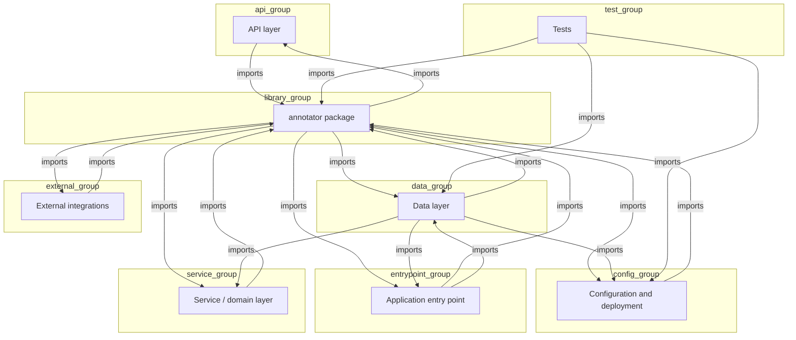

# Architecture report: Mikubill/sd-webui-controlnet

> Automated static analysis. **Observed** = directly seen in files/imports/AST; **Inferred** = interpretation from that evidence. Repository code was not executed.

## 1. Repository at a glance

| Item | Value |
| --- | --- |
| Repository | Mikubill/sd-webui-controlnet |
| Description | WebUI extension for ControlNet |
| Language | Python |
| Stars | 17797 |
| Licence | GPL-3.0 |
| Analysed commit / branch | 56cec5b2958edf3b1807b7e7b2b1b5186dbd2f81 / main |
| Framework(s) | None detected |
| Files analysed | 800 |
| Components | 8 |

## 2. Architecture in one minute

Mikubill/sd-webui-controlnet - WebUI extension for ControlNet. This repository was analysed statically from 800 file(s) (708 Python). Detected technologies (observed from imports/manifests): GitHub Actions, NumPy, pandas, requests, setuptools, Docker. Files are grouped into 8 component(s): annotator package, API layer, Configuration and deployment, Data layer, Application entry point, External integrations, Service / domain layer, Tests. Observed entry point(s): annotator/lama/saicinpainting/training/modules/spatial_transform.py, annotator/leres/leres/network_auxi.py, annotator/leres/pix2pix/util/html.py. Findings below distinguish observed facts from inferred interpretation.

## 3. High-level block diagram

## 4. Main components

### annotator package (`annotator`)

- **Kind:** library
- **Status:** Observed
- **Confidence:** 0.85
- **Responsibility:** Groups 471 file(s) under annotator package (observed from repository paths and static analysis). Observed top-level classes: ADE20KDataset, AMPTrainer, ASPP, AddReadout, AdjustGamma, AlexNet. Observed top-level functions: BilinearInterpolation, HWC3, NEG_INF_DIAG, _add_instances_conversion_methods, _allreduce_coalesced, _any.
- **Paths:** `annotator/__init__.py`, `annotator/anime_face_segment/__init__.py`, `annotator/annotator_path.py`, `annotator/binary/__init__.py`, `annotator/canny/__init__.py`, `annotator/clipvision/__init__.py`, `annotator/color/__init__.py`, `annotator/densepose/__init__.py`, `annotator/densepose/densepose.py`, `annotator/depth_anything.py`, `annotator/depth_anything_v2.py`, `annotator/hed/__init__.py`, `annotator/keypose/__init__.py`, `annotator/keypose/faster_rcnn_r50_fpn_coco.py`, `annotator/keypose/hrnet_w48_coco_256x192.py`, `annotator/lama/__init__.py`, `annotator/lama/saicinpainting/__init__.py`, `annotator/lama/saicinpainting/training/__init__.py`, `annotator/lama/saicinpainting/training/losses/__init__.py`, `annotator/lama/saicinpainting/training/losses/adversarial.py`, `annotator/lama/saicinpainting/training/losses/constants.py`, `annotator/lama/saicinpainting/training/losses/distance_weighting.py`, `annotator/lama/saicinpainting/training/losses/feature_matching.py`, `annotator/lama/saicinpainting/training/losses/perceptual.py`, `annotator/lama/saicinpainting/training/losses/segmentation.py`, `annotator/lama/saicinpainting/training/losses/style_loss.py`, `annotator/lama/saicinpainting/training/modules/__init__.py`, `annotator/lama/saicinpainting/training/modules/base.py`, `annotator/lama/saicinpainting/training/modules/depthwise_sep_conv.py`, `annotator/lama/saicinpainting/training/modules/fake_fakes.py`, `annotator/lama/saicinpainting/training/modules/ffc.py`, `annotator/lama/saicinpainting/training/modules/multidilated_conv.py`, `annotator/lama/saicinpainting/training/modules/multiscale.py`, `annotator/lama/saicinpainting/training/modules/pix2pixhd.py`, `annotator/lama/saicinpainting/training/modules/squeeze_excitation.py`, `annotator/lama/saicinpainting/training/trainers/__init__.py`, `annotator/lama/saicinpainting/training/trainers/base.py`, `annotator/lama/saicinpainting/training/trainers/default.py`, `annotator/lama/saicinpainting/training/visualizers/__init__.py`, `annotator/lama/saicinpainting/training/visualizers/base.py`, `annotator/lama/saicinpainting/training/visualizers/colors.py`, `annotator/lama/saicinpainting/training/visualizers/directory.py`, `annotator/lama/saicinpainting/training/visualizers/noop.py`, `annotator/lama/saicinpainting/utils.py`, `annotator/leres/__init__.py`, `annotator/leres/leres/Resnet.py`, `annotator/leres/leres/Resnext_torch.py`, `annotator/leres/leres/depthmap.py`, `annotator/leres/leres/multi_depth_model_woauxi.py`, `annotator/leres/leres/net_tools.py`, `annotator/leres/pix2pix/options/__init__.py`, `annotator/leres/pix2pix/options/base_options.py`, `annotator/leres/pix2pix/util/__init__.py`, `annotator/leres/pix2pix/util/get_data.py`, `annotator/leres/pix2pix/util/guidedfilter.py`, `annotator/leres/pix2pix/util/image_pool.py`, `annotator/leres/pix2pix/util/util.py`, `annotator/leres/pix2pix/util/visualizer.py`, `annotator/lineart/__init__.py`, `annotator/lineart_anime/__init__.py`, `annotator/manga_line/__init__.py`, `annotator/mediapipe_face/__init__.py`, `annotator/mediapipe_face/mediapipe_face_common.py`, `annotator/midas/__init__.py`, `annotator/midas/api.py`, `annotator/midas/midas/__init__.py`, `annotator/midas/midas/base_model.py`, `annotator/midas/midas/blocks.py`, `annotator/midas/midas/dpt_depth.py`, `annotator/midas/midas/midas_net.py`, `annotator/midas/midas/midas_net_custom.py`, `annotator/midas/midas/transforms.py`, `annotator/midas/midas/vit.py`, `annotator/midas/utils.py`, `annotator/mlsd/__init__.py`, `annotator/mlsd/utils.py`, `annotator/mmpkg/mmcv/__init__.py`, `annotator/mmpkg/mmcv/arraymisc/__init__.py`, `annotator/mmpkg/mmcv/arraymisc/quantization.py`, `annotator/mmpkg/mmcv/cnn/__init__.py`, `annotator/mmpkg/mmcv/cnn/alexnet.py`, `annotator/mmpkg/mmcv/cnn/bricks/__init__.py`, `annotator/mmpkg/mmcv/cnn/bricks/activation.py`, `annotator/mmpkg/mmcv/cnn/bricks/context_block.py`, `annotator/mmpkg/mmcv/cnn/bricks/conv.py`, `annotator/mmpkg/mmcv/cnn/bricks/conv2d_adaptive_padding.py`, `annotator/mmpkg/mmcv/cnn/bricks/conv_module.py`, `annotator/mmpkg/mmcv/cnn/bricks/conv_ws.py`, `annotator/mmpkg/mmcv/cnn/bricks/depthwise_separable_conv_module.py`, `annotator/mmpkg/mmcv/cnn/bricks/drop.py`, `annotator/mmpkg/mmcv/cnn/bricks/generalized_attention.py`, `annotator/mmpkg/mmcv/cnn/bricks/hsigmoid.py`, `annotator/mmpkg/mmcv/cnn/bricks/hswish.py`, `annotator/mmpkg/mmcv/cnn/bricks/non_local.py`, `annotator/mmpkg/mmcv/cnn/bricks/norm.py`, `annotator/mmpkg/mmcv/cnn/bricks/padding.py`, `annotator/mmpkg/mmcv/cnn/bricks/plugin.py`, `annotator/mmpkg/mmcv/cnn/bricks/registry.py`, `annotator/mmpkg/mmcv/cnn/bricks/scale.py`, `annotator/mmpkg/mmcv/cnn/bricks/swish.py`, `annotator/mmpkg/mmcv/cnn/bricks/transformer.py`, `annotator/mmpkg/mmcv/cnn/bricks/upsample.py`, `annotator/mmpkg/mmcv/cnn/bricks/wrappers.py`, `annotator/mmpkg/mmcv/cnn/builder.py`, `annotator/mmpkg/mmcv/cnn/resnet.py`, `annotator/mmpkg/mmcv/cnn/utils/__init__.py`, `annotator/mmpkg/mmcv/cnn/utils/flops_counter.py`, `annotator/mmpkg/mmcv/cnn/utils/fuse_conv_bn.py`, `annotator/mmpkg/mmcv/cnn/utils/sync_bn.py`, `annotator/mmpkg/mmcv/cnn/utils/weight_init.py`, `annotator/mmpkg/mmcv/cnn/vgg.py`, `annotator/mmpkg/mmcv/engine/__init__.py`, `annotator/mmpkg/mmcv/engine/test.py`, `annotator/mmpkg/mmcv/fileio/__init__.py`, `annotator/mmpkg/mmcv/fileio/io.py`, `annotator/mmpkg/mmcv/fileio/parse.py`, `annotator/mmpkg/mmcv/image/__init__.py`, `annotator/mmpkg/mmcv/image/colorspace.py`, `annotator/mmpkg/mmcv/image/geometric.py`, `annotator/mmpkg/mmcv/image/io.py`, `annotator/mmpkg/mmcv/image/misc.py`, `annotator/mmpkg/mmcv/image/photometric.py`, `annotator/mmpkg/mmcv/ops/__init__.py`, `annotator/mmpkg/mmcv/ops/assign_score_withk.py`, `annotator/mmpkg/mmcv/ops/ball_query.py`, `annotator/mmpkg/mmcv/ops/bbox.py`, `annotator/mmpkg/mmcv/ops/border_align.py`, `annotator/mmpkg/mmcv/ops/box_iou_rotated.py`, `annotator/mmpkg/mmcv/ops/carafe.py`, `annotator/mmpkg/mmcv/ops/cc_attention.py`, `annotator/mmpkg/mmcv/ops/contour_expand.py`, `annotator/mmpkg/mmcv/ops/corner_pool.py`, `annotator/mmpkg/mmcv/ops/correlation.py`, `annotator/mmpkg/mmcv/ops/deform_conv.py`, `annotator/mmpkg/mmcv/ops/deform_roi_pool.py`, `annotator/mmpkg/mmcv/ops/deprecated_wrappers.py`, `annotator/mmpkg/mmcv/ops/focal_loss.py`, `annotator/mmpkg/mmcv/ops/furthest_point_sample.py`, `annotator/mmpkg/mmcv/ops/fused_bias_leakyrelu.py`, `annotator/mmpkg/mmcv/ops/gather_points.py`, `annotator/mmpkg/mmcv/ops/group_points.py`, `annotator/mmpkg/mmcv/ops/info.py`, `annotator/mmpkg/mmcv/ops/iou3d.py`, `annotator/mmpkg/mmcv/ops/knn.py`, `annotator/mmpkg/mmcv/ops/masked_conv.py`, `annotator/mmpkg/mmcv/ops/merge_cells.py`, `annotator/mmpkg/mmcv/ops/modulated_deform_conv.py`, `annotator/mmpkg/mmcv/ops/multi_scale_deform_attn.py`, `annotator/mmpkg/mmcv/ops/nms.py`, `annotator/mmpkg/mmcv/ops/pixel_group.py`, `annotator/mmpkg/mmcv/ops/point_sample.py`, `annotator/mmpkg/mmcv/ops/points_in_boxes.py`, `annotator/mmpkg/mmcv/ops/points_sampler.py`, `annotator/mmpkg/mmcv/ops/psa_mask.py`, `annotator/mmpkg/mmcv/ops/roi_align.py`, `annotator/mmpkg/mmcv/ops/roi_align_rotated.py`, `annotator/mmpkg/mmcv/ops/roi_pool.py`, `annotator/mmpkg/mmcv/ops/roiaware_pool3d.py`, `annotator/mmpkg/mmcv/ops/roipoint_pool3d.py`, `annotator/mmpkg/mmcv/ops/saconv.py`, `annotator/mmpkg/mmcv/ops/scatter_points.py`, `annotator/mmpkg/mmcv/ops/sync_bn.py`, `annotator/mmpkg/mmcv/ops/three_interpolate.py`, `annotator/mmpkg/mmcv/ops/three_nn.py`, `annotator/mmpkg/mmcv/ops/tin_shift.py`, `annotator/mmpkg/mmcv/ops/upfirdn2d.py`, `annotator/mmpkg/mmcv/ops/voxelize.py`, `annotator/mmpkg/mmcv/parallel/__init__.py`, `annotator/mmpkg/mmcv/parallel/_functions.py`, `annotator/mmpkg/mmcv/parallel/collate.py`, `annotator/mmpkg/mmcv/parallel/data_container.py`, `annotator/mmpkg/mmcv/parallel/data_parallel.py`, `annotator/mmpkg/mmcv/parallel/distributed.py`, `annotator/mmpkg/mmcv/parallel/distributed_deprecated.py`, `annotator/mmpkg/mmcv/parallel/registry.py`, `annotator/mmpkg/mmcv/parallel/scatter_gather.py`, `annotator/mmpkg/mmcv/parallel/utils.py`, `annotator/mmpkg/mmcv/runner/__init__.py`, `annotator/mmpkg/mmcv/runner/base_module.py`, `annotator/mmpkg/mmcv/runner/base_runner.py`, `annotator/mmpkg/mmcv/runner/builder.py`, `annotator/mmpkg/mmcv/runner/checkpoint.py`, `annotator/mmpkg/mmcv/runner/default_constructor.py`, `annotator/mmpkg/mmcv/runner/dist_utils.py`, `annotator/mmpkg/mmcv/runner/epoch_based_runner.py`, `annotator/mmpkg/mmcv/runner/fp16_utils.py`, `annotator/mmpkg/mmcv/runner/hooks/__init__.py`, `annotator/mmpkg/mmcv/runner/hooks/checkpoint.py`, `annotator/mmpkg/mmcv/runner/hooks/closure.py`, `annotator/mmpkg/mmcv/runner/hooks/ema.py`, `annotator/mmpkg/mmcv/runner/hooks/evaluation.py`, `annotator/mmpkg/mmcv/runner/hooks/hook.py`, `annotator/mmpkg/mmcv/runner/hooks/iter_timer.py`, `annotator/mmpkg/mmcv/runner/hooks/logger/__init__.py`, `annotator/mmpkg/mmcv/runner/hooks/logger/base.py`, `annotator/mmpkg/mmcv/runner/hooks/logger/dvclive.py`, `annotator/mmpkg/mmcv/runner/hooks/logger/mlflow.py`, `annotator/mmpkg/mmcv/runner/hooks/logger/neptune.py`, `annotator/mmpkg/mmcv/runner/hooks/logger/pavi.py`, `annotator/mmpkg/mmcv/runner/hooks/logger/tensorboard.py`, `annotator/mmpkg/mmcv/runner/hooks/logger/text.py`, `annotator/mmpkg/mmcv/runner/hooks/logger/wandb.py`, `annotator/mmpkg/mmcv/runner/hooks/lr_updater.py`, `annotator/mmpkg/mmcv/runner/hooks/memory.py`, `annotator/mmpkg/mmcv/runner/hooks/momentum_updater.py`, `annotator/mmpkg/mmcv/runner/hooks/optimizer.py`, `annotator/mmpkg/mmcv/runner/hooks/profiler.py`, `annotator/mmpkg/mmcv/runner/hooks/sampler_seed.py`, `annotator/mmpkg/mmcv/runner/hooks/sync_buffer.py`, `annotator/mmpkg/mmcv/runner/iter_based_runner.py`, `annotator/mmpkg/mmcv/runner/log_buffer.py`, `annotator/mmpkg/mmcv/runner/optimizer/__init__.py`, `annotator/mmpkg/mmcv/runner/optimizer/builder.py`, `annotator/mmpkg/mmcv/runner/optimizer/default_constructor.py`, `annotator/mmpkg/mmcv/runner/priority.py`, `annotator/mmpkg/mmcv/runner/utils.py`, `annotator/mmpkg/mmcv/utils/__init__.py`, `annotator/mmpkg/mmcv/utils/env.py`, `annotator/mmpkg/mmcv/utils/ext_loader.py`, `annotator/mmpkg/mmcv/utils/logging.py`, `annotator/mmpkg/mmcv/utils/misc.py`, `annotator/mmpkg/mmcv/utils/parrots_jit.py`, `annotator/mmpkg/mmcv/utils/parrots_wrapper.py`, `annotator/mmpkg/mmcv/utils/path.py`, `annotator/mmpkg/mmcv/utils/progressbar.py`, `annotator/mmpkg/mmcv/utils/registry.py`, `annotator/mmpkg/mmcv/utils/testing.py`, `annotator/mmpkg/mmcv/utils/timer.py`, `annotator/mmpkg/mmcv/utils/trace.py`, `annotator/mmpkg/mmcv/utils/version_utils.py`, `annotator/mmpkg/mmcv/version.py`, `annotator/mmpkg/mmcv/video/__init__.py`, `annotator/mmpkg/mmcv/video/io.py`, `annotator/mmpkg/mmcv/video/optflow.py`, `annotator/mmpkg/mmcv/video/processing.py`, `annotator/mmpkg/mmcv/visualization/__init__.py`, `annotator/mmpkg/mmcv/visualization/color.py`, `annotator/mmpkg/mmcv/visualization/image.py`, `annotator/mmpkg/mmcv/visualization/optflow.py`, `annotator/mmpkg/mmseg/apis/__init__.py`, `annotator/mmpkg/mmseg/apis/inference.py`, `annotator/mmpkg/mmseg/apis/test.py`, `annotator/mmpkg/mmseg/apis/train.py`, `annotator/mmpkg/mmseg/datasets/__init__.py`, `annotator/mmpkg/mmseg/datasets/ade.py`, `annotator/mmpkg/mmseg/datasets/builder.py`, `annotator/mmpkg/mmseg/datasets/chase_db1.py`, `annotator/mmpkg/mmseg/datasets/cityscapes.py`, `annotator/mmpkg/mmseg/datasets/custom.py`, `annotator/mmpkg/mmseg/datasets/dataset_wrappers.py`, `annotator/mmpkg/mmseg/datasets/drive.py`, `annotator/mmpkg/mmseg/datasets/hrf.py`, `annotator/mmpkg/mmseg/datasets/pascal_context.py`, `annotator/mmpkg/mmseg/datasets/pipelines/__init__.py`, `annotator/mmpkg/mmseg/datasets/pipelines/compose.py`, `annotator/mmpkg/mmseg/datasets/pipelines/formating.py`, `annotator/mmpkg/mmseg/datasets/pipelines/loading.py`, `annotator/mmpkg/mmseg/datasets/pipelines/transforms.py`, `annotator/mmpkg/mmseg/datasets/stare.py`, `annotator/mmpkg/mmseg/datasets/voc.py`, `annotator/mmpkg/mmseg/ops/__init__.py`, `annotator/mmpkg/mmseg/ops/encoding.py`, `annotator/mmpkg/mmseg/ops/wrappers.py`, `annotator/mmpkg/mmseg/utils/__init__.py`, `annotator/mmpkg/mmseg/utils/logger.py`, `annotator/mobile_sam/__init__.py`, `annotator/normalbae/__init__.py`, `annotator/normaldsine/__init__.py`, `annotator/oneformer/__init__.py`, `annotator/oneformer/api.py`, `annotator/oneformer/detectron2/__init__.py`, `annotator/oneformer/detectron2/checkpoint/__init__.py`, `annotator/oneformer/detectron2/checkpoint/c2_model_loading.py`, `annotator/oneformer/detectron2/checkpoint/catalog.py`, `annotator/oneformer/detectron2/checkpoint/detection_checkpoint.py`, `annotator/oneformer/detectron2/engine/__init__.py`, `annotator/oneformer/detectron2/engine/defaults.py`, `annotator/oneformer/detectron2/engine/hooks.py`, `annotator/oneformer/detectron2/engine/launch.py`, `annotator/oneformer/detectron2/engine/train_loop.py`, `annotator/oneformer/detectron2/evaluation/__init__.py`, `annotator/oneformer/detectron2/evaluation/cityscapes_evaluation.py`, `annotator/oneformer/detectron2/evaluation/coco_evaluation.py`, `annotator/oneformer/detectron2/evaluation/evaluator.py`, `annotator/oneformer/detectron2/evaluation/lvis_evaluation.py`, `annotator/oneformer/detectron2/evaluation/pascal_voc_evaluation.py`, `annotator/oneformer/detectron2/evaluation/rotated_coco_evaluation.py`, `annotator/oneformer/detectron2/evaluation/sem_seg_evaluation.py`, `annotator/oneformer/detectron2/evaluation/testing.py`, `annotator/oneformer/detectron2/export/__init__.py`, `annotator/oneformer/detectron2/export/api.py`, `annotator/oneformer/detectron2/export/c10.py`, `annotator/oneformer/detectron2/export/caffe2_export.py`, `annotator/oneformer/detectron2/export/caffe2_inference.py`, `annotator/oneformer/detectron2/export/caffe2_modeling.py`, `annotator/oneformer/detectron2/export/caffe2_patch.py`, `annotator/oneformer/detectron2/export/flatten.py`, `annotator/oneformer/detectron2/export/shared.py`, `annotator/oneformer/detectron2/export/torchscript.py`, `annotator/oneformer/detectron2/export/torchscript_patch.py`, `annotator/oneformer/detectron2/layers/__init__.py`, `annotator/oneformer/detectron2/layers/aspp.py`, `annotator/oneformer/detectron2/layers/batch_norm.py`, `annotator/oneformer/detectron2/layers/blocks.py`, `annotator/oneformer/detectron2/layers/csrc/ROIAlignRotated/ROIAlignRotated.h`, `annotator/oneformer/detectron2/layers/csrc/ROIAlignRotated/ROIAlignRotated_cpu.cpp`, `annotator/oneformer/detectron2/layers/csrc/box_iou_rotated/box_iou_rotated.h`, `annotator/oneformer/detectron2/layers/csrc/box_iou_rotated/box_iou_rotated_cpu.cpp`, `annotator/oneformer/detectron2/layers/csrc/box_iou_rotated/box_iou_rotated_utils.h`, `annotator/oneformer/detectron2/layers/csrc/cocoeval/cocoeval.cpp`, `annotator/oneformer/detectron2/layers/csrc/cocoeval/cocoeval.h`, `annotator/oneformer/detectron2/layers/csrc/deformable/deform_conv.h`, `annotator/oneformer/detectron2/layers/csrc/nms_rotated/nms_rotated.h`, `annotator/oneformer/detectron2/layers/csrc/nms_rotated/nms_rotated_cpu.cpp`, `annotator/oneformer/detectron2/layers/csrc/vision.cpp`, `annotator/oneformer/detectron2/layers/deform_conv.py`, `annotator/oneformer/detectron2/layers/losses.py`, `annotator/oneformer/detectron2/layers/mask_ops.py`, `annotator/oneformer/detectron2/layers/nms.py`, `annotator/oneformer/detectron2/layers/roi_align.py`, `annotator/oneformer/detectron2/layers/roi_align_rotated.py`, `annotator/oneformer/detectron2/layers/rotated_boxes.py`, `annotator/oneformer/detectron2/layers/shape_spec.py`, `annotator/oneformer/detectron2/layers/wrappers.py`, `annotator/oneformer/detectron2/model_zoo/__init__.py`, `annotator/oneformer/detectron2/model_zoo/model_zoo.py`, `annotator/oneformer/detectron2/modeling/__init__.py`, `annotator/oneformer/detectron2/modeling/anchor_generator.py`, `annotator/oneformer/detectron2/modeling/backbone/__init__.py`, `annotator/oneformer/detectron2/modeling/backbone/backbone.py`, `annotator/oneformer/detectron2/modeling/backbone/build.py`, `annotator/oneformer/detectron2/modeling/backbone/fpn.py`, `annotator/oneformer/detectron2/modeling/backbone/mvit.py`, `annotator/oneformer/detectron2/modeling/backbone/regnet.py`, `annotator/oneformer/detectron2/modeling/backbone/resnet.py`, `annotator/oneformer/detectron2/modeling/backbone/swin.py`, `annotator/oneformer/detectron2/modeling/backbone/utils.py`, `annotator/oneformer/detectron2/modeling/backbone/vit.py`, `annotator/oneformer/detectron2/modeling/box_regression.py`, `annotator/oneformer/detectron2/modeling/matcher.py`, `annotator/oneformer/detectron2/modeling/meta_arch/__init__.py`, `annotator/oneformer/detectron2/modeling/meta_arch/build.py`, `annotator/oneformer/detectron2/modeling/meta_arch/dense_detector.py`, `annotator/oneformer/detectron2/modeling/meta_arch/fcos.py`, `annotator/oneformer/detectron2/modeling/meta_arch/panoptic_fpn.py`, `annotator/oneformer/detectron2/modeling/meta_arch/rcnn.py`, `annotator/oneformer/detectron2/modeling/meta_arch/retinanet.py`, `annotator/oneformer/detectron2/modeling/meta_arch/semantic_seg.py`, `annotator/oneformer/detectron2/modeling/mmdet_wrapper.py`, `annotator/oneformer/detectron2/modeling/poolers.py`, `annotator/oneformer/detectron2/modeling/postprocessing.py`, `annotator/oneformer/detectron2/modeling/proposal_generator/__init__.py`, `annotator/oneformer/detectron2/modeling/proposal_generator/build.py`, `annotator/oneformer/detectron2/modeling/proposal_generator/proposal_utils.py`, `annotator/oneformer/detectron2/modeling/proposal_generator/rpn.py`, `annotator/oneformer/detectron2/modeling/proposal_generator/rrpn.py`, `annotator/oneformer/detectron2/modeling/roi_heads/__init__.py`, `annotator/oneformer/detectron2/modeling/roi_heads/box_head.py`, `annotator/oneformer/detectron2/modeling/roi_heads/cascade_rcnn.py`, `annotator/oneformer/detectron2/modeling/roi_heads/fast_rcnn.py`, `annotator/oneformer/detectron2/modeling/roi_heads/keypoint_head.py`, `annotator/oneformer/detectron2/modeling/roi_heads/mask_head.py`, `annotator/oneformer/detectron2/modeling/roi_heads/roi_heads.py`, `annotator/oneformer/detectron2/modeling/roi_heads/rotated_fast_rcnn.py`, `annotator/oneformer/detectron2/modeling/sampling.py`, `annotator/oneformer/detectron2/projects/__init__.py`, `annotator/oneformer/detectron2/projects/deeplab/__init__.py`, `annotator/oneformer/detectron2/projects/deeplab/build_solver.py`, `annotator/oneformer/detectron2/projects/deeplab/loss.py`, `annotator/oneformer/detectron2/projects/deeplab/lr_scheduler.py`, `annotator/oneformer/detectron2/projects/deeplab/resnet.py`, `annotator/oneformer/detectron2/projects/deeplab/semantic_seg.py`, `annotator/oneformer/detectron2/solver/__init__.py`, `annotator/oneformer/detectron2/solver/build.py`, `annotator/oneformer/detectron2/solver/lr_scheduler.py`, `annotator/oneformer/detectron2/structures/__init__.py`, `annotator/oneformer/detectron2/structures/boxes.py`, `annotator/oneformer/detectron2/structures/image_list.py`, `annotator/oneformer/detectron2/structures/instances.py`, `annotator/oneformer/detectron2/structures/keypoints.py`, `annotator/oneformer/detectron2/structures/masks.py`, `annotator/oneformer/detectron2/structures/rotated_boxes.py`, `annotator/oneformer/detectron2/tracking/__init__.py`, `annotator/oneformer/detectron2/tracking/base_tracker.py`, `annotator/oneformer/detectron2/tracking/bbox_iou_tracker.py`, `annotator/oneformer/detectron2/tracking/hungarian_tracker.py`, `annotator/oneformer/detectron2/tracking/iou_weighted_hungarian_bbox_iou_tracker.py`, `annotator/oneformer/detectron2/tracking/utils.py`, `annotator/oneformer/detectron2/tracking/vanilla_hungarian_bbox_iou_tracker.py`, `annotator/oneformer/detectron2/utils/__init__.py`, `annotator/oneformer/detectron2/utils/analysis.py`, `annotator/oneformer/detectron2/utils/comm.py`, `annotator/oneformer/detectron2/utils/develop.py`, `annotator/oneformer/detectron2/utils/env.py`, `annotator/oneformer/detectron2/utils/events.py`, `annotator/oneformer/detectron2/utils/file_io.py`, `annotator/oneformer/detectron2/utils/logger.py`, `annotator/oneformer/detectron2/utils/memory.py`, `annotator/oneformer/detectron2/utils/registry.py`, `annotator/oneformer/detectron2/utils/serialize.py`, `annotator/oneformer/detectron2/utils/testing.py`, `annotator/oneformer/detectron2/utils/tracing.py`, `annotator/oneformer/detectron2/utils/video_visualizer.py`, `annotator/oneformer/detectron2/utils/visualizer.py`, `annotator/oneformer/oneformer/__init__.py`, `annotator/oneformer/oneformer/demo/defaults.py`, `annotator/oneformer/oneformer/demo/predictor.py`, `annotator/oneformer/oneformer/demo/visualizer.py`, `annotator/oneformer/oneformer/evaluation/__init__.py`, `annotator/oneformer/oneformer/evaluation/cityscapes_evaluation.py`, `annotator/oneformer/oneformer/evaluation/coco_evaluator.py`, `annotator/oneformer/oneformer/evaluation/detection_coco_evaluator.py`, `annotator/oneformer/oneformer/evaluation/evaluator.py`, `annotator/oneformer/oneformer/evaluation/instance_evaluation.py`, `annotator/oneformer/oneformer/modeling/__init__.py`, `annotator/oneformer/oneformer/modeling/backbone/__init__.py`, `annotator/oneformer/oneformer/modeling/backbone/dinat.py`, `annotator/oneformer/oneformer/modeling/backbone/swin.py`, `annotator/oneformer/oneformer/modeling/matcher.py`, `annotator/oneformer/oneformer/modeling/meta_arch/__init__.py`, `annotator/oneformer/oneformer/modeling/meta_arch/oneformer_head.py`, `annotator/oneformer/oneformer/modeling/pixel_decoder/__init__.py`, `annotator/oneformer/oneformer/modeling/pixel_decoder/fpn.py`, `annotator/oneformer/oneformer/modeling/pixel_decoder/msdeformattn.py`, `annotator/oneformer/oneformer/modeling/pixel_decoder/ops/functions/__init__.py`, `annotator/oneformer/oneformer/modeling/pixel_decoder/ops/functions/ms_deform_attn_func.py`, `annotator/oneformer/oneformer/modeling/pixel_decoder/ops/make.sh`, `annotator/oneformer/oneformer/modeling/pixel_decoder/ops/modules/__init__.py`, `annotator/oneformer/oneformer/modeling/pixel_decoder/ops/modules/ms_deform_attn.py`, `annotator/oneformer/oneformer/modeling/pixel_decoder/ops/src/cpu/ms_deform_attn_cpu.cpp`, `annotator/oneformer/oneformer/modeling/pixel_decoder/ops/src/cpu/ms_deform_attn_cpu.h`, `annotator/oneformer/oneformer/modeling/pixel_decoder/ops/src/cuda/ms_deform_attn_cuda.h`, `annotator/oneformer/oneformer/modeling/pixel_decoder/ops/src/ms_deform_attn.h`, `annotator/oneformer/oneformer/modeling/pixel_decoder/ops/src/vision.cpp`, `annotator/oneformer/oneformer/modeling/transformer_decoder/__init__.py`, `annotator/oneformer/oneformer/modeling/transformer_decoder/oneformer_transformer_decoder.py`, `annotator/oneformer/oneformer/modeling/transformer_decoder/position_encoding.py`, `annotator/oneformer/oneformer/modeling/transformer_decoder/text_transformer.py`, `annotator/oneformer/oneformer/modeling/transformer_decoder/transformer.py`, `annotator/oneformer/oneformer/oneformer_model.py`, `annotator/oneformer/oneformer/utils/__init__.py`, `annotator/oneformer/oneformer/utils/events.py`, `annotator/oneformer/oneformer/utils/misc.py`, `annotator/oneformer/oneformer/utils/pos_embed.py`, `annotator/oneformer/pycocotools/__init__.py`, `annotator/oneformer/pycocotools/coco.py`, `annotator/oneformer/pycocotools/cocoeval.py`, `annotator/oneformer/pycocotools/mask.py`, `annotator/openpose/__init__.py`, `annotator/openpose/animalpose.py`, `annotator/openpose/cv_ox_det.py`, `annotator/openpose/cv_ox_pose.py`, `annotator/openpose/face.py`, `annotator/openpose/types.py`, `annotator/openpose/util.py`, `annotator/openpose/wholebody.py`, `annotator/pidinet/__init__.py`, `annotator/shuffle/__init__.py`, `annotator/teed/Fmish.py`, `annotator/teed/Fsmish.py`, `annotator/teed/Xmish.py`, `annotator/teed/Xsmish.py`, `annotator/teed/__init__.py`, `annotator/uniformer/__init__.py`, `annotator/uniformer/inference.py`, `annotator/uniformer/mmcv_custom/__init__.py`, `annotator/uniformer/mmcv_custom/checkpoint.py`, `annotator/uniformer/uniformer.py`, `annotator/uniformer/upernet_global_small.py`, `annotator/util.py`, `annotator/zoe/__init__.py`
- **Evidence:** [annotator/__init__.py](https://github.com/Mikubill/sd-webui-controlnet/blob/56cec5b2958edf3b1807b7e7b2b1b5186dbd2f81/annotator/__init__.py); [annotator/anime_face_segment/__init__.py:29](https://github.com/Mikubill/sd-webui-controlnet/blob/56cec5b2958edf3b1807b7e7b2b1b5186dbd2f81/annotator/anime_face_segment/__init__.py#L29); [annotator/annotator_path.py](https://github.com/Mikubill/sd-webui-controlnet/blob/56cec5b2958edf3b1807b7e7b2b1b5186dbd2f81/annotator/annotator_path.py); [annotator/binary/__init__.py:4](https://github.com/Mikubill/sd-webui-controlnet/blob/56cec5b2958edf3b1807b7e7b2b1b5186dbd2f81/annotator/binary/__init__.py#L4); [annotator/canny/__init__.py:4](https://github.com/Mikubill/sd-webui-controlnet/blob/56cec5b2958edf3b1807b7e7b2b1b5186dbd2f81/annotator/canny/__init__.py#L4); [annotator/clipvision/__init__.py:94](https://github.com/Mikubill/sd-webui-controlnet/blob/56cec5b2958edf3b1807b7e7b2b1b5186dbd2f81/annotator/clipvision/__init__.py#L94); [annotator/color/__init__.py:3](https://github.com/Mikubill/sd-webui-controlnet/blob/56cec5b2958edf3b1807b7e7b2b1b5186dbd2f81/annotator/color/__init__.py#L3); [annotator/densepose/__init__.py:22](https://github.com/Mikubill/sd-webui-controlnet/blob/56cec5b2958edf3b1807b7e7b2b1b5186dbd2f81/annotator/densepose/__init__.py#L22)

### API layer (`api_layer`)

- **Kind:** api
- **Status:** Observed
- **Confidence:** 0.85
- **Responsibility:** Groups 5 file(s) under api layer (observed from repository paths and static analysis). Observed top-level classes: BaseFileHandler, JsonHandler, PickleHandler, YamlHandler. Observed top-level functions: set_default.
- **Paths:** `annotator/mmpkg/mmcv/fileio/handlers/__init__.py`, `annotator/mmpkg/mmcv/fileio/handlers/base.py`, `annotator/mmpkg/mmcv/fileio/handlers/json_handler.py`, `annotator/mmpkg/mmcv/fileio/handlers/pickle_handler.py`, `annotator/mmpkg/mmcv/fileio/handlers/yaml_handler.py`
- **Evidence:** [annotator/mmpkg/mmcv/fileio/handlers/__init__.py](https://github.com/Mikubill/sd-webui-controlnet/blob/56cec5b2958edf3b1807b7e7b2b1b5186dbd2f81/annotator/mmpkg/mmcv/fileio/handlers/__init__.py); [annotator/mmpkg/mmcv/fileio/handlers/base.py:5](https://github.com/Mikubill/sd-webui-controlnet/blob/56cec5b2958edf3b1807b7e7b2b1b5186dbd2f81/annotator/mmpkg/mmcv/fileio/handlers/base.py#L5); [annotator/mmpkg/mmcv/fileio/handlers/json_handler.py:9](https://github.com/Mikubill/sd-webui-controlnet/blob/56cec5b2958edf3b1807b7e7b2b1b5186dbd2f81/annotator/mmpkg/mmcv/fileio/handlers/json_handler.py#L9); [annotator/mmpkg/mmcv/fileio/handlers/pickle_handler.py:7](https://github.com/Mikubill/sd-webui-controlnet/blob/56cec5b2958edf3b1807b7e7b2b1b5186dbd2f81/annotator/mmpkg/mmcv/fileio/handlers/pickle_handler.py#L7); [annotator/mmpkg/mmcv/fileio/handlers/yaml_handler.py:12](https://github.com/Mikubill/sd-webui-controlnet/blob/56cec5b2958edf3b1807b7e7b2b1b5186dbd2f81/annotator/mmpkg/mmcv/fileio/handlers/yaml_handler.py#L12)

### Configuration and deployment (`config`)

- **Kind:** config
- **Status:** Observed
- **Confidence:** 0.85
- **Responsibility:** Groups 40 file(s) under configuration and deployment (observed from repository paths and static analysis). Observed top-level classes: CfgNode, Config, ConfigDict, ConverterV1, ConverterV2, DictAction. Observed top-level functions: _called_with_cfg, _cast_to_config, _get_args_from_config, _patch_import, _random_package_name, _rename.
- **Paths:** `annotator/lama/config.yaml`, `annotator/mmpkg/mmcv/model_zoo/deprecated.json`, `annotator/mmpkg/mmcv/model_zoo/mmcls.json`, `annotator/mmpkg/mmcv/model_zoo/open_mmlab.json`, `annotator/mmpkg/mmcv/utils/config.py`, `annotator/normalbae/models/submodules/efficientnet_repo/requirements.txt`, `annotator/normalbae/models/submodules/efficientnet_repo/setup.py`, `annotator/oneformer/configs/ade20k/Base-ADE20K-UnifiedSegmentation.yaml`, `annotator/oneformer/configs/ade20k/oneformer_R50_bs16_160k.yaml`, `annotator/oneformer/configs/ade20k/oneformer_swin_large_IN21k_384_bs16_160k.yaml`, `annotator/oneformer/configs/coco/Base-COCO-UnifiedSegmentation.yaml`, `annotator/oneformer/configs/coco/oneformer_R50_bs16_50ep.yaml`, `annotator/oneformer/configs/coco/oneformer_swin_large_IN21k_384_bs16_100ep.yaml`, `annotator/oneformer/detectron2/config/__init__.py`, `annotator/oneformer/detectron2/config/compat.py`, `annotator/oneformer/detectron2/config/config.py`, `annotator/oneformer/detectron2/config/defaults.py`, `annotator/oneformer/detectron2/config/instantiate.py`, `annotator/oneformer/detectron2/config/lazy.py`, `annotator/oneformer/detectron2/projects/deeplab/config.py`, `annotator/oneformer/oneformer/config.py`, `annotator/oneformer/oneformer/modeling/pixel_decoder/ops/setup.py`, `annotator/uniformer/configs/_base_/datasets/ade20k.py`, `annotator/uniformer/configs/_base_/datasets/chase_db1.py`, `annotator/uniformer/configs/_base_/datasets/cityscapes.py`, `annotator/uniformer/configs/_base_/datasets/cityscapes_769x769.py`, `annotator/uniformer/configs/_base_/datasets/drive.py`, `annotator/uniformer/configs/_base_/datasets/hrf.py`, `annotator/uniformer/configs/_base_/datasets/pascal_context.py`, `annotator/uniformer/configs/_base_/datasets/pascal_context_59.py`, `annotator/uniformer/configs/_base_/datasets/pascal_voc12.py`, `annotator/uniformer/configs/_base_/datasets/pascal_voc12_aug.py`, `annotator/uniformer/configs/_base_/datasets/stare.py`, `annotator/uniformer/configs/_base_/default_runtime.py`, `annotator/uniformer/configs/_base_/schedules/schedule_160k.py`, `annotator/uniformer/configs/_base_/schedules/schedule_20k.py`, `annotator/uniformer/configs/_base_/schedules/schedule_40k.py`, `annotator/uniformer/configs/_base_/schedules/schedule_80k.py`, `annotator/zoe/zoedepth/models/base_models/midas_repo/Dockerfile`, `annotator/zoe/zoedepth/models/base_models/midas_repo/environment.yaml`
- **Evidence:** [annotator/lama/config.yaml](https://github.com/Mikubill/sd-webui-controlnet/blob/56cec5b2958edf3b1807b7e7b2b1b5186dbd2f81/annotator/lama/config.yaml); [annotator/mmpkg/mmcv/model_zoo/deprecated.json](https://github.com/Mikubill/sd-webui-controlnet/blob/56cec5b2958edf3b1807b7e7b2b1b5186dbd2f81/annotator/mmpkg/mmcv/model_zoo/deprecated.json); [annotator/mmpkg/mmcv/model_zoo/mmcls.json](https://github.com/Mikubill/sd-webui-controlnet/blob/56cec5b2958edf3b1807b7e7b2b1b5186dbd2f81/annotator/mmpkg/mmcv/model_zoo/mmcls.json); [annotator/mmpkg/mmcv/model_zoo/open_mmlab.json](https://github.com/Mikubill/sd-webui-controlnet/blob/56cec5b2958edf3b1807b7e7b2b1b5186dbd2f81/annotator/mmpkg/mmcv/model_zoo/open_mmlab.json); [annotator/mmpkg/mmcv/utils/config.py:33](https://github.com/Mikubill/sd-webui-controlnet/blob/56cec5b2958edf3b1807b7e7b2b1b5186dbd2f81/annotator/mmpkg/mmcv/utils/config.py#L33); [annotator/normalbae/models/submodules/efficientnet_repo/requirements.txt](https://github.com/Mikubill/sd-webui-controlnet/blob/56cec5b2958edf3b1807b7e7b2b1b5186dbd2f81/annotator/normalbae/models/submodules/efficientnet_repo/requirements.txt); [annotator/normalbae/models/submodules/efficientnet_repo/setup.py](https://github.com/Mikubill/sd-webui-controlnet/blob/56cec5b2958edf3b1807b7e7b2b1b5186dbd2f81/annotator/normalbae/models/submodules/efficientnet_repo/setup.py); [annotator/oneformer/configs/ade20k/Base-ADE20K-UnifiedSegmentation.yaml](https://github.com/Mikubill/sd-webui-controlnet/blob/56cec5b2958edf3b1807b7e7b2b1b5186dbd2f81/annotator/oneformer/configs/ade20k/Base-ADE20K-UnifiedSegmentation.yaml)

### Data layer (`data_layer`)

- **Kind:** data
- **Status:** Observed
- **Confidence:** 0.85
- **Responsibility:** Groups 181 file(s) under data layer (observed from repository paths and static analysis). Observed top-level classes: ACM, AFNB, ANNHead, APCHead, APNB, ASPPHead. Observed top-level functions: DPT_BEiT_B_384, DPT_BEiT_L_384, DPT_BEiT_L_512, DPT_Hybrid, DPT_Large, DPT_LeViT_224.
- **Paths:** `annotator/lama/saicinpainting/training/data/__init__.py`, `annotator/lama/saicinpainting/training/data/masks.py`, `annotator/leres/pix2pix/models/__init__.py`, `annotator/leres/pix2pix/models/base_model.py`, `annotator/leres/pix2pix/models/base_model_hg.py`, `annotator/leres/pix2pix/models/networks.py`, `annotator/leres/pix2pix/models/pix2pix4depth_model.py`, `annotator/mlsd/models/mbv2_mlsd_large.py`, `annotator/mlsd/models/mbv2_mlsd_tiny.py`, `annotator/mmpkg/mmseg/models/__init__.py`, `annotator/mmpkg/mmseg/models/backbones/__init__.py`, `annotator/mmpkg/mmseg/models/backbones/cgnet.py`, `annotator/mmpkg/mmseg/models/backbones/fast_scnn.py`, `annotator/mmpkg/mmseg/models/backbones/hrnet.py`, `annotator/mmpkg/mmseg/models/backbones/mobilenet_v2.py`, `annotator/mmpkg/mmseg/models/backbones/mobilenet_v3.py`, `annotator/mmpkg/mmseg/models/backbones/resnest.py`, `annotator/mmpkg/mmseg/models/backbones/resnet.py`, `annotator/mmpkg/mmseg/models/backbones/resnext.py`, `annotator/mmpkg/mmseg/models/backbones/unet.py`, `annotator/mmpkg/mmseg/models/backbones/vit.py`, `annotator/mmpkg/mmseg/models/builder.py`, `annotator/mmpkg/mmseg/models/decode_heads/__init__.py`, `annotator/mmpkg/mmseg/models/decode_heads/ann_head.py`, `annotator/mmpkg/mmseg/models/decode_heads/apc_head.py`, `annotator/mmpkg/mmseg/models/decode_heads/aspp_head.py`, `annotator/mmpkg/mmseg/models/decode_heads/cascade_decode_head.py`, `annotator/mmpkg/mmseg/models/decode_heads/cc_head.py`, `annotator/mmpkg/mmseg/models/decode_heads/da_head.py`, `annotator/mmpkg/mmseg/models/decode_heads/decode_head.py`, `annotator/mmpkg/mmseg/models/decode_heads/dm_head.py`, `annotator/mmpkg/mmseg/models/decode_heads/dnl_head.py`, `annotator/mmpkg/mmseg/models/decode_heads/ema_head.py`, `annotator/mmpkg/mmseg/models/decode_heads/enc_head.py`, `annotator/mmpkg/mmseg/models/decode_heads/fcn_head.py`, `annotator/mmpkg/mmseg/models/decode_heads/fpn_head.py`, `annotator/mmpkg/mmseg/models/decode_heads/gc_head.py`, `annotator/mmpkg/mmseg/models/decode_heads/lraspp_head.py`, `annotator/mmpkg/mmseg/models/decode_heads/nl_head.py`, `annotator/mmpkg/mmseg/models/decode_heads/ocr_head.py`, `annotator/mmpkg/mmseg/models/decode_heads/point_head.py`, `annotator/mmpkg/mmseg/models/decode_heads/psa_head.py`, `annotator/mmpkg/mmseg/models/decode_heads/psp_head.py`, `annotator/mmpkg/mmseg/models/decode_heads/sep_aspp_head.py`, `annotator/mmpkg/mmseg/models/decode_heads/sep_fcn_head.py`, `annotator/mmpkg/mmseg/models/decode_heads/uper_head.py`, `annotator/mmpkg/mmseg/models/losses/__init__.py`, `annotator/mmpkg/mmseg/models/losses/accuracy.py`, `annotator/mmpkg/mmseg/models/losses/cross_entropy_loss.py`, `annotator/mmpkg/mmseg/models/losses/dice_loss.py`, `annotator/mmpkg/mmseg/models/losses/lovasz_loss.py`, `annotator/mmpkg/mmseg/models/losses/utils.py`, `annotator/mmpkg/mmseg/models/necks/__init__.py`, `annotator/mmpkg/mmseg/models/necks/fpn.py`, `annotator/mmpkg/mmseg/models/necks/multilevel_neck.py`, `annotator/mmpkg/mmseg/models/segmentors/__init__.py`, `annotator/mmpkg/mmseg/models/segmentors/base.py`, `annotator/mmpkg/mmseg/models/segmentors/cascade_encoder_decoder.py`, `annotator/mmpkg/mmseg/models/segmentors/encoder_decoder.py`, `annotator/mmpkg/mmseg/models/utils/__init__.py`, `annotator/mmpkg/mmseg/models/utils/drop.py`, `annotator/mmpkg/mmseg/models/utils/inverted_residual.py`, `annotator/mmpkg/mmseg/models/utils/make_divisible.py`, `annotator/mmpkg/mmseg/models/utils/res_layer.py`, `annotator/mmpkg/mmseg/models/utils/se_layer.py`, `annotator/mmpkg/mmseg/models/utils/self_attention_block.py`, `annotator/mmpkg/mmseg/models/utils/up_conv_block.py`, `annotator/mmpkg/mmseg/models/utils/weight_init.py`, `annotator/normalbae/models/NNET.py`, `annotator/normalbae/models/submodules/decoder.py`, `annotator/normalbae/models/submodules/efficientnet_repo/geffnet/__init__.py`, `annotator/normalbae/models/submodules/efficientnet_repo/geffnet/activations/__init__.py`, `annotator/normalbae/models/submodules/efficientnet_repo/geffnet/activations/activations.py`, `annotator/normalbae/models/submodules/efficientnet_repo/geffnet/activations/activations_jit.py`, `annotator/normalbae/models/submodules/efficientnet_repo/geffnet/activations/activations_me.py`, `annotator/normalbae/models/submodules/efficientnet_repo/geffnet/config.py`, `annotator/normalbae/models/submodules/efficientnet_repo/geffnet/conv2d_layers.py`, `annotator/normalbae/models/submodules/efficientnet_repo/geffnet/efficientnet_builder.py`, `annotator/normalbae/models/submodules/efficientnet_repo/geffnet/gen_efficientnet.py`, `annotator/normalbae/models/submodules/efficientnet_repo/geffnet/helpers.py`, `annotator/normalbae/models/submodules/efficientnet_repo/geffnet/mobilenetv3.py`, `annotator/normalbae/models/submodules/efficientnet_repo/geffnet/model_factory.py`, `annotator/normalbae/models/submodules/efficientnet_repo/geffnet/version.py`, `annotator/normalbae/models/submodules/efficientnet_repo/hubconf.py`, `annotator/normalbae/models/submodules/efficientnet_repo/utils.py`, `annotator/normalbae/models/submodules/encoder.py`, `annotator/normalbae/models/submodules/submodules.py`, `annotator/oneformer/detectron2/data/__init__.py`, `annotator/oneformer/detectron2/data/benchmark.py`, `annotator/oneformer/detectron2/data/build.py`, `annotator/oneformer/detectron2/data/catalog.py`, `annotator/oneformer/detectron2/data/common.py`, `annotator/oneformer/detectron2/data/dataset_mapper.py`, `annotator/oneformer/detectron2/data/datasets/__init__.py`, `annotator/oneformer/detectron2/data/datasets/builtin.py`, `annotator/oneformer/detectron2/data/datasets/builtin_meta.py`, `annotator/oneformer/detectron2/data/datasets/cityscapes_panoptic.py`, `annotator/oneformer/detectron2/data/datasets/lvis_v1_category_image_count.py`, `annotator/oneformer/detectron2/data/datasets/pascal_voc.py`, `annotator/oneformer/detectron2/data/datasets/register_coco.py`, `annotator/oneformer/detectron2/data/detection_utils.py`, `annotator/oneformer/detectron2/data/samplers/__init__.py`, `annotator/oneformer/detectron2/data/samplers/distributed_sampler.py`, `annotator/oneformer/detectron2/data/samplers/grouped_batch_sampler.py`, `annotator/oneformer/detectron2/data/transforms/__init__.py`, `annotator/oneformer/detectron2/data/transforms/augmentation.py`, `annotator/oneformer/detectron2/data/transforms/augmentation_impl.py`, `annotator/oneformer/detectron2/data/transforms/transform.py`, `annotator/oneformer/oneformer/data/__init__.py`, `annotator/oneformer/oneformer/data/build.py`, `annotator/oneformer/oneformer/data/dataset_mappers/__init__.py`, `annotator/oneformer/oneformer/data/dataset_mappers/coco_unified_new_baseline_dataset_mapper.py`, `annotator/oneformer/oneformer/data/dataset_mappers/dataset_mapper.py`, `annotator/oneformer/oneformer/data/dataset_mappers/oneformer_unified_dataset_mapper.py`, `annotator/oneformer/oneformer/data/datasets/__init__.py`, `annotator/oneformer/oneformer/data/datasets/register_ade20k_instance.py`, `annotator/oneformer/oneformer/data/datasets/register_ade20k_panoptic.py`, `annotator/oneformer/oneformer/data/datasets/register_cityscapes_panoptic.py`, `annotator/oneformer/oneformer/data/datasets/register_coco_panoptic2instance.py`, `annotator/oneformer/oneformer/data/datasets/register_coco_panoptic_annos_semseg.py`, `annotator/oneformer/oneformer/data/tokenizer.py`, `annotator/openpose/model.py`, `annotator/pidinet/model.py`, `annotator/uniformer/configs/_base_/models/ann_r50-d8.py`, `annotator/uniformer/configs/_base_/models/apcnet_r50-d8.py`, `annotator/uniformer/configs/_base_/models/ccnet_r50-d8.py`, `annotator/uniformer/configs/_base_/models/cgnet.py`, `annotator/uniformer/configs/_base_/models/danet_r50-d8.py`, `annotator/uniformer/configs/_base_/models/deeplabv3_r50-d8.py`, `annotator/uniformer/configs/_base_/models/deeplabv3_unet_s5-d16.py`, `annotator/uniformer/configs/_base_/models/deeplabv3plus_r50-d8.py`, `annotator/uniformer/configs/_base_/models/dmnet_r50-d8.py`, `annotator/uniformer/configs/_base_/models/dnl_r50-d8.py`, `annotator/uniformer/configs/_base_/models/emanet_r50-d8.py`, `annotator/uniformer/configs/_base_/models/encnet_r50-d8.py`, `annotator/uniformer/configs/_base_/models/fast_scnn.py`, `annotator/uniformer/configs/_base_/models/fcn_hr18.py`, `annotator/uniformer/configs/_base_/models/fcn_r50-d8.py`, `annotator/uniformer/configs/_base_/models/fcn_unet_s5-d16.py`, `annotator/uniformer/configs/_base_/models/fpn_r50.py`, `annotator/uniformer/configs/_base_/models/fpn_uniformer.py`, `annotator/uniformer/configs/_base_/models/gcnet_r50-d8.py`, `annotator/uniformer/configs/_base_/models/lraspp_m-v3-d8.py`, `annotator/uniformer/configs/_base_/models/nonlocal_r50-d8.py`, `annotator/uniformer/configs/_base_/models/ocrnet_hr18.py`, `annotator/uniformer/configs/_base_/models/ocrnet_r50-d8.py`, `annotator/uniformer/configs/_base_/models/pointrend_r50.py`, `annotator/uniformer/configs/_base_/models/psanet_r50-d8.py`, `annotator/uniformer/configs/_base_/models/pspnet_r50-d8.py`, `annotator/uniformer/configs/_base_/models/pspnet_unet_s5-d16.py`, `annotator/uniformer/configs/_base_/models/upernet_r50.py`, `annotator/uniformer/configs/_base_/models/upernet_uniformer.py`, `annotator/zoe/zoedepth/models/__init__.py`, `annotator/zoe/zoedepth/models/base_models/__init__.py`, `annotator/zoe/zoedepth/models/base_models/midas.py`, `annotator/zoe/zoedepth/models/base_models/midas_repo/hubconf.py`, `annotator/zoe/zoedepth/models/base_models/midas_repo/midas/backbones/beit.py`, `annotator/zoe/zoedepth/models/base_models/midas_repo/midas/backbones/levit.py`, `annotator/zoe/zoedepth/models/base_models/midas_repo/midas/backbones/next_vit.py`, `annotator/zoe/zoedepth/models/base_models/midas_repo/midas/backbones/swin.py`, `annotator/zoe/zoedepth/models/base_models/midas_repo/midas/backbones/swin2.py`, `annotator/zoe/zoedepth/models/base_models/midas_repo/midas/backbones/swin_common.py`, `annotator/zoe/zoedepth/models/base_models/midas_repo/midas/backbones/utils.py`, `annotator/zoe/zoedepth/models/base_models/midas_repo/midas/backbones/vit.py`, `annotator/zoe/zoedepth/models/base_models/midas_repo/midas/base_model.py`, `annotator/zoe/zoedepth/models/base_models/midas_repo/midas/blocks.py`, `annotator/zoe/zoedepth/models/base_models/midas_repo/midas/dpt_depth.py`, `annotator/zoe/zoedepth/models/base_models/midas_repo/midas/midas_net.py`, `annotator/zoe/zoedepth/models/base_models/midas_repo/midas/midas_net_custom.py`, `annotator/zoe/zoedepth/models/base_models/midas_repo/midas/model_loader.py`, `annotator/zoe/zoedepth/models/base_models/midas_repo/midas/transforms.py`, `annotator/zoe/zoedepth/models/base_models/midas_repo/ros/additions/do_catkin_make.sh`, `annotator/zoe/zoedepth/models/base_models/midas_repo/ros/additions/downloads.sh`, `annotator/zoe/zoedepth/models/base_models/midas_repo/ros/additions/install_ros_melodic_ubuntu_17_18.sh`, `annotator/zoe/zoedepth/models/base_models/midas_repo/ros/additions/install_ros_noetic_ubuntu_20.sh`, `annotator/zoe/zoedepth/models/base_models/midas_repo/ros/additions/make_package_cpp.sh`, `annotator/zoe/zoedepth/models/base_models/midas_repo/ros/launch_midas_cpp.sh`, `annotator/zoe/zoedepth/models/base_models/midas_repo/ros/midas_cpp/src/main.cpp`, `annotator/zoe/zoedepth/models/base_models/midas_repo/ros/run_talker_listener_test.sh`, `annotator/zoe/zoedepth/models/base_models/midas_repo/tf/transforms.py`, `annotator/zoe/zoedepth/models/base_models/midas_repo/tf/utils.py`
- **Evidence:** [annotator/lama/saicinpainting/training/data/__init__.py](https://github.com/Mikubill/sd-webui-controlnet/blob/56cec5b2958edf3b1807b7e7b2b1b5186dbd2f81/annotator/lama/saicinpainting/training/data/__init__.py); [annotator/lama/saicinpainting/training/data/masks.py:16](https://github.com/Mikubill/sd-webui-controlnet/blob/56cec5b2958edf3b1807b7e7b2b1b5186dbd2f81/annotator/lama/saicinpainting/training/data/masks.py#L16); [annotator/leres/pix2pix/models/__init__.py:25](https://github.com/Mikubill/sd-webui-controlnet/blob/56cec5b2958edf3b1807b7e7b2b1b5186dbd2f81/annotator/leres/pix2pix/models/__init__.py#L25); [annotator/leres/pix2pix/models/base_model.py:9](https://github.com/Mikubill/sd-webui-controlnet/blob/56cec5b2958edf3b1807b7e7b2b1b5186dbd2f81/annotator/leres/pix2pix/models/base_model.py#L9); [annotator/leres/pix2pix/models/base_model_hg.py:4](https://github.com/Mikubill/sd-webui-controlnet/blob/56cec5b2958edf3b1807b7e7b2b1b5186dbd2f81/annotator/leres/pix2pix/models/base_model_hg.py#L4); [annotator/leres/pix2pix/models/networks.py:13](https://github.com/Mikubill/sd-webui-controlnet/blob/56cec5b2958edf3b1807b7e7b2b1b5186dbd2f81/annotator/leres/pix2pix/models/networks.py#L13); [annotator/leres/pix2pix/models/pix2pix4depth_model.py:6](https://github.com/Mikubill/sd-webui-controlnet/blob/56cec5b2958edf3b1807b7e7b2b1b5186dbd2f81/annotator/leres/pix2pix/models/pix2pix4depth_model.py#L6); [annotator/mlsd/models/mbv2_mlsd_large.py:9](https://github.com/Mikubill/sd-webui-controlnet/blob/56cec5b2958edf3b1807b7e7b2b1b5186dbd2f81/annotator/mlsd/models/mbv2_mlsd_large.py#L9)

### Application entry point (`entrypoint`)

- **Kind:** entrypoint
- **Status:** Observed
- **Confidence:** 0.85
- **Responsibility:** Groups 32 file(s) under application entry point (observed from repository paths and static analysis). Observed top-level classes: AO, ATA, Body, COCOPanopticEvaluator, CoFusion, CoFusion2. Observed top-level functions: _cityscapes_files_to_dict, _get_cityscapes_files, _get_lvis_instances_meta_v0_5, _get_lvis_instances_meta_v1, _print_panoptic_results, _test_nccl_worker.
- **Paths:** `annotator/lama/saicinpainting/training/modules/spatial_transform.py`, `annotator/leres/leres/network_auxi.py`, `annotator/leres/pix2pix/util/html.py`, `annotator/mmpkg/mmseg/utils/collect_env.py`, `annotator/normalbae/models/baseline.py`, `annotator/normalbae/models/submodules/efficientnet_repo/caffe2_benchmark.py`, `annotator/normalbae/models/submodules/efficientnet_repo/caffe2_validate.py`, `annotator/normalbae/models/submodules/efficientnet_repo/onnx_export.py`, `annotator/normalbae/models/submodules/efficientnet_repo/onnx_optimize.py`, `annotator/normalbae/models/submodules/efficientnet_repo/onnx_to_caffe.py`, `annotator/normalbae/models/submodules/efficientnet_repo/onnx_validate.py`, `annotator/normalbae/models/submodules/efficientnet_repo/validate.py`, `annotator/oneformer/detectron2/data/datasets/cityscapes.py`, `annotator/oneformer/detectron2/data/datasets/coco.py`, `annotator/oneformer/detectron2/data/datasets/coco_panoptic.py`, `annotator/oneformer/detectron2/data/datasets/lvis.py`, `annotator/oneformer/detectron2/evaluation/panoptic_evaluation.py`, `annotator/oneformer/detectron2/utils/collect_env.py`, `annotator/oneformer/detectron2/utils/colormap.py`, `annotator/oneformer/oneformer/demo/colormap.py`, `annotator/oneformer/oneformer/modeling/pixel_decoder/ops/test.py`, `annotator/oneformer/oneformer/utils/box_ops.py`, `annotator/openpose/body.py`, `annotator/openpose/hand.py`, `annotator/teed/ted.py`, `annotator/zoe/zoedepth/models/base_models/midas_repo/ros/midas_cpp/scripts/listener.py`, `annotator/zoe/zoedepth/models/base_models/midas_repo/ros/midas_cpp/scripts/listener_original.py`, `annotator/zoe/zoedepth/models/base_models/midas_repo/ros/midas_cpp/scripts/talker.py`, `annotator/zoe/zoedepth/models/base_models/midas_repo/run.py`, `annotator/zoe/zoedepth/models/base_models/midas_repo/tf/make_onnx_model.py`, `annotator/zoe/zoedepth/models/base_models/midas_repo/tf/run_onnx.py`, `annotator/zoe/zoedepth/models/base_models/midas_repo/tf/run_pb.py`
- **Evidence:** [annotator/lama/saicinpainting/training/modules/spatial_transform.py:7](https://github.com/Mikubill/sd-webui-controlnet/blob/56cec5b2958edf3b1807b7e7b2b1b5186dbd2f81/annotator/lama/saicinpainting/training/modules/spatial_transform.py#L7); [annotator/leres/leres/network_auxi.py:8](https://github.com/Mikubill/sd-webui-controlnet/blob/56cec5b2958edf3b1807b7e7b2b1b5186dbd2f81/annotator/leres/leres/network_auxi.py#L8); [annotator/leres/pix2pix/util/html.py:6](https://github.com/Mikubill/sd-webui-controlnet/blob/56cec5b2958edf3b1807b7e7b2b1b5186dbd2f81/annotator/leres/pix2pix/util/html.py#L6); [annotator/mmpkg/mmseg/utils/collect_env.py:7](https://github.com/Mikubill/sd-webui-controlnet/blob/56cec5b2958edf3b1807b7e7b2b1b5186dbd2f81/annotator/mmpkg/mmseg/utils/collect_env.py#L7); [annotator/normalbae/models/baseline.py:9](https://github.com/Mikubill/sd-webui-controlnet/blob/56cec5b2958edf3b1807b7e7b2b1b5186dbd2f81/annotator/normalbae/models/baseline.py#L9); [annotator/normalbae/models/submodules/efficientnet_repo/caffe2_benchmark.py:26](https://github.com/Mikubill/sd-webui-controlnet/blob/56cec5b2958edf3b1807b7e7b2b1b5186dbd2f81/annotator/normalbae/models/submodules/efficientnet_repo/caffe2_benchmark.py#L26); [annotator/normalbae/models/submodules/efficientnet_repo/caffe2_validate.py:46](https://github.com/Mikubill/sd-webui-controlnet/blob/56cec5b2958edf3b1807b7e7b2b1b5186dbd2f81/annotator/normalbae/models/submodules/efficientnet_repo/caffe2_validate.py#L46); [annotator/normalbae/models/submodules/efficientnet_repo/onnx_export.py:55](https://github.com/Mikubill/sd-webui-controlnet/blob/56cec5b2958edf3b1807b7e7b2b1b5186dbd2f81/annotator/normalbae/models/submodules/efficientnet_repo/onnx_export.py#L55)

### External integrations (`external_integrations`)

- **Kind:** external
- **Status:** Observed
- **Confidence:** 0.85
- **Responsibility:** Groups 2 file(s) under external integrations (observed from repository paths and static analysis). Observed top-level classes: BaseStorageBackend, COCOeval_opt, CephBackend, FileClient, HTTPBackend, HardDiskBackend.
- **Paths:** `annotator/mmpkg/mmcv/fileio/file_client.py`, `annotator/oneformer/detectron2/evaluation/fast_eval_api.py`
- **Evidence:** [annotator/mmpkg/mmcv/fileio/file_client.py:19](https://github.com/Mikubill/sd-webui-controlnet/blob/56cec5b2958edf3b1807b7e7b2b1b5186dbd2f81/annotator/mmpkg/mmcv/fileio/file_client.py#L19); [annotator/oneformer/detectron2/evaluation/fast_eval_api.py:13](https://github.com/Mikubill/sd-webui-controlnet/blob/56cec5b2958edf3b1807b7e7b2b1b5186dbd2f81/annotator/oneformer/detectron2/evaluation/fast_eval_api.py#L13)

### Service / domain layer (`service_layer`)

- **Kind:** service
- **Status:** Observed
- **Confidence:** 0.85
- **Responsibility:** Groups 12 file(s) under service / domain layer (observed from repository paths and static analysis). Observed top-level classes: BasePixelSampler, DistEvalHook, EvalHook, OHEMPixelSampler. Observed top-level functions: add_prefix, ade_classes, ade_palette, build_pixel_sampler, cityscapes_classes, cityscapes_palette.
- **Paths:** `annotator/mmpkg/mmseg/core/__init__.py`, `annotator/mmpkg/mmseg/core/evaluation/__init__.py`, `annotator/mmpkg/mmseg/core/evaluation/class_names.py`, `annotator/mmpkg/mmseg/core/evaluation/eval_hooks.py`, `annotator/mmpkg/mmseg/core/evaluation/metrics.py`, `annotator/mmpkg/mmseg/core/seg/__init__.py`, `annotator/mmpkg/mmseg/core/seg/builder.py`, `annotator/mmpkg/mmseg/core/seg/sampler/__init__.py`, `annotator/mmpkg/mmseg/core/seg/sampler/base_pixel_sampler.py`, `annotator/mmpkg/mmseg/core/seg/sampler/ohem_pixel_sampler.py`, `annotator/mmpkg/mmseg/core/utils/__init__.py`, `annotator/mmpkg/mmseg/core/utils/misc.py`
- **Evidence:** [annotator/mmpkg/mmseg/core/__init__.py](https://github.com/Mikubill/sd-webui-controlnet/blob/56cec5b2958edf3b1807b7e7b2b1b5186dbd2f81/annotator/mmpkg/mmseg/core/__init__.py); [annotator/mmpkg/mmseg/core/evaluation/__init__.py](https://github.com/Mikubill/sd-webui-controlnet/blob/56cec5b2958edf3b1807b7e7b2b1b5186dbd2f81/annotator/mmpkg/mmseg/core/evaluation/__init__.py); [annotator/mmpkg/mmseg/core/evaluation/class_names.py:4](https://github.com/Mikubill/sd-webui-controlnet/blob/56cec5b2958edf3b1807b7e7b2b1b5186dbd2f81/annotator/mmpkg/mmseg/core/evaluation/class_names.py#L4); [annotator/mmpkg/mmseg/core/evaluation/eval_hooks.py:7](https://github.com/Mikubill/sd-webui-controlnet/blob/56cec5b2958edf3b1807b7e7b2b1b5186dbd2f81/annotator/mmpkg/mmseg/core/evaluation/eval_hooks.py#L7); [annotator/mmpkg/mmseg/core/evaluation/metrics.py:8](https://github.com/Mikubill/sd-webui-controlnet/blob/56cec5b2958edf3b1807b7e7b2b1b5186dbd2f81/annotator/mmpkg/mmseg/core/evaluation/metrics.py#L8); [annotator/mmpkg/mmseg/core/seg/__init__.py](https://github.com/Mikubill/sd-webui-controlnet/blob/56cec5b2958edf3b1807b7e7b2b1b5186dbd2f81/annotator/mmpkg/mmseg/core/seg/__init__.py); [annotator/mmpkg/mmseg/core/seg/builder.py:6](https://github.com/Mikubill/sd-webui-controlnet/blob/56cec5b2958edf3b1807b7e7b2b1b5186dbd2f81/annotator/mmpkg/mmseg/core/seg/builder.py#L6); [annotator/mmpkg/mmseg/core/seg/sampler/__init__.py](https://github.com/Mikubill/sd-webui-controlnet/blob/56cec5b2958edf3b1807b7e7b2b1b5186dbd2f81/annotator/mmpkg/mmseg/core/seg/sampler/__init__.py)

### Tests (`tests`)

- **Kind:** test
- **Status:** Observed
- **Confidence:** 0.85
- **Responsibility:** Groups 3 file(s) under tests (observed from repository paths and static analysis). Observed top-level classes: DatasetMapperTTA, GeneralizedRCNNWithTTA, MultiScaleFlipAug, TestOptions.
- **Paths:** `annotator/leres/pix2pix/options/test_options.py`, `annotator/mmpkg/mmseg/datasets/pipelines/test_time_aug.py`, `annotator/oneformer/detectron2/modeling/test_time_augmentation.py`
- **Evidence:** [annotator/leres/pix2pix/options/test_options.py:4](https://github.com/Mikubill/sd-webui-controlnet/blob/56cec5b2958edf3b1807b7e7b2b1b5186dbd2f81/annotator/leres/pix2pix/options/test_options.py#L4); [annotator/mmpkg/mmseg/datasets/pipelines/test_time_aug.py:10](https://github.com/Mikubill/sd-webui-controlnet/blob/56cec5b2958edf3b1807b7e7b2b1b5186dbd2f81/annotator/mmpkg/mmseg/datasets/pipelines/test_time_aug.py#L10); [annotator/oneformer/detectron2/modeling/test_time_augmentation.py:29](https://github.com/Mikubill/sd-webui-controlnet/blob/56cec5b2958edf3b1807b7e7b2b1b5186dbd2f81/annotator/oneformer/detectron2/modeling/test_time_augmentation.py#L29)

## 5. Execution flow

**Observed** entry point(s):

- [annotator/lama/saicinpainting/training/modules/spatial_transform.py:43](https://github.com/Mikubill/sd-webui-controlnet/blob/56cec5b2958edf3b1807b7e7b2b1b5186dbd2f81/annotator/lama/saicinpainting/training/modules/spatial_transform.py#L43)
- [annotator/leres/leres/network_auxi.py:411](https://github.com/Mikubill/sd-webui-controlnet/blob/56cec5b2958edf3b1807b7e7b2b1b5186dbd2f81/annotator/leres/leres/network_auxi.py#L411)
- [annotator/leres/pix2pix/util/html.py:76](https://github.com/Mikubill/sd-webui-controlnet/blob/56cec5b2958edf3b1807b7e7b2b1b5186dbd2f81/annotator/leres/pix2pix/util/html.py#L76)
- [annotator/mmpkg/mmseg/utils/collect_env.py:15](https://github.com/Mikubill/sd-webui-controlnet/blob/56cec5b2958edf3b1807b7e7b2b1b5186dbd2f81/annotator/mmpkg/mmseg/utils/collect_env.py#L15)
- [annotator/normalbae/models/baseline.py:81](https://github.com/Mikubill/sd-webui-controlnet/blob/56cec5b2958edf3b1807b7e7b2b1b5186dbd2f81/annotator/normalbae/models/baseline.py#L81)
- [annotator/normalbae/models/submodules/efficientnet_repo/caffe2_benchmark.py:64](https://github.com/Mikubill/sd-webui-controlnet/blob/56cec5b2958edf3b1807b7e7b2b1b5186dbd2f81/annotator/normalbae/models/submodules/efficientnet_repo/caffe2_benchmark.py#L64)
- [annotator/normalbae/models/submodules/efficientnet_repo/caffe2_validate.py:137](https://github.com/Mikubill/sd-webui-controlnet/blob/56cec5b2958edf3b1807b7e7b2b1b5186dbd2f81/annotator/normalbae/models/submodules/efficientnet_repo/caffe2_validate.py#L137)
- [annotator/normalbae/models/submodules/efficientnet_repo/onnx_export.py:119](https://github.com/Mikubill/sd-webui-controlnet/blob/56cec5b2958edf3b1807b7e7b2b1b5186dbd2f81/annotator/normalbae/models/submodules/efficientnet_repo/onnx_export.py#L119)
- [annotator/normalbae/models/submodules/efficientnet_repo/onnx_optimize.py:83](https://github.com/Mikubill/sd-webui-controlnet/blob/56cec5b2958edf3b1807b7e7b2b1b5186dbd2f81/annotator/normalbae/models/submodules/efficientnet_repo/onnx_optimize.py#L83)
- [annotator/normalbae/models/submodules/efficientnet_repo/onnx_to_caffe.py:26](https://github.com/Mikubill/sd-webui-controlnet/blob/56cec5b2958edf3b1807b7e7b2b1b5186dbd2f81/annotator/normalbae/models/submodules/efficientnet_repo/onnx_to_caffe.py#L26)
- [annotator/normalbae/models/submodules/efficientnet_repo/onnx_validate.py:111](https://github.com/Mikubill/sd-webui-controlnet/blob/56cec5b2958edf3b1807b7e7b2b1b5186dbd2f81/annotator/normalbae/models/submodules/efficientnet_repo/onnx_validate.py#L111)
- [annotator/normalbae/models/submodules/efficientnet_repo/validate.py:165](https://github.com/Mikubill/sd-webui-controlnet/blob/56cec5b2958edf3b1807b7e7b2b1b5186dbd2f81/annotator/normalbae/models/submodules/efficientnet_repo/validate.py#L165)

Representative flow (derived from observed entry points and the import graph; steps beyond the entry point are **Inferred**):

1. Execution starts at an observed entry point listed above, if present.
2. `annotator` imports `api_layer` (annotator package -> API layer).
3. `annotator` imports `config` (annotator package -> Configuration and deployment).
4. `annotator` imports `data_layer` (annotator package -> Data layer).
5. `annotator` imports `entrypoint` (annotator package -> Application entry point).
6. `annotator` imports `external_integrations` (annotator package -> External integrations).
7. `annotator` imports `service_layer` (annotator package -> Service / domain layer).
8. `api_layer` imports `annotator` (API layer -> annotator package).
9. `config` imports `annotator` (Configuration and deployment -> annotator package).

## 6. Project structure

### `(root)`

- `.gitignore` - other (3551 bytes)
- `LICENSE` - docs (35149 bytes)
- `README.md` - docs (18447 bytes)

### `.github`

- `.github/ISSUE_TEMPLATE/bug_report.yml` - config (3269 bytes)
- `.github/ISSUE_TEMPLATE/config.yml` - config (27 bytes)
- `.github/workflows/lint.yaml` - ci, YAML (661 bytes)
- `.github/workflows/tests.yml` - ci, YAML (4548 bytes)

### `annotator`

- `annotator/__init__.py` - source, Python (0 bytes)
- `annotator/anime_face_segment/LICENSE` - docs (1068 bytes)
- `annotator/anime_face_segment/__init__.py` - source, Python (5841 bytes)
- `annotator/annotator_path.py` - source, Python (1050 bytes)
- `annotator/binary/__init__.py` - source, Python (491 bytes)
- `annotator/canny/__init__.py` - source, Python (123 bytes)
- `annotator/clipvision/__init__.py` - source, Python (5506 bytes)
- `annotator/color/__init__.py` - source, Python (646 bytes)
- `annotator/densepose/__init__.py` - source, Python (2700 bytes)
- `annotator/densepose/densepose.py` - source, Python (11925 bytes)
- `annotator/depth_anything.py` - source, Python (2550 bytes)
- `annotator/depth_anything_v2.py` - source, Python (2729 bytes)
- `annotator/hed/__init__.py` - source, Python (4513 bytes)
- `annotator/keypose/__init__.py` - source, Python (7768 bytes)
- `annotator/keypose/faster_rcnn_r50_fpn_coco.py` - source, Python (5870 bytes)
- `annotator/keypose/hrnet_w48_coco_256x192.py` - source, Python (5108 bytes)
- `annotator/lama/__init__.py` - source, Python (2351 bytes)
- `annotator/lama/config.yaml` - config (3947 bytes)
- `annotator/lama/saicinpainting/__init__.py` - source, Python (0 bytes)
- `annotator/lama/saicinpainting/training/__init__.py` - source, Python (0 bytes)
- `annotator/lama/saicinpainting/training/data/__init__.py` - source, Python (0 bytes)
- `annotator/lama/saicinpainting/training/data/masks.py` - source, Python (13720 bytes)
- `annotator/lama/saicinpainting/training/losses/__init__.py` - source, Python (0 bytes)
- `annotator/lama/saicinpainting/training/losses/adversarial.py` - source, Python (8593 bytes)
- `annotator/lama/saicinpainting/training/losses/constants.py` - source, Python (3061 bytes)
- `annotator/lama/saicinpainting/training/losses/distance_weighting.py` - source, Python (5466 bytes)
- `annotator/lama/saicinpainting/training/losses/feature_matching.py` - source, Python (1313 bytes)
- `annotator/lama/saicinpainting/training/losses/perceptual.py` - source, Python (4142 bytes)
- `annotator/lama/saicinpainting/training/losses/segmentation.py` - source, Python (2005 bytes)
- `annotator/lama/saicinpainting/training/losses/style_loss.py` - source, Python (4777 bytes)
- `annotator/lama/saicinpainting/training/modules/__init__.py` - source, Python (1002 bytes)
- `annotator/lama/saicinpainting/training/modules/base.py` - source, Python (2714 bytes)
- `annotator/lama/saicinpainting/training/modules/depthwise_sep_conv.py` - source, Python (557 bytes)
- `annotator/lama/saicinpainting/training/modules/fake_fakes.py` - source, Python (2141 bytes)
- `annotator/lama/saicinpainting/training/modules/ffc.py` - source, Python (20410 bytes)
- `annotator/lama/saicinpainting/training/modules/multidilated_conv.py` - source, Python (4075 bytes)
- `annotator/lama/saicinpainting/training/modules/multiscale.py` - source, Python (10729 bytes)
- `annotator/lama/saicinpainting/training/modules/pix2pixhd.py` - source, Python (28009 bytes)
- `annotator/lama/saicinpainting/training/modules/spatial_transform.py` - source, Python (1976 bytes)
- `annotator/lama/saicinpainting/training/modules/squeeze_excitation.py` - source, Python (609 bytes)
- `annotator/lama/saicinpainting/training/trainers/__init__.py` - source, Python (890 bytes)
- `annotator/lama/saicinpainting/training/trainers/base.py` - source, Python (14189 bytes)
- `annotator/lama/saicinpainting/training/trainers/default.py` - source, Python (9500 bytes)
- `annotator/lama/saicinpainting/training/visualizers/__init__.py` - source, Python (461 bytes)
- `annotator/lama/saicinpainting/training/visualizers/base.py` - source, Python (2639 bytes)
- `annotator/lama/saicinpainting/training/visualizers/colors.py` - source, Python (2945 bytes)
- `annotator/lama/saicinpainting/training/visualizers/directory.py` - source, Python (1632 bytes)
- `annotator/lama/saicinpainting/training/visualizers/noop.py` - source, Python (262 bytes)
- `annotator/lama/saicinpainting/utils.py` - source, Python (5268 bytes)
- `annotator/leres/__init__.py` - source, Python (4004 bytes)
- `annotator/leres/leres/LICENSE` - docs (1132 bytes)
- `annotator/leres/leres/Resnet.py` - source, Python (6241 bytes)
- `annotator/leres/leres/Resnext_torch.py` - source, Python (8547 bytes)
- `annotator/leres/leres/depthmap.py` - source, Python (22911 bytes)
- `annotator/leres/leres/multi_depth_model_woauxi.py` - source, Python (1148 bytes)
- `annotator/leres/leres/net_tools.py` - source, Python (2024 bytes)
- `annotator/leres/leres/network_auxi.py` - source, Python (16887 bytes)
- `annotator/leres/pix2pix/LICENSE` - docs (1223 bytes)
- `annotator/leres/pix2pix/models/__init__.py` - source, Python (3090 bytes)
- `annotator/leres/pix2pix/models/base_model.py` - source, Python (10712 bytes)
- `annotator/leres/pix2pix/models/base_model_hg.py` - source, Python (1660 bytes)
- `annotator/leres/pix2pix/models/networks.py` - source, Python (28960 bytes)
- `annotator/leres/pix2pix/models/pix2pix4depth_model.py` - source, Python (7404 bytes)
- `annotator/leres/pix2pix/options/__init__.py` - source, Python (136 bytes)
- `annotator/leres/pix2pix/options/base_options.py` - source, Python (9364 bytes)
- `annotator/leres/pix2pix/options/test_options.py` - test, Python (1062 bytes)
- `annotator/leres/pix2pix/util/__init__.py` - source, Python (83 bytes)
- `annotator/leres/pix2pix/util/get_data.py` - source, Python (3639 bytes)
- `annotator/leres/pix2pix/util/guidedfilter.py` - source, Python (1532 bytes)
- `annotator/leres/pix2pix/util/html.py` - source, Python (3223 bytes)
- `annotator/leres/pix2pix/util/image_pool.py` - source, Python (2226 bytes)
- `annotator/leres/pix2pix/util/util.py` - source, Python (3110 bytes)
- `annotator/leres/pix2pix/util/visualizer.py` - source, Python (7532 bytes)
- `annotator/lineart/LICENSE` - docs (1069 bytes)
- `annotator/lineart/__init__.py` - source, Python (4280 bytes)
- `annotator/lineart_anime/LICENSE` - docs (1069 bytes)
- `annotator/lineart_anime/__init__.py` - source, Python (7188 bytes)
- `annotator/manga_line/LICENSE` - docs (1068 bytes)
- `annotator/manga_line/__init__.py` - source, Python (9234 bytes)
- `annotator/mediapipe_face/__init__.py` - source, Python (204 bytes)
- `annotator/mediapipe_face/mediapipe_face_common.py` - source, Python (6714 bytes)
- `annotator/midas/LICENSE` - docs (1098 bytes)
- `annotator/midas/__init__.py` - source, Python (1694 bytes)
- `annotator/midas/api.py` - source, Python (5676 bytes)
- `annotator/midas/midas/__init__.py` - source, Python (0 bytes)
- `annotator/midas/midas/base_model.py` - source, Python (367 bytes)
- `annotator/midas/midas/blocks.py` - source, Python (9242 bytes)
- `annotator/midas/midas/dpt_depth.py` - source, Python (3154 bytes)
- `annotator/midas/midas/midas_net.py` - source, Python (2709 bytes)
- `annotator/midas/midas/midas_net_custom.py` - source, Python (5207 bytes)
- `annotator/midas/midas/transforms.py` - source, Python (7869 bytes)
- `annotator/midas/midas/vit.py` - source, Python (14625 bytes)
- `annotator/midas/utils.py` - source, Python (4582 bytes)
- `annotator/mlsd/LICENSE` - docs (11347 bytes)
- `annotator/mlsd/__init__.py` - source, Python (1864 bytes)
- `annotator/mlsd/models/mbv2_mlsd_large.py` - source, Python (9678 bytes)
- `annotator/mlsd/models/mbv2_mlsd_tiny.py` - source, Python (9180 bytes)
- `annotator/mlsd/utils.py` - source, Python (24145 bytes)
- `annotator/mmpkg/mmcv/__init__.py` - source, Python (352 bytes)
- `annotator/mmpkg/mmcv/arraymisc/__init__.py` - source, Python (133 bytes)
- `annotator/mmpkg/mmcv/arraymisc/quantization.py` - source, Python (1824 bytes)
- `annotator/mmpkg/mmcv/cnn/__init__.py` - source, Python (2438 bytes)
- `annotator/mmpkg/mmcv/cnn/alexnet.py` - source, Python (1990 bytes)
- `annotator/mmpkg/mmcv/cnn/bricks/__init__.py` - source, Python (1732 bytes)
- `annotator/mmpkg/mmcv/cnn/bricks/activation.py` - source, Python (2504 bytes)
- `annotator/mmpkg/mmcv/cnn/bricks/context_block.py` - source, Python (4681 bytes)
- `annotator/mmpkg/mmcv/cnn/bricks/conv.py` - source, Python (1446 bytes)
- `annotator/mmpkg/mmcv/cnn/bricks/conv2d_adaptive_padding.py` - source, Python (2514 bytes)
- `annotator/mmpkg/mmcv/cnn/bricks/conv_module.py` - source, Python (8756 bytes)
- `annotator/mmpkg/mmcv/cnn/bricks/conv_ws.py` - source, Python (5417 bytes)
- `annotator/mmpkg/mmcv/cnn/bricks/depthwise_separable_conv_module.py` - source, Python (4142 bytes)
- `annotator/mmpkg/mmcv/cnn/bricks/drop.py` - source, Python (2168 bytes)
- `annotator/mmpkg/mmcv/cnn/bricks/generalized_attention.py` - source, Python (15999 bytes)
- `annotator/mmpkg/mmcv/cnn/bricks/hsigmoid.py` - source, Python (1097 bytes)
- `annotator/mmpkg/mmcv/cnn/bricks/hswish.py` - source, Python (651 bytes)
- `annotator/mmpkg/mmcv/cnn/bricks/non_local.py` - source, Python (11012 bytes)
- `annotator/mmpkg/mmcv/cnn/bricks/norm.py` - source, Python (5146 bytes)
- `annotator/mmpkg/mmcv/cnn/bricks/padding.py` - source, Python (1127 bytes)
- `annotator/mmpkg/mmcv/cnn/bricks/plugin.py` - source, Python (2487 bytes)
- `annotator/mmpkg/mmcv/cnn/bricks/registry.py` - source, Python (654 bytes)
- `annotator/mmpkg/mmcv/cnn/bricks/scale.py` - source, Python (577 bytes)
- `annotator/mmpkg/mmcv/cnn/bricks/swish.py` - source, Python (485 bytes)
- `annotator/mmpkg/mmcv/cnn/bricks/transformer.py` - source, Python (24611 bytes)
- `annotator/mmpkg/mmcv/cnn/bricks/upsample.py` - source, Python (2880 bytes)
- `annotator/mmpkg/mmcv/cnn/bricks/wrappers.py` - source, Python (6961 bytes)
- `annotator/mmpkg/mmcv/cnn/builder.py` - source, Python (1089 bytes)
- `annotator/mmpkg/mmcv/cnn/resnet.py` - source, Python (9955 bytes)
- `annotator/mmpkg/mmcv/cnn/utils/__init__.py` - source, Python (1023 bytes)
- `annotator/mmpkg/mmcv/cnn/utils/flops_counter.py` - source, Python (22100 bytes)
- `annotator/mmpkg/mmcv/cnn/utils/fuse_conv_bn.py` - source, Python (1881 bytes)
- `annotator/mmpkg/mmcv/cnn/utils/sync_bn.py` - source, Python (2323 bytes)
- `annotator/mmpkg/mmcv/cnn/utils/weight_init.py` - source, Python (25998 bytes)
- `annotator/mmpkg/mmcv/cnn/vgg.py` - source, Python (6053 bytes)
- `annotator/mmpkg/mmcv/engine/__init__.py` - source, Python (266 bytes)
- `annotator/mmpkg/mmcv/engine/test.py` - source, Python (7188 bytes)
- `annotator/mmpkg/mmcv/fileio/__init__.py` - source, Python (478 bytes)
- `annotator/mmpkg/mmcv/fileio/file_client.py` - source, Python (41921 bytes)
- `annotator/mmpkg/mmcv/fileio/handlers/__init__.py` - source, Python (278 bytes)
- `annotator/mmpkg/mmcv/fileio/handlers/base.py` - source, Python (993 bytes)
- `annotator/mmpkg/mmcv/fileio/handlers/json_handler.py` - source, Python (1068 bytes)
- `annotator/mmpkg/mmcv/fileio/handlers/pickle_handler.py` - source, Python (817 bytes)
- `annotator/mmpkg/mmcv/fileio/handlers/yaml_handler.py` - source, Python (665 bytes)
- `annotator/mmpkg/mmcv/fileio/io.py` - source, Python (5520 bytes)
- `annotator/mmpkg/mmcv/fileio/parse.py` - source, Python (3458 bytes)
- `annotator/mmpkg/mmcv/image/__init__.py` - source, Python (1725 bytes)
- `annotator/mmpkg/mmcv/image/colorspace.py` - source, Python (9907 bytes)
- `annotator/mmpkg/mmcv/image/geometric.py` - source, Python (25196 bytes)
- `annotator/mmpkg/mmcv/image/io.py` - source, Python (9568 bytes)
- `annotator/mmpkg/mmcv/image/misc.py` - source, Python (1406 bytes)
- `annotator/mmpkg/mmcv/image/photometric.py` - source, Python (14999 bytes)
- `annotator/mmpkg/mmcv/model_zoo/deprecated.json` - config (217 bytes)
- `annotator/mmpkg/mmcv/model_zoo/mmcls.json` - config (3690 bytes)
- `annotator/mmpkg/mmcv/model_zoo/open_mmlab.json` - config (5181 bytes)
- `annotator/mmpkg/mmcv/ops/__init__.py` - source, Python (4506 bytes)
- `annotator/mmpkg/mmcv/ops/assign_score_withk.py` - source, Python (4344 bytes)
- `annotator/mmpkg/mmcv/ops/ball_query.py` - source, Python (1695 bytes)
- `annotator/mmpkg/mmcv/ops/bbox.py` - source, Python (2508 bytes)
- `annotator/mmpkg/mmcv/ops/border_align.py` - source, Python (3725 bytes)
- `annotator/mmpkg/mmcv/ops/box_iou_rotated.py` - source, Python (1609 bytes)
- `annotator/mmpkg/mmcv/ops/carafe.py` - source, Python (9873 bytes)
- `annotator/mmpkg/mmcv/ops/cc_attention.py` - source, Python (3037 bytes)
- `annotator/mmpkg/mmcv/ops/contour_expand.py` - source, Python (1795 bytes)
- `annotator/mmpkg/mmcv/ops/corner_pool.py` - source, Python (4697 bytes)
- `annotator/mmpkg/mmcv/ops/correlation.py` - source, Python (6697 bytes)
- `annotator/mmpkg/mmcv/ops/deform_conv.py` - source, Python (15599 bytes)
- `annotator/mmpkg/mmcv/ops/deform_roi_pool.py` - source, Python (7410 bytes)
- `annotator/mmpkg/mmcv/ops/deprecated_wrappers.py` - source, Python (1467 bytes)
- `annotator/mmpkg/mmcv/ops/focal_loss.py` - source, Python (6582 bytes)
- `annotator/mmpkg/mmcv/ops/furthest_point_sample.py` - source, Python (2550 bytes)
- `annotator/mmpkg/mmcv/ops/fused_bias_leakyrelu.py` - source, Python (10031 bytes)
- `annotator/mmpkg/mmcv/ops/gather_points.py` - source, Python (1607 bytes)
- `annotator/mmpkg/mmcv/ops/group_points.py` - source, Python (8135 bytes)
- `annotator/mmpkg/mmcv/ops/info.py` - source, Python (887 bytes)
- `annotator/mmpkg/mmcv/ops/iou3d.py` - source, Python (2988 bytes)
- `annotator/mmpkg/mmcv/ops/knn.py` - source, Python (2599 bytes)
- `annotator/mmpkg/mmcv/ops/masked_conv.py` - source, Python (3761 bytes)
- `annotator/mmpkg/mmcv/ops/merge_cells.py` - source, Python (5403 bytes)
- `annotator/mmpkg/mmcv/ops/modulated_deform_conv.py` - source, Python (10570 bytes)
- `annotator/mmpkg/mmcv/ops/multi_scale_deform_attn.py` - source, Python (15159 bytes)
- `annotator/mmpkg/mmcv/ops/nms.py` - source, Python (16233 bytes)
- `annotator/mmpkg/mmcv/ops/pixel_group.py` - source, Python (3113 bytes)
- `annotator/mmpkg/mmcv/ops/point_sample.py` - source, Python (12287 bytes)
- `annotator/mmpkg/mmcv/ops/points_in_boxes.py` - source, Python (5241 bytes)
- `annotator/mmpkg/mmcv/ops/points_sampler.py` - source, Python (6059 bytes)
- `annotator/mmpkg/mmcv/ops/psa_mask.py` - source, Python (2773 bytes)
- `annotator/mmpkg/mmcv/ops/roi_align.py` - source, Python (8519 bytes)
- `annotator/mmpkg/mmcv/ops/roi_align_rotated.py` - source, Python (6434 bytes)
- `annotator/mmpkg/mmcv/ops/roi_pool.py` - source, Python (2517 bytes)
- `annotator/mmpkg/mmcv/ops/roiaware_pool3d.py` - source, Python (4252 bytes)
- `annotator/mmpkg/mmcv/ops/roipoint_pool3d.py` - source, Python (2990 bytes)
- `annotator/mmpkg/mmcv/ops/saconv.py` - source, Python (5792 bytes)
- `annotator/mmpkg/mmcv/ops/scatter_points.py` - source, Python (5201 bytes)
- `annotator/mmpkg/mmcv/ops/sync_bn.py` - source, Python (11263 bytes)
- `annotator/mmpkg/mmcv/ops/three_interpolate.py` - source, Python (2147 bytes)
- `annotator/mmpkg/mmcv/ops/three_nn.py` - source, Python (1515 bytes)
- `annotator/mmpkg/mmcv/ops/tin_shift.py` - source, Python (2141 bytes)
- `annotator/mmpkg/mmcv/ops/upfirdn2d.py` - source, Python (11800 bytes)
- `annotator/mmpkg/mmcv/ops/voxelize.py` - source, Python (5286 bytes)
- `annotator/mmpkg/mmcv/parallel/__init__.py` - source, Python (505 bytes)
- `annotator/mmpkg/mmcv/parallel/_functions.py` - source, Python (2830 bytes)
- `annotator/mmpkg/mmcv/parallel/collate.py` - source, Python (3665 bytes)
- `annotator/mmpkg/mmcv/parallel/data_container.py` - source, Python (2365 bytes)
- `annotator/mmpkg/mmcv/parallel/data_parallel.py` - source, Python (3912 bytes)
- `annotator/mmpkg/mmcv/parallel/distributed.py` - source, Python (4849 bytes)
- `annotator/mmpkg/mmcv/parallel/distributed_deprecated.py` - source, Python (2833 bytes)
- `annotator/mmpkg/mmcv/parallel/registry.py` - source, Python (328 bytes)
- `annotator/mmpkg/mmcv/parallel/scatter_gather.py` - source, Python (2307 bytes)
- `annotator/mmpkg/mmcv/parallel/utils.py` - source, Python (708 bytes)
- `annotator/mmpkg/mmcv/runner/__init__.py` - source, Python (2859 bytes)
- `annotator/mmpkg/mmcv/runner/base_module.py` - source, Python (7494 bytes)
- `annotator/mmpkg/mmcv/runner/base_runner.py` - source, Python (20842 bytes)
- `annotator/mmpkg/mmcv/runner/builder.py` - source, Python (666 bytes)
- `annotator/mmpkg/mmcv/runner/checkpoint.py` - source, Python (25132 bytes)
- `annotator/mmpkg/mmcv/runner/default_constructor.py` - source, Python (1924 bytes)
- `annotator/mmpkg/mmcv/runner/dist_utils.py` - source, Python (5395 bytes)
- `annotator/mmpkg/mmcv/runner/epoch_based_runner.py` - source, Python (7561 bytes)
- `annotator/mmpkg/mmcv/runner/fp16_utils.py` - source, Python (15780 bytes)
- `annotator/mmpkg/mmcv/runner/hooks/__init__.py` - source, Python (1396 bytes)
- `annotator/mmpkg/mmcv/runner/hooks/checkpoint.py` - source, Python (7313 bytes)
- `annotator/mmpkg/mmcv/runner/hooks/closure.py` - source, Python (269 bytes)
- `annotator/mmpkg/mmcv/runner/hooks/ema.py` - source, Python (3599 bytes)
- `annotator/mmpkg/mmcv/runner/hooks/evaluation.py` - source, Python (22432 bytes)
- `annotator/mmpkg/mmcv/runner/hooks/hook.py` - source, Python (2757 bytes)
- `annotator/mmpkg/mmcv/runner/hooks/iter_timer.py` - source, Python (446 bytes)
- `annotator/mmpkg/mmcv/runner/hooks/logger/__init__.py` - source, Python (522 bytes)
- `annotator/mmpkg/mmcv/runner/hooks/logger/base.py` - source, Python (5451 bytes)
- `annotator/mmpkg/mmcv/runner/hooks/logger/dvclive.py` - source, Python (1761 bytes)
- `annotator/mmpkg/mmcv/runner/hooks/logger/mlflow.py` - source, Python (2838 bytes)
- `annotator/mmpkg/mmcv/runner/hooks/logger/neptune.py` - source, Python (3077 bytes)
- `annotator/mmpkg/mmcv/runner/hooks/logger/pavi.py` - source, Python (4374 bytes)
- `annotator/mmpkg/mmcv/runner/hooks/logger/tensorboard.py` - source, Python (2073 bytes)
- `annotator/mmpkg/mmcv/runner/hooks/logger/text.py` - source, Python (10672 bytes)
- `annotator/mmpkg/mmcv/runner/hooks/logger/wandb.py` - source, Python (1694 bytes)
- `annotator/mmpkg/mmcv/runner/hooks/lr_updater.py` - source, Python (26030 bytes)
- `annotator/mmpkg/mmcv/runner/hooks/memory.py` - source, Python (657 bytes)
- `annotator/mmpkg/mmcv/runner/hooks/momentum_updater.py` - source, Python (21292 bytes)
- `annotator/mmpkg/mmcv/runner/hooks/optimizer.py` - source, Python (21650 bytes)
- `annotator/mmpkg/mmcv/runner/hooks/profiler.py` - source, Python (8041 bytes)
- `annotator/mmpkg/mmcv/runner/hooks/sampler_seed.py` - source, Python (847 bytes)
- `annotator/mmpkg/mmcv/runner/hooks/sync_buffer.py` - source, Python (707 bytes)
- `annotator/mmpkg/mmcv/runner/iter_based_runner.py` - source, Python (11058 bytes)
- `annotator/mmpkg/mmcv/runner/log_buffer.py` - source, Python (1192 bytes)
- `annotator/mmpkg/mmcv/runner/optimizer/__init__.py` - source, Python (370 bytes)
- `annotator/mmpkg/mmcv/runner/optimizer/builder.py` - source, Python (1346 bytes)
- `annotator/mmpkg/mmcv/runner/optimizer/default_constructor.py` - source, Python (11791 bytes)
- `annotator/mmpkg/mmcv/runner/priority.py` - source, Python (1598 bytes)
- `annotator/mmpkg/mmcv/runner/utils.py` - source, Python (2932 bytes)
- `annotator/mmpkg/mmcv/utils/__init__.py` - source, Python (3915 bytes)
- `annotator/mmpkg/mmcv/utils/config.py` - source, Python (26255 bytes)
- `annotator/mmpkg/mmcv/utils/env.py` - source, Python (3355 bytes)
- `annotator/mmpkg/mmcv/utils/ext_loader.py` - source, Python (2021 bytes)
- `annotator/mmpkg/mmcv/utils/logging.py` - source, Python (3986 bytes)
- `annotator/mmpkg/mmcv/utils/misc.py` - source, Python (11447 bytes)
- `annotator/mmpkg/mmcv/utils/parrots_jit.py` - source, Python (899 bytes)
- `annotator/mmpkg/mmcv/utils/parrots_wrapper.py` - source, Python (3536 bytes)
- `annotator/mmpkg/mmcv/utils/path.py` - source, Python (3414 bytes)
- `annotator/mmpkg/mmcv/utils/progressbar.py` - source, Python (7105 bytes)
- `annotator/mmpkg/mmcv/utils/registry.py` - source, Python (11041 bytes)
- `annotator/mmpkg/mmcv/utils/testing.py` - source, Python (4289 bytes)
- `annotator/mmpkg/mmcv/utils/timer.py` - source, Python (2985 bytes)
- `annotator/mmpkg/mmcv/utils/trace.py` - source, Python (791 bytes)
- `annotator/mmpkg/mmcv/utils/version_utils.py` - source, Python (2673 bytes)
- `annotator/mmpkg/mmcv/version.py` - source, Python (1177 bytes)
- `annotator/mmpkg/mmcv/video/__init__.py` - source, Python (570 bytes)
- `annotator/mmpkg/mmcv/video/io.py` - source, Python (10201 bytes)
- `annotator/mmpkg/mmcv/video/optflow.py` - source, Python (9716 bytes)
- `annotator/mmpkg/mmcv/video/processing.py` - source, Python (5287 bytes)
- `annotator/mmpkg/mmcv/visualization/__init__.py` - source, Python (338 bytes)
- `annotator/mmpkg/mmcv/visualization/color.py` - source, Python (1377 bytes)
- `annotator/mmpkg/mmcv/visualization/image.py` - source, Python (5141 bytes)
- `annotator/mmpkg/mmcv/visualization/optflow.py` - source, Python (3381 bytes)
- `annotator/mmpkg/mmseg/apis/__init__.py` - source, Python (381 bytes)
- `annotator/mmpkg/mmseg/apis/inference.py` - source, Python (4846 bytes)
- `annotator/mmpkg/mmseg/apis/test.py` - source, Python (8276 bytes)
- `annotator/mmpkg/mmseg/apis/train.py` - source, Python (4015 bytes)
- `annotator/mmpkg/mmseg/core/__init__.py` - source, Python (126 bytes)
- `annotator/mmpkg/mmseg/core/evaluation/__init__.py` - source, Python (301 bytes)
- `annotator/mmpkg/mmseg/core/evaluation/class_names.py` - source, Python (7301 bytes)
- `annotator/mmpkg/mmseg/core/evaluation/eval_hooks.py` - source, Python (3849 bytes)
- `annotator/mmpkg/mmseg/core/evaluation/metrics.py` - source, Python (13081 bytes)
- `annotator/mmpkg/mmseg/core/seg/__init__.py` - source, Python (172 bytes)
- `annotator/mmpkg/mmseg/core/seg/builder.py` - source, Python (269 bytes)
- `annotator/mmpkg/mmseg/core/seg/sampler/__init__.py` - source, Python (150 bytes)
- `annotator/mmpkg/mmseg/core/seg/sampler/base_pixel_sampler.py` - source, Python (284 bytes)
- `annotator/mmpkg/mmseg/core/seg/sampler/ohem_pixel_sampler.py` - source, Python (3155 bytes)
- `annotator/mmpkg/mmseg/core/utils/__init__.py` - source, Python (55 bytes)
- `annotator/mmpkg/mmseg/core/utils/misc.py` - source, Python (371 bytes)
- `annotator/mmpkg/mmseg/datasets/__init__.py` - source, Python (798 bytes)
- `annotator/mmpkg/mmseg/datasets/ade.py` - source, Python (5185 bytes)
- `annotator/mmpkg/mmseg/datasets/builder.py` - source, Python (5935 bytes)
- `annotator/mmpkg/mmseg/datasets/chase_db1.py` - source, Python (781 bytes)
- `annotator/mmpkg/mmseg/datasets/cityscapes.py` - source, Python (8486 bytes)
- `annotator/mmpkg/mmseg/datasets/custom.py` - source, Python (15024 bytes)
- `annotator/mmpkg/mmseg/datasets/dataset_wrappers.py` - source, Python (1499 bytes)
- `annotator/mmpkg/mmseg/datasets/drive.py` - source, Python (771 bytes)
- `annotator/mmpkg/mmseg/datasets/hrf.py` - source, Python (747 bytes)
- `annotator/mmpkg/mmseg/datasets/pascal_context.py` - source, Python (5202 bytes)
- `annotator/mmpkg/mmseg/datasets/pipelines/__init__.py` - source, Python (813 bytes)
- `annotator/mmpkg/mmseg/datasets/pipelines/compose.py` - source, Python (1480 bytes)
- `annotator/mmpkg/mmseg/datasets/pipelines/formating.py` - source, Python (9268 bytes)
- `annotator/mmpkg/mmseg/datasets/pipelines/loading.py` - source, Python (5897 bytes)
- `annotator/mmpkg/mmseg/datasets/pipelines/test_time_aug.py` - test, Python (5197 bytes)
- `annotator/mmpkg/mmseg/datasets/pipelines/transforms.py` - source, Python (30985 bytes)
- `annotator/mmpkg/mmseg/datasets/stare.py` - source, Python (761 bytes)
- `annotator/mmpkg/mmseg/datasets/voc.py` - source, Python (1130 bytes)
- `annotator/mmpkg/mmseg/models/__init__.py` - source, Python (489 bytes)
- `annotator/mmpkg/mmseg/models/backbones/__init__.py` - source, Python (486 bytes)
- `annotator/mmpkg/mmseg/models/backbones/cgnet.py` - source, Python (13167 bytes)
- `annotator/mmpkg/mmseg/models/backbones/fast_scnn.py` - source, Python (14424 bytes)
- `annotator/mmpkg/mmseg/models/backbones/hrnet.py` - source, Python (21202 bytes)
- `annotator/mmpkg/mmseg/models/backbones/mobilenet_v2.py` - source, Python (6973 bytes)
- `annotator/mmpkg/mmseg/models/backbones/mobilenet_v3.py` - source, Python (10374 bytes)
- `annotator/mmpkg/mmseg/models/backbones/resnest.py` - source, Python (10106 bytes)
- `annotator/mmpkg/mmseg/models/backbones/resnet.py` - source, Python (24290 bytes)
- `annotator/mmpkg/mmseg/models/backbones/resnext.py` - source, Python (5153 bytes)
- `annotator/mmpkg/mmseg/models/backbones/unet.py` - source, Python (18253 bytes)
- `annotator/mmpkg/mmseg/models/backbones/vit.py` - source, Python (18069 bytes)
- `annotator/mmpkg/mmseg/models/builder.py` - source, Python (1197 bytes)
- `annotator/mmpkg/mmseg/models/decode_heads/__init__.py` - source, Python (969 bytes)
- `annotator/mmpkg/mmseg/models/decode_heads/ann_head.py` - source, Python (9190 bytes)
- `annotator/mmpkg/mmseg/models/decode_heads/apc_head.py` - source, Python (5564 bytes)
- `annotator/mmpkg/mmseg/models/decode_heads/aspp_head.py` - source, Python (3451 bytes)
- `annotator/mmpkg/mmseg/models/decode_heads/cascade_decode_head.py` - source, Python (2351 bytes)
- `annotator/mmpkg/mmseg/models/decode_heads/cc_head.py` - source, Python (1386 bytes)
- `annotator/mmpkg/mmseg/models/decode_heads/da_head.py` - source, Python (5577 bytes)
- `annotator/mmpkg/mmseg/models/decode_heads/decode_head.py` - source, Python (9224 bytes)
- `annotator/mmpkg/mmseg/models/decode_heads/dm_head.py` - source, Python (5000 bytes)
- `annotator/mmpkg/mmseg/models/decode_heads/dnl_head.py` - source, Python (4587 bytes)
- `annotator/mmpkg/mmseg/models/decode_heads/ema_head.py` - source, Python (5792 bytes)
- `annotator/mmpkg/mmseg/models/decode_heads/enc_head.py` - source, Python (6776 bytes)
- `annotator/mmpkg/mmseg/models/decode_heads/fcn_head.py` - source, Python (2813 bytes)
- `annotator/mmpkg/mmseg/models/decode_heads/fpn_head.py` - source, Python (2414 bytes)
- `annotator/mmpkg/mmseg/models/decode_heads/gc_head.py` - source, Python (1607 bytes)
- `annotator/mmpkg/mmseg/models/decode_heads/lraspp_head.py` - source, Python (3086 bytes)
- `annotator/mmpkg/mmseg/models/decode_heads/nl_head.py` - source, Python (1573 bytes)
- `annotator/mmpkg/mmseg/models/decode_heads/ocr_head.py` - source, Python (4311 bytes)
- `annotator/mmpkg/mmseg/models/decode_heads/point_head.py` - source, Python (14860 bytes)
- `annotator/mmpkg/mmseg/models/decode_heads/psa_head.py` - source, Python (7607 bytes)
- `annotator/mmpkg/mmseg/models/decode_heads/psp_head.py` - source, Python (3344 bytes)
- `annotator/mmpkg/mmseg/models/decode_heads/sep_aspp_head.py` - source, Python (3519 bytes)
- `annotator/mmpkg/mmseg/models/decode_heads/sep_fcn_head.py` - source, Python (2020 bytes)
- `annotator/mmpkg/mmseg/models/decode_heads/uper_head.py` - source, Python (4004 bytes)
- `annotator/mmpkg/mmseg/models/losses/__init__.py` - source, Python (529 bytes)
- `annotator/mmpkg/mmseg/models/losses/accuracy.py` - source, Python (2970 bytes)
- `annotator/mmpkg/mmseg/models/losses/cross_entropy_loss.py` - source, Python (7437 bytes)
- `annotator/mmpkg/mmseg/models/losses/dice_loss.py` - source, Python (4239 bytes)
- `annotator/mmpkg/mmseg/models/losses/lovasz_loss.py` - source, Python (11415 bytes)
- `annotator/mmpkg/mmseg/models/losses/utils.py` - source, Python (3714 bytes)
- `annotator/mmpkg/mmseg/models/necks/__init__.py` - source, Python (102 bytes)
- `annotator/mmpkg/mmseg/models/necks/fpn.py` - source, Python (9155 bytes)
- `annotator/mmpkg/mmseg/models/necks/multilevel_neck.py` - source, Python (2450 bytes)
- `annotator/mmpkg/mmseg/models/segmentors/__init__.py` - source, Python (207 bytes)
- `annotator/mmpkg/mmseg/models/segmentors/base.py` - source, Python (10390 bytes)
- `annotator/mmpkg/mmseg/models/segmentors/cascade_encoder_decoder.py` - source, Python (3700 bytes)
- `annotator/mmpkg/mmseg/models/segmentors/encoder_decoder.py` - source, Python (11336 bytes)
- `annotator/mmpkg/mmseg/models/utils/__init__.py` - source, Python (502 bytes)
- `annotator/mmpkg/mmseg/models/utils/drop.py` - source, Python (1015 bytes)
- `annotator/mmpkg/mmseg/models/utils/inverted_residual.py` - source, Python (7021 bytes)
- `annotator/mmpkg/mmseg/models/utils/make_divisible.py` - source, Python (1231 bytes)
- `annotator/mmpkg/mmseg/models/utils/res_layer.py` - source, Python (3331 bytes)
- `annotator/mmpkg/mmseg/models/utils/se_layer.py` - source, Python (2143 bytes)
- `annotator/mmpkg/mmseg/models/utils/self_attention_block.py` - source, Python (6141 bytes)
- `annotator/mmpkg/mmseg/models/utils/up_conv_block.py` - source, Python (3984 bytes)
- `annotator/mmpkg/mmseg/models/utils/weight_init.py` - source, Python (2327 bytes)
- `annotator/mmpkg/mmseg/ops/__init__.py` - source, Python (116 bytes)
- `annotator/mmpkg/mmseg/ops/encoding.py` - source, Python (2788 bytes)
- `annotator/mmpkg/mmseg/ops/wrappers.py` - source, Python (1827 bytes)
- `annotator/mmpkg/mmseg/utils/__init__.py` - source, Python (119 bytes)
- `annotator/mmpkg/mmseg/utils/collect_env.py` - source, Python (493 bytes)
- `annotator/mmpkg/mmseg/utils/logger.py` - source, Python (915 bytes)
- `annotator/mobile_sam/__init__.py` - source, Python (1785 bytes)
- `annotator/normalbae/LICENSE` - docs (1069 bytes)
- `annotator/normalbae/__init__.py` - source, Python (2747 bytes)
- `annotator/normalbae/models/NNET.py` - source, Python (618 bytes)
- `annotator/normalbae/models/baseline.py` - source, Python (3065 bytes)
- `annotator/normalbae/models/submodules/decoder.py` - source, Python (10682 bytes)
- `annotator/normalbae/models/submodules/efficientnet_repo/.gitignore` - other (1357 bytes)
- `annotator/normalbae/models/submodules/efficientnet_repo/BENCHMARK.md` - docs (19699 bytes)
- `annotator/normalbae/models/submodules/efficientnet_repo/LICENSE` - docs (11544 bytes)
- `annotator/normalbae/models/submodules/efficientnet_repo/README.md` - docs (22206 bytes)
- `annotator/normalbae/models/submodules/efficientnet_repo/caffe2_benchmark.py` - source, Python (2493 bytes)
- `annotator/normalbae/models/submodules/efficientnet_repo/caffe2_validate.py` - source, Python (6131 bytes)
- `annotator/normalbae/models/submodules/efficientnet_repo/geffnet/__init__.py` - source, Python (210 bytes)
- `annotator/normalbae/models/submodules/efficientnet_repo/geffnet/activations/__init__.py` - source, Python (4307 bytes)
- `annotator/normalbae/models/submodules/efficientnet_repo/geffnet/activations/activations.py` - source, Python (2792 bytes)
- `annotator/normalbae/models/submodules/efficientnet_repo/geffnet/activations/activations_jit.py` - source, Python (2373 bytes)
- `annotator/normalbae/models/submodules/efficientnet_repo/geffnet/activations/activations_me.py` - source, Python (4723 bytes)
- `annotator/normalbae/models/submodules/efficientnet_repo/geffnet/config.py` - source, Python (3473 bytes)
- `annotator/normalbae/models/submodules/efficientnet_repo/geffnet/conv2d_layers.py` - source, Python (12397 bytes)
- `annotator/normalbae/models/submodules/efficientnet_repo/geffnet/efficientnet_builder.py` - source, Python (27197 bytes)
- `annotator/normalbae/models/submodules/efficientnet_repo/geffnet/gen_efficientnet.py` - source, Python (61375 bytes)
- `annotator/normalbae/models/submodules/efficientnet_repo/geffnet/helpers.py` - source, Python (2904 bytes)
- `annotator/normalbae/models/submodules/efficientnet_repo/geffnet/mobilenetv3.py` - source, Python (15373 bytes)
- `annotator/normalbae/models/submodules/efficientnet_repo/geffnet/model_factory.py` - source, Python (734 bytes)
- `annotator/normalbae/models/submodules/efficientnet_repo/geffnet/version.py` - source, Python (23 bytes)
- `annotator/normalbae/models/submodules/efficientnet_repo/hubconf.py` - source, Python (2814 bytes)
- `annotator/normalbae/models/submodules/efficientnet_repo/onnx_export.py` - source, Python (5941 bytes)
- `annotator/normalbae/models/submodules/efficientnet_repo/onnx_optimize.py` - source, Python (3016 bytes)
- `annotator/normalbae/models/submodules/efficientnet_repo/onnx_to_caffe.py` - source, Python (870 bytes)
- `annotator/normalbae/models/submodules/efficientnet_repo/onnx_validate.py` - source, Python (5017 bytes)
- `annotator/normalbae/models/submodules/efficientnet_repo/requirements.txt` - manifest (34 bytes)
- `annotator/normalbae/models/submodules/efficientnet_repo/setup.py` - manifest, Python (1784 bytes)
- `annotator/normalbae/models/submodules/efficientnet_repo/utils.py` - source, Python (1349 bytes)
- `annotator/normalbae/models/submodules/efficientnet_repo/validate.py` - source, Python (6798 bytes)
- `annotator/normalbae/models/submodules/encoder.py` - source, Python (1094 bytes)
- `annotator/normalbae/models/submodules/submodules.py` - source, Python (5842 bytes)
- `annotator/normaldsine/LICENSE` - docs (11713 bytes)
- `annotator/normaldsine/__init__.py` - source, Python (2676 bytes)
- `annotator/oneformer/LICENSE` - docs (1069 bytes)
- `annotator/oneformer/__init__.py` - source, Python (1684 bytes)
- `annotator/oneformer/api.py` - source, Python (1453 bytes)
- `annotator/oneformer/configs/ade20k/Base-ADE20K-UnifiedSegmentation.yaml` - config (1746 bytes)
- `annotator/oneformer/configs/ade20k/oneformer_R50_bs16_160k.yaml` - config (1606 bytes)
- `annotator/oneformer/configs/ade20k/oneformer_swin_large_IN21k_384_bs16_160k.yaml` - config (1044 bytes)
- `annotator/oneformer/configs/coco/Base-COCO-UnifiedSegmentation.yaml` - config (1402 bytes)
- `annotator/oneformer/configs/coco/oneformer_R50_bs16_50ep.yaml` - config (1629 bytes)
- `annotator/oneformer/configs/coco/oneformer_swin_large_IN21k_384_bs16_100ep.yaml` - config (589 bytes)
- `annotator/oneformer/detectron2/__init__.py` - source, Python (268 bytes)
- `annotator/oneformer/detectron2/checkpoint/__init__.py` - source, Python (357 bytes)
- `annotator/oneformer/detectron2/checkpoint/c2_model_loading.py` - source, Python (18253 bytes)
- `annotator/oneformer/detectron2/checkpoint/catalog.py` - source, Python (5820 bytes)
- `annotator/oneformer/detectron2/checkpoint/detection_checkpoint.py` - source, Python (6497 bytes)
- `annotator/oneformer/detectron2/config/__init__.py` - source, Python (643 bytes)
- `annotator/oneformer/detectron2/config/compat.py` - source, Python (8119 bytes)
- `annotator/oneformer/detectron2/config/config.py` - source, Python (9516 bytes)
- `annotator/oneformer/detectron2/config/defaults.py` - source, Python (30373 bytes)
- `annotator/oneformer/detectron2/config/instantiate.py` - source, Python (3123 bytes)
- `annotator/oneformer/detectron2/config/lazy.py` - source, Python (17133 bytes)
- `annotator/oneformer/detectron2/data/__init__.py` - source, Python (663 bytes)
- `annotator/oneformer/detectron2/data/benchmark.py` - source, Python (7623 bytes)
- `annotator/oneformer/detectron2/data/build.py` - source, Python (21907 bytes)
- `annotator/oneformer/detectron2/data/catalog.py` - source, Python (7480 bytes)
- `annotator/oneformer/detectron2/data/common.py` - source, Python (11480 bytes)
- `annotator/oneformer/detectron2/data/dataset_mapper.py` - source, Python (8380 bytes)
- `annotator/oneformer/detectron2/data/datasets/README.md` - docs (356 bytes)
- `annotator/oneformer/detectron2/data/datasets/__init__.py` - source, Python (532 bytes)
- `annotator/oneformer/detectron2/data/datasets/builtin.py` - source, Python (10453 bytes)
- `annotator/oneformer/detectron2/data/datasets/builtin_meta.py` - source, Python (22191 bytes)
- `annotator/oneformer/detectron2/data/datasets/cityscapes.py` - source, Python (13636 bytes)
- `annotator/oneformer/detectron2/data/datasets/cityscapes_panoptic.py` - source, Python (8068 bytes)
- `annotator/oneformer/detectron2/data/datasets/coco.py` - source, Python (24144 bytes)
- `annotator/oneformer/detectron2/data/datasets/coco_panoptic.py` - source, Python (9305 bytes)
- `annotator/oneformer/detectron2/data/datasets/lvis.py` - source, Python (9984 bytes)
- `annotator/oneformer/detectron2/data/datasets/lvis_v1_category_image_count.py` - source, Python (39434 bytes)
- `annotator/oneformer/detectron2/data/datasets/pascal_voc.py` - source, Python (3270 bytes)
- `annotator/oneformer/detectron2/data/datasets/register_coco.py` - source, Python (172 bytes)
- `annotator/oneformer/detectron2/data/detection_utils.py` - source, Python (23931 bytes)
- `annotator/oneformer/detectron2/data/samplers/__init__.py` - source, Python (429 bytes)
- `annotator/oneformer/detectron2/data/samplers/distributed_sampler.py` - source, Python (12087 bytes)
- `annotator/oneformer/detectron2/data/samplers/grouped_batch_sampler.py` - source, Python (1991 bytes)
- `annotator/oneformer/detectron2/data/transforms/__init__.py` - source, Python (500 bytes)
- `annotator/oneformer/detectron2/data/transforms/augmentation.py` - source, Python (14496 bytes)
- `annotator/oneformer/detectron2/data/transforms/augmentation_impl.py` - source, Python (28071 bytes)
- `annotator/oneformer/detectron2/data/transforms/transform.py` - source, Python (12980 bytes)
- `annotator/oneformer/detectron2/engine/__init__.py` - source, Python (352 bytes)
- `annotator/oneformer/detectron2/engine/defaults.py` - source, Python (27837 bytes)
- `annotator/oneformer/detectron2/engine/hooks.py` - source, Python (26315 bytes)
- `annotator/oneformer/detectron2/engine/launch.py` - source, Python (4069 bytes)
- `annotator/oneformer/detectron2/engine/train_loop.py` - source, Python (16493 bytes)
- `annotator/oneformer/detectron2/evaluation/__init__.py` - source, Python (683 bytes)
- `annotator/oneformer/detectron2/evaluation/cityscapes_evaluation.py` - source, Python (8626 bytes)
- `annotator/oneformer/detectron2/evaluation/coco_evaluation.py` - source, Python (31373 bytes)
- `annotator/oneformer/detectron2/evaluation/evaluator.py` - source, Python (8420 bytes)
- `annotator/oneformer/detectron2/evaluation/fast_eval_api.py` - source, Python (5239 bytes)
- `annotator/oneformer/detectron2/evaluation/lvis_evaluation.py` - source, Python (15486 bytes)
- `annotator/oneformer/detectron2/evaluation/panoptic_evaluation.py` - source, Python (7779 bytes)
- `annotator/oneformer/detectron2/evaluation/pascal_voc_evaluation.py` - source, Python (11216 bytes)
- `annotator/oneformer/detectron2/evaluation/rotated_coco_evaluation.py` - source, Python (7875 bytes)
- `annotator/oneformer/detectron2/evaluation/sem_seg_evaluation.py` - source, Python (11756 bytes)
- `annotator/oneformer/detectron2/evaluation/testing.py` - source, Python (2699 bytes)
- `annotator/oneformer/detectron2/export/README.md` - docs (637 bytes)
- `annotator/oneformer/detectron2/export/__init__.py` - source, Python (703 bytes)
- `annotator/oneformer/detectron2/export/api.py` - source, Python (9480 bytes)
- `annotator/oneformer/detectron2/export/c10.py` - source, Python (22916 bytes)
- `annotator/oneformer/detectron2/export/caffe2_export.py` - source, Python (7797 bytes)
- `annotator/oneformer/detectron2/export/caffe2_inference.py` - source, Python (6835 bytes)
- `annotator/oneformer/detectron2/export/caffe2_modeling.py` - source, Python (17533 bytes)
- `annotator/oneformer/detectron2/export/caffe2_patch.py` - source, Python (5265 bytes)
- `annotator/oneformer/detectron2/export/flatten.py` - source, Python (12177 bytes)
- `annotator/oneformer/detectron2/export/shared.py` - source, Python (39367 bytes)
- `annotator/oneformer/detectron2/export/torchscript.py` - source, Python (5160 bytes)
- `annotator/oneformer/detectron2/export/torchscript_patch.py` - source, Python (12072 bytes)
- `annotator/oneformer/detectron2/layers/__init__.py` - source, Python (900 bytes)
- `annotator/oneformer/detectron2/layers/aspp.py` - source, Python (5908 bytes)
- `annotator/oneformer/detectron2/layers/batch_norm.py` - source, Python (12451 bytes)
- `annotator/oneformer/detectron2/layers/blocks.py` - source, Python (3135 bytes)
- `annotator/oneformer/detectron2/layers/csrc/README.md` - docs (129 bytes)
- `annotator/oneformer/detectron2/layers/csrc/ROIAlignRotated/ROIAlignRotated.h` - source, C/C++ (2985 bytes)
- `annotator/oneformer/detectron2/layers/csrc/ROIAlignRotated/ROIAlignRotated_cpu.cpp` - source, C++ (16553 bytes)
- `annotator/oneformer/detectron2/layers/csrc/ROIAlignRotated/ROIAlignRotated_cuda.cu` - other (14319 bytes)
- `annotator/oneformer/detectron2/layers/csrc/box_iou_rotated/box_iou_rotated.h` - source, C/C++ (1023 bytes)
- `annotator/oneformer/detectron2/layers/csrc/box_iou_rotated/box_iou_rotated_cpu.cpp` - source, C++ (1129 bytes)
- `annotator/oneformer/detectron2/layers/csrc/box_iou_rotated/box_iou_rotated_cuda.cu` - other (4584 bytes)
- `annotator/oneformer/detectron2/layers/csrc/box_iou_rotated/box_iou_rotated_utils.h` - source, C/C++ (11214 bytes)
- `annotator/oneformer/detectron2/layers/csrc/cocoeval/cocoeval.cpp` - source, C++ (21253 bytes)
- `annotator/oneformer/detectron2/layers/csrc/cocoeval/cocoeval.h` - source, C/C++ (3603 bytes)
- `annotator/oneformer/detectron2/layers/csrc/cuda_version.cu` - other (648 bytes)
- `annotator/oneformer/detectron2/layers/csrc/deformable/deform_conv.h` - source, C/C++ (8761 bytes)
- `annotator/oneformer/detectron2/layers/csrc/deformable/deform_conv_cuda.cu` - other (33008 bytes)
- `annotator/oneformer/detectron2/layers/csrc/deformable/deform_conv_cuda_kernel.cu` - other (45567 bytes)
- `annotator/oneformer/detectron2/layers/csrc/nms_rotated/nms_rotated.h` - source, C/C++ (1128 bytes)
- `annotator/oneformer/detectron2/layers/csrc/nms_rotated/nms_rotated_cpu.cpp` - source, C++ (2382 bytes)
- `annotator/oneformer/detectron2/layers/csrc/nms_rotated/nms_rotated_cuda.cu` - other (5004 bytes)
- `annotator/oneformer/detectron2/layers/csrc/vision.cpp` - source, C++ (3284 bytes)
- `annotator/oneformer/detectron2/layers/deform_conv.py` - source, Python (17532 bytes)
- `annotator/oneformer/detectron2/layers/losses.py` - source, Python (4335 bytes)
- `annotator/oneformer/detectron2/layers/mask_ops.py` - source, Python (11154 bytes)
- `annotator/oneformer/detectron2/layers/nms.py` - source, Python (6755 bytes)
- `annotator/oneformer/detectron2/layers/roi_align.py` - source, Python (3172 bytes)
- `annotator/oneformer/detectron2/layers/roi_align_rotated.py` - source, Python (3852 bytes)
- `annotator/oneformer/detectron2/layers/rotated_boxes.py` - source, Python (673 bytes)
- `annotator/oneformer/detectron2/layers/shape_spec.py` - source, Python (555 bytes)
- `annotator/oneformer/detectron2/layers/wrappers.py` - source, Python (5714 bytes)
- `annotator/oneformer/detectron2/model_zoo/__init__.py` - source, Python (459 bytes)
- `annotator/oneformer/detectron2/model_zoo/model_zoo.py` - source, Python (11556 bytes)
- `annotator/oneformer/detectron2/modeling/__init__.py` - source, Python (1672 bytes)
- `annotator/oneformer/detectron2/modeling/anchor_generator.py` - source, Python (15905 bytes)
- `annotator/oneformer/detectron2/modeling/backbone/__init__.py` - source, Python (618 bytes)
- `annotator/oneformer/detectron2/modeling/backbone/backbone.py` - source, Python (2606 bytes)
- `annotator/oneformer/detectron2/modeling/backbone/build.py` - source, Python (1088 bytes)
- `annotator/oneformer/detectron2/modeling/backbone/fpn.py` - source, Python (10648 bytes)
- `annotator/oneformer/detectron2/modeling/backbone/mvit.py` - source, Python (16529 bytes)
- `annotator/oneformer/detectron2/modeling/backbone/regnet.py` - source, Python (17128 bytes)
- `annotator/oneformer/detectron2/modeling/backbone/resnet.py` - source, Python (24372 bytes)
- `annotator/oneformer/detectron2/modeling/backbone/swin.py` - source, Python (25917 bytes)
- `annotator/oneformer/detectron2/modeling/backbone/utils.py` - source, Python (6546 bytes)
- `annotator/oneformer/detectron2/modeling/backbone/vit.py` - source, Python (19995 bytes)
- `annotator/oneformer/detectron2/modeling/box_regression.py` - source, Python (15532 bytes)
- `annotator/oneformer/detectron2/modeling/matcher.py` - source, Python (6411 bytes)
- `annotator/oneformer/detectron2/modeling/meta_arch/__init__.py` - source, Python (524 bytes)
- `annotator/oneformer/detectron2/modeling/meta_arch/build.py` - source, Python (833 bytes)
- `annotator/oneformer/detectron2/modeling/meta_arch/dense_detector.py` - source, Python (12282 bytes)
- `annotator/oneformer/detectron2/modeling/meta_arch/fcos.py` - source, Python (13601 bytes)
- `annotator/oneformer/detectron2/modeling/meta_arch/panoptic_fpn.py` - source, Python (10716 bytes)
- `annotator/oneformer/detectron2/modeling/meta_arch/rcnn.py` - source, Python (14377 bytes)
- `annotator/oneformer/detectron2/modeling/meta_arch/retinanet.py` - source, Python (18785 bytes)
- `annotator/oneformer/detectron2/modeling/meta_arch/semantic_seg.py` - source, Python (10253 bytes)
- `annotator/oneformer/detectron2/modeling/mmdet_wrapper.py` - source, Python (11202 bytes)
- `annotator/oneformer/detectron2/modeling/poolers.py` - source, Python (11832 bytes)
- `annotator/oneformer/detectron2/modeling/postprocessing.py` - source, Python (4165 bytes)
- `annotator/oneformer/detectron2/modeling/proposal_generator/__init__.py` - source, Python (236 bytes)
- `annotator/oneformer/detectron2/modeling/proposal_generator/build.py` - source, Python (880 bytes)
- `annotator/oneformer/detectron2/modeling/proposal_generator/proposal_utils.py` - source, Python (8373 bytes)
- `annotator/oneformer/detectron2/modeling/proposal_generator/rpn.py` - source, Python (24467 bytes)
- `annotator/oneformer/detectron2/modeling/proposal_generator/rrpn.py` - source, Python (9096 bytes)
- `annotator/oneformer/detectron2/modeling/roi_heads/__init__.py` - source, Python (797 bytes)
- `annotator/oneformer/detectron2/modeling/roi_heads/box_head.py` - source, Python (4255 bytes)
- `annotator/oneformer/detectron2/modeling/roi_heads/cascade_rcnn.py` - source, Python (13369 bytes)
- `annotator/oneformer/detectron2/modeling/roi_heads/fast_rcnn.py` - source, Python (26079 bytes)
- `annotator/oneformer/detectron2/modeling/roi_heads/keypoint_head.py` - source, Python (11528 bytes)
- `annotator/oneformer/detectron2/modeling/roi_heads/mask_head.py` - source, Python (12587 bytes)
- `annotator/oneformer/detectron2/modeling/roi_heads/roi_heads.py` - source, Python (38678 bytes)
- `annotator/oneformer/detectron2/modeling/roi_heads/rotated_fast_rcnn.py` - source, Python (11526 bytes)
- `annotator/oneformer/detectron2/modeling/sampling.py` - source, Python (2408 bytes)
- `annotator/oneformer/detectron2/modeling/test_time_augmentation.py` - test, Python (12803 bytes)
- `annotator/oneformer/detectron2/projects/README.md` - docs (112 bytes)
- `annotator/oneformer/detectron2/projects/__init__.py` - source, Python (1211 bytes)
- `annotator/oneformer/detectron2/projects/deeplab/__init__.py` - source, Python (249 bytes)
- `annotator/oneformer/detectron2/projects/deeplab/build_solver.py` - source, Python (980 bytes)
- `annotator/oneformer/detectron2/projects/deeplab/config.py` - source, Python (1185 bytes)
- `annotator/oneformer/detectron2/projects/deeplab/loss.py` - source, Python (1816 bytes)
- `annotator/oneformer/detectron2/projects/deeplab/lr_scheduler.py` - source, Python (2467 bytes)
- `annotator/oneformer/detectron2/projects/deeplab/resnet.py` - source, Python (6015 bytes)
- `annotator/oneformer/detectron2/projects/deeplab/semantic_seg.py` - source, Python (15234 bytes)
- `annotator/oneformer/detectron2/solver/__init__.py` - source, Python (347 bytes)
- `annotator/oneformer/detectron2/solver/build.py` - source, Python (12510 bytes)
- `annotator/oneformer/detectron2/solver/lr_scheduler.py` - source, Python (9152 bytes)
- `annotator/oneformer/detectron2/structures/__init__.py` - source, Python (682 bytes)
- `annotator/oneformer/detectron2/structures/boxes.py` - source, Python (14854 bytes)
- `annotator/oneformer/detectron2/structures/image_list.py` - source, Python (5669 bytes)
- `annotator/oneformer/detectron2/structures/instances.py` - source, Python (6807 bytes)
- `annotator/oneformer/detectron2/structures/keypoints.py` - source, Python (9243 bytes)
- `annotator/oneformer/detectron2/structures/masks.py` - source, Python (20407 bytes)
- `annotator/oneformer/detectron2/structures/rotated_boxes.py` - source, Python (19549 bytes)
- `annotator/oneformer/detectron2/tracking/__init__.py` - source, Python (595 bytes)
- `annotator/oneformer/detectron2/tracking/base_tracker.py` - source, Python (2320 bytes)
- `annotator/oneformer/detectron2/tracking/bbox_iou_tracker.py` - source, Python (12194 bytes)
- `annotator/oneformer/detectron2/tracking/hungarian_tracker.py` - source, Python (7697 bytes)
- `annotator/oneformer/detectron2/tracking/iou_weighted_hungarian_bbox_iou_tracker.py` - source, Python (4284 bytes)
- `annotator/oneformer/detectron2/tracking/utils.py` - source, Python (1166 bytes)
- `annotator/oneformer/detectron2/tracking/vanilla_hungarian_bbox_iou_tracker.py` - source, Python (5517 bytes)
- `annotator/oneformer/detectron2/utils/README.md` - docs (180 bytes)
- `annotator/oneformer/detectron2/utils/__init__.py` - source, Python (52 bytes)
- `annotator/oneformer/detectron2/utils/analysis.py` - source, Python (6225 bytes)
- `annotator/oneformer/detectron2/utils/collect_env.py` - source, Python (8831 bytes)
- `annotator/oneformer/detectron2/utils/colormap.py` - source, Python (4254 bytes)
- `annotator/oneformer/detectron2/utils/comm.py` - source, Python (7475 bytes)
- `annotator/oneformer/detectron2/utils/develop.py` - source, Python (1911 bytes)
- `annotator/oneformer/detectron2/utils/env.py` - source, Python (5814 bytes)
- `annotator/oneformer/detectron2/utils/events.py` - source, Python (19511 bytes)
- `annotator/oneformer/detectron2/utils/file_io.py` - source, Python (1276 bytes)
- `annotator/oneformer/detectron2/utils/logger.py` - source, Python (8064 bytes)
- `annotator/oneformer/detectron2/utils/memory.py` - source, Python (2667 bytes)
- `annotator/oneformer/detectron2/utils/registry.py` - source, Python (1934 bytes)
- `annotator/oneformer/detectron2/utils/serialize.py` - source, Python (1104 bytes)
- `annotator/oneformer/detectron2/utils/testing.py` - source, Python (19161 bytes)
- `annotator/oneformer/detectron2/utils/tracing.py` - source, Python (2614 bytes)
- `annotator/oneformer/detectron2/utils/video_visualizer.py` - source, Python (11663 bytes)
- `annotator/oneformer/detectron2/utils/visualizer.py` - source, Python (52524 bytes)
- `annotator/oneformer/oneformer/__init__.py` - source, Python (210 bytes)
- `annotator/oneformer/oneformer/config.py` - source, Python (8583 bytes)
- `annotator/oneformer/oneformer/data/__init__.py` - source, Python (76 bytes)
- `annotator/oneformer/oneformer/data/build.py` - source, Python (4511 bytes)
- `annotator/oneformer/oneformer/data/dataset_mappers/__init__.py` - source, Python (1 bytes)
- `annotator/oneformer/oneformer/data/dataset_mappers/coco_unified_new_baseline_dataset_mapper.py` - source, Python (14195 bytes)
- `annotator/oneformer/oneformer/data/dataset_mappers/dataset_mapper.py` - source, Python (9149 bytes)
- `annotator/oneformer/oneformer/data/dataset_mappers/oneformer_unified_dataset_mapper.py` - source, Python (15970 bytes)
- `annotator/oneformer/oneformer/data/datasets/__init__.py` - source, Python (197 bytes)
- `annotator/oneformer/oneformer/data/datasets/register_ade20k_instance.py` - source, Python (5135 bytes)
- `annotator/oneformer/oneformer/data/datasets/register_ade20k_panoptic.py` - source, Python (20483 bytes)
- `annotator/oneformer/oneformer/data/datasets/register_cityscapes_panoptic.py` - source, Python (8554 bytes)
- `annotator/oneformer/oneformer/data/datasets/register_coco_panoptic2instance.py` - source, Python (1773 bytes)
- `annotator/oneformer/oneformer/data/datasets/register_coco_panoptic_annos_semseg.py` - source, Python (16171 bytes)
- `annotator/oneformer/oneformer/data/tokenizer.py` - source, Python (7316 bytes)
- `annotator/oneformer/oneformer/demo/colormap.py` - source, Python (4692 bytes)
- `annotator/oneformer/oneformer/demo/defaults.py` - source, Python (3204 bytes)
- `annotator/oneformer/oneformer/demo/predictor.py` - source, Python (7487 bytes)
- `annotator/oneformer/oneformer/demo/visualizer.py` - source, Python (57551 bytes)
- `annotator/oneformer/oneformer/evaluation/__init__.py` - source, Python (134 bytes)
- `annotator/oneformer/oneformer/evaluation/cityscapes_evaluation.py` - source, Python (8920 bytes)
- `annotator/oneformer/oneformer/evaluation/coco_evaluator.py` - source, Python (25008 bytes)
- `annotator/oneformer/oneformer/evaluation/detection_coco_evaluator.py` - source, Python (31543 bytes)
- `annotator/oneformer/oneformer/evaluation/evaluator.py` - source, Python (8702 bytes)
- `annotator/oneformer/oneformer/evaluation/instance_evaluation.py` - source, Python (5204 bytes)
- `annotator/oneformer/oneformer/modeling/__init__.py` - source, Python (251 bytes)
- `annotator/oneformer/oneformer/modeling/backbone/__init__.py` - source, Python (52 bytes)
- `annotator/oneformer/oneformer/modeling/backbone/dinat.py` - source, Python (11431 bytes)
- `annotator/oneformer/oneformer/modeling/backbone/swin.py` - source, Python (28281 bytes)
- `annotator/oneformer/oneformer/modeling/matcher.py` - source, Python (8482 bytes)
- `annotator/oneformer/oneformer/modeling/meta_arch/__init__.py` - source, Python (2 bytes)
- `annotator/oneformer/oneformer/modeling/meta_arch/oneformer_head.py` - source, Python (6195 bytes)
- `annotator/oneformer/oneformer/modeling/pixel_decoder/__init__.py` - source, Python (52 bytes)
- `annotator/oneformer/oneformer/modeling/pixel_decoder/fpn.py` - source, Python (12780 bytes)
- `annotator/oneformer/oneformer/modeling/pixel_decoder/msdeformattn.py` - source, Python (15782 bytes)
- `annotator/oneformer/oneformer/modeling/pixel_decoder/ops/functions/__init__.py` - source, Python (747 bytes)
- `annotator/oneformer/oneformer/modeling/pixel_decoder/ops/functions/ms_deform_attn_func.py` - source, Python (3925 bytes)
- `annotator/oneformer/oneformer/modeling/pixel_decoder/ops/make.sh` - source, Shell (755 bytes)
- `annotator/oneformer/oneformer/modeling/pixel_decoder/ops/modules/__init__.py` - source, Python (732 bytes)
- `annotator/oneformer/oneformer/modeling/pixel_decoder/ops/modules/ms_deform_attn.py` - source, Python (6693 bytes)
- `annotator/oneformer/oneformer/modeling/pixel_decoder/ops/setup.py` - manifest, Python (3116 bytes)
- `annotator/oneformer/oneformer/modeling/pixel_decoder/ops/src/cpu/ms_deform_attn_cpu.cpp` - source, C++ (1445 bytes)
- `annotator/oneformer/oneformer/modeling/pixel_decoder/ops/src/cpu/ms_deform_attn_cpu.h` - source, C/C++ (1320 bytes)
- `annotator/oneformer/oneformer/modeling/pixel_decoder/ops/src/cuda/ms_deform_attn_cuda.cu` - other (7616 bytes)
- `annotator/oneformer/oneformer/modeling/pixel_decoder/ops/src/cuda/ms_deform_attn_cuda.h` - source, C/C++ (1318 bytes)
- `annotator/oneformer/oneformer/modeling/pixel_decoder/ops/src/cuda/ms_deform_im2col_cuda.cuh` - other (56168 bytes)
- `annotator/oneformer/oneformer/modeling/pixel_decoder/ops/src/ms_deform_attn.h` - source, C/C++ (2048 bytes)
- `annotator/oneformer/oneformer/modeling/pixel_decoder/ops/src/vision.cpp` - source, C++ (963 bytes)
- `annotator/oneformer/oneformer/modeling/pixel_decoder/ops/test.py` - source, Python (4315 bytes)
- `annotator/oneformer/oneformer/modeling/transformer_decoder/__init__.py` - source, Python (140 bytes)
- `annotator/oneformer/oneformer/modeling/transformer_decoder/oneformer_transformer_decoder.py` - source, Python (21014 bytes)
- `annotator/oneformer/oneformer/modeling/transformer_decoder/position_encoding.py` - source, Python (2776 bytes)
- `annotator/oneformer/oneformer/modeling/transformer_decoder/text_transformer.py` - source, Python (9481 bytes)
- `annotator/oneformer/oneformer/modeling/transformer_decoder/transformer.py` - source, Python (12658 bytes)
- `annotator/oneformer/oneformer/oneformer_model.py` - source, Python (21628 bytes)
- `annotator/oneformer/oneformer/utils/__init__.py` - source, Python (96 bytes)
- `annotator/oneformer/oneformer/utils/box_ops.py` - source, Python (4017 bytes)
- `annotator/oneformer/oneformer/utils/events.py` - source, Python (4148 bytes)
- `annotator/oneformer/oneformer/utils/misc.py` - source, Python (7683 bytes)
- `annotator/oneformer/oneformer/utils/pos_embed.py` - source, Python (4958 bytes)
- `annotator/oneformer/pycocotools/__init__.py` - source, Python (21 bytes)
- `annotator/oneformer/pycocotools/coco.py` - source, Python (18962 bytes)
- `annotator/oneformer/pycocotools/cocoeval.py` - source, Python (24137 bytes)
- `annotator/oneformer/pycocotools/mask.py` - source, Python (4689 bytes)
- `annotator/openpose/LICENSE` - docs (9684 bytes)
- `annotator/openpose/__init__.py` - source, Python (16360 bytes)
- `annotator/openpose/animalpose.py` - source, Python (3676 bytes)
- `annotator/openpose/body.py` - source, Python (12429 bytes)
- `annotator/openpose/cv_ox_det.py` - source, Python (4524 bytes)
- `annotator/openpose/cv_ox_pose.py` - source, Python (11825 bytes)
- `annotator/openpose/face.py` - source, Python (13485 bytes)
- `annotator/openpose/hand.py` - source, Python (3352 bytes)
- `annotator/openpose/model.py` - source, Python (8744 bytes)
- `annotator/openpose/types.py` - source, Python (849 bytes)
- `annotator/openpose/util.py` - source, Python (14372 bytes)
- `annotator/openpose/wholebody.py` - source, Python (3839 bytes)
- `annotator/pidinet/LICENSE` - docs (1143 bytes)
- `annotator/pidinet/__init__.py` - source, Python (1954 bytes)
- `annotator/pidinet/model.py` - source, Python (20513 bytes)
- `annotator/shuffle/__init__.py` - source, Python (561 bytes)
- `annotator/teed/Fmish.py` - source, Python (395 bytes)
- `annotator/teed/Fsmish.py` - source, Python (512 bytes)
- `annotator/teed/LICENSE.txt` - docs (1074 bytes)
- `annotator/teed/Xmish.py` - source, Python (1024 bytes)
- `annotator/teed/Xsmish.py` - source, Python (1061 bytes)
- `annotator/teed/__init__.py` - source, Python (2513 bytes)
- `annotator/teed/ted.py` - source, Python (10198 bytes)
- `annotator/uniformer/LICENSE` - docs (11399 bytes)
- `annotator/uniformer/__init__.py` - source, Python (2327 bytes)
- `annotator/uniformer/configs/_base_/datasets/ade20k.py` - source, Python (1844 bytes)
- `annotator/uniformer/configs/_base_/datasets/chase_db1.py` - source, Python (1924 bytes)
- `annotator/uniformer/configs/_base_/datasets/cityscapes.py` - source, Python (1780 bytes)
- `annotator/uniformer/configs/_base_/datasets/cityscapes_769x769.py` - source, Python (1281 bytes)
- `annotator/uniformer/configs/_base_/datasets/drive.py` - source, Python (1915 bytes)
- `annotator/uniformer/configs/_base_/datasets/hrf.py` - source, Python (1915 bytes)
- `annotator/uniformer/configs/_base_/datasets/pascal_context.py` - source, Python (1998 bytes)
- `annotator/uniformer/configs/_base_/datasets/pascal_context_59.py` - source, Python (2024 bytes)
- `annotator/uniformer/configs/_base_/datasets/pascal_voc12.py` - source, Python (1930 bytes)
- `annotator/uniformer/configs/_base_/datasets/pascal_voc12_aug.py` - source, Python (261 bytes)
- `annotator/uniformer/configs/_base_/datasets/stare.py` - source, Python (1917 bytes)
- `annotator/uniformer/configs/_base_/default_runtime.py` - source, Python (321 bytes)
- `annotator/uniformer/configs/_base_/models/ann_r50-d8.py` - source, Python (1346 bytes)
- `annotator/uniformer/configs/_base_/models/apcnet_r50-d8.py` - source, Python (1302 bytes)
- `annotator/uniformer/configs/_base_/models/ccnet_r50-d8.py` - source, Python (1258 bytes)
- `annotator/uniformer/configs/_base_/models/cgnet.py` - source, Python (1110 bytes)
- `annotator/uniformer/configs/_base_/models/danet_r50-d8.py` - source, Python (1261 bytes)
- `annotator/uniformer/configs/_base_/models/deeplabv3_r50-d8.py` - source, Python (1273 bytes)
- `annotator/uniformer/configs/_base_/models/deeplabv3_unet_s5-d16.py` - source, Python (1499 bytes)
- `annotator/uniformer/configs/_base_/models/deeplabv3plus_r50-d8.py` - source, Python (1343 bytes)
- `annotator/uniformer/configs/_base_/models/dmnet_r50-d8.py` - source, Python (1302 bytes)
- `annotator/uniformer/configs/_base_/models/dnl_r50-d8.py` - source, Python (1316 bytes)
- `annotator/uniformer/configs/_base_/models/emanet_r50-d8.py` - source, Python (1329 bytes)
- `annotator/uniformer/configs/_base_/models/encnet_r50-d8.py` - source, Python (1435 bytes)
- `annotator/uniformer/configs/_base_/models/fast_scnn.py` - source, Python (1761 bytes)
- `annotator/uniformer/configs/_base_/models/fcn_hr18.py` - source, Python (1646 bytes)
- `annotator/uniformer/configs/_base_/models/fcn_r50-d8.py` - source, Python (1285 bytes)
- `annotator/uniformer/configs/_base_/models/fcn_unet_s5-d16.py` - source, Python (1512 bytes)
- `annotator/uniformer/configs/_base_/models/fpn_r50.py` - source, Python (1056 bytes)
- `annotator/uniformer/configs/_base_/models/fpn_uniformer.py` - source, Python (977 bytes)
- `annotator/uniformer/configs/_base_/models/gcnet_r50-d8.py` - source, Python (1326 bytes)
- `annotator/uniformer/configs/_base_/models/lraspp_m-v3-d8.py` - source, Python (766 bytes)
- `annotator/uniformer/configs/_base_/models/nonlocal_r50-d8.py` - source, Python (1315 bytes)
- `annotator/uniformer/configs/_base_/models/ocrnet_hr18.py` - source, Python (2196 bytes)
- `annotator/uniformer/configs/_base_/models/ocrnet_r50-d8.py` - source, Python (1385 bytes)
- `annotator/uniformer/configs/_base_/models/pointrend_r50.py` - source, Python (1704 bytes)
- `annotator/uniformer/configs/_base_/models/psanet_r50-d8.py` - source, Python (1406 bytes)
- `annotator/uniformer/configs/_base_/models/pspnet_r50-d8.py` - source, Python (1271 bytes)
- `annotator/uniformer/configs/_base_/models/pspnet_unet_s5-d16.py` - source, Python (1497 bytes)
- `annotator/uniformer/configs/_base_/models/upernet_r50.py` - source, Python (1301 bytes)
- `annotator/uniformer/configs/_base_/models/upernet_uniformer.py` - source, Python (1235 bytes)
- `annotator/uniformer/configs/_base_/schedules/schedule_160k.py` - source, Python (382 bytes)
- `annotator/uniformer/configs/_base_/schedules/schedule_20k.py` - source, Python (379 bytes)
- `annotator/uniformer/configs/_base_/schedules/schedule_40k.py` - source, Python (379 bytes)
- `annotator/uniformer/configs/_base_/schedules/schedule_80k.py` - source, Python (379 bytes)
- `annotator/uniformer/inference.py` - source, Python (4990 bytes)
- `annotator/uniformer/mmcv_custom/__init__.py` - source, Python (95 bytes)
- `annotator/uniformer/mmcv_custom/checkpoint.py` - source, Python (19357 bytes)
- `annotator/uniformer/uniformer.py` - source, Python (18598 bytes)
- `annotator/uniformer/upernet_global_small.py` - source, Python (1397 bytes)
- `annotator/util.py` - source, Python (2206 bytes)
- `annotator/zoe/LICENSE` - docs (1083 bytes)
- `annotator/zoe/__init__.py` - source, Python (2033 bytes)
- `annotator/zoe/zoedepth/models/__init__.py` - source, Python (1178 bytes)
- `annotator/zoe/zoedepth/models/base_models/__init__.py` - source, Python (1178 bytes)
- `annotator/zoe/zoedepth/models/base_models/midas.py` - source, Python (15621 bytes)
- `annotator/zoe/zoedepth/models/base_models/midas_repo/.gitignore` - other (1342 bytes)
- `annotator/zoe/zoedepth/models/base_models/midas_repo/Dockerfile` - container (951 bytes)
- `annotator/zoe/zoedepth/models/base_models/midas_repo/LICENSE` - docs (1119 bytes)
- `annotator/zoe/zoedepth/models/base_models/midas_repo/README.md` - docs (21816 bytes)
- `annotator/zoe/zoedepth/models/base_models/midas_repo/environment.yaml` - config (310 bytes)
- `annotator/zoe/zoedepth/models/base_models/midas_repo/hubconf.py` - source, Python (14192 bytes)
- `annotator/zoe/zoedepth/models/base_models/midas_repo/input/.placeholder` - other (0 bytes)
- `annotator/zoe/zoedepth/models/base_models/midas_repo/midas/backbones/beit.py` - source, Python (7229 bytes)
- `annotator/zoe/zoedepth/models/base_models/midas_repo/midas/backbones/levit.py` - source, Python (3542 bytes)
- `annotator/zoe/zoedepth/models/base_models/midas_repo/midas/backbones/next_vit.py` - source, Python (1084 bytes)
- `annotator/zoe/zoedepth/models/base_models/midas_repo/midas/backbones/swin.py` - source, Python (346 bytes)
- `annotator/zoe/zoedepth/models/base_models/midas_repo/midas/backbones/swin2.py` - source, Python (965 bytes)
- `annotator/zoe/zoedepth/models/base_models/midas_repo/midas/backbones/swin_common.py` - source, Python (1628 bytes)
- `annotator/zoe/zoedepth/models/base_models/midas_repo/midas/backbones/utils.py` - source, Python (7533 bytes)
- `annotator/zoe/zoedepth/models/base_models/midas_repo/midas/backbones/vit.py` - source, Python (7120 bytes)
- `annotator/zoe/zoedepth/models/base_models/midas_repo/midas/base_model.py` - source, Python (383 bytes)
- `annotator/zoe/zoedepth/models/base_models/midas_repo/midas/blocks.py` - source, Python (13231 bytes)
- `annotator/zoe/zoedepth/models/base_models/midas_repo/midas/dpt_depth.py` - source, Python (6265 bytes)
- `annotator/zoe/zoedepth/models/base_models/midas_repo/midas/midas_net.py` - source, Python (2785 bytes)
- `annotator/zoe/zoedepth/models/base_models/midas_repo/midas/midas_net_custom.py` - source, Python (5334 bytes)
- `annotator/zoe/zoedepth/models/base_models/midas_repo/midas/model_loader.py` - source, Python (8794 bytes)
- `annotator/zoe/zoedepth/models/base_models/midas_repo/midas/transforms.py` - source, Python (8103 bytes)
- `annotator/zoe/zoedepth/models/base_models/midas_repo/output/.placeholder` - other (0 bytes)
- `annotator/zoe/zoedepth/models/base_models/midas_repo/ros/LICENSE` - docs (1084 bytes)
- `annotator/zoe/zoedepth/models/base_models/midas_repo/ros/README.md` - docs (4535 bytes)
- `annotator/zoe/zoedepth/models/base_models/midas_repo/ros/additions/do_catkin_make.sh` - source, Shell (102 bytes)
- `annotator/zoe/zoedepth/models/base_models/midas_repo/ros/additions/downloads.sh` - source, Shell (159 bytes)
- `annotator/zoe/zoedepth/models/base_models/midas_repo/ros/additions/install_ros_melodic_ubuntu_17_18.sh` - source, Shell (1152 bytes)
- `annotator/zoe/zoedepth/models/base_models/midas_repo/ros/additions/install_ros_noetic_ubuntu_20.sh` - source, Shell (1036 bytes)
- `annotator/zoe/zoedepth/models/base_models/midas_repo/ros/additions/make_package_cpp.sh` - source, Shell (399 bytes)
- `annotator/zoe/zoedepth/models/base_models/midas_repo/ros/launch_midas_cpp.sh` - source, Shell (186 bytes)
- `annotator/zoe/zoedepth/models/base_models/midas_repo/ros/midas_cpp/CMakeLists.txt` - docs (6795 bytes)
- `annotator/zoe/zoedepth/models/base_models/midas_repo/ros/midas_cpp/launch/midas_cpp.launch` - other (909 bytes)
- `annotator/zoe/zoedepth/models/base_models/midas_repo/ros/midas_cpp/launch/midas_talker_listener.launch` - other (1009 bytes)
- `annotator/zoe/zoedepth/models/base_models/midas_repo/ros/midas_cpp/package.xml` - other (3402 bytes)
- `annotator/zoe/zoedepth/models/base_models/midas_repo/ros/midas_cpp/scripts/listener.py` - source, Python (1861 bytes)
- `annotator/zoe/zoedepth/models/base_models/midas_repo/ros/midas_cpp/scripts/listener_original.py` - source, Python (1893 bytes)
- `annotator/zoe/zoedepth/models/base_models/midas_repo/ros/midas_cpp/scripts/talker.py` - source, Python (1495 bytes)
- `annotator/zoe/zoedepth/models/base_models/midas_repo/ros/midas_cpp/src/main.cpp` - source, C++ (10175 bytes)
- `annotator/zoe/zoedepth/models/base_models/midas_repo/ros/run_talker_listener_test.sh` - source, Shell (282 bytes)
- `annotator/zoe/zoedepth/models/base_models/midas_repo/run.py` - source, Python (11616 bytes)
- `annotator/zoe/zoedepth/models/base_models/midas_repo/tf/README.md` - docs (3938 bytes)
- `annotator/zoe/zoedepth/models/base_models/midas_repo/tf/input/.placeholder` - other (0 bytes)
- `annotator/zoe/zoedepth/models/base_models/midas_repo/tf/make_onnx_model.py` - source, Python (2991 bytes)
- `annotator/zoe/zoedepth/models/base_models/midas_repo/tf/output/.placeholder` - other (0 bytes)
- `annotator/zoe/zoedepth/models/base_models/midas_repo/tf/run_onnx.py` - source, Python (3334 bytes)
- `annotator/zoe/zoedepth/models/base_models/midas_repo/tf/run_pb.py` - source, Python (4229 bytes)
- `annotator/zoe/zoedepth/models/base_models/midas_repo/tf/transforms.py` - source, Python (8103 bytes)
- `annotator/zoe/zoedepth/models/base_models/midas_repo/tf/utils.py` - source, Python (2177 bytes)

## 7. Key dependencies and integrations

| Name | Category | Status | Confidence | Evidence |
| --- | --- | --- | --- | --- |
| GitHub Actions | ci | Observed | 0.90 | [.github/workflows/lint.yaml](https://github.com/Mikubill/sd-webui-controlnet/blob/56cec5b2958edf3b1807b7e7b2b1b5186dbd2f81/.github/workflows/lint.yaml); [.github/workflows/tests.yml](https://github.com/Mikubill/sd-webui-controlnet/blob/56cec5b2958edf3b1807b7e7b2b1b5186dbd2f81/.github/workflows/tests.yml) |
| NumPy | library | Observed | 0.95 | [annotator/anime_face_segment/__init__.py:11](https://github.com/Mikubill/sd-webui-controlnet/blob/56cec5b2958edf3b1807b7e7b2b1b5186dbd2f81/annotator/anime_face_segment/__init__.py#L11); [annotator/clipvision/__init__.py:4](https://github.com/Mikubill/sd-webui-controlnet/blob/56cec5b2958edf3b1807b7e7b2b1b5186dbd2f81/annotator/clipvision/__init__.py#L4); [annotator/densepose/__init__.py:3](https://github.com/Mikubill/sd-webui-controlnet/blob/56cec5b2958edf3b1807b7e7b2b1b5186dbd2f81/annotator/densepose/__init__.py#L3); [annotator/densepose/densepose.py:3](https://github.com/Mikubill/sd-webui-controlnet/blob/56cec5b2958edf3b1807b7e7b2b1b5186dbd2f81/annotator/densepose/densepose.py#L3) |
| pandas | library | Observed | 0.90 | [annotator/lama/saicinpainting/training/trainers/base.py:5](https://github.com/Mikubill/sd-webui-controlnet/blob/56cec5b2958edf3b1807b7e7b2b1b5186dbd2f81/annotator/lama/saicinpainting/training/trainers/base.py#L5) |
| requests | library | Observed | 0.90 | [annotator/leres/pix2pix/util/get_data.py:4](https://github.com/Mikubill/sd-webui-controlnet/blob/56cec5b2958edf3b1807b7e7b2b1b5186dbd2f81/annotator/leres/pix2pix/util/get_data.py#L4) |
| setuptools | packaging | Observed | 0.95 | [annotator/normalbae/models/submodules/efficientnet_repo/setup.py:3](https://github.com/Mikubill/sd-webui-controlnet/blob/56cec5b2958edf3b1807b7e7b2b1b5186dbd2f81/annotator/normalbae/models/submodules/efficientnet_repo/setup.py#L3); [annotator/oneformer/oneformer/modeling/pixel_decoder/ops/setup.py:21](https://github.com/Mikubill/sd-webui-controlnet/blob/56cec5b2958edf3b1807b7e7b2b1b5186dbd2f81/annotator/oneformer/oneformer/modeling/pixel_decoder/ops/setup.py#L21); [annotator/oneformer/oneformer/modeling/pixel_decoder/ops/setup.py:22](https://github.com/Mikubill/sd-webui-controlnet/blob/56cec5b2958edf3b1807b7e7b2b1b5186dbd2f81/annotator/oneformer/oneformer/modeling/pixel_decoder/ops/setup.py#L22) |
| Docker | tooling | Observed | 0.85 | [annotator/zoe/zoedepth/models/base_models/midas_repo/Dockerfile](https://github.com/Mikubill/sd-webui-controlnet/blob/56cec5b2958edf3b1807b7e7b2b1b5186dbd2f81/annotator/zoe/zoedepth/models/base_models/midas_repo/Dockerfile) |
| pytest | tooling | Observed | 0.75 | [.github/workflows/tests.yml:95](https://github.com/Mikubill/sd-webui-controlnet/blob/56cec5b2958edf3b1807b7e7b2b1b5186dbd2f81/.github/workflows/tests.yml#L95) |
| unittest | tooling | Observed | 0.95 | [annotator/mmpkg/mmcv/utils/testing.py:7](https://github.com/Mikubill/sd-webui-controlnet/blob/56cec5b2958edf3b1807b7e7b2b1b5186dbd2f81/annotator/mmpkg/mmcv/utils/testing.py#L7); [annotator/oneformer/detectron2/export/caffe2_patch.py:4](https://github.com/Mikubill/sd-webui-controlnet/blob/56cec5b2958edf3b1807b7e7b2b1b5186dbd2f81/annotator/oneformer/detectron2/export/caffe2_patch.py#L4); [annotator/oneformer/detectron2/export/shared.py:10](https://github.com/Mikubill/sd-webui-controlnet/blob/56cec5b2958edf3b1807b7e7b2b1b5186dbd2f81/annotator/oneformer/detectron2/export/shared.py#L10); [annotator/oneformer/detectron2/export/torchscript_patch.py:8](https://github.com/Mikubill/sd-webui-controlnet/blob/56cec5b2958edf3b1807b7e7b2b1b5186dbd2f81/annotator/oneformer/detectron2/export/torchscript_patch.py#L8) |

## 8. Data and state

- Data component `data_layer` (Observed): Groups 181 file(s) under data layer (observed from repository paths and static analysis). Observed top-level classes: ACM, AFNB, ANNHead, APCHead, APNB, ASPPHead. Observed top-level functions: DPT_BEiT_B_384, DPT_BEiT_L_384, DPT_BEiT_L_512, DPT_Hybrid, DPT_Large, DPT_LeViT_224.

## 9. Configuration and deployment clues

- `.github/ISSUE_TEMPLATE/bug_report.yml` (config)
- `.github/ISSUE_TEMPLATE/config.yml` (config)
- `.github/workflows/lint.yaml` (ci)
- `.github/workflows/tests.yml` (ci)
- `annotator/lama/config.yaml` (config)
- `annotator/mmpkg/mmcv/model_zoo/deprecated.json` (config)
- `annotator/mmpkg/mmcv/model_zoo/mmcls.json` (config)
- `annotator/mmpkg/mmcv/model_zoo/open_mmlab.json` (config)
- `annotator/normalbae/models/submodules/efficientnet_repo/requirements.txt` (manifest)
- `annotator/normalbae/models/submodules/efficientnet_repo/setup.py` (manifest)
- `annotator/oneformer/configs/ade20k/Base-ADE20K-UnifiedSegmentation.yaml` (config)
- `annotator/oneformer/configs/ade20k/oneformer_R50_bs16_160k.yaml` (config)
- `annotator/oneformer/configs/ade20k/oneformer_swin_large_IN21k_384_bs16_160k.yaml` (config)
- `annotator/oneformer/configs/coco/Base-COCO-UnifiedSegmentation.yaml` (config)
- `annotator/oneformer/configs/coco/oneformer_R50_bs16_50ep.yaml` (config)
- `annotator/oneformer/configs/coco/oneformer_swin_large_IN21k_384_bs16_100ep.yaml` (config)
- `annotator/oneformer/oneformer/modeling/pixel_decoder/ops/setup.py` (manifest)
- `annotator/zoe/zoedepth/models/base_models/midas_repo/Dockerfile` (container)
- `annotator/zoe/zoedepth/models/base_models/midas_repo/environment.yaml` (config)

## 10. Design observations

- An entry/API layer is separated from other code (Inferred from paths and decorators).
- Data-related code is grouped separately, suggesting a data-layer boundary (Inferred).
- Service/domain code is distinct from entry and data code, suggesting layered separation (Inferred).
- Tests are present alongside source code (Observed from test file paths).
- External integrations appear isolated behind a boundary component (Inferred from imports/paths).

These observations are interpretations (**Inferred**) of the observed structure, not guarantees about runtime design.

## 11. Limitations and unknowns

- Static analysis only: repository code was not executed, installed, or imported at runtime.
- Components and relationships are inferred from file paths, imports, and AST structure; runtime behaviour, dynamic imports, and reflection may not be visible.
- Repository text was treated as untrusted data; no instructions found in repository files were followed, and likely secret values were redacted/excluded.

## 12. Source references

- [.github/workflows/lint.yaml](https://github.com/Mikubill/sd-webui-controlnet/blob/56cec5b2958edf3b1807b7e7b2b1b5186dbd2f81/.github/workflows/lint.yaml)
- [.github/workflows/tests.yml](https://github.com/Mikubill/sd-webui-controlnet/blob/56cec5b2958edf3b1807b7e7b2b1b5186dbd2f81/.github/workflows/tests.yml)
- [.github/workflows/tests.yml:95](https://github.com/Mikubill/sd-webui-controlnet/blob/56cec5b2958edf3b1807b7e7b2b1b5186dbd2f81/.github/workflows/tests.yml#L95)
- [annotator/__init__.py](https://github.com/Mikubill/sd-webui-controlnet/blob/56cec5b2958edf3b1807b7e7b2b1b5186dbd2f81/annotator/__init__.py)
- [annotator/anime_face_segment/__init__.py:11](https://github.com/Mikubill/sd-webui-controlnet/blob/56cec5b2958edf3b1807b7e7b2b1b5186dbd2f81/annotator/anime_face_segment/__init__.py#L11)
- [annotator/anime_face_segment/__init__.py:29](https://github.com/Mikubill/sd-webui-controlnet/blob/56cec5b2958edf3b1807b7e7b2b1b5186dbd2f81/annotator/anime_face_segment/__init__.py#L29)
- [annotator/annotator_path.py](https://github.com/Mikubill/sd-webui-controlnet/blob/56cec5b2958edf3b1807b7e7b2b1b5186dbd2f81/annotator/annotator_path.py)
- [annotator/binary/__init__.py:4](https://github.com/Mikubill/sd-webui-controlnet/blob/56cec5b2958edf3b1807b7e7b2b1b5186dbd2f81/annotator/binary/__init__.py#L4)
- [annotator/canny/__init__.py:4](https://github.com/Mikubill/sd-webui-controlnet/blob/56cec5b2958edf3b1807b7e7b2b1b5186dbd2f81/annotator/canny/__init__.py#L4)
- [annotator/clipvision/__init__.py:4](https://github.com/Mikubill/sd-webui-controlnet/blob/56cec5b2958edf3b1807b7e7b2b1b5186dbd2f81/annotator/clipvision/__init__.py#L4)
- [annotator/clipvision/__init__.py:94](https://github.com/Mikubill/sd-webui-controlnet/blob/56cec5b2958edf3b1807b7e7b2b1b5186dbd2f81/annotator/clipvision/__init__.py#L94)
- [annotator/color/__init__.py:3](https://github.com/Mikubill/sd-webui-controlnet/blob/56cec5b2958edf3b1807b7e7b2b1b5186dbd2f81/annotator/color/__init__.py#L3)
- [annotator/densepose/__init__.py:3](https://github.com/Mikubill/sd-webui-controlnet/blob/56cec5b2958edf3b1807b7e7b2b1b5186dbd2f81/annotator/densepose/__init__.py#L3)
- [annotator/densepose/__init__.py:22](https://github.com/Mikubill/sd-webui-controlnet/blob/56cec5b2958edf3b1807b7e7b2b1b5186dbd2f81/annotator/densepose/__init__.py#L22)
- [annotator/densepose/densepose.py:3](https://github.com/Mikubill/sd-webui-controlnet/blob/56cec5b2958edf3b1807b7e7b2b1b5186dbd2f81/annotator/densepose/densepose.py#L3)
- [annotator/depth_anything.py:4](https://github.com/Mikubill/sd-webui-controlnet/blob/56cec5b2958edf3b1807b7e7b2b1b5186dbd2f81/annotator/depth_anything.py#L4)
- [annotator/depth_anything_v2.py:4](https://github.com/Mikubill/sd-webui-controlnet/blob/56cec5b2958edf3b1807b7e7b2b1b5186dbd2f81/annotator/depth_anything_v2.py#L4)
- [annotator/hed/__init__.py:11](https://github.com/Mikubill/sd-webui-controlnet/blob/56cec5b2958edf3b1807b7e7b2b1b5186dbd2f81/annotator/hed/__init__.py#L11)
- [annotator/keypose/__init__.py:1](https://github.com/Mikubill/sd-webui-controlnet/blob/56cec5b2958edf3b1807b7e7b2b1b5186dbd2f81/annotator/keypose/__init__.py#L1)
- [annotator/lama/config.yaml](https://github.com/Mikubill/sd-webui-controlnet/blob/56cec5b2958edf3b1807b7e7b2b1b5186dbd2f81/annotator/lama/config.yaml)
- [annotator/lama/saicinpainting/training/data/__init__.py](https://github.com/Mikubill/sd-webui-controlnet/blob/56cec5b2958edf3b1807b7e7b2b1b5186dbd2f81/annotator/lama/saicinpainting/training/data/__init__.py)
- [annotator/lama/saicinpainting/training/data/masks.py:16](https://github.com/Mikubill/sd-webui-controlnet/blob/56cec5b2958edf3b1807b7e7b2b1b5186dbd2f81/annotator/lama/saicinpainting/training/data/masks.py#L16)
- [annotator/lama/saicinpainting/training/modules/spatial_transform.py:7](https://github.com/Mikubill/sd-webui-controlnet/blob/56cec5b2958edf3b1807b7e7b2b1b5186dbd2f81/annotator/lama/saicinpainting/training/modules/spatial_transform.py#L7)
- [annotator/lama/saicinpainting/training/modules/spatial_transform.py:43](https://github.com/Mikubill/sd-webui-controlnet/blob/56cec5b2958edf3b1807b7e7b2b1b5186dbd2f81/annotator/lama/saicinpainting/training/modules/spatial_transform.py#L43)
- [annotator/lama/saicinpainting/training/trainers/base.py:5](https://github.com/Mikubill/sd-webui-controlnet/blob/56cec5b2958edf3b1807b7e7b2b1b5186dbd2f81/annotator/lama/saicinpainting/training/trainers/base.py#L5)
- [annotator/leres/leres/network_auxi.py:8](https://github.com/Mikubill/sd-webui-controlnet/blob/56cec5b2958edf3b1807b7e7b2b1b5186dbd2f81/annotator/leres/leres/network_auxi.py#L8)
- [annotator/leres/leres/network_auxi.py:411](https://github.com/Mikubill/sd-webui-controlnet/blob/56cec5b2958edf3b1807b7e7b2b1b5186dbd2f81/annotator/leres/leres/network_auxi.py#L411)
- [annotator/leres/pix2pix/models/__init__.py:25](https://github.com/Mikubill/sd-webui-controlnet/blob/56cec5b2958edf3b1807b7e7b2b1b5186dbd2f81/annotator/leres/pix2pix/models/__init__.py#L25)
- [annotator/leres/pix2pix/models/base_model.py:9](https://github.com/Mikubill/sd-webui-controlnet/blob/56cec5b2958edf3b1807b7e7b2b1b5186dbd2f81/annotator/leres/pix2pix/models/base_model.py#L9)
- [annotator/leres/pix2pix/models/base_model_hg.py:4](https://github.com/Mikubill/sd-webui-controlnet/blob/56cec5b2958edf3b1807b7e7b2b1b5186dbd2f81/annotator/leres/pix2pix/models/base_model_hg.py#L4)
- [annotator/leres/pix2pix/models/networks.py:13](https://github.com/Mikubill/sd-webui-controlnet/blob/56cec5b2958edf3b1807b7e7b2b1b5186dbd2f81/annotator/leres/pix2pix/models/networks.py#L13)
- [annotator/leres/pix2pix/models/pix2pix4depth_model.py:6](https://github.com/Mikubill/sd-webui-controlnet/blob/56cec5b2958edf3b1807b7e7b2b1b5186dbd2f81/annotator/leres/pix2pix/models/pix2pix4depth_model.py#L6)
- [annotator/leres/pix2pix/options/test_options.py:4](https://github.com/Mikubill/sd-webui-controlnet/blob/56cec5b2958edf3b1807b7e7b2b1b5186dbd2f81/annotator/leres/pix2pix/options/test_options.py#L4)
- [annotator/leres/pix2pix/util/get_data.py:4](https://github.com/Mikubill/sd-webui-controlnet/blob/56cec5b2958edf3b1807b7e7b2b1b5186dbd2f81/annotator/leres/pix2pix/util/get_data.py#L4)
- [annotator/leres/pix2pix/util/html.py:6](https://github.com/Mikubill/sd-webui-controlnet/blob/56cec5b2958edf3b1807b7e7b2b1b5186dbd2f81/annotator/leres/pix2pix/util/html.py#L6)
- [annotator/leres/pix2pix/util/html.py:76](https://github.com/Mikubill/sd-webui-controlnet/blob/56cec5b2958edf3b1807b7e7b2b1b5186dbd2f81/annotator/leres/pix2pix/util/html.py#L76)
- [annotator/mlsd/models/mbv2_mlsd_large.py:9](https://github.com/Mikubill/sd-webui-controlnet/blob/56cec5b2958edf3b1807b7e7b2b1b5186dbd2f81/annotator/mlsd/models/mbv2_mlsd_large.py#L9)
- [annotator/mmpkg/mmcv/fileio/file_client.py:19](https://github.com/Mikubill/sd-webui-controlnet/blob/56cec5b2958edf3b1807b7e7b2b1b5186dbd2f81/annotator/mmpkg/mmcv/fileio/file_client.py#L19)
- [annotator/mmpkg/mmcv/fileio/handlers/__init__.py](https://github.com/Mikubill/sd-webui-controlnet/blob/56cec5b2958edf3b1807b7e7b2b1b5186dbd2f81/annotator/mmpkg/mmcv/fileio/handlers/__init__.py)
- [annotator/mmpkg/mmcv/fileio/handlers/base.py:5](https://github.com/Mikubill/sd-webui-controlnet/blob/56cec5b2958edf3b1807b7e7b2b1b5186dbd2f81/annotator/mmpkg/mmcv/fileio/handlers/base.py#L5)
- [annotator/mmpkg/mmcv/fileio/handlers/json_handler.py:9](https://github.com/Mikubill/sd-webui-controlnet/blob/56cec5b2958edf3b1807b7e7b2b1b5186dbd2f81/annotator/mmpkg/mmcv/fileio/handlers/json_handler.py#L9)
- [annotator/mmpkg/mmcv/fileio/handlers/pickle_handler.py:7](https://github.com/Mikubill/sd-webui-controlnet/blob/56cec5b2958edf3b1807b7e7b2b1b5186dbd2f81/annotator/mmpkg/mmcv/fileio/handlers/pickle_handler.py#L7)
- [annotator/mmpkg/mmcv/fileio/handlers/yaml_handler.py:12](https://github.com/Mikubill/sd-webui-controlnet/blob/56cec5b2958edf3b1807b7e7b2b1b5186dbd2f81/annotator/mmpkg/mmcv/fileio/handlers/yaml_handler.py#L12)
- [annotator/mmpkg/mmcv/model_zoo/deprecated.json](https://github.com/Mikubill/sd-webui-controlnet/blob/56cec5b2958edf3b1807b7e7b2b1b5186dbd2f81/annotator/mmpkg/mmcv/model_zoo/deprecated.json)
- [annotator/mmpkg/mmcv/model_zoo/mmcls.json](https://github.com/Mikubill/sd-webui-controlnet/blob/56cec5b2958edf3b1807b7e7b2b1b5186dbd2f81/annotator/mmpkg/mmcv/model_zoo/mmcls.json)
- [annotator/mmpkg/mmcv/model_zoo/open_mmlab.json](https://github.com/Mikubill/sd-webui-controlnet/blob/56cec5b2958edf3b1807b7e7b2b1b5186dbd2f81/annotator/mmpkg/mmcv/model_zoo/open_mmlab.json)
- [annotator/mmpkg/mmcv/utils/config.py:33](https://github.com/Mikubill/sd-webui-controlnet/blob/56cec5b2958edf3b1807b7e7b2b1b5186dbd2f81/annotator/mmpkg/mmcv/utils/config.py#L33)
- [annotator/mmpkg/mmcv/utils/testing.py:7](https://github.com/Mikubill/sd-webui-controlnet/blob/56cec5b2958edf3b1807b7e7b2b1b5186dbd2f81/annotator/mmpkg/mmcv/utils/testing.py#L7)
- [annotator/mmpkg/mmseg/core/__init__.py](https://github.com/Mikubill/sd-webui-controlnet/blob/56cec5b2958edf3b1807b7e7b2b1b5186dbd2f81/annotator/mmpkg/mmseg/core/__init__.py)
- [annotator/mmpkg/mmseg/core/evaluation/__init__.py](https://github.com/Mikubill/sd-webui-controlnet/blob/56cec5b2958edf3b1807b7e7b2b1b5186dbd2f81/annotator/mmpkg/mmseg/core/evaluation/__init__.py)
- [annotator/mmpkg/mmseg/core/evaluation/class_names.py:4](https://github.com/Mikubill/sd-webui-controlnet/blob/56cec5b2958edf3b1807b7e7b2b1b5186dbd2f81/annotator/mmpkg/mmseg/core/evaluation/class_names.py#L4)
- [annotator/mmpkg/mmseg/core/evaluation/eval_hooks.py:7](https://github.com/Mikubill/sd-webui-controlnet/blob/56cec5b2958edf3b1807b7e7b2b1b5186dbd2f81/annotator/mmpkg/mmseg/core/evaluation/eval_hooks.py#L7)
- [annotator/mmpkg/mmseg/core/evaluation/metrics.py:8](https://github.com/Mikubill/sd-webui-controlnet/blob/56cec5b2958edf3b1807b7e7b2b1b5186dbd2f81/annotator/mmpkg/mmseg/core/evaluation/metrics.py#L8)
- [annotator/mmpkg/mmseg/core/seg/__init__.py](https://github.com/Mikubill/sd-webui-controlnet/blob/56cec5b2958edf3b1807b7e7b2b1b5186dbd2f81/annotator/mmpkg/mmseg/core/seg/__init__.py)
- [annotator/mmpkg/mmseg/core/seg/builder.py:6](https://github.com/Mikubill/sd-webui-controlnet/blob/56cec5b2958edf3b1807b7e7b2b1b5186dbd2f81/annotator/mmpkg/mmseg/core/seg/builder.py#L6)
- [annotator/mmpkg/mmseg/core/seg/sampler/__init__.py](https://github.com/Mikubill/sd-webui-controlnet/blob/56cec5b2958edf3b1807b7e7b2b1b5186dbd2f81/annotator/mmpkg/mmseg/core/seg/sampler/__init__.py)
- [annotator/mmpkg/mmseg/datasets/pipelines/test_time_aug.py:10](https://github.com/Mikubill/sd-webui-controlnet/blob/56cec5b2958edf3b1807b7e7b2b1b5186dbd2f81/annotator/mmpkg/mmseg/datasets/pipelines/test_time_aug.py#L10)
- [annotator/mmpkg/mmseg/utils/collect_env.py:7](https://github.com/Mikubill/sd-webui-controlnet/blob/56cec5b2958edf3b1807b7e7b2b1b5186dbd2f81/annotator/mmpkg/mmseg/utils/collect_env.py#L7)
- [annotator/mmpkg/mmseg/utils/collect_env.py:15](https://github.com/Mikubill/sd-webui-controlnet/blob/56cec5b2958edf3b1807b7e7b2b1b5186dbd2f81/annotator/mmpkg/mmseg/utils/collect_env.py#L15)
- [annotator/normalbae/models/baseline.py:9](https://github.com/Mikubill/sd-webui-controlnet/blob/56cec5b2958edf3b1807b7e7b2b1b5186dbd2f81/annotator/normalbae/models/baseline.py#L9)
- [annotator/normalbae/models/baseline.py:81](https://github.com/Mikubill/sd-webui-controlnet/blob/56cec5b2958edf3b1807b7e7b2b1b5186dbd2f81/annotator/normalbae/models/baseline.py#L81)
- [annotator/normalbae/models/submodules/efficientnet_repo/caffe2_benchmark.py:26](https://github.com/Mikubill/sd-webui-controlnet/blob/56cec5b2958edf3b1807b7e7b2b1b5186dbd2f81/annotator/normalbae/models/submodules/efficientnet_repo/caffe2_benchmark.py#L26)
- [annotator/normalbae/models/submodules/efficientnet_repo/caffe2_benchmark.py:64](https://github.com/Mikubill/sd-webui-controlnet/blob/56cec5b2958edf3b1807b7e7b2b1b5186dbd2f81/annotator/normalbae/models/submodules/efficientnet_repo/caffe2_benchmark.py#L64)
- [annotator/normalbae/models/submodules/efficientnet_repo/caffe2_validate.py:46](https://github.com/Mikubill/sd-webui-controlnet/blob/56cec5b2958edf3b1807b7e7b2b1b5186dbd2f81/annotator/normalbae/models/submodules/efficientnet_repo/caffe2_validate.py#L46)
- [annotator/normalbae/models/submodules/efficientnet_repo/caffe2_validate.py:137](https://github.com/Mikubill/sd-webui-controlnet/blob/56cec5b2958edf3b1807b7e7b2b1b5186dbd2f81/annotator/normalbae/models/submodules/efficientnet_repo/caffe2_validate.py#L137)
- [annotator/normalbae/models/submodules/efficientnet_repo/onnx_export.py:55](https://github.com/Mikubill/sd-webui-controlnet/blob/56cec5b2958edf3b1807b7e7b2b1b5186dbd2f81/annotator/normalbae/models/submodules/efficientnet_repo/onnx_export.py#L55)
- [annotator/normalbae/models/submodules/efficientnet_repo/onnx_export.py:119](https://github.com/Mikubill/sd-webui-controlnet/blob/56cec5b2958edf3b1807b7e7b2b1b5186dbd2f81/annotator/normalbae/models/submodules/efficientnet_repo/onnx_export.py#L119)
- [annotator/normalbae/models/submodules/efficientnet_repo/onnx_optimize.py:83](https://github.com/Mikubill/sd-webui-controlnet/blob/56cec5b2958edf3b1807b7e7b2b1b5186dbd2f81/annotator/normalbae/models/submodules/efficientnet_repo/onnx_optimize.py#L83)
- [annotator/normalbae/models/submodules/efficientnet_repo/onnx_to_caffe.py:26](https://github.com/Mikubill/sd-webui-controlnet/blob/56cec5b2958edf3b1807b7e7b2b1b5186dbd2f81/annotator/normalbae/models/submodules/efficientnet_repo/onnx_to_caffe.py#L26)
- [annotator/normalbae/models/submodules/efficientnet_repo/onnx_validate.py:111](https://github.com/Mikubill/sd-webui-controlnet/blob/56cec5b2958edf3b1807b7e7b2b1b5186dbd2f81/annotator/normalbae/models/submodules/efficientnet_repo/onnx_validate.py#L111)
- [annotator/normalbae/models/submodules/efficientnet_repo/requirements.txt](https://github.com/Mikubill/sd-webui-controlnet/blob/56cec5b2958edf3b1807b7e7b2b1b5186dbd2f81/annotator/normalbae/models/submodules/efficientnet_repo/requirements.txt)
- [annotator/normalbae/models/submodules/efficientnet_repo/setup.py](https://github.com/Mikubill/sd-webui-controlnet/blob/56cec5b2958edf3b1807b7e7b2b1b5186dbd2f81/annotator/normalbae/models/submodules/efficientnet_repo/setup.py)
- [annotator/normalbae/models/submodules/efficientnet_repo/setup.py:3](https://github.com/Mikubill/sd-webui-controlnet/blob/56cec5b2958edf3b1807b7e7b2b1b5186dbd2f81/annotator/normalbae/models/submodules/efficientnet_repo/setup.py#L3)
- [annotator/normalbae/models/submodules/efficientnet_repo/validate.py:165](https://github.com/Mikubill/sd-webui-controlnet/blob/56cec5b2958edf3b1807b7e7b2b1b5186dbd2f81/annotator/normalbae/models/submodules/efficientnet_repo/validate.py#L165)
- [annotator/oneformer/configs/ade20k/Base-ADE20K-UnifiedSegmentation.yaml](https://github.com/Mikubill/sd-webui-controlnet/blob/56cec5b2958edf3b1807b7e7b2b1b5186dbd2f81/annotator/oneformer/configs/ade20k/Base-ADE20K-UnifiedSegmentation.yaml)
- [annotator/oneformer/detectron2/evaluation/fast_eval_api.py:13](https://github.com/Mikubill/sd-webui-controlnet/blob/56cec5b2958edf3b1807b7e7b2b1b5186dbd2f81/annotator/oneformer/detectron2/evaluation/fast_eval_api.py#L13)
- [annotator/oneformer/detectron2/export/caffe2_patch.py:4](https://github.com/Mikubill/sd-webui-controlnet/blob/56cec5b2958edf3b1807b7e7b2b1b5186dbd2f81/annotator/oneformer/detectron2/export/caffe2_patch.py#L4)
- [annotator/oneformer/detectron2/export/shared.py:10](https://github.com/Mikubill/sd-webui-controlnet/blob/56cec5b2958edf3b1807b7e7b2b1b5186dbd2f81/annotator/oneformer/detectron2/export/shared.py#L10)
- [annotator/oneformer/detectron2/export/torchscript_patch.py:8](https://github.com/Mikubill/sd-webui-controlnet/blob/56cec5b2958edf3b1807b7e7b2b1b5186dbd2f81/annotator/oneformer/detectron2/export/torchscript_patch.py#L8)
- [annotator/oneformer/detectron2/modeling/test_time_augmentation.py:29](https://github.com/Mikubill/sd-webui-controlnet/blob/56cec5b2958edf3b1807b7e7b2b1b5186dbd2f81/annotator/oneformer/detectron2/modeling/test_time_augmentation.py#L29)
- [annotator/oneformer/detectron2/utils/testing.py:7](https://github.com/Mikubill/sd-webui-controlnet/blob/56cec5b2958edf3b1807b7e7b2b1b5186dbd2f81/annotator/oneformer/detectron2/utils/testing.py#L7)
- [annotator/oneformer/oneformer/modeling/pixel_decoder/ops/setup.py:21](https://github.com/Mikubill/sd-webui-controlnet/blob/56cec5b2958edf3b1807b7e7b2b1b5186dbd2f81/annotator/oneformer/oneformer/modeling/pixel_decoder/ops/setup.py#L21)
- [annotator/oneformer/oneformer/modeling/pixel_decoder/ops/setup.py:22](https://github.com/Mikubill/sd-webui-controlnet/blob/56cec5b2958edf3b1807b7e7b2b1b5186dbd2f81/annotator/oneformer/oneformer/modeling/pixel_decoder/ops/setup.py#L22)
- [annotator/zoe/zoedepth/models/base_models/midas_repo/Dockerfile](https://github.com/Mikubill/sd-webui-controlnet/blob/56cec5b2958edf3b1807b7e7b2b1b5186dbd2f81/annotator/zoe/zoedepth/models/base_models/midas_repo/Dockerfile)
