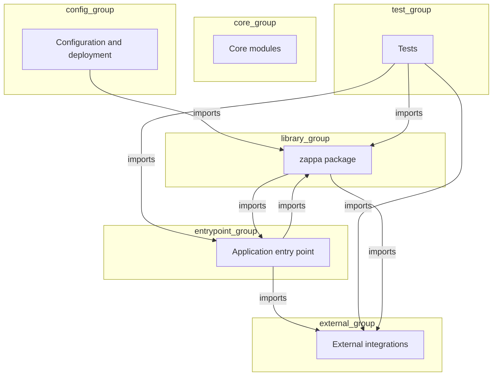

# Architecture report: Miserlou/Zappa

> Automated static analysis. **Observed** = directly seen in files/imports/AST; **Inferred** = interpretation from that evidence. Repository code was not executed.

## 1. Repository at a glance

| Item | Value |
| --- | --- |
| Repository | Miserlou/Zappa |
| Description | Serverless Python |
| Language | Python |
| Stars | 11811 |
| Licence | MIT |
| Analysed commit / branch | 5a11c17f5ecf0568bdb73b4baf6fb08ff0184f39 / master |
| Framework(s) | Django, Flask |
| Files analysed | 475 |
| Components | 6 |

## 2. Architecture in one minute

Miserlou/Zappa - Serverless Python. This repository was analysed statically from 475 file(s) (37 Python). Detected technologies (observed from imports/manifests): Django, Flask, AWS (boto3), Click, requests, setuptools. Files are grouped into 6 component(s): Configuration and deployment, Core modules, Application entry point, External integrations, Tests, zappa package. Observed entry point(s): zappa/cli.py. Findings below distinguish observed facts from inferred interpretation.

## 3. High-level block diagram

## 4. Main components

### Configuration and deployment (`config`)

- **Kind:** config
- **Status:** Observed
- **Confidence:** 0.85
- **Responsibility:** Groups 3 file(s) under configuration and deployment (observed from repository paths and static analysis).
- **Paths:** `MANIFEST.in`, `requirements.txt`, `setup.py`
- **Evidence:** [MANIFEST.in](https://github.com/Miserlou/Zappa/blob/5a11c17f5ecf0568bdb73b4baf6fb08ff0184f39/MANIFEST.in); [requirements.txt](https://github.com/Miserlou/Zappa/blob/5a11c17f5ecf0568bdb73b4baf6fb08ff0184f39/requirements.txt); [setup.py](https://github.com/Miserlou/Zappa/blob/5a11c17f5ecf0568bdb73b4baf6fb08ff0184f39/setup.py)

### Core modules (`core`)

- **Kind:** core
- **Status:** Observed
- **Confidence:** 0.85
- **Responsibility:** Groups 2 file(s) under core modules (observed from repository paths and static analysis).
- **Paths:** `requirements.sh`, `test.sh`
- **Evidence:** [requirements.sh](https://github.com/Miserlou/Zappa/blob/5a11c17f5ecf0568bdb73b4baf6fb08ff0184f39/requirements.sh); [test.sh](https://github.com/Miserlou/Zappa/blob/5a11c17f5ecf0568bdb73b4baf6fb08ff0184f39/test.sh)

### Application entry point (`entrypoint`)

- **Kind:** entrypoint
- **Status:** Observed
- **Confidence:** 0.85
- **Responsibility:** Groups 2 file(s) under application entry point (observed from repository paths and static analysis). Observed top-level classes: ZappaCLI. Observed top-level functions: common_log, create_wsgi_request, disable_click_colors, get_wsgi_string, handle, shamelessly_promote.
- **Paths:** `zappa/cli.py`, `zappa/wsgi.py`
- **Evidence:** [zappa/cli.py:72](https://github.com/Miserlou/Zappa/blob/5a11c17f5ecf0568bdb73b4baf6fb08ff0184f39/zappa/cli.py#L72); [zappa/wsgi.py:22](https://github.com/Miserlou/Zappa/blob/5a11c17f5ecf0568bdb73b4baf6fb08ff0184f39/zappa/wsgi.py#L22)

### External integrations (`external_integrations`)

- **Kind:** external
- **Status:** Inferred
- **Confidence:** 0.70
- **Responsibility:** Groups 0 file(s) under external integrations (observed from repository paths and static analysis).
- **Evidence:** [tests/tests_async.py:2](https://github.com/Miserlou/Zappa/blob/5a11c17f5ecf0568bdb73b4baf6fb08ff0184f39/tests/tests_async.py#L2); [tests/tests_async_old.py:2](https://github.com/Miserlou/Zappa/blob/5a11c17f5ecf0568bdb73b4baf6fb08ff0184f39/tests/tests_async_old.py#L2); [tests/utils.py:2](https://github.com/Miserlou/Zappa/blob/5a11c17f5ecf0568bdb73b4baf6fb08ff0184f39/tests/utils.py#L2); [zappa/asynchronous.py:88](https://github.com/Miserlou/Zappa/blob/5a11c17f5ecf0568bdb73b4baf6fb08ff0184f39/zappa/asynchronous.py#L88); [zappa/cli.py:28](https://github.com/Miserlou/Zappa/blob/5a11c17f5ecf0568bdb73b4baf6fb08ff0184f39/zappa/cli.py#L28); [zappa/core.py:28](https://github.com/Miserlou/Zappa/blob/5a11c17f5ecf0568bdb73b4baf6fb08ff0184f39/zappa/core.py#L28)

### Tests (`tests`)

- **Kind:** test
- **Status:** Observed
- **Confidence:** 0.85
- **Responsibility:** Groups 440 file(s) under tests (observed from repository paths and static analysis). Observed application object created via Flask. Observed routes: ROUTE /return/request/url, PATCH zappa.core.find_packages, PATCH os.remove, PATCH troposphere.Template, PATCH botocore.client. Observed top-level classes: TestDocs, TestWSGIMockMiddleWare, TestZappa. Observed top-level functions: async_me, authorizer_event, aws_async_sns_event, aws_dynamodb_event, aws_kinesis_event, aws_s3_event.
- **Paths:** `test_requirements.in`, `test_requirements.txt`, `test_settings.json`, `test_settings.py`, `tests/README.md`, `tests/__init__.py`, `tests/data/test1.py`, `tests/data/test1/this_dir_is_not_a_module.txt`, `tests/data/test2/test.py`, `tests/name_scenarios.json`, `tests/placebo/TestZappa.test_cli_aws/apigateway.CreateApiKey_1.json`, `tests/placebo/TestZappa.test_cli_aws/apigateway.CreateDeployment_1.json`, `tests/placebo/TestZappa.test_cli_aws/apigateway.CreateDeployment_2.json`, `tests/placebo/TestZappa.test_cli_aws/apigateway.CreateDeployment_3.json`, `tests/placebo/TestZappa.test_cli_aws/apigateway.CreateResource_1.json`, `tests/placebo/TestZappa.test_cli_aws/apigateway.CreateResource_2.json`, `tests/placebo/TestZappa.test_cli_aws/apigateway.CreateResource_3.json`, `tests/placebo/TestZappa.test_cli_aws/apigateway.CreateResource_4.json`, `tests/placebo/TestZappa.test_cli_aws/apigateway.CreateResource_5.json`, `tests/placebo/TestZappa.test_cli_aws/apigateway.CreateResource_6.json`, `tests/placebo/TestZappa.test_cli_aws/apigateway.CreateResource_7.json`, `tests/placebo/TestZappa.test_cli_aws/apigateway.CreateResource_8.json`, `tests/placebo/TestZappa.test_cli_aws/apigateway.CreateResource_9.json`, `tests/placebo/TestZappa.test_cli_aws/apigateway.DeleteApiKey_1.json`, `tests/placebo/TestZappa.test_cli_aws/apigateway.DeleteRestApi_1.json`, `tests/placebo/TestZappa.test_cli_aws/apigateway.DeleteRestApi_2.json`, `tests/placebo/TestZappa.test_cli_aws/apigateway.GetApiKeys_1.json`, `tests/placebo/TestZappa.test_cli_aws/apigateway.GetResources_1.json`, `tests/placebo/TestZappa.test_cli_aws/apigateway.GetResources_2.json`, `tests/placebo/TestZappa.test_cli_aws/apigateway.GetResources_3.json`, `tests/placebo/TestZappa.test_cli_aws/apigateway.GetRestApi_1.json`, `tests/placebo/TestZappa.test_cli_aws/apigateway.GetRestApi_2.json`, `tests/placebo/TestZappa.test_cli_aws/apigateway.GetRestApis_1.json`, `tests/placebo/TestZappa.test_cli_aws/apigateway.GetRestApis_2.json`, `tests/placebo/TestZappa.test_cli_aws/apigateway.GetRestApis_3.json`, `tests/placebo/TestZappa.test_cli_aws/apigateway.GetRestApis_4.json`, `tests/placebo/TestZappa.test_cli_aws/apigateway.GetRestApis_5.json`, `tests/placebo/TestZappa.test_cli_aws/apigateway.GetRestApis_6.json`, `tests/placebo/TestZappa.test_cli_aws/apigateway.GetRestApis_7.json`, `tests/placebo/TestZappa.test_cli_aws/apigateway.GetRestApis_8.json`, `tests/placebo/TestZappa.test_cli_aws/apigateway.GetRestApis_9.json`, `tests/placebo/TestZappa.test_cli_aws/apigateway.GetStages_1.json`, `tests/placebo/TestZappa.test_cli_aws/apigateway.UpdateRestApi_1.json`, `tests/placebo/TestZappa.test_cli_aws/apigateway.UpdateStage_1.json`, `tests/placebo/TestZappa.test_cli_aws/apigateway.UpdateStage_2.json`, `tests/placebo/TestZappa.test_cli_aws/apigateway.UpdateStage_3.json`, `tests/placebo/TestZappa.test_cli_aws/cloudformation.CreateStack_1.json`, `tests/placebo/TestZappa.test_cli_aws/cloudformation.DeleteStack_1.json`, `tests/placebo/TestZappa.test_cli_aws/cloudformation.DescribeStackResource_1.json`, `tests/placebo/TestZappa.test_cli_aws/cloudformation.DescribeStackResource_2.json`, `tests/placebo/TestZappa.test_cli_aws/cloudformation.DescribeStackResource_3.json`, `tests/placebo/TestZappa.test_cli_aws/cloudformation.DescribeStacks_1.json`, `tests/placebo/TestZappa.test_cli_aws/cloudformation.DescribeStacks_10.json`, `tests/placebo/TestZappa.test_cli_aws/cloudformation.DescribeStacks_11.json`, `tests/placebo/TestZappa.test_cli_aws/cloudformation.DescribeStacks_12.json`, `tests/placebo/TestZappa.test_cli_aws/cloudformation.DescribeStacks_13.json`, `tests/placebo/TestZappa.test_cli_aws/cloudformation.DescribeStacks_14.json`, `tests/placebo/TestZappa.test_cli_aws/cloudformation.DescribeStacks_15.json`, `tests/placebo/TestZappa.test_cli_aws/cloudformation.DescribeStacks_16.json`, `tests/placebo/TestZappa.test_cli_aws/cloudformation.DescribeStacks_2.json`, `tests/placebo/TestZappa.test_cli_aws/cloudformation.DescribeStacks_3.json`, `tests/placebo/TestZappa.test_cli_aws/cloudformation.DescribeStacks_4.json`, `tests/placebo/TestZappa.test_cli_aws/cloudformation.DescribeStacks_5.json`, `tests/placebo/TestZappa.test_cli_aws/cloudformation.DescribeStacks_6.json`, `tests/placebo/TestZappa.test_cli_aws/cloudformation.DescribeStacks_7.json`, `tests/placebo/TestZappa.test_cli_aws/cloudformation.DescribeStacks_8.json`, `tests/placebo/TestZappa.test_cli_aws/cloudformation.DescribeStacks_9.json`, `tests/placebo/TestZappa.test_cli_aws/cloudformation.ListStackResources_1.json`, `tests/placebo/TestZappa.test_cli_aws/cloudformation.ListStackResources_10.json`, `tests/placebo/TestZappa.test_cli_aws/cloudformation.ListStackResources_11.json`, `tests/placebo/TestZappa.test_cli_aws/cloudformation.ListStackResources_12.json`, `tests/placebo/TestZappa.test_cli_aws/cloudformation.ListStackResources_2.json`, `tests/placebo/TestZappa.test_cli_aws/cloudformation.ListStackResources_3.json`, `tests/placebo/TestZappa.test_cli_aws/cloudformation.ListStackResources_4.json`, `tests/placebo/TestZappa.test_cli_aws/cloudformation.ListStackResources_5.json`, `tests/placebo/TestZappa.test_cli_aws/cloudformation.ListStackResources_6.json`, `tests/placebo/TestZappa.test_cli_aws/cloudformation.ListStackResources_7.json`, `tests/placebo/TestZappa.test_cli_aws/cloudformation.ListStackResources_8.json`, `tests/placebo/TestZappa.test_cli_aws/cloudformation.ListStackResources_9.json`, `tests/placebo/TestZappa.test_cli_aws/cloudformation.UpdateStack_1.json`, `tests/placebo/TestZappa.test_cli_aws/cognito-idp.DescribeUserPool_1.json`, `tests/placebo/TestZappa.test_cli_aws/cognito-idp.UpdateUserPool_1.json`, `tests/placebo/TestZappa.test_cli_aws/events.DeleteRule_1.json`, `tests/placebo/TestZappa.test_cli_aws/events.DeleteRule_2.json`, `tests/placebo/TestZappa.test_cli_aws/events.DeleteRule_3.json`, `tests/placebo/TestZappa.test_cli_aws/events.DeleteRule_4.json`, `tests/placebo/TestZappa.test_cli_aws/events.DeleteRule_5.json`, `tests/placebo/TestZappa.test_cli_aws/events.DeleteRule_6.json`, `tests/placebo/TestZappa.test_cli_aws/events.DeleteRule_7.json`, `tests/placebo/TestZappa.test_cli_aws/events.DeleteRule_8.json`, `tests/placebo/TestZappa.test_cli_aws/events.DeleteRule_9.json`, `tests/placebo/TestZappa.test_cli_aws/events.ListRuleNamesByTarget_1.json`, `tests/placebo/TestZappa.test_cli_aws/events.ListRuleNamesByTarget_2.json`, `tests/placebo/TestZappa.test_cli_aws/events.ListRuleNamesByTarget_3.json`, `tests/placebo/TestZappa.test_cli_aws/events.ListRuleNamesByTarget_4.json`, `tests/placebo/TestZappa.test_cli_aws/events.ListRuleNamesByTarget_5.json`, `tests/placebo/TestZappa.test_cli_aws/events.ListRuleNamesByTarget_6.json`, `tests/placebo/TestZappa.test_cli_aws/events.ListRuleNamesByTarget_7.json`, `tests/placebo/TestZappa.test_cli_aws/events.ListRuleNamesByTarget_8.json`, `tests/placebo/TestZappa.test_cli_aws/events.ListTargetsByRule_1.json`, `tests/placebo/TestZappa.test_cli_aws/events.ListTargetsByRule_10.json`, `tests/placebo/TestZappa.test_cli_aws/events.ListTargetsByRule_11.json`, `tests/placebo/TestZappa.test_cli_aws/events.ListTargetsByRule_12.json`, `tests/placebo/TestZappa.test_cli_aws/events.ListTargetsByRule_2.json`, `tests/placebo/TestZappa.test_cli_aws/events.ListTargetsByRule_3.json`, `tests/placebo/TestZappa.test_cli_aws/events.ListTargetsByRule_4.json`, `tests/placebo/TestZappa.test_cli_aws/events.ListTargetsByRule_5.json`, `tests/placebo/TestZappa.test_cli_aws/events.ListTargetsByRule_6.json`, `tests/placebo/TestZappa.test_cli_aws/events.ListTargetsByRule_7.json`, `tests/placebo/TestZappa.test_cli_aws/events.ListTargetsByRule_8.json`, `tests/placebo/TestZappa.test_cli_aws/events.ListTargetsByRule_9.json`, `tests/placebo/TestZappa.test_cli_aws/events.PutRule_1.json`, `tests/placebo/TestZappa.test_cli_aws/events.PutRule_10.json`, `tests/placebo/TestZappa.test_cli_aws/events.PutRule_11.json`, `tests/placebo/TestZappa.test_cli_aws/events.PutRule_12.json`, `tests/placebo/TestZappa.test_cli_aws/events.PutRule_13.json`, `tests/placebo/TestZappa.test_cli_aws/events.PutRule_14.json`, `tests/placebo/TestZappa.test_cli_aws/events.PutRule_2.json`, `tests/placebo/TestZappa.test_cli_aws/events.PutRule_3.json`, `tests/placebo/TestZappa.test_cli_aws/events.PutRule_4.json`, `tests/placebo/TestZappa.test_cli_aws/events.PutRule_5.json`, `tests/placebo/TestZappa.test_cli_aws/events.PutRule_6.json`, `tests/placebo/TestZappa.test_cli_aws/events.PutRule_7.json`, `tests/placebo/TestZappa.test_cli_aws/events.PutRule_8.json`, `tests/placebo/TestZappa.test_cli_aws/events.PutRule_9.json`, `tests/placebo/TestZappa.test_cli_aws/events.PutTargets_1.json`, `tests/placebo/TestZappa.test_cli_aws/events.PutTargets_10.json`, `tests/placebo/TestZappa.test_cli_aws/events.PutTargets_11.json`, `tests/placebo/TestZappa.test_cli_aws/events.PutTargets_12.json`, `tests/placebo/TestZappa.test_cli_aws/events.PutTargets_13.json`, `tests/placebo/TestZappa.test_cli_aws/events.PutTargets_14.json`, `tests/placebo/TestZappa.test_cli_aws/events.PutTargets_2.json`, `tests/placebo/TestZappa.test_cli_aws/events.PutTargets_3.json`, `tests/placebo/TestZappa.test_cli_aws/events.PutTargets_4.json`, `tests/placebo/TestZappa.test_cli_aws/events.PutTargets_5.json`, `tests/placebo/TestZappa.test_cli_aws/events.PutTargets_6.json`, `tests/placebo/TestZappa.test_cli_aws/events.PutTargets_7.json`, `tests/placebo/TestZappa.test_cli_aws/events.PutTargets_8.json`, `tests/placebo/TestZappa.test_cli_aws/events.PutTargets_9.json`, `tests/placebo/TestZappa.test_cli_aws/events.RemoveTargets_1.json`, `tests/placebo/TestZappa.test_cli_aws/events.RemoveTargets_2.json`, `tests/placebo/TestZappa.test_cli_aws/events.RemoveTargets_3.json`, `tests/placebo/TestZappa.test_cli_aws/events.RemoveTargets_4.json`, `tests/placebo/TestZappa.test_cli_aws/events.RemoveTargets_5.json`, `tests/placebo/TestZappa.test_cli_aws/events.RemoveTargets_6.json`, `tests/placebo/TestZappa.test_cli_aws/events.RemoveTargets_7.json`, `tests/placebo/TestZappa.test_cli_aws/events.RemoveTargets_8.json`, `tests/placebo/TestZappa.test_cli_aws/events.RemoveTargets_9.json`, `tests/placebo/TestZappa.test_cli_aws/iam.GetRolePolicy_1.json`, `tests/placebo/TestZappa.test_cli_aws/iam.GetRolePolicy_10.json`, `tests/placebo/TestZappa.test_cli_aws/iam.GetRolePolicy_11.json`, `tests/placebo/TestZappa.test_cli_aws/iam.GetRolePolicy_12.json`, `tests/placebo/TestZappa.test_cli_aws/iam.GetRolePolicy_2.json`, `tests/placebo/TestZappa.test_cli_aws/iam.GetRolePolicy_3.json`, `tests/placebo/TestZappa.test_cli_aws/iam.GetRolePolicy_4.json`, `tests/placebo/TestZappa.test_cli_aws/iam.GetRolePolicy_5.json`, `tests/placebo/TestZappa.test_cli_aws/iam.GetRolePolicy_6.json`, `tests/placebo/TestZappa.test_cli_aws/iam.GetRolePolicy_7.json`, `tests/placebo/TestZappa.test_cli_aws/iam.GetRolePolicy_8.json`, `tests/placebo/TestZappa.test_cli_aws/iam.GetRolePolicy_9.json`, `tests/placebo/TestZappa.test_cli_aws/iam.GetRole_1.json`, `tests/placebo/TestZappa.test_cli_aws/iam.GetRole_10.json`, `tests/placebo/TestZappa.test_cli_aws/iam.GetRole_11.json`, `tests/placebo/TestZappa.test_cli_aws/iam.GetRole_12.json`, `tests/placebo/TestZappa.test_cli_aws/iam.GetRole_2.json`, `tests/placebo/TestZappa.test_cli_aws/iam.GetRole_3.json`, `tests/placebo/TestZappa.test_cli_aws/iam.GetRole_4.json`, `tests/placebo/TestZappa.test_cli_aws/iam.GetRole_5.json`, `tests/placebo/TestZappa.test_cli_aws/iam.GetRole_6.json`, `tests/placebo/TestZappa.test_cli_aws/iam.GetRole_7.json`, `tests/placebo/TestZappa.test_cli_aws/iam.GetRole_8.json`, `tests/placebo/TestZappa.test_cli_aws/iam.GetRole_9.json`, `tests/placebo/TestZappa.test_cli_aws/iam.PutRolePolicy_1.json`, `tests/placebo/TestZappa.test_cli_aws/lambda.AddPermission_1.json`, `tests/placebo/TestZappa.test_cli_aws/lambda.AddPermission_10.json`, `tests/placebo/TestZappa.test_cli_aws/lambda.AddPermission_11.json`, `tests/placebo/TestZappa.test_cli_aws/lambda.AddPermission_12.json`, `tests/placebo/TestZappa.test_cli_aws/lambda.AddPermission_13.json`, `tests/placebo/TestZappa.test_cli_aws/lambda.AddPermission_14.json`, `tests/placebo/TestZappa.test_cli_aws/lambda.AddPermission_2.json`, `tests/placebo/TestZappa.test_cli_aws/lambda.AddPermission_3.json`, `tests/placebo/TestZappa.test_cli_aws/lambda.AddPermission_4.json`, `tests/placebo/TestZappa.test_cli_aws/lambda.AddPermission_5.json`, `tests/placebo/TestZappa.test_cli_aws/lambda.AddPermission_6.json`, `tests/placebo/TestZappa.test_cli_aws/lambda.AddPermission_7.json`, `tests/placebo/TestZappa.test_cli_aws/lambda.AddPermission_8.json`, `tests/placebo/TestZappa.test_cli_aws/lambda.AddPermission_9.json`, `tests/placebo/TestZappa.test_cli_aws/lambda.CreateFunction_1.json`, `tests/placebo/TestZappa.test_cli_aws/lambda.CreateFunction_2.json`, `tests/placebo/TestZappa.test_cli_aws/lambda.CreateFunction_3.json`, `tests/placebo/TestZappa.test_cli_aws/lambda.CreateFunction_4.json`, `tests/placebo/TestZappa.test_cli_aws/lambda.CreateFunction_5.json`, `tests/placebo/TestZappa.test_cli_aws/lambda.DeleteFunctionConcurrency_1.json`, `tests/placebo/TestZappa.test_cli_aws/lambda.DeleteFunction_1.json`, `tests/placebo/TestZappa.test_cli_aws/lambda.DeleteFunction_2.json`, `tests/placebo/TestZappa.test_cli_aws/lambda.GetAlias_1.json`, `tests/placebo/TestZappa.test_cli_aws/lambda.GetFunctionConfiguration_1.json`, `tests/placebo/TestZappa.test_cli_aws/lambda.GetFunction_1.json`, `tests/placebo/TestZappa.test_cli_aws/lambda.GetFunction_2.json`, `tests/placebo/TestZappa.test_cli_aws/lambda.GetFunction_3.json`, `tests/placebo/TestZappa.test_cli_aws/lambda.GetFunction_4.json`, `tests/placebo/TestZappa.test_cli_aws/lambda.GetFunction_5.json`, `tests/placebo/TestZappa.test_cli_aws/lambda.GetFunction_6.json`, `tests/placebo/TestZappa.test_cli_aws/lambda.GetFunction_7.json`, `tests/placebo/TestZappa.test_cli_aws/lambda.GetFunction_8.json`, `tests/placebo/TestZappa.test_cli_aws/lambda.GetPolicy_1.json`, `tests/placebo/TestZappa.test_cli_aws/lambda.ListVersionsByFunction_1.json`, `tests/placebo/TestZappa.test_cli_aws/lambda.ListVersionsByFunction_2.json`, `tests/placebo/TestZappa.test_cli_aws/lambda.ListVersionsByFunction_3.json`, `tests/placebo/TestZappa.test_cli_aws/lambda.ListVersionsByFunction_4.json`, `tests/placebo/TestZappa.test_cli_aws/lambda.UpdateAlias_1.json`, `tests/placebo/TestZappa.test_cli_aws/lambda.UpdateFunctionCode_1.json`, `tests/placebo/TestZappa.test_cli_aws/lambda.UpdateFunctionCode_2.json`, `tests/placebo/TestZappa.test_cli_aws/lambda.UpdateFunctionCode_3.json`, `tests/placebo/TestZappa.test_cli_aws/lambda.UpdateFunctionCode_4.json`, `tests/placebo/TestZappa.test_cli_aws/lambda.UpdateFunctionCode_5.json`, `tests/placebo/TestZappa.test_cli_aws/lambda.UpdateFunctionCode_6.json`, `tests/placebo/TestZappa.test_cli_aws/lambda.UpdateFunctionConfiguration_1.json`, `tests/placebo/TestZappa.test_cli_aws/logs.DeleteLogGroup_1.json`, `tests/placebo/TestZappa.test_cli_aws/logs.DeleteLogGroup_2.json`, `tests/placebo/TestZappa.test_cli_aws/logs.DeleteLogGroup_3.json`, `tests/placebo/TestZappa.test_cli_aws/logs.DescribeLogStreams_1.json`, `tests/placebo/TestZappa.test_cli_aws/logs.DescribeLogStreams_2.json`, `tests/placebo/TestZappa.test_cli_aws/logs.DescribeLogStreams_3.json`, `tests/placebo/TestZappa.test_cli_aws/logs.DescribeLogStreams_4.json`, `tests/placebo/TestZappa.test_cli_aws/logs.FilterLogEvents_1.json`, `tests/placebo/TestZappa.test_cli_aws/logs.FilterLogEvents_2.json`, `tests/placebo/TestZappa.test_cli_aws/logs.FilterLogEvents_3.json`, `tests/placebo/TestZappa.test_cli_aws/logs.FilterLogEvents_4.json`, `tests/placebo/TestZappa.test_cli_aws/s3.CompleteMultipartUpload_1.json`, `tests/placebo/TestZappa.test_cli_aws/s3.CompleteMultipartUpload_2.json`, `tests/placebo/TestZappa.test_cli_aws/s3.CompleteMultipartUpload_3.json`, `tests/placebo/TestZappa.test_cli_aws/s3.CompleteMultipartUpload_4.json`, `tests/placebo/TestZappa.test_cli_aws/s3.CompleteMultipartUpload_5.json`, `tests/placebo/TestZappa.test_cli_aws/s3.CompleteMultipartUpload_6.json`, `tests/placebo/TestZappa.test_cli_aws/s3.CreateBucket_1.json`, `tests/placebo/TestZappa.test_cli_aws/s3.CreateBucket_10.json`, `tests/placebo/TestZappa.test_cli_aws/s3.CreateBucket_2.json`, `tests/placebo/TestZappa.test_cli_aws/s3.CreateBucket_3.json`, `tests/placebo/TestZappa.test_cli_aws/s3.CreateBucket_4.json`, `tests/placebo/TestZappa.test_cli_aws/s3.CreateBucket_5.json`, `tests/placebo/TestZappa.test_cli_aws/s3.CreateBucket_6.json`, `tests/placebo/TestZappa.test_cli_aws/s3.CreateBucket_7.json`, `tests/placebo/TestZappa.test_cli_aws/s3.CreateBucket_8.json`, `tests/placebo/TestZappa.test_cli_aws/s3.CreateBucket_9.json`, `tests/placebo/TestZappa.test_cli_aws/s3.CreateMultipartUpload_1.json`, `tests/placebo/TestZappa.test_cli_aws/s3.CreateMultipartUpload_2.json`, `tests/placebo/TestZappa.test_cli_aws/s3.CreateMultipartUpload_3.json`, `tests/placebo/TestZappa.test_cli_aws/s3.CreateMultipartUpload_4.json`, `tests/placebo/TestZappa.test_cli_aws/s3.CreateMultipartUpload_5.json`, `tests/placebo/TestZappa.test_cli_aws/s3.CreateMultipartUpload_6.json`, `tests/placebo/TestZappa.test_cli_aws/s3.CreateMultipartUpload_7.json`, `tests/placebo/TestZappa.test_cli_aws/s3.CreateMultipartUpload_8.json`, `tests/placebo/TestZappa.test_cli_aws/s3.DeleteObject_1.json`, `tests/placebo/TestZappa.test_cli_aws/s3.DeleteObject_2.json`, `tests/placebo/TestZappa.test_cli_aws/s3.DeleteObject_3.json`, `tests/placebo/TestZappa.test_cli_aws/s3.DeleteObject_4.json`, `tests/placebo/TestZappa.test_cli_aws/s3.DeleteObject_5.json`, `tests/placebo/TestZappa.test_cli_aws/s3.DeleteObject_6.json`, `tests/placebo/TestZappa.test_cli_aws/s3.HeadBucket_1.json`, `tests/placebo/TestZappa.test_cli_aws/s3.HeadBucket_2.json`, `tests/placebo/TestZappa.test_cli_aws/s3.HeadBucket_3.json`, `tests/placebo/TestZappa.test_cli_aws/s3.HeadBucket_4.json`, `tests/placebo/TestZappa.test_cli_aws/s3.HeadBucket_5.json`, `tests/placebo/TestZappa.test_cli_aws/s3.HeadBucket_6.json`, `tests/placebo/TestZappa.test_cli_aws/s3.PutObject_1.json`, `tests/placebo/TestZappa.test_cli_aws/s3.PutObject_2.json`, `tests/placebo/TestZappa.test_cli_aws/s3.UploadPart_1.json`, `tests/placebo/TestZappa.test_cli_aws/s3.UploadPart_10.json`, `tests/placebo/TestZappa.test_cli_aws/s3.UploadPart_11.json`, `tests/placebo/TestZappa.test_cli_aws/s3.UploadPart_12.json`, `tests/placebo/TestZappa.test_cli_aws/s3.UploadPart_13.json`, `tests/placebo/TestZappa.test_cli_aws/s3.UploadPart_14.json`, `tests/placebo/TestZappa.test_cli_aws/s3.UploadPart_15.json`, `tests/placebo/TestZappa.test_cli_aws/s3.UploadPart_16.json`, `tests/placebo/TestZappa.test_cli_aws/s3.UploadPart_17.json`, `tests/placebo/TestZappa.test_cli_aws/s3.UploadPart_18.json`, `tests/placebo/TestZappa.test_cli_aws/s3.UploadPart_19.json`, `tests/placebo/TestZappa.test_cli_aws/s3.UploadPart_2.json`, `tests/placebo/TestZappa.test_cli_aws/s3.UploadPart_20.json`, `tests/placebo/TestZappa.test_cli_aws/s3.UploadPart_21.json`, `tests/placebo/TestZappa.test_cli_aws/s3.UploadPart_22.json`, `tests/placebo/TestZappa.test_cli_aws/s3.UploadPart_23.json`, `tests/placebo/TestZappa.test_cli_aws/s3.UploadPart_24.json`, `tests/placebo/TestZappa.test_cli_aws/s3.UploadPart_25.json`, `tests/placebo/TestZappa.test_cli_aws/s3.UploadPart_26.json`, `tests/placebo/TestZappa.test_cli_aws/s3.UploadPart_27.json`, `tests/placebo/TestZappa.test_cli_aws/s3.UploadPart_28.json`, `tests/placebo/TestZappa.test_cli_aws/s3.UploadPart_29.json`, `tests/placebo/TestZappa.test_cli_aws/s3.UploadPart_3.json`, `tests/placebo/TestZappa.test_cli_aws/s3.UploadPart_30.json`, `tests/placebo/TestZappa.test_cli_aws/s3.UploadPart_31.json`, `tests/placebo/TestZappa.test_cli_aws/s3.UploadPart_32.json`, `tests/placebo/TestZappa.test_cli_aws/s3.UploadPart_33.json`, `tests/placebo/TestZappa.test_cli_aws/s3.UploadPart_34.json`, `tests/placebo/TestZappa.test_cli_aws/s3.UploadPart_35.json`, `tests/placebo/TestZappa.test_cli_aws/s3.UploadPart_36.json`, `tests/placebo/TestZappa.test_cli_aws/s3.UploadPart_37.json`, `tests/placebo/TestZappa.test_cli_aws/s3.UploadPart_38.json`, `tests/placebo/TestZappa.test_cli_aws/s3.UploadPart_39.json`, `tests/placebo/TestZappa.test_cli_aws/s3.UploadPart_4.json`, `tests/placebo/TestZappa.test_cli_aws/s3.UploadPart_40.json`, `tests/placebo/TestZappa.test_cli_aws/s3.UploadPart_41.json`, `tests/placebo/TestZappa.test_cli_aws/s3.UploadPart_42.json`, `tests/placebo/TestZappa.test_cli_aws/s3.UploadPart_43.json`, `tests/placebo/TestZappa.test_cli_aws/s3.UploadPart_44.json`, `tests/placebo/TestZappa.test_cli_aws/s3.UploadPart_45.json`, `tests/placebo/TestZappa.test_cli_aws/s3.UploadPart_46.json`, `tests/placebo/TestZappa.test_cli_aws/s3.UploadPart_47.json`, `tests/placebo/TestZappa.test_cli_aws/s3.UploadPart_48.json`, `tests/placebo/TestZappa.test_cli_aws/s3.UploadPart_5.json`, `tests/placebo/TestZappa.test_cli_aws/s3.UploadPart_6.json`, `tests/placebo/TestZappa.test_cli_aws/s3.UploadPart_7.json`, `tests/placebo/TestZappa.test_cli_aws/s3.UploadPart_8.json`, `tests/placebo/TestZappa.test_cli_aws/s3.UploadPart_9.json`, `tests/placebo/TestZappa.test_cli_aws/sns.ListSubscriptionsByTopic_1.json`, `tests/placebo/TestZappa.test_cli_aws/sns.ListSubscriptionsByTopic_2.json`, `tests/placebo/TestZappa.test_cli_aws/sns.ListSubscriptionsByTopic_3.json`, `tests/placebo/TestZappa.test_cli_aws/sns.ListSubscriptionsByTopic_4.json`, `tests/placebo/TestZappa.test_cli_aws/sns.ListSubscriptionsByTopic_5.json`, `tests/placebo/TestZappa.test_cli_aws/sns.ListSubscriptionsByTopic_6.json`, `tests/placebo/TestZappa.test_cli_aws/sns.ListSubscriptionsByTopic_7.json`, `tests/placebo/TestZappa.test_cli_aws/sns.ListSubscriptionsByTopic_8.json`, `tests/placebo/TestZappa.test_cli_aws/sns.SetSubscriptionAttributes_1.json`, `tests/placebo/TestZappa.test_cli_aws/sns.Subscribe_1.json`, `tests/placebo/TestZappa.test_cli_aws/sns.Subscribe_2.json`, `tests/placebo/TestZappa.test_cli_aws/sns.Subscribe_3.json`, `tests/placebo/TestZappa.test_cli_aws/sns.Subscribe_4.json`, `tests/placebo/TestZappa.test_cli_aws/sns.Subscribe_5.json`, `tests/placebo/TestZappa.test_cli_aws/sns.Subscribe_6.json`, `tests/placebo/TestZappa.test_cli_aws/sns.Unsubscribe_1.json`, `tests/placebo/TestZappa.test_cli_aws/sns.Unsubscribe_2.json`, `tests/placebo/TestZappa.test_cli_aws/sns.Unsubscribe_3.json`, `tests/placebo/TestZappa.test_cli_aws/sns.Unsubscribe_4.json`, `tests/placebo/TestZappa.test_cli_aws/sns.Unsubscribe_5.json`, `tests/placebo/TestZappa.test_cli_aws/sts.GetCallerIdentity_1.json`, `tests/placebo/TestZappa.test_cli_aws_status/apigateway.GetApiKeys_1.json`, `tests/placebo/TestZappa.test_cli_aws_status/apigateway.GetRestApis_1.json`, `tests/placebo/TestZappa.test_cli_aws_status/events.DescribeRule_1.json`, `tests/placebo/TestZappa.test_cli_aws_status/events.ListRuleNamesByTarget_1.json`, `tests/placebo/TestZappa.test_cli_aws_status/events.ListRules_1.json`, `tests/placebo/TestZappa.test_cli_aws_status/lambda.GetFunction_1.json`, `tests/placebo/TestZappa.test_cli_aws_status/lambda.ListVersionsByFunction_1.json`, `tests/placebo/TestZappa.test_cli_aws_status/monitoring.GetMetricStatistics_1.json`, `tests/placebo/TestZappa.test_cli_aws_status/monitoring.GetMetricStatistics_2.json`, `tests/placebo/TestZappa.test_cli_cognito_triggers/cognito-idp.DescribeUserPool_1.json`, `tests/placebo/TestZappa.test_cli_cognito_triggers/cognito-idp.UpdateUserPool_1.json`, `tests/placebo/TestZappa.test_cli_cognito_triggers/lambda.AddPermission_1.json`, `tests/placebo/TestZappa.test_cli_cognito_triggers/sts.GetCallerIdentity_1.json`, `tests/placebo/TestZappa.test_cognito_trigger/cognito-idp.DescribeUserPool_1.json`, `tests/placebo/TestZappa.test_cognito_trigger/cognito-idp.UpdateUserPool_1.json`, `tests/placebo/TestZappa.test_cognito_trigger/lambda.AddPermission_1.json`, `tests/placebo/TestZappa.test_cognito_trigger/sts.GetCallerIdentity_1.json`, `tests/placebo/TestZappa.test_cognito_trigger_existing/cognito-idp.DescribeUserPool_1.json`, `tests/placebo/TestZappa.test_cognito_trigger_existing/cognito-idp.UpdateUserPool_1.json`, `tests/placebo/TestZappa.test_cognito_trigger_existing/lambda.AddPermission_1.json`, `tests/placebo/TestZappa.test_cognito_trigger_existing/sts.GetCallerIdentity_1.json`, `tests/placebo/TestZappa.test_cognito_trigger_existing_UnusedAccountValidityDays/cognito-idp.DescribeUserPool_1.json`, `tests/placebo/TestZappa.test_cognito_trigger_existing_UnusedAccountValidityDays/cognito-idp.UpdateUserPool_1.json`, `tests/placebo/TestZappa.test_cognito_trigger_existing_UnusedAccountValidityDays/lambda.AddPermission_1.json`, `tests/placebo/TestZappa.test_cognito_trigger_existing_UnusedAccountValidityDays/sts.GetCallerIdentity_1.json`, `tests/placebo/TestZappa.test_copy_on_s3/s3.AbortMultipartUpload_1.json`, `tests/placebo/TestZappa.test_copy_on_s3/s3.CompleteMultipartUpload_1.json`, `tests/placebo/TestZappa.test_copy_on_s3/s3.CopyObject_1.json`, `tests/placebo/TestZappa.test_copy_on_s3/s3.CreateBucket_1.json`, `tests/placebo/TestZappa.test_copy_on_s3/s3.CreateMultipartUpload_1.json`, `tests/placebo/TestZappa.test_copy_on_s3/s3.HeadBucket_1.json`, `tests/placebo/TestZappa.test_copy_on_s3/s3.HeadObject_1.json`, `tests/placebo/TestZappa.test_copy_on_s3/s3.PutObject_1.json`, `tests/placebo/TestZappa.test_copy_on_s3/s3.UploadPart_1.json`, `tests/placebo/TestZappa.test_create_iam_roles/iam.CreateRole_1.json`, `tests/placebo/TestZappa.test_create_iam_roles/iam.GetRolePolicy_1.json`, `tests/placebo/TestZappa.test_create_iam_roles/iam.GetRolePolicy_2.json`, `tests/placebo/TestZappa.test_create_iam_roles/iam.GetRole_1.json`, `tests/placebo/TestZappa.test_create_iam_roles/iam.GetRole_2.json`, `tests/placebo/TestZappa.test_create_iam_roles/iam.PutRolePolicy_1.json`, `tests/placebo/TestZappa.test_create_lambda_function_local/lambda.CreateAlias_1.json`, `tests/placebo/TestZappa.test_create_lambda_function_local/lambda.CreateFunction_1.json`, `tests/placebo/TestZappa.test_create_lambda_function_local/lambda.DeleteFunctionConcurrency_1.json`, `tests/placebo/TestZappa.test_create_lambda_function_local/lambda.GetAlias_1.json`, `tests/placebo/TestZappa.test_create_lambda_function_local/lambda.UpdateAlias_1.json`, `tests/placebo/TestZappa.test_create_lambda_function_local/lambda.UpdateFunctionCode_1.json`, `tests/placebo/TestZappa.test_create_lambda_function_s3/lambda.CreateAlias_1.json`, `tests/placebo/TestZappa.test_create_lambda_function_s3/lambda.CreateFunction_1.json`, `tests/placebo/TestZappa.test_create_lambda_function_s3/lambda.DeleteFunctionConcurrency_1.json`, `tests/placebo/TestZappa.test_create_lambda_function_s3/lambda.GetAlias_1.json`, `tests/placebo/TestZappa.test_create_lambda_function_s3/lambda.UpdateAlias_1.json`, `tests/placebo/TestZappa.test_create_lambda_function_s3/lambda.UpdateFunctionCode_1.json`, `tests/placebo/TestZappa.test_deploy_api_gateway/apigateway.CreateDeployment_1.json`, `tests/placebo/TestZappa.test_deploy_api_gateway/apigateway.CreateRestApi_1.json`, `tests/placebo/TestZappa.test_deploy_api_gateway/apigateway.GetResources_1.json`, `tests/placebo/TestZappa.test_deploy_api_gateway/apigateway.GetRestApi_1.json`, `tests/placebo/TestZappa.test_deploy_api_gateway/apigateway.GetRestApis_1.json`, `tests/placebo/TestZappa.test_deploy_api_gateway/apigateway.PutIntegrationResponse_1.json`, `tests/placebo/TestZappa.test_deploy_api_gateway/apigateway.PutIntegration_1.json`, `tests/placebo/TestZappa.test_deploy_api_gateway/apigateway.PutMethodResponse_1.json`, `tests/placebo/TestZappa.test_deploy_api_gateway/apigateway.PutMethod_1.json`, `tests/placebo/TestZappa.test_deploy_api_gateway/apigateway.UpdateStage_1.json`, `tests/placebo/TestZappa.test_fetch_logs/logs.DescribeLogStreams_1.json`, `tests/placebo/TestZappa.test_fetch_logs/logs.FilterLogEvents_1.json`, `tests/placebo/TestZappa.test_get_api_url/apigateway.GetRestApis_1.json`, `tests/placebo/TestZappa.test_handler/s3.GetObject_1.json`, `tests/placebo/TestZappa.test_invoke_lambda_function/lambda.Invoke_1.json`, `tests/placebo/TestZappa.test_rollback_lambda_function_version/lambda.GetFunction_1.json`, `tests/placebo/TestZappa.test_rollback_lambda_function_version/lambda.ListVersionsByFunction_1.json`, `tests/placebo/TestZappa.test_rollback_lambda_function_version/lambda.ListVersionsByFunction_2.json`, `tests/placebo/TestZappa.test_rollback_lambda_function_version/lambda.UpdateFunctionCode_1.json`, `tests/placebo/TestZappa.test_upload_remove_s3/s3.CompleteMultipartUpload_1.json`, `tests/placebo/TestZappa.test_upload_remove_s3/s3.CreateBucket_1.json`, `tests/placebo/TestZappa.test_upload_remove_s3/s3.CreateMultipartUpload_1.json`, `tests/placebo/TestZappa.test_upload_remove_s3/s3.DeleteObject_1.json`, `tests/placebo/TestZappa.test_upload_remove_s3/s3.HeadBucket_1.json`, `tests/placebo/TestZappa.test_upload_remove_s3/s3.HeadObject_1.json`, `tests/placebo/TestZappa.test_upload_remove_s3/s3.PutObject_1.json`, `tests/placebo/TestZappa.test_upload_remove_s3/s3.UploadPart_1.json`, `tests/test_app.py`, `tests/test_bad_circular_extends_settings.json`, `tests/test_bad_environment_vars.json`, `tests/test_bad_settings.json`, `tests/test_bad_stage_name_settings.json`, `tests/test_bot_exception_handler_settings.py`, `tests/test_bot_handler_being_triggered.py`, `tests/test_event_script_app.py`, `tests/test_event_script_settings.py`, `tests/test_exception_handler_settings.py`, `tests/test_handler.py`, `tests/test_non_ascii_environment_var_key.json`, `tests/test_one_env.json`, `tests/test_settings.toml`, `tests/test_settings.yaml`, `tests/test_settings.yml`, `tests/test_wsgi_script_name_app.py`, `tests/test_wsgi_script_name_settings.py`, `tests/tests.py`, `tests/tests_async.py`, `tests/tests_async_old.py`, `tests/tests_docs.py`, `tests/tests_middleware.py`, `tests/tests_placebo.py`, `tests/utils.py`
- **Evidence:** [test_requirements.in](https://github.com/Miserlou/Zappa/blob/5a11c17f5ecf0568bdb73b4baf6fb08ff0184f39/test_requirements.in); [test_requirements.txt](https://github.com/Miserlou/Zappa/blob/5a11c17f5ecf0568bdb73b4baf6fb08ff0184f39/test_requirements.txt); [test_settings.json](https://github.com/Miserlou/Zappa/blob/5a11c17f5ecf0568bdb73b4baf6fb08ff0184f39/test_settings.json); [test_settings.py:31](https://github.com/Miserlou/Zappa/blob/5a11c17f5ecf0568bdb73b4baf6fb08ff0184f39/test_settings.py#L31); [tests/README.md](https://github.com/Miserlou/Zappa/blob/5a11c17f5ecf0568bdb73b4baf6fb08ff0184f39/tests/README.md); [tests/__init__.py](https://github.com/Miserlou/Zappa/blob/5a11c17f5ecf0568bdb73b4baf6fb08ff0184f39/tests/__init__.py); [tests/data/test1.py:5](https://github.com/Miserlou/Zappa/blob/5a11c17f5ecf0568bdb73b4baf6fb08ff0184f39/tests/data/test1.py#L5); [tests/data/test1/this_dir_is_not_a_module.txt](https://github.com/Miserlou/Zappa/blob/5a11c17f5ecf0568bdb73b4baf6fb08ff0184f39/tests/data/test1/this_dir_is_not_a_module.txt)

### zappa package (`zappa`)

- **Kind:** library
- **Status:** Observed
- **Confidence:** 0.85
- **Responsibility:** Groups 11 file(s) under zappa package (observed from repository paths and static analysis). Observed top-level classes: AsyncException, InvalidAwsLambdaName, LambdaAsyncResponse, LambdaHandler, SnsAsyncResponse, Zappa. Observed top-level functions: _b64, _send_signed_request, add_event_source, all_casings, check_new_version_available, cleanup.
- **Paths:** `zappa/__init__.py`, `zappa/async.py`, `zappa/asynchronous.py`, `zappa/core.py`, `zappa/ext/__init__.py`, `zappa/ext/django_zappa.py`, `zappa/handler.py`, `zappa/letsencrypt.py`, `zappa/middleware.py`, `zappa/policies.py`, `zappa/utilities.py`
- **Evidence:** [zappa/__init__.py](https://github.com/Miserlou/Zappa/blob/5a11c17f5ecf0568bdb73b4baf6fb08ff0184f39/zappa/__init__.py); [zappa/async.py](https://github.com/Miserlou/Zappa/blob/5a11c17f5ecf0568bdb73b4baf6fb08ff0184f39/zappa/async.py); [zappa/asynchronous.py:125](https://github.com/Miserlou/Zappa/blob/5a11c17f5ecf0568bdb73b4baf6fb08ff0184f39/zappa/asynchronous.py#L125); [zappa/core.py:215](https://github.com/Miserlou/Zappa/blob/5a11c17f5ecf0568bdb73b4baf6fb08ff0184f39/zappa/core.py#L215); [zappa/ext/__init__.py](https://github.com/Miserlou/Zappa/blob/5a11c17f5ecf0568bdb73b4baf6fb08ff0184f39/zappa/ext/__init__.py); [zappa/ext/django_zappa.py:8](https://github.com/Miserlou/Zappa/blob/5a11c17f5ecf0568bdb73b4baf6fb08ff0184f39/zappa/ext/django_zappa.py#L8); [zappa/handler.py:35](https://github.com/Miserlou/Zappa/blob/5a11c17f5ecf0568bdb73b4baf6fb08ff0184f39/zappa/handler.py#L35); [zappa/letsencrypt.py:44](https://github.com/Miserlou/Zappa/blob/5a11c17f5ecf0568bdb73b4baf6fb08ff0184f39/zappa/letsencrypt.py#L44)

## 5. Execution flow

**Observed** entry point(s):

- [zappa/cli.py](https://github.com/Miserlou/Zappa/blob/5a11c17f5ecf0568bdb73b4baf6fb08ff0184f39/zappa/cli.py)
- [zappa/cli.py](https://github.com/Miserlou/Zappa/blob/5a11c17f5ecf0568bdb73b4baf6fb08ff0184f39/zappa/cli.py)

**Observed** routes (from decorators):

- `ROUTE /` -> `lambda_handler` in `example/app.py:10`
- `ROUTE /return/request/url` -> `return_request_url` in `tests/test_wsgi_script_name_app.py:7`
- `PATCH zappa.core.find_packages` -> `test_copy_editable_packages` in `tests/tests.py:81`
- `PATCH os.remove` -> `test_copy_editable_packages` in `tests/tests.py:81`
- `PATCH troposphere.Template` -> `test_get_domain_respects_route53_setting` in `tests/tests.py:1443`
- `PATCH botocore.client` -> `test_get_domain_respects_route53_setting` in `tests/tests.py:1443`
- `PATCH botocore.client` -> `test_get_all_zones_normal_case` in `tests/tests.py:1486`
- `PATCH botocore.client` -> `test_get_all_zones_two_pages` in `tests/tests.py:1510`
- `PATCH botocore.client` -> `test_set_lambda_concurrency` in `tests/tests.py:2195`
- `PATCH botocore.client` -> `test_update_lambda_concurrency` in `tests/tests.py:2216`
- `PATCH botocore.client` -> `test_delete_lambda_concurrency` in `tests/tests.py:2240`

Representative flow (derived from observed entry points and the import graph; steps beyond the entry point are **Inferred**):

1. Execution starts at an observed entry point listed above, if present.
2. `config` imports `zappa` (Configuration and deployment -> zappa package).
3. `entrypoint` imports `external_integrations` (Application entry point -> External integrations).
4. `entrypoint` imports `zappa` (Application entry point -> zappa package).
5. `tests` imports `entrypoint` (Tests -> Application entry point).
6. `tests` imports `external_integrations` (Tests -> External integrations).
7. `tests` imports `zappa` (Tests -> zappa package).
8. `zappa` imports `entrypoint` (zappa package -> Application entry point).
9. `zappa` imports `external_integrations` (zappa package -> External integrations).

## 6. Project structure

### `(root)`

- `.gitignore` - other (1186 bytes)
- `.travis.yml` - ci, YAML (1122 bytes)
- `CHANGELOG.md` - docs (15369 bytes)
- `LICENSE` - docs (1077 bytes)
- `MANIFEST.in` - manifest (131 bytes)
- `README.md` - docs (184 bytes)
- `requirements.in` - other (304 bytes)
- `requirements.sh` - source, Shell (253 bytes)
- `requirements.txt` - manifest (1949 bytes)
- `setup.py` - manifest, Python (1673 bytes)
- `test.sh` - source, Shell (147 bytes)
- `test_requirements.in` - test (60 bytes)
- `test_requirements.txt` - test (2934 bytes)
- `test_settings.json` - test (3609 bytes)
- `test_settings.py` - test, Python (1326 bytes)

### `.github`

- `.github/ISSUE_TEMPLATE.md` - docs (954 bytes)
- `.github/PULL_REQUEST_TEMPLATE.md` - docs (1249 bytes)

### `docs`

- `docs/domain_with_free_ssl_dns.md` - docs (3518 bytes)
- `docs/domain_with_free_ssl_http.md` - docs (3642 bytes)

### `example`

- `example/README.md` - docs (2014 bytes)
- `example/app.py` - source, Python (376 bytes)
- `example/authmodule.py` - source, Python (9325 bytes)
- `example/mymodule.py` - source, Python (299 bytes)
- `example/policy/deploy.json` - config (4400 bytes)
- `example/requirements.txt` - manifest (26 bytes)
- `example/zappa_settings.json` - config (1529 bytes)

### `tests`

- `tests/README.md` - test (515 bytes)
- `tests/__init__.py` - test, Python (0 bytes)
- `tests/data/test1.py` - test, Python (135 bytes)
- `tests/data/test1/this_dir_is_not_a_module.txt` - test (257 bytes)
- `tests/data/test2/test.py` - test, Python (148 bytes)
- `tests/name_scenarios.json` - test (1061 bytes)
- `tests/placebo/TestZappa.test_cli_aws/apigateway.CreateApiKey_1.json` - test (1116 bytes)
- `tests/placebo/TestZappa.test_cli_aws/apigateway.CreateDeployment_1.json` - test (471 bytes)
- `tests/placebo/TestZappa.test_cli_aws/apigateway.CreateDeployment_2.json` - test (472 bytes)
- `tests/placebo/TestZappa.test_cli_aws/apigateway.CreateDeployment_3.json` - test (745 bytes)
- `tests/placebo/TestZappa.test_cli_aws/apigateway.CreateResource_1.json` - test (322 bytes)
- `tests/placebo/TestZappa.test_cli_aws/apigateway.CreateResource_2.json` - test (332 bytes)
- `tests/placebo/TestZappa.test_cli_aws/apigateway.CreateResource_3.json` - test (346 bytes)
- `tests/placebo/TestZappa.test_cli_aws/apigateway.CreateResource_4.json` - test (360 bytes)
- `tests/placebo/TestZappa.test_cli_aws/apigateway.CreateResource_5.json` - test (374 bytes)
- `tests/placebo/TestZappa.test_cli_aws/apigateway.CreateResource_6.json` - test (388 bytes)
- `tests/placebo/TestZappa.test_cli_aws/apigateway.CreateResource_7.json` - test (402 bytes)
- `tests/placebo/TestZappa.test_cli_aws/apigateway.CreateResource_8.json` - test (322 bytes)
- `tests/placebo/TestZappa.test_cli_aws/apigateway.CreateResource_9.json` - test (594 bytes)
- `tests/placebo/TestZappa.test_cli_aws/apigateway.DeleteApiKey_1.json` - test (163 bytes)
- `tests/placebo/TestZappa.test_cli_aws/apigateway.DeleteRestApi_1.json` - test (189 bytes)
- `tests/placebo/TestZappa.test_cli_aws/apigateway.DeleteRestApi_2.json` - test (460 bytes)
- `tests/placebo/TestZappa.test_cli_aws/apigateway.GetApiKeys_1.json` - test (131 bytes)
- `tests/placebo/TestZappa.test_cli_aws/apigateway.GetResources_1.json` - test (313 bytes)
- `tests/placebo/TestZappa.test_cli_aws/apigateway.GetResources_2.json` - test (313 bytes)
- `tests/placebo/TestZappa.test_cli_aws/apigateway.GetResources_3.json` - test (585 bytes)
- `tests/placebo/TestZappa.test_cli_aws/apigateway.GetRestApi_1.json` - test (981 bytes)
- `tests/placebo/TestZappa.test_cli_aws/apigateway.GetRestApi_2.json` - test (921 bytes)
- `tests/placebo/TestZappa.test_cli_aws/apigateway.GetRestApis_1.json` - test (12936 bytes)
- `tests/placebo/TestZappa.test_cli_aws/apigateway.GetRestApis_2.json` - test (12936 bytes)
- `tests/placebo/TestZappa.test_cli_aws/apigateway.GetRestApis_3.json` - test (12929 bytes)
- `tests/placebo/TestZappa.test_cli_aws/apigateway.GetRestApis_4.json` - test (30051 bytes)
- `tests/placebo/TestZappa.test_cli_aws/apigateway.GetRestApis_5.json` - test (13147 bytes)
- `tests/placebo/TestZappa.test_cli_aws/apigateway.GetRestApis_6.json` - test (29276 bytes)
- `tests/placebo/TestZappa.test_cli_aws/apigateway.GetRestApis_7.json` - test (29276 bytes)
- `tests/placebo/TestZappa.test_cli_aws/apigateway.GetRestApis_8.json` - test (29276 bytes)
- `tests/placebo/TestZappa.test_cli_aws/apigateway.GetRestApis_9.json` - test (29276 bytes)
- `tests/placebo/TestZappa.test_cli_aws/apigateway.GetStages_1.json` - test (2154 bytes)
- `tests/placebo/TestZappa.test_cli_aws/apigateway.UpdateRestApi_1.json` - test (921 bytes)
- `tests/placebo/TestZappa.test_cli_aws/apigateway.UpdateStage_1.json` - test (778 bytes)
- `tests/placebo/TestZappa.test_cli_aws/apigateway.UpdateStage_2.json` - test (1778 bytes)
- `tests/placebo/TestZappa.test_cli_aws/apigateway.UpdateStage_3.json` - test (1778 bytes)
- `tests/placebo/TestZappa.test_cli_aws/cloudformation.CreateStack_1.json` - test (611 bytes)
- `tests/placebo/TestZappa.test_cli_aws/cloudformation.DeleteStack_1.json` - test (486 bytes)
- `tests/placebo/TestZappa.test_cli_aws/cloudformation.DescribeStackResource_1.json` - test (1241 bytes)
- `tests/placebo/TestZappa.test_cli_aws/cloudformation.DescribeStackResource_2.json` - test (1241 bytes)
- `tests/placebo/TestZappa.test_cli_aws/cloudformation.DescribeStackResource_3.json` - test (1241 bytes)
- `tests/placebo/TestZappa.test_cli_aws/cloudformation.DescribeStacks_1.json` - test (695 bytes)
- `tests/placebo/TestZappa.test_cli_aws/cloudformation.DescribeStacks_10.json` - test (4770 bytes)
- `tests/placebo/TestZappa.test_cli_aws/cloudformation.DescribeStacks_11.json` - test (4770 bytes)
- `tests/placebo/TestZappa.test_cli_aws/cloudformation.DescribeStacks_12.json` - test (4770 bytes)
- `tests/placebo/TestZappa.test_cli_aws/cloudformation.DescribeStacks_13.json` - test (4770 bytes)
- `tests/placebo/TestZappa.test_cli_aws/cloudformation.DescribeStacks_14.json` - test (4767 bytes)
- `tests/placebo/TestZappa.test_cli_aws/cloudformation.DescribeStacks_15.json` - test (4767 bytes)
- `tests/placebo/TestZappa.test_cli_aws/cloudformation.DescribeStacks_16.json` - test (596 bytes)
- `tests/placebo/TestZappa.test_cli_aws/cloudformation.DescribeStacks_2.json` - test (4770 bytes)
- `tests/placebo/TestZappa.test_cli_aws/cloudformation.DescribeStacks_3.json` - test (4770 bytes)
- `tests/placebo/TestZappa.test_cli_aws/cloudformation.DescribeStacks_4.json` - test (4770 bytes)
- `tests/placebo/TestZappa.test_cli_aws/cloudformation.DescribeStacks_5.json` - test (4770 bytes)
- `tests/placebo/TestZappa.test_cli_aws/cloudformation.DescribeStacks_6.json` - test (4770 bytes)
- `tests/placebo/TestZappa.test_cli_aws/cloudformation.DescribeStacks_7.json` - test (4770 bytes)
- `tests/placebo/TestZappa.test_cli_aws/cloudformation.DescribeStacks_8.json` - test (4770 bytes)
- `tests/placebo/TestZappa.test_cli_aws/cloudformation.DescribeStacks_9.json` - test (4770 bytes)
- `tests/placebo/TestZappa.test_cli_aws/cloudformation.ListStackResources_1.json` - test (525 bytes)
- `tests/placebo/TestZappa.test_cli_aws/cloudformation.ListStackResources_10.json` - test (10587 bytes)
- `tests/placebo/TestZappa.test_cli_aws/cloudformation.ListStackResources_11.json` - test (10512 bytes)
- `tests/placebo/TestZappa.test_cli_aws/cloudformation.ListStackResources_12.json` - test (10289 bytes)
- `tests/placebo/TestZappa.test_cli_aws/cloudformation.ListStackResources_2.json` - test (1124 bytes)
- `tests/placebo/TestZappa.test_cli_aws/cloudformation.ListStackResources_3.json` - test (4713 bytes)
- `tests/placebo/TestZappa.test_cli_aws/cloudformation.ListStackResources_4.json` - test (5041 bytes)
- `tests/placebo/TestZappa.test_cli_aws/cloudformation.ListStackResources_5.json` - test (10287 bytes)
- `tests/placebo/TestZappa.test_cli_aws/cloudformation.ListStackResources_6.json` - test (10287 bytes)
- `tests/placebo/TestZappa.test_cli_aws/cloudformation.ListStackResources_7.json` - test (10896 bytes)
- `tests/placebo/TestZappa.test_cli_aws/cloudformation.ListStackResources_8.json` - test (11036 bytes)
- `tests/placebo/TestZappa.test_cli_aws/cloudformation.ListStackResources_9.json` - test (10736 bytes)
- `tests/placebo/TestZappa.test_cli_aws/cloudformation.UpdateStack_1.json` - test (685 bytes)
- `tests/placebo/TestZappa.test_cli_aws/cognito-idp.DescribeUserPool_1.json` - test (10242 bytes)
- `tests/placebo/TestZappa.test_cli_aws/cognito-idp.UpdateUserPool_1.json` - test (539 bytes)
- `tests/placebo/TestZappa.test_cli_aws/events.DeleteRule_1.json` - test (189 bytes)
- `tests/placebo/TestZappa.test_cli_aws/events.DeleteRule_2.json` - test (189 bytes)
- `tests/placebo/TestZappa.test_cli_aws/events.DeleteRule_3.json` - test (189 bytes)
- `tests/placebo/TestZappa.test_cli_aws/events.DeleteRule_4.json` - test (470 bytes)
- `tests/placebo/TestZappa.test_cli_aws/events.DeleteRule_5.json` - test (470 bytes)
- `tests/placebo/TestZappa.test_cli_aws/events.DeleteRule_6.json` - test (470 bytes)
- `tests/placebo/TestZappa.test_cli_aws/events.DeleteRule_7.json` - test (470 bytes)
- `tests/placebo/TestZappa.test_cli_aws/events.DeleteRule_8.json` - test (470 bytes)
- `tests/placebo/TestZappa.test_cli_aws/events.DeleteRule_9.json` - test (470 bytes)
- `tests/placebo/TestZappa.test_cli_aws/events.ListRuleNamesByTarget_1.json` - test (263 bytes)
- `tests/placebo/TestZappa.test_cli_aws/events.ListRuleNamesByTarget_2.json` - test (263 bytes)
- `tests/placebo/TestZappa.test_cli_aws/events.ListRuleNamesByTarget_3.json` - test (263 bytes)
- `tests/placebo/TestZappa.test_cli_aws/events.ListRuleNamesByTarget_4.json` - test (211 bytes)
- `tests/placebo/TestZappa.test_cli_aws/events.ListRuleNamesByTarget_5.json` - test (345 bytes)
- `tests/placebo/TestZappa.test_cli_aws/events.ListRuleNamesByTarget_6.json` - test (345 bytes)
- `tests/placebo/TestZappa.test_cli_aws/events.ListRuleNamesByTarget_7.json` - test (345 bytes)
- `tests/placebo/TestZappa.test_cli_aws/events.ListRuleNamesByTarget_8.json` - test (211 bytes)
- `tests/placebo/TestZappa.test_cli_aws/events.ListTargetsByRule_1.json` - test (345 bytes)
- `tests/placebo/TestZappa.test_cli_aws/events.ListTargetsByRule_10.json` - test (815 bytes)
- `tests/placebo/TestZappa.test_cli_aws/events.ListTargetsByRule_11.json` - test (659 bytes)
- `tests/placebo/TestZappa.test_cli_aws/events.ListTargetsByRule_12.json` - test (971 bytes)
- `tests/placebo/TestZappa.test_cli_aws/events.ListTargetsByRule_2.json` - test (366 bytes)
- `tests/placebo/TestZappa.test_cli_aws/events.ListTargetsByRule_3.json` - test (345 bytes)
- `tests/placebo/TestZappa.test_cli_aws/events.ListTargetsByRule_4.json` - test (345 bytes)
- `tests/placebo/TestZappa.test_cli_aws/events.ListTargetsByRule_5.json` - test (366 bytes)
- `tests/placebo/TestZappa.test_cli_aws/events.ListTargetsByRule_6.json` - test (368 bytes)
- `tests/placebo/TestZappa.test_cli_aws/events.ListTargetsByRule_7.json` - test (659 bytes)
- `tests/placebo/TestZappa.test_cli_aws/events.ListTargetsByRule_8.json` - test (659 bytes)
- `tests/placebo/TestZappa.test_cli_aws/events.ListTargetsByRule_9.json` - test (659 bytes)
- `tests/placebo/TestZappa.test_cli_aws/events.PutRule_1.json` - test (284 bytes)
- `tests/placebo/TestZappa.test_cli_aws/events.PutRule_10.json` - test (594 bytes)
- `tests/placebo/TestZappa.test_cli_aws/events.PutRule_11.json` - test (577 bytes)
- `tests/placebo/TestZappa.test_cli_aws/events.PutRule_12.json` - test (594 bytes)
- `tests/placebo/TestZappa.test_cli_aws/events.PutRule_13.json` - test (594 bytes)
- `tests/placebo/TestZappa.test_cli_aws/events.PutRule_14.json` - test (594 bytes)
- `tests/placebo/TestZappa.test_cli_aws/events.PutRule_2.json` - test (284 bytes)
- `tests/placebo/TestZappa.test_cli_aws/events.PutRule_3.json` - test (284 bytes)
- `tests/placebo/TestZappa.test_cli_aws/events.PutRule_4.json` - test (284 bytes)
- `tests/placebo/TestZappa.test_cli_aws/events.PutRule_5.json` - test (284 bytes)
- `tests/placebo/TestZappa.test_cli_aws/events.PutRule_6.json` - test (577 bytes)
- `tests/placebo/TestZappa.test_cli_aws/events.PutRule_7.json` - test (594 bytes)
- `tests/placebo/TestZappa.test_cli_aws/events.PutRule_8.json` - test (577 bytes)
- `tests/placebo/TestZappa.test_cli_aws/events.PutRule_9.json` - test (594 bytes)
- `tests/placebo/TestZappa.test_cli_aws/events.PutTargets_1.json` - test (251 bytes)
- `tests/placebo/TestZappa.test_cli_aws/events.PutTargets_10.json` - test (533 bytes)
- `tests/placebo/TestZappa.test_cli_aws/events.PutTargets_11.json` - test (533 bytes)
- `tests/placebo/TestZappa.test_cli_aws/events.PutTargets_12.json` - test (533 bytes)
- `tests/placebo/TestZappa.test_cli_aws/events.PutTargets_13.json` - test (533 bytes)
- `tests/placebo/TestZappa.test_cli_aws/events.PutTargets_14.json` - test (533 bytes)
- `tests/placebo/TestZappa.test_cli_aws/events.PutTargets_2.json` - test (251 bytes)
- `tests/placebo/TestZappa.test_cli_aws/events.PutTargets_3.json` - test (251 bytes)
- `tests/placebo/TestZappa.test_cli_aws/events.PutTargets_4.json` - test (251 bytes)
- `tests/placebo/TestZappa.test_cli_aws/events.PutTargets_5.json` - test (251 bytes)
- `tests/placebo/TestZappa.test_cli_aws/events.PutTargets_6.json` - test (533 bytes)
- `tests/placebo/TestZappa.test_cli_aws/events.PutTargets_7.json` - test (533 bytes)
- `tests/placebo/TestZappa.test_cli_aws/events.PutTargets_8.json` - test (533 bytes)
- `tests/placebo/TestZappa.test_cli_aws/events.PutTargets_9.json` - test (533 bytes)
- `tests/placebo/TestZappa.test_cli_aws/events.RemoveTargets_1.json` - test (251 bytes)
- `tests/placebo/TestZappa.test_cli_aws/events.RemoveTargets_2.json` - test (251 bytes)
- `tests/placebo/TestZappa.test_cli_aws/events.RemoveTargets_3.json` - test (251 bytes)
- `tests/placebo/TestZappa.test_cli_aws/events.RemoveTargets_4.json` - test (533 bytes)
- `tests/placebo/TestZappa.test_cli_aws/events.RemoveTargets_5.json` - test (533 bytes)
- `tests/placebo/TestZappa.test_cli_aws/events.RemoveTargets_6.json` - test (533 bytes)
- `tests/placebo/TestZappa.test_cli_aws/events.RemoveTargets_7.json` - test (533 bytes)
- `tests/placebo/TestZappa.test_cli_aws/events.RemoveTargets_8.json` - test (533 bytes)
- `tests/placebo/TestZappa.test_cli_aws/events.RemoveTargets_9.json` - test (533 bytes)
- `tests/placebo/TestZappa.test_cli_aws/iam.GetRolePolicy_1.json` - test (5564 bytes)
- `tests/placebo/TestZappa.test_cli_aws/iam.GetRolePolicy_10.json` - test (5420 bytes)
- `tests/placebo/TestZappa.test_cli_aws/iam.GetRolePolicy_11.json` - test (5686 bytes)
- `tests/placebo/TestZappa.test_cli_aws/iam.GetRolePolicy_12.json` - test (5686 bytes)
- `tests/placebo/TestZappa.test_cli_aws/iam.GetRolePolicy_2.json` - test (5420 bytes)
- `tests/placebo/TestZappa.test_cli_aws/iam.GetRolePolicy_3.json` - test (5420 bytes)
- `tests/placebo/TestZappa.test_cli_aws/iam.GetRolePolicy_4.json` - test (5420 bytes)
- `tests/placebo/TestZappa.test_cli_aws/iam.GetRolePolicy_5.json` - test (5420 bytes)
- `tests/placebo/TestZappa.test_cli_aws/iam.GetRolePolicy_6.json` - test (5420 bytes)
- `tests/placebo/TestZappa.test_cli_aws/iam.GetRolePolicy_7.json` - test (5420 bytes)
- `tests/placebo/TestZappa.test_cli_aws/iam.GetRolePolicy_8.json` - test (5420 bytes)
- `tests/placebo/TestZappa.test_cli_aws/iam.GetRolePolicy_9.json` - test (5420 bytes)
- `tests/placebo/TestZappa.test_cli_aws/iam.GetRole_1.json` - test (1053 bytes)
- `tests/placebo/TestZappa.test_cli_aws/iam.GetRole_10.json` - test (1053 bytes)
- `tests/placebo/TestZappa.test_cli_aws/iam.GetRole_11.json` - test (1318 bytes)
- `tests/placebo/TestZappa.test_cli_aws/iam.GetRole_12.json` - test (1318 bytes)
- `tests/placebo/TestZappa.test_cli_aws/iam.GetRole_2.json` - test (1053 bytes)
- `tests/placebo/TestZappa.test_cli_aws/iam.GetRole_3.json` - test (1053 bytes)
- `tests/placebo/TestZappa.test_cli_aws/iam.GetRole_4.json` - test (1053 bytes)
- `tests/placebo/TestZappa.test_cli_aws/iam.GetRole_5.json` - test (1053 bytes)
- `tests/placebo/TestZappa.test_cli_aws/iam.GetRole_6.json` - test (1053 bytes)
- `tests/placebo/TestZappa.test_cli_aws/iam.GetRole_7.json` - test (1053 bytes)
- `tests/placebo/TestZappa.test_cli_aws/iam.GetRole_8.json` - test (1053 bytes)
- `tests/placebo/TestZappa.test_cli_aws/iam.GetRole_9.json` - test (1053 bytes)
- `tests/placebo/TestZappa.test_cli_aws/iam.PutRolePolicy_1.json` - test (486 bytes)
- `tests/placebo/TestZappa.test_cli_aws/lambda.AddPermission_1.json` - test (888 bytes)
- `tests/placebo/TestZappa.test_cli_aws/lambda.AddPermission_10.json` - test (896 bytes)
- `tests/placebo/TestZappa.test_cli_aws/lambda.AddPermission_11.json` - test (880 bytes)
- `tests/placebo/TestZappa.test_cli_aws/lambda.AddPermission_12.json` - test (896 bytes)
- `tests/placebo/TestZappa.test_cli_aws/lambda.AddPermission_13.json` - test (896 bytes)
- `tests/placebo/TestZappa.test_cli_aws/lambda.AddPermission_14.json` - test (896 bytes)
- `tests/placebo/TestZappa.test_cli_aws/lambda.AddPermission_2.json` - test (551 bytes)
- `tests/placebo/TestZappa.test_cli_aws/lambda.AddPermission_3.json` - test (551 bytes)
- `tests/placebo/TestZappa.test_cli_aws/lambda.AddPermission_4.json` - test (551 bytes)
- `tests/placebo/TestZappa.test_cli_aws/lambda.AddPermission_5.json` - test (551 bytes)
- `tests/placebo/TestZappa.test_cli_aws/lambda.AddPermission_6.json` - test (880 bytes)
- `tests/placebo/TestZappa.test_cli_aws/lambda.AddPermission_7.json` - test (896 bytes)
- `tests/placebo/TestZappa.test_cli_aws/lambda.AddPermission_8.json` - test (880 bytes)
- `tests/placebo/TestZappa.test_cli_aws/lambda.AddPermission_9.json` - test (896 bytes)
- `tests/placebo/TestZappa.test_cli_aws/lambda.CreateFunction_1.json` - test (748 bytes)
- `tests/placebo/TestZappa.test_cli_aws/lambda.CreateFunction_2.json` - test (748 bytes)
- `tests/placebo/TestZappa.test_cli_aws/lambda.CreateFunction_3.json` - test (332 bytes)
- `tests/placebo/TestZappa.test_cli_aws/lambda.CreateFunction_4.json` - test (747 bytes)
- `tests/placebo/TestZappa.test_cli_aws/lambda.CreateFunction_5.json` - test (1066 bytes)
- `tests/placebo/TestZappa.test_cli_aws/lambda.DeleteFunctionConcurrency_1.json` - test (189 bytes)
- `tests/placebo/TestZappa.test_cli_aws/lambda.DeleteFunction_1.json` - test (189 bytes)
- `tests/placebo/TestZappa.test_cli_aws/lambda.DeleteFunction_2.json` - test (465 bytes)
- `tests/placebo/TestZappa.test_cli_aws/lambda.GetAlias_1.json` - test (266 bytes)
- `tests/placebo/TestZappa.test_cli_aws/lambda.GetFunctionConfiguration_1.json` - test (1165 bytes)
- `tests/placebo/TestZappa.test_cli_aws/lambda.GetFunction_1.json` - test (1845 bytes)
- `tests/placebo/TestZappa.test_cli_aws/lambda.GetFunction_2.json` - test (1818 bytes)
- `tests/placebo/TestZappa.test_cli_aws/lambda.GetFunction_3.json` - test (2182 bytes)
- `tests/placebo/TestZappa.test_cli_aws/lambda.GetFunction_4.json` - test (2186 bytes)
- `tests/placebo/TestZappa.test_cli_aws/lambda.GetFunction_5.json` - test (2200 bytes)
- `tests/placebo/TestZappa.test_cli_aws/lambda.GetFunction_6.json` - test (2186 bytes)
- `tests/placebo/TestZappa.test_cli_aws/lambda.GetFunction_7.json` - test (2192 bytes)
- `tests/placebo/TestZappa.test_cli_aws/lambda.GetFunction_8.json` - test (2192 bytes)
- `tests/placebo/TestZappa.test_cli_aws/lambda.GetPolicy_1.json` - test (779 bytes)
- `tests/placebo/TestZappa.test_cli_aws/lambda.ListVersionsByFunction_1.json` - test (223 bytes)
- `tests/placebo/TestZappa.test_cli_aws/lambda.ListVersionsByFunction_2.json` - test (2285 bytes)
- `tests/placebo/TestZappa.test_cli_aws/lambda.ListVersionsByFunction_3.json` - test (759 bytes)
- `tests/placebo/TestZappa.test_cli_aws/lambda.ListVersionsByFunction_4.json` - test (2607 bytes)
- `tests/placebo/TestZappa.test_cli_aws/lambda.UpdateAlias_1.json` - test (266 bytes)
- `tests/placebo/TestZappa.test_cli_aws/lambda.UpdateFunctionCode_1.json` - test (750 bytes)
- `tests/placebo/TestZappa.test_cli_aws/lambda.UpdateFunctionCode_2.json` - test (381 bytes)
- `tests/placebo/TestZappa.test_cli_aws/lambda.UpdateFunctionCode_3.json` - test (749 bytes)
- `tests/placebo/TestZappa.test_cli_aws/lambda.UpdateFunctionCode_4.json` - test (749 bytes)
- `tests/placebo/TestZappa.test_cli_aws/lambda.UpdateFunctionCode_5.json` - test (1068 bytes)
- `tests/placebo/TestZappa.test_cli_aws/lambda.UpdateFunctionCode_6.json` - test (1068 bytes)
- `tests/placebo/TestZappa.test_cli_aws/lambda.UpdateFunctionConfiguration_1.json` - test (1072 bytes)
- `tests/placebo/TestZappa.test_cli_aws/logs.DeleteLogGroup_1.json` - test (153 bytes)
- `tests/placebo/TestZappa.test_cli_aws/logs.DeleteLogGroup_2.json` - test (657 bytes)
- `tests/placebo/TestZappa.test_cli_aws/logs.DeleteLogGroup_3.json` - test (470 bytes)
- `tests/placebo/TestZappa.test_cli_aws/logs.DescribeLogStreams_1.json` - test (1473 bytes)
- `tests/placebo/TestZappa.test_cli_aws/logs.DescribeLogStreams_2.json` - test (1473 bytes)
- `tests/placebo/TestZappa.test_cli_aws/logs.DescribeLogStreams_3.json` - test (3011 bytes)
- `tests/placebo/TestZappa.test_cli_aws/logs.DescribeLogStreams_4.json` - test (3011 bytes)
- `tests/placebo/TestZappa.test_cli_aws/logs.FilterLogEvents_1.json` - test (3642 bytes)
- `tests/placebo/TestZappa.test_cli_aws/logs.FilterLogEvents_2.json` - test (3642 bytes)
- `tests/placebo/TestZappa.test_cli_aws/logs.FilterLogEvents_3.json` - test (17655 bytes)
- `tests/placebo/TestZappa.test_cli_aws/logs.FilterLogEvents_4.json` - test (17655 bytes)
- `tests/placebo/TestZappa.test_cli_aws/s3.CompleteMultipartUpload_1.json` - test (489 bytes)
- `tests/placebo/TestZappa.test_cli_aws/s3.CompleteMultipartUpload_2.json` - test (489 bytes)
- `tests/placebo/TestZappa.test_cli_aws/s3.CompleteMultipartUpload_3.json` - test (489 bytes)
- `tests/placebo/TestZappa.test_cli_aws/s3.CompleteMultipartUpload_4.json` - test (489 bytes)
- `tests/placebo/TestZappa.test_cli_aws/s3.CompleteMultipartUpload_5.json` - test (898 bytes)
- `tests/placebo/TestZappa.test_cli_aws/s3.CompleteMultipartUpload_6.json` - test (898 bytes)
- `tests/placebo/TestZappa.test_cli_aws/s3.CreateBucket_1.json` - test (473 bytes)
- `tests/placebo/TestZappa.test_cli_aws/s3.CreateBucket_10.json` - test (690 bytes)
- `tests/placebo/TestZappa.test_cli_aws/s3.CreateBucket_2.json` - test (473 bytes)
- `tests/placebo/TestZappa.test_cli_aws/s3.CreateBucket_3.json` - test (473 bytes)
- `tests/placebo/TestZappa.test_cli_aws/s3.CreateBucket_4.json` - test (473 bytes)
- `tests/placebo/TestZappa.test_cli_aws/s3.CreateBucket_5.json` - test (473 bytes)
- `tests/placebo/TestZappa.test_cli_aws/s3.CreateBucket_6.json` - test (473 bytes)
- `tests/placebo/TestZappa.test_cli_aws/s3.CreateBucket_7.json` - test (473 bytes)
- `tests/placebo/TestZappa.test_cli_aws/s3.CreateBucket_8.json` - test (473 bytes)
- `tests/placebo/TestZappa.test_cli_aws/s3.CreateBucket_9.json` - test (690 bytes)
- `tests/placebo/TestZappa.test_cli_aws/s3.CreateMultipartUpload_1.json` - test (460 bytes)
- `tests/placebo/TestZappa.test_cli_aws/s3.CreateMultipartUpload_2.json` - test (460 bytes)
- `tests/placebo/TestZappa.test_cli_aws/s3.CreateMultipartUpload_3.json` - test (460 bytes)
- `tests/placebo/TestZappa.test_cli_aws/s3.CreateMultipartUpload_4.json` - test (460 bytes)
- `tests/placebo/TestZappa.test_cli_aws/s3.CreateMultipartUpload_5.json` - test (460 bytes)
- `tests/placebo/TestZappa.test_cli_aws/s3.CreateMultipartUpload_6.json` - test (460 bytes)
- `tests/placebo/TestZappa.test_cli_aws/s3.CreateMultipartUpload_7.json` - test (817 bytes)
- `tests/placebo/TestZappa.test_cli_aws/s3.CreateMultipartUpload_8.json` - test (817 bytes)
- `tests/placebo/TestZappa.test_cli_aws/s3.DeleteObject_1.json` - test (605 bytes)
- `tests/placebo/TestZappa.test_cli_aws/s3.DeleteObject_2.json` - test (608 bytes)
- `tests/placebo/TestZappa.test_cli_aws/s3.DeleteObject_3.json` - test (608 bytes)
- `tests/placebo/TestZappa.test_cli_aws/s3.DeleteObject_4.json` - test (608 bytes)
- `tests/placebo/TestZappa.test_cli_aws/s3.DeleteObject_5.json` - test (608 bytes)
- `tests/placebo/TestZappa.test_cli_aws/s3.DeleteObject_6.json` - test (608 bytes)
- `tests/placebo/TestZappa.test_cli_aws/s3.HeadBucket_1.json` - test (272 bytes)
- `tests/placebo/TestZappa.test_cli_aws/s3.HeadBucket_2.json` - test (272 bytes)
- `tests/placebo/TestZappa.test_cli_aws/s3.HeadBucket_3.json` - test (272 bytes)
- `tests/placebo/TestZappa.test_cli_aws/s3.HeadBucket_4.json` - test (272 bytes)
- `tests/placebo/TestZappa.test_cli_aws/s3.HeadBucket_5.json` - test (734 bytes)
- `tests/placebo/TestZappa.test_cli_aws/s3.HeadBucket_6.json` - test (734 bytes)
- `tests/placebo/TestZappa.test_cli_aws/s3.PutObject_1.json` - test (329 bytes)
- `tests/placebo/TestZappa.test_cli_aws/s3.PutObject_2.json` - test (329 bytes)
- `tests/placebo/TestZappa.test_cli_aws/s3.UploadPart_1.json` - test (329 bytes)
- `tests/placebo/TestZappa.test_cli_aws/s3.UploadPart_10.json` - test (329 bytes)
- `tests/placebo/TestZappa.test_cli_aws/s3.UploadPart_11.json` - test (329 bytes)
- `tests/placebo/TestZappa.test_cli_aws/s3.UploadPart_12.json` - test (329 bytes)
- `tests/placebo/TestZappa.test_cli_aws/s3.UploadPart_13.json` - test (329 bytes)
- `tests/placebo/TestZappa.test_cli_aws/s3.UploadPart_14.json` - test (329 bytes)
- `tests/placebo/TestZappa.test_cli_aws/s3.UploadPart_15.json` - test (329 bytes)
- `tests/placebo/TestZappa.test_cli_aws/s3.UploadPart_16.json` - test (329 bytes)
- `tests/placebo/TestZappa.test_cli_aws/s3.UploadPart_17.json` - test (329 bytes)
- `tests/placebo/TestZappa.test_cli_aws/s3.UploadPart_18.json` - test (329 bytes)
- `tests/placebo/TestZappa.test_cli_aws/s3.UploadPart_19.json` - test (329 bytes)
- `tests/placebo/TestZappa.test_cli_aws/s3.UploadPart_2.json` - test (329 bytes)
- `tests/placebo/TestZappa.test_cli_aws/s3.UploadPart_20.json` - test (329 bytes)
- `tests/placebo/TestZappa.test_cli_aws/s3.UploadPart_21.json` - test (329 bytes)
- `tests/placebo/TestZappa.test_cli_aws/s3.UploadPart_22.json` - test (329 bytes)
- `tests/placebo/TestZappa.test_cli_aws/s3.UploadPart_23.json` - test (329 bytes)
- `tests/placebo/TestZappa.test_cli_aws/s3.UploadPart_24.json` - test (329 bytes)
- `tests/placebo/TestZappa.test_cli_aws/s3.UploadPart_25.json` - test (329 bytes)
- `tests/placebo/TestZappa.test_cli_aws/s3.UploadPart_26.json` - test (329 bytes)
- `tests/placebo/TestZappa.test_cli_aws/s3.UploadPart_27.json` - test (329 bytes)
- `tests/placebo/TestZappa.test_cli_aws/s3.UploadPart_28.json` - test (329 bytes)
- `tests/placebo/TestZappa.test_cli_aws/s3.UploadPart_29.json` - test (329 bytes)
- `tests/placebo/TestZappa.test_cli_aws/s3.UploadPart_3.json` - test (329 bytes)
- `tests/placebo/TestZappa.test_cli_aws/s3.UploadPart_30.json` - test (329 bytes)
- `tests/placebo/TestZappa.test_cli_aws/s3.UploadPart_31.json` - test (329 bytes)
- `tests/placebo/TestZappa.test_cli_aws/s3.UploadPart_32.json` - test (329 bytes)
- `tests/placebo/TestZappa.test_cli_aws/s3.UploadPart_33.json` - test (329 bytes)
- `tests/placebo/TestZappa.test_cli_aws/s3.UploadPart_34.json` - test (329 bytes)
- `tests/placebo/TestZappa.test_cli_aws/s3.UploadPart_35.json` - test (329 bytes)
- `tests/placebo/TestZappa.test_cli_aws/s3.UploadPart_36.json` - test (329 bytes)
- `tests/placebo/TestZappa.test_cli_aws/s3.UploadPart_37.json` - test (329 bytes)
- `tests/placebo/TestZappa.test_cli_aws/s3.UploadPart_38.json` - test (329 bytes)
- `tests/placebo/TestZappa.test_cli_aws/s3.UploadPart_39.json` - test (742 bytes)
- `tests/placebo/TestZappa.test_cli_aws/s3.UploadPart_4.json` - test (329 bytes)
- `tests/placebo/TestZappa.test_cli_aws/s3.UploadPart_40.json` - test (742 bytes)
- `tests/placebo/TestZappa.test_cli_aws/s3.UploadPart_41.json` - test (742 bytes)
- `tests/placebo/TestZappa.test_cli_aws/s3.UploadPart_42.json` - test (742 bytes)
- `tests/placebo/TestZappa.test_cli_aws/s3.UploadPart_43.json` - test (742 bytes)
- `tests/placebo/TestZappa.test_cli_aws/s3.UploadPart_44.json` - test (742 bytes)
- `tests/placebo/TestZappa.test_cli_aws/s3.UploadPart_45.json` - test (742 bytes)
- `tests/placebo/TestZappa.test_cli_aws/s3.UploadPart_46.json` - test (742 bytes)
- `tests/placebo/TestZappa.test_cli_aws/s3.UploadPart_47.json` - test (742 bytes)
- `tests/placebo/TestZappa.test_cli_aws/s3.UploadPart_48.json` - test (742 bytes)
- `tests/placebo/TestZappa.test_cli_aws/s3.UploadPart_5.json` - test (329 bytes)
- `tests/placebo/TestZappa.test_cli_aws/s3.UploadPart_6.json` - test (329 bytes)
- `tests/placebo/TestZappa.test_cli_aws/s3.UploadPart_7.json` - test (329 bytes)
- `tests/placebo/TestZappa.test_cli_aws/s3.UploadPart_8.json` - test (329 bytes)
- `tests/placebo/TestZappa.test_cli_aws/s3.UploadPart_9.json` - test (329 bytes)
- `tests/placebo/TestZappa.test_cli_aws/sns.ListSubscriptionsByTopic_1.json` - test (516 bytes)
- `tests/placebo/TestZappa.test_cli_aws/sns.ListSubscriptionsByTopic_2.json` - test (1155 bytes)
- `tests/placebo/TestZappa.test_cli_aws/sns.ListSubscriptionsByTopic_3.json` - test (1192 bytes)
- `tests/placebo/TestZappa.test_cli_aws/sns.ListSubscriptionsByTopic_4.json` - test (516 bytes)
- `tests/placebo/TestZappa.test_cli_aws/sns.ListSubscriptionsByTopic_5.json` - test (1192 bytes)
- `tests/placebo/TestZappa.test_cli_aws/sns.ListSubscriptionsByTopic_6.json` - test (1192 bytes)
- `tests/placebo/TestZappa.test_cli_aws/sns.ListSubscriptionsByTopic_7.json` - test (1192 bytes)
- `tests/placebo/TestZappa.test_cli_aws/sns.ListSubscriptionsByTopic_8.json` - test (516 bytes)
- `tests/placebo/TestZappa.test_cli_aws/sns.SetSubscriptionAttributes_1.json` - test (404 bytes)
- `tests/placebo/TestZappa.test_cli_aws/sns.Subscribe_1.json` - test (537 bytes)
- `tests/placebo/TestZappa.test_cli_aws/sns.Subscribe_2.json` - test (563 bytes)
- `tests/placebo/TestZappa.test_cli_aws/sns.Subscribe_3.json` - test (574 bytes)
- `tests/placebo/TestZappa.test_cli_aws/sns.Subscribe_4.json` - test (563 bytes)
- `tests/placebo/TestZappa.test_cli_aws/sns.Subscribe_5.json` - test (574 bytes)
- `tests/placebo/TestZappa.test_cli_aws/sns.Subscribe_6.json` - test (563 bytes)
- `tests/placebo/TestZappa.test_cli_aws/sns.Unsubscribe_1.json` - test (486 bytes)
- `tests/placebo/TestZappa.test_cli_aws/sns.Unsubscribe_2.json` - test (486 bytes)
- `tests/placebo/TestZappa.test_cli_aws/sns.Unsubscribe_3.json` - test (486 bytes)
- `tests/placebo/TestZappa.test_cli_aws/sns.Unsubscribe_4.json` - test (486 bytes)
- `tests/placebo/TestZappa.test_cli_aws/sns.Unsubscribe_5.json` - test (486 bytes)
- `tests/placebo/TestZappa.test_cli_aws/sts.GetCallerIdentity_1.json` - test (594 bytes)
- `tests/placebo/TestZappa.test_cli_aws_status/apigateway.GetApiKeys_1.json` - test (1178 bytes)
- `tests/placebo/TestZappa.test_cli_aws_status/apigateway.GetRestApis_1.json` - test (30829 bytes)
- `tests/placebo/TestZappa.test_cli_aws_status/events.DescribeRule_1.json` - test (773 bytes)
- `tests/placebo/TestZappa.test_cli_aws_status/events.ListRuleNamesByTarget_1.json` - test (533 bytes)
- `tests/placebo/TestZappa.test_cli_aws_status/events.ListRules_1.json` - test (646 bytes)
- `tests/placebo/TestZappa.test_cli_aws_status/lambda.GetFunction_1.json` - test (2153 bytes)
- `tests/placebo/TestZappa.test_cli_aws_status/lambda.ListVersionsByFunction_1.json` - test (2630 bytes)
- `tests/placebo/TestZappa.test_cli_aws_status/monitoring.GetMetricStatistics_1.json` - test (23597 bytes)
- `tests/placebo/TestZappa.test_cli_aws_status/monitoring.GetMetricStatistics_2.json` - test (23539 bytes)
- `tests/placebo/TestZappa.test_cli_cognito_triggers/cognito-idp.DescribeUserPool_1.json` - test (10242 bytes)
- `tests/placebo/TestZappa.test_cli_cognito_triggers/cognito-idp.UpdateUserPool_1.json` - test (539 bytes)
- `tests/placebo/TestZappa.test_cli_cognito_triggers/lambda.AddPermission_1.json` - test (888 bytes)
- `tests/placebo/TestZappa.test_cli_cognito_triggers/sts.GetCallerIdentity_1.json` - test (594 bytes)
- `tests/placebo/TestZappa.test_cognito_trigger/cognito-idp.DescribeUserPool_1.json` - test (10242 bytes)
- `tests/placebo/TestZappa.test_cognito_trigger/cognito-idp.UpdateUserPool_1.json` - test (539 bytes)
- `tests/placebo/TestZappa.test_cognito_trigger/lambda.AddPermission_1.json` - test (888 bytes)
- `tests/placebo/TestZappa.test_cognito_trigger/sts.GetCallerIdentity_1.json` - test (594 bytes)
- `tests/placebo/TestZappa.test_cognito_trigger_existing/cognito-idp.DescribeUserPool_1.json` - test (10356 bytes)
- `tests/placebo/TestZappa.test_cognito_trigger_existing/cognito-idp.UpdateUserPool_1.json` - test (539 bytes)
- `tests/placebo/TestZappa.test_cognito_trigger_existing/lambda.AddPermission_1.json` - test (888 bytes)
- `tests/placebo/TestZappa.test_cognito_trigger_existing/sts.GetCallerIdentity_1.json` - test (594 bytes)
- `tests/placebo/TestZappa.test_cognito_trigger_existing_UnusedAccountValidityDays/cognito-idp.DescribeUserPool_1.json` - test (10364 bytes)
- `tests/placebo/TestZappa.test_cognito_trigger_existing_UnusedAccountValidityDays/cognito-idp.UpdateUserPool_1.json` - test (539 bytes)
- `tests/placebo/TestZappa.test_cognito_trigger_existing_UnusedAccountValidityDays/lambda.AddPermission_1.json` - test (888 bytes)
- `tests/placebo/TestZappa.test_cognito_trigger_existing_UnusedAccountValidityDays/sts.GetCallerIdentity_1.json` - test (594 bytes)
- `tests/placebo/TestZappa.test_copy_on_s3/s3.AbortMultipartUpload_1.json` - test (605 bytes)
- `tests/placebo/TestZappa.test_copy_on_s3/s3.CompleteMultipartUpload_1.json` - test (516 bytes)
- `tests/placebo/TestZappa.test_copy_on_s3/s3.CopyObject_1.json` - test (1190 bytes)
- `tests/placebo/TestZappa.test_copy_on_s3/s3.CreateBucket_1.json` - test (318 bytes)
- `tests/placebo/TestZappa.test_copy_on_s3/s3.CreateMultipartUpload_1.json` - test (499 bytes)
- `tests/placebo/TestZappa.test_copy_on_s3/s3.HeadBucket_1.json` - test (272 bytes)
- `tests/placebo/TestZappa.test_copy_on_s3/s3.HeadObject_1.json` - test (730 bytes)
- `tests/placebo/TestZappa.test_copy_on_s3/s3.PutObject_1.json` - test (329 bytes)
- `tests/placebo/TestZappa.test_copy_on_s3/s3.UploadPart_1.json` - test (329 bytes)
- `tests/placebo/TestZappa.test_create_iam_roles/iam.CreateRole_1.json` - test (1386 bytes)
- `tests/placebo/TestZappa.test_create_iam_roles/iam.GetRolePolicy_1.json` - test (374 bytes)
- `tests/placebo/TestZappa.test_create_iam_roles/iam.GetRolePolicy_2.json` - test (3908 bytes)
- `tests/placebo/TestZappa.test_create_iam_roles/iam.GetRole_1.json` - test (370 bytes)
- `tests/placebo/TestZappa.test_create_iam_roles/iam.GetRole_2.json` - test (1053 bytes)
- `tests/placebo/TestZappa.test_create_iam_roles/iam.PutRolePolicy_1.json` - test (189 bytes)
- `tests/placebo/TestZappa.test_create_lambda_function_local/lambda.CreateAlias_1.json` - test (266 bytes)
- `tests/placebo/TestZappa.test_create_lambda_function_local/lambda.CreateFunction_1.json` - test (750 bytes)
- `tests/placebo/TestZappa.test_create_lambda_function_local/lambda.DeleteFunctionConcurrency_1.json` - test (189 bytes)
- `tests/placebo/TestZappa.test_create_lambda_function_local/lambda.GetAlias_1.json` - test (266 bytes)
- `tests/placebo/TestZappa.test_create_lambda_function_local/lambda.UpdateAlias_1.json` - test (266 bytes)
- `tests/placebo/TestZappa.test_create_lambda_function_local/lambda.UpdateFunctionCode_1.json` - test (752 bytes)
- `tests/placebo/TestZappa.test_create_lambda_function_s3/lambda.CreateAlias_1.json` - test (266 bytes)
- `tests/placebo/TestZappa.test_create_lambda_function_s3/lambda.CreateFunction_1.json` - test (750 bytes)
- `tests/placebo/TestZappa.test_create_lambda_function_s3/lambda.DeleteFunctionConcurrency_1.json` - test (189 bytes)
- `tests/placebo/TestZappa.test_create_lambda_function_s3/lambda.GetAlias_1.json` - test (266 bytes)
- `tests/placebo/TestZappa.test_create_lambda_function_s3/lambda.UpdateAlias_1.json` - test (266 bytes)
- `tests/placebo/TestZappa.test_create_lambda_function_s3/lambda.UpdateFunctionCode_1.json` - test (752 bytes)
- `tests/placebo/TestZappa.test_deploy_api_gateway/apigateway.CreateDeployment_1.json` - test (472 bytes)
- `tests/placebo/TestZappa.test_deploy_api_gateway/apigateway.CreateRestApi_1.json` - test (551 bytes)
- `tests/placebo/TestZappa.test_deploy_api_gateway/apigateway.GetResources_1.json` - test (313 bytes)
- `tests/placebo/TestZappa.test_deploy_api_gateway/apigateway.GetRestApi_1.json` - test (325 bytes)
- `tests/placebo/TestZappa.test_deploy_api_gateway/apigateway.GetRestApis_1.json` - test (217 bytes)
- `tests/placebo/TestZappa.test_deploy_api_gateway/apigateway.PutIntegrationResponse_1.json` - test (872 bytes)
- `tests/placebo/TestZappa.test_deploy_api_gateway/apigateway.PutIntegration_1.json` - test (2169 bytes)
- `tests/placebo/TestZappa.test_deploy_api_gateway/apigateway.PutMethodResponse_1.json` - test (620 bytes)
- `tests/placebo/TestZappa.test_deploy_api_gateway/apigateway.PutMethod_1.json` - test (291 bytes)
- `tests/placebo/TestZappa.test_deploy_api_gateway/apigateway.UpdateStage_1.json` - test (778 bytes)
- `tests/placebo/TestZappa.test_fetch_logs/logs.DescribeLogStreams_1.json` - test (2131 bytes)
- `tests/placebo/TestZappa.test_fetch_logs/logs.FilterLogEvents_1.json` - test (6214 bytes)
- `tests/placebo/TestZappa.test_get_api_url/apigateway.GetRestApis_1.json` - test (30417 bytes)
- `tests/placebo/TestZappa.test_handler/s3.GetObject_1.json` - test (1473 bytes)
- `tests/placebo/TestZappa.test_invoke_lambda_function/lambda.Invoke_1.json` - test (364 bytes)
- `tests/placebo/TestZappa.test_rollback_lambda_function_version/lambda.GetFunction_1.json` - test (1906 bytes)
- `tests/placebo/TestZappa.test_rollback_lambda_function_version/lambda.ListVersionsByFunction_1.json` - test (6632 bytes)
- `tests/placebo/TestZappa.test_rollback_lambda_function_version/lambda.ListVersionsByFunction_2.json` - test (6632 bytes)
- `tests/placebo/TestZappa.test_rollback_lambda_function_version/lambda.UpdateFunctionCode_1.json` - test (776 bytes)
- `tests/placebo/TestZappa.test_upload_remove_s3/s3.CompleteMultipartUpload_1.json` - test (523 bytes)
- `tests/placebo/TestZappa.test_upload_remove_s3/s3.CreateBucket_1.json` - test (318 bytes)
- `tests/placebo/TestZappa.test_upload_remove_s3/s3.CreateMultipartUpload_1.json` - test (505 bytes)
- `tests/placebo/TestZappa.test_upload_remove_s3/s3.DeleteObject_1.json` - test (608 bytes)
- `tests/placebo/TestZappa.test_upload_remove_s3/s3.HeadBucket_1.json` - test (272 bytes)
- `tests/placebo/TestZappa.test_upload_remove_s3/s3.HeadObject_1.json` - test (730 bytes)
- `tests/placebo/TestZappa.test_upload_remove_s3/s3.PutObject_1.json` - test (329 bytes)
- `tests/placebo/TestZappa.test_upload_remove_s3/s3.UploadPart_1.json` - test (329 bytes)
- `tests/test_app.py` - test, Python (1055 bytes)
- `tests/test_bad_circular_extends_settings.json` - test (1810 bytes)
- `tests/test_bad_environment_vars.json` - test (505 bytes)
- `tests/test_bad_settings.json` - test (1474 bytes)
- `tests/test_bad_stage_name_settings.json` - test (1394 bytes)
- `tests/test_bot_exception_handler_settings.py` - test, Python (482 bytes)
- `tests/test_bot_handler_being_triggered.py` - test, Python (417 bytes)
- `tests/test_event_script_app.py` - test, Python (123 bytes)
- `tests/test_event_script_settings.py` - test, Python (277 bytes)
- `tests/test_exception_handler_settings.py` - test, Python (379 bytes)
- `tests/test_handler.py` - test, Python (14534 bytes)
- `tests/test_non_ascii_environment_var_key.json` - test (474 bytes)
- `tests/test_one_env.json` - test (98 bytes)
- `tests/test_settings.toml` - test (312 bytes)
- `tests/test_settings.yaml` - test (1363 bytes)
- `tests/test_settings.yml` - test (1363 bytes)
- `tests/test_wsgi_script_name_app.py` - test, Python (166 bytes)
- `tests/test_wsgi_script_name_settings.py` - test, Python (322 bytes)
- `tests/tests.py` - test, Python (99486 bytes)
- `tests/tests_async.py` - test, Python (3580 bytes)
- `tests/tests_async_old.py` - test, Python (3930 bytes)
- `tests/tests_docs.py` - test, Python (3205 bytes)
- `tests/tests_middleware.py` - test, Python (10881 bytes)
- `tests/tests_placebo.py` - test, Python (20345 bytes)
- `tests/utils.py` - test, Python (2102 bytes)

### `zappa`

- `zappa/__init__.py` - source, Python (481 bytes)
- `zappa/async.py` - source, Python (192 bytes)
- `zappa/asynchronous.py` - source, Python (16390 bytes)
- `zappa/cli.py` - source, Python (120791 bytes)
- `zappa/core.py` - source, Python (134606 bytes)
- `zappa/ext/__init__.py` - source, Python (0 bytes)
- `zappa/ext/django_zappa.py` - source, Python (605 bytes)
- `zappa/handler.py` - source, Python (26455 bytes)
- `zappa/letsencrypt.py` - source, Python (13059 bytes)
- `zappa/middleware.py` - source, Python (2066 bytes)
- `zappa/policies.py` - source, Python (0 bytes)
- `zappa/utilities.py` - source, Python (18964 bytes)
- `zappa/wsgi.py` - source, Python (7422 bytes)

## 7. Key dependencies and integrations

| Name | Category | Status | Confidence | Evidence |
| --- | --- | --- | --- | --- |
| Django | framework | Observed | 0.95 | [zappa/cli.py:1671](https://github.com/Miserlou/Zappa/blob/5a11c17f5ecf0568bdb73b4baf6fb08ff0184f39/zappa/cli.py#L1671); [zappa/ext/django_zappa.py:9](https://github.com/Miserlou/Zappa/blob/5a11c17f5ecf0568bdb73b4baf6fb08ff0184f39/zappa/ext/django_zappa.py#L9); [zappa/ext/django_zappa.py:12](https://github.com/Miserlou/Zappa/blob/5a11c17f5ecf0568bdb73b4baf6fb08ff0184f39/zappa/ext/django_zappa.py#L12); [zappa/handler.py:126](https://github.com/Miserlou/Zappa/blob/5a11c17f5ecf0568bdb73b4baf6fb08ff0184f39/zappa/handler.py#L126) |
| Flask | framework | Observed | 0.95 | [example/app.py:2](https://github.com/Miserlou/Zappa/blob/5a11c17f5ecf0568bdb73b4baf6fb08ff0184f39/example/app.py#L2); [example/requirements.txt:1](https://github.com/Miserlou/Zappa/blob/5a11c17f5ecf0568bdb73b4baf6fb08ff0184f39/example/requirements.txt#L1); [tests/test_wsgi_script_name_app.py:1](https://github.com/Miserlou/Zappa/blob/5a11c17f5ecf0568bdb73b4baf6fb08ff0184f39/tests/test_wsgi_script_name_app.py#L1); [tests/tests.py:8](https://github.com/Miserlou/Zappa/blob/5a11c17f5ecf0568bdb73b4baf6fb08ff0184f39/tests/tests.py#L8) |
| AWS (boto3) | library | Observed | 0.95 | [requirements.txt:8](https://github.com/Miserlou/Zappa/blob/5a11c17f5ecf0568bdb73b4baf6fb08ff0184f39/requirements.txt#L8); [tests/tests_async.py:2](https://github.com/Miserlou/Zappa/blob/5a11c17f5ecf0568bdb73b4baf6fb08ff0184f39/tests/tests_async.py#L2); [tests/tests_async_old.py:2](https://github.com/Miserlou/Zappa/blob/5a11c17f5ecf0568bdb73b4baf6fb08ff0184f39/tests/tests_async_old.py#L2); [tests/utils.py:2](https://github.com/Miserlou/Zappa/blob/5a11c17f5ecf0568bdb73b4baf6fb08ff0184f39/tests/utils.py#L2) |
| Click | library | Observed | 0.95 | [requirements.txt:13](https://github.com/Miserlou/Zappa/blob/5a11c17f5ecf0568bdb73b4baf6fb08ff0184f39/requirements.txt#L13); [tests/tests.py:20](https://github.com/Miserlou/Zappa/blob/5a11c17f5ecf0568bdb73b4baf6fb08ff0184f39/tests/tests.py#L20); [tests/tests.py:21](https://github.com/Miserlou/Zappa/blob/5a11c17f5ecf0568bdb73b4baf6fb08ff0184f39/tests/tests.py#L21); [zappa/cli.py:18](https://github.com/Miserlou/Zappa/blob/5a11c17f5ecf0568bdb73b4baf6fb08ff0184f39/zappa/cli.py#L18) |
| requests | library | Observed | 0.95 | [requirements.txt:10](https://github.com/Miserlou/Zappa/blob/5a11c17f5ecf0568bdb73b4baf6fb08ff0184f39/requirements.txt#L10); [zappa/cli.py:28](https://github.com/Miserlou/Zappa/blob/5a11c17f5ecf0568bdb73b4baf6fb08ff0184f39/zappa/cli.py#L28); [zappa/core.py:28](https://github.com/Miserlou/Zappa/blob/5a11c17f5ecf0568bdb73b4baf6fb08ff0184f39/zappa/core.py#L28); [zappa/letsencrypt.py:29](https://github.com/Miserlou/Zappa/blob/5a11c17f5ecf0568bdb73b4baf6fb08ff0184f39/zappa/letsencrypt.py#L29) |
| setuptools | packaging | Observed | 0.95 | [setup.py:3](https://github.com/Miserlou/Zappa/blob/5a11c17f5ecf0568bdb73b4baf6fb08ff0184f39/setup.py#L3); [zappa/core.py:29](https://github.com/Miserlou/Zappa/blob/5a11c17f5ecf0568bdb73b4baf6fb08ff0184f39/zappa/core.py#L29) |
| unittest | tooling | Observed | 0.95 | [tests/test_handler.py:3](https://github.com/Miserlou/Zappa/blob/5a11c17f5ecf0568bdb73b4baf6fb08ff0184f39/tests/test_handler.py#L3); [tests/tests.py:14](https://github.com/Miserlou/Zappa/blob/5a11c17f5ecf0568bdb73b4baf6fb08ff0184f39/tests/tests.py#L14); [tests/tests_async.py:5](https://github.com/Miserlou/Zappa/blob/5a11c17f5ecf0568bdb73b4baf6fb08ff0184f39/tests/tests_async.py#L5); [tests/tests_async.py:10](https://github.com/Miserlou/Zappa/blob/5a11c17f5ecf0568bdb73b4baf6fb08ff0184f39/tests/tests_async.py#L10) |

## 8. Data and state

No database, cache, queue, or persistent-state usage was observed in the analysed files. State handling, if any, may be in-memory or in files that were not analysed.

## 9. Configuration and deployment clues

- `.travis.yml` (ci)
- `MANIFEST.in` (manifest)
- `example/policy/deploy.json` (config)
- `example/requirements.txt` (manifest)
- `example/zappa_settings.json` (config)
- `requirements.txt` (manifest)
- `setup.py` (manifest)

Console scripts declared in packaging metadata (**Observed**):

- `z` -> `zappa.cli:handle`
- `zappa` -> `zappa.cli:handle`

## 10. Design observations

- An entry/API layer is separated from other code (Inferred from paths and decorators).
- Tests are present alongside source code (Observed from test file paths).
- External integrations appear isolated behind a boundary component (Inferred from imports/paths).

These observations are interpretations (**Inferred**) of the observed structure, not guarantees about runtime design.

## 11. Limitations and unknowns

- Static analysis only: repository code was not executed, installed, or imported at runtime.
- Components and relationships are inferred from file paths, imports, and AST structure; runtime behaviour, dynamic imports, and reflection may not be visible.
- Repository text was treated as untrusted data; no instructions found in repository files were followed, and likely secret values were redacted/excluded.

## 12. Source references

- [MANIFEST.in](https://github.com/Miserlou/Zappa/blob/5a11c17f5ecf0568bdb73b4baf6fb08ff0184f39/MANIFEST.in)
- [example/app.py:2](https://github.com/Miserlou/Zappa/blob/5a11c17f5ecf0568bdb73b4baf6fb08ff0184f39/example/app.py#L2)
- [example/requirements.txt:1](https://github.com/Miserlou/Zappa/blob/5a11c17f5ecf0568bdb73b4baf6fb08ff0184f39/example/requirements.txt#L1)
- [requirements.sh](https://github.com/Miserlou/Zappa/blob/5a11c17f5ecf0568bdb73b4baf6fb08ff0184f39/requirements.sh)
- [requirements.txt](https://github.com/Miserlou/Zappa/blob/5a11c17f5ecf0568bdb73b4baf6fb08ff0184f39/requirements.txt)
- [requirements.txt:8](https://github.com/Miserlou/Zappa/blob/5a11c17f5ecf0568bdb73b4baf6fb08ff0184f39/requirements.txt#L8)
- [requirements.txt:10](https://github.com/Miserlou/Zappa/blob/5a11c17f5ecf0568bdb73b4baf6fb08ff0184f39/requirements.txt#L10)
- [requirements.txt:13](https://github.com/Miserlou/Zappa/blob/5a11c17f5ecf0568bdb73b4baf6fb08ff0184f39/requirements.txt#L13)
- [setup.py](https://github.com/Miserlou/Zappa/blob/5a11c17f5ecf0568bdb73b4baf6fb08ff0184f39/setup.py)
- [setup.py:3](https://github.com/Miserlou/Zappa/blob/5a11c17f5ecf0568bdb73b4baf6fb08ff0184f39/setup.py#L3)
- [test.sh](https://github.com/Miserlou/Zappa/blob/5a11c17f5ecf0568bdb73b4baf6fb08ff0184f39/test.sh)
- [test_requirements.in](https://github.com/Miserlou/Zappa/blob/5a11c17f5ecf0568bdb73b4baf6fb08ff0184f39/test_requirements.in)
- [test_requirements.txt](https://github.com/Miserlou/Zappa/blob/5a11c17f5ecf0568bdb73b4baf6fb08ff0184f39/test_requirements.txt)
- [test_settings.json](https://github.com/Miserlou/Zappa/blob/5a11c17f5ecf0568bdb73b4baf6fb08ff0184f39/test_settings.json)
- [test_settings.py:31](https://github.com/Miserlou/Zappa/blob/5a11c17f5ecf0568bdb73b4baf6fb08ff0184f39/test_settings.py#L31)
- [tests/README.md](https://github.com/Miserlou/Zappa/blob/5a11c17f5ecf0568bdb73b4baf6fb08ff0184f39/tests/README.md)
- [tests/__init__.py](https://github.com/Miserlou/Zappa/blob/5a11c17f5ecf0568bdb73b4baf6fb08ff0184f39/tests/__init__.py)
- [tests/data/test1.py:5](https://github.com/Miserlou/Zappa/blob/5a11c17f5ecf0568bdb73b4baf6fb08ff0184f39/tests/data/test1.py#L5)
- [tests/data/test1/this_dir_is_not_a_module.txt](https://github.com/Miserlou/Zappa/blob/5a11c17f5ecf0568bdb73b4baf6fb08ff0184f39/tests/data/test1/this_dir_is_not_a_module.txt)
- [tests/test_handler.py:3](https://github.com/Miserlou/Zappa/blob/5a11c17f5ecf0568bdb73b4baf6fb08ff0184f39/tests/test_handler.py#L3)
- [tests/test_wsgi_script_name_app.py:1](https://github.com/Miserlou/Zappa/blob/5a11c17f5ecf0568bdb73b4baf6fb08ff0184f39/tests/test_wsgi_script_name_app.py#L1)
- [tests/tests.py:8](https://github.com/Miserlou/Zappa/blob/5a11c17f5ecf0568bdb73b4baf6fb08ff0184f39/tests/tests.py#L8)
- [tests/tests.py:14](https://github.com/Miserlou/Zappa/blob/5a11c17f5ecf0568bdb73b4baf6fb08ff0184f39/tests/tests.py#L14)
- [tests/tests.py:20](https://github.com/Miserlou/Zappa/blob/5a11c17f5ecf0568bdb73b4baf6fb08ff0184f39/tests/tests.py#L20)
- [tests/tests.py:21](https://github.com/Miserlou/Zappa/blob/5a11c17f5ecf0568bdb73b4baf6fb08ff0184f39/tests/tests.py#L21)
- [tests/tests_async.py:2](https://github.com/Miserlou/Zappa/blob/5a11c17f5ecf0568bdb73b4baf6fb08ff0184f39/tests/tests_async.py#L2)
- [tests/tests_async.py:5](https://github.com/Miserlou/Zappa/blob/5a11c17f5ecf0568bdb73b4baf6fb08ff0184f39/tests/tests_async.py#L5)
- [tests/tests_async.py:10](https://github.com/Miserlou/Zappa/blob/5a11c17f5ecf0568bdb73b4baf6fb08ff0184f39/tests/tests_async.py#L10)
- [tests/tests_async_old.py:2](https://github.com/Miserlou/Zappa/blob/5a11c17f5ecf0568bdb73b4baf6fb08ff0184f39/tests/tests_async_old.py#L2)
- [tests/tests_async_old.py:5](https://github.com/Miserlou/Zappa/blob/5a11c17f5ecf0568bdb73b4baf6fb08ff0184f39/tests/tests_async_old.py#L5)
- [tests/tests_async_old.py:10](https://github.com/Miserlou/Zappa/blob/5a11c17f5ecf0568bdb73b4baf6fb08ff0184f39/tests/tests_async_old.py#L10)
- [tests/tests_docs.py:1](https://github.com/Miserlou/Zappa/blob/5a11c17f5ecf0568bdb73b4baf6fb08ff0184f39/tests/tests_docs.py#L1)
- [tests/tests_middleware.py:3](https://github.com/Miserlou/Zappa/blob/5a11c17f5ecf0568bdb73b4baf6fb08ff0184f39/tests/tests_middleware.py#L3)
- [tests/utils.py:2](https://github.com/Miserlou/Zappa/blob/5a11c17f5ecf0568bdb73b4baf6fb08ff0184f39/tests/utils.py#L2)
- [zappa/__init__.py](https://github.com/Miserlou/Zappa/blob/5a11c17f5ecf0568bdb73b4baf6fb08ff0184f39/zappa/__init__.py)
- [zappa/async.py](https://github.com/Miserlou/Zappa/blob/5a11c17f5ecf0568bdb73b4baf6fb08ff0184f39/zappa/async.py)
- [zappa/asynchronous.py:88](https://github.com/Miserlou/Zappa/blob/5a11c17f5ecf0568bdb73b4baf6fb08ff0184f39/zappa/asynchronous.py#L88)
- [zappa/asynchronous.py:125](https://github.com/Miserlou/Zappa/blob/5a11c17f5ecf0568bdb73b4baf6fb08ff0184f39/zappa/asynchronous.py#L125)
- [zappa/cli.py](https://github.com/Miserlou/Zappa/blob/5a11c17f5ecf0568bdb73b4baf6fb08ff0184f39/zappa/cli.py)
- [zappa/cli.py:18](https://github.com/Miserlou/Zappa/blob/5a11c17f5ecf0568bdb73b4baf6fb08ff0184f39/zappa/cli.py#L18)
- [zappa/cli.py:28](https://github.com/Miserlou/Zappa/blob/5a11c17f5ecf0568bdb73b4baf6fb08ff0184f39/zappa/cli.py#L28)
- [zappa/cli.py:38](https://github.com/Miserlou/Zappa/blob/5a11c17f5ecf0568bdb73b4baf6fb08ff0184f39/zappa/cli.py#L38)
- [zappa/cli.py:39](https://github.com/Miserlou/Zappa/blob/5a11c17f5ecf0568bdb73b4baf6fb08ff0184f39/zappa/cli.py#L39)
- [zappa/cli.py:40](https://github.com/Miserlou/Zappa/blob/5a11c17f5ecf0568bdb73b4baf6fb08ff0184f39/zappa/cli.py#L40)
- [zappa/cli.py:72](https://github.com/Miserlou/Zappa/blob/5a11c17f5ecf0568bdb73b4baf6fb08ff0184f39/zappa/cli.py#L72)
- [zappa/cli.py:1671](https://github.com/Miserlou/Zappa/blob/5a11c17f5ecf0568bdb73b4baf6fb08ff0184f39/zappa/cli.py#L1671)
- [zappa/cli.py:1677](https://github.com/Miserlou/Zappa/blob/5a11c17f5ecf0568bdb73b4baf6fb08ff0184f39/zappa/cli.py#L1677)
- [zappa/core.py:28](https://github.com/Miserlou/Zappa/blob/5a11c17f5ecf0568bdb73b4baf6fb08ff0184f39/zappa/core.py#L28)
- [zappa/core.py:29](https://github.com/Miserlou/Zappa/blob/5a11c17f5ecf0568bdb73b4baf6fb08ff0184f39/zappa/core.py#L29)
- [zappa/core.py:31](https://github.com/Miserlou/Zappa/blob/5a11c17f5ecf0568bdb73b4baf6fb08ff0184f39/zappa/core.py#L31)
- [zappa/core.py:215](https://github.com/Miserlou/Zappa/blob/5a11c17f5ecf0568bdb73b4baf6fb08ff0184f39/zappa/core.py#L215)
- [zappa/ext/__init__.py](https://github.com/Miserlou/Zappa/blob/5a11c17f5ecf0568bdb73b4baf6fb08ff0184f39/zappa/ext/__init__.py)
- [zappa/ext/django_zappa.py:8](https://github.com/Miserlou/Zappa/blob/5a11c17f5ecf0568bdb73b4baf6fb08ff0184f39/zappa/ext/django_zappa.py#L8)
- [zappa/ext/django_zappa.py:9](https://github.com/Miserlou/Zappa/blob/5a11c17f5ecf0568bdb73b4baf6fb08ff0184f39/zappa/ext/django_zappa.py#L9)
- [zappa/ext/django_zappa.py:12](https://github.com/Miserlou/Zappa/blob/5a11c17f5ecf0568bdb73b4baf6fb08ff0184f39/zappa/ext/django_zappa.py#L12)
- [zappa/handler.py:2](https://github.com/Miserlou/Zappa/blob/5a11c17f5ecf0568bdb73b4baf6fb08ff0184f39/zappa/handler.py#L2)
- [zappa/handler.py:35](https://github.com/Miserlou/Zappa/blob/5a11c17f5ecf0568bdb73b4baf6fb08ff0184f39/zappa/handler.py#L35)
- [zappa/handler.py:126](https://github.com/Miserlou/Zappa/blob/5a11c17f5ecf0568bdb73b4baf6fb08ff0184f39/zappa/handler.py#L126)
- [zappa/handler.py:394](https://github.com/Miserlou/Zappa/blob/5a11c17f5ecf0568bdb73b4baf6fb08ff0184f39/zappa/handler.py#L394)
- [zappa/letsencrypt.py:29](https://github.com/Miserlou/Zappa/blob/5a11c17f5ecf0568bdb73b4baf6fb08ff0184f39/zappa/letsencrypt.py#L29)
- [zappa/letsencrypt.py:44](https://github.com/Miserlou/Zappa/blob/5a11c17f5ecf0568bdb73b4baf6fb08ff0184f39/zappa/letsencrypt.py#L44)
- [zappa/utilities.py:455](https://github.com/Miserlou/Zappa/blob/5a11c17f5ecf0568bdb73b4baf6fb08ff0184f39/zappa/utilities.py#L455)
- [zappa/wsgi.py:22](https://github.com/Miserlou/Zappa/blob/5a11c17f5ecf0568bdb73b4baf6fb08ff0184f39/zappa/wsgi.py#L22)
