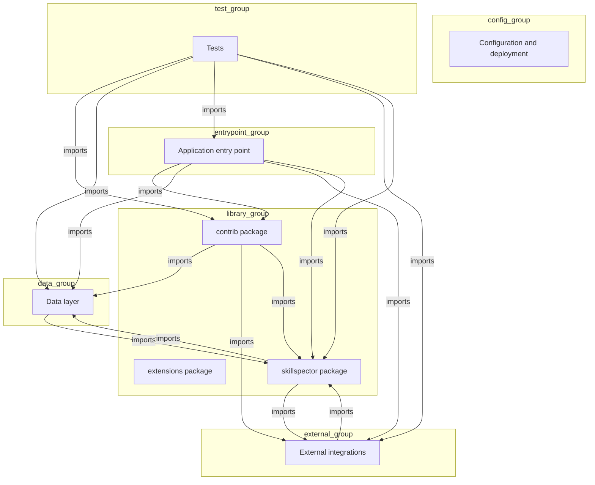

# Architecture report: NVIDIA/SkillSpector

> Automated static analysis. **Observed** = directly seen in files/imports/AST; **Inferred** = interpretation from that evidence. Repository code was not executed.

## 1. Repository at a glance

| Item | Value |
| --- | --- |
| Repository | NVIDIA/SkillSpector |
| Description | Security scanner for AI agent skills. Detect vulnerabilities, malicious patterns, security risks, prompt injection, data exfiltration, and supply-chain risks in Claude Code, Codex, and MCP skills before you install them. |
| Language | Python |
| Stars | 26025 |
| Licence | Apache-2.0 |
| Analysed commit / branch | c81615007d40e86051a302a3cf897f8a05264928 / main |
| Framework(s) | Typer |
| Files analysed | 471 |
| Components | 8 |

## 2. Architecture in one minute

NVIDIA/SkillSpector - Security scanner for AI agent skills. Detect vulnerabilities, malicious patterns, security risks, prompt injection, data exfiltration, and supply-chain risks in Claude Code, Codex, and MCP skills bef…. This repository was analysed statically from 471 file(s) (334 Python). Detected technologies (observed from imports/manifests): GitHub Actions, Typer, AWS (boto3), Click, httpx, Pydantic. Files are grouped into 8 component(s): Configuration and deployment, contrib package, Data layer, Application entry point, extensions package, External integrations, skillspector package, Tests. Observed entry point(s): contrib/batch_scan/batch_scan.py, scripts/compare_scan_accuracy.py, scripts/generate_unicode_confusables.py. Findings below distinguish observed facts from inferred interpretation.

## 3. High-level block diagram

## 4. Main components

### Configuration and deployment (`config`)

- **Kind:** config
- **Status:** Observed
- **Confidence:** 0.85
- **Responsibility:** Groups 16 file(s) under configuration and deployment (observed from repository paths and static analysis).
- **Paths:** `Dockerfile`, `contrib/batch_scan/.env.example`, `langgraph.json`, `model_registry.yaml`, `package.json`, `pyproject.toml`, `src/skillspector/providers/anthropic/model_registry.yaml`, `src/skillspector/providers/anthropic_proxy/model_registry.yaml`, `src/skillspector/providers/azure_openai/model_registry.yaml`, `src/skillspector/providers/bedrock/model_registry.yaml`, `src/skillspector/providers/gemini/model_registry.yaml`, `src/skillspector/providers/minimax/model_registry.yaml`, `src/skillspector/providers/nv_build/model_registry.yaml`, `src/skillspector/providers/ollama/model_registry.yaml`, `src/skillspector/providers/openai/model_registry.yaml`, `src/skillspector/providers/openai_compatible/model_registry.yaml`
- **Evidence:** [Dockerfile](https://github.com/NVIDIA/SkillSpector/blob/c81615007d40e86051a302a3cf897f8a05264928/Dockerfile); [contrib/batch_scan/.env.example](https://github.com/NVIDIA/SkillSpector/blob/c81615007d40e86051a302a3cf897f8a05264928/contrib/batch_scan/.env.example); [langgraph.json](https://github.com/NVIDIA/SkillSpector/blob/c81615007d40e86051a302a3cf897f8a05264928/langgraph.json); [model_registry.yaml](https://github.com/NVIDIA/SkillSpector/blob/c81615007d40e86051a302a3cf897f8a05264928/model_registry.yaml); [package.json](https://github.com/NVIDIA/SkillSpector/blob/c81615007d40e86051a302a3cf897f8a05264928/package.json); [pyproject.toml](https://github.com/NVIDIA/SkillSpector/blob/c81615007d40e86051a302a3cf897f8a05264928/pyproject.toml); [src/skillspector/providers/anthropic/model_registry.yaml](https://github.com/NVIDIA/SkillSpector/blob/c81615007d40e86051a302a3cf897f8a05264928/src/skillspector/providers/anthropic/model_registry.yaml); [src/skillspector/providers/anthropic_proxy/model_registry.yaml](https://github.com/NVIDIA/SkillSpector/blob/c81615007d40e86051a302a3cf897f8a05264928/src/skillspector/providers/anthropic_proxy/model_registry.yaml)

### contrib package (`contrib`)

- **Kind:** library
- **Status:** Observed
- **Confidence:** 0.85
- **Responsibility:** Groups 8 file(s) under contrib package (observed from repository paths and static analysis). Observed top-level classes: ApiKey, ApiKeyPool, GapFillAnalyzer, GapFillError, GapFillFinding, GapFillResult. Observed top-level functions: _apply_patches, _check_signature, _completeness, _count_sev, _exception_groups, _format_json.
- **Paths:** `contrib/batch_scan/__init__.py`, `contrib/batch_scan/annotation.py`, `contrib/batch_scan/api_pool.py`, `contrib/batch_scan/detection.py`, `contrib/batch_scan/discovery.py`, `contrib/batch_scan/gap_fill.py`, `contrib/batch_scan/reports.py`, `contrib/batch_scan/runner.py`
- **Evidence:** [contrib/batch_scan/__init__.py](https://github.com/NVIDIA/SkillSpector/blob/c81615007d40e86051a302a3cf897f8a05264928/contrib/batch_scan/__init__.py); [contrib/batch_scan/annotation.py:73](https://github.com/NVIDIA/SkillSpector/blob/c81615007d40e86051a302a3cf897f8a05264928/contrib/batch_scan/annotation.py#L73); [contrib/batch_scan/api_pool.py:81](https://github.com/NVIDIA/SkillSpector/blob/c81615007d40e86051a302a3cf897f8a05264928/contrib/batch_scan/api_pool.py#L81); [contrib/batch_scan/detection.py:46](https://github.com/NVIDIA/SkillSpector/blob/c81615007d40e86051a302a3cf897f8a05264928/contrib/batch_scan/detection.py#L46); [contrib/batch_scan/discovery.py:27](https://github.com/NVIDIA/SkillSpector/blob/c81615007d40e86051a302a3cf897f8a05264928/contrib/batch_scan/discovery.py#L27); [contrib/batch_scan/gap_fill.py:64](https://github.com/NVIDIA/SkillSpector/blob/c81615007d40e86051a302a3cf897f8a05264928/contrib/batch_scan/gap_fill.py#L64); [contrib/batch_scan/reports.py:36](https://github.com/NVIDIA/SkillSpector/blob/c81615007d40e86051a302a3cf897f8a05264928/contrib/batch_scan/reports.py#L36); [contrib/batch_scan/runner.py:69](https://github.com/NVIDIA/SkillSpector/blob/c81615007d40e86051a302a3cf897f8a05264928/contrib/batch_scan/runner.py#L69)

### Data layer (`data_layer`)

- **Kind:** data
- **Status:** Observed
- **Confidence:** 0.85
- **Responsibility:** Groups 1 file(s) under data layer (observed from repository paths and static analysis). Observed top-level classes: AnalyzerFinding, AnalyzerPlugin, Finding, Location, Severity. Observed top-level functions: _new_finding_id, compute_match_fingerprint, map_analyzer_findings, observe_analyzer_findings, use_finding_id_factory.
- **Paths:** `src/skillspector/models.py`
- **Evidence:** [src/skillspector/models.py:36](https://github.com/NVIDIA/SkillSpector/blob/c81615007d40e86051a302a3cf897f8a05264928/src/skillspector/models.py#L36)

### Application entry point (`entrypoint`)

- **Kind:** entrypoint
- **Status:** Observed
- **Confidence:** 0.85
- **Responsibility:** Groups 8 file(s) under application entry point (observed from repository paths and static analysis). Observed application object created via Typer. Observed top-level classes: FormatChoice, InspectionError, TransportChoice, _CachedTransitiveResult, _LazyCommandGroup, _PoolManager. Observed top-level functions: _accuracy_snapshots, _actual_source_files, _adjudicate_counts, _adjudication_delta, _aggregate_adjudication, _annotate_transitive_findings.
- **Paths:** `contrib/batch_scan/batch_scan.py`, `scripts/compare_scan_accuracy.py`, `scripts/generate_unicode_confusables.py`, `scripts/release/public/create_github_release.py`, `src/skillspector/cli.py`, `src/skillspector/cli_entry.py`, `src/skillspector/dependency_downloader.py`, `src/skillspector/dependency_worker.py`
- **Evidence:** [contrib/batch_scan/batch_scan.py:99](https://github.com/NVIDIA/SkillSpector/blob/c81615007d40e86051a302a3cf897f8a05264928/contrib/batch_scan/batch_scan.py#L99); [scripts/compare_scan_accuracy.py:270](https://github.com/NVIDIA/SkillSpector/blob/c81615007d40e86051a302a3cf897f8a05264928/scripts/compare_scan_accuracy.py#L270); [scripts/generate_unicode_confusables.py:19](https://github.com/NVIDIA/SkillSpector/blob/c81615007d40e86051a302a3cf897f8a05264928/scripts/generate_unicode_confusables.py#L19); [scripts/release/public/create_github_release.py:29](https://github.com/NVIDIA/SkillSpector/blob/c81615007d40e86051a302a3cf897f8a05264928/scripts/release/public/create_github_release.py#L29); [src/skillspector/cli.py:100](https://github.com/NVIDIA/SkillSpector/blob/c81615007d40e86051a302a3cf897f8a05264928/src/skillspector/cli.py#L100); [src/skillspector/cli_entry.py:82](https://github.com/NVIDIA/SkillSpector/blob/c81615007d40e86051a302a3cf897f8a05264928/src/skillspector/cli_entry.py#L82); [src/skillspector/dependency_downloader.py:20](https://github.com/NVIDIA/SkillSpector/blob/c81615007d40e86051a302a3cf897f8a05264928/src/skillspector/dependency_downloader.py#L20); [src/skillspector/dependency_worker.py:63](https://github.com/NVIDIA/SkillSpector/blob/c81615007d40e86051a302a3cf897f8a05264928/src/skillspector/dependency_worker.py#L63)

### extensions package (`extensions`)

- **Kind:** library
- **Status:** Observed
- **Confidence:** 0.85
- **Responsibility:** Groups 1 file(s) under extensions package (observed from repository paths and static analysis).
- **Paths:** `extensions/skillspector.ts`
- **Evidence:** [extensions/skillspector.ts](https://github.com/NVIDIA/SkillSpector/blob/c81615007d40e86051a302a3cf897f8a05264928/extensions/skillspector.ts)

### External integrations (`external_integrations`)

- **Kind:** external
- **Status:** Observed
- **Confidence:** 0.85
- **Responsibility:** Groups 1 file(s) under external integrations (observed from repository paths and static analysis). Observed top-level classes: OsvQueryBudget, OsvQueryLimitation, QueryBatchResults, VulnResult, _OsvLimitReachedError. Observed top-level functions: _build_query, _cache_key, _estimate_cvss_severity, _fallback_vuln, _fetch_vuln_details, _get_cached.
- **Paths:** `src/skillspector/nodes/analyzers/osv_client.py`
- **Evidence:** [src/skillspector/nodes/analyzers/osv_client.py:83](https://github.com/NVIDIA/SkillSpector/blob/c81615007d40e86051a302a3cf897f8a05264928/src/skillspector/nodes/analyzers/osv_client.py#L83)

### skillspector package (`skillspector`)

- **Kind:** library
- **Status:** Observed
- **Confidence:** 0.85
- **Responsibility:** Groups 140 file(s) under skillspector package (observed from repository paths and static analysis). Observed top-level classes: AgentCLICapable, AgentCLIChatModel, AgentCLIError, AgentCLIProviderBase, AnalysisCompleteness, AnalyzerNodeResponse. Observed top-level functions: __getattr__, _accepted_builtin_ransomware_instances, _account_for_missing_meta_batches, _action_governs_quoted_payload, _action_immediately_precedes_boundary, _actions.
- **Paths:** `src/skillspector/__init__.py`, `src/skillspector/_workflow_warnings.py`, `src/skillspector/allowed_tools.py`, `src/skillspector/artifacts.py`, `src/skillspector/baseline_tokens.py`, `src/skillspector/cleanup.py`, `src/skillspector/constants.py`, `src/skillspector/dependency_inspection.py`, `src/skillspector/dependency_sandbox.py`, `src/skillspector/dependency_sources.py`, `src/skillspector/file_output.py`, `src/skillspector/graph.py`, `src/skillspector/graph_proxy.py`, `src/skillspector/inference_usage.py`, `src/skillspector/input_handler.py`, `src/skillspector/inspection_ledger.py`, `src/skillspector/javascript_ast.py`, `src/skillspector/javascript_tokens.py`, `src/skillspector/json_tokens.py`, `src/skillspector/llm_analyzer_base.py`, `src/skillspector/llm_provenance.py`, `src/skillspector/llm_utils.py`, `src/skillspector/logging_config.py`, `src/skillspector/markdown_tokens.py`, `src/skillspector/mcp_registry.py`, `src/skillspector/mcp_server.py`, `src/skillspector/model_info.py`, `src/skillspector/multi_skill.py`, `src/skillspector/nested_artifacts.py`, `src/skillspector/nodes/__init__.py`, `src/skillspector/nodes/analyzers/__init__.py`, `src/skillspector/nodes/analyzers/artifact_integrity.py`, `src/skillspector/nodes/analyzers/behavioral_ast.py`, `src/skillspector/nodes/analyzers/behavioral_taint_tracking.py`, `src/skillspector/nodes/analyzers/bundled_execution_surface.py`, `src/skillspector/nodes/analyzers/canonical_sink.py`, `src/skillspector/nodes/analyzers/common.py`, `src/skillspector/nodes/analyzers/mcp_least_privilege.py`, `src/skillspector/nodes/analyzers/mcp_rug_pull.py`, `src/skillspector/nodes/analyzers/mcp_tool_poisoning.py`, `src/skillspector/nodes/analyzers/pattern_defaults.py`, `src/skillspector/nodes/analyzers/prohibition_context.py`, `src/skillspector/nodes/analyzers/semantic_developer_intent.py`, `src/skillspector/nodes/analyzers/semantic_quality_policy.py`, `src/skillspector/nodes/analyzers/semantic_security_discovery.py`, `src/skillspector/nodes/analyzers/sql_parameter_binding.py`, `src/skillspector/nodes/analyzers/static_patterns_agent_snooping.py`, `src/skillspector/nodes/analyzers/static_patterns_anti_refusal.py`, `src/skillspector/nodes/analyzers/static_patterns_data_exfiltration.py`, `src/skillspector/nodes/analyzers/static_patterns_deserialization.py`, `src/skillspector/nodes/analyzers/static_patterns_excessive_agency.py`, `src/skillspector/nodes/analyzers/static_patterns_harmful_content.py`, `src/skillspector/nodes/analyzers/static_patterns_memory_poisoning.py`, `src/skillspector/nodes/analyzers/static_patterns_output_handling.py`, `src/skillspector/nodes/analyzers/static_patterns_privilege_escalation.py`, `src/skillspector/nodes/analyzers/static_patterns_prompt_injection.py`, `src/skillspector/nodes/analyzers/static_patterns_rogue_agent.py`, `src/skillspector/nodes/analyzers/static_patterns_ssrf.py`, `src/skillspector/nodes/analyzers/static_patterns_supply_chain.py`, `src/skillspector/nodes/analyzers/static_patterns_system_prompt_leakage.py`, `src/skillspector/nodes/analyzers/static_python_shell_truthiness.py`, `src/skillspector/nodes/analyzers/static_yara.py`, `src/skillspector/nodes/analyzers/structured_skill_roles.py`, `src/skillspector/nodes/analyzers/whitespace_padding.py`, `src/skillspector/nodes/build_context.py`, `src/skillspector/nodes/deduplicate.py`, `src/skillspector/nodes/finalize_inspection_ledger.py`, `src/skillspector/nodes/meta_analyzer.py`, `src/skillspector/nodes/report.py`, `src/skillspector/nodes/resolve_input.py`, `src/skillspector/oms.py`, `src/skillspector/passive_bmp.py`, `src/skillspector/passive_jpeg.py`, `src/skillspector/passive_svg.py`, `src/skillspector/powershell_tokens.py`, `src/skillspector/providers/__init__.py`, `src/skillspector/providers/_agent_cli.py`, `src/skillspector/providers/_agent_cli_base.py`, `src/skillspector/providers/anthropic/__init__.py`, `src/skillspector/providers/anthropic/provider.py`, `src/skillspector/providers/anthropic_proxy/__init__.py`, `src/skillspector/providers/anthropic_proxy/provider.py`, `src/skillspector/providers/antigravity_cli/__init__.py`, `src/skillspector/providers/antigravity_cli/provider.py`, `src/skillspector/providers/azure_openai/__init__.py`, `src/skillspector/providers/azure_openai/provider.py`, `src/skillspector/providers/base.py`, `src/skillspector/providers/bedrock/__init__.py`, `src/skillspector/providers/bedrock/provider.py`, `src/skillspector/providers/chat_models.py`, `src/skillspector/providers/claude_cli/__init__.py`, `src/skillspector/providers/claude_cli/provider.py`, `src/skillspector/providers/codex_cli/__init__.py`, `src/skillspector/providers/codex_cli/provider.py`, `src/skillspector/providers/gemini/__init__.py`, `src/skillspector/providers/gemini/provider.py`, `src/skillspector/providers/gemini_cli/__init__.py`, `src/skillspector/providers/gemini_cli/provider.py`, `src/skillspector/providers/minimax/__init__.py`, `src/skillspector/providers/minimax/chat_model.py`, `src/skillspector/providers/minimax/provider.py`, `src/skillspector/providers/nv_build/__init__.py`, `src/skillspector/providers/nv_build/provider.py`, `src/skillspector/providers/ollama/__init__.py`, `src/skillspector/providers/ollama/provider.py`, `src/skillspector/providers/openai/__init__.py`, `src/skillspector/providers/openai/provider.py`, `src/skillspector/providers/openai_compatible/__init__.py`, `src/skillspector/providers/openai_compatible/provider.py`, `src/skillspector/providers/opencode_cli/__init__.py`, `src/skillspector/providers/opencode_cli/provider.py`, `src/skillspector/providers/registry.py`, `src/skillspector/providers/structured_output.py`, `src/skillspector/python_ast.py`, `src/skillspector/python_import_bounds.py`, `src/skillspector/python_string_constants.py`, `src/skillspector/python_tokens.py`, `src/skillspector/references.py`, `src/skillspector/resource_limits.py`, `src/skillspector/response_recovery.py`, `src/skillspector/sarif_models.py`, `src/skillspector/security_reconstruction.py`, `src/skillspector/semantic_runtime.py`, `src/skillspector/semgrep_tokens.py`, `src/skillspector/shell_artifact_effects.py`, `src/skillspector/shell_artifact_flow.py`, `src/skillspector/shell_artifacts.py`, `src/skillspector/shell_helper_argv.py`, `src/skillspector/shell_source_effects.py`, `src/skillspector/shell_sources.py`, `src/skillspector/shell_tokens.py`, `src/skillspector/state.py`, `src/skillspector/structured_response.py`, `src/skillspector/structured_skill.py`, `src/skillspector/suppression.py`, `src/skillspector/surface.py`, `src/skillspector/terminal_text.py`, `src/skillspector/transitive.py`, `src/skillspector/unicode_confusables.py`, `src/skillspector/yaml_tokens.py`
- **Evidence:** [src/skillspector/__init__.py:26](https://github.com/NVIDIA/SkillSpector/blob/c81615007d40e86051a302a3cf897f8a05264928/src/skillspector/__init__.py#L26); [src/skillspector/_workflow_warnings.py](https://github.com/NVIDIA/SkillSpector/blob/c81615007d40e86051a302a3cf897f8a05264928/src/skillspector/_workflow_warnings.py); [src/skillspector/allowed_tools.py:43](https://github.com/NVIDIA/SkillSpector/blob/c81615007d40e86051a302a3cf897f8a05264928/src/skillspector/allowed_tools.py#L43); [src/skillspector/artifacts.py:32](https://github.com/NVIDIA/SkillSpector/blob/c81615007d40e86051a302a3cf897f8a05264928/src/skillspector/artifacts.py#L32); [src/skillspector/baseline_tokens.py:21](https://github.com/NVIDIA/SkillSpector/blob/c81615007d40e86051a302a3cf897f8a05264928/src/skillspector/baseline_tokens.py#L21); [src/skillspector/cleanup.py:20](https://github.com/NVIDIA/SkillSpector/blob/c81615007d40e86051a302a3cf897f8a05264928/src/skillspector/cleanup.py#L20); [src/skillspector/constants.py:77](https://github.com/NVIDIA/SkillSpector/blob/c81615007d40e86051a302a3cf897f8a05264928/src/skillspector/constants.py#L77); [src/skillspector/dependency_inspection.py:51](https://github.com/NVIDIA/SkillSpector/blob/c81615007d40e86051a302a3cf897f8a05264928/src/skillspector/dependency_inspection.py#L51)

### Tests (`tests`)

- **Kind:** test
- **Status:** Observed
- **Confidence:** 0.85
- **Responsibility:** Groups 220 file(s) under tests (observed from repository paths and static analysis). Observed routes: PATCH (path not a literal), PATCH (path not a literal), PATCH (path not a literal), PATCH (path not a literal), PATCH (path not a literal). Observed top-level classes: Neighbour, Spelling, TestAcquireRelease, TestAcquireTimeout, TestAdversarialInputs, TestAgentCliFullScan. Observed top-level functions: _analyze, _analyzer_code_objects, _ar2, _as3_from_cli, _assert_all_patched, _assert_all_restored.
- **Paths:** `contrib/batch_scan/tests/conftest.py`, `contrib/batch_scan/tests/docs/BUGS_FOUND.md`, `contrib/batch_scan/tests/docs/TEST_DESIGN.md`, `contrib/batch_scan/tests/docs/TEST_GUIDE.md`, `contrib/batch_scan/tests/test_inspection_reporting.py`, `contrib/batch_scan/tests/test_monkeypatch_fragility.py`, `contrib/batch_scan/tests/test_monkeypatch_invasiveness.py`, `contrib/batch_scan/tests/test_pool_wiring.py`, `contrib/batch_scan/tests/tests-pro/__init__.py`, `contrib/batch_scan/tests/tests-pro/mutation_max.py`, `contrib/batch_scan/tests/tests-pro/random_numbered.py`, `contrib/batch_scan/tests/tests-pro/test_annotation.py`, `contrib/batch_scan/tests/tests-pro/test_api_pool.py`, `contrib/batch_scan/tests/tests-pro/test_gap_fill.py`, `contrib/batch_scan/tests/tests-pro/test_runner_patches.py`, `tests/__init__.py`, `tests/conftest.py`, `tests/docker/smoke.sh`, `tests/evasion_corpus/__init__.py`, `tests/evasion_corpus/corpus.py`, `tests/evasion_corpus/test_canonical_sink_fitness.py`, `tests/fixtures/as3_self_reference/README.md`, `tests/fixtures/as3_self_reference/SKILL.md`, `tests/fixtures/e2_shell_env_harvest/SKILL.md`, `tests/fixtures/malicious_skill/SKILL.md`, `tests/fixtures/malicious_skill/scripts/helper.py`, `tests/fixtures/mcp_clean_skill/SKILL.md`, `tests/fixtures/mcp_clean_skill/scripts/format.py`, `tests/fixtures/mcp_mismatched_skill/SKILL.md`, `tests/fixtures/mcp_mismatched_skill/scripts/greet.py`, `tests/fixtures/mcp_overprivileged_skill/SKILL.md`, `tests/fixtures/mcp_overprivileged_skill/scripts/helper.py`, `tests/fixtures/mcp_poisoned_tool/SKILL.md`, `tests/fixtures/mcp_poisoned_tool/scripts/reader.py`, `tests/fixtures/mcp_registry/malformed.json`, `tests/fixtures/mcp_registry/mcp_registry.json`, `tests/fixtures/mcp_underdeclared_skill/SKILL.md`, `tests/fixtures/mcp_underdeclared_skill/scripts/agent.py`, `tests/fixtures/oms/mcore-split-pr.skill.oms.sig`, `tests/fixtures/pe3_bare_keyring/SKILL.md`, `tests/fixtures/pe3_bare_keyring/issue-396-keyring.md`, `tests/fixtures/safe_skill/SKILL.md`, `tests/fixtures/sdi/sdi1_mismatch/SKILL.md`, `tests/fixtures/sdi/sdi1_mismatch/summarizer.py`, `tests/fixtures/sdi/sdi2_inappropriate/SKILL.md`, `tests/fixtures/sdi/sdi2_inappropriate/formatter.py`, `tests/fixtures/sdi/sdi3_scope_creep/SKILL.md`, `tests/fixtures/sdi/sdi3_scope_creep/config_reader.py`, `tests/fixtures/sdi/sdi4_divergence/SKILL.md`, `tests/fixtures/sdi/sdi4_divergence/processor.py`, `tests/fixtures/sdi/sdi_clean/SKILL.md`, `tests/fixtures/sdi/sdi_clean/indexer.py`, `tests/fixtures/sqp/sqp1_clean/SKILL.md`, `tests/fixtures/sqp/sqp1_vague_triggers/SKILL.md`, `tests/fixtures/sqp/sqp2_clean/SKILL.md`, `tests/fixtures/sqp/sqp2_clean/deploy.py`, `tests/fixtures/sqp/sqp2_missing_warnings/SKILL.md`, `tests/fixtures/sqp/sqp2_missing_warnings/organizer.py`, `tests/fixtures/sqp/sqp2_tool_catalog_clean/SKILL.md`, `tests/fixtures/sqp/sqp2_tool_descriptive_step/SKILL.md`, `tests/fixtures/sqp/sqp2_tool_instructed/SKILL.md`, `tests/fixtures/sqp/sqp3_clean/SKILL.md`, `tests/fixtures/sqp/sqp3_clean/config.yaml`, `tests/fixtures/sqp/sqp3_forced_language/SKILL.md`, `tests/fixtures/sqp/sqp3_locale_forcing/SKILL.md`, `tests/fixtures/sqp/sqp3_locale_forcing/config.yaml`, `tests/fixtures/sqp/sqp3_plain_english_clean/SKILL.md`, `tests/fixtures/sqp/sqp3_plain_english_override/SKILL.md`, `tests/fixtures/ssd/ssd1_semantic_injection/SKILL.md`, `tests/fixtures/ssd/ssd2_novel_phrasing/SKILL.md`, `tests/fixtures/ssd/ssd3_nl_exfiltration/SKILL.md`, `tests/fixtures/ssd/ssd4_narrative_deception/SKILL.md`, `tests/fixtures/ssd/ssd_clean/SKILL.md`, `tests/fixtures/tp4_markdown_fenced_code/SKILL.md`, `tests/integration/__init__.py`, `tests/integration/conftest.py`, `tests/integration/test_agent_cli_live.py`, `tests/integration/test_graph.py`, `tests/integration/test_graph_scanner.py`, `tests/integration/test_linked_zip_coverage.py`, `tests/integration/test_meta_analyzer_use_llm.py`, `tests/integration/test_opaque_reference_reporting.py`, `tests/integration/test_ransomware_rule.py`, `tests/integration/test_stream_invoke_parity.py`, `tests/nodes/__init__.py`, `tests/nodes/analyzers/conftest.py`, `tests/nodes/analyzers/test_artifact_integrity_bounds.py`, `tests/nodes/analyzers/test_baseline_scalar_ownership.py`, `tests/nodes/analyzers/test_behavioral_ast.py`, `tests/nodes/analyzers/test_behavioral_taint_tracking.py`, `tests/nodes/analyzers/test_binary_and_pe3_filtering.py`, `tests/nodes/analyzers/test_bounded_parser_regressions.py`, `tests/nodes/analyzers/test_bundled_execution_surface.py`, `tests/nodes/analyzers/test_chmod_regex_backtracking.py`, `tests/nodes/analyzers/test_cli_companion_documentation.py`, `tests/nodes/analyzers/test_cloud_download_direction.py`, `tests/nodes/analyzers/test_command_wrapper_without_command.py`, `tests/nodes/analyzers/test_common.py`, `tests/nodes/analyzers/test_dependency_source_budget_behavior.py`, `tests/nodes/analyzers/test_dependency_source_budget_configuration.py`, `tests/nodes/analyzers/test_dependency_source_review_regressions.py`, `tests/nodes/analyzers/test_dependency_sources.py`, `tests/nodes/analyzers/test_documentation_reconstruction.py`, `tests/nodes/analyzers/test_e1_command_boundaries.py`, `tests/nodes/analyzers/test_ea1_wildcard_line_boundary.py`, `tests/nodes/analyzers/test_eval_command_strings.py`, `tests/nodes/analyzers/test_excessive_agency_prohibitions.py`, `tests/nodes/analyzers/test_host_language_shell_ownership.py`, `tests/nodes/analyzers/test_javascript_template_ownership.py`, `tests/nodes/analyzers/test_json_capacity_diagnostics.py`, `tests/nodes/analyzers/test_json_container_indentation.py`, `tests/nodes/analyzers/test_json_container_ownership.py`, `tests/nodes/analyzers/test_json_decoded_views.py`, `tests/nodes/analyzers/test_json_host_syntax.py`, `tests/nodes/analyzers/test_json_iterative_validation.py`, `tests/nodes/analyzers/test_json_owned_runtime_bounds.py`, `tests/nodes/analyzers/test_json_quote_scan_runtime.py`, `tests/nodes/analyzers/test_json_recovery_context.py`, `tests/nodes/analyzers/test_json_wrapper_names.py`, `tests/nodes/analyzers/test_make_documentation_reconstruction.py`, `tests/nodes/analyzers/test_markdown_list_continuation_coverage.py`, `tests/nodes/analyzers/test_markdown_owned_commands.py`, `tests/nodes/analyzers/test_markdown_ownership_composition.py`, `tests/nodes/analyzers/test_markdown_split_commands.py`, `tests/nodes/analyzers/test_markdown_table_boundaries.py`, `tests/nodes/analyzers/test_markdown_table_separator_rows.py`, `tests/nodes/analyzers/test_mcp_rug_pull.py`, `tests/nodes/analyzers/test_mdc_classification.py`, `tests/nodes/analyzers/test_mdc_supply_chain_coverage.py`, `tests/nodes/analyzers/test_mp2_markdown_tables.py`, `tests/nodes/analyzers/test_mp2_regex_backtracking.py`, `tests/nodes/analyzers/test_mp3_hardware_state.py`, `tests/nodes/analyzers/test_mp3_memory_file_write.py`, `tests/nodes/analyzers/test_mp3_timestamp_context.py`, `tests/nodes/analyzers/test_mp3_whole_words.py`, `tests/nodes/analyzers/test_multiline_prompt_spacing.py`, `tests/nodes/analyzers/test_multiline_word_shadow.py`, `tests/nodes/analyzers/test_oms_projected_file_type.py`, `tests/nodes/analyzers/test_p2_reference_comments.py`, `tests/nodes/analyzers/test_p2_structural_benign.py`, `tests/nodes/analyzers/test_p6_identifier_boundaries.py`, `tests/nodes/analyzers/test_p6_local_return_values.py`, `tests/nodes/analyzers/test_parameter_expansion_reconstruction.py`, `tests/nodes/analyzers/test_pe3_credential_type_label.py`, `tests/nodes/analyzers/test_pe3_ignore_file_entries.py`, `tests/nodes/analyzers/test_pe3_python_setting_literal.py`, `tests/nodes/analyzers/test_perl_print_ownership.py`, `tests/nodes/analyzers/test_powershell_embedded_completeness.py`, `tests/nodes/analyzers/test_powershell_generic_coverage.py`, `tests/nodes/analyzers/test_powershell_shell_ownership.py`, `tests/nodes/analyzers/test_powershell_source_ownership.py`, `tests/nodes/analyzers/test_prohibition_review_regressions.py`, `tests/nodes/analyzers/test_prose_shell_context.py`, `tests/nodes/analyzers/test_python_ast_columns.py`, `tests/nodes/analyzers/test_python_host_word_bounds.py`, `tests/nodes/analyzers/test_python_shell_cached_imports.py`, `tests/nodes/analyzers/test_python_string_marker_ownership.py`, `tests/nodes/analyzers/test_registry.py`, `tests/nodes/analyzers/test_rogue_agent_negated_recommendation.py`, `tests/nodes/analyzers/test_runtime_brace_limits.py`, `tests/nodes/analyzers/test_runtime_reconstruction_workflow.py`, `tests/nodes/analyzers/test_sc2_command_boundaries.py`, `tests/nodes/analyzers/test_sc4_reporting.py`, `tests/nodes/analyzers/test_sc8_shipped_bytecode.py`, `tests/nodes/analyzers/test_security_character_folding.py`, `tests/nodes/analyzers/test_security_reconstruction.py`, `tests/nodes/analyzers/test_security_text_predicate_cache.py`, `tests/nodes/analyzers/test_security_word_run_skipping.py`, `tests/nodes/analyzers/test_semantic_developer_intent.py`, `tests/nodes/analyzers/test_semantic_security_discovery.py`, `tests/nodes/analyzers/test_semgrep_advanced_queries.py`, `tests/nodes/analyzers/test_semgrep_inline_messages.py`, `tests/nodes/analyzers/test_semgrep_rule_ownership.py`, `tests/nodes/analyzers/test_shared_python_ast.py`, `tests/nodes/analyzers/test_shell_artifact_effects.py`, `tests/nodes/analyzers/test_shell_artifacts.py`, `tests/nodes/analyzers/test_shell_assignment_quotes.py`, `tests/nodes/analyzers/test_shell_generated_sources.py`, `tests/nodes/analyzers/test_shell_marker_ownership.py`, `tests/nodes/analyzers/test_shell_quote_ownership.py`, `tests/nodes/analyzers/test_shell_source_effects.py`, `tests/nodes/analyzers/test_shell_source_effects_calls.py`, `tests/nodes/analyzers/test_shell_string_marker_ownership.py`, `tests/nodes/analyzers/test_skill_installation_patterns.py`, `tests/nodes/analyzers/test_static_budget_configuration.py`, `tests/nodes/analyzers/test_static_code_blank_lines.py`, `tests/nodes/analyzers/test_static_false_positive_controls.py`, `tests/nodes/analyzers/test_static_parse_limit_issue_901.py`, `tests/nodes/analyzers/test_static_parse_limit_literals.py`, `tests/nodes/analyzers/test_static_patterns.py`, `tests/nodes/analyzers/test_static_patterns_anti_refusal.py`, `tests/nodes/analyzers/test_static_patterns_deserialization.py`, `tests/nodes/analyzers/test_static_patterns_supply_chain_lockfiles.py`, `tests/nodes/analyzers/test_static_patterns_supply_chain_pipenv.py`, `tests/nodes/analyzers/test_static_runner_filtering.py`, `tests/nodes/analyzers/test_static_yara.py`, `tests/nodes/analyzers/test_structured_marker_ownership.py`, `tests/nodes/analyzers/test_structured_skill_roles.py`, `tests/nodes/analyzers/test_tm1_assignment_final_state.py`, `tests/nodes/analyzers/test_tm1_command_boundaries.py`, `tests/nodes/analyzers/test_tm1_lexical_abstention.py`, `tests/nodes/analyzers/test_tm1_window_identity.py`, `tests/nodes/analyzers/test_token_gap_fast_paths.py`, `tests/nodes/analyzers/test_tool_misuse_python_ast.py`, `tests/nodes/analyzers/test_whitespace_padding.py`, `tests/nodes/analyzers/test_yaml_scalar_ownership.py`, `tests/nodes/analyzers/test_yara_prompt_prohibitions.py`, `tests/nodes/test_analysis_completeness.py`, `tests/nodes/test_as3_source_identity.py`, `tests/nodes/test_build_context.py`, `tests/nodes/test_deduplicate.py`, `tests/nodes/test_explicit_exclusions.py`, `tests/nodes/test_fragment_terminal_ledger.py`, `tests/nodes/test_inspection_notices.py`, `tests/nodes/test_json_capacity_scan.py`, `tests/nodes/test_json_capacity_upgrade.py`, `tests/nodes/test_passive_documentation_images.py`, `tests/provider/__init__.py`, `tests/unit/__init__.py`, `tests/unit/test_wheel_contents.py`
- **Evidence:** [contrib/batch_scan/tests/conftest.py:23](https://github.com/NVIDIA/SkillSpector/blob/c81615007d40e86051a302a3cf897f8a05264928/contrib/batch_scan/tests/conftest.py#L23); [contrib/batch_scan/tests/docs/BUGS_FOUND.md](https://github.com/NVIDIA/SkillSpector/blob/c81615007d40e86051a302a3cf897f8a05264928/contrib/batch_scan/tests/docs/BUGS_FOUND.md); [contrib/batch_scan/tests/docs/TEST_DESIGN.md](https://github.com/NVIDIA/SkillSpector/blob/c81615007d40e86051a302a3cf897f8a05264928/contrib/batch_scan/tests/docs/TEST_DESIGN.md); [contrib/batch_scan/tests/docs/TEST_GUIDE.md](https://github.com/NVIDIA/SkillSpector/blob/c81615007d40e86051a302a3cf897f8a05264928/contrib/batch_scan/tests/docs/TEST_GUIDE.md); [contrib/batch_scan/tests/test_inspection_reporting.py:17](https://github.com/NVIDIA/SkillSpector/blob/c81615007d40e86051a302a3cf897f8a05264928/contrib/batch_scan/tests/test_inspection_reporting.py#L17); [contrib/batch_scan/tests/test_monkeypatch_fragility.py:77](https://github.com/NVIDIA/SkillSpector/blob/c81615007d40e86051a302a3cf897f8a05264928/contrib/batch_scan/tests/test_monkeypatch_fragility.py#L77); [contrib/batch_scan/tests/test_monkeypatch_invasiveness.py:93](https://github.com/NVIDIA/SkillSpector/blob/c81615007d40e86051a302a3cf897f8a05264928/contrib/batch_scan/tests/test_monkeypatch_invasiveness.py#L93); [contrib/batch_scan/tests/test_pool_wiring.py](https://github.com/NVIDIA/SkillSpector/blob/c81615007d40e86051a302a3cf897f8a05264928/contrib/batch_scan/tests/test_pool_wiring.py)

## 5. Execution flow

**Observed** entry point(s):

- [contrib/batch_scan/batch_scan.py:558](https://github.com/NVIDIA/SkillSpector/blob/c81615007d40e86051a302a3cf897f8a05264928/contrib/batch_scan/batch_scan.py#L558)
- [scripts/compare_scan_accuracy.py:1874](https://github.com/NVIDIA/SkillSpector/blob/c81615007d40e86051a302a3cf897f8a05264928/scripts/compare_scan_accuracy.py#L1874)
- [scripts/generate_unicode_confusables.py:75](https://github.com/NVIDIA/SkillSpector/blob/c81615007d40e86051a302a3cf897f8a05264928/scripts/generate_unicode_confusables.py#L75)
- [scripts/release/public/create_github_release.py:269](https://github.com/NVIDIA/SkillSpector/blob/c81615007d40e86051a302a3cf897f8a05264928/scripts/release/public/create_github_release.py#L269)
- [src/skillspector/cli.py:518](https://github.com/NVIDIA/SkillSpector/blob/c81615007d40e86051a302a3cf897f8a05264928/src/skillspector/cli.py#L518)
- [src/skillspector/cli_entry.py](https://github.com/NVIDIA/SkillSpector/blob/c81615007d40e86051a302a3cf897f8a05264928/src/skillspector/cli_entry.py)
- [src/skillspector/dependency_downloader.py:34](https://github.com/NVIDIA/SkillSpector/blob/c81615007d40e86051a302a3cf897f8a05264928/src/skillspector/dependency_downloader.py#L34)
- [src/skillspector/dependency_worker.py:368](https://github.com/NVIDIA/SkillSpector/blob/c81615007d40e86051a302a3cf897f8a05264928/src/skillspector/dependency_worker.py#L368)

**Observed** routes (from decorators):

- `PATCH ` -> `test_use_llm_true_proceeds` in `tests/nodes/analyzers/test_semantic_developer_intent.py:60`
- `PATCH ` -> `test_detects_description_behavior_mismatch` in `tests/nodes/analyzers/test_semantic_developer_intent.py:106`
- `PATCH ` -> `test_manifest_name_and_description_appear_in_prompt` in `tests/nodes/analyzers/test_semantic_developer_intent.py:138`
- `PATCH ` -> `test_works_without_manifest` in `tests/nodes/analyzers/test_semantic_developer_intent.py:176`
- `PATCH ` -> `test_empty_manifest_uses_placeholder` in `tests/nodes/analyzers/test_semantic_developer_intent.py:194`
- `PATCH ` -> `test_handles_llm_exception` in `tests/nodes/analyzers/test_semantic_developer_intent.py:224`
- `PATCH ` -> `test_reraises_value_error` in `tests/nodes/analyzers/test_semantic_developer_intent.py:234`
- `PATCH ` -> `test_success_records_ok_true` in `tests/nodes/analyzers/test_semantic_developer_intent.py:248`
- `PATCH ` -> `test_partial_batch_failure_records_llm_failure` in `tests/nodes/analyzers/test_semantic_developer_intent.py:256`
- `PATCH ` -> `test_exception_records_ok_false` in `tests/nodes/analyzers/test_semantic_developer_intent.py:280`
- `PATCH ` -> `test_uses_analyzer_specific_model` in `tests/nodes/analyzers/test_semantic_developer_intent.py:298`
- `PATCH ` -> `test_falls_back_to_default_model` in `tests/nodes/analyzers/test_semantic_developer_intent.py:318`
- `PATCH ` -> `test_skipped_when_use_llm_false` in `tests/nodes/analyzers/test_semantic_security_discovery.py:83`
- `PATCH ` -> `test_returns_findings_from_llm` in `tests/nodes/analyzers/test_semantic_security_discovery.py:91`
- `PATCH ` -> `test_empty_components_returns_no_findings` in `tests/nodes/analyzers/test_semantic_security_discovery.py:111`
- `PATCH ` -> `test_mixed_cache_only_batches_available_files_and_marks_status_failed` in `tests/nodes/analyzers/test_semantic_security_discovery.py:134`
- `PATCH ` -> `test_all_ssd_rule_ids_pass_through` in `tests/nodes/analyzers/test_semantic_security_discovery.py:160`
- `PATCH ` -> `test_runtime_limit_from_async_fan_out_is_recorded` in `tests/nodes/analyzers/test_semantic_security_discovery.py:203`
- `PATCH ` -> `test_single_file_one_batch` in `tests/nodes/analyzers/test_semantic_security_discovery.py:293`
- `PATCH ` -> `test_oversized_file_multiple_batches` in `tests/nodes/analyzers/test_semantic_security_discovery.py:307`
- `PATCH ` -> `test_uses_analyzer_specific_model` in `tests/nodes/analyzers/test_semantic_security_discovery.py:359`
- `PATCH ` -> `test_falls_back_to_default_model` in `tests/nodes/analyzers/test_semantic_security_discovery.py:379`
- `PATCH ` -> `test_falls_back_to_constant_default` in `tests/nodes/analyzers/test_semantic_security_discovery.py:395`
- `PATCH ` -> `test_value_error_propagates` in `tests/nodes/analyzers/test_semantic_security_discovery.py:417`
- `PATCH ` -> `test_generic_exception_returns_empty` in `tests/nodes/analyzers/test_semantic_security_discovery.py:424`
- `PATCH ` -> `test_generic_exception_preserves_missing_cache_events` in `tests/nodes/analyzers/test_semantic_security_discovery.py:434`
- `PATCH ` -> `test_validation_error_returns_empty` in `tests/nodes/analyzers/test_semantic_security_discovery.py:456`
- `PATCH ` -> `test_validation_error_preserves_failed_work_evidence` in `tests/nodes/analyzers/test_semantic_security_discovery.py:475`
- `PATCH ` -> `test_refused_structured_response_is_failed_not_clean` in `tests/nodes/analyzers/test_semantic_security_discovery.py:506`
- `PATCH ` -> `test_openai_refusal_is_failed_not_clean` in `tests/nodes/analyzers/test_semantic_security_discovery.py:534`
- `PATCH ` -> `test_success_records_ok_true` in `tests/nodes/analyzers/test_semantic_security_discovery.py:562`
- `PATCH ` -> `test_generic_exception_records_ok_false` in `tests/nodes/analyzers/test_semantic_security_discovery.py:570`
- `PATCH ` -> `test_validation_error_records_ok_false` in `tests/nodes/analyzers/test_semantic_security_discovery.py:580`
- `PATCH ` -> `test_malicious_skill_produces_findings` in `tests/nodes/analyzers/test_semantic_security_discovery.py:677`
- `PATCH ` -> `test_malicious_skill_rule_ids` in `tests/nodes/analyzers/test_semantic_security_discovery.py:696`
- `PATCH ` -> `test_malicious_skill_findings_preserve_metadata` in `tests/nodes/analyzers/test_semantic_security_discovery.py:714`
- `PATCH ` -> `test_safe_skill_produces_no_findings` in `tests/nodes/analyzers/test_semantic_security_discovery.py:738`
- `PATCH ` -> `test_semantic_injection_flagged` in `tests/nodes/analyzers/test_semantic_security_discovery.py:782`
- `PATCH ` -> `test_novel_phrasing_flagged` in `tests/nodes/analyzers/test_semantic_security_discovery.py:834`
- `PATCH ` -> `test_nl_exfiltration_flagged` in `tests/nodes/analyzers/test_semantic_security_discovery.py:885`
- `PATCH ` -> `test_narrative_deception_flagged` in `tests/nodes/analyzers/test_semantic_security_discovery.py:935`
- `PATCH ` -> `test_clean_skill_produces_no_findings` in `tests/nodes/analyzers/test_semantic_security_discovery.py:966`

Representative flow (derived from observed entry points and the import graph; steps beyond the entry point are **Inferred**):

1. Execution starts at an observed entry point listed above, if present.
2. `contrib` imports `data_layer` (contrib package -> Data layer).
3. `contrib` imports `external_integrations` (contrib package -> External integrations).
4. `contrib` imports `skillspector` (contrib package -> skillspector package).
5. `data_layer` imports `skillspector` (Data layer -> skillspector package).
6. `entrypoint` imports `contrib` (Application entry point -> contrib package).
7. `entrypoint` imports `data_layer` (Application entry point -> Data layer).
8. `entrypoint` imports `external_integrations` (Application entry point -> External integrations).
9. `entrypoint` imports `skillspector` (Application entry point -> skillspector package).

## 6. Project structure

### `(root)`

- `.dockerignore` - container (181 bytes)
- `.env.example` - config (6393 bytes)
- `.gitignore` - other (1232 bytes)
- `.pre-commit-config.yaml` - config (243 bytes)
- `.skillspector-baseline.example.yaml` - config (1711 bytes)
- `CHANGELOG.md` - docs (36653 bytes)
- `CONTRIBUTING.md` - docs (3718 bytes)
- `Dockerfile` - container (596 bytes)
- `LICENSE` - docs (10782 bytes)
- `Makefile` - other (5977 bytes)
- `README.md` - docs (68268 bytes)
- `SECURITY.md` - docs (1906 bytes)
- `THIRD_PARTY_NOTICES.md` - docs (4651 bytes)
- `langgraph.json` - config (153 bytes)
- `model_registry.yaml` - config (2076 bytes)
- `package.json` - manifest (447 bytes)
- `pyproject.toml` - manifest (3544 bytes)

### `.github`

- `.github/workflows/ci.yml` - ci, YAML (6397 bytes)
- `.github/workflows/release.yml` - ci, YAML (1884 bytes)
- `.github/workflows/scorecard.yml` - ci, YAML (3432 bytes)
- `.github/workflows/update-pr-branches.yml` - ci, YAML (3561 bytes)

### `.opencode`

- `.opencode/commands/skillspector.md` - docs (407 bytes)
- `.opencode/tools/skillspector_scan.ts` - source, TypeScript (1205 bytes)
- `.opencode/tools/skillspector_scan_lib.ts` - source, TypeScript (21534 bytes)

### `contrib`

- `contrib/batch_scan/.env.example` - config (1008 bytes)
- `contrib/batch_scan/CONTRIBUTING.md` - docs (5992 bytes)
- `contrib/batch_scan/__init__.py` - source, Python (2415 bytes)
- `contrib/batch_scan/annotation.py` - source, Python (3603 bytes)
- `contrib/batch_scan/api_pool.py` - source, Python (25345 bytes)
- `contrib/batch_scan/batch_scan.py` - source, Python (20478 bytes)
- `contrib/batch_scan/detection.py` - source, Python (3195 bytes)
- `contrib/batch_scan/discovery.py` - source, Python (1424 bytes)
- `contrib/batch_scan/docs/DESIGN.md` - docs (15114 bytes)
- `contrib/batch_scan/docs/README.md` - docs (18560 bytes)
- `contrib/batch_scan/docs/REVIEW_RESPONSE.md` - docs (8585 bytes)
- `contrib/batch_scan/docs/archive/ARCHITECTURE_DEEP_DIVE.md` - docs (13790 bytes)
- `contrib/batch_scan/docs/archive/DESIGN_HISTORY.md` - docs (6778 bytes)
- `contrib/batch_scan/docs/archive/FLOW_DIAGRAM.md` - docs (12149 bytes)
- `contrib/batch_scan/docs/archive/FUTURE_WORK.md` - docs (7458 bytes)
- `contrib/batch_scan/docs/archive/PITFALLS.md` - docs (8776 bytes)
- `contrib/batch_scan/gap_fill.py` - source, Python (14291 bytes)
- `contrib/batch_scan/reports.py` - source, Python (21476 bytes)
- `contrib/batch_scan/runner.py` - source, Python (35919 bytes)
- `contrib/batch_scan/tests/conftest.py` - test, Python (1053 bytes)
- `contrib/batch_scan/tests/docs/BUGS_FOUND.md` - test (6674 bytes)
- `contrib/batch_scan/tests/docs/TEST_DESIGN.md` - test (11598 bytes)
- `contrib/batch_scan/tests/docs/TEST_GUIDE.md` - test (10099 bytes)
- `contrib/batch_scan/tests/test_inspection_reporting.py` - test, Python (2581 bytes)
- `contrib/batch_scan/tests/test_monkeypatch_fragility.py` - test, Python (24061 bytes)
- `contrib/batch_scan/tests/test_monkeypatch_invasiveness.py` - test, Python (19916 bytes)
- `contrib/batch_scan/tests/test_pool_wiring.py` - test, Python (4264 bytes)
- `contrib/batch_scan/tests/tests-pro/__init__.py` - test, Python (808 bytes)
- `contrib/batch_scan/tests/tests-pro/mutation_max.py` - test, Python (31879 bytes)
- `contrib/batch_scan/tests/tests-pro/random_numbered.py` - test, Python (2030 bytes)
- `contrib/batch_scan/tests/tests-pro/test_annotation.py` - test, Python (5230 bytes)
- `contrib/batch_scan/tests/tests-pro/test_api_pool.py` - test, Python (18905 bytes)
- `contrib/batch_scan/tests/tests-pro/test_gap_fill.py` - test, Python (16838 bytes)
- `contrib/batch_scan/tests/tests-pro/test_runner_patches.py` - test, Python (31292 bytes)

### `docs`

- `docs/ANALYSIS_RESOURCE_BOUNDS.md` - docs (33744 bytes)
- `docs/AS3_SELF_REFERENCES.md` - docs (1958 bytes)
- `docs/B.3.1-mcp-least-privilege.md` - docs (11620 bytes)
- `docs/B.3.2-mcp-tool-poisoning.md` - docs (15173 bytes)
- `docs/DEPENDENCY_CONTENT_INSPECTION.md` - docs (8060 bytes)
- `docs/DEPENDENCY_SOURCE_REDIRECTION.md` - docs (2362 bytes)
- `docs/DEVELOPMENT.md` - docs (33723 bytes)
- `docs/EVAL_DATASETS.md` - docs (699 bytes)
- `docs/INFERENCE_USAGE.md` - docs (7810 bytes)
- `docs/LLM_ANALYZER_BASE_GUIDE.md` - docs (21887 bytes)
- `docs/NESTED_ARTIFACT_INSPECTION.md` - docs (7252 bytes)
- `docs/OPENCODE_EXTENSION.md` - docs (3412 bytes)
- `docs/PI_EXTENSION.md` - docs (2417 bytes)
- `docs/SC4-osv-live-vulnerability-lookups.md` - docs (7800 bytes)
- `docs/SUPPRESSION.md` - docs (11505 bytes)
- `docs/passive-documentation-images.md` - docs (2940 bytes)
- `docs/release/json-quote-ownership-migration.md` - docs (1771 bytes)
- `docs/release/skillspector-2.10.0.md` - docs (8184 bytes)
- `docs/release/skillspector-2.11.0.md` - docs (5691 bytes)
- `docs/release/skillspector-2.11.1.md` - docs (4031 bytes)
- `docs/release/skillspector-2.11.2.md` - docs (2849 bytes)
- `docs/release/skillspector-2.12.0.md` - docs (41338 bytes)
- `docs/release/skillspector-2.5.0.md` - docs (2885 bytes)
- `docs/release/skillspector-2.5.1.md` - docs (1826 bytes)
- `docs/release/skillspector-2.5.2.md` - docs (2157 bytes)
- `docs/release/skillspector-2.5.3.md` - docs (1430 bytes)
- `docs/release/skillspector-2.6.0.md` - docs (749 bytes)
- `docs/release/skillspector-2.7.0.md` - docs (617 bytes)
- `docs/release/skillspector-2.7.2.md` - docs (651 bytes)
- `docs/release/skillspector-2.8.0.md` - docs (615 bytes)
- `docs/release/skillspector-2.8.1.md` - docs (629 bytes)
- `docs/release/skillspector-2.8.2.md` - docs (976 bytes)
- `docs/release/skillspector-2.9.0.md` - docs (821 bytes)
- `docs/release/skillspector-2.9.1.md` - docs (1342 bytes)
- `docs/release/skillspector-2.9.2.md` - docs (1101 bytes)
- `docs/release/skillspector-2.9.3.md` - docs (1321 bytes)
- `docs/release/skillspector-2.9.4.md` - docs (2310 bytes)
- `docs/release/skillspector-2.9.5.md` - docs (2803 bytes)
- `docs/release/skillspector-2.9.6.md` - docs (2226 bytes)
- `docs/scan-completeness.md` - docs (20625 bytes)
- `docs/validation/CONTRIBUTOR_ONBOARDING.md` - docs (5338 bytes)
- `docs/validation/contributor-onboarding-2026-11-06.md` - docs (12054 bytes)

### `extensions`

- `extensions/skillspector.ts` - source, TypeScript (12012 bytes)

### `scripts`

- `scripts/compare_scan_accuracy.py` - source, Python (78292 bytes)
- `scripts/generate_unicode_confusables.py` - source, Python (2802 bytes)
- `scripts/release/public/create_github_release.py` - source, Python (8925 bytes)

### `skills`

- `skills/skill-inspector/SKILL.md` - docs (7559 bytes)

### `src`

- `src/skillspector/__init__.py` - source, Python (1398 bytes)
- `src/skillspector/_workflow_warnings.py` - source, Python (587 bytes)
- `src/skillspector/allowed_tools.py` - source, Python (5445 bytes)
- `src/skillspector/artifacts.py` - source, Python (102513 bytes)
- `src/skillspector/baseline_tokens.py` - source, Python (3827 bytes)
- `src/skillspector/cleanup.py` - source, Python (4651 bytes)
- `src/skillspector/cli.py` - source, Python (148188 bytes)
- `src/skillspector/cli_entry.py` - source, Python (3088 bytes)
- `src/skillspector/constants.py` - source, Python (5501 bytes)
- `src/skillspector/dependency_downloader.py` - source, Python (1094 bytes)
- `src/skillspector/dependency_inspection.py` - source, Python (32409 bytes)
- `src/skillspector/dependency_sandbox.py` - source, Python (3425 bytes)
- `src/skillspector/dependency_sources.py` - source, Python (81940 bytes)
- `src/skillspector/dependency_worker.py` - source, Python (14005 bytes)
- `src/skillspector/file_output.py` - source, Python (7504 bytes)
- `src/skillspector/graph.py` - source, Python (4896 bytes)
- `src/skillspector/graph_proxy.py` - source, Python (2362 bytes)
- `src/skillspector/inference_usage.py` - source, Python (24753 bytes)
- `src/skillspector/input_handler.py` - source, Python (75289 bytes)
- `src/skillspector/inspection_ledger.py` - source, Python (76873 bytes)
- `src/skillspector/javascript_ast.py` - source, Python (6635 bytes)
- `src/skillspector/javascript_tokens.py` - source, Python (100886 bytes)
- `src/skillspector/json_tokens.py` - source, Python (12407 bytes)
- `src/skillspector/llm_analyzer_base.py` - source, Python (134489 bytes)
- `src/skillspector/llm_provenance.py` - source, Python (25508 bytes)
- `src/skillspector/llm_utils.py` - source, Python (40308 bytes)
- `src/skillspector/logging_config.py` - source, Python (2546 bytes)
- `src/skillspector/markdown_tokens.py` - source, Python (5855 bytes)
- `src/skillspector/mcp_registry.py` - source, Python (23226 bytes)
- `src/skillspector/mcp_server.py` - source, Python (14643 bytes)
- `src/skillspector/model_info.py` - source, Python (2617 bytes)
- `src/skillspector/models.py` - source, Python (13274 bytes)
- `src/skillspector/multi_skill.py` - source, Python (24520 bytes)
- `src/skillspector/nested_artifacts.py` - source, Python (77518 bytes)
- `src/skillspector/nodes/__init__.py` - source, Python (774 bytes)
- `src/skillspector/nodes/analyzers/__init__.py` - source, Python (2273 bytes)
- `src/skillspector/nodes/analyzers/artifact_integrity.py` - source, Python (42376 bytes)
- `src/skillspector/nodes/analyzers/behavioral_ast.py` - source, Python (35648 bytes)
- `src/skillspector/nodes/analyzers/behavioral_taint_tracking.py` - source, Python (100160 bytes)
- `src/skillspector/nodes/analyzers/bundled_execution_surface.py` - source, Python (73922 bytes)
- `src/skillspector/nodes/analyzers/canonical_sink.py` - source, Python (15336 bytes)
- `src/skillspector/nodes/analyzers/common.py` - source, Python (17497 bytes)
- `src/skillspector/nodes/analyzers/mcp_least_privilege.py` - source, Python (29686 bytes)
- `src/skillspector/nodes/analyzers/mcp_rug_pull.py` - source, Python (38789 bytes)
- `src/skillspector/nodes/analyzers/mcp_tool_poisoning.py` - source, Python (78292 bytes)
- `src/skillspector/nodes/analyzers/osv_client.py` - source, Python (33655 bytes)
- `src/skillspector/nodes/analyzers/pattern_defaults.py` - source, Python (44289 bytes)
- `src/skillspector/nodes/analyzers/prohibition_context.py` - source, Python (10179 bytes)
- `src/skillspector/nodes/analyzers/semantic_developer_intent.py` - source, Python (14049 bytes)
- `src/skillspector/nodes/analyzers/semantic_quality_policy.py` - source, Python (12534 bytes)
- `src/skillspector/nodes/analyzers/semantic_security_discovery.py` - source, Python (13723 bytes)
- `src/skillspector/nodes/analyzers/sql_parameter_binding.py` - source, Python (15023 bytes)
- `src/skillspector/nodes/analyzers/static_patterns_agent_snooping.py` - source, Python (13265 bytes)
- `src/skillspector/nodes/analyzers/static_patterns_anti_refusal.py` - source, Python (28941 bytes)
- `src/skillspector/nodes/analyzers/static_patterns_data_exfiltration.py` - source, Python (74086 bytes)
- `src/skillspector/nodes/analyzers/static_patterns_deserialization.py` - source, Python (5604 bytes)
- `src/skillspector/nodes/analyzers/static_patterns_excessive_agency.py` - source, Python (22561 bytes)
- `src/skillspector/nodes/analyzers/static_patterns_harmful_content.py` - source, Python (6784 bytes)
- `src/skillspector/nodes/analyzers/static_patterns_memory_poisoning.py` - source, Python (42012 bytes)
- `src/skillspector/nodes/analyzers/static_patterns_output_handling.py` - source, Python (29183 bytes)
- `src/skillspector/nodes/analyzers/static_patterns_privilege_escalation.py` - source, Python (66211 bytes)
- `src/skillspector/nodes/analyzers/static_patterns_prompt_injection.py` - source, Python (49661 bytes)
- `src/skillspector/nodes/analyzers/static_patterns_rogue_agent.py` - source, Python (27183 bytes)
- `src/skillspector/nodes/analyzers/static_patterns_ssrf.py` - source, Python (6309 bytes)
- `src/skillspector/nodes/analyzers/static_patterns_supply_chain.py` - source, Python (179815 bytes)
- `src/skillspector/nodes/analyzers/static_patterns_system_prompt_leakage.py` - source, Python (74460 bytes)
- `src/skillspector/nodes/analyzers/static_python_shell_truthiness.py` - source, Python (99038 bytes)
- `src/skillspector/nodes/analyzers/static_yara.py` - source, Python (65257 bytes)
- `src/skillspector/nodes/analyzers/structured_skill_roles.py` - source, Python (2468 bytes)
- `src/skillspector/nodes/analyzers/whitespace_padding.py` - source, Python (23497 bytes)
- `src/skillspector/nodes/build_context.py` - source, Python (161961 bytes)
- `src/skillspector/nodes/deduplicate.py` - source, Python (11734 bytes)
- `src/skillspector/nodes/finalize_inspection_ledger.py` - source, Python (55741 bytes)
- `src/skillspector/nodes/meta_analyzer.py` - source, Python (46832 bytes)
- `src/skillspector/nodes/report.py` - source, Python (97448 bytes)
- `src/skillspector/nodes/resolve_input.py` - source, Python (5802 bytes)
- `src/skillspector/oms.py` - source, Python (9541 bytes)
- `src/skillspector/passive_bmp.py` - source, Python (3393 bytes)
- `src/skillspector/passive_jpeg.py` - source, Python (11234 bytes)
- `src/skillspector/passive_svg.py` - source, Python (11424 bytes)
- `src/skillspector/powershell_tokens.py` - source, Python (18592 bytes)
- `src/skillspector/providers/__init__.py` - source, Python (12649 bytes)
- `src/skillspector/providers/_agent_cli.py` - source, Python (54477 bytes)
- `src/skillspector/providers/_agent_cli_base.py` - source, Python (5390 bytes)
- `src/skillspector/providers/anthropic/__init__.py` - source, Python (901 bytes)
- `src/skillspector/providers/anthropic/model_registry.yaml` - config (1790 bytes)
- `src/skillspector/providers/anthropic/provider.py` - source, Python (5903 bytes)
- `src/skillspector/providers/anthropic_proxy/__init__.py` - source, Python (873 bytes)
- `src/skillspector/providers/anthropic_proxy/model_registry.yaml` - config (1279 bytes)
- `src/skillspector/providers/anthropic_proxy/provider.py` - source, Python (10444 bytes)
- `src/skillspector/providers/antigravity_cli/__init__.py` - source, Python (886 bytes)
- `src/skillspector/providers/antigravity_cli/provider.py` - source, Python (2056 bytes)
- `src/skillspector/providers/azure_openai/__init__.py` - source, Python (861 bytes)
- `src/skillspector/providers/azure_openai/model_registry.yaml` - config (3175 bytes)
- `src/skillspector/providers/azure_openai/provider.py` - source, Python (4374 bytes)
- `src/skillspector/providers/base.py` - source, Python (4728 bytes)
- `src/skillspector/providers/bedrock/__init__.py` - source, Python (1079 bytes)
- `src/skillspector/providers/bedrock/model_registry.yaml` - config (3547 bytes)
- `src/skillspector/providers/bedrock/provider.py` - source, Python (8233 bytes)
- `src/skillspector/providers/chat_models.py` - source, Python (9859 bytes)
- `src/skillspector/providers/claude_cli/__init__.py` - source, Python (1007 bytes)
- `src/skillspector/providers/claude_cli/provider.py` - source, Python (1733 bytes)
- `src/skillspector/providers/codex_cli/__init__.py` - source, Python (1031 bytes)
- `src/skillspector/providers/codex_cli/provider.py` - source, Python (1288 bytes)
- `src/skillspector/providers/gemini/__init__.py` - source, Python (827 bytes)
- `src/skillspector/providers/gemini/model_registry.yaml` - config (1099 bytes)
- `src/skillspector/providers/gemini/provider.py` - source, Python (12699 bytes)
- `src/skillspector/providers/gemini_cli/__init__.py` - source, Python (858 bytes)
- `src/skillspector/providers/gemini_cli/provider.py` - source, Python (1475 bytes)
- `src/skillspector/providers/minimax/__init__.py` - source, Python (950 bytes)
- `src/skillspector/providers/minimax/chat_model.py` - source, Python (3062 bytes)
- `src/skillspector/providers/minimax/model_registry.yaml` - config (344 bytes)
- `src/skillspector/providers/minimax/provider.py` - source, Python (4422 bytes)
- `src/skillspector/providers/nv_build/__init__.py` - source, Python (857 bytes)
- `src/skillspector/providers/nv_build/model_registry.yaml` - config (2243 bytes)
- `src/skillspector/providers/nv_build/provider.py` - source, Python (4062 bytes)
- `src/skillspector/providers/ollama/__init__.py` - source, Python (910 bytes)
- `src/skillspector/providers/ollama/model_registry.yaml` - config (807 bytes)
- `src/skillspector/providers/ollama/provider.py` - source, Python (3280 bytes)
- `src/skillspector/providers/openai/__init__.py` - source, Python (914 bytes)
- `src/skillspector/providers/openai/model_registry.yaml` - config (3531 bytes)
- `src/skillspector/providers/openai/provider.py` - source, Python (4167 bytes)
- `src/skillspector/providers/openai_compatible/__init__.py` - source, Python (885 bytes)
- `src/skillspector/providers/openai_compatible/model_registry.yaml` - config (1547 bytes)
- `src/skillspector/providers/openai_compatible/provider.py` - source, Python (5416 bytes)
- `src/skillspector/providers/opencode_cli/__init__.py` - source, Python (1183 bytes)
- `src/skillspector/providers/opencode_cli/provider.py` - source, Python (1707 bytes)
- `src/skillspector/providers/registry.py` - source, Python (4379 bytes)
- `src/skillspector/providers/structured_output.py` - source, Python (6625 bytes)
- `src/skillspector/python_ast.py` - source, Python (89098 bytes)
- `src/skillspector/python_import_bounds.py` - source, Python (20617 bytes)
- `src/skillspector/python_string_constants.py` - source, Python (19468 bytes)
- `src/skillspector/python_tokens.py` - source, Python (48336 bytes)
- `src/skillspector/references.py` - source, Python (30888 bytes)
- `src/skillspector/resource_limits.py` - source, Python (857 bytes)
- `src/skillspector/response_recovery.py` - source, Python (5672 bytes)
- `src/skillspector/sarif_models.py` - source, Python (6370 bytes)
- `src/skillspector/security_reconstruction.py` - source, Python (104527 bytes)
- `src/skillspector/semantic_runtime.py` - source, Python (24095 bytes)
- `src/skillspector/semgrep_tokens.py` - source, Python (9370 bytes)
- `src/skillspector/shell_artifact_effects.py` - source, Python (35358 bytes)
- `src/skillspector/shell_artifact_flow.py` - source, Python (40874 bytes)
- `src/skillspector/shell_artifacts.py` - source, Python (20134 bytes)
- `src/skillspector/shell_helper_argv.py` - source, Python (39360 bytes)
- `src/skillspector/shell_source_effects.py` - source, Python (89299 bytes)
- `src/skillspector/shell_sources.py` - source, Python (87017 bytes)
- `src/skillspector/shell_tokens.py` - source, Python (4480 bytes)
- `src/skillspector/state.py` - source, Python (21373 bytes)
- `src/skillspector/structured_response.py` - source, Python (16018 bytes)
- `src/skillspector/structured_skill.py` - source, Python (29643 bytes)
- `src/skillspector/suppression.py` - source, Python (35914 bytes)
- `src/skillspector/surface.py` - source, Python (8849 bytes)
- `src/skillspector/terminal_text.py` - source, Python (1321 bytes)
- `src/skillspector/transitive.py` - source, Python (30772 bytes)
- `src/skillspector/unicode_confusables.py` - source, Python (27342 bytes)
- `src/skillspector/yaml_tokens.py` - source, Python (4867 bytes)
- `src/skillspector/yara_rules/agent_skills.yar` - other (7296 bytes)
- `src/skillspector/yara_rules/cryptominers.yar` - other (3646 bytes)
- `src/skillspector/yara_rules/hacktools.yar` - other (3959 bytes)
- `src/skillspector/yara_rules/malware.yar.b64` - other (12649 bytes)
- `src/skillspector/yara_rules/webshells.yar` - other (4649 bytes)

### `tests`

- `tests/__init__.py` - test, Python (714 bytes)
- `tests/conftest.py` - test, Python (2546 bytes)
- `tests/docker/smoke.sh` - test, Shell (2248 bytes)
- `tests/evasion_corpus/__init__.py` - test, Python (679 bytes)
- `tests/evasion_corpus/corpus.py` - test, Python (7850 bytes)
- `tests/evasion_corpus/test_canonical_sink_fitness.py` - test, Python (11245 bytes)
- `tests/fixtures/as3_self_reference/README.md` - test (113 bytes)
- `tests/fixtures/as3_self_reference/SKILL.md` - test (185 bytes)
- `tests/fixtures/e2_shell_env_harvest/SKILL.md` - test (189 bytes)
- `tests/fixtures/malicious_skill/SKILL.md` - test (1330 bytes)
- `tests/fixtures/malicious_skill/scripts/helper.py` - test, Python (676 bytes)
- `tests/fixtures/mcp_clean_skill/SKILL.md` - test (234 bytes)
- `tests/fixtures/mcp_clean_skill/scripts/format.py` - test, Python (467 bytes)
- `tests/fixtures/mcp_mismatched_skill/SKILL.md` - test (220 bytes)
- `tests/fixtures/mcp_mismatched_skill/scripts/greet.py` - test, Python (410 bytes)
- `tests/fixtures/mcp_overprivileged_skill/SKILL.md` - test (252 bytes)
- `tests/fixtures/mcp_overprivileged_skill/scripts/helper.py` - test, Python (144 bytes)
- `tests/fixtures/mcp_poisoned_tool/SKILL.md` - test (444 bytes)
- `tests/fixtures/mcp_poisoned_tool/scripts/reader.py` - test, Python (164 bytes)
- `tests/fixtures/mcp_registry/malformed.json` - test (34 bytes)
- `tests/fixtures/mcp_registry/mcp_registry.json` - test (1995 bytes)
- `tests/fixtures/mcp_underdeclared_skill/SKILL.md` - test (164 bytes)
- `tests/fixtures/mcp_underdeclared_skill/scripts/agent.py` - test, Python (391 bytes)
- `tests/fixtures/oms/mcore-split-pr.skill.oms.sig` - test (4582 bytes)
- `tests/fixtures/pe3_bare_keyring/SKILL.md` - test (136 bytes)
- `tests/fixtures/pe3_bare_keyring/issue-396-keyring.md` - test (8 bytes)
- `tests/fixtures/safe_skill/SKILL.md` - test (510 bytes)
- `tests/fixtures/sdi/sdi1_mismatch/SKILL.md` - test (335 bytes)
- `tests/fixtures/sdi/sdi1_mismatch/summarizer.py` - test, Python (391 bytes)
- `tests/fixtures/sdi/sdi2_inappropriate/SKILL.md` - test (315 bytes)
- `tests/fixtures/sdi/sdi2_inappropriate/formatter.py` - test, Python (325 bytes)
- `tests/fixtures/sdi/sdi3_scope_creep/SKILL.md` - test (296 bytes)
- `tests/fixtures/sdi/sdi3_scope_creep/config_reader.py` - test, Python (841 bytes)
- `tests/fixtures/sdi/sdi4_divergence/SKILL.md` - test (314 bytes)
- `tests/fixtures/sdi/sdi4_divergence/processor.py` - test, Python (700 bytes)
- `tests/fixtures/sdi/sdi_clean/SKILL.md` - test (443 bytes)
- `tests/fixtures/sdi/sdi_clean/indexer.py` - test, Python (926 bytes)
- `tests/fixtures/sqp/sqp1_clean/SKILL.md` - test (774 bytes)
- `tests/fixtures/sqp/sqp1_vague_triggers/SKILL.md` - test (370 bytes)
- `tests/fixtures/sqp/sqp2_clean/SKILL.md` - test (554 bytes)
- `tests/fixtures/sqp/sqp2_clean/deploy.py` - test, Python (677 bytes)
- `tests/fixtures/sqp/sqp2_missing_warnings/SKILL.md` - test (256 bytes)
- `tests/fixtures/sqp/sqp2_missing_warnings/organizer.py` - test, Python (970 bytes)
- `tests/fixtures/sqp/sqp2_tool_catalog_clean/SKILL.md` - test (573 bytes)
- `tests/fixtures/sqp/sqp2_tool_descriptive_step/SKILL.md` - test (571 bytes)
- `tests/fixtures/sqp/sqp2_tool_instructed/SKILL.md` - test (592 bytes)
- `tests/fixtures/sqp/sqp3_clean/SKILL.md` - test (645 bytes)
- `tests/fixtures/sqp/sqp3_clean/config.yaml` - test (231 bytes)
- `tests/fixtures/sqp/sqp3_forced_language/SKILL.md` - test (401 bytes)
- `tests/fixtures/sqp/sqp3_locale_forcing/SKILL.md` - test (250 bytes)
- `tests/fixtures/sqp/sqp3_locale_forcing/config.yaml` - test (244 bytes)
- `tests/fixtures/sqp/sqp3_plain_english_clean/SKILL.md` - test (391 bytes)
- `tests/fixtures/sqp/sqp3_plain_english_override/SKILL.md` - test (408 bytes)
- `tests/fixtures/ssd/ssd1_semantic_injection/SKILL.md` - test (852 bytes)
- `tests/fixtures/ssd/ssd2_novel_phrasing/SKILL.md` - test (972 bytes)
- `tests/fixtures/ssd/ssd3_nl_exfiltration/SKILL.md` - test (922 bytes)
- `tests/fixtures/ssd/ssd4_narrative_deception/SKILL.md` - test (1100 bytes)
- `tests/fixtures/ssd/ssd_clean/SKILL.md` - test (813 bytes)
- `tests/fixtures/tp4_markdown_fenced_code/SKILL.md` - test (290 bytes)
- `tests/integration/__init__.py` - test, Python (680 bytes)
- `tests/integration/conftest.py` - test, Python (965 bytes)
- `tests/integration/test_agent_cli_live.py` - test, Python (6071 bytes)
- `tests/integration/test_graph.py` - test, Python (9417 bytes)
- `tests/integration/test_graph_scanner.py` - test, Python (4748 bytes)
- `tests/integration/test_linked_zip_coverage.py` - test, Python (3684 bytes)
- `tests/integration/test_meta_analyzer_use_llm.py` - test, Python (2976 bytes)
- `tests/integration/test_opaque_reference_reporting.py` - test, Python (23049 bytes)
- `tests/integration/test_ransomware_rule.py` - test, Python (9982 bytes)
- `tests/integration/test_stream_invoke_parity.py` - test, Python (3040 bytes)
- `tests/nodes/__init__.py` - test, Python (716 bytes)
- `tests/nodes/analyzers/conftest.py` - test, Python (1252 bytes)
- `tests/nodes/analyzers/test_artifact_integrity_bounds.py` - test, Python (3455 bytes)
- `tests/nodes/analyzers/test_baseline_scalar_ownership.py` - test, Python (7365 bytes)
- `tests/nodes/analyzers/test_behavioral_ast.py` - test, Python (37263 bytes)
- `tests/nodes/analyzers/test_behavioral_taint_tracking.py` - test, Python (184295 bytes)
- `tests/nodes/analyzers/test_binary_and_pe3_filtering.py` - test, Python (17842 bytes)
- `tests/nodes/analyzers/test_bounded_parser_regressions.py` - test, Python (31374 bytes)
- `tests/nodes/analyzers/test_bundled_execution_surface.py` - test, Python (77252 bytes)
- `tests/nodes/analyzers/test_chmod_regex_backtracking.py` - test, Python (4844 bytes)
- `tests/nodes/analyzers/test_cli_companion_documentation.py` - test, Python (25715 bytes)
- `tests/nodes/analyzers/test_cloud_download_direction.py` - test, Python (17994 bytes)
- `tests/nodes/analyzers/test_command_wrapper_without_command.py` - test, Python (8927 bytes)
- `tests/nodes/analyzers/test_common.py` - test, Python (2810 bytes)
- `tests/nodes/analyzers/test_dependency_source_budget_behavior.py` - test, Python (5376 bytes)
- `tests/nodes/analyzers/test_dependency_source_budget_configuration.py` - test, Python (2695 bytes)
- `tests/nodes/analyzers/test_dependency_source_review_regressions.py` - test, Python (12183 bytes)
- `tests/nodes/analyzers/test_dependency_sources.py` - test, Python (61568 bytes)
- `tests/nodes/analyzers/test_documentation_reconstruction.py` - test, Python (29227 bytes)
- `tests/nodes/analyzers/test_e1_command_boundaries.py` - test, Python (17022 bytes)
- `tests/nodes/analyzers/test_ea1_wildcard_line_boundary.py` - test, Python (15385 bytes)
- `tests/nodes/analyzers/test_eval_command_strings.py` - test, Python (8152 bytes)
- `tests/nodes/analyzers/test_excessive_agency_prohibitions.py` - test, Python (2818 bytes)
- `tests/nodes/analyzers/test_host_language_shell_ownership.py` - test, Python (77597 bytes)
- `tests/nodes/analyzers/test_javascript_template_ownership.py` - test, Python (57286 bytes)
- `tests/nodes/analyzers/test_json_capacity_diagnostics.py` - test, Python (15517 bytes)
- `tests/nodes/analyzers/test_json_container_indentation.py` - test, Python (25147 bytes)
- `tests/nodes/analyzers/test_json_container_ownership.py` - test, Python (10988 bytes)
- `tests/nodes/analyzers/test_json_decoded_views.py` - test, Python (16142 bytes)
- `tests/nodes/analyzers/test_json_host_syntax.py` - test, Python (25707 bytes)
- `tests/nodes/analyzers/test_json_iterative_validation.py` - test, Python (13943 bytes)
- `tests/nodes/analyzers/test_json_owned_runtime_bounds.py` - test, Python (8980 bytes)
- `tests/nodes/analyzers/test_json_quote_scan_runtime.py` - test, Python (8260 bytes)
- `tests/nodes/analyzers/test_json_recovery_context.py` - test, Python (5032 bytes)
- `tests/nodes/analyzers/test_json_wrapper_names.py` - test, Python (5420 bytes)
- `tests/nodes/analyzers/test_make_documentation_reconstruction.py` - test, Python (8435 bytes)
- `tests/nodes/analyzers/test_markdown_list_continuation_coverage.py` - test, Python (8748 bytes)
- `tests/nodes/analyzers/test_markdown_owned_commands.py` - test, Python (33515 bytes)
- `tests/nodes/analyzers/test_markdown_ownership_composition.py` - test, Python (6089 bytes)
- `tests/nodes/analyzers/test_markdown_split_commands.py` - test, Python (16203 bytes)
- `tests/nodes/analyzers/test_markdown_table_boundaries.py` - test, Python (22630 bytes)
- `tests/nodes/analyzers/test_markdown_table_separator_rows.py` - test, Python (7978 bytes)
- `tests/nodes/analyzers/test_mcp_rug_pull.py` - test, Python (16486 bytes)
- `tests/nodes/analyzers/test_mdc_classification.py` - test, Python (6294 bytes)
- `tests/nodes/analyzers/test_mdc_supply_chain_coverage.py` - test, Python (2898 bytes)
- `tests/nodes/analyzers/test_mp2_markdown_tables.py` - test, Python (4779 bytes)
- `tests/nodes/analyzers/test_mp2_regex_backtracking.py` - test, Python (4659 bytes)
- `tests/nodes/analyzers/test_mp3_hardware_state.py` - test, Python (15055 bytes)
- `tests/nodes/analyzers/test_mp3_memory_file_write.py` - test, Python (6018 bytes)
- `tests/nodes/analyzers/test_mp3_timestamp_context.py` - test, Python (11607 bytes)
- `tests/nodes/analyzers/test_mp3_whole_words.py` - test, Python (4903 bytes)
- `tests/nodes/analyzers/test_multiline_prompt_spacing.py` - test, Python (20730 bytes)
- `tests/nodes/analyzers/test_multiline_word_shadow.py` - test, Python (4107 bytes)
- `tests/nodes/analyzers/test_oms_projected_file_type.py` - test, Python (2312 bytes)
- `tests/nodes/analyzers/test_p2_reference_comments.py` - test, Python (11629 bytes)
- `tests/nodes/analyzers/test_p2_structural_benign.py` - test, Python (23442 bytes)
- `tests/nodes/analyzers/test_p6_identifier_boundaries.py` - test, Python (23442 bytes)
- `tests/nodes/analyzers/test_p6_local_return_values.py` - test, Python (21914 bytes)
- `tests/nodes/analyzers/test_parameter_expansion_reconstruction.py` - test, Python (8234 bytes)
- `tests/nodes/analyzers/test_pe3_credential_type_label.py` - test, Python (12956 bytes)
- `tests/nodes/analyzers/test_pe3_ignore_file_entries.py` - test, Python (12751 bytes)
- `tests/nodes/analyzers/test_pe3_python_setting_literal.py` - test, Python (4006 bytes)
- `tests/nodes/analyzers/test_perl_print_ownership.py` - test, Python (12724 bytes)
- `tests/nodes/analyzers/test_powershell_embedded_completeness.py` - test, Python (5999 bytes)
- `tests/nodes/analyzers/test_powershell_generic_coverage.py` - test, Python (2520 bytes)
- `tests/nodes/analyzers/test_powershell_shell_ownership.py` - test, Python (8095 bytes)
- `tests/nodes/analyzers/test_powershell_source_ownership.py` - test, Python (20037 bytes)
- `tests/nodes/analyzers/test_prohibition_review_regressions.py` - test, Python (6926 bytes)
- `tests/nodes/analyzers/test_prose_shell_context.py` - test, Python (37353 bytes)
- `tests/nodes/analyzers/test_python_ast_columns.py` - test, Python (9533 bytes)
- `tests/nodes/analyzers/test_python_host_word_bounds.py` - test, Python (4025 bytes)
- `tests/nodes/analyzers/test_python_shell_cached_imports.py` - test, Python (11652 bytes)
- `tests/nodes/analyzers/test_python_string_marker_ownership.py` - test, Python (24401 bytes)
- `tests/nodes/analyzers/test_registry.py` - test, Python (2803 bytes)
- `tests/nodes/analyzers/test_rogue_agent_negated_recommendation.py` - test, Python (3045 bytes)
- `tests/nodes/analyzers/test_runtime_brace_limits.py` - test, Python (5044 bytes)
- `tests/nodes/analyzers/test_runtime_reconstruction_workflow.py` - test, Python (4148 bytes)
- `tests/nodes/analyzers/test_sc2_command_boundaries.py` - test, Python (14062 bytes)
- `tests/nodes/analyzers/test_sc4_reporting.py` - test, Python (17395 bytes)
- `tests/nodes/analyzers/test_sc8_shipped_bytecode.py` - test, Python (15326 bytes)
- `tests/nodes/analyzers/test_security_character_folding.py` - test, Python (6369 bytes)
- `tests/nodes/analyzers/test_security_reconstruction.py` - test, Python (133970 bytes)
- `tests/nodes/analyzers/test_security_text_predicate_cache.py` - test, Python (5145 bytes)
- `tests/nodes/analyzers/test_security_word_run_skipping.py` - test, Python (6204 bytes)
- `tests/nodes/analyzers/test_semantic_developer_intent.py` - test, Python (21645 bytes)
- `tests/nodes/analyzers/test_semantic_security_discovery.py` - test, Python (38194 bytes)
- `tests/nodes/analyzers/test_semgrep_advanced_queries.py` - test, Python (8465 bytes)
- `tests/nodes/analyzers/test_semgrep_inline_messages.py` - test, Python (19146 bytes)
- `tests/nodes/analyzers/test_semgrep_rule_ownership.py` - test, Python (9280 bytes)
- `tests/nodes/analyzers/test_shared_python_ast.py` - test, Python (25198 bytes)
- `tests/nodes/analyzers/test_shell_artifact_effects.py` - test, Python (31527 bytes)
- `tests/nodes/analyzers/test_shell_artifacts.py` - test, Python (49865 bytes)
- `tests/nodes/analyzers/test_shell_assignment_quotes.py` - test, Python (5666 bytes)
- `tests/nodes/analyzers/test_shell_generated_sources.py` - test, Python (40534 bytes)
- `tests/nodes/analyzers/test_shell_marker_ownership.py` - test, Python (6612 bytes)
- `tests/nodes/analyzers/test_shell_quote_ownership.py` - test, Python (68432 bytes)
- `tests/nodes/analyzers/test_shell_source_effects.py` - test, Python (18615 bytes)
- `tests/nodes/analyzers/test_shell_source_effects_calls.py` - test, Python (59000 bytes)
- `tests/nodes/analyzers/test_shell_string_marker_ownership.py` - test, Python (12361 bytes)
- `tests/nodes/analyzers/test_skill_installation_patterns.py` - test, Python (13238 bytes)
- `tests/nodes/analyzers/test_static_budget_configuration.py` - test, Python (6001 bytes)
- `tests/nodes/analyzers/test_static_code_blank_lines.py` - test, Python (3930 bytes)
- `tests/nodes/analyzers/test_static_false_positive_controls.py` - test, Python (5313 bytes)
- `tests/nodes/analyzers/test_static_parse_limit_issue_901.py` - test, Python (9747 bytes)
- `tests/nodes/analyzers/test_static_parse_limit_literals.py` - test, Python (8380 bytes)
- `tests/nodes/analyzers/test_static_patterns.py` - test, Python (192846 bytes)
- `tests/nodes/analyzers/test_static_patterns_anti_refusal.py` - test, Python (27738 bytes)
- `tests/nodes/analyzers/test_static_patterns_deserialization.py` - test, Python (5481 bytes)
- `tests/nodes/analyzers/test_static_patterns_supply_chain_lockfiles.py` - test, Python (29341 bytes)
- `tests/nodes/analyzers/test_static_patterns_supply_chain_pipenv.py` - test, Python (25175 bytes)
- `tests/nodes/analyzers/test_static_runner_filtering.py` - test, Python (67084 bytes)
- `tests/nodes/analyzers/test_static_yara.py` - test, Python (160690 bytes)
- `tests/nodes/analyzers/test_structured_marker_ownership.py` - test, Python (11097 bytes)
- `tests/nodes/analyzers/test_structured_skill_roles.py` - test, Python (3727 bytes)
- `tests/nodes/analyzers/test_tm1_assignment_final_state.py` - test, Python (5901 bytes)
- `tests/nodes/analyzers/test_tm1_command_boundaries.py` - test, Python (17041 bytes)
- `tests/nodes/analyzers/test_tm1_lexical_abstention.py` - test, Python (23300 bytes)
- `tests/nodes/analyzers/test_tm1_window_identity.py` - test, Python (17258 bytes)
- `tests/nodes/analyzers/test_token_gap_fast_paths.py` - test, Python (12690 bytes)
- `tests/nodes/analyzers/test_tool_misuse_python_ast.py` - test, Python (50256 bytes)
- `tests/nodes/analyzers/test_whitespace_padding.py` - test, Python (20715 bytes)
- `tests/nodes/analyzers/test_yaml_scalar_ownership.py` - test, Python (11064 bytes)
- `tests/nodes/analyzers/test_yara_prompt_prohibitions.py` - test, Python (5760 bytes)
- `tests/nodes/test_analysis_completeness.py` - test, Python (4372 bytes)
- `tests/nodes/test_as3_source_identity.py` - test, Python (9762 bytes)
- `tests/nodes/test_build_context.py` - test, Python (104812 bytes)
- `tests/nodes/test_deduplicate.py` - test, Python (20565 bytes)
- `tests/nodes/test_explicit_exclusions.py` - test, Python (10092 bytes)
- `tests/nodes/test_fragment_terminal_ledger.py` - test, Python (16983 bytes)
- `tests/nodes/test_inspection_notices.py` - test, Python (5282 bytes)
- `tests/nodes/test_json_capacity_scan.py` - test, Python (5983 bytes)
- `tests/nodes/test_json_capacity_upgrade.py` - test, Python (13019 bytes)
- `tests/nodes/test_passive_documentation_images.py` - test, Python (2875 bytes)
- `tests/provider/__init__.py` - test, Python (137 bytes)
- `tests/unit/__init__.py` - test, Python (680 bytes)
- `tests/unit/test_wheel_contents.py` - test, Python (1266 bytes)

## 7. Key dependencies and integrations

| Name | Category | Status | Confidence | Evidence |
| --- | --- | --- | --- | --- |
| GitHub Actions | ci | Observed | 0.90 | [.github/workflows/ci.yml](https://github.com/NVIDIA/SkillSpector/blob/c81615007d40e86051a302a3cf897f8a05264928/.github/workflows/ci.yml); [.github/workflows/release.yml](https://github.com/NVIDIA/SkillSpector/blob/c81615007d40e86051a302a3cf897f8a05264928/.github/workflows/release.yml); [.github/workflows/scorecard.yml](https://github.com/NVIDIA/SkillSpector/blob/c81615007d40e86051a302a3cf897f8a05264928/.github/workflows/scorecard.yml); [.github/workflows/update-pr-branches.yml](https://github.com/NVIDIA/SkillSpector/blob/c81615007d40e86051a302a3cf897f8a05264928/.github/workflows/update-pr-branches.yml) |
| Typer | framework | Observed | 0.95 | [pyproject.toml:34](https://github.com/NVIDIA/SkillSpector/blob/c81615007d40e86051a302a3cf897f8a05264928/pyproject.toml#L34); [src/skillspector/cli.py:40](https://github.com/NVIDIA/SkillSpector/blob/c81615007d40e86051a302a3cf897f8a05264928/src/skillspector/cli.py#L40); [src/skillspector/cli_entry.py:15](https://github.com/NVIDIA/SkillSpector/blob/c81615007d40e86051a302a3cf897f8a05264928/src/skillspector/cli_entry.py#L15); [src/skillspector/cli_entry.py:17](https://github.com/NVIDIA/SkillSpector/blob/c81615007d40e86051a302a3cf897f8a05264928/src/skillspector/cli_entry.py#L17) |
| AWS (boto3) | library | Observed | 0.90 | [pyproject.toml:51](https://github.com/NVIDIA/SkillSpector/blob/c81615007d40e86051a302a3cf897f8a05264928/pyproject.toml#L51); [src/skillspector/providers/bedrock/provider.py:44](https://github.com/NVIDIA/SkillSpector/blob/c81615007d40e86051a302a3cf897f8a05264928/src/skillspector/providers/bedrock/provider.py#L44) |
| Click | library | Observed | 0.95 | [src/skillspector/cli.py:41](https://github.com/NVIDIA/SkillSpector/blob/c81615007d40e86051a302a3cf897f8a05264928/src/skillspector/cli.py#L41); [src/skillspector/cli_entry.py:14](https://github.com/NVIDIA/SkillSpector/blob/c81615007d40e86051a302a3cf897f8a05264928/src/skillspector/cli_entry.py#L14) |
| httpx | library | Observed | 0.95 | [contrib/batch_scan/api_pool.py:555](https://github.com/NVIDIA/SkillSpector/blob/c81615007d40e86051a302a3cf897f8a05264928/contrib/batch_scan/api_pool.py#L555); [contrib/batch_scan/runner.py:259](https://github.com/NVIDIA/SkillSpector/blob/c81615007d40e86051a302a3cf897f8a05264928/contrib/batch_scan/runner.py#L259); [contrib/batch_scan/runner.py:507](https://github.com/NVIDIA/SkillSpector/blob/c81615007d40e86051a302a3cf897f8a05264928/contrib/batch_scan/runner.py#L507); [contrib/batch_scan/tests/test_monkeypatch_invasiveness.py:55](https://github.com/NVIDIA/SkillSpector/blob/c81615007d40e86051a302a3cf897f8a05264928/contrib/batch_scan/tests/test_monkeypatch_invasiveness.py#L55) |
| Pydantic | library | Observed | 0.95 | [contrib/batch_scan/api_pool.py:551](https://github.com/NVIDIA/SkillSpector/blob/c81615007d40e86051a302a3cf897f8a05264928/contrib/batch_scan/api_pool.py#L551); [contrib/batch_scan/gap_fill.py:34](https://github.com/NVIDIA/SkillSpector/blob/c81615007d40e86051a302a3cf897f8a05264928/contrib/batch_scan/gap_fill.py#L34); [contrib/batch_scan/runner.py:41](https://github.com/NVIDIA/SkillSpector/blob/c81615007d40e86051a302a3cf897f8a05264928/contrib/batch_scan/runner.py#L41); [pyproject.toml:44](https://github.com/NVIDIA/SkillSpector/blob/c81615007d40e86051a302a3cf897f8a05264928/pyproject.toml#L44) |
| requests | library | Observed | 0.95 | [tests/fixtures/malicious_skill/scripts/helper.py:7](https://github.com/NVIDIA/SkillSpector/blob/c81615007d40e86051a302a3cf897f8a05264928/tests/fixtures/malicious_skill/scripts/helper.py#L7); [tests/fixtures/sdi/sdi1_mismatch/summarizer.py:3](https://github.com/NVIDIA/SkillSpector/blob/c81615007d40e86051a302a3cf897f8a05264928/tests/fixtures/sdi/sdi1_mismatch/summarizer.py#L3); [tests/fixtures/sdi/sdi_clean/indexer.py:5](https://github.com/NVIDIA/SkillSpector/blob/c81615007d40e86051a302a3cf897f8a05264928/tests/fixtures/sdi/sdi_clean/indexer.py#L5) |
| Poetry | packaging | Observed | 0.90 | [pyproject.toml:75](https://github.com/NVIDIA/SkillSpector/blob/c81615007d40e86051a302a3cf897f8a05264928/pyproject.toml#L75) |
| Docker | tooling | Observed | 0.90 | [.github/workflows/ci.yml:44](https://github.com/NVIDIA/SkillSpector/blob/c81615007d40e86051a302a3cf897f8a05264928/.github/workflows/ci.yml#L44); [Dockerfile](https://github.com/NVIDIA/SkillSpector/blob/c81615007d40e86051a302a3cf897f8a05264928/Dockerfile) |
| pytest | tooling | Observed | 0.95 | [.github/workflows/ci.yml:93](https://github.com/NVIDIA/SkillSpector/blob/c81615007d40e86051a302a3cf897f8a05264928/.github/workflows/ci.yml#L93); [contrib/batch_scan/tests/conftest.py:20](https://github.com/NVIDIA/SkillSpector/blob/c81615007d40e86051a302a3cf897f8a05264928/contrib/batch_scan/tests/conftest.py#L20); [pyproject.toml:67](https://github.com/NVIDIA/SkillSpector/blob/c81615007d40e86051a302a3cf897f8a05264928/pyproject.toml#L67); [tests/conftest.py:21](https://github.com/NVIDIA/SkillSpector/blob/c81615007d40e86051a302a3cf897f8a05264928/tests/conftest.py#L21) |
| unittest | tooling | Observed | 0.95 | [contrib/batch_scan/tests/test_monkeypatch_fragility.py:40](https://github.com/NVIDIA/SkillSpector/blob/c81615007d40e86051a302a3cf897f8a05264928/contrib/batch_scan/tests/test_monkeypatch_fragility.py#L40); [contrib/batch_scan/tests/test_monkeypatch_fragility.py:43](https://github.com/NVIDIA/SkillSpector/blob/c81615007d40e86051a302a3cf897f8a05264928/contrib/batch_scan/tests/test_monkeypatch_fragility.py#L43); [contrib/batch_scan/tests/test_monkeypatch_invasiveness.py:42](https://github.com/NVIDIA/SkillSpector/blob/c81615007d40e86051a302a3cf897f8a05264928/contrib/batch_scan/tests/test_monkeypatch_invasiveness.py#L42); [contrib/batch_scan/tests/tests-pro/mutation_max.py:24](https://github.com/NVIDIA/SkillSpector/blob/c81615007d40e86051a302a3cf897f8a05264928/contrib/batch_scan/tests/tests-pro/mutation_max.py#L24) |

## 8. Data and state

- Data component `data_layer` (Observed): Groups 1 file(s) under data layer (observed from repository paths and static analysis). Observed top-level classes: AnalyzerFinding, AnalyzerPlugin, Finding, Location, Severity. Observed top-level functions: _new_finding_id, compute_match_fingerprint, map_analyzer_findings, observe_analyzer_finding…

## 9. Configuration and deployment clues

- `.dockerignore` (container)
- `.env.example` (config)
- `.github/workflows/ci.yml` (ci)
- `.github/workflows/release.yml` (ci)
- `.github/workflows/scorecard.yml` (ci)
- `.github/workflows/update-pr-branches.yml` (ci)
- `.pre-commit-config.yaml` (config)
- `.skillspector-baseline.example.yaml` (config)
- `Dockerfile` (container)
- `contrib/batch_scan/.env.example` (config)
- `langgraph.json` (config)
- `model_registry.yaml` (config)
- `package.json` (manifest)
- `pyproject.toml` (manifest)
- `src/skillspector/providers/anthropic/model_registry.yaml` (config)
- `src/skillspector/providers/anthropic_proxy/model_registry.yaml` (config)
- `src/skillspector/providers/azure_openai/model_registry.yaml` (config)
- `src/skillspector/providers/bedrock/model_registry.yaml` (config)
- `src/skillspector/providers/gemini/model_registry.yaml` (config)
- `src/skillspector/providers/minimax/model_registry.yaml` (config)
- `src/skillspector/providers/nv_build/model_registry.yaml` (config)
- `src/skillspector/providers/ollama/model_registry.yaml` (config)
- `src/skillspector/providers/openai/model_registry.yaml` (config)
- `src/skillspector/providers/openai_compatible/model_registry.yaml` (config)

Environment variable *names* seen in example env files (values never recorded):

- `.env.example`: `ANTHROPIC_API_KEY`, `ANTHROPIC_PROXY_API_KEY`, `ANTHROPIC_PROXY_ENDPOINT_URL`, `AZURE_OPENAI_API_KEY`, `AZURE_OPENAI_ENDPOINT`, `ENV`, `GOOGLE_CLOUD_PROJECT`, `LANGCHAIN_API_KEY`, `LANGCHAIN_ENDPOINT`, `LANGCHAIN_PROJECT`, `LANGCHAIN_TRACING_V2`, `LANGCHAIN_WORKSPACE`, `MINIMAX_API_KEY`, `MINIMAX_REGION`, `NVIDIA_INFERENCE_KEY`, `OPENAI_API_KEY`, `OPENAI_BASE_URL`, `SKILLSPECTOR_COMPAT_API_KEY`, `SKILLSPECTOR_COMPAT_BASE_URL`, `SKILLSPECTOR_LOG_LEVEL`, `SKILLSPECTOR_MODEL`, `SKILLSPECTOR_OUTPUT_LANGUAGE`, `SKILLSPECTOR_PROVIDER`, `SKILLSPECTOR_REASONING_EFFORT`, `SKILLSPECTOR_SEED`, `SKILLSPECTOR_TEMPERATURE`
- `contrib/batch_scan/.env.example`: `OPENAI_API_KEY`, `OPENAI_BASE_URL`, `SKILLSPECTOR_API_KEYS`, `SKILLSPECTOR_LOG_LEVEL`, `SKILLSPECTOR_MODEL`, `SKILLSPECTOR_PROVIDER`

Console scripts declared in packaging metadata (**Observed**):

- `skillspector` -> `skillspector.cli_entry:app`

## 10. Design observations

- An entry/API layer is separated from other code (Inferred from paths and decorators).
- Data-related code is grouped separately, suggesting a data-layer boundary (Inferred).
- Tests are present alongside source code (Observed from test file paths).
- External integrations appear isolated behind a boundary component (Inferred from imports/paths).

These observations are interpretations (**Inferred**) of the observed structure, not guarantees about runtime design.

## 11. Limitations and unknowns

- Static analysis only: repository code was not executed, installed, or imported at runtime.
- Components and relationships are inferred from file paths, imports, and AST structure; runtime behaviour, dynamic imports, and reflection may not be visible.
- Repository text was treated as untrusted data; no instructions found in repository files were followed, and likely secret values were redacted/excluded.

## 12. Source references

- [.github/workflows/ci.yml](https://github.com/NVIDIA/SkillSpector/blob/c81615007d40e86051a302a3cf897f8a05264928/.github/workflows/ci.yml)
- [.github/workflows/ci.yml:44](https://github.com/NVIDIA/SkillSpector/blob/c81615007d40e86051a302a3cf897f8a05264928/.github/workflows/ci.yml#L44)
- [.github/workflows/ci.yml:93](https://github.com/NVIDIA/SkillSpector/blob/c81615007d40e86051a302a3cf897f8a05264928/.github/workflows/ci.yml#L93)
- [.github/workflows/release.yml](https://github.com/NVIDIA/SkillSpector/blob/c81615007d40e86051a302a3cf897f8a05264928/.github/workflows/release.yml)
- [.github/workflows/scorecard.yml](https://github.com/NVIDIA/SkillSpector/blob/c81615007d40e86051a302a3cf897f8a05264928/.github/workflows/scorecard.yml)
- [.github/workflows/update-pr-branches.yml](https://github.com/NVIDIA/SkillSpector/blob/c81615007d40e86051a302a3cf897f8a05264928/.github/workflows/update-pr-branches.yml)
- [Dockerfile](https://github.com/NVIDIA/SkillSpector/blob/c81615007d40e86051a302a3cf897f8a05264928/Dockerfile)
- [contrib/batch_scan/.env.example](https://github.com/NVIDIA/SkillSpector/blob/c81615007d40e86051a302a3cf897f8a05264928/contrib/batch_scan/.env.example)
- [contrib/batch_scan/__init__.py](https://github.com/NVIDIA/SkillSpector/blob/c81615007d40e86051a302a3cf897f8a05264928/contrib/batch_scan/__init__.py)
- [contrib/batch_scan/annotation.py:73](https://github.com/NVIDIA/SkillSpector/blob/c81615007d40e86051a302a3cf897f8a05264928/contrib/batch_scan/annotation.py#L73)
- [contrib/batch_scan/api_pool.py:81](https://github.com/NVIDIA/SkillSpector/blob/c81615007d40e86051a302a3cf897f8a05264928/contrib/batch_scan/api_pool.py#L81)
- [contrib/batch_scan/api_pool.py:551](https://github.com/NVIDIA/SkillSpector/blob/c81615007d40e86051a302a3cf897f8a05264928/contrib/batch_scan/api_pool.py#L551)
- [contrib/batch_scan/api_pool.py:555](https://github.com/NVIDIA/SkillSpector/blob/c81615007d40e86051a302a3cf897f8a05264928/contrib/batch_scan/api_pool.py#L555)
- [contrib/batch_scan/batch_scan.py:99](https://github.com/NVIDIA/SkillSpector/blob/c81615007d40e86051a302a3cf897f8a05264928/contrib/batch_scan/batch_scan.py#L99)
- [contrib/batch_scan/batch_scan.py:558](https://github.com/NVIDIA/SkillSpector/blob/c81615007d40e86051a302a3cf897f8a05264928/contrib/batch_scan/batch_scan.py#L558)
- [contrib/batch_scan/detection.py:46](https://github.com/NVIDIA/SkillSpector/blob/c81615007d40e86051a302a3cf897f8a05264928/contrib/batch_scan/detection.py#L46)
- [contrib/batch_scan/discovery.py:27](https://github.com/NVIDIA/SkillSpector/blob/c81615007d40e86051a302a3cf897f8a05264928/contrib/batch_scan/discovery.py#L27)
- [contrib/batch_scan/gap_fill.py:34](https://github.com/NVIDIA/SkillSpector/blob/c81615007d40e86051a302a3cf897f8a05264928/contrib/batch_scan/gap_fill.py#L34)
- [contrib/batch_scan/gap_fill.py:64](https://github.com/NVIDIA/SkillSpector/blob/c81615007d40e86051a302a3cf897f8a05264928/contrib/batch_scan/gap_fill.py#L64)
- [contrib/batch_scan/reports.py:36](https://github.com/NVIDIA/SkillSpector/blob/c81615007d40e86051a302a3cf897f8a05264928/contrib/batch_scan/reports.py#L36)
- [contrib/batch_scan/runner.py:41](https://github.com/NVIDIA/SkillSpector/blob/c81615007d40e86051a302a3cf897f8a05264928/contrib/batch_scan/runner.py#L41)
- [contrib/batch_scan/runner.py:69](https://github.com/NVIDIA/SkillSpector/blob/c81615007d40e86051a302a3cf897f8a05264928/contrib/batch_scan/runner.py#L69)
- [contrib/batch_scan/runner.py:259](https://github.com/NVIDIA/SkillSpector/blob/c81615007d40e86051a302a3cf897f8a05264928/contrib/batch_scan/runner.py#L259)
- [contrib/batch_scan/runner.py:507](https://github.com/NVIDIA/SkillSpector/blob/c81615007d40e86051a302a3cf897f8a05264928/contrib/batch_scan/runner.py#L507)
- [contrib/batch_scan/tests/conftest.py:20](https://github.com/NVIDIA/SkillSpector/blob/c81615007d40e86051a302a3cf897f8a05264928/contrib/batch_scan/tests/conftest.py#L20)
- [contrib/batch_scan/tests/conftest.py:23](https://github.com/NVIDIA/SkillSpector/blob/c81615007d40e86051a302a3cf897f8a05264928/contrib/batch_scan/tests/conftest.py#L23)
- [contrib/batch_scan/tests/docs/BUGS_FOUND.md](https://github.com/NVIDIA/SkillSpector/blob/c81615007d40e86051a302a3cf897f8a05264928/contrib/batch_scan/tests/docs/BUGS_FOUND.md)
- [contrib/batch_scan/tests/docs/TEST_DESIGN.md](https://github.com/NVIDIA/SkillSpector/blob/c81615007d40e86051a302a3cf897f8a05264928/contrib/batch_scan/tests/docs/TEST_DESIGN.md)
- [contrib/batch_scan/tests/docs/TEST_GUIDE.md](https://github.com/NVIDIA/SkillSpector/blob/c81615007d40e86051a302a3cf897f8a05264928/contrib/batch_scan/tests/docs/TEST_GUIDE.md)
- [contrib/batch_scan/tests/test_inspection_reporting.py:17](https://github.com/NVIDIA/SkillSpector/blob/c81615007d40e86051a302a3cf897f8a05264928/contrib/batch_scan/tests/test_inspection_reporting.py#L17)
- [contrib/batch_scan/tests/test_monkeypatch_fragility.py:40](https://github.com/NVIDIA/SkillSpector/blob/c81615007d40e86051a302a3cf897f8a05264928/contrib/batch_scan/tests/test_monkeypatch_fragility.py#L40)
- [contrib/batch_scan/tests/test_monkeypatch_fragility.py:43](https://github.com/NVIDIA/SkillSpector/blob/c81615007d40e86051a302a3cf897f8a05264928/contrib/batch_scan/tests/test_monkeypatch_fragility.py#L43)
- [contrib/batch_scan/tests/test_monkeypatch_fragility.py:77](https://github.com/NVIDIA/SkillSpector/blob/c81615007d40e86051a302a3cf897f8a05264928/contrib/batch_scan/tests/test_monkeypatch_fragility.py#L77)
- [contrib/batch_scan/tests/test_monkeypatch_invasiveness.py:42](https://github.com/NVIDIA/SkillSpector/blob/c81615007d40e86051a302a3cf897f8a05264928/contrib/batch_scan/tests/test_monkeypatch_invasiveness.py#L42)
- [contrib/batch_scan/tests/test_monkeypatch_invasiveness.py:55](https://github.com/NVIDIA/SkillSpector/blob/c81615007d40e86051a302a3cf897f8a05264928/contrib/batch_scan/tests/test_monkeypatch_invasiveness.py#L55)
- [contrib/batch_scan/tests/test_monkeypatch_invasiveness.py:93](https://github.com/NVIDIA/SkillSpector/blob/c81615007d40e86051a302a3cf897f8a05264928/contrib/batch_scan/tests/test_monkeypatch_invasiveness.py#L93)
- [contrib/batch_scan/tests/test_pool_wiring.py](https://github.com/NVIDIA/SkillSpector/blob/c81615007d40e86051a302a3cf897f8a05264928/contrib/batch_scan/tests/test_pool_wiring.py)
- [contrib/batch_scan/tests/tests-pro/mutation_max.py:24](https://github.com/NVIDIA/SkillSpector/blob/c81615007d40e86051a302a3cf897f8a05264928/contrib/batch_scan/tests/tests-pro/mutation_max.py#L24)
- [contrib/batch_scan/tests/tests-pro/mutation_max.py:258](https://github.com/NVIDIA/SkillSpector/blob/c81615007d40e86051a302a3cf897f8a05264928/contrib/batch_scan/tests/tests-pro/mutation_max.py#L258)
- [contrib/batch_scan/tests/tests-pro/random_numbered.py:20](https://github.com/NVIDIA/SkillSpector/blob/c81615007d40e86051a302a3cf897f8a05264928/contrib/batch_scan/tests/tests-pro/random_numbered.py#L20)
- [contrib/batch_scan/tests/tests-pro/test_annotation.py:24](https://github.com/NVIDIA/SkillSpector/blob/c81615007d40e86051a302a3cf897f8a05264928/contrib/batch_scan/tests/tests-pro/test_annotation.py#L24)
- [contrib/batch_scan/tests/tests-pro/test_api_pool.py:28](https://github.com/NVIDIA/SkillSpector/blob/c81615007d40e86051a302a3cf897f8a05264928/contrib/batch_scan/tests/tests-pro/test_api_pool.py#L28)
- [contrib/batch_scan/tests/tests-pro/test_api_pool.py:30](https://github.com/NVIDIA/SkillSpector/blob/c81615007d40e86051a302a3cf897f8a05264928/contrib/batch_scan/tests/tests-pro/test_api_pool.py#L30)
- [contrib/batch_scan/tests/tests-pro/test_runner_patches.py:48](https://github.com/NVIDIA/SkillSpector/blob/c81615007d40e86051a302a3cf897f8a05264928/contrib/batch_scan/tests/tests-pro/test_runner_patches.py#L48)
- [contrib/batch_scan/tests/tests-pro/test_runner_patches.py:407](https://github.com/NVIDIA/SkillSpector/blob/c81615007d40e86051a302a3cf897f8a05264928/contrib/batch_scan/tests/tests-pro/test_runner_patches.py#L407)
- [extensions/skillspector.ts](https://github.com/NVIDIA/SkillSpector/blob/c81615007d40e86051a302a3cf897f8a05264928/extensions/skillspector.ts)
- [langgraph.json](https://github.com/NVIDIA/SkillSpector/blob/c81615007d40e86051a302a3cf897f8a05264928/langgraph.json)
- [model_registry.yaml](https://github.com/NVIDIA/SkillSpector/blob/c81615007d40e86051a302a3cf897f8a05264928/model_registry.yaml)
- [package.json](https://github.com/NVIDIA/SkillSpector/blob/c81615007d40e86051a302a3cf897f8a05264928/package.json)
- [pyproject.toml](https://github.com/NVIDIA/SkillSpector/blob/c81615007d40e86051a302a3cf897f8a05264928/pyproject.toml)
- [pyproject.toml:34](https://github.com/NVIDIA/SkillSpector/blob/c81615007d40e86051a302a3cf897f8a05264928/pyproject.toml#L34)
- [pyproject.toml:37](https://github.com/NVIDIA/SkillSpector/blob/c81615007d40e86051a302a3cf897f8a05264928/pyproject.toml#L37)
- [pyproject.toml:44](https://github.com/NVIDIA/SkillSpector/blob/c81615007d40e86051a302a3cf897f8a05264928/pyproject.toml#L44)
- [pyproject.toml:51](https://github.com/NVIDIA/SkillSpector/blob/c81615007d40e86051a302a3cf897f8a05264928/pyproject.toml#L51)
- [pyproject.toml:67](https://github.com/NVIDIA/SkillSpector/blob/c81615007d40e86051a302a3cf897f8a05264928/pyproject.toml#L67)
- [pyproject.toml:75](https://github.com/NVIDIA/SkillSpector/blob/c81615007d40e86051a302a3cf897f8a05264928/pyproject.toml#L75)
- [scripts/compare_scan_accuracy.py:270](https://github.com/NVIDIA/SkillSpector/blob/c81615007d40e86051a302a3cf897f8a05264928/scripts/compare_scan_accuracy.py#L270)
- [scripts/compare_scan_accuracy.py:1874](https://github.com/NVIDIA/SkillSpector/blob/c81615007d40e86051a302a3cf897f8a05264928/scripts/compare_scan_accuracy.py#L1874)
- [scripts/generate_unicode_confusables.py:19](https://github.com/NVIDIA/SkillSpector/blob/c81615007d40e86051a302a3cf897f8a05264928/scripts/generate_unicode_confusables.py#L19)
- [scripts/generate_unicode_confusables.py:75](https://github.com/NVIDIA/SkillSpector/blob/c81615007d40e86051a302a3cf897f8a05264928/scripts/generate_unicode_confusables.py#L75)
- [scripts/release/public/create_github_release.py:29](https://github.com/NVIDIA/SkillSpector/blob/c81615007d40e86051a302a3cf897f8a05264928/scripts/release/public/create_github_release.py#L29)
- [scripts/release/public/create_github_release.py:269](https://github.com/NVIDIA/SkillSpector/blob/c81615007d40e86051a302a3cf897f8a05264928/scripts/release/public/create_github_release.py#L269)
- [src/skillspector/__init__.py:26](https://github.com/NVIDIA/SkillSpector/blob/c81615007d40e86051a302a3cf897f8a05264928/src/skillspector/__init__.py#L26)
- [src/skillspector/_workflow_warnings.py](https://github.com/NVIDIA/SkillSpector/blob/c81615007d40e86051a302a3cf897f8a05264928/src/skillspector/_workflow_warnings.py)
- [src/skillspector/allowed_tools.py:43](https://github.com/NVIDIA/SkillSpector/blob/c81615007d40e86051a302a3cf897f8a05264928/src/skillspector/allowed_tools.py#L43)
- [src/skillspector/artifacts.py:32](https://github.com/NVIDIA/SkillSpector/blob/c81615007d40e86051a302a3cf897f8a05264928/src/skillspector/artifacts.py#L32)
- [src/skillspector/baseline_tokens.py:21](https://github.com/NVIDIA/SkillSpector/blob/c81615007d40e86051a302a3cf897f8a05264928/src/skillspector/baseline_tokens.py#L21)
- [src/skillspector/cleanup.py:20](https://github.com/NVIDIA/SkillSpector/blob/c81615007d40e86051a302a3cf897f8a05264928/src/skillspector/cleanup.py#L20)
- [src/skillspector/cli.py:40](https://github.com/NVIDIA/SkillSpector/blob/c81615007d40e86051a302a3cf897f8a05264928/src/skillspector/cli.py#L40)
- [src/skillspector/cli.py:41](https://github.com/NVIDIA/SkillSpector/blob/c81615007d40e86051a302a3cf897f8a05264928/src/skillspector/cli.py#L41)
- [src/skillspector/cli.py:100](https://github.com/NVIDIA/SkillSpector/blob/c81615007d40e86051a302a3cf897f8a05264928/src/skillspector/cli.py#L100)
- [src/skillspector/cli.py:518](https://github.com/NVIDIA/SkillSpector/blob/c81615007d40e86051a302a3cf897f8a05264928/src/skillspector/cli.py#L518)
- [src/skillspector/cli_entry.py](https://github.com/NVIDIA/SkillSpector/blob/c81615007d40e86051a302a3cf897f8a05264928/src/skillspector/cli_entry.py)
- [src/skillspector/cli_entry.py:14](https://github.com/NVIDIA/SkillSpector/blob/c81615007d40e86051a302a3cf897f8a05264928/src/skillspector/cli_entry.py#L14)
- [src/skillspector/cli_entry.py:15](https://github.com/NVIDIA/SkillSpector/blob/c81615007d40e86051a302a3cf897f8a05264928/src/skillspector/cli_entry.py#L15)
- [src/skillspector/cli_entry.py:17](https://github.com/NVIDIA/SkillSpector/blob/c81615007d40e86051a302a3cf897f8a05264928/src/skillspector/cli_entry.py#L17)
- [src/skillspector/cli_entry.py:18](https://github.com/NVIDIA/SkillSpector/blob/c81615007d40e86051a302a3cf897f8a05264928/src/skillspector/cli_entry.py#L18)
- [src/skillspector/cli_entry.py:82](https://github.com/NVIDIA/SkillSpector/blob/c81615007d40e86051a302a3cf897f8a05264928/src/skillspector/cli_entry.py#L82)
- [src/skillspector/constants.py:77](https://github.com/NVIDIA/SkillSpector/blob/c81615007d40e86051a302a3cf897f8a05264928/src/skillspector/constants.py#L77)
- [src/skillspector/dependency_downloader.py:20](https://github.com/NVIDIA/SkillSpector/blob/c81615007d40e86051a302a3cf897f8a05264928/src/skillspector/dependency_downloader.py#L20)
- [src/skillspector/dependency_downloader.py:34](https://github.com/NVIDIA/SkillSpector/blob/c81615007d40e86051a302a3cf897f8a05264928/src/skillspector/dependency_downloader.py#L34)
- [src/skillspector/dependency_inspection.py:51](https://github.com/NVIDIA/SkillSpector/blob/c81615007d40e86051a302a3cf897f8a05264928/src/skillspector/dependency_inspection.py#L51)
- [src/skillspector/dependency_worker.py:63](https://github.com/NVIDIA/SkillSpector/blob/c81615007d40e86051a302a3cf897f8a05264928/src/skillspector/dependency_worker.py#L63)
- [src/skillspector/dependency_worker.py:368](https://github.com/NVIDIA/SkillSpector/blob/c81615007d40e86051a302a3cf897f8a05264928/src/skillspector/dependency_worker.py#L368)
- [src/skillspector/llm_analyzer_base.py:47](https://github.com/NVIDIA/SkillSpector/blob/c81615007d40e86051a302a3cf897f8a05264928/src/skillspector/llm_analyzer_base.py#L47)
- [src/skillspector/llm_utils.py:54](https://github.com/NVIDIA/SkillSpector/blob/c81615007d40e86051a302a3cf897f8a05264928/src/skillspector/llm_utils.py#L54)
- [src/skillspector/models.py:36](https://github.com/NVIDIA/SkillSpector/blob/c81615007d40e86051a302a3cf897f8a05264928/src/skillspector/models.py#L36)
- [src/skillspector/nodes/analyzers/mcp_tool_poisoning.py:30](https://github.com/NVIDIA/SkillSpector/blob/c81615007d40e86051a302a3cf897f8a05264928/src/skillspector/nodes/analyzers/mcp_tool_poisoning.py#L30)
- [src/skillspector/nodes/analyzers/osv_client.py:83](https://github.com/NVIDIA/SkillSpector/blob/c81615007d40e86051a302a3cf897f8a05264928/src/skillspector/nodes/analyzers/osv_client.py#L83)
- [src/skillspector/nodes/analyzers/semantic_security_discovery.py:20](https://github.com/NVIDIA/SkillSpector/blob/c81615007d40e86051a302a3cf897f8a05264928/src/skillspector/nodes/analyzers/semantic_security_discovery.py#L20)
- [src/skillspector/providers/anthropic/model_registry.yaml](https://github.com/NVIDIA/SkillSpector/blob/c81615007d40e86051a302a3cf897f8a05264928/src/skillspector/providers/anthropic/model_registry.yaml)
- [src/skillspector/providers/anthropic_proxy/model_registry.yaml](https://github.com/NVIDIA/SkillSpector/blob/c81615007d40e86051a302a3cf897f8a05264928/src/skillspector/providers/anthropic_proxy/model_registry.yaml)
- [src/skillspector/providers/bedrock/provider.py:44](https://github.com/NVIDIA/SkillSpector/blob/c81615007d40e86051a302a3cf897f8a05264928/src/skillspector/providers/bedrock/provider.py#L44)
- [tests/conftest.py:21](https://github.com/NVIDIA/SkillSpector/blob/c81615007d40e86051a302a3cf897f8a05264928/tests/conftest.py#L21)
- [tests/evasion_corpus/test_canonical_sink_fitness.py:29](https://github.com/NVIDIA/SkillSpector/blob/c81615007d40e86051a302a3cf897f8a05264928/tests/evasion_corpus/test_canonical_sink_fitness.py#L29)
- [tests/fixtures/malicious_skill/scripts/helper.py:7](https://github.com/NVIDIA/SkillSpector/blob/c81615007d40e86051a302a3cf897f8a05264928/tests/fixtures/malicious_skill/scripts/helper.py#L7)
- [tests/fixtures/sdi/sdi1_mismatch/summarizer.py:3](https://github.com/NVIDIA/SkillSpector/blob/c81615007d40e86051a302a3cf897f8a05264928/tests/fixtures/sdi/sdi1_mismatch/summarizer.py#L3)
- [tests/fixtures/sdi/sdi_clean/indexer.py:5](https://github.com/NVIDIA/SkillSpector/blob/c81615007d40e86051a302a3cf897f8a05264928/tests/fixtures/sdi/sdi_clean/indexer.py#L5)
- [tests/integration/conftest.py:18](https://github.com/NVIDIA/SkillSpector/blob/c81615007d40e86051a302a3cf897f8a05264928/tests/integration/conftest.py#L18)
- [tests/integration/test_agent_cli_live.py:56](https://github.com/NVIDIA/SkillSpector/blob/c81615007d40e86051a302a3cf897f8a05264928/tests/integration/test_agent_cli_live.py#L56)
- [tests/integration/test_graph.py:22](https://github.com/NVIDIA/SkillSpector/blob/c81615007d40e86051a302a3cf897f8a05264928/tests/integration/test_graph.py#L22)
- [tests/nodes/analyzers/test_cloud_download_direction.py:22](https://github.com/NVIDIA/SkillSpector/blob/c81615007d40e86051a302a3cf897f8a05264928/tests/nodes/analyzers/test_cloud_download_direction.py#L22)
- [tests/nodes/analyzers/test_documentation_reconstruction.py:15](https://github.com/NVIDIA/SkillSpector/blob/c81615007d40e86051a302a3cf897f8a05264928/tests/nodes/analyzers/test_documentation_reconstruction.py#L15)
- [tests/nodes/analyzers/test_e1_command_boundaries.py:9](https://github.com/NVIDIA/SkillSpector/blob/c81615007d40e86051a302a3cf897f8a05264928/tests/nodes/analyzers/test_e1_command_boundaries.py#L9)
