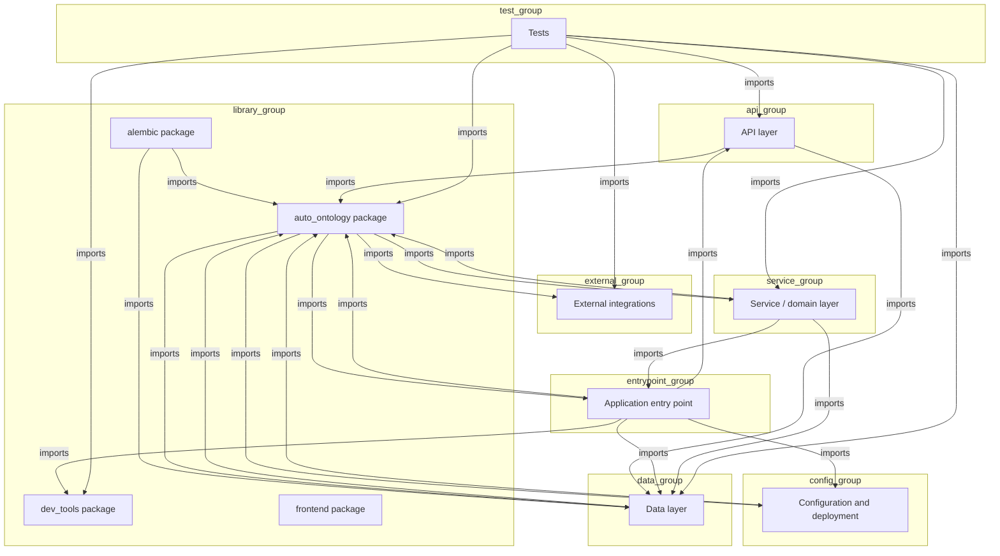

# Architecture report: NVIDIA/auto-ontology

> Automated static analysis. **Observed** = directly seen in files/imports/AST; **Inferred** = interpretation from that evidence. Repository code was not executed.

## 1. Repository at a glance

| Item | Value |
| --- | --- |
| Repository | NVIDIA/auto-ontology |
| Description | Auto Ontology is a Python framework for building semantic, graph-based reasoning layers over data. It enables deterministic query generation, better context retrieval, and more explainable AI for LLM and agent workflows. |
| Language | Python |
| Stars | 12796 |
| Licence | Apache-2.0 |
| Analysed commit / branch | 8ff3060a29bb8cb7c301ecf3945fc0a5fab009eb / main |
| Framework(s) | FastAPI, Starlette |
| Files analysed | 799 |
| Components | 11 |

## 2. Architecture in one minute

NVIDIA/auto-ontology - Auto Ontology is a Python framework for building semantic, graph-based reasoning layers over data. It enables deterministic query generation, better context retrieval, and more explainable AI for LLM…. This repository was analysed statically from 799 file(s) (477 Python). Detected technologies (observed from imports/manifests): GitHub Actions, MySQL, PostgreSQL, SQLite, FastAPI, Starlette. Files are grouped into 11 component(s): alembic package, API layer, auto_ontology package, Configuration and deployment, Data layer, dev_tools package, Application entry point, External integrations. Observed entry point(s): auto_ontology/ingestion_service/__main__.py, auto_ontology/semantic/__main__.py, auto_ontology/server/__main__.py. Findings below distinguish observed facts from inferred interpretation.

## 3. High-level block diagram

## 4. Main components

### alembic package (`alembic`)

- **Kind:** library
- **Status:** Observed
- **Confidence:** 0.85
- **Responsibility:** Groups 11 file(s) under alembic package (observed from repository paths and static analysis). Observed top-level functions: _configure, downgrade, include_object, run_migrations_offline, run_migrations_online, upgrade.
- **Paths:** `alembic/env.py`, `alembic/versions/47ffb7499dfa_trigram_index_on_tag_name_for_global_.py`, `alembic/versions/6347ede6dac1_add_pii_processed_to_catalog_columns.py`, `alembic/versions/7d864cacef9c_add_term_families.py`, `alembic/versions/84dd4f50dbba_add_catalog_column_distinct_ratio.py`, `alembic/versions/99d4d343dd0b_add_semantic_fk_join_path_default.py`, `alembic/versions/b3aed65e49b7_add_pii_processed_to_attributes.py`, `alembic/versions/c778a7d94c20_create_the_auto_ontology_schema.py`, `alembic/versions/caee572fa81c_add_catalog_column_distinct_values.py`, `alembic/versions/e4850fd803d6_add_user_groups.py`, `alembic/versions/f3a91c0e5b27_add_owner_id.py`
- **Evidence:** [alembic/env.py:53](https://github.com/NVIDIA/auto-ontology/blob/8ff3060a29bb8cb7c301ecf3945fc0a5fab009eb/alembic/env.py#L53); [alembic/versions/47ffb7499dfa_trigram_index_on_tag_name_for_global_.py:36](https://github.com/NVIDIA/auto-ontology/blob/8ff3060a29bb8cb7c301ecf3945fc0a5fab009eb/alembic/versions/47ffb7499dfa_trigram_index_on_tag_name_for_global_.py#L36); [alembic/versions/6347ede6dac1_add_pii_processed_to_catalog_columns.py:25](https://github.com/NVIDIA/auto-ontology/blob/8ff3060a29bb8cb7c301ecf3945fc0a5fab009eb/alembic/versions/6347ede6dac1_add_pii_processed_to_catalog_columns.py#L25); [alembic/versions/7d864cacef9c_add_term_families.py:26](https://github.com/NVIDIA/auto-ontology/blob/8ff3060a29bb8cb7c301ecf3945fc0a5fab009eb/alembic/versions/7d864cacef9c_add_term_families.py#L26); [alembic/versions/84dd4f50dbba_add_catalog_column_distinct_ratio.py:26](https://github.com/NVIDIA/auto-ontology/blob/8ff3060a29bb8cb7c301ecf3945fc0a5fab009eb/alembic/versions/84dd4f50dbba_add_catalog_column_distinct_ratio.py#L26); [alembic/versions/99d4d343dd0b_add_semantic_fk_join_path_default.py:26](https://github.com/NVIDIA/auto-ontology/blob/8ff3060a29bb8cb7c301ecf3945fc0a5fab009eb/alembic/versions/99d4d343dd0b_add_semantic_fk_join_path_default.py#L26); [alembic/versions/b3aed65e49b7_add_pii_processed_to_attributes.py:26](https://github.com/NVIDIA/auto-ontology/blob/8ff3060a29bb8cb7c301ecf3945fc0a5fab009eb/alembic/versions/b3aed65e49b7_add_pii_processed_to_attributes.py#L26); [alembic/versions/c778a7d94c20_create_the_auto_ontology_schema.py:114](https://github.com/NVIDIA/auto-ontology/blob/8ff3060a29bb8cb7c301ecf3945fc0a5fab009eb/alembic/versions/c778a7d94c20_create_the_auto_ontology_schema.py#L114)

### API layer (`api_layer`)

- **Kind:** api
- **Status:** Observed
- **Confidence:** 0.85
- **Responsibility:** Groups 148 file(s) under api layer (observed from repository paths and static analysis). Observed routes: GET /health, GET /health/live, POST /ingest, POST /ingest/delete, POST /semantic/reset. Observed top-level classes: ColumnAttributeUpdate, ConnectionBody, ConnectionTestBody, CustomAnalysisCreate, CustomAnalysisValidate, EntityCoverageRequest. Observed top-level functions: _author, _build_charts_event, _caller_in_group, _chips, _color, _count_payload.
- **Paths:** `auto_ontology/ingestion_service/router.py`, `auto_ontology/server/chat/router.py`, `auto_ontology/server/connections/router.py`, `auto_ontology/server/datasources/router.py`, `auto_ontology/server/exploration/router.py`, `auto_ontology/server/health/router.py`, `auto_ontology/server/metadata/router.py`, `auto_ontology/server/model_interchange/router.py`, `auto_ontology/server/rules/router.py`, `auto_ontology/server/search/router.py`, `auto_ontology/server/semantic_compilation/router.py`, `auto_ontology/server/sql_attributes/router.py`, `auto_ontology/server/tags/router.py`, `auto_ontology/server/terms/router.py`, `auto_ontology/server/users/router.py`, `auto_ontology/server/zones/router.py`, `frontend/api/analyses.ts`, `frontend/api/analytics.ts`, `frontend/api/apiTokens.ts`, `frontend/api/auth.ts`, `frontend/api/chat.ts`, `frontend/api/connections.ts`, `frontend/api/conversations.ts`, `frontend/api/datasources.ts`, `frontend/api/exploration.ts`, `frontend/api/groups.ts`, `frontend/api/invitations.ts`, `frontend/api/modelInterchange.ts`, `frontend/api/owners.ts`, `frontend/api/pqlAnalyses.ts`, `frontend/api/requests.ts`, `frontend/api/rules.ts`, `frontend/api/search.ts`, `frontend/api/settings.ts`, `frontend/api/sqlAttributes.ts`, `frontend/api/tags.ts`, `frontend/api/terms.ts`, `frontend/api/types.ts`, `frontend/api/users.ts`, `frontend/api/zones.ts`, `frontend/app/api/acronyms/[id]/openapi.ts`, `frontend/app/api/acronyms/[id]/route.ts`, `frontend/app/api/acronyms/openapi.ts`, `frontend/app/api/acronyms/route.ts`, `frontend/app/api/analytics/openapi.ts`, `frontend/app/api/analytics/route.ts`, `frontend/app/api/api-tokens/[id]/openapi.ts`, `frontend/app/api/api-tokens/[id]/route.ts`, `frontend/app/api/api-tokens/openapi.ts`, `frontend/app/api/api-tokens/route.ts`, `frontend/app/api/auth/[...all]/openapi.ts`, `frontend/app/api/auth/[...all]/route.ts`, `frontend/app/api/chat/cancel/openapi.ts`, `frontend/app/api/chat/cancel/route.ts`, `frontend/app/api/chat/completions/openapi.ts`, `frontend/app/api/chat/completions/route.ts`, `frontend/app/api/chat/watch/openapi.ts`, `frontend/app/api/chat/watch/route.ts`, `frontend/app/api/columns/[table_id]/route.ts`, `frontend/app/api/configurations/distinct-value-probing/openapi.ts`, `frontend/app/api/configurations/distinct-value-probing/route.ts`, `frontend/app/api/configurations/pii-detection/openapi.ts`, `frontend/app/api/configurations/pii-detection/route.ts`, `frontend/app/api/configurations/semantic-compilation/openapi.ts`, `frontend/app/api/configurations/semantic-compilation/route.ts`, `frontend/app/api/configurations/sql-query-timeout/openapi.ts`, `frontend/app/api/configurations/sql-query-timeout/route.ts`, `frontend/app/api/configurations/visualization/openapi.ts`, `frontend/app/api/configurations/visualization/route.ts`, `frontend/app/api/connections/[database_name]/route.ts`, `frontend/app/api/connections/[database_name]/sso-federation/route.ts`, `frontend/app/api/connections/route.ts`, `frontend/app/api/connections/source/route.ts`, `frontend/app/api/conversations/[id]/messages/openapi.ts`, `frontend/app/api/conversations/[id]/messages/route.ts`, `frontend/app/api/conversations/[id]/openapi.ts`, `frontend/app/api/conversations/[id]/route.ts`, `frontend/app/api/conversations/openapi.ts`, `frontend/app/api/conversations/route.ts`, `frontend/app/api/custom-analyses/[analysis_id]/route.ts`, `frontend/app/api/custom-analyses/route.ts`, `frontend/app/api/custom-analyses/validate/route.ts`, `frontend/app/api/custom-prompts/[id]/openapi.ts`, `frontend/app/api/custom-prompts/[id]/route.ts`, `frontend/app/api/custom-prompts/openapi.ts`, `frontend/app/api/custom-prompts/route.ts`, `frontend/app/api/datasources/dbs/route.ts`, `frontend/app/api/exploration/column-attributes/[attr_id]/details/route.ts`, `frontend/app/api/exploration/columns/[column_id]/details/route.ts`, `frontend/app/api/exploration/edges/route.ts`, `frontend/app/api/exploration/graph/route.ts`, `frontend/app/api/exploration/nodes/[node_id]/relationships/route.ts`, `frontend/app/api/exploration/semantic-graph/route.ts`, `frontend/app/api/exploration/sql-attributes/[attr_id]/details/route.ts`, `frontend/app/api/exploration/sql/[sql_id]/details/route.ts`, `frontend/app/api/exploration/tables/[table_id]/details/route.ts`, `frontend/app/api/exploration/tables/zones/route.ts`, `frontend/app/api/exploration/terms/[term_id]/details/route.ts`, `frontend/app/api/exploration/terms/[term_id]/path/[other_term_id]/route.ts`, `frontend/app/api/groups/[group_id]/route.ts`, `frontend/app/api/groups/route.ts`, `frontend/app/api/health/openapi.ts`, `frontend/app/api/health/route.ts`, `frontend/app/api/invitations/[token]/accept/openapi.ts`, `frontend/app/api/invitations/[token]/accept/route.ts`, `frontend/app/api/invitations/[token]/openapi.ts`, `frontend/app/api/invitations/[token]/route.ts`, `frontend/app/api/invitations/openapi.ts`, `frontend/app/api/invitations/reset/openapi.ts`, `frontend/app/api/invitations/reset/route.ts`, `frontend/app/api/invitations/route.ts`, `frontend/app/api/model/export/route.ts`, `frontend/app/api/model/import/route.ts`, `frontend/app/api/nodes/[node_id]/route.ts`, `frontend/app/api/owners/route.ts`, `frontend/app/api/pql-analyses/[analysis_id]/route.ts`, `frontend/app/api/pql-analyses/route.ts`, `frontend/app/api/question-entity-coverage/route.ts`, `frontend/app/api/rules/[rule_id]/route.ts`, `frontend/app/api/rules/route.ts`, `frontend/app/api/schemas/[db_id]/route.ts`, `frontend/app/api/search/global-search/count/route.ts`, `frontend/app/api/search/global-search/route.ts`, `frontend/app/api/semantic-compilation/reset/route.ts`, `frontend/app/api/semantic-compilation/status/route.ts`, `frontend/app/api/sql-attributes/[attr_id]/description-suggestion/route.ts`, `frontend/app/api/sql-attributes/[attr_id]/route.ts`, `frontend/app/api/sql-attributes/route.ts`, `frontend/app/api/sql-attributes/validate/route.ts`, `frontend/app/api/sso-discovery/openapi.ts`, `frontend/app/api/sso-discovery/route.ts`, `frontend/app/api/sso-providers/openapi.ts`, `frontend/app/api/sso-providers/route.ts`, `frontend/app/api/tables/[schema_id]/route.ts`, `frontend/app/api/tags/[tag_id]/openapi.ts`, `frontend/app/api/tags/[tag_id]/route.ts`, `frontend/app/api/tags/[tag_id]/targets/[target_type]/[item_id]/route.ts`, `frontend/app/api/tags/[tag_id]/targets/route.ts`, `frontend/app/api/tags/openapi.ts`, `frontend/app/api/tags/route.ts`, `frontend/app/api/terms/[term_id]/column-attributes/[attr_id]/route.ts`, `frontend/app/api/terms/[term_id]/column-attributes/route.ts`, `frontend/app/api/terms/[term_id]/route.ts`, `frontend/app/api/terms/[term_id]/sql-attributes/route.ts`, `frontend/app/api/terms/route.ts`, `frontend/app/api/zones/[zone_id]/route.ts`, `frontend/app/api/zones/[zone_id]/status/route.ts`, `frontend/app/api/zones/route.ts`
- **Evidence:** [auto_ontology/ingestion_service/router.py:40](https://github.com/NVIDIA/auto-ontology/blob/8ff3060a29bb8cb7c301ecf3945fc0a5fab009eb/auto_ontology/ingestion_service/router.py#L40); [auto_ontology/server/chat/router.py:114](https://github.com/NVIDIA/auto-ontology/blob/8ff3060a29bb8cb7c301ecf3945fc0a5fab009eb/auto_ontology/server/chat/router.py#L114); [auto_ontology/server/connections/router.py:30](https://github.com/NVIDIA/auto-ontology/blob/8ff3060a29bb8cb7c301ecf3945fc0a5fab009eb/auto_ontology/server/connections/router.py#L30); [auto_ontology/server/datasources/router.py:33](https://github.com/NVIDIA/auto-ontology/blob/8ff3060a29bb8cb7c301ecf3945fc0a5fab009eb/auto_ontology/server/datasources/router.py#L33); [auto_ontology/server/exploration/router.py:67](https://github.com/NVIDIA/auto-ontology/blob/8ff3060a29bb8cb7c301ecf3945fc0a5fab009eb/auto_ontology/server/exploration/router.py#L67); [auto_ontology/server/health/router.py:39](https://github.com/NVIDIA/auto-ontology/blob/8ff3060a29bb8cb7c301ecf3945fc0a5fab009eb/auto_ontology/server/health/router.py#L39); [auto_ontology/server/metadata/router.py:19](https://github.com/NVIDIA/auto-ontology/blob/8ff3060a29bb8cb7c301ecf3945fc0a5fab009eb/auto_ontology/server/metadata/router.py#L19); [auto_ontology/server/model_interchange/router.py:25](https://github.com/NVIDIA/auto-ontology/blob/8ff3060a29bb8cb7c301ecf3945fc0a5fab009eb/auto_ontology/server/model_interchange/router.py#L25)

### auto_ontology package (`auto_ontology`)

- **Kind:** library
- **Status:** Observed
- **Confidence:** 0.85
- **Responsibility:** Groups 238 file(s) under auto_ontology package (observed from repository paths and static analysis). Observed top-level classes: AgentExecutionError, AgentPayload, AgentState, AskUserAction, BaseAgent, Budget. Observed top-level functions: __getattr__, _accounts_by_id, _aggregate, _aggregate_outputs, _aggregation_clauses, _alias_to_table_map.
- **Paths:** `auto_ontology/__init__.py`, `auto_ontology/catalog/__init__.py`, `auto_ontology/catalog/constants.py`, `auto_ontology/catalog/diff.py`, `auto_ontology/catalog/extract.py`, `auto_ontology/catalog/ingest.py`, `auto_ontology/catalog/model/__init__.py`, `auto_ontology/catalog/model/node.py`, `auto_ontology/catalog/model/query.py`, `auto_ontology/catalog/model/schema.py`, `auto_ontology/catalog/normalize.py`, `auto_ontology/catalog/parsers/__init__.py`, `auto_ontology/catalog/parsers/query_comparator.py`, `auto_ontology/catalog/parsers/schemas_parser.py`, `auto_ontology/catalog/parsers/sqlglot_extractor.py`, `auto_ontology/catalog/query_stats.py`, `auto_ontology/catalog/sql_parse.py`, `auto_ontology/catalog/store/__init__.py`, `auto_ontology/catalog/store/indexes.py`, `auto_ontology/catalog/store/queries.py`, `auto_ontology/catalog/store/registry.py`, `auto_ontology/catalog/store/rows.py`, `auto_ontology/catalog/table_filter.py`, `auto_ontology/catalog/write.py`, `auto_ontology/connectors/__init__.py`, `auto_ontology/connectors/base.py`, `auto_ontology/connectors/clickhouse.py`, `auto_ontology/connectors/connection_string_factory.py`, `auto_ontology/connectors/databricks.py`, `auto_ontology/connectors/databricks_oauth.py`, `auto_ontology/connectors/db_errors.py`, `auto_ontology/connectors/duckdb.py`, `auto_ontology/connectors/heavydb.py`, `auto_ontology/connectors/kyuubi.py`, `auto_ontology/connectors/mysql.py`, `auto_ontology/connectors/postgres.py`, `auto_ontology/connectors/registry.py`, `auto_ontology/connectors/snowflake.py`, `auto_ontology/connectors/sqlite.py`, `auto_ontology/connectors/trino.py`, `auto_ontology/connectors/vault.py`, `auto_ontology/dal/__init__.py`, `auto_ontology/dal/attributes.py`, `auto_ontology/dal/candidates.py`, `auto_ontology/dal/connections.py`, `auto_ontology/dal/custom_analyses.py`, `auto_ontology/dal/datasources.py`, `auto_ontology/dal/exploration.py`, `auto_ontology/dal/groups.py`, `auto_ontology/dal/model_interchange.py`, `auto_ontology/dal/owners.py`, `auto_ontology/dal/pii.py`, `auto_ontology/dal/pql_analyses.py`, `auto_ontology/dal/reset.py`, `auto_ontology/dal/rules.py`, `auto_ontology/dal/schema.py`, `auto_ontology/dal/schema_version.py`, `auto_ontology/dal/search.py`, `auto_ontology/dal/session.py`, `auto_ontology/dal/sql_attributes.py`, `auto_ontology/dal/sql_fragments.py`, `auto_ontology/dal/tags.py`, `auto_ontology/dal/term_families.py`, `auto_ontology/dal/terms.py`, `auto_ontology/dal/users.py`, `auto_ontology/dal/zones.py`, `auto_ontology/env.py`, `auto_ontology/infra/__init__.py`, `auto_ontology/infra/feature_flags.py`, `auto_ontology/infra/postgres.py`, `auto_ontology/ingestion_service/__init__.py`, `auto_ontology/ingestion_service/connections.py`, `auto_ontology/ingestion_service/data_scheduler.py`, `auto_ontology/ingestion_service/history.py`, `auto_ontology/ingestion_service/ingest.py`, `auto_ontology/ingestion_service/pii.py`, `auto_ontology/ingestion_service/rules.py`, `auto_ontology/ingestion_service/scheduler.py`, `auto_ontology/ingestion_service/semantic_scheduler.py`, `auto_ontology/pii_detection/__init__.py`, `auto_ontology/pii_detection/detector.py`, `auto_ontology/pii_detection/rules.py`, `auto_ontology/retrieval/__init__.py`, `auto_ontology/retrieval/data_access/__init__.py`, `auto_ontology/retrieval/data_access/candidates.py`, `auto_ontology/retrieval/data_access/custom_analyses.py`, `auto_ontology/retrieval/data_access/graph_schemas.py`, `auto_ontology/retrieval/data_access/relevant_tables.py`, `auto_ontology/retrieval/data_access/response_formatting.py`, `auto_ontology/retrieval/data_access/semantic_search.py`, `auto_ontology/retrieval/entity_coverage/__init__.py`, `auto_ontology/retrieval/entity_coverage/agents/__init__.py`, `auto_ontology/retrieval/entity_coverage/agents/coverage.py`, `auto_ontology/retrieval/entity_coverage/agents/question_extraction.py`, `auto_ontology/retrieval/entity_coverage/graph.py`, `auto_ontology/retrieval/entity_coverage/prompts.py`, `auto_ontology/retrieval/entity_coverage/state.py`, `auto_ontology/retrieval/interactive/__init__.py`, `auto_ontology/retrieval/interactive/clarify.py`, `auto_ontology/retrieval/interactive/completeness.py`, `auto_ontology/retrieval/interactive/conditional_output.py`, `auto_ontology/retrieval/interactive/coordinator.py`, `auto_ontology/retrieval/interactive/entity_resolution.py`, `auto_ontology/retrieval/interactive/evidence.py`, `auto_ontology/retrieval/interactive/followup_merge.py`, `auto_ontology/retrieval/interactive/grounding.py`, `auto_ontology/retrieval/interactive/kb_coverage.py`, `auto_ontology/retrieval/interactive/merge.py`, `auto_ontology/retrieval/interactive/output_type.py`, `auto_ontology/retrieval/interactive/state.py`, `auto_ontology/retrieval/interactive/types.py`, `auto_ontology/retrieval/kumo/__init__.py`, `auto_ontology/retrieval/kumo/budget.py`, `auto_ontology/retrieval/kumo/column_reference.py`, `auto_ontology/retrieval/kumo/graph_cache.py`, `auto_ontology/retrieval/kumo/kumo_model.py`, `auto_ontology/retrieval/kumo/pql_gen.py`, `auto_ontology/retrieval/kumo/predictor.py`, `auto_ontology/retrieval/kumo/prompts.py`, `auto_ontology/retrieval/kumo/rag.py`, `auto_ontology/retrieval/kumo/telemetry.py`, `auto_ontology/retrieval/text_to_sql/__init__.py`, `auto_ontology/retrieval/text_to_sql/agents/__init__.py`, `auto_ontology/retrieval/text_to_sql/agents/candidates_preparation.py`, `auto_ontology/retrieval/text_to_sql/agents/candidates_retrieval.py`, `auto_ontology/retrieval/text_to_sql/agents/combined_precheck.py`, `auto_ontology/retrieval/text_to_sql/agents/empty_like_result_check.py`, `auto_ontology/retrieval/text_to_sql/agents/empty_result_value_repair.py`, `auto_ontology/retrieval/text_to_sql/agents/evidence_refinement.py`, `auto_ontology/retrieval/text_to_sql/agents/information_agent.py`, `auto_ontology/retrieval/text_to_sql/agents/information_tools.py`, `auto_ontology/retrieval/text_to_sql/agents/join_path_check.py`, `auto_ontology/retrieval/text_to_sql/agents/jsonb_path_check.py`, `auto_ontology/retrieval/text_to_sql/agents/kumo_prediction.py`, `auto_ontology/retrieval/text_to_sql/agents/prediction_graph.py`, `auto_ontology/retrieval/text_to_sql/agents/proactive_value_check.py`, `auto_ontology/retrieval/text_to_sql/agents/question_intent.py`, `auto_ontology/retrieval/text_to_sql/agents/response.py`, `auto_ontology/retrieval/text_to_sql/agents/sql_execution.py`, `auto_ontology/retrieval/text_to_sql/agents/sql_from_semantic.py`, `auto_ontology/retrieval/text_to_sql/agents/sql_from_tables.py`, `auto_ontology/retrieval/text_to_sql/agents/sql_parse_validation.py`, `auto_ontology/retrieval/text_to_sql/agents/sql_reconstruction.py`, `auto_ontology/retrieval/text_to_sql/agents/sql_unconstructable.py`, `auto_ontology/retrieval/text_to_sql/agents/sql_value_validation.py`, `auto_ontology/retrieval/text_to_sql/base.py`, `auto_ontology/retrieval/text_to_sql/chat_sql.py`, `auto_ontology/retrieval/text_to_sql/connector_routing.py`, `auto_ontology/retrieval/text_to_sql/db_probe/__init__.py`, `auto_ontology/retrieval/text_to_sql/db_probe/executor.py`, `auto_ontology/retrieval/text_to_sql/db_probe/join_path_check.py`, `auto_ontology/retrieval/text_to_sql/db_probe/jsonb_path_check.py`, `auto_ontology/retrieval/text_to_sql/db_probe/literal_check.py`, `auto_ontology/retrieval/text_to_sql/follow_up.py`, `auto_ontology/retrieval/text_to_sql/formatters_util.py`, `auto_ontology/retrieval/text_to_sql/node_labels.py`, `auto_ontology/retrieval/text_to_sql/numeric_types.py`, `auto_ontology/retrieval/text_to_sql/prompts.py`, `auto_ontology/retrieval/text_to_sql/state.py`, `auto_ontology/retrieval/text_to_sql/text_to_sql_graph.py`, `auto_ontology/retrieval/text_to_sql/value_anchors.py`, `auto_ontology/retrieval/text_to_sql/visualization/__init__.py`, `auto_ontology/retrieval/text_to_sql/visualization/analyze.py`, `auto_ontology/retrieval/text_to_sql/visualization/chart_specs.py`, `auto_ontology/retrieval/text_to_sql/visualization/helpers.py`, `auto_ontology/retrieval/text_to_sql/visualization/prompts.py`, `auto_ontology/semantic/__init__.py`, `auto_ontology/semantic/attribute_descriptions.py`, `auto_ontology/semantic/bridge_tables.py`, `auto_ontology/semantic/cancellation.py`, `auto_ontology/semantic/compile.py`, `auto_ontology/semantic/constants.py`, `auto_ontology/semantic/date_format.py`, `auto_ontology/semantic/deterministic.py`, `auto_ontology/semantic/domain.py`, `auto_ontology/semantic/embed.py`, `auto_ontology/semantic/fk_suggester.py`, `auto_ontology/semantic/fk_values.py`, `auto_ontology/semantic/loaders.py`, `auto_ontology/semantic/pipeline.py`, `auto_ontology/semantic/semantic_fk.py`, `auto_ontology/semantic/sql_attribute_suggester.py`, `auto_ontology/semantic/term_extractor.py`, `auto_ontology/semantic/term_families.py`, `auto_ontology/semantic/unmatched_fks.py`, `auto_ontology/semantic/visit_enter.py`, `auto_ontology/server/__init__.py`, `auto_ontology/server/chat/__init__.py`, `auto_ontology/server/chat/conversation_dal.py`, `auto_ontology/server/chat/helpers.py`, `auto_ontology/server/chat/settings_dal.py`, `auto_ontology/server/chat/worker.py`, `auto_ontology/server/connections/__init__.py`, `auto_ontology/server/custom_analyses/__init__.py`, `auto_ontology/server/datasources/__init__.py`, `auto_ontology/server/exploration/__init__.py`, `auto_ontology/server/health/__init__.py`, `auto_ontology/server/health/checks.py`, `auto_ontology/server/identity.py`, `auto_ontology/server/ingestion/__init__.py`, `auto_ontology/server/ingestion/proxy.py`, `auto_ontology/server/metadata/__init__.py`, `auto_ontology/server/model_interchange/__init__.py`, `auto_ontology/server/model_interchange/embed.py`, `auto_ontology/server/owners.py`, `auto_ontology/server/pagination.py`, `auto_ontology/server/pql_analyses/__init__.py`, `auto_ontology/server/responses.py`, `auto_ontology/server/rules/__init__.py`, `auto_ontology/server/search/__init__.py`, `auto_ontology/server/search/constants.py`, `auto_ontology/server/semantic_compilation/__init__.py`, `auto_ontology/server/sql_attributes/__init__.py`, `auto_ontology/server/sql_attributes/description_suggester.py`, `auto_ontology/server/sql_utils.py`, `auto_ontology/server/tags/__init__.py`, `auto_ontology/server/terms/__init__.py`, `auto_ontology/server/users/__init__.py`, `auto_ontology/server/users/permissions.py`, `auto_ontology/server/users/postgres_dal.py`, `auto_ontology/server/zones/__init__.py`, `auto_ontology/server/zones/constants.py`, `auto_ontology/server/zones/utils.py`, `auto_ontology/utils/__init__.py`, `auto_ontology/utils/catalog_reembed.py`, `auto_ontology/utils/column_types.py`, `auto_ontology/utils/embedding.py`, `auto_ontology/utils/embedding_rows.py`, `auto_ontology/utils/llm_invoke.py`, `auto_ontology/utils/model_config.py`, `auto_ontology/utils/rerank.py`, `auto_ontology/utils/retriever.py`, `auto_ontology/utils/sample_values.py`, `auto_ontology/utils/sql_identifiers.py`, `auto_ontology/vdb/__init__.py`, `auto_ontology/vdb/postgres.py`, `auto_ontology/vdb/records.py`, `auto_ontology/version.py`
- **Evidence:** [auto_ontology/__init__.py](https://github.com/NVIDIA/auto-ontology/blob/8ff3060a29bb8cb7c301ecf3945fc0a5fab009eb/auto_ontology/__init__.py); [auto_ontology/catalog/__init__.py:31](https://github.com/NVIDIA/auto-ontology/blob/8ff3060a29bb8cb7c301ecf3945fc0a5fab009eb/auto_ontology/catalog/__init__.py#L31); [auto_ontology/catalog/constants.py:13](https://github.com/NVIDIA/auto-ontology/blob/8ff3060a29bb8cb7c301ecf3945fc0a5fab009eb/auto_ontology/catalog/constants.py#L13); [auto_ontology/catalog/diff.py:42](https://github.com/NVIDIA/auto-ontology/blob/8ff3060a29bb8cb7c301ecf3945fc0a5fab009eb/auto_ontology/catalog/diff.py#L42); [auto_ontology/catalog/extract.py:25](https://github.com/NVIDIA/auto-ontology/blob/8ff3060a29bb8cb7c301ecf3945fc0a5fab009eb/auto_ontology/catalog/extract.py#L25); [auto_ontology/catalog/ingest.py:28](https://github.com/NVIDIA/auto-ontology/blob/8ff3060a29bb8cb7c301ecf3945fc0a5fab009eb/auto_ontology/catalog/ingest.py#L28); [auto_ontology/catalog/model/__init__.py](https://github.com/NVIDIA/auto-ontology/blob/8ff3060a29bb8cb7c301ecf3945fc0a5fab009eb/auto_ontology/catalog/model/__init__.py); [auto_ontology/catalog/model/node.py:15](https://github.com/NVIDIA/auto-ontology/blob/8ff3060a29bb8cb7c301ecf3945fc0a5fab009eb/auto_ontology/catalog/model/node.py#L15)

### Configuration and deployment (`config`)

- **Kind:** config
- **Status:** Observed
- **Confidence:** 0.85
- **Responsibility:** Groups 38 file(s) under configuration and deployment (observed from repository paths and static analysis). Observed top-level functions: _float_env, _int_env, is_db_probe_join_path_check, is_db_probe_jsonb_path_check, is_db_probe_proactive, is_semantic_compilation_enabled.
- **Paths:** `Dockerfile`, `alembic.ini`, `auto_ontology/ingestion_service/config.py`, `auto_ontology/retrieval/text_to_sql/agents/calculation_subtypes.json`, `auto_ontology/retrieval/text_to_sql/db_probe/config.py`, `auto_ontology/server/users/access.json`, `docker-compose.yml`, `frontend/.dockerignore`, `frontend/.eslintrc.json`, `frontend/Dockerfile`, `frontend/app/settings/agent-settings/page.tsx`, `frontend/app/settings/connections/page.tsx`, `frontend/app/settings/import-export/ImportExportView.tsx`, `frontend/app/settings/import-export/page.tsx`, `frontend/app/settings/layout.tsx`, `frontend/app/settings/page.tsx`, `frontend/app/settings/pii/PiiSettingsForm.tsx`, `frontend/app/settings/pii/page.tsx`, `frontend/app/settings/rules/RuleAuthor.tsx`, `frontend/app/settings/rules/RuleInformationModal.tsx`, `frontend/app/settings/rules/page.tsx`, `frontend/app/settings/semantic-compilation/SemanticCompilationForm.tsx`, `frontend/app/settings/semantic-compilation/page.tsx`, `frontend/app/settings/semantic-input/page.tsx`, `frontend/app/settings/sso/SsoConfigForm.tsx`, `frontend/app/settings/sso/page.tsx`, `frontend/app/settings/tags/TagDetailView.tsx`, `frontend/app/settings/tags/TagsSettingsView.tsx`, `frontend/app/settings/tags/page.tsx`, `frontend/app/settings/tags/tag-item-path.ts`, `frontend/app/settings/tags/tags-path.ts`, `frontend/app/settings/users/EditUserModal.tsx`, `frontend/app/settings/users/GroupsSection.tsx`, `frontend/app/settings/users/InviteUserModal.tsx`, `frontend/app/settings/users/UsersManager.tsx`, `frontend/app/settings/users/page.tsx`, `frontend/app/settings/zones/page.tsx`, `frontend/auth/access.json`
- **Evidence:** [Dockerfile](https://github.com/NVIDIA/auto-ontology/blob/8ff3060a29bb8cb7c301ecf3945fc0a5fab009eb/Dockerfile); [alembic.ini](https://github.com/NVIDIA/auto-ontology/blob/8ff3060a29bb8cb7c301ecf3945fc0a5fab009eb/alembic.ini); [auto_ontology/ingestion_service/config.py:29](https://github.com/NVIDIA/auto-ontology/blob/8ff3060a29bb8cb7c301ecf3945fc0a5fab009eb/auto_ontology/ingestion_service/config.py#L29); [auto_ontology/retrieval/text_to_sql/agents/calculation_subtypes.json](https://github.com/NVIDIA/auto-ontology/blob/8ff3060a29bb8cb7c301ecf3945fc0a5fab009eb/auto_ontology/retrieval/text_to_sql/agents/calculation_subtypes.json); [auto_ontology/retrieval/text_to_sql/db_probe/config.py:19](https://github.com/NVIDIA/auto-ontology/blob/8ff3060a29bb8cb7c301ecf3945fc0a5fab009eb/auto_ontology/retrieval/text_to_sql/db_probe/config.py#L19); [auto_ontology/server/users/access.json](https://github.com/NVIDIA/auto-ontology/blob/8ff3060a29bb8cb7c301ecf3945fc0a5fab009eb/auto_ontology/server/users/access.json); [docker-compose.yml](https://github.com/NVIDIA/auto-ontology/blob/8ff3060a29bb8cb7c301ecf3945fc0a5fab009eb/docker-compose.yml); [frontend/.dockerignore](https://github.com/NVIDIA/auto-ontology/blob/8ff3060a29bb8cb7c301ecf3945fc0a5fab009eb/frontend/.dockerignore)

### Data layer (`data_layer`)

- **Kind:** data
- **Status:** Observed
- **Confidence:** 0.85
- **Responsibility:** Groups 10 file(s) under data layer (observed from repository paths and static analysis). Observed top-level classes: AnchorColumnModel, ApiModel, AutoOntologyModelDocument, CandidateFilterModel, ColumnAttribute, ColumnAttributeExplorationColumn. Observed top-level functions: _append_to_pk, _catalog_join, _column_ids_by_name, _column_ids_of_schema, _column_ids_of_table, _source_owned.
- **Paths:** `auto_ontology/catalog/store/db.py`, `auto_ontology/catalog/store/schemas.py`, `auto_ontology/pii_detection/models.py`, `auto_ontology/retrieval/entity_coverage/models.py`, `auto_ontology/retrieval/text_to_sql/models.py`, `auto_ontology/semantic/models.py`, `auto_ontology/server/model_interchange/schemas.py`, `auto_ontology/server/models.py`, `frontend/app/data/layout.tsx`, `frontend/app/data/page.tsx`
- **Evidence:** [auto_ontology/catalog/store/db.py:38](https://github.com/NVIDIA/auto-ontology/blob/8ff3060a29bb8cb7c301ecf3945fc0a5fab009eb/auto_ontology/catalog/store/db.py#L38); [auto_ontology/catalog/store/schemas.py:39](https://github.com/NVIDIA/auto-ontology/blob/8ff3060a29bb8cb7c301ecf3945fc0a5fab009eb/auto_ontology/catalog/store/schemas.py#L39); [auto_ontology/pii_detection/models.py:11](https://github.com/NVIDIA/auto-ontology/blob/8ff3060a29bb8cb7c301ecf3945fc0a5fab009eb/auto_ontology/pii_detection/models.py#L11); [auto_ontology/retrieval/entity_coverage/models.py:16](https://github.com/NVIDIA/auto-ontology/blob/8ff3060a29bb8cb7c301ecf3945fc0a5fab009eb/auto_ontology/retrieval/entity_coverage/models.py#L16); [auto_ontology/retrieval/text_to_sql/models.py:18](https://github.com/NVIDIA/auto-ontology/blob/8ff3060a29bb8cb7c301ecf3945fc0a5fab009eb/auto_ontology/retrieval/text_to_sql/models.py#L18); [auto_ontology/semantic/models.py:15](https://github.com/NVIDIA/auto-ontology/blob/8ff3060a29bb8cb7c301ecf3945fc0a5fab009eb/auto_ontology/semantic/models.py#L15); [auto_ontology/server/model_interchange/schemas.py:15](https://github.com/NVIDIA/auto-ontology/blob/8ff3060a29bb8cb7c301ecf3945fc0a5fab009eb/auto_ontology/server/model_interchange/schemas.py#L15); [auto_ontology/server/models.py:91](https://github.com/NVIDIA/auto-ontology/blob/8ff3060a29bb8cb7c301ecf3945fc0a5fab009eb/auto_ontology/server/models.py#L91)

### dev_tools package (`dev_tools`)

- **Kind:** library
- **Status:** Observed
- **Confidence:** 0.85
- **Responsibility:** Groups 4 file(s) under dev_tools package (observed from repository paths and static analysis).
- **Paths:** `dev_tools/__init__.py`, `dev_tools/fixtures/__init__.py`, `dev_tools/fixtures/sql/build_pagila.sh`, `dev_tools/setup_env.sh`
- **Evidence:** [dev_tools/__init__.py](https://github.com/NVIDIA/auto-ontology/blob/8ff3060a29bb8cb7c301ecf3945fc0a5fab009eb/dev_tools/__init__.py); [dev_tools/fixtures/__init__.py](https://github.com/NVIDIA/auto-ontology/blob/8ff3060a29bb8cb7c301ecf3945fc0a5fab009eb/dev_tools/fixtures/__init__.py); [dev_tools/fixtures/sql/build_pagila.sh](https://github.com/NVIDIA/auto-ontology/blob/8ff3060a29bb8cb7c301ecf3945fc0a5fab009eb/dev_tools/fixtures/sql/build_pagila.sh); [dev_tools/setup_env.sh](https://github.com/NVIDIA/auto-ontology/blob/8ff3060a29bb8cb7c301ecf3945fc0a5fab009eb/dev_tools/setup_env.sh)

### Application entry point (`entrypoint`)

- **Kind:** entrypoint
- **Status:** Observed
- **Confidence:** 0.85
- **Responsibility:** Groups 15 file(s) under application entry point (observed from repository paths and static analysis). Observed application object created via FastAPI. Observed top-level classes: AgentRunError, Capture, Fixture, SqliteFixture. Observed top-level functions: _all_statements, _already_seeded, _apply_last_deterministic_sql_fallback, _apply_sql, _build_state, _build_thoughts_summary.
- **Paths:** `auto_ontology/ingestion_service/__main__.py`, `auto_ontology/retrieval/entity_coverage/main.py`, `auto_ontology/retrieval/text_to_sql/main.py`, `auto_ontology/semantic/__main__.py`, `auto_ontology/server/__main__.py`, `dev_tools/_add_spdx_headers.py`, `dev_tools/fixtures/build_sqlite_fixtures.py`, `dev_tools/fixtures/capture_dal_golden.py`, `dev_tools/fixtures/seed_fixtures.py`, `dev_tools/fixtures/seed_graph_fixture.py`, `dev_tools/fixtures/seed_local_postgres.py`, `dev_tools/generate_backend_openapi.py`, `dev_tools/generate_permission_resource.py`, `dev_tools/local_ingest.py`, `dev_tools/release_helm_chart.py`
- **Evidence:** [auto_ontology/ingestion_service/__main__.py:92](https://github.com/NVIDIA/auto-ontology/blob/8ff3060a29bb8cb7c301ecf3945fc0a5fab009eb/auto_ontology/ingestion_service/__main__.py#L92); [auto_ontology/retrieval/entity_coverage/main.py:35](https://github.com/NVIDIA/auto-ontology/blob/8ff3060a29bb8cb7c301ecf3945fc0a5fab009eb/auto_ontology/retrieval/entity_coverage/main.py#L35); [auto_ontology/retrieval/text_to_sql/main.py:35](https://github.com/NVIDIA/auto-ontology/blob/8ff3060a29bb8cb7c301ecf3945fc0a5fab009eb/auto_ontology/retrieval/text_to_sql/main.py#L35); [auto_ontology/semantic/__main__.py:21](https://github.com/NVIDIA/auto-ontology/blob/8ff3060a29bb8cb7c301ecf3945fc0a5fab009eb/auto_ontology/semantic/__main__.py#L21); [auto_ontology/server/__main__.py:81](https://github.com/NVIDIA/auto-ontology/blob/8ff3060a29bb8cb7c301ecf3945fc0a5fab009eb/auto_ontology/server/__main__.py#L81); [dev_tools/_add_spdx_headers.py:49](https://github.com/NVIDIA/auto-ontology/blob/8ff3060a29bb8cb7c301ecf3945fc0a5fab009eb/dev_tools/_add_spdx_headers.py#L49); [dev_tools/fixtures/build_sqlite_fixtures.py:37](https://github.com/NVIDIA/auto-ontology/blob/8ff3060a29bb8cb7c301ecf3945fc0a5fab009eb/dev_tools/fixtures/build_sqlite_fixtures.py#L37); [dev_tools/fixtures/capture_dal_golden.py:50](https://github.com/NVIDIA/auto-ontology/blob/8ff3060a29bb8cb7c301ecf3945fc0a5fab009eb/dev_tools/fixtures/capture_dal_golden.py#L50)

### External integrations (`external_integrations`)

- **Kind:** external
- **Status:** Observed
- **Confidence:** 0.85
- **Responsibility:** Groups 1 file(s) under external integrations (observed from repository paths and static analysis).
- **Paths:** `frontend/adapters/ui/icons.tsx`
- **Evidence:** [frontend/adapters/ui/icons.tsx](https://github.com/NVIDIA/auto-ontology/blob/8ff3060a29bb8cb7c301ecf3945fc0a5fab009eb/frontend/adapters/ui/icons.tsx)

### frontend package (`frontend`)

- **Kind:** library
- **Status:** Observed
- **Confidence:** 0.85
- **Responsibility:** Groups 83 file(s) under frontend package (observed from repository paths and static analysis).
- **Paths:** `frontend/app/.well-known/oauth-authorization-server/route.ts`, `frontend/app/account/api-tokens/page.tsx`, `frontend/app/account/layout.tsx`, `frontend/app/admin/layout.tsx`, `frontend/app/analysis/layout.tsx`, `frontend/app/analysis/page.tsx`, `frontend/app/analytics/layout.tsx`, `frontend/app/analytics/page.tsx`, `frontend/app/chat/layout.tsx`, `frontend/app/chat/page.tsx`, `frontend/app/discovery/layout.tsx`, `frontend/app/discovery/page.tsx`, `frontend/app/exploration/page.tsx`, `frontend/app/invite/[token]/InviteSetPassword.tsx`, `frontend/app/invite/[token]/page.tsx`, `frontend/app/layout.tsx`, `frontend/app/login/page.tsx`, `frontend/app/oauth/OauthStatus.tsx`, `frontend/app/oauth/consent/page.tsx`, `frontend/app/oauth/handoff/page.tsx`, `frontend/app/page.tsx`, `frontend/app/terms/page.tsx`, `frontend/assets/images/placeholders.tsx`, `frontend/auth/api-token.ts`, `frontend/auth/auth-access.ts`, `frontend/auth/auth-client.ts`, `frontend/auth/auth-guards.ts`, `frontend/auth/auth.ts`, `frontend/auth/bearer.ts`, `frontend/auth/exact-admin.ts`, `frontend/auth/oauth-loopback.ts`, `frontend/auth/oauth-token.ts`, `frontend/auth/permissions.ts`, `frontend/auth/proxy-backend.ts`, `frontend/auth/resolve-user.ts`, `frontend/auth/seed-admin.ts`, `frontend/auth/sso-token.ts`, `frontend/auth/with-auth.ts`, `frontend/common/AppTopBar.tsx`, `frontend/common/BackPanelLayout.tsx`, `frontend/common/Breadcrumbs.tsx`, `frontend/common/Button/Button.tsx`, `frontend/common/Button/CopyButton.tsx`, `frontend/common/Button/SelectButton.tsx`, `frontend/common/Button/index.ts`, `frontend/common/CertificationBadge.tsx`, `frontend/common/CertificationSelect.tsx`, `frontend/common/DataTreeSelect/DataTreeSelect.tsx`, `frontend/common/DataTreeSelect/index.ts`, `frontend/common/DetailLinkButton.tsx`, `frontend/common/EmptyState/EmptyState.tsx`, `frontend/common/EmptyState/index.ts`, `frontend/common/FileUpload/FileUpload.tsx`, `frontend/common/FileUpload/index.ts`, `frontend/common/GlobalSearch.tsx`, `frontend/common/GlobalSearchResults.tsx`, `frontend/common/GlobalSearchTabs.tsx`, `frontend/common/InfiniteScroll.tsx`, `frontend/common/Label.tsx`, `frontend/common/NavRail.tsx`, `frontend/common/OwnerLabel.tsx`, `frontend/common/OwnersSelect.tsx`, `frontend/common/Popover.tsx`, `frontend/common/PopoverMenu.tsx`, `frontend/common/ProgressBar/ProgressBar.tsx`, `frontend/common/ProgressBar/index.ts`, `frontend/common/PropertyRow.tsx`, `frontend/common/RuleTagPopover.tsx`, `frontend/common/SearchInput.tsx`, `frontend/common/SidePanel.tsx`, `frontend/common/SinglePageComposer.tsx`, `frontend/common/SinglePageView.tsx`, `frontend/common/Skeleton.tsx`, `frontend/common/Spinner.tsx`, `frontend/common/SqlBlock.tsx`, `frontend/common/Table.tsx`, `frontend/common/TagInput.tsx`, `frontend/common/Text.tsx`, `frontend/common/Toast.tsx`, `frontend/common/Toggle/Toggle.tsx`, `frontend/common/Toggle/index.ts`, `frontend/common/UserMenu.tsx`, `frontend/common/date.ts`
- **Evidence:** [frontend/app/.well-known/oauth-authorization-server/route.ts](https://github.com/NVIDIA/auto-ontology/blob/8ff3060a29bb8cb7c301ecf3945fc0a5fab009eb/frontend/app/.well-known/oauth-authorization-server/route.ts); [frontend/app/account/api-tokens/page.tsx](https://github.com/NVIDIA/auto-ontology/blob/8ff3060a29bb8cb7c301ecf3945fc0a5fab009eb/frontend/app/account/api-tokens/page.tsx); [frontend/app/account/layout.tsx](https://github.com/NVIDIA/auto-ontology/blob/8ff3060a29bb8cb7c301ecf3945fc0a5fab009eb/frontend/app/account/layout.tsx); [frontend/app/admin/layout.tsx](https://github.com/NVIDIA/auto-ontology/blob/8ff3060a29bb8cb7c301ecf3945fc0a5fab009eb/frontend/app/admin/layout.tsx); [frontend/app/analysis/layout.tsx](https://github.com/NVIDIA/auto-ontology/blob/8ff3060a29bb8cb7c301ecf3945fc0a5fab009eb/frontend/app/analysis/layout.tsx); [frontend/app/analysis/page.tsx](https://github.com/NVIDIA/auto-ontology/blob/8ff3060a29bb8cb7c301ecf3945fc0a5fab009eb/frontend/app/analysis/page.tsx); [frontend/app/analytics/layout.tsx](https://github.com/NVIDIA/auto-ontology/blob/8ff3060a29bb8cb7c301ecf3945fc0a5fab009eb/frontend/app/analytics/layout.tsx); [frontend/app/analytics/page.tsx](https://github.com/NVIDIA/auto-ontology/blob/8ff3060a29bb8cb7c301ecf3945fc0a5fab009eb/frontend/app/analytics/page.tsx)

### Service / domain layer (`service_layer`)

- **Kind:** service
- **Status:** Observed
- **Confidence:** 0.85
- **Responsibility:** Groups 14 file(s) under service / domain layer (observed from repository paths and static analysis). Observed top-level classes: PiiPropagationResult, PiiTaggingResult, PredictionFlowError, SearchValidationError, _Prepared. Observed top-level functions: _add_results, _apply_batch, _apply_one, _build_coverage_payload, _database_already_connected, _dialect_by_database_name.
- **Paths:** `auto_ontology/catalog/services/__init__.py`, `auto_ontology/catalog/services/schema.py`, `auto_ontology/pii_detection/service.py`, `auto_ontology/server/connections/service.py`, `auto_ontology/server/custom_analyses/service.py`, `auto_ontology/server/datasources/service.py`, `auto_ontology/server/exploration/service.py`, `auto_ontology/server/metadata/service.py`, `auto_ontology/server/model_interchange/service.py`, `auto_ontology/server/pql_analyses/service.py`, `auto_ontology/server/rules/service.py`, `auto_ontology/server/search/service.py`, `auto_ontology/server/sql_attributes/service.py`, `auto_ontology/server/terms/service.py`
- **Evidence:** [auto_ontology/catalog/services/__init__.py](https://github.com/NVIDIA/auto-ontology/blob/8ff3060a29bb8cb7c301ecf3945fc0a5fab009eb/auto_ontology/catalog/services/__init__.py); [auto_ontology/catalog/services/schema.py:24](https://github.com/NVIDIA/auto-ontology/blob/8ff3060a29bb8cb7c301ecf3945fc0a5fab009eb/auto_ontology/catalog/services/schema.py#L24); [auto_ontology/pii_detection/service.py:41](https://github.com/NVIDIA/auto-ontology/blob/8ff3060a29bb8cb7c301ecf3945fc0a5fab009eb/auto_ontology/pii_detection/service.py#L41); [auto_ontology/server/connections/service.py:48](https://github.com/NVIDIA/auto-ontology/blob/8ff3060a29bb8cb7c301ecf3945fc0a5fab009eb/auto_ontology/server/connections/service.py#L48); [auto_ontology/server/custom_analyses/service.py:63](https://github.com/NVIDIA/auto-ontology/blob/8ff3060a29bb8cb7c301ecf3945fc0a5fab009eb/auto_ontology/server/custom_analyses/service.py#L63); [auto_ontology/server/datasources/service.py:51](https://github.com/NVIDIA/auto-ontology/blob/8ff3060a29bb8cb7c301ecf3945fc0a5fab009eb/auto_ontology/server/datasources/service.py#L51); [auto_ontology/server/exploration/service.py](https://github.com/NVIDIA/auto-ontology/blob/8ff3060a29bb8cb7c301ecf3945fc0a5fab009eb/auto_ontology/server/exploration/service.py); [auto_ontology/server/metadata/service.py:41](https://github.com/NVIDIA/auto-ontology/blob/8ff3060a29bb8cb7c301ecf3945fc0a5fab009eb/auto_ontology/server/metadata/service.py#L41)

### Tests (`tests`)

- **Kind:** test
- **Status:** Observed
- **Confidence:** 0.85
- **Responsibility:** Groups 173 file(s) under tests (observed from repository paths and static analysis). Observed routes: PATCH auto_ontology.retrieval.text_to_sql.agents.sql_parse_validation._JOINS_VALIDATED_ELSEWHERE, PATCH auto_ontology.retrieval.text_to_sql.agents.sql_parse_validation.invoke_with_structured_output, PATCH auto_ontology.retrieval.text_to_sql.agents.sql_parse_validation._JOINS_VALIDATED_ELSEWHERE, PATCH auto_ontology.retrieval.text_to_sql.agents.sql_parse_validation.invoke_with_structured_output, PATCH auto_ontology.retrieval.text_to_sql.agents.sql_parse_validation._JOINS_VALIDATED_ELSEWHERE. O…
- **Paths:** `auto_ontology/catalog/store/tests/__init__.py`, `auto_ontology/catalog/store/tests/test_primary_keys.py`, `auto_ontology/catalog/store/tests/test_review_regressions.py`, `auto_ontology/catalog/store/tests/test_rows_and_links.py`, `auto_ontology/catalog/tests/catalog_inspector.py`, `auto_ontology/catalog/tests/test_extract.py`, `auto_ontology/catalog/tests/test_incremental_ingest.py`, `auto_ontology/catalog/tests/test_ingest.py`, `auto_ontology/catalog/tests/test_normalize_nullable.py`, `auto_ontology/catalog/tests/test_sqlglot_extractor.py`, `auto_ontology/catalog/tests/test_table_filter.py`, `auto_ontology/connectors/tests/test_base.py`, `auto_ontology/connectors/tests/test_clickhouse.py`, `auto_ontology/connectors/tests/test_connection_string_factory.py`, `auto_ontology/connectors/tests/test_databricks.py`, `auto_ontology/connectors/tests/test_databricks_oauth.py`, `auto_ontology/connectors/tests/test_db_errors.py`, `auto_ontology/connectors/tests/test_kyuubi.py`, `auto_ontology/connectors/tests/test_mysql.py`, `auto_ontology/connectors/tests/test_nullability.py`, `auto_ontology/connectors/tests/test_postgres.py`, `auto_ontology/connectors/tests/test_registry_connection_strings.py`, `auto_ontology/connectors/tests/test_registry_dialects.py`, `auto_ontology/connectors/tests/test_snowflake.py`, `auto_ontology/connectors/tests/test_sqlite.py`, `auto_ontology/connectors/tests/test_statement_timeouts.py`, `auto_ontology/connectors/tests/test_trino.py`, `auto_ontology/dal/tests/dal_surface.json`, `auto_ontology/dal/tests/test_analyses.py`, `auto_ontology/dal/tests/test_attributes.py`, `auto_ontology/dal/tests/test_candidates.py`, `auto_ontology/dal/tests/test_close_store.py`, `auto_ontology/dal/tests/test_column_properties.py`, `auto_ontology/dal/tests/test_dal_surface.py`, `auto_ontology/dal/tests/test_datasources_semantic.py`, `auto_ontology/dal/tests/test_exploration.py`, `auto_ontology/dal/tests/test_golden.py`, `auto_ontology/dal/tests/test_groups.py`, `auto_ontology/dal/tests/test_metadata_batch.py`, `auto_ontology/dal/tests/test_migration_revision.py`, `auto_ontology/dal/tests/test_model_interchange.py`, `auto_ontology/dal/tests/test_reset.py`, `auto_ontology/dal/tests/test_rules.py`, `auto_ontology/dal/tests/test_schema_version.py`, `auto_ontology/dal/tests/test_search.py`, `auto_ontology/dal/tests/test_session.py`, `auto_ontology/dal/tests/test_sql_attributes.py`, `auto_ontology/dal/tests/test_sql_fragments.py`, `auto_ontology/dal/tests/test_tags.py`, `auto_ontology/dal/tests/test_term_families.py`, `auto_ontology/dal/tests/test_terms.py`, `auto_ontology/dal/tests/test_users.py`, `auto_ontology/dal/tests/test_zones.py`, `auto_ontology/infra/tests/test_feature_flags.py`, `auto_ontology/infra/tests/test_frontend_schema_qualified.py`, `auto_ontology/ingestion_service/tests/test_completion_logs.py`, `auto_ontology/ingestion_service/tests/test_history.py`, `auto_ontology/ingestion_service/tests/test_ingest_reset.py`, `auto_ontology/ingestion_service/tests/test_semantic_reset_order.py`, `auto_ontology/pii_detection/tests/test_detector.py`, `auto_ontology/pii_detection/tests/test_service.py`, `auto_ontology/retrieval/data_access/tests/__init__.py`, `auto_ontology/retrieval/data_access/tests/test_query_retry.py`, `auto_ontology/retrieval/data_access/tests/test_relevant_tables.py`, `auto_ontology/retrieval/kumo/tests/test_budget.py`, `auto_ontology/retrieval/kumo/tests/test_column_reference.py`, `auto_ontology/retrieval/kumo/tests/test_composite_keys.py`, `auto_ontology/retrieval/kumo/tests/test_eval_behaviour.py`, `auto_ontology/retrieval/kumo/tests/test_graph_cache.py`, `auto_ontology/retrieval/kumo/tests/test_population.py`, `auto_ontology/retrieval/kumo/tests/test_pql_gen.py`, `auto_ontology/retrieval/kumo/tests/test_predictor.py`, `auto_ontology/retrieval/kumo/tests/test_telemetry.py`, `auto_ontology/retrieval/kumo/tests/test_wiring.py`, `auto_ontology/retrieval/text_to_sql/tests/__init__.py`, `auto_ontology/retrieval/text_to_sql/tests/test_agent_run_failure.py`, `auto_ontology/retrieval/text_to_sql/tests/test_candidates_preparation.py`, `auto_ontology/retrieval/text_to_sql/tests/test_candidates_retrieval.py`, `auto_ontology/retrieval/text_to_sql/tests/test_chart_specs.py`, `auto_ontology/retrieval/text_to_sql/tests/test_chat_sql.py`, `auto_ontology/retrieval/text_to_sql/tests/test_connector_routing.py`, `auto_ontology/retrieval/text_to_sql/tests/test_date_format.py`, `auto_ontology/retrieval/text_to_sql/tests/test_evidence_agents.py`, `auto_ontology/retrieval/text_to_sql/tests/test_evidence_prompt.py`, `auto_ontology/retrieval/text_to_sql/tests/test_evidence_refinement.py`, `auto_ontology/retrieval/text_to_sql/tests/test_follow_up.py`, `auto_ontology/retrieval/text_to_sql/tests/test_formatters_util.py`, `auto_ontology/retrieval/text_to_sql/tests/test_full_pipeline_retry.py`, `auto_ontology/retrieval/text_to_sql/tests/test_graph_state_failures.py`, `auto_ontology/retrieval/text_to_sql/tests/test_information_agent.py`, `auto_ontology/retrieval/text_to_sql/tests/test_information_tools.py`, `auto_ontology/retrieval/text_to_sql/tests/test_infrastructure_failure.py`, `auto_ontology/retrieval/text_to_sql/tests/test_intent_validation.py`, `auto_ontology/retrieval/text_to_sql/tests/test_main_evidence.py`, `auto_ontology/retrieval/text_to_sql/tests/test_mixed_case_quoting.py`, `auto_ontology/retrieval/text_to_sql/tests/test_node_start_events.py`, `auto_ontology/retrieval/text_to_sql/tests/test_numeric_types.py`, `auto_ontology/retrieval/text_to_sql/tests/test_prediction_override.py`, `auto_ontology/retrieval/text_to_sql/tests/test_question_accessors.py`, `auto_ontology/retrieval/text_to_sql/tests/test_question_extraction_evidence.py`, `auto_ontology/retrieval/text_to_sql/tests/test_question_intent.py`, `auto_ontology/retrieval/text_to_sql/tests/test_sql_execution.py`, `auto_ontology/retrieval/text_to_sql/tests/test_sql_from_semantic.py`, `auto_ontology/retrieval/text_to_sql/tests/test_sql_reconstruction.py`, `auto_ontology/retrieval/text_to_sql/tests/test_sql_value_validation.py`, `auto_ontology/retrieval/text_to_sql/tests/test_stream_sql_events.py`, `auto_ontology/retrieval/text_to_sql/tests/test_value_anchors.py`, `auto_ontology/retrieval/text_to_sql/tests/test_visualization_analyze.py`, `auto_ontology/semantic/tests/__init__.py`, `auto_ontology/semantic/tests/test_attribute_descriptions.py`, `auto_ontology/semantic/tests/test_bridge_tables.py`, `auto_ontology/semantic/tests/test_cancellation.py`, `auto_ontology/semantic/tests/test_date_format.py`, `auto_ontology/semantic/tests/test_deterministic.py`, `auto_ontology/semantic/tests/test_embed.py`, `auto_ontology/semantic/tests/test_fk_suggester.py`, `auto_ontology/semantic/tests/test_fk_values.py`, `auto_ontology/semantic/tests/test_pipeline.py`, `auto_ontology/semantic/tests/test_semantic_fk.py`, `auto_ontology/semantic/tests/test_term_extractor.py`, `auto_ontology/semantic/tests/test_term_families.py`, `auto_ontology/semantic/tests/test_unmatched_fks.py`, `auto_ontology/semantic/tests/test_usage_score.py`, `auto_ontology/semantic/tests/test_visit_enter.py`, `auto_ontology/semantic/tests/test_visit_enter_step_logs.py`, `auto_ontology/server/chat/tests/test_conversation_dal.py`, `auto_ontology/server/chat/tests/test_pump_sql_events.py`, `auto_ontology/server/chat/tests/test_target_database.py`, `auto_ontology/server/chat/tests/test_worker.py`, `auto_ontology/server/connections/tests/test_service.py`, `auto_ontology/server/custom_analyses/tests/test_service.py`, `auto_ontology/server/datasources/tests/test_service.py`, `auto_ontology/server/model_interchange/tests/test_model_interchange.py`, `auto_ontology/server/rules/tests/test_router.py`, `auto_ontology/server/rules/tests/test_service.py`, `auto_ontology/server/search/tests/test_service.py`, `auto_ontology/server/search/tests/test_tokens.py`, `auto_ontology/server/tags/tests/test_router.py`, `auto_ontology/server/terms/tests/test_service.py`, `auto_ontology/server/tests/test_identity.py`, `auto_ontology/server/tests/test_sql_utils.py`, `auto_ontology/server/tests/test_tag_target_type.py`, `auto_ontology/server/users/tests/test_owners.py`, `auto_ontology/server/users/tests/test_permissions.py`, `auto_ontology/server/users/tests/test_router.py`, `auto_ontology/tests/__init__.py`, `auto_ontology/tests/conftest.py`, `auto_ontology/tests/interactive/__init__.py`, `auto_ontology/tests/interactive/test_coordinator.py`, `auto_ontology/tests/interactive/test_grounding.py`, `auto_ontology/tests/interactive/test_reconstruction_error_context.py`, `auto_ontology/tests/test_case_dirty_join_check.py`, `auto_ontology/tests/test_empty_result_retry.py`, `auto_ontology/tests/test_jsonb_path_check.py`, `auto_ontology/tests/test_literal_check.py`, `auto_ontology/tests/test_table_without_columns_validation.py`, `auto_ontology/utils/tests/test_catalog_reembed.py`, `auto_ontology/utils/tests/test_column_types.py`, `auto_ontology/utils/tests/test_embedding.py`, `auto_ontology/utils/tests/test_embedding_rows.py`, `auto_ontology/utils/tests/test_llm_invoke.py`, `auto_ontology/utils/tests/test_model_config.py`, `auto_ontology/utils/tests/test_rerank.py`, `auto_ontology/utils/tests/test_sample_values.py`, `auto_ontology/utils/tests/test_sql_identifiers.py`, `auto_ontology/vdb/tests/test_records.py`, `auto_ontology/vdb/tests/test_vector_index.py`, `dev_tools/fixtures/tests/__init__.py`, `dev_tools/fixtures/tests/test_fixtures.py`, `dev_tools/tests/__init__.py`, `dev_tools/tests/test_licensing.py`, `dev_tools/tests/test_packaging.py`, `frontend/app/api/connections/test/route.ts`
- **Evidence:** [auto_ontology/catalog/store/tests/__init__.py](https://github.com/NVIDIA/auto-ontology/blob/8ff3060a29bb8cb7c301ecf3945fc0a5fab009eb/auto_ontology/catalog/store/tests/__init__.py); [auto_ontology/catalog/store/tests/test_primary_keys.py:33](https://github.com/NVIDIA/auto-ontology/blob/8ff3060a29bb8cb7c301ecf3945fc0a5fab009eb/auto_ontology/catalog/store/tests/test_primary_keys.py#L33); [auto_ontology/catalog/store/tests/test_review_regressions.py:32](https://github.com/NVIDIA/auto-ontology/blob/8ff3060a29bb8cb7c301ecf3945fc0a5fab009eb/auto_ontology/catalog/store/tests/test_review_regressions.py#L32); [auto_ontology/catalog/store/tests/test_rows_and_links.py:41](https://github.com/NVIDIA/auto-ontology/blob/8ff3060a29bb8cb7c301ecf3945fc0a5fab009eb/auto_ontology/catalog/store/tests/test_rows_and_links.py#L41); [auto_ontology/catalog/tests/catalog_inspector.py:22](https://github.com/NVIDIA/auto-ontology/blob/8ff3060a29bb8cb7c301ecf3945fc0a5fab009eb/auto_ontology/catalog/tests/catalog_inspector.py#L22); [auto_ontology/catalog/tests/test_extract.py:21](https://github.com/NVIDIA/auto-ontology/blob/8ff3060a29bb8cb7c301ecf3945fc0a5fab009eb/auto_ontology/catalog/tests/test_extract.py#L21); [auto_ontology/catalog/tests/test_incremental_ingest.py:39](https://github.com/NVIDIA/auto-ontology/blob/8ff3060a29bb8cb7c301ecf3945fc0a5fab009eb/auto_ontology/catalog/tests/test_incremental_ingest.py#L39); [auto_ontology/catalog/tests/test_ingest.py:23](https://github.com/NVIDIA/auto-ontology/blob/8ff3060a29bb8cb7c301ecf3945fc0a5fab009eb/auto_ontology/catalog/tests/test_ingest.py#L23)

## 5. Execution flow

**Observed** entry point(s):

- [auto_ontology/ingestion_service/__main__.py:92](https://github.com/NVIDIA/auto-ontology/blob/8ff3060a29bb8cb7c301ecf3945fc0a5fab009eb/auto_ontology/ingestion_service/__main__.py#L92)
- [auto_ontology/semantic/__main__.py:48](https://github.com/NVIDIA/auto-ontology/blob/8ff3060a29bb8cb7c301ecf3945fc0a5fab009eb/auto_ontology/semantic/__main__.py#L48)
- [auto_ontology/server/__main__.py:81](https://github.com/NVIDIA/auto-ontology/blob/8ff3060a29bb8cb7c301ecf3945fc0a5fab009eb/auto_ontology/server/__main__.py#L81)
- [dev_tools/_add_spdx_headers.py:92](https://github.com/NVIDIA/auto-ontology/blob/8ff3060a29bb8cb7c301ecf3945fc0a5fab009eb/dev_tools/_add_spdx_headers.py#L92)
- [dev_tools/fixtures/build_sqlite_fixtures.py:88](https://github.com/NVIDIA/auto-ontology/blob/8ff3060a29bb8cb7c301ecf3945fc0a5fab009eb/dev_tools/fixtures/build_sqlite_fixtures.py#L88)
- [dev_tools/fixtures/capture_dal_golden.py:776](https://github.com/NVIDIA/auto-ontology/blob/8ff3060a29bb8cb7c301ecf3945fc0a5fab009eb/dev_tools/fixtures/capture_dal_golden.py#L776)
- [dev_tools/fixtures/seed_fixtures.py:39](https://github.com/NVIDIA/auto-ontology/blob/8ff3060a29bb8cb7c301ecf3945fc0a5fab009eb/dev_tools/fixtures/seed_fixtures.py#L39)
- [dev_tools/fixtures/seed_graph_fixture.py:552](https://github.com/NVIDIA/auto-ontology/blob/8ff3060a29bb8cb7c301ecf3945fc0a5fab009eb/dev_tools/fixtures/seed_graph_fixture.py#L552)
- [dev_tools/fixtures/seed_local_postgres.py:150](https://github.com/NVIDIA/auto-ontology/blob/8ff3060a29bb8cb7c301ecf3945fc0a5fab009eb/dev_tools/fixtures/seed_local_postgres.py#L150)
- [dev_tools/generate_backend_openapi.py:53](https://github.com/NVIDIA/auto-ontology/blob/8ff3060a29bb8cb7c301ecf3945fc0a5fab009eb/dev_tools/generate_backend_openapi.py#L53)
- [dev_tools/generate_permission_resource.py:27](https://github.com/NVIDIA/auto-ontology/blob/8ff3060a29bb8cb7c301ecf3945fc0a5fab009eb/dev_tools/generate_permission_resource.py#L27)
- [dev_tools/local_ingest.py:53](https://github.com/NVIDIA/auto-ontology/blob/8ff3060a29bb8cb7c301ecf3945fc0a5fab009eb/dev_tools/local_ingest.py#L53)

**Observed** routes (from decorators):

- `GET /health` -> `health` in `auto_ontology/ingestion_service/router.py:40`
- `GET /health/live` -> `liveness` in `auto_ontology/ingestion_service/router.py:64`
- `POST /ingest` -> `ingest_connection` in `auto_ontology/ingestion_service/router.py:75`
- `POST /ingest/delete` -> `ingest_delete` in `auto_ontology/ingestion_service/router.py:82`
- `POST /semantic/reset` -> `semantic_reset` in `auto_ontology/ingestion_service/router.py:92`
- `POST /semantic/compile` -> `semantic_compile` in `auto_ontology/ingestion_service/router.py:114`
- `GET /semantic/status` -> `semantic_status` in `auto_ontology/ingestion_service/router.py:132`
- `POST /semantic/stop` -> `semantic_stop` in `auto_ontology/ingestion_service/router.py:150`
- `PATCH auto_ontology.retrieval.text_to_sql.agents.sql_parse_validation._JOINS_VALIDATED_ELSEWHERE` -> `test_intent_validation_keeps_authoritative_attribute_join` in `auto_ontology/retrieval/text_to_sql/tests/test_intent_validation.py:27`
- `PATCH auto_ontology.retrieval.text_to_sql.agents.sql_parse_validation.invoke_with_structured_output` -> `test_intent_validation_keeps_authoritative_attribute_join` in `auto_ontology/retrieval/text_to_sql/tests/test_intent_validation.py:27`
- `PATCH auto_ontology.retrieval.text_to_sql.agents.sql_parse_validation._JOINS_VALIDATED_ELSEWHERE` -> `test_intent_validation_receives_verbatim_authoritative_evidence` in `auto_ontology/retrieval/text_to_sql/tests/test_intent_validation.py:133`
- `PATCH auto_ontology.retrieval.text_to_sql.agents.sql_parse_validation.invoke_with_structured_output` -> `test_intent_validation_receives_verbatim_authoritative_evidence` in `auto_ontology/retrieval/text_to_sql/tests/test_intent_validation.py:133`
- `PATCH auto_ontology.retrieval.text_to_sql.agents.sql_parse_validation._JOINS_VALIDATED_ELSEWHERE` -> `test_intent_validation_rejects_and_reports_evidence_violation` in `auto_ontology/retrieval/text_to_sql/tests/test_intent_validation.py:182`
- `PATCH auto_ontology.retrieval.text_to_sql.agents.sql_parse_validation.invoke_with_structured_output` -> `test_intent_validation_rejects_and_reports_evidence_violation` in `auto_ontology/retrieval/text_to_sql/tests/test_intent_validation.py:182`
- `PATCH auto_ontology.retrieval.text_to_sql.agents.sql_parse_validation.invoke_with_structured_output` -> `test_short_answer_validation_requires_exact_projection` in `auto_ontology/retrieval/text_to_sql/tests/test_intent_validation.py:222`
- `PATCH auto_ontology.retrieval.text_to_sql.agents.sql_parse_validation.invoke_with_structured_output` -> `test_non_short_answer_validation_omits_strict_projection_check` in `auto_ontology/retrieval/text_to_sql/tests/test_intent_validation.py:264`
- `PATCH auto_ontology.retrieval.text_to_sql.agents.sql_parse_validation.invoke_with_structured_output` -> `test_parse_failure_does_not_call_intent_llm` in `auto_ontology/retrieval/text_to_sql/tests/test_intent_validation.py:306`
- `PATCH auto_ontology.retrieval.text_to_sql.agents.sql_parse_validation.get_schemas_by_ids` -> `test_parse_failure_does_not_call_intent_llm` in `auto_ontology/retrieval/text_to_sql/tests/test_intent_validation.py:306`
- `PATCH auto_ontology.retrieval.text_to_sql.agents.sql_parse_validation.fetch_all_schema_ids` -> `test_parse_failure_does_not_call_intent_llm` in `auto_ontology/retrieval/text_to_sql/tests/test_intent_validation.py:306`
- `PATCH auto_ontology.retrieval.text_to_sql.agents.sql_parse_validation.parse_query_single` -> `test_parse_result_populates_catalog_ids_and_qualified_names` in `auto_ontology/retrieval/text_to_sql/tests/test_intent_validation.py:334`
- `PATCH auto_ontology.retrieval.text_to_sql.agents.sql_parse_validation.parse_query_single` -> `test_parse_result_with_no_columns_succeeds_for_valid_table` in `auto_ontology/retrieval/text_to_sql/tests/test_intent_validation.py:361`
- `PATCH auto_ontology.retrieval.text_to_sql.agents.sql_parse_validation.parse_query_single` -> `test_parse_result_without_catalog_table_is_invalid` in `auto_ontology/retrieval/text_to_sql/tests/test_intent_validation.py:389`
- `PATCH auto_ontology.retrieval.text_to_sql.agents.sql_parse_validation.invoke_with_structured_output` -> `test_retry_threshold_still_runs_intent_llm` in `auto_ontology/retrieval/text_to_sql/tests/test_intent_validation.py:409`
- `PATCH auto_ontology.retrieval.text_to_sql.agents.sql_parse_validation.get_schemas_by_ids` -> `test_retry_threshold_still_runs_intent_llm` in `auto_ontology/retrieval/text_to_sql/tests/test_intent_validation.py:409`
- `PATCH auto_ontology.retrieval.text_to_sql.agents.sql_parse_validation.fetch_all_schema_ids` -> `test_retry_threshold_still_runs_intent_llm` in `auto_ontology/retrieval/text_to_sql/tests/test_intent_validation.py:409`
- `PATCH auto_ontology.retrieval.text_to_sql.agents.sql_parse_validation.invoke_with_structured_output` -> `test_final_full_pipeline_attempt_still_runs_intent_llm` in `auto_ontology/retrieval/text_to_sql/tests/test_intent_validation.py:457`
- `PATCH auto_ontology.retrieval.text_to_sql.agents.sql_parse_validation.get_schemas_by_ids` -> `test_final_full_pipeline_attempt_still_runs_intent_llm` in `auto_ontology/retrieval/text_to_sql/tests/test_intent_validation.py:457`
- `PATCH auto_ontology.retrieval.text_to_sql.agents.sql_parse_validation.fetch_all_schema_ids` -> `test_final_full_pipeline_attempt_still_runs_intent_llm` in `auto_ontology/retrieval/text_to_sql/tests/test_intent_validation.py:457`
- `PATCH auto_ontology.semantic.fk_suggester.get_llm_client` -> `test_wide_declared_fk_table_is_classified_without_suggestion_candidates` in `auto_ontology/semantic/tests/test_fk_suggester.py:31`
- `PATCH auto_ontology.semantic.fk_suggester.invoke_with_structured_output` -> `test_wide_declared_fk_table_is_classified_without_suggestion_candidates` in `auto_ontology/semantic/tests/test_fk_suggester.py:31`
- `PATCH auto_ontology.semantic.fk_suggester.get_llm_client` -> `test_satellite_classification_stays_false_and_prompt_is_conservative` in `auto_ontology/semantic/tests/test_fk_suggester.py:76`
- `PATCH auto_ontology.semantic.fk_suggester.invoke_with_structured_output` -> `test_satellite_classification_stays_false_and_prompt_is_conservative` in `auto_ontology/semantic/tests/test_fk_suggester.py:76`
- `PATCH auto_ontology.semantic.fk_suggester.get_llm_client` -> `test_non_unique_uuid_columns_suggested` in `auto_ontology/semantic/tests/test_fk_suggester.py:106`
- `PATCH auto_ontology.semantic.fk_suggester.invoke_with_structured_output` -> `test_non_unique_uuid_columns_suggested` in `auto_ontology/semantic/tests/test_fk_suggester.py:106`
- `PATCH auto_ontology.semantic.fk_suggester.get_llm_client` -> `test_non_unique_uuid_cannot_be_inferred_as_primary_key` in `auto_ontology/semantic/tests/test_fk_suggester.py:150`
- `PATCH auto_ontology.semantic.fk_suggester.invoke_with_structured_output` -> `test_non_unique_uuid_cannot_be_inferred_as_primary_key` in `auto_ontology/semantic/tests/test_fk_suggester.py:150`
- `PATCH auto_ontology.semantic.fk_suggester.get_llm_client` -> `test_inferred_primary_key_names_are_returned` in `auto_ontology/semantic/tests/test_fk_suggester.py:181`
- `PATCH auto_ontology.semantic.fk_suggester.invoke_with_structured_output` -> `test_inferred_primary_key_names_are_returned` in `auto_ontology/semantic/tests/test_fk_suggester.py:181`
- `PATCH auto_ontology.semantic.fk_suggester.get_llm_client` -> `test_uuid_without_profiling_not_suggested` in `auto_ontology/semantic/tests/test_fk_suggester.py:208`
- `PATCH auto_ontology.semantic.fk_suggester.invoke_with_structured_output` -> `test_uuid_without_profiling_not_suggested` in `auto_ontology/semantic/tests/test_fk_suggester.py:208`
- `PATCH auto_ontology.semantic.fk_suggester.get_llm_client` -> `test_candidate_column_samples_included_regardless_of_stored_shape` in `auto_ontology/semantic/tests/test_fk_suggester.py:245`
- `PATCH auto_ontology.semantic.fk_suggester.invoke_with_structured_output` -> `test_candidate_column_samples_included_regardless_of_stored_shape` in `auto_ontology/semantic/tests/test_fk_suggester.py:245`
- `PATCH auto_ontology.semantic.fk_suggester.get_llm_client` -> `test_declared_fk_target_is_not_suggested` in `auto_ontology/semantic/tests/test_fk_suggester.py:283`
- `PATCH auto_ontology.semantic.fk_suggester.invoke_with_structured_output` -> `test_declared_fk_target_is_not_suggested` in `auto_ontology/semantic/tests/test_fk_suggester.py:283`
- `PATCH auto_ontology.semantic.pipeline.process_table` -> `test_compile_processes_all_tables` in `auto_ontology/semantic/tests/test_pipeline.py:21`
- `PATCH auto_ontology.semantic.pipeline.fetch_table_context` -> `test_compile_processes_all_tables` in `auto_ontology/semantic/tests/test_pipeline.py:21`
- `PATCH auto_ontology.semantic.pipeline.load_domain_summary` -> `test_compile_processes_all_tables` in `auto_ontology/semantic/tests/test_pipeline.py:21`
- `PATCH auto_ontology.semantic.pipeline.fetch_all_tables_without_term` -> `test_compile_processes_all_tables` in `auto_ontology/semantic/tests/test_pipeline.py:21`
- `PATCH auto_ontology.semantic.pipeline.fetch_table_context` -> `test_term_commits_follow_canonical_order_when_llm_completion_is_reversed` in `auto_ontology/semantic/tests/test_pipeline.py:46`
- `PATCH auto_ontology.semantic.pipeline.load_domain_summary` -> `test_term_commits_follow_canonical_order_when_llm_completion_is_reversed` in `auto_ontology/semantic/tests/test_pipeline.py:46`
- `PATCH auto_ontology.semantic.pipeline.fetch_all_tables_without_term` -> `test_term_commits_follow_canonical_order_when_llm_completion_is_reversed` in `auto_ontology/semantic/tests/test_pipeline.py:46`
- `PATCH auto_ontology.semantic.pipeline.process_table` -> `test_compile_skips_columnless_table` in `auto_ontology/semantic/tests/test_pipeline.py:83`
- `PATCH auto_ontology.semantic.pipeline.fetch_table_context` -> `test_compile_skips_columnless_table` in `auto_ontology/semantic/tests/test_pipeline.py:83`
- `PATCH auto_ontology.semantic.pipeline.load_domain_summary` -> `test_compile_skips_columnless_table` in `auto_ontology/semantic/tests/test_pipeline.py:83`
- `PATCH auto_ontology.semantic.pipeline.fetch_all_tables_without_term` -> `test_compile_skips_columnless_table` in `auto_ontology/semantic/tests/test_pipeline.py:83`
- `PATCH auto_ontology.semantic.pipeline.process_table` -> `test_compile_continues_after_error` in `auto_ontology/semantic/tests/test_pipeline.py:107`
- `PATCH auto_ontology.semantic.pipeline.fetch_table_context` -> `test_compile_continues_after_error` in `auto_ontology/semantic/tests/test_pipeline.py:107`
- `PATCH auto_ontology.semantic.pipeline.load_domain_summary` -> `test_compile_continues_after_error` in `auto_ontology/semantic/tests/test_pipeline.py:107`
- `PATCH auto_ontology.semantic.pipeline.fetch_all_tables_without_term` -> `test_compile_continues_after_error` in `auto_ontology/semantic/tests/test_pipeline.py:107`
- `PATCH auto_ontology.semantic.semantic_fk._llm_pick_hit` -> `test_vdb_resolution_excludes_same_table_candidates` in `auto_ontology/semantic/tests/test_semantic_fk.py:104`
- `PATCH auto_ontology.semantic.semantic_fk._llm_pick_hit` -> `test_vdb_resolution_skips_llm_when_only_same_table_candidate_exists` in `auto_ontology/semantic/tests/test_semantic_fk.py:130`
- `PATCH auto_ontology.semantic.semantic_fk._llm_pick_hit` -> `test_pick_stands_unconfirmed_when_fk_column_has_no_values` in `auto_ontology/semantic/tests/test_semantic_fk.py:147`
- `PATCH auto_ontology.semantic.semantic_fk._llm_pick_hit` -> `test_llm_pick_is_confirmed_by_values` in `auto_ontology/semantic/tests/test_semantic_fk.py:160`
- `PATCH auto_ontology.semantic.semantic_fk._llm_pick_hit` -> `test_unconfirmed_pick_falls_to_next_hit_by_distance` in `auto_ontology/semantic/tests/test_semantic_fk.py:179`
- `PATCH auto_ontology.semantic.semantic_fk._llm_pick_hit` -> `test_vector_hits_from_another_family_are_never_offered` in `auto_ontology/semantic/tests/test_semantic_fk.py:310`
- `PATCH auto_ontology.semantic.visit_enter.store_column_date_formats` -> `test_a_column_is_unique_when_95_percent_of_its_values_are_distinct` in `auto_ontology/semantic/tests/test_visit_enter.py:113`
- `PATCH auto_ontology.semantic.visit_enter.store_column_uniqueness` -> `test_a_column_is_unique_when_95_percent_of_its_values_are_distinct` in `auto_ontology/semantic/tests/test_visit_enter.py:113`
- `PATCH auto_ontology.semantic.visit_enter.store_column_sample_values` -> `test_a_column_is_unique_when_95_percent_of_its_values_are_distinct` in `auto_ontology/semantic/tests/test_visit_enter.py:113`
- `PATCH auto_ontology.semantic.visit_enter.store_column_date_formats` -> `test_calculate_columns_profiling_quotes_name_with_space` in `auto_ontology/semantic/tests/test_visit_enter.py:162`
- `PATCH auto_ontology.semantic.visit_enter.store_column_uniqueness` -> `test_calculate_columns_profiling_quotes_name_with_space` in `auto_ontology/semantic/tests/test_visit_enter.py:162`
- `PATCH auto_ontology.semantic.visit_enter.store_column_sample_values` -> `test_calculate_columns_profiling_quotes_name_with_space` in `auto_ontology/semantic/tests/test_visit_enter.py:162`
- `PATCH auto_ontology.semantic.visit_enter.store_column_date_formats` -> `test_profiling_probe_uses_the_connectors_qualification` in `auto_ontology/semantic/tests/test_visit_enter.py:186`
- `PATCH auto_ontology.semantic.visit_enter.store_column_uniqueness` -> `test_profiling_probe_uses_the_connectors_qualification` in `auto_ontology/semantic/tests/test_visit_enter.py:186`
- `PATCH auto_ontology.semantic.visit_enter.store_column_sample_values` -> `test_profiling_probe_uses_the_connectors_qualification` in `auto_ontology/semantic/tests/test_visit_enter.py:186`
- `PATCH auto_ontology.semantic.visit_enter.store_column_date_formats` -> `test_calculate_columns_profiling_unhashable_values` in `auto_ontology/semantic/tests/test_visit_enter.py:214`
- `PATCH auto_ontology.semantic.visit_enter.store_column_uniqueness` -> `test_calculate_columns_profiling_unhashable_values` in `auto_ontology/semantic/tests/test_visit_enter.py:214`
- `PATCH auto_ontology.semantic.visit_enter.store_column_sample_values` -> `test_calculate_columns_profiling_unhashable_values` in `auto_ontology/semantic/tests/test_visit_enter.py:214`
- `PATCH auto_ontology.semantic.visit_enter.store_column_date_formats` -> `test_calculate_columns_profiling_text_typed_array_column` in `auto_ontology/semantic/tests/test_visit_enter.py:257`
- `PATCH auto_ontology.semantic.visit_enter.store_column_uniqueness` -> `test_calculate_columns_profiling_text_typed_array_column` in `auto_ontology/semantic/tests/test_visit_enter.py:257`
- `PATCH auto_ontology.semantic.visit_enter.store_column_sample_values` -> `test_calculate_columns_profiling_text_typed_array_column` in `auto_ontology/semantic/tests/test_visit_enter.py:257`
- `PATCH auto_ontology.semantic.visit_enter.store_column_date_formats` -> `test_calculate_columns_profiling` in `auto_ontology/semantic/tests/test_visit_enter.py:304`
- `PATCH auto_ontology.semantic.visit_enter.store_column_uniqueness` -> `test_calculate_columns_profiling` in `auto_ontology/semantic/tests/test_visit_enter.py:304`
- `PATCH auto_ontology.semantic.visit_enter.store_column_sample_values` -> `test_calculate_columns_profiling` in `auto_ontology/semantic/tests/test_visit_enter.py:304`
- `PATCH auto_ontology.semantic.visit_enter.store_column_date_formats` -> `test_calculate_columns_profiling_preserves_scalar_types` in `auto_ontology/semantic/tests/test_visit_enter.py:386`
- `PATCH auto_ontology.semantic.visit_enter.store_column_uniqueness` -> `test_calculate_columns_profiling_preserves_scalar_types` in `auto_ontology/semantic/tests/test_visit_enter.py:386`
- `PATCH auto_ontology.semantic.visit_enter.store_column_sample_values` -> `test_calculate_columns_profiling_preserves_scalar_types` in `auto_ontology/semantic/tests/test_visit_enter.py:386`
- `PATCH auto_ontology.semantic.visit_enter.store_column_date_formats` -> `test_calculate_columns_profiling_infers_date_format` in `auto_ontology/semantic/tests/test_visit_enter.py:439`
- `PATCH auto_ontology.semantic.visit_enter.store_column_uniqueness` -> `test_calculate_columns_profiling_infers_date_format` in `auto_ontology/semantic/tests/test_visit_enter.py:439`
- `PATCH auto_ontology.semantic.visit_enter.store_column_sample_values` -> `test_calculate_columns_profiling_infers_date_format` in `auto_ontology/semantic/tests/test_visit_enter.py:439`
- `PATCH auto_ontology.semantic.visit_enter.store_column_date_formats` -> `test_text_column_with_date_format_keeps_sample_values` in `auto_ontology/semantic/tests/test_visit_enter.py:476`
- `PATCH auto_ontology.semantic.visit_enter.store_column_uniqueness` -> `test_text_column_with_date_format_keeps_sample_values` in `auto_ontology/semantic/tests/test_visit_enter.py:476`
- `PATCH auto_ontology.semantic.visit_enter.store_column_sample_values` -> `test_text_column_with_date_format_keeps_sample_values` in `auto_ontology/semantic/tests/test_visit_enter.py:476`
- `PATCH auto_ontology.semantic.visit_enter.store_column_date_formats` -> `test_calculate_columns_profiling_distinct_only_when_under_top_n` in `auto_ontology/semantic/tests/test_visit_enter.py:518`
- `PATCH auto_ontology.semantic.visit_enter.store_column_uniqueness` -> `test_calculate_columns_profiling_distinct_only_when_under_top_n` in `auto_ontology/semantic/tests/test_visit_enter.py:518`
- `PATCH auto_ontology.semantic.visit_enter.store_column_sample_values` -> `test_calculate_columns_profiling_distinct_only_when_under_top_n` in `auto_ontology/semantic/tests/test_visit_enter.py:518`
- `PATCH auto_ontology.semantic.visit_enter.merge_column_attribute` -> `test_process_table_writes_term_and_attributes` in `auto_ontology/semantic/tests/test_visit_enter.py:561`
- `PATCH auto_ontology.semantic.visit_enter.upsert_table_term` -> `test_process_table_writes_term_and_attributes` in `auto_ontology/semantic/tests/test_visit_enter.py:561`
- `PATCH auto_ontology.semantic.visit_enter.suggest_potential_foreign_keys` -> `test_process_table_writes_term_and_attributes` in `auto_ontology/semantic/tests/test_visit_enter.py:561`
- `PATCH auto_ontology.semantic.visit_enter.extract_term` -> `test_process_table_writes_term_and_attributes` in `auto_ontology/semantic/tests/test_visit_enter.py:561`
- `PATCH auto_ontology.semantic.visit_enter.store_column_date_formats` -> `test_distinct_probe_is_gated_but_the_row_sample_is_not` in `auto_ontology/semantic/tests/test_visit_enter.py:608`
- `PATCH auto_ontology.semantic.visit_enter.store_column_uniqueness` -> `test_distinct_probe_is_gated_but_the_row_sample_is_not` in `auto_ontology/semantic/tests/test_visit_enter.py:608`
- `PATCH auto_ontology.semantic.visit_enter.store_column_sample_values` -> `test_distinct_probe_is_gated_but_the_row_sample_is_not` in `auto_ontology/semantic/tests/test_visit_enter.py:608`
- `PATCH auto_ontology.semantic.visit_enter.get_connectors` -> `test_row_sample_runs_even_with_the_setting_off` in `auto_ontology/semantic/tests/test_visit_enter.py:647`
- `PATCH auto_ontology.semantic.visit_enter.merge_column_attribute` -> `test_row_sample_runs_even_with_the_setting_off` in `auto_ontology/semantic/tests/test_visit_enter.py:647`
- `PATCH auto_ontology.semantic.visit_enter.upsert_table_term` -> `test_row_sample_runs_even_with_the_setting_off` in `auto_ontology/semantic/tests/test_visit_enter.py:647`
- `PATCH auto_ontology.semantic.visit_enter.suggest_potential_foreign_keys` -> `test_row_sample_runs_even_with_the_setting_off` in `auto_ontology/semantic/tests/test_visit_enter.py:647`
- `PATCH auto_ontology.semantic.visit_enter.extract_term` -> `test_row_sample_runs_even_with_the_setting_off` in `auto_ontology/semantic/tests/test_visit_enter.py:647`
- `PATCH auto_ontology.semantic.visit_enter.calculate_columns_profiling` -> `test_process_table_profiles_by_default` in `auto_ontology/semantic/tests/test_visit_enter.py:698`
- `PATCH auto_ontology.semantic.visit_enter._resolve_connector` -> `test_process_table_profiles_by_default` in `auto_ontology/semantic/tests/test_visit_enter.py:698`
- `PATCH auto_ontology.semantic.visit_enter.merge_column_attribute` -> `test_process_table_profiles_by_default` in `auto_ontology/semantic/tests/test_visit_enter.py:698`
- `PATCH auto_ontology.semantic.visit_enter.upsert_table_term` -> `test_process_table_profiles_by_default` in `auto_ontology/semantic/tests/test_visit_enter.py:698`
- `PATCH auto_ontology.semantic.visit_enter.suggest_potential_foreign_keys` -> `test_process_table_profiles_by_default` in `auto_ontology/semantic/tests/test_visit_enter.py:698`
- `PATCH auto_ontology.semantic.visit_enter.extract_term` -> `test_process_table_profiles_by_default` in `auto_ontology/semantic/tests/test_visit_enter.py:698`
- `PATCH auto_ontology.semantic.visit_enter.merge_column_attribute` -> `test_process_table_skips_fk_columns` in `auto_ontology/semantic/tests/test_visit_enter.py:724`
- `PATCH auto_ontology.semantic.visit_enter.upsert_table_term` -> `test_process_table_skips_fk_columns` in `auto_ontology/semantic/tests/test_visit_enter.py:724`
- `PATCH auto_ontology.semantic.visit_enter.suggest_potential_foreign_keys` -> `test_process_table_skips_fk_columns` in `auto_ontology/semantic/tests/test_visit_enter.py:724`
- `PATCH auto_ontology.semantic.visit_enter.extract_term` -> `test_process_table_skips_fk_columns` in `auto_ontology/semantic/tests/test_visit_enter.py:724`
- `PATCH auto_ontology.semantic.visit_enter.merge_column_attribute` -> `test_process_table_multiple_terms` in `auto_ontology/semantic/tests/test_visit_enter.py:848`
- `PATCH auto_ontology.semantic.visit_enter.upsert_table_term` -> `test_process_table_multiple_terms` in `auto_ontology/semantic/tests/test_visit_enter.py:848`
- `PATCH auto_ontology.semantic.visit_enter.suggest_potential_foreign_keys` -> `test_process_table_multiple_terms` in `auto_ontology/semantic/tests/test_visit_enter.py:848`
- `PATCH auto_ontology.semantic.visit_enter.extract_term` -> `test_process_table_multiple_terms` in `auto_ontology/semantic/tests/test_visit_enter.py:848`
- `PATCH auto_ontology.semantic.visit_enter.store_column_date_formats` -> `test_sample_query_is_capped_where_the_connector_supports_it` in `auto_ontology/semantic/tests/test_visit_enter.py:944`
- `PATCH auto_ontology.semantic.visit_enter.store_column_uniqueness` -> `test_sample_query_is_capped_where_the_connector_supports_it` in `auto_ontology/semantic/tests/test_visit_enter.py:944`
- `PATCH auto_ontology.semantic.visit_enter.store_column_sample_values` -> `test_sample_query_is_capped_where_the_connector_supports_it` in `auto_ontology/semantic/tests/test_visit_enter.py:944`
- `PATCH auto_ontology.semantic.visit_enter.store_column_date_formats` -> `test_a_connector_without_a_cap_is_called_unchanged` in `auto_ontology/semantic/tests/test_visit_enter.py:956`
- `PATCH auto_ontology.semantic.visit_enter.store_column_uniqueness` -> `test_a_connector_without_a_cap_is_called_unchanged` in `auto_ontology/semantic/tests/test_visit_enter.py:956`
- `PATCH auto_ontology.semantic.visit_enter.store_column_sample_values` -> `test_a_connector_without_a_cap_is_called_unchanged` in `auto_ontology/semantic/tests/test_visit_enter.py:956`
- `PATCH auto_ontology.semantic.visit_enter.store_column_date_formats` -> `test_one_success_clears_the_failure_streak` in `auto_ontology/semantic/tests/test_visit_enter.py:989`
- `PATCH auto_ontology.semantic.visit_enter.store_column_uniqueness` -> `test_one_success_clears_the_failure_streak` in `auto_ontology/semantic/tests/test_visit_enter.py:989`
- `PATCH auto_ontology.semantic.visit_enter.store_column_sample_values` -> `test_one_success_clears_the_failure_streak` in `auto_ontology/semantic/tests/test_visit_enter.py:989`
- `PATCH auto_ontology.semantic.visit_enter.calculate_columns_profiling` -> `test_a_tripped_breaker_stops_process_table_sampling` in `auto_ontology/semantic/tests/test_visit_enter.py:1042`
- `PATCH auto_ontology.semantic.visit_enter._resolve_connector` -> `test_a_tripped_breaker_stops_process_table_sampling` in `auto_ontology/semantic/tests/test_visit_enter.py:1042`
- `PATCH auto_ontology.semantic.visit_enter.merge_column_attribute` -> `test_a_tripped_breaker_stops_process_table_sampling` in `auto_ontology/semantic/tests/test_visit_enter.py:1042`
- `PATCH auto_ontology.semantic.visit_enter.upsert_table_term` -> `test_a_tripped_breaker_stops_process_table_sampling` in `auto_ontology/semantic/tests/test_visit_enter.py:1042`
- `PATCH auto_ontology.semantic.visit_enter.suggest_potential_foreign_keys` -> `test_a_tripped_breaker_stops_process_table_sampling` in `auto_ontology/semantic/tests/test_visit_enter.py:1042`
- `PATCH auto_ontology.semantic.visit_enter.extract_term` -> `test_a_tripped_breaker_stops_process_table_sampling` in `auto_ontology/semantic/tests/test_visit_enter.py:1042`
- `POST /chat/completions` -> `chat_completions` in `auto_ontology/server/chat/router.py:540`
- `GET /chat/watch` -> `chat_watch` in `auto_ontology/server/chat/router.py:678`
- `POST /chat/cancel` -> `chat_cancel` in `auto_ontology/server/chat/router.py:715`
- `GET /connections/source` -> `is_env_source` in `auto_ontology/server/connections/router.py:57`
- `GET /connections` -> `list_connections` in `auto_ontology/server/connections/router.py:67`
- `POST /connections/test` -> `test_connection` in `auto_ontology/server/connections/router.py:80`
- `POST /connections` -> `create_connection` in `auto_ontology/server/connections/router.py:103`
- `PUT /connections/{database_name}` -> `update_connection` in `auto_ontology/server/connections/router.py:125`
- `PATCH /connections/{database_name}/sso-federation` -> `set_sso_federation` in `auto_ontology/server/connections/router.py:167`
- `DELETE /connections/{database_name}` -> `delete_connection` in `auto_ontology/server/connections/router.py:192`
- `PATCH auto_ontology.server.custom_analyses.service.embed_custom_analyses` -> `test_embed_scopes_the_row_to_the_referenced_database` in `auto_ontology/server/custom_analyses/tests/test_service.py:18`
- `PATCH auto_ontology.server.custom_analyses.service.fetch_database_name_for_analysis` -> `test_embed_scopes_the_row_to_the_referenced_database` in `auto_ontology/server/custom_analyses/tests/test_service.py:18`
- `PATCH auto_ontology.vdb.get_semantic_vdb` -> `test_embed_scopes_the_row_to_the_referenced_database` in `auto_ontology/server/custom_analyses/tests/test_service.py:18`
- `PATCH auto_ontology.utils.get_embed_params` -> `test_embed_scopes_the_row_to_the_referenced_database` in `auto_ontology/server/custom_analyses/tests/test_service.py:18`
- `PATCH auto_ontology.server.custom_analyses.service.embed_custom_analyses` -> `test_unresolvable_database_still_embeds_but_warns` in `auto_ontology/server/custom_analyses/tests/test_service.py:37`
- `PATCH auto_ontology.server.custom_analyses.service.fetch_database_name_for_analysis` -> `test_unresolvable_database_still_embeds_but_warns` in `auto_ontology/server/custom_analyses/tests/test_service.py:37`
- `PATCH auto_ontology.vdb.get_semantic_vdb` -> `test_unresolvable_database_still_embeds_but_warns` in `auto_ontology/server/custom_analyses/tests/test_service.py:37`
- `PATCH auto_ontology.utils.get_embed_params` -> `test_unresolvable_database_still_embeds_but_warns` in `auto_ontology/server/custom_analyses/tests/test_service.py:37`
- `GET /schemas/{db_id}` -> `list_schemas_by_database` in `auto_ontology/server/datasources/router.py:76`
- `GET /tables/{schema_id}` -> `list_tables_by_schema` in `auto_ontology/server/datasources/router.py:83`
- `GET /columns/{table_id}` -> `list_columns_by_table` in `auto_ontology/server/datasources/router.py:101`
- `GET /datasources/dbs` -> `list_databases` in `auto_ontology/server/datasources/router.py:143`
- `GET /custom-analyses` -> `list_custom_analyses` in `auto_ontology/server/datasources/router.py:155`
- `POST /custom-analyses/validate` -> `validate_custom_analysis_sql` in `auto_ontology/server/datasources/router.py:186`
- `POST /custom-analyses` -> `create_custom_analysis` in `auto_ontology/server/datasources/router.py:200`
- `PUT /custom-analyses/{analysis_id}` -> `update_custom_analysis` in `auto_ontology/server/datasources/router.py:231`
- `DELETE /custom-analyses/{analysis_id}` -> `delete_custom_analysis` in `auto_ontology/server/datasources/router.py:264`
- `GET /pql-analyses` -> `list_pql_analyses` in `auto_ontology/server/datasources/router.py:286`
- `POST /pql-analyses` -> `create_pql_analysis` in `auto_ontology/server/datasources/router.py:310`
- `PUT /pql-analyses/{analysis_id}` -> `update_pql_analysis` in `auto_ontology/server/datasources/router.py:332`
- `DELETE /pql-analyses/{analysis_id}` -> `delete_pql_analysis` in `auto_ontology/server/datasources/router.py:360`
- `PATCH /nodes/{node_id}` -> `update_node` in `auto_ontology/server/datasources/router.py:388`
- `GET /exploration/edges` -> `list_data_exploration_edges` in `auto_ontology/server/exploration/router.py:67`
- `GET /exploration/graph` -> `get_data_exploration_graph` in `auto_ontology/server/exploration/router.py:74`
- `GET /exploration/tables/{table_id}/details` -> `get_table_exploration_details` in `auto_ontology/server/exploration/router.py:99`
- `GET /exploration/terms/{term_id}/details` -> `get_term_exploration_details` in `auto_ontology/server/exploration/router.py:116`
- `GET /exploration/columns/{column_id}/details` -> `get_column_exploration_details` in `auto_ontology/server/exploration/router.py:133`
- `GET /exploration/column-attributes/{attr_id}/details` -> `get_column_attribute_exploration_details` in `auto_ontology/server/exploration/router.py:142`
- `GET /exploration/sql-attributes/{attr_id}/details` -> `get_sql_attribute_exploration_details` in `auto_ontology/server/exploration/router.py:161`
- `GET /exploration/sql/{sql_id}/details` -> `get_sql_exploration_details` in `auto_ontology/server/exploration/router.py:172`
- `GET /exploration/terms/{term_id}/path/{other_term_id}` -> `get_semantic_link_path` in `auto_ontology/server/exploration/router.py:181`
- `GET /exploration/nodes/{node_id}/relationships` -> `get_exploration_node_relationships` in `auto_ontology/server/exploration/router.py:198`
- `GET /exploration/tables/zones` -> `list_table_zones` in `auto_ontology/server/exploration/router.py:224`
- `GET /exploration/semantic-graph` -> `get_semantic_exploration_graph` in `auto_ontology/server/exploration/router.py:236`
- `GET /health` -> `health` in `auto_ontology/server/health/router.py:39`
- `GET /health/live` -> `liveness` in `auto_ontology/server/health/router.py:74`
- `POST /question-entity-coverage` -> `entity_coverage` in `auto_ontology/server/metadata/router.py:34`
- `POST /model/export` -> `export_model` in `auto_ontology/server/model_interchange/router.py:48`
- `POST /model/import` -> `import_model` in `auto_ontology/server/model_interchange/router.py:77`
- `PATCH auto_ontology.dal.model_interchange._resolve_entities_batch` -> `test_import_catalog_encodes_supplied_sample_values` in `auto_ontology/server/model_interchange/tests/test_model_interchange.py:253`
- `PATCH auto_ontology.server.model_interchange.service.dal.make_cached_sql_column_resolver` -> `test_export_model_filters_by_database_id` in `auto_ontology/server/model_interchange/tests/test_model_interchange.py:385`
- `PATCH auto_ontology.server.model_interchange.service.dal.fetch_export_rows` -> `test_export_model_filters_by_database_id` in `auto_ontology/server/model_interchange/tests/test_model_interchange.py:385`
- `PATCH auto_ontology.server.model_interchange.service.dal.validate_database_ids` -> `test_export_model_filters_by_database_id` in `auto_ontology/server/model_interchange/tests/test_model_interchange.py:385`
- `PATCH auto_ontology.server.model_interchange.service.dal.make_cached_sql_column_resolver` -> `test_export_model_all_databases_uses_empty_filter` in `auto_ontology/server/model_interchange/tests/test_model_interchange.py:410`
- `PATCH auto_ontology.server.model_interchange.service.dal.fetch_export_rows` -> `test_export_model_all_databases_uses_empty_filter` in `auto_ontology/server/model_interchange/tests/test_model_interchange.py:410`
- `PATCH auto_ontology.server.model_interchange.service.dal.validate_database_ids` -> `test_export_model_all_databases_uses_empty_filter` in `auto_ontology/server/model_interchange/tests/test_model_interchange.py:410`
- `PATCH auto_ontology.server.model_interchange.service.dal.make_cached_sql_column_resolver` -> `test_export_model_ossie_format_emits_ossie_document` in `auto_ontology/server/model_interchange/tests/test_model_interchange.py:429`
- `PATCH auto_ontology.server.model_interchange.service.dal.fetch_export_rows` -> `test_export_model_ossie_format_emits_ossie_document` in `auto_ontology/server/model_interchange/tests/test_model_interchange.py:429`
- `PATCH auto_ontology.server.model_interchange.service.dal.validate_database_ids` -> `test_export_model_ossie_format_emits_ossie_document` in `auto_ontology/server/model_interchange/tests/test_model_interchange.py:429`
- `PATCH auto_ontology.server.model_interchange.service.dal.make_cached_sql_column_resolver` -> `test_export_ossie_documents_zips_the_model_its_ontology_and_mapping` in `auto_ontology/server/model_interchange/tests/test_model_interchange.py:453`
- `PATCH auto_ontology.server.model_interchange.service.dal.fetch_export_rows` -> `test_export_ossie_documents_zips_the_model_its_ontology_and_mapping` in `auto_ontology/server/model_interchange/tests/test_model_interchange.py:453`
- `PATCH auto_ontology.server.model_interchange.service.dal.validate_database_ids` -> `test_export_ossie_documents_zips_the_model_its_ontology_and_mapping` in `auto_ontology/server/model_interchange/tests/test_model_interchange.py:453`
- `PATCH auto_ontology.server.model_interchange.service.dal.make_cached_sql_column_resolver` -> `test_export_model_ossie_reports_all_duplicate_custom_analysis_names` in `auto_ontology/server/model_interchange/tests/test_model_interchange.py:488`
- `PATCH auto_ontology.server.model_interchange.service.dal.fetch_export_rows` -> `test_export_model_ossie_reports_all_duplicate_custom_analysis_names` in `auto_ontology/server/model_interchange/tests/test_model_interchange.py:488`
- `PATCH auto_ontology.server.model_interchange.service.dal.validate_database_ids` -> `test_export_model_ossie_reports_all_duplicate_custom_analysis_names` in `auto_ontology/server/model_interchange/tests/test_model_interchange.py:488`
- `PATCH auto_ontology.server.model_interchange.service.dal.make_cached_sql_column_resolver` -> `test_export_model_ossie_keeps_one_table_per_term` in `auto_ontology/server/model_interchange/tests/test_model_interchange.py:592`
- `PATCH auto_ontology.server.model_interchange.service.dal.fetch_export_rows` -> `test_export_model_ossie_keeps_one_table_per_term` in `auto_ontology/server/model_interchange/tests/test_model_interchange.py:592`
- `PATCH auto_ontology.server.model_interchange.service.dal.validate_database_ids` -> `test_export_model_ossie_keeps_one_table_per_term` in `auto_ontology/server/model_interchange/tests/test_model_interchange.py:592`
- `PATCH auto_ontology.server.model_interchange.service.dal.make_cached_sql_column_resolver` -> `test_export_model_auto_ontology_keeps_every_represented_table` in `auto_ontology/server/model_interchange/tests/test_model_interchange.py:626`
- `PATCH auto_ontology.server.model_interchange.service.dal.fetch_export_rows` -> `test_export_model_auto_ontology_keeps_every_represented_table` in `auto_ontology/server/model_interchange/tests/test_model_interchange.py:626`
- `PATCH auto_ontology.server.model_interchange.service.dal.validate_database_ids` -> `test_export_model_auto_ontology_keeps_every_represented_table` in `auto_ontology/server/model_interchange/tests/test_model_interchange.py:626`
- `PATCH auto_ontology.server.model_interchange.service.dal.make_cached_sql_column_resolver` -> `test_export_model_succeeds_with_an_unreachable_database` in `auto_ontology/server/model_interchange/tests/test_model_interchange.py:674`
- `PATCH auto_ontology.server.model_interchange.service.dal.fetch_export_rows` -> `test_export_model_succeeds_with_an_unreachable_database` in `auto_ontology/server/model_interchange/tests/test_model_interchange.py:674`
- `PATCH auto_ontology.server.model_interchange.service.dal.validate_database_ids` -> `test_export_model_succeeds_with_an_unreachable_database` in `auto_ontology/server/model_interchange/tests/test_model_interchange.py:674`
- `PATCH auto_ontology.server.model_interchange.service.get_connectors` -> `test_export_model_succeeds_with_an_unreachable_database` in `auto_ontology/server/model_interchange/tests/test_model_interchange.py:674`
- `PATCH auto_ontology.server.model_interchange.service.dal.apply_import_model` -> `test_import_model_rejects_unreadable_documents_before_touching_data` in `auto_ontology/server/model_interchange/tests/test_model_interchange.py:706`
- `PATCH auto_ontology.server.model_interchange.service.dal.apply_import_model` -> `test_import_model_converts_ossie_document_back_to_auto_ontology` in `auto_ontology/server/model_interchange/tests/test_model_interchange.py:719`
- `PATCH auto_ontology.server.model_interchange.service.dal.apply_import_model` -> `test_import_model_reports_auto_ontology_format` in `auto_ontology/server/model_interchange/tests/test_model_interchange.py:746`
- `PATCH auto_ontology.server.model_interchange.service.flush_import_embeddings` -> `test_import_model_flushes_embeddings_when_embed_true` in `auto_ontology/server/model_interchange/tests/test_model_interchange.py:762`
- `PATCH auto_ontology.server.model_interchange.service.dal.apply_import_model` -> `test_import_model_flushes_embeddings_when_embed_true` in `auto_ontology/server/model_interchange/tests/test_model_interchange.py:762`
- `PATCH auto_ontology.server.model_interchange.service.flush_import_embeddings` -> `test_import_model_skips_flush_when_embed_false` in `auto_ontology/server/model_interchange/tests/test_model_interchange.py:783`
- `PATCH auto_ontology.server.model_interchange.service.dal.apply_import_model` -> `test_import_model_skips_flush_when_embed_false` in `auto_ontology/server/model_interchange/tests/test_model_interchange.py:783`
- `PATCH auto_ontology.server.model_interchange.embed.resolve` -> `test_flush_import_embeddings_skips_without_api_key` in `auto_ontology/server/model_interchange/tests/test_model_interchange.py:803`
- `PATCH auto_ontology.dal.model_interchange.get_schemas` -> `test_resolve_sql_column_ids_returns_parser_column_ids` in `auto_ontology/server/model_interchange/tests/test_model_interchange.py:841`
- `PATCH auto_ontology.dal.model_interchange.get_dialects` -> `test_resolve_sql_column_ids_returns_parser_column_ids` in `auto_ontology/server/model_interchange/tests/test_model_interchange.py:841`
- `PATCH auto_ontology.dal.model_interchange.validate_sql` -> `test_resolve_sql_column_ids_returns_parser_column_ids` in `auto_ontology/server/model_interchange/tests/test_model_interchange.py:841`
- `POST /rules` -> `create_rule` in `auto_ontology/server/rules/router.py:306`
- `GET /rules` -> `list_rules` in `auto_ontology/server/rules/router.py:371`
- `PATCH /rules/{rule_id}` -> `update_rule` in `auto_ontology/server/rules/router.py:405`
- `DELETE /rules/{rule_id}` -> `delete_rule` in `auto_ontology/server/rules/router.py:443`
- `POST /search/global-search` -> `post_global_search` in `auto_ontology/server/search/router.py:89`
- `POST /search/global-search/count` -> `post_global_search_count` in `auto_ontology/server/search/router.py:111`
- `PATCH auto_ontology.server.search.service.search_dal.fetch_global_search` -> `test_global_search_normalizes_and_ranks` in `auto_ontology/server/search/tests/test_service.py:203`
- `PATCH auto_ontology.server.search.service.search_dal.fetch_global_search` -> `test_global_search_keeps_breadcrumb_ids` in `auto_ontology/server/search/tests/test_service.py:253`
- `PATCH auto_ontology.server.search.service.search_dal.count_global_search` -> `test_global_search_count_passes_object_filter` in `auto_ontology/server/search/tests/test_service.py:286`
- `PATCH auto_ontology.server.search.service.search_dal.fetch_global_search` -> `test_global_search_keeps_matching_synonyms_only` in `auto_ontology/server/search/tests/test_service.py:301`
- `PATCH auto_ontology.server.search.service.search_dal.fetch_global_search` -> `test_synonyms_off_asks_the_database_for_no_alias_match` in `auto_ontology/server/search/tests/test_service.py:327`
- `PATCH auto_ontology.server.search.service.search_dal.count_global_search` -> `test_synonyms_off_counts_without_aliases` in `auto_ontology/server/search/tests/test_service.py:346`
- `PATCH auto_ontology.server.search.service.search_dal.fetch_global_search` -> `test_synonyms_off_reports_no_aliases_on_a_hit` in `auto_ontology/server/search/tests/test_service.py:360`
- `PATCH auto_ontology.server.search.service.search_dal.fetch_global_search` -> `test_global_search_keeps_table_label_for_views` in `auto_ontology/server/search/tests/test_service.py:391`
- `PATCH auto_ontology.server.search.service.search_dal.LIST_LIMIT` -> `test_synonym_only_term_survives_list_cap` in `auto_ontology/server/search/tests/test_service.py:419`
- `PATCH auto_ontology.server.search.service.search_dal.fetch_global_search` -> `test_synonym_only_term_survives_list_cap` in `auto_ontology/server/search/tests/test_service.py:419`
- `PATCH auto_ontology.server.search.service.search_dal.LIST_LIMIT` -> `test_synonym_rescue_cannot_evict_the_whole_page` in `auto_ontology/server/search/tests/test_service.py:509`
- `PATCH auto_ontology.server.search.service.search_dal.fetch_global_search` -> `test_synonym_rescue_cannot_evict_the_whole_page` in `auto_ontology/server/search/tests/test_service.py:509`
- `PATCH auto_ontology.server.search.service.search_dal.LIST_LIMIT` -> `test_synonym_rescue_claims_only_its_share_of_the_page` in `auto_ontology/server/search/tests/test_service.py:546`
- `PATCH auto_ontology.server.search.service.search_dal.fetch_global_search` -> `test_synonym_rescue_claims_only_its_share_of_the_page` in `auto_ontology/server/search/tests/test_service.py:546`
- `PATCH auto_ontology.server.search.service.search_dal.fetch_global_search` -> `test_an_unmatched_alias_does_not_claim_the_middle_rank` in `auto_ontology/server/search/tests/test_service.py:570`
- `POST /semantic-compilation/trigger` -> `trigger` in `auto_ontology/server/semantic_compilation/router.py:39`
- `POST /semantic-compilation/reset` -> `reset` in `auto_ontology/server/semantic_compilation/router.py:48`
- `GET /semantic-compilation/status` -> `semantic_status` in `auto_ontology/server/semantic_compilation/router.py:59`
- `GET /sql-attributes` -> `list_sql_attributes` in `auto_ontology/server/sql_attributes/router.py:60`
- `GET /sql-attributes/{attr_id}` -> `get_sql_attribute` in `auto_ontology/server/sql_attributes/router.py:67`
- `GET /sql-attributes/{attr_id}/description-suggestion` -> `get_sql_attribute_description_suggestion` in `auto_ontology/server/sql_attributes/router.py:82`
- `POST /sql-attributes/validate` -> `validate_sql_attribute` in `auto_ontology/server/sql_attributes/router.py:103`
- `POST /sql-attributes` -> `create_sql_attribute` in `auto_ontology/server/sql_attributes/router.py:123`
- `PUT /sql-attributes/{attr_id}` -> `update_sql_attribute` in `auto_ontology/server/sql_attributes/router.py:154`
- `PATCH /sql-attributes/{attr_id}` -> `patch_sql_attribute` in `auto_ontology/server/sql_attributes/router.py:194`
- `DELETE /sql-attributes/{attr_id}` -> `delete_sql_attribute` in `auto_ontology/server/sql_attributes/router.py:250`
- `GET /tags` -> `list_tags` in `auto_ontology/server/tags/router.py:54`
- `GET /tags/{tag_id}` -> `get_tag` in `auto_ontology/server/tags/router.py:82`
- `GET /tags/{tag_id}/targets` -> `list_tag_targets` in `auto_ontology/server/tags/router.py:101`
- `POST /tags` -> `create_tag` in `auto_ontology/server/tags/router.py:166`
- `PATCH /tags/{tag_id}` -> `update_tag` in `auto_ontology/server/tags/router.py:189`
- `DELETE /tags/{tag_id}` -> `delete_tag` in `auto_ontology/server/tags/router.py:225`
- `POST /tags/{tag_id}/targets` -> `attach_tag` in `auto_ontology/server/tags/router.py:264`
- `DELETE /tags/{tag_id}/targets/{target_type}/{item_id}` -> `detach_tag` in `auto_ontology/server/tags/router.py:317`
- `GET /terms` -> `list_terms` in `auto_ontology/server/terms/router.py:50`
- `GET /terms/{term_id}/column-attributes` -> `list_term_column_attributes_by_id` in `auto_ontology/server/terms/router.py:88`
- `PATCH /terms/{term_id}/column-attributes/{attr_id}` -> `update_column_attribute` in `auto_ontology/server/terms/router.py:120`
- `GET /terms/{term_id}/sql-attributes` -> `list_term_sql_attributes_by_id` in `auto_ontology/server/terms/router.py:180`
- `PATCH /terms/{term_id}` -> `update_term` in `auto_ontology/server/terms/router.py:206`
- `GET /terms/{term_id}` -> `get_term` in `auto_ontology/server/terms/router.py:273`
- `PATCH auto_ontology.dal.attributes.update_column_attribute` -> `test_sample_values_are_refused_before_any_metadata_is_written` in `auto_ontology/server/terms/tests/test_service.py:18`
- `PATCH auto_ontology.dal.attributes.fetch_column_attribute_column` -> `test_sample_values_are_refused_before_any_metadata_is_written` in `auto_ontology/server/terms/tests/test_service.py:18`
- `PATCH auto_ontology.dal.attributes.update_column_attribute` -> `test_a_missing_attribute_still_answers_not_found` in `auto_ontology/server/terms/tests/test_service.py:43`
- `PATCH auto_ontology.dal.attributes.fetch_column_attribute_column` -> `test_a_missing_attribute_still_answers_not_found` in `auto_ontology/server/terms/tests/test_service.py:43`
- `PATCH auto_ontology.dal.attributes.update_column_attribute` -> `test_a_description_edit_does_not_re_embed_the_attribute` in `auto_ontology/server/terms/tests/test_service.py:74`
- `PATCH auto_ontology.dal.attributes.update_column_attribute` -> `test_a_rename_re_embeds_from_the_column_description` in `auto_ontology/server/terms/tests/test_service.py:88`
- `PATCH auto_ontology.server.sql_utils.get_connectors` -> `test_falls_back_when_no_connector_matches_the_database` in `auto_ontology/server/tests/test_sql_utils.py:31`
- `PATCH auto_ontology.server.sql_utils.get_connectors` -> `test_uses_the_matching_connector_dialect` in `auto_ontology/server/tests/test_sql_utils.py:40`
- `PATCH auto_ontology.server.sql_utils.get_connectors` -> `test_falls_back_when_there_are_no_connectors` in `auto_ontology/server/tests/test_sql_utils.py:50`
- `GET /owners` -> `list_owners` in `auto_ontology/server/users/router.py:153`
- `GET /groups` -> `list_groups` in `auto_ontology/server/users/router.py:195`
- `GET /groups/{group_id}` -> `get_group` in `auto_ontology/server/users/router.py:203`
- `POST /groups` -> `create_group` in `auto_ontology/server/users/router.py:217`
- `PATCH /groups/{group_id}` -> `update_group` in `auto_ontology/server/users/router.py:242`
- `DELETE /groups/{group_id}` -> `delete_group` in `auto_ontology/server/users/router.py:287`
- `GET /zones` -> `list_zones` in `auto_ontology/server/zones/router.py:47`
- `GET /zones/{zone_id}` -> `get_zone` in `auto_ontology/server/zones/router.py:54`
- `POST /zones` -> `create_zone` in `auto_ontology/server/zones/router.py:66`
- `PATCH /zones/{zone_id}` -> `update_zone` in `auto_ontology/server/zones/router.py:85`
- `DELETE /zones/{zone_id}` -> `delete_zone` in `auto_ontology/server/zones/router.py:118`
- `PATCH /zones/{zone_id}/status` -> `set_zone_status` in `auto_ontology/server/zones/router.py:126`
- `PATCH auto_ontology.retrieval.text_to_sql.db_probe.join_path_check.find_join_path` -> `test_not_flagged_when_no_predicate_is_graph_verified` in `auto_ontology/tests/test_case_dirty_join_check.py:146`
- `PATCH auto_ontology.retrieval.text_to_sql.db_probe.join_path_check.find_column_id_by_table_and_name` -> `test_not_flagged_when_no_predicate_is_graph_verified` in `auto_ontology/tests/test_case_dirty_join_check.py:146`

Representative flow (derived from observed entry points and the import graph; steps beyond the entry point are **Inferred**):

1. Execution starts at an observed entry point listed above, if present.
2. `alembic` imports `auto_ontology` (alembic package -> auto_ontology package).
3. `alembic` imports `data_layer` (alembic package -> Data layer).
4. `api_layer` imports `auto_ontology` (API layer -> auto_ontology package).
5. `api_layer` imports `data_layer` (API layer -> Data layer).
6. `auto_ontology` imports `config` (auto_ontology package -> Configuration and deployment).
7. `auto_ontology` imports `data_layer` (auto_ontology package -> Data layer).
8. `auto_ontology` imports `entrypoint` (auto_ontology package -> Application entry point).
9. `auto_ontology` imports `external_integrations` (auto_ontology package -> External integrations).

## 6. Project structure

### `(root)`

- `.coderabbit.yaml` - config (8293 bytes)
- `.dockerignore` - container (823 bytes)
- `.env.example` - config (10551 bytes)
- `.gitignore` - other (1942 bytes)
- `.python-version` - other (5 bytes)
- `AGENTS.md` - docs (4821 bytes)
- `CLAUDE.md` - docs (3632 bytes)
- `CODE_OF_CONDUCT.md` - docs (5593 bytes)
- `CONTAINER_THIRD_PARTY_NOTICES.md` - docs (4079 bytes)
- `CONTRIBUTING.md` - docs (1871 bytes)
- `DEPLOYMENT.md` - docs (2139 bytes)
- `Dockerfile` - container (5720 bytes)
- `LICENSE` - docs (11432 bytes)
- `Makefile` - other (5351 bytes)
- `OPEN_SOURCE_NOTICE` - other (202 bytes)
- `OPEN_SOURCE_NOTICE.license` - other (134 bytes)
- `README.md` - docs (23977 bytes)
- `SECURITY.md` - docs (2061 bytes)
- `THIRD_PARTY_NOTICES.md` - docs (12229 bytes)
- `alembic.ini` - config (5467 bytes)
- `docker-compose.yml` - container (5540 bytes)

### `.cursor`

- `.cursor/rules/frontend-formatting.md` - docs (1211 bytes)

### `.github`

- `.github/CODEOWNERS` - other (609 bytes)
- `.github/ISSUE_TEMPLATE/integration.yml` - config (1619 bytes)
- `.github/actions/determine-release-version/action.yml` - config (1927 bytes)
- `.github/actions/docker-login-ngc/action.yml` - config (836 bytes)
- `.github/actions/setup-docker-buildx/action.yml` - config (865 bytes)
- `.github/workflows/ci-client.yml` - ci, YAML (3341 bytes)
- `.github/workflows/ci-mcp.yml` - ci, YAML (3910 bytes)
- `.github/workflows/ci-openapi.yml` - ci, YAML (3173 bytes)
- `.github/workflows/ci-python.yml` - ci, YAML (7206 bytes)
- `.github/workflows/publish-api-docs.yml` - ci, YAML (2188 bytes)
- `.github/workflows/release-all.yml` - ci, YAML (2308 bytes)
- `.github/workflows/release-docker.yml` - ci, YAML (6284 bytes)
- `.github/workflows/release-helm.yml` - ci, YAML (7682 bytes)
- `.github/workflows/request-nvskills-ci.yml` - ci, YAML (1022 bytes)
- `.github/workflows/staging-publish-chart.yml` - ci, YAML (2505 bytes)
- `.github/workflows/staging-publish-frontend.yml` - ci, YAML (3806 bytes)
- `.github/workflows/staging-publish-image.yml` - ci, YAML (3627 bytes)
- `.github/workflows/staging-publish-mcp.yml` - ci, YAML (2445 bytes)

### `.vscode`

- `.vscode/launch.json` - config (1292 bytes)

### `alembic`

- `alembic/README` - other (179 bytes)
- `alembic/env.py` - source, Python (8558 bytes)
- `alembic/script.py.mako` - other (845 bytes)
- `alembic/versions/47ffb7499dfa_trigram_index_on_tag_name_for_global_.py` - source, Python (1558 bytes)
- `alembic/versions/6347ede6dac1_add_pii_processed_to_catalog_columns.py` - source, Python (1150 bytes)
- `alembic/versions/7d864cacef9c_add_term_families.py` - source, Python (2256 bytes)
- `alembic/versions/84dd4f50dbba_add_catalog_column_distinct_ratio.py` - source, Python (853 bytes)
- `alembic/versions/99d4d343dd0b_add_semantic_fk_join_path_default.py` - source, Python (1765 bytes)
- `alembic/versions/b3aed65e49b7_add_pii_processed_to_attributes.py` - source, Python (1231 bytes)
- `alembic/versions/c778a7d94c20_create_the_auto_ontology_schema.py` - source, Python (45302 bytes)
- `alembic/versions/caee572fa81c_add_catalog_column_distinct_values.py` - source, Python (855 bytes)
- `alembic/versions/e4850fd803d6_add_user_groups.py` - source, Python (2497 bytes)
- `alembic/versions/f3a91c0e5b27_add_owner_id.py` - source, Python (2111 bytes)

### `auto_ontology`

- `auto_ontology/__init__.py` - source, Python (145 bytes)
- `auto_ontology/catalog/__init__.py` - source, Python (1417 bytes)
- `auto_ontology/catalog/constants.py` - source, Python (1272 bytes)
- `auto_ontology/catalog/diff.py` - source, Python (9686 bytes)
- `auto_ontology/catalog/extract.py` - source, Python (5076 bytes)
- `auto_ontology/catalog/ingest.py` - source, Python (2056 bytes)
- `auto_ontology/catalog/model/__init__.py` - source, Python (536 bytes)
- `auto_ontology/catalog/model/node.py` - source, Python (3585 bytes)
- `auto_ontology/catalog/model/query.py` - source, Python (2778 bytes)
- `auto_ontology/catalog/model/schema.py` - source, Python (19756 bytes)
- `auto_ontology/catalog/normalize.py` - source, Python (4444 bytes)
- `auto_ontology/catalog/parsers/__init__.py` - source, Python (205 bytes)
- `auto_ontology/catalog/parsers/query_comparator.py` - source, Python (3738 bytes)
- `auto_ontology/catalog/parsers/schemas_parser.py` - source, Python (2105 bytes)
- `auto_ontology/catalog/parsers/sqlglot_extractor.py` - source, Python (29415 bytes)
- `auto_ontology/catalog/query_stats.py` - source, Python (2198 bytes)
- `auto_ontology/catalog/services/__init__.py` - source, Python (219 bytes)
- `auto_ontology/catalog/services/schema.py` - source, Python (3203 bytes)
- `auto_ontology/catalog/sql_parse.py` - source, Python (17243 bytes)
- `auto_ontology/catalog/store/__init__.py` - source, Python (338 bytes)
- `auto_ontology/catalog/store/db.py` - source, Python (7068 bytes)
- `auto_ontology/catalog/store/indexes.py` - source, Python (704 bytes)
- `auto_ontology/catalog/store/queries.py` - source, Python (12177 bytes)
- `auto_ontology/catalog/store/registry.py` - source, Python (10794 bytes)
- `auto_ontology/catalog/store/rows.py` - source, Python (9696 bytes)
- `auto_ontology/catalog/store/schemas.py` - source, Python (22043 bytes)
- `auto_ontology/catalog/store/tests/__init__.py` - test, Python (140 bytes)
- `auto_ontology/catalog/store/tests/test_primary_keys.py` - test, Python (3898 bytes)
- `auto_ontology/catalog/store/tests/test_review_regressions.py` - test, Python (8123 bytes)
- `auto_ontology/catalog/store/tests/test_rows_and_links.py` - test, Python (11224 bytes)
- `auto_ontology/catalog/table_filter.py` - source, Python (6123 bytes)
- `auto_ontology/catalog/tests/catalog_inspector.py` - test, Python (4472 bytes)
- `auto_ontology/catalog/tests/test_extract.py` - test, Python (2686 bytes)
- `auto_ontology/catalog/tests/test_incremental_ingest.py` - test, Python (9612 bytes)
- `auto_ontology/catalog/tests/test_ingest.py` - test, Python (4353 bytes)
- `auto_ontology/catalog/tests/test_normalize_nullable.py` - test, Python (4224 bytes)
- `auto_ontology/catalog/tests/test_sqlglot_extractor.py` - test, Python (2987 bytes)
- `auto_ontology/catalog/tests/test_table_filter.py` - test, Python (5855 bytes)
- `auto_ontology/catalog/write.py` - source, Python (6255 bytes)
- `auto_ontology/connectors/__init__.py` - source, Python (1276 bytes)
- `auto_ontology/connectors/base.py` - source, Python (10335 bytes)
- `auto_ontology/connectors/clickhouse.py` - source, Python (35357 bytes)
- `auto_ontology/connectors/connection_string_factory.py` - source, Python (11567 bytes)
- `auto_ontology/connectors/databricks.py` - source, Python (43526 bytes)
- `auto_ontology/connectors/databricks_oauth.py` - source, Python (8709 bytes)
- `auto_ontology/connectors/db_errors.py` - source, Python (5776 bytes)
- `auto_ontology/connectors/duckdb.py` - source, Python (7203 bytes)
- `auto_ontology/connectors/heavydb.py` - source, Python (16564 bytes)
- `auto_ontology/connectors/kyuubi.py` - source, Python (42578 bytes)
- `auto_ontology/connectors/mysql.py` - source, Python (9540 bytes)
- `auto_ontology/connectors/postgres.py` - source, Python (14671 bytes)
- `auto_ontology/connectors/registry.py` - source, Python (12385 bytes)
- `auto_ontology/connectors/snowflake.py` - source, Python (18260 bytes)
- `auto_ontology/connectors/sqlite.py` - source, Python (11729 bytes)
- `auto_ontology/connectors/tests/test_base.py` - test, Python (4209 bytes)
- `auto_ontology/connectors/tests/test_clickhouse.py` - test, Python (25081 bytes)
- `auto_ontology/connectors/tests/test_connection_string_factory.py` - test, Python (4128 bytes)
- `auto_ontology/connectors/tests/test_databricks.py` - test, Python (31706 bytes)
- `auto_ontology/connectors/tests/test_databricks_oauth.py` - test, Python (11158 bytes)
- `auto_ontology/connectors/tests/test_db_errors.py` - test, Python (6308 bytes)
- `auto_ontology/connectors/tests/test_kyuubi.py` - test, Python (25932 bytes)
- `auto_ontology/connectors/tests/test_mysql.py` - test, Python (6689 bytes)
- `auto_ontology/connectors/tests/test_nullability.py` - test, Python (3806 bytes)
- `auto_ontology/connectors/tests/test_postgres.py` - test, Python (11621 bytes)
- `auto_ontology/connectors/tests/test_registry_connection_strings.py` - test, Python (609 bytes)
- `auto_ontology/connectors/tests/test_registry_dialects.py` - test, Python (1316 bytes)
- `auto_ontology/connectors/tests/test_snowflake.py` - test, Python (6438 bytes)
- `auto_ontology/connectors/tests/test_sqlite.py` - test, Python (8060 bytes)
- `auto_ontology/connectors/tests/test_statement_timeouts.py` - test, Python (28821 bytes)
- `auto_ontology/connectors/tests/test_trino.py` - test, Python (11969 bytes)
- `auto_ontology/connectors/trino.py` - source, Python (22395 bytes)
- `auto_ontology/connectors/vault.py` - source, Python (4990 bytes)
- `auto_ontology/dal/__init__.py` - source, Python (1998 bytes)
- `auto_ontology/dal/attributes.py` - source, Python (69701 bytes)
- `auto_ontology/dal/candidates.py` - source, Python (12032 bytes)
- `auto_ontology/dal/connections.py` - source, Python (4358 bytes)
- `auto_ontology/dal/custom_analyses.py` - source, Python (22601 bytes)
- `auto_ontology/dal/datasources.py` - source, Python (61122 bytes)
- `auto_ontology/dal/exploration.py` - source, Python (54351 bytes)
- `auto_ontology/dal/groups.py` - source, Python (10599 bytes)
- `auto_ontology/dal/model_interchange.py` - source, Python (65360 bytes)
- `auto_ontology/dal/owners.py` - source, Python (3526 bytes)
- `auto_ontology/dal/pii.py` - source, Python (13068 bytes)
- `auto_ontology/dal/pql_analyses.py` - source, Python (9993 bytes)
- `auto_ontology/dal/reset.py` - source, Python (15799 bytes)
- `auto_ontology/dal/rules.py` - source, Python (21024 bytes)
- `auto_ontology/dal/schema.py` - source, Python (61030 bytes)
- `auto_ontology/dal/schema_version.py` - source, Python (7065 bytes)
- `auto_ontology/dal/search.py` - source, Python (48165 bytes)
- `auto_ontology/dal/session.py` - source, Python (10268 bytes)
- `auto_ontology/dal/sql_attributes.py` - source, Python (28780 bytes)
- `auto_ontology/dal/sql_fragments.py` - source, Python (4282 bytes)
- `auto_ontology/dal/tags.py` - source, Python (47626 bytes)
- `auto_ontology/dal/term_families.py` - source, Python (7900 bytes)
- `auto_ontology/dal/terms.py` - source, Python (74520 bytes)
- `auto_ontology/dal/tests/dal_surface.json` - test (27441 bytes)
- `auto_ontology/dal/tests/test_analyses.py` - test, Python (15872 bytes)
- `auto_ontology/dal/tests/test_attributes.py` - test, Python (51731 bytes)
- `auto_ontology/dal/tests/test_candidates.py` - test, Python (10888 bytes)
- `auto_ontology/dal/tests/test_close_store.py` - test, Python (1077 bytes)
- `auto_ontology/dal/tests/test_column_properties.py` - test, Python (8912 bytes)
- `auto_ontology/dal/tests/test_dal_surface.py` - test, Python (5872 bytes)
- `auto_ontology/dal/tests/test_datasources_semantic.py` - test, Python (30432 bytes)
- `auto_ontology/dal/tests/test_exploration.py` - test, Python (22827 bytes)
- `auto_ontology/dal/tests/test_golden.py` - test, Python (7010 bytes)
- `auto_ontology/dal/tests/test_groups.py` - test, Python (8655 bytes)
- `auto_ontology/dal/tests/test_metadata_batch.py` - test, Python (7952 bytes)
- `auto_ontology/dal/tests/test_migration_revision.py` - test, Python (2260 bytes)
- `auto_ontology/dal/tests/test_model_interchange.py` - test, Python (24934 bytes)
- `auto_ontology/dal/tests/test_reset.py` - test, Python (14489 bytes)
- `auto_ontology/dal/tests/test_rules.py` - test, Python (19820 bytes)
- `auto_ontology/dal/tests/test_schema_version.py` - test, Python (3860 bytes)
- `auto_ontology/dal/tests/test_search.py` - test, Python (48119 bytes)
- `auto_ontology/dal/tests/test_session.py` - test, Python (6364 bytes)
- `auto_ontology/dal/tests/test_sql_attributes.py` - test, Python (24259 bytes)
- `auto_ontology/dal/tests/test_sql_fragments.py` - test, Python (8601 bytes)
- `auto_ontology/dal/tests/test_tags.py` - test, Python (85505 bytes)
- `auto_ontology/dal/tests/test_term_families.py` - test, Python (8539 bytes)
- `auto_ontology/dal/tests/test_terms.py` - test, Python (33220 bytes)
- `auto_ontology/dal/tests/test_users.py` - test, Python (8444 bytes)
- `auto_ontology/dal/tests/test_zones.py` - test, Python (9958 bytes)
- `auto_ontology/dal/users.py` - source, Python (5396 bytes)
- `auto_ontology/dal/zones.py` - source, Python (16123 bytes)
- `auto_ontology/env.py` - source, Python (506 bytes)
- `auto_ontology/infra/__init__.py` - source, Python (145 bytes)
- `auto_ontology/infra/feature_flags.py` - source, Python (6997 bytes)
- `auto_ontology/infra/postgres.py` - source, Python (1953 bytes)
- `auto_ontology/infra/tests/test_feature_flags.py` - test, Python (6523 bytes)
- `auto_ontology/infra/tests/test_frontend_schema_qualified.py` - test, Python (8041 bytes)
- `auto_ontology/ingestion_service/__init__.py` - source, Python (145 bytes)
- `auto_ontology/ingestion_service/__main__.py` - source, Python (4153 bytes)
- `auto_ontology/ingestion_service/config.py` - source, Python (1381 bytes)
- `auto_ontology/ingestion_service/connections.py` - source, Python (2365 bytes)
- `auto_ontology/ingestion_service/data_scheduler.py` - source, Python (4215 bytes)
- `auto_ontology/ingestion_service/history.py` - source, Python (8086 bytes)
- `auto_ontology/ingestion_service/ingest.py` - source, Python (13851 bytes)
- `auto_ontology/ingestion_service/pii.py` - source, Python (1412 bytes)
- `auto_ontology/ingestion_service/router.py` - source, Python (6431 bytes)
- `auto_ontology/ingestion_service/rules.py` - source, Python (2352 bytes)
- `auto_ontology/ingestion_service/scheduler.py` - source, Python (7614 bytes)
- `auto_ontology/ingestion_service/semantic_scheduler.py` - source, Python (13458 bytes)
- `auto_ontology/ingestion_service/tests/test_completion_logs.py` - test, Python (21164 bytes)
- `auto_ontology/ingestion_service/tests/test_history.py` - test, Python (2389 bytes)
- `auto_ontology/ingestion_service/tests/test_ingest_reset.py` - test, Python (3512 bytes)
- `auto_ontology/ingestion_service/tests/test_semantic_reset_order.py` - test, Python (7639 bytes)
- `auto_ontology/pii_detection/__init__.py` - source, Python (522 bytes)
- `auto_ontology/pii_detection/detector.py` - source, Python (6320 bytes)
- `auto_ontology/pii_detection/models.py` - source, Python (1223 bytes)
- `auto_ontology/pii_detection/rules.py` - source, Python (7855 bytes)
- `auto_ontology/pii_detection/service.py` - source, Python (9329 bytes)
- `auto_ontology/pii_detection/tests/test_detector.py` - test, Python (12159 bytes)
- `auto_ontology/pii_detection/tests/test_service.py` - test, Python (10492 bytes)
- `auto_ontology/retrieval/__init__.py` - source, Python (224 bytes)
- `auto_ontology/retrieval/data_access/__init__.py` - source, Python (827 bytes)
- `auto_ontology/retrieval/data_access/candidates.py` - source, Python (6088 bytes)
- `auto_ontology/retrieval/data_access/custom_analyses.py` - source, Python (3116 bytes)
- `auto_ontology/retrieval/data_access/graph_schemas.py` - source, Python (3598 bytes)
- `auto_ontology/retrieval/data_access/relevant_tables.py` - source, Python (10972 bytes)
- `auto_ontology/retrieval/data_access/response_formatting.py` - source, Python (4802 bytes)
- `auto_ontology/retrieval/data_access/semantic_search.py` - source, Python (12602 bytes)
- `auto_ontology/retrieval/data_access/tests/__init__.py` - test, Python (140 bytes)
- `auto_ontology/retrieval/data_access/tests/test_query_retry.py` - test, Python (2580 bytes)
- `auto_ontology/retrieval/data_access/tests/test_relevant_tables.py` - test, Python (7062 bytes)
- `auto_ontology/retrieval/entity_coverage/__init__.py` - source, Python (233 bytes)
- `auto_ontology/retrieval/entity_coverage/agents/__init__.py` - source, Python (461 bytes)
- `auto_ontology/retrieval/entity_coverage/agents/coverage.py` - source, Python (7347 bytes)
- `auto_ontology/retrieval/entity_coverage/agents/question_extraction.py` - source, Python (6096 bytes)
- `auto_ontology/retrieval/entity_coverage/graph.py` - source, Python (1544 bytes)
- `auto_ontology/retrieval/entity_coverage/main.py` - source, Python (3576 bytes)
- `auto_ontology/retrieval/entity_coverage/models.py` - source, Python (2649 bytes)
- `auto_ontology/retrieval/entity_coverage/prompts.py` - source, Python (9668 bytes)
- `auto_ontology/retrieval/entity_coverage/state.py` - source, Python (1021 bytes)
- `auto_ontology/retrieval/interactive/__init__.py` - source, Python (564 bytes)
- `auto_ontology/retrieval/interactive/clarify.py` - source, Python (29308 bytes)
- `auto_ontology/retrieval/interactive/completeness.py` - source, Python (8156 bytes)
- `auto_ontology/retrieval/interactive/conditional_output.py` - source, Python (7348 bytes)
- `auto_ontology/retrieval/interactive/coordinator.py` - source, Python (49854 bytes)
- `auto_ontology/retrieval/interactive/entity_resolution.py` - source, Python (64084 bytes)
- `auto_ontology/retrieval/interactive/evidence.py` - source, Python (5800 bytes)
- `auto_ontology/retrieval/interactive/followup_merge.py` - source, Python (3572 bytes)
- `auto_ontology/retrieval/interactive/grounding.py` - source, Python (1079 bytes)
- `auto_ontology/retrieval/interactive/kb_coverage.py` - source, Python (16134 bytes)
- `auto_ontology/retrieval/interactive/merge.py` - source, Python (2781 bytes)
- `auto_ontology/retrieval/interactive/output_type.py` - source, Python (6501 bytes)
- `auto_ontology/retrieval/interactive/state.py` - source, Python (7826 bytes)
- `auto_ontology/retrieval/interactive/types.py` - source, Python (704 bytes)
- `auto_ontology/retrieval/kumo/__init__.py` - source, Python (423 bytes)
- `auto_ontology/retrieval/kumo/budget.py` - source, Python (5961 bytes)
- `auto_ontology/retrieval/kumo/column_reference.py` - source, Python (7329 bytes)
- `auto_ontology/retrieval/kumo/graph_cache.py` - source, Python (15557 bytes)
- `auto_ontology/retrieval/kumo/kumo_model.py` - source, Python (6529 bytes)
- `auto_ontology/retrieval/kumo/pql_gen.py` - source, Python (81069 bytes)
- `auto_ontology/retrieval/kumo/predictor.py` - source, Python (35741 bytes)
- `auto_ontology/retrieval/kumo/prompts.py` - source, Python (14807 bytes)
- `auto_ontology/retrieval/kumo/rag.py` - source, Python (2589 bytes)
- `auto_ontology/retrieval/kumo/telemetry.py` - source, Python (5288 bytes)
- `auto_ontology/retrieval/kumo/tests/test_budget.py` - test, Python (5336 bytes)
- `auto_ontology/retrieval/kumo/tests/test_column_reference.py` - test, Python (6941 bytes)
- `auto_ontology/retrieval/kumo/tests/test_composite_keys.py` - test, Python (6874 bytes)
- `auto_ontology/retrieval/kumo/tests/test_eval_behaviour.py` - test, Python (6308 bytes)
- `auto_ontology/retrieval/kumo/tests/test_graph_cache.py` - test, Python (25114 bytes)
- `auto_ontology/retrieval/kumo/tests/test_population.py` - test, Python (5988 bytes)
- `auto_ontology/retrieval/kumo/tests/test_pql_gen.py` - test, Python (8345 bytes)
- `auto_ontology/retrieval/kumo/tests/test_predictor.py` - test, Python (1372 bytes)
- `auto_ontology/retrieval/kumo/tests/test_telemetry.py` - test, Python (12887 bytes)
- `auto_ontology/retrieval/kumo/tests/test_wiring.py` - test, Python (16881 bytes)
- `auto_ontology/retrieval/text_to_sql/__init__.py` - source, Python (145 bytes)
- `auto_ontology/retrieval/text_to_sql/agents/__init__.py` - source, Python (145 bytes)
- `auto_ontology/retrieval/text_to_sql/agents/calculation_subtypes.json` - config (2624 bytes)
- `auto_ontology/retrieval/text_to_sql/agents/candidates_preparation.py` - source, Python (57519 bytes)
- `auto_ontology/retrieval/text_to_sql/agents/candidates_retrieval.py` - source, Python (26365 bytes)
- `auto_ontology/retrieval/text_to_sql/agents/combined_precheck.py` - source, Python (6240 bytes)
- `auto_ontology/retrieval/text_to_sql/agents/empty_like_result_check.py` - source, Python (12320 bytes)
- `auto_ontology/retrieval/text_to_sql/agents/empty_result_value_repair.py` - source, Python (7233 bytes)
- `auto_ontology/retrieval/text_to_sql/agents/evidence_refinement.py` - source, Python (29208 bytes)
- `auto_ontology/retrieval/text_to_sql/agents/information_agent.py` - source, Python (14599 bytes)
- `auto_ontology/retrieval/text_to_sql/agents/information_tools.py` - source, Python (24699 bytes)
- `auto_ontology/retrieval/text_to_sql/agents/join_path_check.py` - source, Python (13994 bytes)
- `auto_ontology/retrieval/text_to_sql/agents/jsonb_path_check.py` - source, Python (6449 bytes)
- `auto_ontology/retrieval/text_to_sql/agents/kumo_prediction.py` - source, Python (2833 bytes)
- `auto_ontology/retrieval/text_to_sql/agents/prediction_graph.py` - source, Python (5716 bytes)
- `auto_ontology/retrieval/text_to_sql/agents/proactive_value_check.py` - source, Python (6102 bytes)
- `auto_ontology/retrieval/text_to_sql/agents/question_intent.py` - source, Python (21609 bytes)
- `auto_ontology/retrieval/text_to_sql/agents/response.py` - source, Python (3261 bytes)
- `auto_ontology/retrieval/text_to_sql/agents/sql_execution.py` - source, Python (12909 bytes)
- `auto_ontology/retrieval/text_to_sql/agents/sql_from_semantic.py` - source, Python (19654 bytes)
- `auto_ontology/retrieval/text_to_sql/agents/sql_from_tables.py` - source, Python (6574 bytes)
- `auto_ontology/retrieval/text_to_sql/agents/sql_parse_validation.py` - source, Python (48488 bytes)
- `auto_ontology/retrieval/text_to_sql/agents/sql_reconstruction.py` - source, Python (33497 bytes)
- `auto_ontology/retrieval/text_to_sql/agents/sql_unconstructable.py` - source, Python (2970 bytes)
- `auto_ontology/retrieval/text_to_sql/agents/sql_value_validation.py` - source, Python (26517 bytes)
- `auto_ontology/retrieval/text_to_sql/base.py` - source, Python (8130 bytes)
- `auto_ontology/retrieval/text_to_sql/chat_sql.py` - source, Python (3332 bytes)
- `auto_ontology/retrieval/text_to_sql/connector_routing.py` - source, Python (3725 bytes)
- `auto_ontology/retrieval/text_to_sql/db_probe/__init__.py` - source, Python (2038 bytes)
- `auto_ontology/retrieval/text_to_sql/db_probe/config.py` - source, Python (3757 bytes)
- `auto_ontology/retrieval/text_to_sql/db_probe/executor.py` - source, Python (6220 bytes)
- `auto_ontology/retrieval/text_to_sql/db_probe/join_path_check.py` - source, Python (52713 bytes)
- `auto_ontology/retrieval/text_to_sql/db_probe/jsonb_path_check.py` - source, Python (14738 bytes)
- `auto_ontology/retrieval/text_to_sql/db_probe/literal_check.py` - source, Python (43720 bytes)
- `auto_ontology/retrieval/text_to_sql/follow_up.py` - source, Python (2434 bytes)
- `auto_ontology/retrieval/text_to_sql/formatters_util.py` - source, Python (19037 bytes)
- `auto_ontology/retrieval/text_to_sql/main.py` - source, Python (25019 bytes)
- `auto_ontology/retrieval/text_to_sql/models.py` - source, Python (9960 bytes)
- `auto_ontology/retrieval/text_to_sql/node_labels.py` - source, Python (1784 bytes)
- `auto_ontology/retrieval/text_to_sql/numeric_types.py` - source, Python (32415 bytes)
- `auto_ontology/retrieval/text_to_sql/prompts.py` - source, Python (58627 bytes)
- `auto_ontology/retrieval/text_to_sql/state.py` - source, Python (6167 bytes)
- `auto_ontology/retrieval/text_to_sql/tests/__init__.py` - test, Python (140 bytes)
- `auto_ontology/retrieval/text_to_sql/tests/test_agent_run_failure.py` - test, Python (5286 bytes)
- `auto_ontology/retrieval/text_to_sql/tests/test_candidates_preparation.py` - test, Python (22348 bytes)
- `auto_ontology/retrieval/text_to_sql/tests/test_candidates_retrieval.py` - test, Python (11102 bytes)
- `auto_ontology/retrieval/text_to_sql/tests/test_chart_specs.py` - test, Python (9021 bytes)
- `auto_ontology/retrieval/text_to_sql/tests/test_chat_sql.py` - test, Python (5991 bytes)
- `auto_ontology/retrieval/text_to_sql/tests/test_connector_routing.py` - test, Python (1942 bytes)
- `auto_ontology/retrieval/text_to_sql/tests/test_date_format.py` - test, Python (4823 bytes)
- `auto_ontology/retrieval/text_to_sql/tests/test_evidence_agents.py` - test, Python (3521 bytes)
- `auto_ontology/retrieval/text_to_sql/tests/test_evidence_prompt.py` - test, Python (1850 bytes)
- `auto_ontology/retrieval/text_to_sql/tests/test_evidence_refinement.py` - test, Python (22814 bytes)
- `auto_ontology/retrieval/text_to_sql/tests/test_follow_up.py` - test, Python (2274 bytes)
- `auto_ontology/retrieval/text_to_sql/tests/test_formatters_util.py` - test, Python (15123 bytes)
- `auto_ontology/retrieval/text_to_sql/tests/test_full_pipeline_retry.py` - test, Python (9158 bytes)
- `auto_ontology/retrieval/text_to_sql/tests/test_graph_state_failures.py` - test, Python (2909 bytes)
- `auto_ontology/retrieval/text_to_sql/tests/test_information_agent.py` - test, Python (9168 bytes)
- `auto_ontology/retrieval/text_to_sql/tests/test_information_tools.py` - test, Python (15559 bytes)
- `auto_ontology/retrieval/text_to_sql/tests/test_infrastructure_failure.py` - test, Python (5911 bytes)
- `auto_ontology/retrieval/text_to_sql/tests/test_intent_validation.py` - test, Python (16566 bytes)
- `auto_ontology/retrieval/text_to_sql/tests/test_main_evidence.py` - test, Python (6841 bytes)
- `auto_ontology/retrieval/text_to_sql/tests/test_mixed_case_quoting.py` - test, Python (1557 bytes)
- `auto_ontology/retrieval/text_to_sql/tests/test_node_start_events.py` - test, Python (3763 bytes)
- `auto_ontology/retrieval/text_to_sql/tests/test_numeric_types.py` - test, Python (23303 bytes)
- `auto_ontology/retrieval/text_to_sql/tests/test_prediction_override.py` - test, Python (6518 bytes)
- `auto_ontology/retrieval/text_to_sql/tests/test_question_accessors.py` - test, Python (2499 bytes)
- `auto_ontology/retrieval/text_to_sql/tests/test_question_extraction_evidence.py` - test, Python (5017 bytes)
- `auto_ontology/retrieval/text_to_sql/tests/test_question_intent.py` - test, Python (15360 bytes)
- `auto_ontology/retrieval/text_to_sql/tests/test_sql_execution.py` - test, Python (2180 bytes)
- `auto_ontology/retrieval/text_to_sql/tests/test_sql_from_semantic.py` - test, Python (10116 bytes)
- `auto_ontology/retrieval/text_to_sql/tests/test_sql_reconstruction.py` - test, Python (8966 bytes)
- `auto_ontology/retrieval/text_to_sql/tests/test_sql_value_validation.py` - test, Python (11785 bytes)
- `auto_ontology/retrieval/text_to_sql/tests/test_stream_sql_events.py` - test, Python (17436 bytes)
- `auto_ontology/retrieval/text_to_sql/tests/test_value_anchors.py` - test, Python (5219 bytes)
- `auto_ontology/retrieval/text_to_sql/tests/test_visualization_analyze.py` - test, Python (3716 bytes)
- `auto_ontology/retrieval/text_to_sql/text_to_sql_graph.py` - source, Python (22993 bytes)
- `auto_ontology/retrieval/text_to_sql/value_anchors.py` - source, Python (5385 bytes)
- `auto_ontology/retrieval/text_to_sql/visualization/__init__.py` - source, Python (364 bytes)
- `auto_ontology/retrieval/text_to_sql/visualization/analyze.py` - source, Python (4179 bytes)
- `auto_ontology/retrieval/text_to_sql/visualization/chart_specs.py` - source, Python (10855 bytes)
- `auto_ontology/retrieval/text_to_sql/visualization/helpers.py` - source, Python (3228 bytes)
- `auto_ontology/retrieval/text_to_sql/visualization/prompts.py` - source, Python (5485 bytes)
- `auto_ontology/semantic/__init__.py` - source, Python (217 bytes)
- `auto_ontology/semantic/__main__.py` - source, Python (1213 bytes)
- `auto_ontology/semantic/attribute_descriptions.py` - source, Python (6934 bytes)
- `auto_ontology/semantic/bridge_tables.py` - source, Python (10914 bytes)
- `auto_ontology/semantic/cancellation.py` - source, Python (2088 bytes)
- `auto_ontology/semantic/compile.py` - source, Python (5928 bytes)
- `auto_ontology/semantic/constants.py` - source, Python (1377 bytes)
- `auto_ontology/semantic/date_format.py` - source, Python (7496 bytes)
- `auto_ontology/semantic/deterministic.py` - source, Python (10925 bytes)
- `auto_ontology/semantic/domain.py` - source, Python (1450 bytes)
- `auto_ontology/semantic/embed.py` - source, Python (10987 bytes)
- `auto_ontology/semantic/fk_suggester.py` - source, Python (9401 bytes)
- `auto_ontology/semantic/fk_values.py` - source, Python (4066 bytes)
- `auto_ontology/semantic/loaders.py` - source, Python (873 bytes)
- `auto_ontology/semantic/models.py` - source, Python (7085 bytes)
- `auto_ontology/semantic/pipeline.py` - source, Python (9174 bytes)
- `auto_ontology/semantic/prompts/system_prompt.txt` - docs (211 bytes)
- `auto_ontology/semantic/prompts/system_prompt.txt.license` - other (134 bytes)
- `auto_ontology/semantic/semantic_fk.py` - source, Python (32276 bytes)
- `auto_ontology/semantic/sql_attribute_suggester.py` - source, Python (29446 bytes)
- `auto_ontology/semantic/term_extractor.py` - source, Python (9728 bytes)
- `auto_ontology/semantic/term_families.py` - source, Python (12340 bytes)
- `auto_ontology/semantic/tests/__init__.py` - test, Python (140 bytes)
- `auto_ontology/semantic/tests/test_attribute_descriptions.py` - test, Python (5911 bytes)
- `auto_ontology/semantic/tests/test_bridge_tables.py` - test, Python (1243 bytes)
- `auto_ontology/semantic/tests/test_cancellation.py` - test, Python (5706 bytes)
- `auto_ontology/semantic/tests/test_date_format.py` - test, Python (4823 bytes)
- `auto_ontology/semantic/tests/test_deterministic.py` - test, Python (5629 bytes)
- `auto_ontology/semantic/tests/test_embed.py` - test, Python (2360 bytes)
- `auto_ontology/semantic/tests/test_fk_suggester.py` - test, Python (10119 bytes)
- `auto_ontology/semantic/tests/test_fk_values.py` - test, Python (2491 bytes)
- `auto_ontology/semantic/tests/test_pipeline.py` - test, Python (4262 bytes)
- `auto_ontology/semantic/tests/test_semantic_fk.py` - test, Python (24318 bytes)
- `auto_ontology/semantic/tests/test_term_extractor.py` - test, Python (3567 bytes)
- `auto_ontology/semantic/tests/test_term_families.py` - test, Python (9713 bytes)
- `auto_ontology/semantic/tests/test_unmatched_fks.py` - test, Python (7586 bytes)
- `auto_ontology/semantic/tests/test_usage_score.py` - test, Python (3539 bytes)
- `auto_ontology/semantic/tests/test_visit_enter.py` - test, Python (44916 bytes)
- `auto_ontology/semantic/tests/test_visit_enter_step_logs.py` - test, Python (4757 bytes)
- `auto_ontology/semantic/unmatched_fks.py` - source, Python (7343 bytes)
- `auto_ontology/semantic/visit_enter.py` - source, Python (46792 bytes)
- `auto_ontology/server/__init__.py` - source, Python (146 bytes)
- `auto_ontology/server/__main__.py` - source, Python (5280 bytes)
- `auto_ontology/server/chat/__init__.py` - source, Python (146 bytes)
- `auto_ontology/server/chat/conversation_dal.py` - source, Python (9923 bytes)
- `auto_ontology/server/chat/helpers.py` - source, Python (4214 bytes)
- `auto_ontology/server/chat/router.py` - source, Python (29929 bytes)
- `auto_ontology/server/chat/settings_dal.py` - source, Python (3376 bytes)
- `auto_ontology/server/chat/tests/test_conversation_dal.py` - test, Python (2366 bytes)
- `auto_ontology/server/chat/tests/test_pump_sql_events.py` - test, Python (4243 bytes)
- `auto_ontology/server/chat/tests/test_target_database.py` - test, Python (1291 bytes)
- `auto_ontology/server/chat/tests/test_worker.py` - test, Python (4353 bytes)
- `auto_ontology/server/chat/worker.py` - source, Python (15955 bytes)
- `auto_ontology/server/connections/__init__.py` - source, Python (211 bytes)
- `auto_ontology/server/connections/router.py` - source, Python (7441 bytes)
- `auto_ontology/server/connections/service.py` - source, Python (13371 bytes)
- `auto_ontology/server/connections/tests/test_service.py` - test, Python (14064 bytes)
- `auto_ontology/server/custom_analyses/__init__.py` - source, Python (189 bytes)
- `auto_ontology/server/custom_analyses/service.py` - source, Python (8629 bytes)
- `auto_ontology/server/custom_analyses/tests/test_service.py` - test, Python (1614 bytes)
- `auto_ontology/server/datasources/__init__.py` - source, Python (195 bytes)
- `auto_ontology/server/datasources/router.py` - source, Python (14984 bytes)
- `auto_ontology/server/datasources/service.py` - source, Python (5981 bytes)
- `auto_ontology/server/datasources/tests/test_service.py` - test, Python (5089 bytes)
- `auto_ontology/server/exploration/__init__.py` - source, Python (145 bytes)
- `auto_ontology/server/exploration/router.py` - source, Python (8632 bytes)
- `auto_ontology/server/exploration/service.py` - source, Python (1376 bytes)
- `auto_ontology/server/health/__init__.py` - source, Python (145 bytes)
- `auto_ontology/server/health/checks.py` - source, Python (1987 bytes)
- `auto_ontology/server/health/router.py` - source, Python (3063 bytes)
- `auto_ontology/server/identity.py` - source, Python (1323 bytes)
- `auto_ontology/server/ingestion/__init__.py` - source, Python (145 bytes)
- `auto_ontology/server/ingestion/proxy.py` - source, Python (4267 bytes)
- `auto_ontology/server/metadata/__init__.py` - source, Python (140 bytes)
- `auto_ontology/server/metadata/router.py` - source, Python (1717 bytes)
- `auto_ontology/server/metadata/service.py` - source, Python (2798 bytes)
- `auto_ontology/server/model_interchange/__init__.py` - source, Python (201 bytes)
- `auto_ontology/server/model_interchange/embed.py` - source, Python (7528 bytes)
- `auto_ontology/server/model_interchange/router.py` - source, Python (4215 bytes)
- `auto_ontology/server/model_interchange/schemas.py` - source, Python (4625 bytes)
- `auto_ontology/server/model_interchange/service.py` - source, Python (9432 bytes)
- `auto_ontology/server/model_interchange/tests/test_model_interchange.py` - test, Python (29893 bytes)
- `auto_ontology/server/models.py` - source, Python (39836 bytes)
- `auto_ontology/server/owners.py` - source, Python (4331 bytes)
- `auto_ontology/server/pagination.py` - source, Python (861 bytes)
- `auto_ontology/server/pql_analyses/__init__.py` - source, Python (140 bytes)
- `auto_ontology/server/pql_analyses/service.py` - source, Python (4332 bytes)
- `auto_ontology/server/responses.py` - source, Python (11485 bytes)
- `auto_ontology/server/rules/__init__.py` - source, Python (206 bytes)
- `auto_ontology/server/rules/router.py` - source, Python (22006 bytes)
- `auto_ontology/server/rules/service.py` - source, Python (16516 bytes)
- `auto_ontology/server/rules/tests/test_router.py` - test, Python (3650 bytes)
- `auto_ontology/server/rules/tests/test_service.py` - test, Python (12880 bytes)
- `auto_ontology/server/search/__init__.py` - source, Python (145 bytes)
- `auto_ontology/server/search/constants.py` - source, Python (1629 bytes)
- `auto_ontology/server/search/router.py` - source, Python (4706 bytes)
- `auto_ontology/server/search/service.py` - source, Python (15436 bytes)
- `auto_ontology/server/search/tests/test_service.py` - test, Python (20128 bytes)
- `auto_ontology/server/search/tests/test_tokens.py` - test, Python (4850 bytes)
- `auto_ontology/server/semantic_compilation/__init__.py` - source, Python (145 bytes)
- `auto_ontology/server/semantic_compilation/router.py` - source, Python (2811 bytes)
- `auto_ontology/server/sql_attributes/__init__.py` - source, Python (145 bytes)
- `auto_ontology/server/sql_attributes/description_suggester.py` - source, Python (4169 bytes)
- `auto_ontology/server/sql_attributes/router.py` - source, Python (9822 bytes)
- `auto_ontology/server/sql_attributes/service.py` - source, Python (15757 bytes)
- `auto_ontology/server/sql_utils.py` - source, Python (3071 bytes)
- `auto_ontology/server/tags/__init__.py` - source, Python (208 bytes)
- `auto_ontology/server/tags/router.py` - source, Python (14295 bytes)
- `auto_ontology/server/tags/tests/test_router.py` - test, Python (5011 bytes)
- `auto_ontology/server/terms/__init__.py` - source, Python (145 bytes)
- `auto_ontology/server/terms/router.py` - source, Python (10458 bytes)
- `auto_ontology/server/terms/service.py` - source, Python (8167 bytes)
- `auto_ontology/server/terms/tests/test_service.py` - test, Python (3281 bytes)
- `auto_ontology/server/tests/test_identity.py` - test, Python (1265 bytes)
- `auto_ontology/server/tests/test_sql_utils.py` - test, Python (1726 bytes)
- `auto_ontology/server/tests/test_tag_target_type.py` - test, Python (1974 bytes)
- `auto_ontology/server/users/__init__.py` - source, Python (265 bytes)
- `auto_ontology/server/users/access.json` - config (872 bytes)
- `auto_ontology/server/users/permissions.py` - source, Python (3395 bytes)
- `auto_ontology/server/users/postgres_dal.py` - source, Python (2302 bytes)
- `auto_ontology/server/users/router.py` - source, Python (10151 bytes)
- `auto_ontology/server/users/tests/test_owners.py` - test, Python (2611 bytes)
- `auto_ontology/server/users/tests/test_permissions.py` - test, Python (3640 bytes)
- `auto_ontology/server/users/tests/test_router.py` - test, Python (7386 bytes)
- `auto_ontology/server/zones/__init__.py` - source, Python (215 bytes)
- `auto_ontology/server/zones/constants.py` - source, Python (743 bytes)
- `auto_ontology/server/zones/router.py` - source, Python (4723 bytes)
- `auto_ontology/server/zones/utils.py` - source, Python (1396 bytes)
- `auto_ontology/tests/__init__.py` - test, Python (140 bytes)
- `auto_ontology/tests/conftest.py` - test, Python (187 bytes)
- `auto_ontology/tests/interactive/__init__.py` - test, Python (140 bytes)
- `auto_ontology/tests/interactive/test_coordinator.py` - test, Python (23332 bytes)
- `auto_ontology/tests/interactive/test_grounding.py` - test, Python (6054 bytes)
- `auto_ontology/tests/interactive/test_reconstruction_error_context.py` - test, Python (4631 bytes)
- `auto_ontology/tests/test_case_dirty_join_check.py` - test, Python (6711 bytes)
- `auto_ontology/tests/test_empty_result_retry.py` - test, Python (2886 bytes)
- `auto_ontology/tests/test_jsonb_path_check.py` - test, Python (4325 bytes)
- `auto_ontology/tests/test_literal_check.py` - test, Python (16291 bytes)
- `auto_ontology/tests/test_table_without_columns_validation.py` - test, Python (3118 bytes)
- `auto_ontology/utils/__init__.py` - source, Python (933 bytes)
- `auto_ontology/utils/catalog_reembed.py` - source, Python (2278 bytes)
- `auto_ontology/utils/column_types.py` - source, Python (3545 bytes)
- `auto_ontology/utils/embedding.py` - source, Python (20710 bytes)
- `auto_ontology/utils/embedding_rows.py` - source, Python (9100 bytes)
- `auto_ontology/utils/llm_invoke.py` - source, Python (28209 bytes)
- `auto_ontology/utils/model_config.py` - source, Python (4331 bytes)
- `auto_ontology/utils/rerank.py` - source, Python (4091 bytes)
- `auto_ontology/utils/retriever.py` - source, Python (4392 bytes)
- `auto_ontology/utils/sample_values.py` - source, Python (3784 bytes)
- `auto_ontology/utils/sql_identifiers.py` - source, Python (1651 bytes)
- `auto_ontology/utils/tests/test_catalog_reembed.py` - test, Python (1723 bytes)
- `auto_ontology/utils/tests/test_column_types.py` - test, Python (3773 bytes)
- `auto_ontology/utils/tests/test_embedding.py` - test, Python (14497 bytes)
- `auto_ontology/utils/tests/test_embedding_rows.py` - test, Python (10588 bytes)
- `auto_ontology/utils/tests/test_llm_invoke.py` - test, Python (16809 bytes)
- `auto_ontology/utils/tests/test_model_config.py` - test, Python (2430 bytes)
- `auto_ontology/utils/tests/test_rerank.py` - test, Python (3922 bytes)
- `auto_ontology/utils/tests/test_sample_values.py` - test, Python (3839 bytes)
- `auto_ontology/utils/tests/test_sql_identifiers.py` - test, Python (1465 bytes)
- `auto_ontology/vdb/__init__.py` - source, Python (1659 bytes)
- `auto_ontology/vdb/postgres.py` - source, Python (26172 bytes)
- `auto_ontology/vdb/records.py` - source, Python (3785 bytes)
- `auto_ontology/vdb/tests/test_records.py` - test, Python (5687 bytes)
- `auto_ontology/vdb/tests/test_vector_index.py` - test, Python (5307 bytes)
- `auto_ontology/version.py` - source, Python (841 bytes)

### `dev_tools`

- `dev_tools/README.md` - docs (5372 bytes)
- `dev_tools/__init__.py` - source, Python (146 bytes)
- `dev_tools/_add_spdx_headers.py` - source, Python (2495 bytes)
- `dev_tools/fixtures/__init__.py` - source, Python (223 bytes)
- `dev_tools/fixtures/build_sqlite_fixtures.py` - source, Python (3057 bytes)
- `dev_tools/fixtures/capture_dal_golden.py` - source, Python (29637 bytes)
- `dev_tools/fixtures/seed_fixtures.py` - source, Python (1286 bytes)
- `dev_tools/fixtures/seed_graph_fixture.py` - source, Python (18175 bytes)
- `dev_tools/fixtures/seed_local_postgres.py` - source, Python (4897 bytes)
- `dev_tools/fixtures/sql/README.md` - docs (4955 bytes)
- `dev_tools/fixtures/sql/build_pagila.sh` - source, Shell (3273 bytes)
- `dev_tools/fixtures/sql/pagila_analytics.sql` - data, SQL (4186 bytes)
- `dev_tools/fixtures/tests/__init__.py` - test, Python (145 bytes)
- `dev_tools/fixtures/tests/test_fixtures.py` - test, Python (7877 bytes)
- `dev_tools/generate_backend_openapi.py` - source, Python (1824 bytes)
- `dev_tools/generate_permission_resource.py` - source, Python (804 bytes)
- `dev_tools/local_ingest.py` - source, Python (2572 bytes)
- `dev_tools/release_helm_chart.py` - source, Python (7938 bytes)
- `dev_tools/setup_env.sh` - source, Shell (2769 bytes)
- `dev_tools/tests/__init__.py` - test, Python (140 bytes)
- `dev_tools/tests/test_licensing.py` - test, Python (2788 bytes)
- `dev_tools/tests/test_packaging.py` - test, Python (939 bytes)

### `docs`

- `docs/authentication.md` - docs (2513 bytes)
- `docs/connections.md` - docs (2905 bytes)
- `docs/conversation-api.md` - docs (3885 bytes)
- `docs/mcp.md` - docs (10588 bytes)
- `docs/openapi/README.md` - docs (5729 bytes)
- `docs/openapi/ingestion.json` - config (9717 bytes)

### `frontend`

- `frontend/.dockerignore` - container (1024 bytes)
- `frontend/.eslintrc.json` - config (3035 bytes)
- `frontend/.gitignore` - other (682 bytes)
- `frontend/.prettierignore` - other (497 bytes)
- `frontend/.prettierrc` - other (119 bytes)
- `frontend/.prettierrc.license` - other (134 bytes)
- `frontend/AGENTS.md` - docs (822 bytes)
- `frontend/CLAUDE.md` - docs (1165 bytes)
- `frontend/CONTAINER_THIRD_PARTY_NOTICES.md` - docs (4079 bytes)
- `frontend/Dockerfile` - container (5710 bytes)
- `frontend/LICENSE` - docs (11432 bytes)
- `frontend/OPEN_SOURCE_NOTICE` - other (202 bytes)
- `frontend/OPEN_SOURCE_NOTICE.license` - other (134 bytes)
- `frontend/README.md` - docs (1376 bytes)
- `frontend/THIRD_PARTY_NOTICES.md` - docs (12229 bytes)
- `frontend/adapters/ui/icons.tsx` - source, TypeScript (1731 bytes)
- `frontend/api/analyses.ts` - source, TypeScript (1956 bytes)
- `frontend/api/analytics.ts` - source, TypeScript (691 bytes)
- `frontend/api/apiTokens.ts` - source, TypeScript (1132 bytes)
- `frontend/api/auth.ts` - source, TypeScript (3074 bytes)
- `frontend/api/chat.ts` - source, TypeScript (6870 bytes)
- `frontend/api/connections.ts` - source, TypeScript (2613 bytes)
- `frontend/api/conversations.ts` - source, TypeScript (2613 bytes)
- `frontend/api/datasources.ts` - source, TypeScript (4304 bytes)
- `frontend/api/exploration.ts` - source, TypeScript (4807 bytes)
- `frontend/api/groups.ts` - source, TypeScript (1063 bytes)
- `frontend/api/invitations.ts` - source, TypeScript (968 bytes)
- `frontend/api/modelInterchange.ts` - source, TypeScript (1472 bytes)
- `frontend/api/owners.ts` - source, TypeScript (443 bytes)
- `frontend/api/pqlAnalyses.ts` - source, TypeScript (1651 bytes)
- `frontend/api/requests.ts` - source, TypeScript (5111 bytes)
- `frontend/api/rules.ts` - source, TypeScript (4413 bytes)
- `frontend/api/search.ts` - source, TypeScript (2205 bytes)
- `frontend/api/settings.ts` - source, TypeScript (3962 bytes)
- `frontend/api/sqlAttributes.ts` - source, TypeScript (2753 bytes)
- `frontend/api/tags.ts` - source, TypeScript (4511 bytes)
- `frontend/api/terms.ts` - source, TypeScript (3752 bytes)
- `frontend/api/types.ts` - source, TypeScript (1774 bytes)
- `frontend/api/users.ts` - source, TypeScript (999 bytes)
- `frontend/api/zones.ts` - source, TypeScript (1254 bytes)
- `frontend/app/.well-known/oauth-authorization-server/route.ts` - source, TypeScript (889 bytes)
- `frontend/app/account/api-tokens/page.tsx` - source, TypeScript (731 bytes)
- `frontend/app/account/layout.tsx` - source, TypeScript (582 bytes)
- `frontend/app/admin/layout.tsx` - source, TypeScript (1162 bytes)
- `frontend/app/analysis/layout.tsx` - source, TypeScript (432 bytes)
- `frontend/app/analysis/page.tsx` - source, TypeScript (589 bytes)
- `frontend/app/analytics/layout.tsx` - source, TypeScript (356 bytes)
- `frontend/app/analytics/page.tsx` - source, TypeScript (425 bytes)
- `frontend/app/api/acronyms/[id]/openapi.ts` - source, TypeScript (1115 bytes)
- `frontend/app/api/acronyms/[id]/route.ts` - source, TypeScript (1400 bytes)
- `frontend/app/api/acronyms/openapi.ts` - source, TypeScript (1174 bytes)
- `frontend/app/api/acronyms/route.ts` - source, TypeScript (1536 bytes)
- `frontend/app/api/analytics/openapi.ts` - source, TypeScript (1592 bytes)
- `frontend/app/api/analytics/route.ts` - source, TypeScript (1764 bytes)
- `frontend/app/api/api-tokens/[id]/openapi.ts` - source, TypeScript (740 bytes)
- `frontend/app/api/api-tokens/[id]/route.ts` - source, TypeScript (1383 bytes)
- `frontend/app/api/api-tokens/openapi.ts` - source, TypeScript (1317 bytes)
- `frontend/app/api/api-tokens/route.ts` - source, TypeScript (3740 bytes)
- `frontend/app/api/auth/[...all]/openapi.ts` - source, TypeScript (978 bytes)
- `frontend/app/api/auth/[...all]/route.ts` - source, TypeScript (3392 bytes)
- `frontend/app/api/chat/cancel/openapi.ts` - source, TypeScript (1363 bytes)
- `frontend/app/api/chat/cancel/route.ts` - source, TypeScript (2281 bytes)
- `frontend/app/api/chat/completions/openapi.ts` - source, TypeScript (1619 bytes)
- `frontend/app/api/chat/completions/route.ts` - source, TypeScript (5000 bytes)
- `frontend/app/api/chat/watch/openapi.ts` - source, TypeScript (1551 bytes)
- `frontend/app/api/chat/watch/route.ts` - source, TypeScript (2419 bytes)
- `frontend/app/api/columns/[table_id]/route.ts` - source, TypeScript (410 bytes)
- `frontend/app/api/configurations/distinct-value-probing/openapi.ts` - source, TypeScript (1207 bytes)
- `frontend/app/api/configurations/distinct-value-probing/route.ts` - source, TypeScript (2920 bytes)
- `frontend/app/api/configurations/pii-detection/openapi.ts` - source, TypeScript (1142 bytes)
- `frontend/app/api/configurations/pii-detection/route.ts` - source, TypeScript (2296 bytes)
- `frontend/app/api/configurations/semantic-compilation/openapi.ts` - source, TypeScript (865 bytes)
- `frontend/app/api/configurations/semantic-compilation/route.ts` - source, TypeScript (2189 bytes)
- `frontend/app/api/configurations/sql-query-timeout/openapi.ts` - source, TypeScript (1449 bytes)
- `frontend/app/api/configurations/sql-query-timeout/route.ts` - source, TypeScript (2249 bytes)
- `frontend/app/api/configurations/visualization/openapi.ts` - source, TypeScript (766 bytes)
- `frontend/app/api/configurations/visualization/route.ts` - source, TypeScript (1520 bytes)
- `frontend/app/api/connections/[database_name]/route.ts` - source, TypeScript (584 bytes)
- `frontend/app/api/connections/[database_name]/sso-federation/route.ts` - source, TypeScript (473 bytes)
- `frontend/app/api/connections/route.ts` - source, TypeScript (587 bytes)
- `frontend/app/api/connections/source/route.ts` - source, TypeScript (423 bytes)
- `frontend/app/api/connections/test/route.ts` - test, TypeScript (420 bytes)
- `frontend/app/api/conversations/[id]/messages/openapi.ts` - source, TypeScript (1090 bytes)
- `frontend/app/api/conversations/[id]/messages/route.ts` - source, TypeScript (1614 bytes)
- `frontend/app/api/conversations/[id]/openapi.ts` - source, TypeScript (1365 bytes)
- `frontend/app/api/conversations/[id]/route.ts` - source, TypeScript (2456 bytes)
- `frontend/app/api/conversations/openapi.ts` - source, TypeScript (749 bytes)
- `frontend/app/api/conversations/route.ts` - source, TypeScript (1459 bytes)
- `frontend/app/api/custom-analyses/[analysis_id]/route.ts` - source, TypeScript (580 bytes)
- `frontend/app/api/custom-analyses/route.ts` - source, TypeScript (550 bytes)
- `frontend/app/api/custom-analyses/validate/route.ts` - source, TypeScript (477 bytes)
- `frontend/app/api/custom-prompts/[id]/openapi.ts` - source, TypeScript (1359 bytes)
- `frontend/app/api/custom-prompts/[id]/route.ts` - source, TypeScript (1618 bytes)
- `frontend/app/api/custom-prompts/openapi.ts` - source, TypeScript (711 bytes)
- `frontend/app/api/custom-prompts/route.ts` - source, TypeScript (926 bytes)
- `frontend/app/api/datasources/dbs/route.ts` - source, TypeScript (386 bytes)
- `frontend/app/api/exploration/column-attributes/[attr_id]/details/route.ts` - source, TypeScript (471 bytes)
- `frontend/app/api/exploration/columns/[column_id]/details/route.ts` - source, TypeScript (459 bytes)
- `frontend/app/api/exploration/edges/route.ts` - source, TypeScript (440 bytes)
- `frontend/app/api/exploration/graph/route.ts` - source, TypeScript (430 bytes)
- `frontend/app/api/exploration/nodes/[node_id]/relationships/route.ts` - source, TypeScript (419 bytes)
- `frontend/app/api/exploration/semantic-graph/route.ts` - source, TypeScript (438 bytes)
- `frontend/app/api/exploration/sql-attributes/[attr_id]/details/route.ts` - source, TypeScript (479 bytes)
- `frontend/app/api/exploration/sql/[sql_id]/details/route.ts` - source, TypeScript (506 bytes)
- `frontend/app/api/exploration/tables/[table_id]/details/route.ts` - source, TypeScript (446 bytes)
- `frontend/app/api/exploration/tables/zones/route.ts` - source, TypeScript (412 bytes)
- `frontend/app/api/exploration/terms/[term_id]/details/route.ts` - source, TypeScript (450 bytes)
- `frontend/app/api/exploration/terms/[term_id]/path/[other_term_id]/route.ts` - source, TypeScript (488 bytes)
- `frontend/app/api/groups/[group_id]/route.ts` - source, TypeScript (897 bytes)
- `frontend/app/api/groups/route.ts` - source, TypeScript (733 bytes)
- `frontend/app/api/health/openapi.ts` - source, TypeScript (827 bytes)
- `frontend/app/api/health/route.ts` - source, TypeScript (1144 bytes)
- `frontend/app/api/invitations/[token]/accept/openapi.ts` - source, TypeScript (932 bytes)
- `frontend/app/api/invitations/[token]/accept/route.ts` - source, TypeScript (1550 bytes)
- `frontend/app/api/invitations/[token]/openapi.ts` - source, TypeScript (607 bytes)
- `frontend/app/api/invitations/[token]/route.ts` - source, TypeScript (990 bytes)
- `frontend/app/api/invitations/openapi.ts` - source, TypeScript (1384 bytes)
- `frontend/app/api/invitations/reset/openapi.ts` - source, TypeScript (826 bytes)
- `frontend/app/api/invitations/reset/route.ts` - source, TypeScript (1710 bytes)
- `frontend/app/api/invitations/route.ts` - source, TypeScript (2364 bytes)
- `frontend/app/api/model/export/route.ts` - source, TypeScript (506 bytes)
- `frontend/app/api/model/import/route.ts` - source, TypeScript (548 bytes)
- `frontend/app/api/nodes/[node_id]/route.ts` - source, TypeScript (664 bytes)
- `frontend/app/api/owners/route.ts` - source, TypeScript (628 bytes)
- `frontend/app/api/pql-analyses/[analysis_id]/route.ts` - source, TypeScript (572 bytes)
- `frontend/app/api/pql-analyses/route.ts` - source, TypeScript (542 bytes)
- `frontend/app/api/question-entity-coverage/route.ts` - source, TypeScript (499 bytes)
- `frontend/app/api/rules/[rule_id]/route.ts` - source, TypeScript (1341 bytes)
- `frontend/app/api/rules/route.ts` - source, TypeScript (1986 bytes)
- `frontend/app/api/schemas/[db_id]/route.ts` - source, TypeScript (416 bytes)
- `frontend/app/api/search/global-search/count/route.ts` - source, TypeScript (345 bytes)
- `frontend/app/api/search/global-search/route.ts` - source, TypeScript (345 bytes)
- `frontend/app/api/semantic-compilation/reset/route.ts` - source, TypeScript (547 bytes)
- `frontend/app/api/semantic-compilation/status/route.ts` - source, TypeScript (499 bytes)
- `frontend/app/api/sql-attributes/[attr_id]/description-suggestion/route.ts` - source, TypeScript (648 bytes)
- `frontend/app/api/sql-attributes/[attr_id]/route.ts` - source, TypeScript (1308 bytes)
- `frontend/app/api/sql-attributes/route.ts` - source, TypeScript (534 bytes)
- `frontend/app/api/sql-attributes/validate/route.ts` - source, TypeScript (485 bytes)
- `frontend/app/api/sso-discovery/openapi.ts` - source, TypeScript (1392 bytes)
- `frontend/app/api/sso-discovery/route.ts` - source, TypeScript (3214 bytes)
- `frontend/app/api/sso-providers/openapi.ts` - source, TypeScript (650 bytes)
- `frontend/app/api/sso-providers/route.ts` - source, TypeScript (905 bytes)
- `frontend/app/api/tables/[schema_id]/route.ts` - source, TypeScript (410 bytes)
- `frontend/app/api/tags/[tag_id]/openapi.ts` - source, TypeScript (960 bytes)
- `frontend/app/api/tags/[tag_id]/route.ts` - source, TypeScript (1636 bytes)
- `frontend/app/api/tags/[tag_id]/targets/[target_type]/[item_id]/route.ts` - source, TypeScript (536 bytes)
- `frontend/app/api/tags/[tag_id]/targets/route.ts` - source, TypeScript (1665 bytes)
- `frontend/app/api/tags/openapi.ts` - source, TypeScript (1201 bytes)
- `frontend/app/api/tags/route.ts` - source, TypeScript (1359 bytes)
- `frontend/app/api/terms/[term_id]/column-attributes/[attr_id]/route.ts` - source, TypeScript (504 bytes)
- `frontend/app/api/terms/[term_id]/column-attributes/route.ts` - source, TypeScript (616 bytes)
- `frontend/app/api/terms/[term_id]/route.ts` - source, TypeScript (899 bytes)
- `frontend/app/api/terms/[term_id]/sql-attributes/route.ts` - source, TypeScript (410 bytes)
- `frontend/app/api/terms/route.ts` - source, TypeScript (461 bytes)
- `frontend/app/api/zones/[zone_id]/route.ts` - source, TypeScript (712 bytes)
- `frontend/app/api/zones/[zone_id]/status/route.ts` - source, TypeScript (408 bytes)
- `frontend/app/api/zones/route.ts` - source, TypeScript (564 bytes)
- `frontend/app/chat/layout.tsx` - source, TypeScript (577 bytes)
- `frontend/app/chat/page.tsx` - source, TypeScript (1449 bytes)
- `frontend/app/data/layout.tsx` - source, TypeScript (424 bytes)
- `frontend/app/data/page.tsx` - source, TypeScript (854 bytes)
- `frontend/app/discovery/layout.tsx` - source, TypeScript (434 bytes)
- `frontend/app/discovery/page.tsx` - source, TypeScript (1249 bytes)
- `frontend/app/exploration/page.tsx` - source, TypeScript (476 bytes)
- `frontend/app/globals.css` - other (10477 bytes)
- `frontend/app/invite/[token]/InviteSetPassword.tsx` - source, TypeScript (5514 bytes)
- `frontend/app/invite/[token]/page.tsx` - source, TypeScript (1202 bytes)
- `frontend/app/layout.tsx` - source, TypeScript (4802 bytes)
- `frontend/app/login/page.tsx` - source, TypeScript (7536 bytes)
- `frontend/app/oauth/OauthStatus.tsx` - source, TypeScript (481 bytes)
- `frontend/app/oauth/consent/page.tsx` - source, TypeScript (3932 bytes)
- `frontend/app/oauth/handoff/page.tsx` - source, TypeScript (1927 bytes)
- `frontend/app/page.tsx` - source, TypeScript (249 bytes)
- `frontend/app/settings/agent-settings/page.tsx` - source, TypeScript (6512 bytes)
- `frontend/app/settings/connections/page.tsx` - source, TypeScript (1100 bytes)
- `frontend/app/settings/import-export/ImportExportView.tsx` - source, TypeScript (15443 bytes)
- `frontend/app/settings/import-export/page.tsx` - source, TypeScript (550 bytes)
- `frontend/app/settings/layout.tsx` - source, TypeScript (1506 bytes)
- `frontend/app/settings/page.tsx` - source, TypeScript (859 bytes)
- `frontend/app/settings/pii/PiiSettingsForm.tsx` - source, TypeScript (2797 bytes)
- `frontend/app/settings/pii/page.tsx` - source, TypeScript (669 bytes)
- `frontend/app/settings/rules/RuleAuthor.tsx` - source, TypeScript (1632 bytes)
- `frontend/app/settings/rules/RuleInformationModal.tsx` - source, TypeScript (5404 bytes)
- `frontend/app/settings/rules/page.tsx` - source, TypeScript (18125 bytes)
- `frontend/app/settings/semantic-compilation/SemanticCompilationForm.tsx` - source, TypeScript (10836 bytes)
- `frontend/app/settings/semantic-compilation/page.tsx` - source, TypeScript (2100 bytes)
- `frontend/app/settings/semantic-input/page.tsx` - source, TypeScript (15651 bytes)
- `frontend/app/settings/sso/SsoConfigForm.tsx` - source, TypeScript (6226 bytes)
- `frontend/app/settings/sso/page.tsx` - source, TypeScript (1025 bytes)
- `frontend/app/settings/tags/TagDetailView.tsx` - source, TypeScript (11139 bytes)
- `frontend/app/settings/tags/TagsSettingsView.tsx` - source, TypeScript (18962 bytes)
- `frontend/app/settings/tags/page.tsx` - source, TypeScript (710 bytes)
- `frontend/app/settings/tags/tag-item-path.ts` - source, TypeScript (2509 bytes)
- `frontend/app/settings/tags/tags-path.ts` - source, TypeScript (1785 bytes)
- `frontend/app/settings/users/EditUserModal.tsx` - source, TypeScript (3120 bytes)
- `frontend/app/settings/users/GroupsSection.tsx` - source, TypeScript (14235 bytes)
- `frontend/app/settings/users/InviteUserModal.tsx` - source, TypeScript (3372 bytes)
- `frontend/app/settings/users/UsersManager.tsx` - source, TypeScript (13643 bytes)
- `frontend/app/settings/users/page.tsx` - source, TypeScript (369 bytes)
- `frontend/app/settings/zones/page.tsx` - source, TypeScript (26891 bytes)
- `frontend/app/terms/page.tsx` - source, TypeScript (941 bytes)
- `frontend/assets/images/placeholders.tsx` - source, TypeScript (2740 bytes)
- `frontend/auth/access.json` - config (872 bytes)
- `frontend/auth/api-token.ts` - source, TypeScript (3267 bytes)
- `frontend/auth/auth-access.ts` - source, TypeScript (4038 bytes)
- `frontend/auth/auth-client.ts` - source, TypeScript (622 bytes)
- `frontend/auth/auth-guards.ts` - source, TypeScript (1003 bytes)
- `frontend/auth/auth.ts` - source, TypeScript (11671 bytes)
- `frontend/auth/bearer.ts` - source, TypeScript (4746 bytes)
- `frontend/auth/exact-admin.ts` - source, TypeScript (1013 bytes)
- `frontend/auth/oauth-loopback.ts` - source, TypeScript (7283 bytes)
- `frontend/auth/oauth-token.ts` - source, TypeScript (3228 bytes)
- `frontend/auth/permissions.ts` - source, TypeScript (1096 bytes)
- `frontend/auth/proxy-backend.ts` - source, TypeScript (3183 bytes)
- `frontend/auth/resolve-user.ts` - source, TypeScript (3669 bytes)
- `frontend/auth/seed-admin.ts` - source, TypeScript (2566 bytes)
- `frontend/auth/sso-token.ts` - source, TypeScript (7644 bytes)
- `frontend/auth/with-auth.ts` - source, TypeScript (3090 bytes)
- `frontend/common/AppTopBar.tsx` - source, TypeScript (1028 bytes)
- `frontend/common/BackPanelLayout.tsx` - source, TypeScript (3516 bytes)
- `frontend/common/Breadcrumbs.tsx` - source, TypeScript (1394 bytes)
- `frontend/common/Button/Button.tsx` - source, TypeScript (5321 bytes)
- `frontend/common/Button/CopyButton.tsx` - source, TypeScript (2249 bytes)
- `frontend/common/Button/SelectButton.tsx` - source, TypeScript (3631 bytes)
- `frontend/common/Button/index.ts` - source, TypeScript (338 bytes)
- `frontend/common/CertificationBadge.tsx` - source, TypeScript (3664 bytes)
- `frontend/common/CertificationSelect.tsx` - source, TypeScript (2849 bytes)
- `frontend/common/DataTreeSelect/DataTreeSelect.tsx` - source, TypeScript (15547 bytes)
- `frontend/common/DataTreeSelect/index.ts` - source, TypeScript (226 bytes)
- `frontend/common/DetailLinkButton.tsx` - source, TypeScript (770 bytes)
- `frontend/common/EmptyState/EmptyState.tsx` - source, TypeScript (3197 bytes)
- `frontend/common/EmptyState/index.ts` - source, TypeScript (237 bytes)
- `frontend/common/FileUpload/FileUpload.tsx` - source, TypeScript (4536 bytes)
- `frontend/common/FileUpload/index.ts` - source, TypeScript (214 bytes)
- `frontend/common/GlobalSearch.tsx` - source, TypeScript (13312 bytes)
- `frontend/common/GlobalSearchResults.tsx` - source, TypeScript (10737 bytes)
- `frontend/common/GlobalSearchTabs.tsx` - source, TypeScript (3162 bytes)
- `frontend/common/InfiniteScroll.tsx` - source, TypeScript (4236 bytes)
- `frontend/common/Label.tsx` - source, TypeScript (3668 bytes)
- `frontend/common/NavRail.tsx` - source, TypeScript (2841 bytes)
- `frontend/common/OwnerLabel.tsx` - source, TypeScript (1764 bytes)
- `frontend/common/OwnersSelect.tsx` - source, TypeScript (1677 bytes)
- `frontend/common/Popover.tsx` - source, TypeScript (5423 bytes)
- `frontend/common/PopoverMenu.tsx` - source, TypeScript (1724 bytes)
- `frontend/common/ProgressBar/ProgressBar.tsx` - source, TypeScript (2470 bytes)
- `frontend/common/ProgressBar/index.ts` - source, TypeScript (217 bytes)
- `frontend/common/PropertyRow.tsx` - source, TypeScript (999 bytes)
- `frontend/common/RuleTagPopover.tsx` - source, TypeScript (13753 bytes)
- `frontend/common/SearchInput.tsx` - source, TypeScript (2061 bytes)
- `frontend/common/SidePanel.tsx` - source, TypeScript (9408 bytes)
- `frontend/common/SinglePageComposer.tsx` - source, TypeScript (46934 bytes)
- `frontend/common/SinglePageView.tsx` - source, TypeScript (4170 bytes)
- `frontend/common/Skeleton.tsx` - source, TypeScript (4552 bytes)
- `frontend/common/Spinner.tsx` - source, TypeScript (768 bytes)
- `frontend/common/SqlBlock.tsx` - source, TypeScript (1796 bytes)
- `frontend/common/Table.tsx` - source, TypeScript (5647 bytes)
- `frontend/common/TagInput.tsx` - source, TypeScript (6690 bytes)
- `frontend/common/Text.tsx` - source, TypeScript (5749 bytes)
- `frontend/common/Toast.tsx` - source, TypeScript (4222 bytes)
- `frontend/common/Toggle/Toggle.tsx` - source, TypeScript (1746 bytes)
- `frontend/common/Toggle/index.ts` - source, TypeScript (202 bytes)
- `frontend/common/UserMenu.tsx` - source, TypeScript (2500 bytes)
- `frontend/common/date.ts` - source, TypeScript (336 bytes)

## 7. Key dependencies and integrations

| Name | Category | Status | Confidence | Evidence |
| --- | --- | --- | --- | --- |
| GitHub Actions | ci | Observed | 0.90 | [.github/workflows/ci-client.yml](https://github.com/NVIDIA/auto-ontology/blob/8ff3060a29bb8cb7c301ecf3945fc0a5fab009eb/.github/workflows/ci-client.yml); [.github/workflows/ci-mcp.yml](https://github.com/NVIDIA/auto-ontology/blob/8ff3060a29bb8cb7c301ecf3945fc0a5fab009eb/.github/workflows/ci-mcp.yml); [.github/workflows/ci-openapi.yml](https://github.com/NVIDIA/auto-ontology/blob/8ff3060a29bb8cb7c301ecf3945fc0a5fab009eb/.github/workflows/ci-openapi.yml); [.github/workflows/ci-python.yml](https://github.com/NVIDIA/auto-ontology/blob/8ff3060a29bb8cb7c301ecf3945fc0a5fab009eb/.github/workflows/ci-python.yml) |
| MySQL | database | Observed | 0.95 | [auto_ontology/connectors/mysql.py:14](https://github.com/NVIDIA/auto-ontology/blob/8ff3060a29bb8cb7c301ecf3945fc0a5fab009eb/auto_ontology/connectors/mysql.py#L14); [auto_ontology/connectors/tests/test_statement_timeouts.py:26](https://github.com/NVIDIA/auto-ontology/blob/8ff3060a29bb8cb7c301ecf3945fc0a5fab009eb/auto_ontology/connectors/tests/test_statement_timeouts.py#L26) |
| PostgreSQL | database | Observed | 0.95 | [.env.example:7](https://github.com/NVIDIA/auto-ontology/blob/8ff3060a29bb8cb7c301ecf3945fc0a5fab009eb/.env.example#L7); [.env.example:8](https://github.com/NVIDIA/auto-ontology/blob/8ff3060a29bb8cb7c301ecf3945fc0a5fab009eb/.env.example#L8); [.env.example:9](https://github.com/NVIDIA/auto-ontology/blob/8ff3060a29bb8cb7c301ecf3945fc0a5fab009eb/.env.example#L9); [.env.example:10](https://github.com/NVIDIA/auto-ontology/blob/8ff3060a29bb8cb7c301ecf3945fc0a5fab009eb/.env.example#L10) |
| SQLite | database | Observed | 0.95 | [auto_ontology/catalog/store/tests/test_primary_keys.py:10](https://github.com/NVIDIA/auto-ontology/blob/8ff3060a29bb8cb7c301ecf3945fc0a5fab009eb/auto_ontology/catalog/store/tests/test_primary_keys.py#L10); [auto_ontology/connectors/sqlite.py:10](https://github.com/NVIDIA/auto-ontology/blob/8ff3060a29bb8cb7c301ecf3945fc0a5fab009eb/auto_ontology/connectors/sqlite.py#L10); [auto_ontology/connectors/tests/test_nullability.py:22](https://github.com/NVIDIA/auto-ontology/blob/8ff3060a29bb8cb7c301ecf3945fc0a5fab009eb/auto_ontology/connectors/tests/test_nullability.py#L22); [auto_ontology/connectors/tests/test_sqlite.py:14](https://github.com/NVIDIA/auto-ontology/blob/8ff3060a29bb8cb7c301ecf3945fc0a5fab009eb/auto_ontology/connectors/tests/test_sqlite.py#L14) |
| FastAPI | framework | Observed | 0.95 | [auto_ontology/ingestion_service/__main__.py:33](https://github.com/NVIDIA/auto-ontology/blob/8ff3060a29bb8cb7c301ecf3945fc0a5fab009eb/auto_ontology/ingestion_service/__main__.py#L33); [auto_ontology/ingestion_service/router.py:11](https://github.com/NVIDIA/auto-ontology/blob/8ff3060a29bb8cb7c301ecf3945fc0a5fab009eb/auto_ontology/ingestion_service/router.py#L11); [auto_ontology/ingestion_service/router.py:12](https://github.com/NVIDIA/auto-ontology/blob/8ff3060a29bb8cb7c301ecf3945fc0a5fab009eb/auto_ontology/ingestion_service/router.py#L12); [auto_ontology/server/__main__.py:11](https://github.com/NVIDIA/auto-ontology/blob/8ff3060a29bb8cb7c301ecf3945fc0a5fab009eb/auto_ontology/server/__main__.py#L11) |
| Starlette | framework | Observed | 0.90 | [auto_ontology/server/users/tests/test_router.py:13](https://github.com/NVIDIA/auto-ontology/blob/8ff3060a29bb8cb7c301ecf3945fc0a5fab009eb/auto_ontology/server/users/tests/test_router.py#L13) |
| httpx | library | Observed | 0.95 | [auto_ontology/connectors/clickhouse.py:71](https://github.com/NVIDIA/auto-ontology/blob/8ff3060a29bb8cb7c301ecf3945fc0a5fab009eb/auto_ontology/connectors/clickhouse.py#L71); [auto_ontology/connectors/databricks_oauth.py:30](https://github.com/NVIDIA/auto-ontology/blob/8ff3060a29bb8cb7c301ecf3945fc0a5fab009eb/auto_ontology/connectors/databricks_oauth.py#L30); [auto_ontology/connectors/tests/test_clickhouse.py:18](https://github.com/NVIDIA/auto-ontology/blob/8ff3060a29bb8cb7c301ecf3945fc0a5fab009eb/auto_ontology/connectors/tests/test_clickhouse.py#L18); [auto_ontology/connectors/tests/test_databricks_oauth.py:7](https://github.com/NVIDIA/auto-ontology/blob/8ff3060a29bb8cb7c301ecf3945fc0a5fab009eb/auto_ontology/connectors/tests/test_databricks_oauth.py#L7) |
| NumPy | library | Observed | 0.95 | [auto_ontology/catalog/model/schema.py:11](https://github.com/NVIDIA/auto-ontology/blob/8ff3060a29bb8cb7c301ecf3945fc0a5fab009eb/auto_ontology/catalog/model/schema.py#L11); [auto_ontology/catalog/normalize.py:9](https://github.com/NVIDIA/auto-ontology/blob/8ff3060a29bb8cb7c301ecf3945fc0a5fab009eb/auto_ontology/catalog/normalize.py#L9); [auto_ontology/retrieval/kumo/predictor.py:280](https://github.com/NVIDIA/auto-ontology/blob/8ff3060a29bb8cb7c301ecf3945fc0a5fab009eb/auto_ontology/retrieval/kumo/predictor.py#L280); [auto_ontology/semantic/tests/test_visit_enter.py:14](https://github.com/NVIDIA/auto-ontology/blob/8ff3060a29bb8cb7c301ecf3945fc0a5fab009eb/auto_ontology/semantic/tests/test_visit_enter.py#L14) |
| pandas | library | Observed | 0.95 | [auto_ontology/catalog/diff.py:23](https://github.com/NVIDIA/auto-ontology/blob/8ff3060a29bb8cb7c301ecf3945fc0a5fab009eb/auto_ontology/catalog/diff.py#L23); [auto_ontology/catalog/extract.py:16](https://github.com/NVIDIA/auto-ontology/blob/8ff3060a29bb8cb7c301ecf3945fc0a5fab009eb/auto_ontology/catalog/extract.py#L16); [auto_ontology/catalog/ingest.py:17](https://github.com/NVIDIA/auto-ontology/blob/8ff3060a29bb8cb7c301ecf3945fc0a5fab009eb/auto_ontology/catalog/ingest.py#L17); [auto_ontology/catalog/model/schema.py:10](https://github.com/NVIDIA/auto-ontology/blob/8ff3060a29bb8cb7c301ecf3945fc0a5fab009eb/auto_ontology/catalog/model/schema.py#L10) |
| Pydantic | library | Observed | 0.95 | [auto_ontology/pii_detection/detector.py:17](https://github.com/NVIDIA/auto-ontology/blob/8ff3060a29bb8cb7c301ecf3945fc0a5fab009eb/auto_ontology/pii_detection/detector.py#L17); [auto_ontology/retrieval/entity_coverage/models.py:11](https://github.com/NVIDIA/auto-ontology/blob/8ff3060a29bb8cb7c301ecf3945fc0a5fab009eb/auto_ontology/retrieval/entity_coverage/models.py#L11); [auto_ontology/retrieval/text_to_sql/agents/empty_like_result_check.py:27](https://github.com/NVIDIA/auto-ontology/blob/8ff3060a29bb8cb7c301ecf3945fc0a5fab009eb/auto_ontology/retrieval/text_to_sql/agents/empty_like_result_check.py#L27); [auto_ontology/retrieval/text_to_sql/agents/evidence_refinement.py:14](https://github.com/NVIDIA/auto-ontology/blob/8ff3060a29bb8cb7c301ecf3945fc0a5fab009eb/auto_ontology/retrieval/text_to_sql/agents/evidence_refinement.py#L14) |
| requests | library | Observed | 0.95 | [auto_ontology/retrieval/interactive/kb_coverage.py:21](https://github.com/NVIDIA/auto-ontology/blob/8ff3060a29bb8cb7c301ecf3945fc0a5fab009eb/auto_ontology/retrieval/interactive/kb_coverage.py#L21); [auto_ontology/utils/llm_invoke.py:16](https://github.com/NVIDIA/auto-ontology/blob/8ff3060a29bb8cb7c301ecf3945fc0a5fab009eb/auto_ontology/utils/llm_invoke.py#L16) |
| SQLAlchemy | library | Observed | 0.95 | [alembic/env.py:26](https://github.com/NVIDIA/auto-ontology/blob/8ff3060a29bb8cb7c301ecf3945fc0a5fab009eb/alembic/env.py#L26); [alembic/versions/6347ede6dac1_add_pii_processed_to_catalog_columns.py:15](https://github.com/NVIDIA/auto-ontology/blob/8ff3060a29bb8cb7c301ecf3945fc0a5fab009eb/alembic/versions/6347ede6dac1_add_pii_processed_to_catalog_columns.py#L15); [alembic/versions/7d864cacef9c_add_term_families.py:16](https://github.com/NVIDIA/auto-ontology/blob/8ff3060a29bb8cb7c301ecf3945fc0a5fab009eb/alembic/versions/7d864cacef9c_add_term_families.py#L16); [alembic/versions/84dd4f50dbba_add_catalog_column_distinct_ratio.py:16](https://github.com/NVIDIA/auto-ontology/blob/8ff3060a29bb8cb7c301ecf3945fc0a5fab009eb/alembic/versions/84dd4f50dbba_add_catalog_column_distinct_ratio.py#L16) |
| Uvicorn | library | Observed | 0.95 | [auto_ontology/ingestion_service/__main__.py:32](https://github.com/NVIDIA/auto-ontology/blob/8ff3060a29bb8cb7c301ecf3945fc0a5fab009eb/auto_ontology/ingestion_service/__main__.py#L32); [auto_ontology/server/__main__.py:13](https://github.com/NVIDIA/auto-ontology/blob/8ff3060a29bb8cb7c301ecf3945fc0a5fab009eb/auto_ontology/server/__main__.py#L13) |
| Alembic | tooling | Observed | 0.95 | [alembic/env.py:25](https://github.com/NVIDIA/auto-ontology/blob/8ff3060a29bb8cb7c301ecf3945fc0a5fab009eb/alembic/env.py#L25); [alembic/versions/47ffb7499dfa_trigram_index_on_tag_name_for_global_.py:27](https://github.com/NVIDIA/auto-ontology/blob/8ff3060a29bb8cb7c301ecf3945fc0a5fab009eb/alembic/versions/47ffb7499dfa_trigram_index_on_tag_name_for_global_.py#L27); [alembic/versions/6347ede6dac1_add_pii_processed_to_catalog_columns.py:14](https://github.com/NVIDIA/auto-ontology/blob/8ff3060a29bb8cb7c301ecf3945fc0a5fab009eb/alembic/versions/6347ede6dac1_add_pii_processed_to_catalog_columns.py#L14); [alembic/versions/7d864cacef9c_add_term_families.py:15](https://github.com/NVIDIA/auto-ontology/blob/8ff3060a29bb8cb7c301ecf3945fc0a5fab009eb/alembic/versions/7d864cacef9c_add_term_families.py#L15) |
| Docker | tooling | Observed | 0.90 | [.github/workflows/ci-client.yml:94](https://github.com/NVIDIA/auto-ontology/blob/8ff3060a29bb8cb7c301ecf3945fc0a5fab009eb/.github/workflows/ci-client.yml#L94); [.github/workflows/ci-python.yml:57](https://github.com/NVIDIA/auto-ontology/blob/8ff3060a29bb8cb7c301ecf3945fc0a5fab009eb/.github/workflows/ci-python.yml#L57); [.github/workflows/release-all.yml:5](https://github.com/NVIDIA/auto-ontology/blob/8ff3060a29bb8cb7c301ecf3945fc0a5fab009eb/.github/workflows/release-all.yml#L5); [.github/workflows/release-docker.yml:17](https://github.com/NVIDIA/auto-ontology/blob/8ff3060a29bb8cb7c301ecf3945fc0a5fab009eb/.github/workflows/release-docker.yml#L17) |
| Docker Compose | tooling | Observed | 0.85 | [docker-compose.yml](https://github.com/NVIDIA/auto-ontology/blob/8ff3060a29bb8cb7c301ecf3945fc0a5fab009eb/docker-compose.yml) |
| pytest | tooling | Observed | 0.95 | [.github/workflows/ci-mcp.yml:64](https://github.com/NVIDIA/auto-ontology/blob/8ff3060a29bb8cb7c301ecf3945fc0a5fab009eb/.github/workflows/ci-mcp.yml#L64); [.github/workflows/ci-python.yml:97](https://github.com/NVIDIA/auto-ontology/blob/8ff3060a29bb8cb7c301ecf3945fc0a5fab009eb/.github/workflows/ci-python.yml#L97); [auto_ontology/catalog/store/tests/test_primary_keys.py:16](https://github.com/NVIDIA/auto-ontology/blob/8ff3060a29bb8cb7c301ecf3945fc0a5fab009eb/auto_ontology/catalog/store/tests/test_primary_keys.py#L16); [auto_ontology/catalog/store/tests/test_review_regressions.py:17](https://github.com/NVIDIA/auto-ontology/blob/8ff3060a29bb8cb7c301ecf3945fc0a5fab009eb/auto_ontology/catalog/store/tests/test_review_regressions.py#L17) |
| unittest | tooling | Observed | 0.95 | [auto_ontology/catalog/tests/test_ingest.py:16](https://github.com/NVIDIA/auto-ontology/blob/8ff3060a29bb8cb7c301ecf3945fc0a5fab009eb/auto_ontology/catalog/tests/test_ingest.py#L16); [auto_ontology/catalog/tests/test_sqlglot_extractor.py:9](https://github.com/NVIDIA/auto-ontology/blob/8ff3060a29bb8cb7c301ecf3945fc0a5fab009eb/auto_ontology/catalog/tests/test_sqlglot_extractor.py#L9); [auto_ontology/dal/tests/test_close_store.py:16](https://github.com/NVIDIA/auto-ontology/blob/8ff3060a29bb8cb7c301ecf3945fc0a5fab009eb/auto_ontology/dal/tests/test_close_store.py#L16); [auto_ontology/retrieval/text_to_sql/tests/test_evidence_agents.py:6](https://github.com/NVIDIA/auto-ontology/blob/8ff3060a29bb8cb7c301ecf3945fc0a5fab009eb/auto_ontology/retrieval/text_to_sql/tests/test_evidence_agents.py#L6) |

## 8. Data and state

- **MySQL** (Observed, confidence 0.95) - evidence: [auto_ontology/connectors/mysql.py:14](https://github.com/NVIDIA/auto-ontology/blob/8ff3060a29bb8cb7c301ecf3945fc0a5fab009eb/auto_ontology/connectors/mysql.py#L14); [auto_ontology/connectors/tests/test_statement_timeouts.py:26](https://github.com/NVIDIA/auto-ontology/blob/8ff3060a29bb8cb7c301ecf3945fc0a5fab009eb/auto_ontology/connectors/tests/test_statement_timeouts.py#L26)
- **PostgreSQL** (Observed, confidence 0.95) - evidence: [.env.example:7](https://github.com/NVIDIA/auto-ontology/blob/8ff3060a29bb8cb7c301ecf3945fc0a5fab009eb/.env.example#L7); [.env.example:8](https://github.com/NVIDIA/auto-ontology/blob/8ff3060a29bb8cb7c301ecf3945fc0a5fab009eb/.env.example#L8); [.env.example:9](https://github.com/NVIDIA/auto-ontology/blob/8ff3060a29bb8cb7c301ecf3945fc0a5fab009eb/.env.example#L9); [.env.example:10](https://github.com/NVIDIA/auto-ontology/blob/8ff3060a29bb8cb7c301ecf3945fc0a5fab009eb/.env.example#L10)
- **SQLite** (Observed, confidence 0.95) - evidence: [auto_ontology/catalog/store/tests/test_primary_keys.py:10](https://github.com/NVIDIA/auto-ontology/blob/8ff3060a29bb8cb7c301ecf3945fc0a5fab009eb/auto_ontology/catalog/store/tests/test_primary_keys.py#L10); [auto_ontology/connectors/sqlite.py:10](https://github.com/NVIDIA/auto-ontology/blob/8ff3060a29bb8cb7c301ecf3945fc0a5fab009eb/auto_ontology/connectors/sqlite.py#L10); [auto_ontology/connectors/tests/test_nullability.py:22](https://github.com/NVIDIA/auto-ontology/blob/8ff3060a29bb8cb7c301ecf3945fc0a5fab009eb/auto_ontology/connectors/tests/test_nullability.py#L22); [auto_ontology/connectors/tests/test_sqlite.py:14](https://github.com/NVIDIA/auto-ontology/blob/8ff3060a29bb8cb7c301ecf3945fc0a5fab009eb/auto_ontology/connectors/tests/test_sqlite.py#L14)
- Data component `data_layer` (Observed): Groups 10 file(s) under data layer (observed from repository paths and static analysis). Observed top-level classes: AnchorColumnModel, ApiModel, AutoOntologyModelDocument, CandidateFilterModel, ColumnAttribute, ColumnAttributeExplorationColumn. Observed top-level functions: _append_to_pk, _catalog…

## 9. Configuration and deployment clues

- `.coderabbit.yaml` (config)
- `.dockerignore` (container)
- `.env.example` (config)
- `.github/ISSUE_TEMPLATE/integration.yml` (config)
- `.github/actions/determine-release-version/action.yml` (config)
- `.github/actions/docker-login-ngc/action.yml` (config)
- `.github/actions/setup-docker-buildx/action.yml` (config)
- `.github/workflows/ci-client.yml` (ci)
- `.github/workflows/ci-mcp.yml` (ci)
- `.github/workflows/ci-openapi.yml` (ci)
- `.github/workflows/ci-python.yml` (ci)
- `.github/workflows/publish-api-docs.yml` (ci)
- `.github/workflows/release-all.yml` (ci)
- `.github/workflows/release-docker.yml` (ci)
- `.github/workflows/release-helm.yml` (ci)
- `.github/workflows/request-nvskills-ci.yml` (ci)
- `.github/workflows/staging-publish-chart.yml` (ci)
- `.github/workflows/staging-publish-frontend.yml` (ci)
- `.github/workflows/staging-publish-image.yml` (ci)
- `.github/workflows/staging-publish-mcp.yml` (ci)
- `.vscode/launch.json` (config)
- `Dockerfile` (container)
- `alembic.ini` (config)
- `auto_ontology/retrieval/text_to_sql/agents/calculation_subtypes.json` (config)
- `auto_ontology/server/users/access.json` (config)
- `docker-compose.yml` (container)
- `docs/openapi/ingestion.json` (config)
- `frontend/.dockerignore` (container)
- `frontend/.eslintrc.json` (config)
- `frontend/Dockerfile` (container)
- `frontend/auth/access.json` (config)

Environment variable *names* seen in example env files (values never recorded):

- `.env.example`: `APP_URL`, `AUTH_SECRET`, `AUTO_ONTOLOGY_ADMIN_EMAIL`, `AUTO_ONTOLOGY_ADMIN_PASSWORD`, `AUTO_ONTOLOGY_MCP_PUBLIC_URL`, `CONNECTION_STRINGS`, `DEFAULT_MODELS_API_KEY`, `DEFAULT_MODELS_ENDPOINT`, `DEFAULT_MODELS_MODEL`, `EMBED_API_KEY`, `EMBED_ENDPOINT`, `EMBED_MODEL`, `INGESTION_SERVICE_URL`, `NON_REASONING_API_KEY`, `NON_REASONING_ENDPOINT`, `NON_REASONING_MODEL`, `PGADMIN_EMAIL`, `PGADMIN_PASSWORD`, `POSTGRES_DATABASE`, `POSTGRES_HOST`, `POSTGRES_PASSWORD`, `POSTGRES_PORT`, `POSTGRES_USER`, `REASONING_API_KEY`, `REASONING_ENDPOINT`, `REASONING_MODEL`, `RERANK_API_KEY`, `RERANK_ENDPOINT`, `RERANK_MODEL`

## 10. Design observations

- An entry/API layer is separated from other code (Inferred from paths and decorators).
- Data-related code is grouped separately, suggesting a data-layer boundary (Inferred).
- Service/domain code is distinct from entry and data code, suggesting layered separation (Inferred).
- Tests are present alongside source code (Observed from test file paths).
- External integrations appear isolated behind a boundary component (Inferred from imports/paths).

These observations are interpretations (**Inferred**) of the observed structure, not guarantees about runtime design.

## 11. Limitations and unknowns

- Static analysis only: repository code was not executed, installed, or imported at runtime.
- Components and relationships are inferred from file paths, imports, and AST structure; runtime behaviour, dynamic imports, and reflection may not be visible.
- 1 file(s) were skipped during inventory (1 x likely secret file excluded).
- Repository text was treated as untrusted data; no instructions found in repository files were followed, and likely secret values were redacted/excluded.

## 12. Source references

- [.env.example:7](https://github.com/NVIDIA/auto-ontology/blob/8ff3060a29bb8cb7c301ecf3945fc0a5fab009eb/.env.example#L7)
- [.env.example:8](https://github.com/NVIDIA/auto-ontology/blob/8ff3060a29bb8cb7c301ecf3945fc0a5fab009eb/.env.example#L8)
- [.env.example:9](https://github.com/NVIDIA/auto-ontology/blob/8ff3060a29bb8cb7c301ecf3945fc0a5fab009eb/.env.example#L9)
- [.env.example:10](https://github.com/NVIDIA/auto-ontology/blob/8ff3060a29bb8cb7c301ecf3945fc0a5fab009eb/.env.example#L10)
- [.env.example:11](https://github.com/NVIDIA/auto-ontology/blob/8ff3060a29bb8cb7c301ecf3945fc0a5fab009eb/.env.example#L11)
- [.github/workflows/ci-client.yml](https://github.com/NVIDIA/auto-ontology/blob/8ff3060a29bb8cb7c301ecf3945fc0a5fab009eb/.github/workflows/ci-client.yml)
- [.github/workflows/ci-client.yml:94](https://github.com/NVIDIA/auto-ontology/blob/8ff3060a29bb8cb7c301ecf3945fc0a5fab009eb/.github/workflows/ci-client.yml#L94)
- [.github/workflows/ci-mcp.yml](https://github.com/NVIDIA/auto-ontology/blob/8ff3060a29bb8cb7c301ecf3945fc0a5fab009eb/.github/workflows/ci-mcp.yml)
- [.github/workflows/ci-mcp.yml:64](https://github.com/NVIDIA/auto-ontology/blob/8ff3060a29bb8cb7c301ecf3945fc0a5fab009eb/.github/workflows/ci-mcp.yml#L64)
- [.github/workflows/ci-openapi.yml](https://github.com/NVIDIA/auto-ontology/blob/8ff3060a29bb8cb7c301ecf3945fc0a5fab009eb/.github/workflows/ci-openapi.yml)
- [.github/workflows/ci-python.yml](https://github.com/NVIDIA/auto-ontology/blob/8ff3060a29bb8cb7c301ecf3945fc0a5fab009eb/.github/workflows/ci-python.yml)
- [.github/workflows/ci-python.yml:57](https://github.com/NVIDIA/auto-ontology/blob/8ff3060a29bb8cb7c301ecf3945fc0a5fab009eb/.github/workflows/ci-python.yml#L57)
- [.github/workflows/ci-python.yml:97](https://github.com/NVIDIA/auto-ontology/blob/8ff3060a29bb8cb7c301ecf3945fc0a5fab009eb/.github/workflows/ci-python.yml#L97)
- [.github/workflows/publish-api-docs.yml](https://github.com/NVIDIA/auto-ontology/blob/8ff3060a29bb8cb7c301ecf3945fc0a5fab009eb/.github/workflows/publish-api-docs.yml)
- [.github/workflows/release-all.yml](https://github.com/NVIDIA/auto-ontology/blob/8ff3060a29bb8cb7c301ecf3945fc0a5fab009eb/.github/workflows/release-all.yml)
- [.github/workflows/release-all.yml:5](https://github.com/NVIDIA/auto-ontology/blob/8ff3060a29bb8cb7c301ecf3945fc0a5fab009eb/.github/workflows/release-all.yml#L5)
- [.github/workflows/release-docker.yml](https://github.com/NVIDIA/auto-ontology/blob/8ff3060a29bb8cb7c301ecf3945fc0a5fab009eb/.github/workflows/release-docker.yml)
- [.github/workflows/release-docker.yml:17](https://github.com/NVIDIA/auto-ontology/blob/8ff3060a29bb8cb7c301ecf3945fc0a5fab009eb/.github/workflows/release-docker.yml#L17)
- [.github/workflows/release-helm.yml](https://github.com/NVIDIA/auto-ontology/blob/8ff3060a29bb8cb7c301ecf3945fc0a5fab009eb/.github/workflows/release-helm.yml)
- [.github/workflows/release-helm.yml:6](https://github.com/NVIDIA/auto-ontology/blob/8ff3060a29bb8cb7c301ecf3945fc0a5fab009eb/.github/workflows/release-helm.yml#L6)
- [.github/workflows/staging-publish-frontend.yml:67](https://github.com/NVIDIA/auto-ontology/blob/8ff3060a29bb8cb7c301ecf3945fc0a5fab009eb/.github/workflows/staging-publish-frontend.yml#L67)
- [.github/workflows/staging-publish-image.yml:28](https://github.com/NVIDIA/auto-ontology/blob/8ff3060a29bb8cb7c301ecf3945fc0a5fab009eb/.github/workflows/staging-publish-image.yml#L28)
- [.github/workflows/staging-publish-mcp.yml:47](https://github.com/NVIDIA/auto-ontology/blob/8ff3060a29bb8cb7c301ecf3945fc0a5fab009eb/.github/workflows/staging-publish-mcp.yml#L47)
- [Dockerfile](https://github.com/NVIDIA/auto-ontology/blob/8ff3060a29bb8cb7c301ecf3945fc0a5fab009eb/Dockerfile)
- [alembic.ini](https://github.com/NVIDIA/auto-ontology/blob/8ff3060a29bb8cb7c301ecf3945fc0a5fab009eb/alembic.ini)
- [alembic/env.py:25](https://github.com/NVIDIA/auto-ontology/blob/8ff3060a29bb8cb7c301ecf3945fc0a5fab009eb/alembic/env.py#L25)
- [alembic/env.py:26](https://github.com/NVIDIA/auto-ontology/blob/8ff3060a29bb8cb7c301ecf3945fc0a5fab009eb/alembic/env.py#L26)
- [alembic/env.py:53](https://github.com/NVIDIA/auto-ontology/blob/8ff3060a29bb8cb7c301ecf3945fc0a5fab009eb/alembic/env.py#L53)
- [alembic/versions/47ffb7499dfa_trigram_index_on_tag_name_for_global_.py:27](https://github.com/NVIDIA/auto-ontology/blob/8ff3060a29bb8cb7c301ecf3945fc0a5fab009eb/alembic/versions/47ffb7499dfa_trigram_index_on_tag_name_for_global_.py#L27)
- [alembic/versions/47ffb7499dfa_trigram_index_on_tag_name_for_global_.py:36](https://github.com/NVIDIA/auto-ontology/blob/8ff3060a29bb8cb7c301ecf3945fc0a5fab009eb/alembic/versions/47ffb7499dfa_trigram_index_on_tag_name_for_global_.py#L36)
- [alembic/versions/6347ede6dac1_add_pii_processed_to_catalog_columns.py:14](https://github.com/NVIDIA/auto-ontology/blob/8ff3060a29bb8cb7c301ecf3945fc0a5fab009eb/alembic/versions/6347ede6dac1_add_pii_processed_to_catalog_columns.py#L14)
- [alembic/versions/6347ede6dac1_add_pii_processed_to_catalog_columns.py:15](https://github.com/NVIDIA/auto-ontology/blob/8ff3060a29bb8cb7c301ecf3945fc0a5fab009eb/alembic/versions/6347ede6dac1_add_pii_processed_to_catalog_columns.py#L15)
- [alembic/versions/6347ede6dac1_add_pii_processed_to_catalog_columns.py:25](https://github.com/NVIDIA/auto-ontology/blob/8ff3060a29bb8cb7c301ecf3945fc0a5fab009eb/alembic/versions/6347ede6dac1_add_pii_processed_to_catalog_columns.py#L25)
- [alembic/versions/7d864cacef9c_add_term_families.py:15](https://github.com/NVIDIA/auto-ontology/blob/8ff3060a29bb8cb7c301ecf3945fc0a5fab009eb/alembic/versions/7d864cacef9c_add_term_families.py#L15)
- [alembic/versions/7d864cacef9c_add_term_families.py:16](https://github.com/NVIDIA/auto-ontology/blob/8ff3060a29bb8cb7c301ecf3945fc0a5fab009eb/alembic/versions/7d864cacef9c_add_term_families.py#L16)
- [alembic/versions/7d864cacef9c_add_term_families.py:26](https://github.com/NVIDIA/auto-ontology/blob/8ff3060a29bb8cb7c301ecf3945fc0a5fab009eb/alembic/versions/7d864cacef9c_add_term_families.py#L26)
- [alembic/versions/84dd4f50dbba_add_catalog_column_distinct_ratio.py:15](https://github.com/NVIDIA/auto-ontology/blob/8ff3060a29bb8cb7c301ecf3945fc0a5fab009eb/alembic/versions/84dd4f50dbba_add_catalog_column_distinct_ratio.py#L15)
- [alembic/versions/84dd4f50dbba_add_catalog_column_distinct_ratio.py:16](https://github.com/NVIDIA/auto-ontology/blob/8ff3060a29bb8cb7c301ecf3945fc0a5fab009eb/alembic/versions/84dd4f50dbba_add_catalog_column_distinct_ratio.py#L16)
- [alembic/versions/84dd4f50dbba_add_catalog_column_distinct_ratio.py:26](https://github.com/NVIDIA/auto-ontology/blob/8ff3060a29bb8cb7c301ecf3945fc0a5fab009eb/alembic/versions/84dd4f50dbba_add_catalog_column_distinct_ratio.py#L26)
- [alembic/versions/99d4d343dd0b_add_semantic_fk_join_path_default.py:15](https://github.com/NVIDIA/auto-ontology/blob/8ff3060a29bb8cb7c301ecf3945fc0a5fab009eb/alembic/versions/99d4d343dd0b_add_semantic_fk_join_path_default.py#L15)
- [alembic/versions/99d4d343dd0b_add_semantic_fk_join_path_default.py:16](https://github.com/NVIDIA/auto-ontology/blob/8ff3060a29bb8cb7c301ecf3945fc0a5fab009eb/alembic/versions/99d4d343dd0b_add_semantic_fk_join_path_default.py#L16)
- [alembic/versions/99d4d343dd0b_add_semantic_fk_join_path_default.py:26](https://github.com/NVIDIA/auto-ontology/blob/8ff3060a29bb8cb7c301ecf3945fc0a5fab009eb/alembic/versions/99d4d343dd0b_add_semantic_fk_join_path_default.py#L26)
- [alembic/versions/b3aed65e49b7_add_pii_processed_to_attributes.py:15](https://github.com/NVIDIA/auto-ontology/blob/8ff3060a29bb8cb7c301ecf3945fc0a5fab009eb/alembic/versions/b3aed65e49b7_add_pii_processed_to_attributes.py#L15)
- [alembic/versions/b3aed65e49b7_add_pii_processed_to_attributes.py:16](https://github.com/NVIDIA/auto-ontology/blob/8ff3060a29bb8cb7c301ecf3945fc0a5fab009eb/alembic/versions/b3aed65e49b7_add_pii_processed_to_attributes.py#L16)
- [alembic/versions/b3aed65e49b7_add_pii_processed_to_attributes.py:26](https://github.com/NVIDIA/auto-ontology/blob/8ff3060a29bb8cb7c301ecf3945fc0a5fab009eb/alembic/versions/b3aed65e49b7_add_pii_processed_to_attributes.py#L26)
- [alembic/versions/c778a7d94c20_create_the_auto_ontology_schema.py:58](https://github.com/NVIDIA/auto-ontology/blob/8ff3060a29bb8cb7c301ecf3945fc0a5fab009eb/alembic/versions/c778a7d94c20_create_the_auto_ontology_schema.py#L58)
- [alembic/versions/c778a7d94c20_create_the_auto_ontology_schema.py:59](https://github.com/NVIDIA/auto-ontology/blob/8ff3060a29bb8cb7c301ecf3945fc0a5fab009eb/alembic/versions/c778a7d94c20_create_the_auto_ontology_schema.py#L59)
- [alembic/versions/c778a7d94c20_create_the_auto_ontology_schema.py:60](https://github.com/NVIDIA/auto-ontology/blob/8ff3060a29bb8cb7c301ecf3945fc0a5fab009eb/alembic/versions/c778a7d94c20_create_the_auto_ontology_schema.py#L60)
- [alembic/versions/c778a7d94c20_create_the_auto_ontology_schema.py:114](https://github.com/NVIDIA/auto-ontology/blob/8ff3060a29bb8cb7c301ecf3945fc0a5fab009eb/alembic/versions/c778a7d94c20_create_the_auto_ontology_schema.py#L114)
- [auto_ontology/__init__.py](https://github.com/NVIDIA/auto-ontology/blob/8ff3060a29bb8cb7c301ecf3945fc0a5fab009eb/auto_ontology/__init__.py)
- [auto_ontology/catalog/__init__.py:31](https://github.com/NVIDIA/auto-ontology/blob/8ff3060a29bb8cb7c301ecf3945fc0a5fab009eb/auto_ontology/catalog/__init__.py#L31)
- [auto_ontology/catalog/constants.py:13](https://github.com/NVIDIA/auto-ontology/blob/8ff3060a29bb8cb7c301ecf3945fc0a5fab009eb/auto_ontology/catalog/constants.py#L13)
- [auto_ontology/catalog/diff.py:23](https://github.com/NVIDIA/auto-ontology/blob/8ff3060a29bb8cb7c301ecf3945fc0a5fab009eb/auto_ontology/catalog/diff.py#L23)
- [auto_ontology/catalog/diff.py:42](https://github.com/NVIDIA/auto-ontology/blob/8ff3060a29bb8cb7c301ecf3945fc0a5fab009eb/auto_ontology/catalog/diff.py#L42)
- [auto_ontology/catalog/extract.py:16](https://github.com/NVIDIA/auto-ontology/blob/8ff3060a29bb8cb7c301ecf3945fc0a5fab009eb/auto_ontology/catalog/extract.py#L16)
- [auto_ontology/catalog/extract.py:25](https://github.com/NVIDIA/auto-ontology/blob/8ff3060a29bb8cb7c301ecf3945fc0a5fab009eb/auto_ontology/catalog/extract.py#L25)
- [auto_ontology/catalog/ingest.py:17](https://github.com/NVIDIA/auto-ontology/blob/8ff3060a29bb8cb7c301ecf3945fc0a5fab009eb/auto_ontology/catalog/ingest.py#L17)
- [auto_ontology/catalog/ingest.py:28](https://github.com/NVIDIA/auto-ontology/blob/8ff3060a29bb8cb7c301ecf3945fc0a5fab009eb/auto_ontology/catalog/ingest.py#L28)
- [auto_ontology/catalog/model/__init__.py](https://github.com/NVIDIA/auto-ontology/blob/8ff3060a29bb8cb7c301ecf3945fc0a5fab009eb/auto_ontology/catalog/model/__init__.py)
- [auto_ontology/catalog/model/node.py:15](https://github.com/NVIDIA/auto-ontology/blob/8ff3060a29bb8cb7c301ecf3945fc0a5fab009eb/auto_ontology/catalog/model/node.py#L15)
- [auto_ontology/catalog/model/schema.py:10](https://github.com/NVIDIA/auto-ontology/blob/8ff3060a29bb8cb7c301ecf3945fc0a5fab009eb/auto_ontology/catalog/model/schema.py#L10)
- [auto_ontology/catalog/model/schema.py:11](https://github.com/NVIDIA/auto-ontology/blob/8ff3060a29bb8cb7c301ecf3945fc0a5fab009eb/auto_ontology/catalog/model/schema.py#L11)
- [auto_ontology/catalog/normalize.py:9](https://github.com/NVIDIA/auto-ontology/blob/8ff3060a29bb8cb7c301ecf3945fc0a5fab009eb/auto_ontology/catalog/normalize.py#L9)
- [auto_ontology/catalog/normalize.py:10](https://github.com/NVIDIA/auto-ontology/blob/8ff3060a29bb8cb7c301ecf3945fc0a5fab009eb/auto_ontology/catalog/normalize.py#L10)
- [auto_ontology/catalog/query_stats.py:15](https://github.com/NVIDIA/auto-ontology/blob/8ff3060a29bb8cb7c301ecf3945fc0a5fab009eb/auto_ontology/catalog/query_stats.py#L15)
- [auto_ontology/catalog/services/__init__.py](https://github.com/NVIDIA/auto-ontology/blob/8ff3060a29bb8cb7c301ecf3945fc0a5fab009eb/auto_ontology/catalog/services/__init__.py)
- [auto_ontology/catalog/services/schema.py:24](https://github.com/NVIDIA/auto-ontology/blob/8ff3060a29bb8cb7c301ecf3945fc0a5fab009eb/auto_ontology/catalog/services/schema.py#L24)
- [auto_ontology/catalog/sql_parse.py:13](https://github.com/NVIDIA/auto-ontology/blob/8ff3060a29bb8cb7c301ecf3945fc0a5fab009eb/auto_ontology/catalog/sql_parse.py#L13)
- [auto_ontology/catalog/store/db.py:38](https://github.com/NVIDIA/auto-ontology/blob/8ff3060a29bb8cb7c301ecf3945fc0a5fab009eb/auto_ontology/catalog/store/db.py#L38)
- [auto_ontology/catalog/store/queries.py:31](https://github.com/NVIDIA/auto-ontology/blob/8ff3060a29bb8cb7c301ecf3945fc0a5fab009eb/auto_ontology/catalog/store/queries.py#L31)
- [auto_ontology/catalog/store/schemas.py:39](https://github.com/NVIDIA/auto-ontology/blob/8ff3060a29bb8cb7c301ecf3945fc0a5fab009eb/auto_ontology/catalog/store/schemas.py#L39)
- [auto_ontology/catalog/store/tests/__init__.py](https://github.com/NVIDIA/auto-ontology/blob/8ff3060a29bb8cb7c301ecf3945fc0a5fab009eb/auto_ontology/catalog/store/tests/__init__.py)
- [auto_ontology/catalog/store/tests/test_primary_keys.py:10](https://github.com/NVIDIA/auto-ontology/blob/8ff3060a29bb8cb7c301ecf3945fc0a5fab009eb/auto_ontology/catalog/store/tests/test_primary_keys.py#L10)
- [auto_ontology/catalog/store/tests/test_primary_keys.py:16](https://github.com/NVIDIA/auto-ontology/blob/8ff3060a29bb8cb7c301ecf3945fc0a5fab009eb/auto_ontology/catalog/store/tests/test_primary_keys.py#L16)
- [auto_ontology/catalog/store/tests/test_primary_keys.py:33](https://github.com/NVIDIA/auto-ontology/blob/8ff3060a29bb8cb7c301ecf3945fc0a5fab009eb/auto_ontology/catalog/store/tests/test_primary_keys.py#L33)
- [auto_ontology/catalog/store/tests/test_review_regressions.py:17](https://github.com/NVIDIA/auto-ontology/blob/8ff3060a29bb8cb7c301ecf3945fc0a5fab009eb/auto_ontology/catalog/store/tests/test_review_regressions.py#L17)
- [auto_ontology/catalog/store/tests/test_review_regressions.py:32](https://github.com/NVIDIA/auto-ontology/blob/8ff3060a29bb8cb7c301ecf3945fc0a5fab009eb/auto_ontology/catalog/store/tests/test_review_regressions.py#L32)
- [auto_ontology/catalog/store/tests/test_rows_and_links.py:25](https://github.com/NVIDIA/auto-ontology/blob/8ff3060a29bb8cb7c301ecf3945fc0a5fab009eb/auto_ontology/catalog/store/tests/test_rows_and_links.py#L25)
- [auto_ontology/catalog/store/tests/test_rows_and_links.py:41](https://github.com/NVIDIA/auto-ontology/blob/8ff3060a29bb8cb7c301ecf3945fc0a5fab009eb/auto_ontology/catalog/store/tests/test_rows_and_links.py#L41)
- [auto_ontology/catalog/tests/catalog_inspector.py:22](https://github.com/NVIDIA/auto-ontology/blob/8ff3060a29bb8cb7c301ecf3945fc0a5fab009eb/auto_ontology/catalog/tests/catalog_inspector.py#L22)
- [auto_ontology/catalog/tests/test_extract.py:12](https://github.com/NVIDIA/auto-ontology/blob/8ff3060a29bb8cb7c301ecf3945fc0a5fab009eb/auto_ontology/catalog/tests/test_extract.py#L12)
- [auto_ontology/catalog/tests/test_extract.py:21](https://github.com/NVIDIA/auto-ontology/blob/8ff3060a29bb8cb7c301ecf3945fc0a5fab009eb/auto_ontology/catalog/tests/test_extract.py#L21)
- [auto_ontology/catalog/tests/test_incremental_ingest.py:31](https://github.com/NVIDIA/auto-ontology/blob/8ff3060a29bb8cb7c301ecf3945fc0a5fab009eb/auto_ontology/catalog/tests/test_incremental_ingest.py#L31)
- [auto_ontology/catalog/tests/test_incremental_ingest.py:34](https://github.com/NVIDIA/auto-ontology/blob/8ff3060a29bb8cb7c301ecf3945fc0a5fab009eb/auto_ontology/catalog/tests/test_incremental_ingest.py#L34)
- [auto_ontology/catalog/tests/test_incremental_ingest.py:39](https://github.com/NVIDIA/auto-ontology/blob/8ff3060a29bb8cb7c301ecf3945fc0a5fab009eb/auto_ontology/catalog/tests/test_incremental_ingest.py#L39)
- [auto_ontology/catalog/tests/test_ingest.py:16](https://github.com/NVIDIA/auto-ontology/blob/8ff3060a29bb8cb7c301ecf3945fc0a5fab009eb/auto_ontology/catalog/tests/test_ingest.py#L16)
- [auto_ontology/catalog/tests/test_ingest.py:23](https://github.com/NVIDIA/auto-ontology/blob/8ff3060a29bb8cb7c301ecf3945fc0a5fab009eb/auto_ontology/catalog/tests/test_ingest.py#L23)
- [auto_ontology/catalog/tests/test_normalize_nullable.py:17](https://github.com/NVIDIA/auto-ontology/blob/8ff3060a29bb8cb7c301ecf3945fc0a5fab009eb/auto_ontology/catalog/tests/test_normalize_nullable.py#L17)
- [auto_ontology/catalog/tests/test_sqlglot_extractor.py:9](https://github.com/NVIDIA/auto-ontology/blob/8ff3060a29bb8cb7c301ecf3945fc0a5fab009eb/auto_ontology/catalog/tests/test_sqlglot_extractor.py#L9)
- [auto_ontology/connectors/clickhouse.py:71](https://github.com/NVIDIA/auto-ontology/blob/8ff3060a29bb8cb7c301ecf3945fc0a5fab009eb/auto_ontology/connectors/clickhouse.py#L71)
- [auto_ontology/connectors/databricks_oauth.py:30](https://github.com/NVIDIA/auto-ontology/blob/8ff3060a29bb8cb7c301ecf3945fc0a5fab009eb/auto_ontology/connectors/databricks_oauth.py#L30)
- [auto_ontology/connectors/mysql.py:14](https://github.com/NVIDIA/auto-ontology/blob/8ff3060a29bb8cb7c301ecf3945fc0a5fab009eb/auto_ontology/connectors/mysql.py#L14)
- [auto_ontology/connectors/postgres.py:14](https://github.com/NVIDIA/auto-ontology/blob/8ff3060a29bb8cb7c301ecf3945fc0a5fab009eb/auto_ontology/connectors/postgres.py#L14)
- [auto_ontology/connectors/postgres.py:15](https://github.com/NVIDIA/auto-ontology/blob/8ff3060a29bb8cb7c301ecf3945fc0a5fab009eb/auto_ontology/connectors/postgres.py#L15)
- [auto_ontology/connectors/sqlite.py:10](https://github.com/NVIDIA/auto-ontology/blob/8ff3060a29bb8cb7c301ecf3945fc0a5fab009eb/auto_ontology/connectors/sqlite.py#L10)
- [auto_ontology/connectors/tests/test_clickhouse.py:18](https://github.com/NVIDIA/auto-ontology/blob/8ff3060a29bb8cb7c301ecf3945fc0a5fab009eb/auto_ontology/connectors/tests/test_clickhouse.py#L18)
- [auto_ontology/connectors/tests/test_databricks_oauth.py:7](https://github.com/NVIDIA/auto-ontology/blob/8ff3060a29bb8cb7c301ecf3945fc0a5fab009eb/auto_ontology/connectors/tests/test_databricks_oauth.py#L7)
- [auto_ontology/connectors/tests/test_nullability.py:22](https://github.com/NVIDIA/auto-ontology/blob/8ff3060a29bb8cb7c301ecf3945fc0a5fab009eb/auto_ontology/connectors/tests/test_nullability.py#L22)
- [auto_ontology/connectors/tests/test_sqlite.py:14](https://github.com/NVIDIA/auto-ontology/blob/8ff3060a29bb8cb7c301ecf3945fc0a5fab009eb/auto_ontology/connectors/tests/test_sqlite.py#L14)
- [auto_ontology/connectors/tests/test_statement_timeouts.py:17](https://github.com/NVIDIA/auto-ontology/blob/8ff3060a29bb8cb7c301ecf3945fc0a5fab009eb/auto_ontology/connectors/tests/test_statement_timeouts.py#L17)
- [auto_ontology/connectors/tests/test_statement_timeouts.py:25](https://github.com/NVIDIA/auto-ontology/blob/8ff3060a29bb8cb7c301ecf3945fc0a5fab009eb/auto_ontology/connectors/tests/test_statement_timeouts.py#L25)
- [auto_ontology/connectors/tests/test_statement_timeouts.py:26](https://github.com/NVIDIA/auto-ontology/blob/8ff3060a29bb8cb7c301ecf3945fc0a5fab009eb/auto_ontology/connectors/tests/test_statement_timeouts.py#L26)
- [auto_ontology/dal/tests/test_close_store.py:16](https://github.com/NVIDIA/auto-ontology/blob/8ff3060a29bb8cb7c301ecf3945fc0a5fab009eb/auto_ontology/dal/tests/test_close_store.py#L16)
- [auto_ontology/ingestion_service/__main__.py:32](https://github.com/NVIDIA/auto-ontology/blob/8ff3060a29bb8cb7c301ecf3945fc0a5fab009eb/auto_ontology/ingestion_service/__main__.py#L32)
- [auto_ontology/ingestion_service/__main__.py:33](https://github.com/NVIDIA/auto-ontology/blob/8ff3060a29bb8cb7c301ecf3945fc0a5fab009eb/auto_ontology/ingestion_service/__main__.py#L33)
- [auto_ontology/ingestion_service/__main__.py:92](https://github.com/NVIDIA/auto-ontology/blob/8ff3060a29bb8cb7c301ecf3945fc0a5fab009eb/auto_ontology/ingestion_service/__main__.py#L92)
- [auto_ontology/ingestion_service/config.py:29](https://github.com/NVIDIA/auto-ontology/blob/8ff3060a29bb8cb7c301ecf3945fc0a5fab009eb/auto_ontology/ingestion_service/config.py#L29)
- [auto_ontology/ingestion_service/router.py:11](https://github.com/NVIDIA/auto-ontology/blob/8ff3060a29bb8cb7c301ecf3945fc0a5fab009eb/auto_ontology/ingestion_service/router.py#L11)
- [auto_ontology/ingestion_service/router.py:12](https://github.com/NVIDIA/auto-ontology/blob/8ff3060a29bb8cb7c301ecf3945fc0a5fab009eb/auto_ontology/ingestion_service/router.py#L12)
- [auto_ontology/ingestion_service/router.py:40](https://github.com/NVIDIA/auto-ontology/blob/8ff3060a29bb8cb7c301ecf3945fc0a5fab009eb/auto_ontology/ingestion_service/router.py#L40)
- [auto_ontology/pii_detection/detector.py:17](https://github.com/NVIDIA/auto-ontology/blob/8ff3060a29bb8cb7c301ecf3945fc0a5fab009eb/auto_ontology/pii_detection/detector.py#L17)
- [auto_ontology/pii_detection/models.py:11](https://github.com/NVIDIA/auto-ontology/blob/8ff3060a29bb8cb7c301ecf3945fc0a5fab009eb/auto_ontology/pii_detection/models.py#L11)
- [auto_ontology/pii_detection/service.py:41](https://github.com/NVIDIA/auto-ontology/blob/8ff3060a29bb8cb7c301ecf3945fc0a5fab009eb/auto_ontology/pii_detection/service.py#L41)
- [auto_ontology/retrieval/data_access/tests/test_query_retry.py:17](https://github.com/NVIDIA/auto-ontology/blob/8ff3060a29bb8cb7c301ecf3945fc0a5fab009eb/auto_ontology/retrieval/data_access/tests/test_query_retry.py#L17)
- [auto_ontology/retrieval/entity_coverage/main.py:35](https://github.com/NVIDIA/auto-ontology/blob/8ff3060a29bb8cb7c301ecf3945fc0a5fab009eb/auto_ontology/retrieval/entity_coverage/main.py#L35)
- [auto_ontology/retrieval/entity_coverage/models.py:11](https://github.com/NVIDIA/auto-ontology/blob/8ff3060a29bb8cb7c301ecf3945fc0a5fab009eb/auto_ontology/retrieval/entity_coverage/models.py#L11)
- [auto_ontology/retrieval/entity_coverage/models.py:16](https://github.com/NVIDIA/auto-ontology/blob/8ff3060a29bb8cb7c301ecf3945fc0a5fab009eb/auto_ontology/retrieval/entity_coverage/models.py#L16)
- [auto_ontology/retrieval/interactive/kb_coverage.py:21](https://github.com/NVIDIA/auto-ontology/blob/8ff3060a29bb8cb7c301ecf3945fc0a5fab009eb/auto_ontology/retrieval/interactive/kb_coverage.py#L21)
- [auto_ontology/retrieval/kumo/predictor.py:280](https://github.com/NVIDIA/auto-ontology/blob/8ff3060a29bb8cb7c301ecf3945fc0a5fab009eb/auto_ontology/retrieval/kumo/predictor.py#L280)
- [auto_ontology/retrieval/text_to_sql/agents/calculation_subtypes.json](https://github.com/NVIDIA/auto-ontology/blob/8ff3060a29bb8cb7c301ecf3945fc0a5fab009eb/auto_ontology/retrieval/text_to_sql/agents/calculation_subtypes.json)
- [auto_ontology/retrieval/text_to_sql/agents/empty_like_result_check.py:27](https://github.com/NVIDIA/auto-ontology/blob/8ff3060a29bb8cb7c301ecf3945fc0a5fab009eb/auto_ontology/retrieval/text_to_sql/agents/empty_like_result_check.py#L27)
- [auto_ontology/retrieval/text_to_sql/agents/evidence_refinement.py:14](https://github.com/NVIDIA/auto-ontology/blob/8ff3060a29bb8cb7c301ecf3945fc0a5fab009eb/auto_ontology/retrieval/text_to_sql/agents/evidence_refinement.py#L14)
- [auto_ontology/retrieval/text_to_sql/agents/information_agent.py:14](https://github.com/NVIDIA/auto-ontology/blob/8ff3060a29bb8cb7c301ecf3945fc0a5fab009eb/auto_ontology/retrieval/text_to_sql/agents/information_agent.py#L14)
- [auto_ontology/retrieval/text_to_sql/agents/question_intent.py:16](https://github.com/NVIDIA/auto-ontology/blob/8ff3060a29bb8cb7c301ecf3945fc0a5fab009eb/auto_ontology/retrieval/text_to_sql/agents/question_intent.py#L16)
- [auto_ontology/retrieval/text_to_sql/agents/sql_parse_validation.py:28](https://github.com/NVIDIA/auto-ontology/blob/8ff3060a29bb8cb7c301ecf3945fc0a5fab009eb/auto_ontology/retrieval/text_to_sql/agents/sql_parse_validation.py#L28)
- [auto_ontology/retrieval/text_to_sql/agents/sql_reconstruction.py:29](https://github.com/NVIDIA/auto-ontology/blob/8ff3060a29bb8cb7c301ecf3945fc0a5fab009eb/auto_ontology/retrieval/text_to_sql/agents/sql_reconstruction.py#L29)
- [auto_ontology/retrieval/text_to_sql/db_probe/config.py:19](https://github.com/NVIDIA/auto-ontology/blob/8ff3060a29bb8cb7c301ecf3945fc0a5fab009eb/auto_ontology/retrieval/text_to_sql/db_probe/config.py#L19)
- [auto_ontology/retrieval/text_to_sql/main.py:35](https://github.com/NVIDIA/auto-ontology/blob/8ff3060a29bb8cb7c301ecf3945fc0a5fab009eb/auto_ontology/retrieval/text_to_sql/main.py#L35)
- [auto_ontology/retrieval/text_to_sql/models.py:18](https://github.com/NVIDIA/auto-ontology/blob/8ff3060a29bb8cb7c301ecf3945fc0a5fab009eb/auto_ontology/retrieval/text_to_sql/models.py#L18)
- [auto_ontology/retrieval/text_to_sql/tests/test_evidence_agents.py:6](https://github.com/NVIDIA/auto-ontology/blob/8ff3060a29bb8cb7c301ecf3945fc0a5fab009eb/auto_ontology/retrieval/text_to_sql/tests/test_evidence_agents.py#L6)
- [auto_ontology/retrieval/text_to_sql/tests/test_information_agent.py:10](https://github.com/NVIDIA/auto-ontology/blob/8ff3060a29bb8cb7c301ecf3945fc0a5fab009eb/auto_ontology/retrieval/text_to_sql/tests/test_information_agent.py#L10)
- [auto_ontology/retrieval/text_to_sql/tests/test_intent_validation.py:10](https://github.com/NVIDIA/auto-ontology/blob/8ff3060a29bb8cb7c301ecf3945fc0a5fab009eb/auto_ontology/retrieval/text_to_sql/tests/test_intent_validation.py#L10)
- [auto_ontology/retrieval/text_to_sql/tests/test_numeric_types.py:424](https://github.com/NVIDIA/auto-ontology/blob/8ff3060a29bb8cb7c301ecf3945fc0a5fab009eb/auto_ontology/retrieval/text_to_sql/tests/test_numeric_types.py#L424)
- [auto_ontology/retrieval/text_to_sql/tests/test_question_extraction_evidence.py:6](https://github.com/NVIDIA/auto-ontology/blob/8ff3060a29bb8cb7c301ecf3945fc0a5fab009eb/auto_ontology/retrieval/text_to_sql/tests/test_question_extraction_evidence.py#L6)
- [auto_ontology/semantic/__main__.py:21](https://github.com/NVIDIA/auto-ontology/blob/8ff3060a29bb8cb7c301ecf3945fc0a5fab009eb/auto_ontology/semantic/__main__.py#L21)
- [auto_ontology/semantic/__main__.py:48](https://github.com/NVIDIA/auto-ontology/blob/8ff3060a29bb8cb7c301ecf3945fc0a5fab009eb/auto_ontology/semantic/__main__.py#L48)
- [auto_ontology/semantic/models.py:15](https://github.com/NVIDIA/auto-ontology/blob/8ff3060a29bb8cb7c301ecf3945fc0a5fab009eb/auto_ontology/semantic/models.py#L15)
- [auto_ontology/semantic/tests/test_visit_enter.py:14](https://github.com/NVIDIA/auto-ontology/blob/8ff3060a29bb8cb7c301ecf3945fc0a5fab009eb/auto_ontology/semantic/tests/test_visit_enter.py#L14)
- [auto_ontology/server/__main__.py:11](https://github.com/NVIDIA/auto-ontology/blob/8ff3060a29bb8cb7c301ecf3945fc0a5fab009eb/auto_ontology/server/__main__.py#L11)
- [auto_ontology/server/__main__.py:12](https://github.com/NVIDIA/auto-ontology/blob/8ff3060a29bb8cb7c301ecf3945fc0a5fab009eb/auto_ontology/server/__main__.py#L12)
- [auto_ontology/server/__main__.py:13](https://github.com/NVIDIA/auto-ontology/blob/8ff3060a29bb8cb7c301ecf3945fc0a5fab009eb/auto_ontology/server/__main__.py#L13)
- [auto_ontology/server/__main__.py:81](https://github.com/NVIDIA/auto-ontology/blob/8ff3060a29bb8cb7c301ecf3945fc0a5fab009eb/auto_ontology/server/__main__.py#L81)
- [auto_ontology/server/chat/router.py:84](https://github.com/NVIDIA/auto-ontology/blob/8ff3060a29bb8cb7c301ecf3945fc0a5fab009eb/auto_ontology/server/chat/router.py#L84)
- [auto_ontology/server/chat/router.py:85](https://github.com/NVIDIA/auto-ontology/blob/8ff3060a29bb8cb7c301ecf3945fc0a5fab009eb/auto_ontology/server/chat/router.py#L85)
- [auto_ontology/server/chat/router.py:114](https://github.com/NVIDIA/auto-ontology/blob/8ff3060a29bb8cb7c301ecf3945fc0a5fab009eb/auto_ontology/server/chat/router.py#L114)
- [auto_ontology/server/chat/tests/test_target_database.py:6](https://github.com/NVIDIA/auto-ontology/blob/8ff3060a29bb8cb7c301ecf3945fc0a5fab009eb/auto_ontology/server/chat/tests/test_target_database.py#L6)
- [auto_ontology/server/connections/router.py:30](https://github.com/NVIDIA/auto-ontology/blob/8ff3060a29bb8cb7c301ecf3945fc0a5fab009eb/auto_ontology/server/connections/router.py#L30)
- [auto_ontology/server/connections/service.py:48](https://github.com/NVIDIA/auto-ontology/blob/8ff3060a29bb8cb7c301ecf3945fc0a5fab009eb/auto_ontology/server/connections/service.py#L48)
- [auto_ontology/server/custom_analyses/service.py:63](https://github.com/NVIDIA/auto-ontology/blob/8ff3060a29bb8cb7c301ecf3945fc0a5fab009eb/auto_ontology/server/custom_analyses/service.py#L63)
- [auto_ontology/server/datasources/router.py:33](https://github.com/NVIDIA/auto-ontology/blob/8ff3060a29bb8cb7c301ecf3945fc0a5fab009eb/auto_ontology/server/datasources/router.py#L33)
- [auto_ontology/server/datasources/service.py:51](https://github.com/NVIDIA/auto-ontology/blob/8ff3060a29bb8cb7c301ecf3945fc0a5fab009eb/auto_ontology/server/datasources/service.py#L51)
- [auto_ontology/server/exploration/router.py:67](https://github.com/NVIDIA/auto-ontology/blob/8ff3060a29bb8cb7c301ecf3945fc0a5fab009eb/auto_ontology/server/exploration/router.py#L67)
- [auto_ontology/server/exploration/service.py](https://github.com/NVIDIA/auto-ontology/blob/8ff3060a29bb8cb7c301ecf3945fc0a5fab009eb/auto_ontology/server/exploration/service.py)
- [auto_ontology/server/health/router.py:39](https://github.com/NVIDIA/auto-ontology/blob/8ff3060a29bb8cb7c301ecf3945fc0a5fab009eb/auto_ontology/server/health/router.py#L39)
- [auto_ontology/server/ingestion/proxy.py:17](https://github.com/NVIDIA/auto-ontology/blob/8ff3060a29bb8cb7c301ecf3945fc0a5fab009eb/auto_ontology/server/ingestion/proxy.py#L17)
- [auto_ontology/server/metadata/router.py:19](https://github.com/NVIDIA/auto-ontology/blob/8ff3060a29bb8cb7c301ecf3945fc0a5fab009eb/auto_ontology/server/metadata/router.py#L19)
- [auto_ontology/server/metadata/service.py:41](https://github.com/NVIDIA/auto-ontology/blob/8ff3060a29bb8cb7c301ecf3945fc0a5fab009eb/auto_ontology/server/metadata/service.py#L41)
- [auto_ontology/server/model_interchange/router.py:25](https://github.com/NVIDIA/auto-ontology/blob/8ff3060a29bb8cb7c301ecf3945fc0a5fab009eb/auto_ontology/server/model_interchange/router.py#L25)
- [auto_ontology/server/model_interchange/schemas.py:15](https://github.com/NVIDIA/auto-ontology/blob/8ff3060a29bb8cb7c301ecf3945fc0a5fab009eb/auto_ontology/server/model_interchange/schemas.py#L15)
- [auto_ontology/server/models.py:91](https://github.com/NVIDIA/auto-ontology/blob/8ff3060a29bb8cb7c301ecf3945fc0a5fab009eb/auto_ontology/server/models.py#L91)
- [auto_ontology/server/users/access.json](https://github.com/NVIDIA/auto-ontology/blob/8ff3060a29bb8cb7c301ecf3945fc0a5fab009eb/auto_ontology/server/users/access.json)
- [auto_ontology/server/users/tests/test_router.py:13](https://github.com/NVIDIA/auto-ontology/blob/8ff3060a29bb8cb7c301ecf3945fc0a5fab009eb/auto_ontology/server/users/tests/test_router.py#L13)
- [auto_ontology/utils/embedding.py:32](https://github.com/NVIDIA/auto-ontology/blob/8ff3060a29bb8cb7c301ecf3945fc0a5fab009eb/auto_ontology/utils/embedding.py#L32)
- [auto_ontology/utils/llm_invoke.py:16](https://github.com/NVIDIA/auto-ontology/blob/8ff3060a29bb8cb7c301ecf3945fc0a5fab009eb/auto_ontology/utils/llm_invoke.py#L16)
- [dev_tools/__init__.py](https://github.com/NVIDIA/auto-ontology/blob/8ff3060a29bb8cb7c301ecf3945fc0a5fab009eb/dev_tools/__init__.py)
- [dev_tools/_add_spdx_headers.py:49](https://github.com/NVIDIA/auto-ontology/blob/8ff3060a29bb8cb7c301ecf3945fc0a5fab009eb/dev_tools/_add_spdx_headers.py#L49)
- [dev_tools/_add_spdx_headers.py:92](https://github.com/NVIDIA/auto-ontology/blob/8ff3060a29bb8cb7c301ecf3945fc0a5fab009eb/dev_tools/_add_spdx_headers.py#L92)
- [dev_tools/fixtures/__init__.py](https://github.com/NVIDIA/auto-ontology/blob/8ff3060a29bb8cb7c301ecf3945fc0a5fab009eb/dev_tools/fixtures/__init__.py)
- [dev_tools/fixtures/build_sqlite_fixtures.py:27](https://github.com/NVIDIA/auto-ontology/blob/8ff3060a29bb8cb7c301ecf3945fc0a5fab009eb/dev_tools/fixtures/build_sqlite_fixtures.py#L27)
- [dev_tools/fixtures/build_sqlite_fixtures.py:37](https://github.com/NVIDIA/auto-ontology/blob/8ff3060a29bb8cb7c301ecf3945fc0a5fab009eb/dev_tools/fixtures/build_sqlite_fixtures.py#L37)
- [dev_tools/fixtures/build_sqlite_fixtures.py:88](https://github.com/NVIDIA/auto-ontology/blob/8ff3060a29bb8cb7c301ecf3945fc0a5fab009eb/dev_tools/fixtures/build_sqlite_fixtures.py#L88)
- [dev_tools/fixtures/capture_dal_golden.py:50](https://github.com/NVIDIA/auto-ontology/blob/8ff3060a29bb8cb7c301ecf3945fc0a5fab009eb/dev_tools/fixtures/capture_dal_golden.py#L50)
- [dev_tools/fixtures/capture_dal_golden.py:776](https://github.com/NVIDIA/auto-ontology/blob/8ff3060a29bb8cb7c301ecf3945fc0a5fab009eb/dev_tools/fixtures/capture_dal_golden.py#L776)
- [dev_tools/fixtures/seed_fixtures.py:39](https://github.com/NVIDIA/auto-ontology/blob/8ff3060a29bb8cb7c301ecf3945fc0a5fab009eb/dev_tools/fixtures/seed_fixtures.py#L39)
- [dev_tools/fixtures/seed_graph_fixture.py:552](https://github.com/NVIDIA/auto-ontology/blob/8ff3060a29bb8cb7c301ecf3945fc0a5fab009eb/dev_tools/fixtures/seed_graph_fixture.py#L552)
- [dev_tools/fixtures/seed_local_postgres.py:150](https://github.com/NVIDIA/auto-ontology/blob/8ff3060a29bb8cb7c301ecf3945fc0a5fab009eb/dev_tools/fixtures/seed_local_postgres.py#L150)
- [dev_tools/fixtures/sql/build_pagila.sh](https://github.com/NVIDIA/auto-ontology/blob/8ff3060a29bb8cb7c301ecf3945fc0a5fab009eb/dev_tools/fixtures/sql/build_pagila.sh)
- [dev_tools/fixtures/tests/test_fixtures.py:20](https://github.com/NVIDIA/auto-ontology/blob/8ff3060a29bb8cb7c301ecf3945fc0a5fab009eb/dev_tools/fixtures/tests/test_fixtures.py#L20)
- [dev_tools/generate_backend_openapi.py:53](https://github.com/NVIDIA/auto-ontology/blob/8ff3060a29bb8cb7c301ecf3945fc0a5fab009eb/dev_tools/generate_backend_openapi.py#L53)
- [dev_tools/generate_permission_resource.py:27](https://github.com/NVIDIA/auto-ontology/blob/8ff3060a29bb8cb7c301ecf3945fc0a5fab009eb/dev_tools/generate_permission_resource.py#L27)
- [dev_tools/local_ingest.py:53](https://github.com/NVIDIA/auto-ontology/blob/8ff3060a29bb8cb7c301ecf3945fc0a5fab009eb/dev_tools/local_ingest.py#L53)
- [dev_tools/setup_env.sh](https://github.com/NVIDIA/auto-ontology/blob/8ff3060a29bb8cb7c301ecf3945fc0a5fab009eb/dev_tools/setup_env.sh)
- [docker-compose.yml](https://github.com/NVIDIA/auto-ontology/blob/8ff3060a29bb8cb7c301ecf3945fc0a5fab009eb/docker-compose.yml)
- [frontend/.dockerignore](https://github.com/NVIDIA/auto-ontology/blob/8ff3060a29bb8cb7c301ecf3945fc0a5fab009eb/frontend/.dockerignore)
- [frontend/adapters/ui/icons.tsx](https://github.com/NVIDIA/auto-ontology/blob/8ff3060a29bb8cb7c301ecf3945fc0a5fab009eb/frontend/adapters/ui/icons.tsx)
- [frontend/app/.well-known/oauth-authorization-server/route.ts](https://github.com/NVIDIA/auto-ontology/blob/8ff3060a29bb8cb7c301ecf3945fc0a5fab009eb/frontend/app/.well-known/oauth-authorization-server/route.ts)
- [frontend/app/account/api-tokens/page.tsx](https://github.com/NVIDIA/auto-ontology/blob/8ff3060a29bb8cb7c301ecf3945fc0a5fab009eb/frontend/app/account/api-tokens/page.tsx)
- [frontend/app/account/layout.tsx](https://github.com/NVIDIA/auto-ontology/blob/8ff3060a29bb8cb7c301ecf3945fc0a5fab009eb/frontend/app/account/layout.tsx)
- [frontend/app/admin/layout.tsx](https://github.com/NVIDIA/auto-ontology/blob/8ff3060a29bb8cb7c301ecf3945fc0a5fab009eb/frontend/app/admin/layout.tsx)
- [frontend/app/analysis/layout.tsx](https://github.com/NVIDIA/auto-ontology/blob/8ff3060a29bb8cb7c301ecf3945fc0a5fab009eb/frontend/app/analysis/layout.tsx)
- [frontend/app/analysis/page.tsx](https://github.com/NVIDIA/auto-ontology/blob/8ff3060a29bb8cb7c301ecf3945fc0a5fab009eb/frontend/app/analysis/page.tsx)
- [frontend/app/analytics/layout.tsx](https://github.com/NVIDIA/auto-ontology/blob/8ff3060a29bb8cb7c301ecf3945fc0a5fab009eb/frontend/app/analytics/layout.tsx)
- [frontend/app/analytics/page.tsx](https://github.com/NVIDIA/auto-ontology/blob/8ff3060a29bb8cb7c301ecf3945fc0a5fab009eb/frontend/app/analytics/page.tsx)
