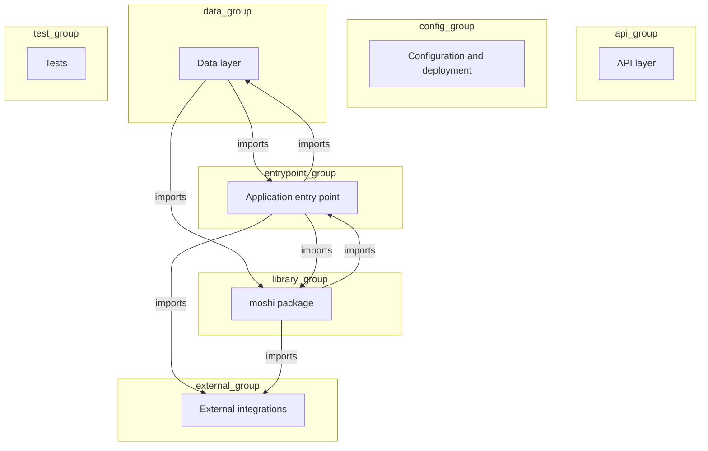

# Architecture report: NVIDIA/personaplex

> Automated static analysis. **Observed** = directly seen in files/imports/AST; **Inferred** = interpretation from that evidence. Repository code was not executed.

## 1. Repository at a glance

| Item | Value |
| --- | --- |
| Repository | NVIDIA/personaplex |
| Description | PersonaPlex code. |
| Language | Python |
| Stars | 12130 |
| Licence | MIT |
| Analysed commit / branch | 16419a2ef7b98611f58c9df07477d00e5ad61d5f / main |
| Framework(s) | React |
| Files analysed | 96 |
| Components | 7 |

## 2. Architecture in one minute

NVIDIA/personaplex - PersonaPlex code.. This repository was analysed statically from 96 file(s) (26 Python). Detected technologies (observed from imports/manifests): React, aiohttp, NumPy, React Router, Tailwind CSS, Poetry. Files are grouped into 7 component(s): API layer, Configuration and deployment, Data layer, Application entry point, External integrations, moshi package, Tests. Observed entry point(s): moshi/moshi/modules/streaming.py, moshi/moshi/offline.py, moshi/moshi/utils/sampling.py. Findings below distinguish observed facts from inferred interpretation.

## 3. High-level block diagram

## 4. Main components

### API layer (`api_layer`)

- **Kind:** api
- **Status:** Observed
- **Confidence:** 0.85
- **Responsibility:** Groups 4 file(s) under api layer (observed from repository paths and static analysis).
- **Paths:** `client/src/pages/Queue/api/client.ts`, `client/src/pages/Queue/api/errors/api_error.ts`, `client/src/pages/Queue/api/errors/response_error.ts`, `client/src/pages/Queue/api/validators.ts`
- **Evidence:** [client/src/pages/Queue/api/client.ts](https://github.com/NVIDIA/personaplex/blob/16419a2ef7b98611f58c9df07477d00e5ad61d5f/client/src/pages/Queue/api/client.ts); [client/src/pages/Queue/api/errors/api_error.ts](https://github.com/NVIDIA/personaplex/blob/16419a2ef7b98611f58c9df07477d00e5ad61d5f/client/src/pages/Queue/api/errors/api_error.ts); [client/src/pages/Queue/api/errors/response_error.ts](https://github.com/NVIDIA/personaplex/blob/16419a2ef7b98611f58c9df07477d00e5ad61d5f/client/src/pages/Queue/api/errors/response_error.ts); [client/src/pages/Queue/api/validators.ts](https://github.com/NVIDIA/personaplex/blob/16419a2ef7b98611f58c9df07477d00e5ad61d5f/client/src/pages/Queue/api/validators.ts)

### Configuration and deployment (`config`)

- **Kind:** config
- **Status:** Observed
- **Confidence:** 0.85
- **Responsibility:** Groups 11 file(s) under configuration and deployment (observed from repository paths and static analysis).
- **Paths:** `Dockerfile`, `client/.eslinrc.json`, `client/.prettierrc.json`, `client/Dockerfile`, `client/package.json`, `client/tsconfig.json`, `docker-compose.yaml`, `moshi/MANIFEST.in`, `moshi/pyproject.toml`, `moshi/requirements.txt`, `moshi/setup.cfg`
- **Evidence:** [Dockerfile](https://github.com/NVIDIA/personaplex/blob/16419a2ef7b98611f58c9df07477d00e5ad61d5f/Dockerfile); [client/.eslinrc.json](https://github.com/NVIDIA/personaplex/blob/16419a2ef7b98611f58c9df07477d00e5ad61d5f/client/.eslinrc.json); [client/.prettierrc.json](https://github.com/NVIDIA/personaplex/blob/16419a2ef7b98611f58c9df07477d00e5ad61d5f/client/.prettierrc.json); [client/Dockerfile](https://github.com/NVIDIA/personaplex/blob/16419a2ef7b98611f58c9df07477d00e5ad61d5f/client/Dockerfile); [client/package.json](https://github.com/NVIDIA/personaplex/blob/16419a2ef7b98611f58c9df07477d00e5ad61d5f/client/package.json); [client/tsconfig.json](https://github.com/NVIDIA/personaplex/blob/16419a2ef7b98611f58c9df07477d00e5ad61d5f/client/tsconfig.json); [docker-compose.yaml](https://github.com/NVIDIA/personaplex/blob/16419a2ef7b98611f58c9df07477d00e5ad61d5f/docker-compose.yaml); [moshi/MANIFEST.in](https://github.com/NVIDIA/personaplex/blob/16419a2ef7b98611f58c9df07477d00e5ad61d5f/moshi/MANIFEST.in)

### Data layer (`data_layer`)

- **Kind:** data
- **Status:** Observed
- **Confidence:** 0.85
- **Responsibility:** Groups 4 file(s) under data layer (observed from repository paths and static analysis). Observed top-level classes: CompressionModel, LMGen, LMModel, LMOutput, MimiModel, ScaledEmbedding. Observed top-level functions: _delay_sequence, _get_moshi_lm_with_offload, _is_safetensors, _iterate_audio, _undelay_sequence, create_loss_report.
- **Paths:** `moshi/moshi/models/__init__.py`, `moshi/moshi/models/compression.py`, `moshi/moshi/models/lm.py`, `moshi/moshi/models/loaders.py`
- **Evidence:** [moshi/moshi/models/__init__.py](https://github.com/NVIDIA/personaplex/blob/16419a2ef7b98611f58c9df07477d00e5ad61d5f/moshi/moshi/models/__init__.py); [moshi/moshi/models/compression.py:40](https://github.com/NVIDIA/personaplex/blob/16419a2ef7b98611f58c9df07477d00e5ad61d5f/moshi/moshi/models/compression.py#L40); [moshi/moshi/models/lm.py:64](https://github.com/NVIDIA/personaplex/blob/16419a2ef7b98611f58c9df07477d00e5ad61d5f/moshi/moshi/models/lm.py#L64); [moshi/moshi/models/loaders.py:125](https://github.com/NVIDIA/personaplex/blob/16419a2ef7b98611f58c9df07477d00e5ad61d5f/moshi/moshi/models/loaders.py#L125)

### Application entry point (`entrypoint`)

- **Kind:** entrypoint
- **Status:** Observed
- **Confidence:** 0.85
- **Responsibility:** Groups 4 file(s) under application entry point (observed from repository paths and static analysis). Observed top-level classes: RawStreamingConv1d, RawStreamingConvTranspose1d, Resetable, ServerState, StreamingAdd, StreamingContainer. Observed top-level functions: _flatten_streaming_state, _get_static_path, _get_voice_prompt_dir, _restore_streaming_state_from_keys, _restore_streaming_state_pt, _set_streaming_state_inplace.
- **Paths:** `moshi/moshi/modules/streaming.py`, `moshi/moshi/offline.py`, `moshi/moshi/server.py`, `moshi/moshi/utils/sampling.py`
- **Evidence:** [moshi/moshi/modules/streaming.py:47](https://github.com/NVIDIA/personaplex/blob/16419a2ef7b98611f58c9df07477d00e5ad61d5f/moshi/moshi/modules/streaming.py#L47); [moshi/moshi/offline.py:62](https://github.com/NVIDIA/personaplex/blob/16419a2ef7b98611f58c9df07477d00e5ad61d5f/moshi/moshi/offline.py#L62); [moshi/moshi/server.py:57](https://github.com/NVIDIA/personaplex/blob/16419a2ef7b98611f58c9df07477d00e5ad61d5f/moshi/moshi/server.py#L57); [moshi/moshi/utils/sampling.py:36](https://github.com/NVIDIA/personaplex/blob/16419a2ef7b98611f58c9df07477d00e5ad61d5f/moshi/moshi/utils/sampling.py#L36)

### External integrations (`external_integrations`)

- **Kind:** external
- **Status:** Observed
- **Confidence:** 0.85
- **Responsibility:** Groups 40 file(s) under external integrations (observed from repository paths and static analysis).
- **Paths:** `client/postcss.config.js`, `client/src/app.tsx`, `client/src/audio-processor.ts`, `client/src/components/Button/Button.tsx`, `client/src/components/Input/Input.tsx`, `client/src/decoder/decoderWorker.ts`, `client/src/env.ts`, `client/src/modules.d.ts`, `client/src/pages/Conversation/Conversation.tsx`, `client/src/pages/Conversation/MediaContext.ts`, `client/src/pages/Conversation/SocketContext.ts`, `client/src/pages/Conversation/components/AudioVisualizer/AudioVisualizer.tsx`, `client/src/pages/Conversation/components/AudioVisualizer/ClientVisualizer.tsx`, `client/src/pages/Conversation/components/AudioVisualizer/ServerVisualizer.tsx`, `client/src/pages/Conversation/components/Controls/Controls.tsx`, `client/src/pages/Conversation/components/ModelParams/ModelParams.tsx`, `client/src/pages/Conversation/components/ServerAudio/ServerAudio.tsx`, `client/src/pages/Conversation/components/ServerAudio/ServerAudioStats.tsx`, `client/src/pages/Conversation/components/ServerInfo/ServerInfo.tsx`, `client/src/pages/Conversation/components/TextDisplay/TextDisplay.tsx`, `client/src/pages/Conversation/components/TextDisplay/TextDisplayStats.tsx`, `client/src/pages/Conversation/components/UserAudio/UserAudio.tsx`, `client/src/pages/Conversation/components/UserAudio/UserAudioStats.tsx`, `client/src/pages/Conversation/getMimeType.ts`, `client/src/pages/Conversation/hooks/audioUtils.ts`, `client/src/pages/Conversation/hooks/useLocalStorage.ts`, `client/src/pages/Conversation/hooks/useModelParams.ts`, `client/src/pages/Conversation/hooks/useServerAudio.ts`, `client/src/pages/Conversation/hooks/useServerInfo.ts`, `client/src/pages/Conversation/hooks/useServerText.ts`, `client/src/pages/Conversation/hooks/useSocket.ts`, `client/src/pages/Conversation/hooks/useSystemTheme.ts`, `client/src/pages/Conversation/hooks/useUserAudio.ts`, `client/src/pages/Queue/Queue.tsx`, `client/src/pages/Queue/hooks/useUserEmail.ts`, `client/src/protocol/encoder.ts`, `client/src/protocol/testMessages.ts`, `client/src/protocol/types.ts`, `client/tailwind.config.js`, `client/vite.config.ts`
- **Evidence:** [client/postcss.config.js](https://github.com/NVIDIA/personaplex/blob/16419a2ef7b98611f58c9df07477d00e5ad61d5f/client/postcss.config.js); [client/src/app.tsx](https://github.com/NVIDIA/personaplex/blob/16419a2ef7b98611f58c9df07477d00e5ad61d5f/client/src/app.tsx); [client/src/audio-processor.ts](https://github.com/NVIDIA/personaplex/blob/16419a2ef7b98611f58c9df07477d00e5ad61d5f/client/src/audio-processor.ts); [client/src/components/Button/Button.tsx](https://github.com/NVIDIA/personaplex/blob/16419a2ef7b98611f58c9df07477d00e5ad61d5f/client/src/components/Button/Button.tsx); [client/src/components/Input/Input.tsx](https://github.com/NVIDIA/personaplex/blob/16419a2ef7b98611f58c9df07477d00e5ad61d5f/client/src/components/Input/Input.tsx); [client/src/decoder/decoderWorker.ts](https://github.com/NVIDIA/personaplex/blob/16419a2ef7b98611f58c9df07477d00e5ad61d5f/client/src/decoder/decoderWorker.ts); [client/src/env.ts](https://github.com/NVIDIA/personaplex/blob/16419a2ef7b98611f58c9df07477d00e5ad61d5f/client/src/env.ts); [client/src/modules.d.ts](https://github.com/NVIDIA/personaplex/blob/16419a2ef7b98611f58c9df07477d00e5ad61d5f/client/src/modules.d.ts)

### moshi package (`moshi`)

- **Kind:** library
- **Status:** Observed
- **Confidence:** 0.85
- **Responsibility:** Groups 18 file(s) under moshi package (observed from repository paths and static analysis). Observed top-level classes: ActivationGating, BaseQuantizer, CUDAGraphed, Checkpoint, ColorizedLog, ConvDownsample1d. Observed top-level functions: _compute_entropy, _ema_inplace, _get_activation, _is_cuda_graph_enabled, _is_distributed, _make_gating.
- **Paths:** `moshi/moshi/__init__.py`, `moshi/moshi/client_utils.py`, `moshi/moshi/modules/__init__.py`, `moshi/moshi/modules/conv.py`, `moshi/moshi/modules/gating.py`, `moshi/moshi/modules/resample.py`, `moshi/moshi/modules/rope.py`, `moshi/moshi/modules/seanet.py`, `moshi/moshi/modules/transformer.py`, `moshi/moshi/quantization/__init__.py`, `moshi/moshi/quantization/base.py`, `moshi/moshi/quantization/core_vq.py`, `moshi/moshi/quantization/vq.py`, `moshi/moshi/utils/__init__.py`, `moshi/moshi/utils/autocast.py`, `moshi/moshi/utils/compile.py`, `moshi/moshi/utils/connection.py`, `moshi/moshi/utils/logging.py`
- **Evidence:** [moshi/moshi/__init__.py](https://github.com/NVIDIA/personaplex/blob/16419a2ef7b98611f58c9df07477d00e5ad61d5f/moshi/moshi/__init__.py); [moshi/moshi/client_utils.py:11](https://github.com/NVIDIA/personaplex/blob/16419a2ef7b98611f58c9df07477d00e5ad61d5f/moshi/moshi/client_utils.py#L11); [moshi/moshi/modules/__init__.py](https://github.com/NVIDIA/personaplex/blob/16419a2ef7b98611f58c9df07477d00e5ad61d5f/moshi/moshi/modules/__init__.py); [moshi/moshi/modules/conv.py:48](https://github.com/NVIDIA/personaplex/blob/16419a2ef7b98611f58c9df07477d00e5ad61d5f/moshi/moshi/modules/conv.py#L48); [moshi/moshi/modules/gating.py:34](https://github.com/NVIDIA/personaplex/blob/16419a2ef7b98611f58c9df07477d00e5ad61d5f/moshi/moshi/modules/gating.py#L34); [moshi/moshi/modules/resample.py:35](https://github.com/NVIDIA/personaplex/blob/16419a2ef7b98611f58c9df07477d00e5ad61d5f/moshi/moshi/modules/resample.py#L35); [moshi/moshi/modules/rope.py:33](https://github.com/NVIDIA/personaplex/blob/16419a2ef7b98611f58c9df07477d00e5ad61d5f/moshi/moshi/modules/rope.py#L33); [moshi/moshi/modules/seanet.py:42](https://github.com/NVIDIA/personaplex/blob/16419a2ef7b98611f58c9df07477d00e5ad61d5f/moshi/moshi/modules/seanet.py#L42)

### Tests (`tests`)

- **Kind:** test
- **Status:** Observed
- **Confidence:** 0.85
- **Responsibility:** Groups 1 file(s) under tests (observed from repository paths and static analysis).
- **Paths:** `assets/test/prompt_service.txt`
- **Evidence:** [assets/test/prompt_service.txt](https://github.com/NVIDIA/personaplex/blob/16419a2ef7b98611f58c9df07477d00e5ad61d5f/assets/test/prompt_service.txt)

## 5. Execution flow

**Observed** entry point(s):

- [client/src/app.tsx](https://github.com/NVIDIA/personaplex/blob/16419a2ef7b98611f58c9df07477d00e5ad61d5f/client/src/app.tsx)
- [moshi/moshi/modules/streaming.py:628](https://github.com/NVIDIA/personaplex/blob/16419a2ef7b98611f58c9df07477d00e5ad61d5f/moshi/moshi/modules/streaming.py#L628)
- [moshi/moshi/offline.py:451](https://github.com/NVIDIA/personaplex/blob/16419a2ef7b98611f58c9df07477d00e5ad61d5f/moshi/moshi/offline.py#L451)
- [moshi/moshi/utils/sampling.py:129](https://github.com/NVIDIA/personaplex/blob/16419a2ef7b98611f58c9df07477d00e5ad61d5f/moshi/moshi/utils/sampling.py#L129)

Representative flow (derived from observed entry points and the import graph; steps beyond the entry point are **Inferred**):

1. Execution starts at an observed entry point listed above, if present.
2. `data_layer` imports `entrypoint` (Data layer -> Application entry point).
3. `data_layer` imports `moshi` (Data layer -> moshi package).
4. `entrypoint` imports `data_layer` (Application entry point -> Data layer).
5. `entrypoint` imports `external_integrations` (Application entry point -> External integrations).
6. `entrypoint` imports `moshi` (Application entry point -> moshi package).
7. `moshi` imports `entrypoint` (moshi package -> Application entry point).
8. `moshi` imports `external_integrations` (moshi package -> External integrations).

## 6. Project structure

### `(root)`

- `.dockerignore` - container (6 bytes)
- `.gitignore` - other (3346 bytes)
- `Dockerfile` - container (575 bytes)
- `LICENSE-MIT` - other (1023 bytes)
- `README.md` - docs (10131 bytes)
- `docker-compose.yaml` - container (385 bytes)

### `.github`

- `.github/ISSUE_TEMPLATE/bug.yml` - config (2046 bytes)
- `.github/ISSUE_TEMPLATE/question.yml` - config (1148 bytes)

### `assets`

- `assets/test/prompt_service.txt` - test (261 bytes)

### `client`

- `client/.eslinrc.json` - config (494 bytes)
- `client/.nvmrc` - other (9 bytes)
- `client/.prettierignore` - other (6 bytes)
- `client/.prettierrc.json` - config (198 bytes)
- `client/Dockerfile` - container (390 bytes)
- `client/LICENSE` - docs (1023 bytes)
- `client/README.md` - docs (956 bytes)
- `client/index.html` - other (542 bytes)
- `client/package.json` - manifest (1311 bytes)
- `client/postcss.config.js` - source, JavaScript (81 bytes)
- `client/src/app.tsx` - source, TypeScript (393 bytes)
- `client/src/audio-processor.ts` - source, TypeScript (6551 bytes)
- `client/src/components/Button/Button.tsx` - source, TypeScript (396 bytes)
- `client/src/components/Input/Input.tsx` - source, TypeScript (475 bytes)
- `client/src/decoder/decoderWorker.ts` - source, TypeScript (5413 bytes)
- `client/src/env.ts` - source, TypeScript (426 bytes)
- `client/src/index.css` - other (1981 bytes)
- `client/src/modules.d.ts` - source, TypeScript (32 bytes)
- `client/src/pages/Conversation/Conversation.tsx` - source, TypeScript (10104 bytes)
- `client/src/pages/Conversation/MediaContext.ts` - source, TypeScript (768 bytes)
- `client/src/pages/Conversation/SocketContext.ts` - source, TypeScript (481 bytes)
- `client/src/pages/Conversation/components/AudioVisualizer/AudioVisualizer.tsx` - source, TypeScript (2032 bytes)
- `client/src/pages/Conversation/components/AudioVisualizer/ClientVisualizer.tsx` - source, TypeScript (3933 bytes)
- `client/src/pages/Conversation/components/AudioVisualizer/ServerVisualizer.tsx` - source, TypeScript (3524 bytes)
- `client/src/pages/Conversation/components/Controls/Controls.tsx` - source, TypeScript (709 bytes)
- `client/src/pages/Conversation/components/ModelParams/ModelParams.tsx` - source, TypeScript (3516 bytes)
- `client/src/pages/Conversation/components/ServerAudio/ServerAudio.tsx` - source, TypeScript (1258 bytes)
- `client/src/pages/Conversation/components/ServerAudio/ServerAudioStats.tsx` - source, TypeScript (2448 bytes)
- `client/src/pages/Conversation/components/ServerInfo/ServerInfo.tsx` - source, TypeScript (903 bytes)
- `client/src/pages/Conversation/components/TextDisplay/TextDisplay.tsx` - source, TypeScript (925 bytes)
- `client/src/pages/Conversation/components/TextDisplay/TextDisplayStats.tsx` - source, TypeScript (496 bytes)
- `client/src/pages/Conversation/components/UserAudio/UserAudio.tsx` - source, TypeScript (2058 bytes)
- `client/src/pages/Conversation/components/UserAudio/UserAudioStats.tsx` - source, TypeScript (459 bytes)
- `client/src/pages/Conversation/getMimeType.ts` - source, TypeScript (1603 bytes)
- `client/src/pages/Conversation/hooks/audioUtils.ts` - source, TypeScript (117 bytes)
- `client/src/pages/Conversation/hooks/useLocalStorage.ts` - source, TypeScript (704 bytes)
- `client/src/pages/Conversation/hooks/useModelParams.ts` - source, TypeScript (5319 bytes)
- `client/src/pages/Conversation/hooks/useServerAudio.ts` - source, TypeScript (6382 bytes)
- `client/src/pages/Conversation/hooks/useServerInfo.ts` - source, TypeScript (2478 bytes)
- `client/src/pages/Conversation/hooks/useServerText.ts` - source, TypeScript (1000 bytes)
- `client/src/pages/Conversation/hooks/useSocket.ts` - source, TypeScript (3725 bytes)
- `client/src/pages/Conversation/hooks/useSystemTheme.ts` - source, TypeScript (959 bytes)
- `client/src/pages/Conversation/hooks/useUserAudio.ts` - source, TypeScript (4393 bytes)
- `client/src/pages/Queue/Queue.tsx` - source, TypeScript (8726 bytes)
- `client/src/pages/Queue/api/client.ts` - source, TypeScript (2521 bytes)
- `client/src/pages/Queue/api/errors/api_error.ts` - source, TypeScript (183 bytes)
- `client/src/pages/Queue/api/errors/response_error.ts` - source, TypeScript (134 bytes)
- `client/src/pages/Queue/api/validators.ts` - source, TypeScript (570 bytes)
- `client/src/pages/Queue/hooks/useUserEmail.ts` - source, TypeScript (676 bytes)
- `client/src/protocol/encoder.ts` - source, TypeScript (2150 bytes)
- `client/src/protocol/testMessages.ts` - source, TypeScript (572 bytes)
- `client/src/protocol/types.ts` - source, TypeScript (1000 bytes)
- `client/tailwind.config.js` - source, JavaScript (262 bytes)
- `client/tsconfig.json` - config (602 bytes)
- `client/vite.config.ts` - source, TypeScript (879 bytes)

### `moshi`

- `moshi/LICENSE.audiocraft` - other (1088 bytes)
- `moshi/LICENSE.moshi` - other (1058 bytes)
- `moshi/MANIFEST.in` - manifest (92 bytes)
- `moshi/moshi/__init__.py` - source, Python (491 bytes)
- `moshi/moshi/client_utils.py` - source, Python (6356 bytes)
- `moshi/moshi/models/__init__.py` - source, Python (370 bytes)
- `moshi/moshi/models/compression.py` - source, Python (16955 bytes)
- `moshi/moshi/models/lm.py` - source, Python (57076 bytes)
- `moshi/moshi/models/loaders.py` - source, Python (12794 bytes)
- `moshi/moshi/modules/__init__.py` - source, Python (677 bytes)
- `moshi/moshi/modules/conv.py` - source, Python (12061 bytes)
- `moshi/moshi/modules/gating.py` - source, Python (3946 bytes)
- `moshi/moshi/modules/resample.py` - source, Python (4734 bytes)
- `moshi/moshi/modules/rope.py` - source, Python (3756 bytes)
- `moshi/moshi/modules/seanet.py` - source, Python (16942 bytes)
- `moshi/moshi/modules/streaming.py` - source, Python (24356 bytes)
- `moshi/moshi/modules/transformer.py` - source, Python (39419 bytes)
- `moshi/moshi/offline.py` - source, Python (17881 bytes)
- `moshi/moshi/quantization/__init__.py` - source, Python (525 bytes)
- `moshi/moshi/quantization/base.py` - source, Python (5648 bytes)
- `moshi/moshi/quantization/core_vq.py` - source, Python (14475 bytes)
- `moshi/moshi/quantization/vq.py` - source, Python (15734 bytes)
- `moshi/moshi/server.py` - source, Python (21651 bytes)
- `moshi/moshi/utils/__init__.py` - source, Python (381 bytes)
- `moshi/moshi/utils/autocast.py` - source, Python (1544 bytes)
- `moshi/moshi/utils/compile.py` - source, Python (11996 bytes)
- `moshi/moshi/utils/connection.py` - source, Python (6797 bytes)
- `moshi/moshi/utils/logging.py` - source, Python (2794 bytes)
- `moshi/moshi/utils/sampling.py` - source, Python (5855 bytes)
- `moshi/pyproject.toml` - manifest (866 bytes)
- `moshi/requirements.txt` - manifest (173 bytes)
- `moshi/setup.cfg` - manifest (115 bytes)

## 7. Key dependencies and integrations

| Name | Category | Status | Confidence | Evidence |
| --- | --- | --- | --- | --- |
| React | framework | Observed | 0.90 | [client/package.json:17](https://github.com/NVIDIA/personaplex/blob/16419a2ef7b98611f58c9df07477d00e5ad61d5f/client/package.json#L17); [client/package.json:18](https://github.com/NVIDIA/personaplex/blob/16419a2ef7b98611f58c9df07477d00e5ad61d5f/client/package.json#L18) |
| aiohttp | library | Observed | 0.95 | [moshi/moshi/server.py:39](https://github.com/NVIDIA/personaplex/blob/16419a2ef7b98611f58c9df07477d00e5ad61d5f/moshi/moshi/server.py#L39); [moshi/moshi/server.py:40](https://github.com/NVIDIA/personaplex/blob/16419a2ef7b98611f58c9df07477d00e5ad61d5f/moshi/moshi/server.py#L40); [moshi/pyproject.toml:14](https://github.com/NVIDIA/personaplex/blob/16419a2ef7b98611f58c9df07477d00e5ad61d5f/moshi/pyproject.toml#L14); [moshi/requirements.txt:9](https://github.com/NVIDIA/personaplex/blob/16419a2ef7b98611f58c9df07477d00e5ad61d5f/moshi/requirements.txt#L9) |
| NumPy | library | Observed | 0.95 | [moshi/moshi/models/lm.py:37](https://github.com/NVIDIA/personaplex/blob/16419a2ef7b98611f58c9df07477d00e5ad61d5f/moshi/moshi/models/lm.py#L37); [moshi/moshi/modules/seanet.py:34](https://github.com/NVIDIA/personaplex/blob/16419a2ef7b98611f58c9df07477d00e5ad61d5f/moshi/moshi/modules/seanet.py#L34); [moshi/moshi/offline.py:49](https://github.com/NVIDIA/personaplex/blob/16419a2ef7b98611f58c9df07477d00e5ad61d5f/moshi/moshi/offline.py#L49); [moshi/moshi/offline.py:76](https://github.com/NVIDIA/personaplex/blob/16419a2ef7b98611f58c9df07477d00e5ad61d5f/moshi/moshi/offline.py#L76) |
| React Router | library | Observed | 0.85 | [client/package.json:43](https://github.com/NVIDIA/personaplex/blob/16419a2ef7b98611f58c9df07477d00e5ad61d5f/client/package.json#L43) |
| Tailwind CSS | library | Observed | 0.85 | [client/package.json:31](https://github.com/NVIDIA/personaplex/blob/16419a2ef7b98611f58c9df07477d00e5ad61d5f/client/package.json#L31) |
| Poetry | packaging | Observed | 0.85 | [moshi/pyproject.toml](https://github.com/NVIDIA/personaplex/blob/16419a2ef7b98611f58c9df07477d00e5ad61d5f/moshi/pyproject.toml) |
| setuptools | packaging | Observed | 0.85 | [moshi/pyproject.toml:26](https://github.com/NVIDIA/personaplex/blob/16419a2ef7b98611f58c9df07477d00e5ad61d5f/moshi/pyproject.toml#L26) |
| Docker | tooling | Observed | 0.90 | [Dockerfile](https://github.com/NVIDIA/personaplex/blob/16419a2ef7b98611f58c9df07477d00e5ad61d5f/Dockerfile); [client/Dockerfile](https://github.com/NVIDIA/personaplex/blob/16419a2ef7b98611f58c9df07477d00e5ad61d5f/client/Dockerfile) |
| Docker Compose | tooling | Observed | 0.85 | [docker-compose.yaml](https://github.com/NVIDIA/personaplex/blob/16419a2ef7b98611f58c9df07477d00e5ad61d5f/docker-compose.yaml) |
| TypeScript | tooling | Observed | 0.85 | [client/package.json:33](https://github.com/NVIDIA/personaplex/blob/16419a2ef7b98611f58c9df07477d00e5ad61d5f/client/package.json#L33) |
| Vite | tooling | Observed | 0.85 | [client/package.json:7](https://github.com/NVIDIA/personaplex/blob/16419a2ef7b98611f58c9df07477d00e5ad61d5f/client/package.json#L7) |

## 8. Data and state

- Data component `data_layer` (Observed): Groups 4 file(s) under data layer (observed from repository paths and static analysis). Observed top-level classes: CompressionModel, LMGen, LMModel, LMOutput, MimiModel, ScaledEmbedding. Observed top-level functions: _delay_sequence, _get_moshi_lm_with_offload, _is_safetensors, _iterate_audio, _un…

## 9. Configuration and deployment clues

- `.dockerignore` (container)
- `.github/ISSUE_TEMPLATE/bug.yml` (config)
- `.github/ISSUE_TEMPLATE/question.yml` (config)
- `Dockerfile` (container)
- `client/.eslinrc.json` (config)
- `client/.prettierrc.json` (config)
- `client/Dockerfile` (container)
- `client/package.json` (manifest)
- `client/tsconfig.json` (config)
- `docker-compose.yaml` (container)
- `moshi/MANIFEST.in` (manifest)
- `moshi/pyproject.toml` (manifest)
- `moshi/requirements.txt` (manifest)
- `moshi/setup.cfg` (manifest)

Console scripts declared in packaging metadata (**Observed**):

- `moshi-offline` -> `moshi.offline:main`
- `moshi-server` -> `moshi.server:main`

## 10. Design observations

- An entry/API layer is separated from other code (Inferred from paths and decorators).
- Data-related code is grouped separately, suggesting a data-layer boundary (Inferred).
- Tests are present alongside source code (Observed from test file paths).
- External integrations appear isolated behind a boundary component (Inferred from imports/paths).

These observations are interpretations (**Inferred**) of the observed structure, not guarantees about runtime design.

## 11. Limitations and unknowns

- Static analysis only: repository code was not executed, installed, or imported at runtime.
- Components and relationships are inferred from file paths, imports, and AST structure; runtime behaviour, dynamic imports, and reflection may not be visible.
- 2 file(s) were skipped during inventory (1 x likely secret file excluded; 1 x lockfile excluded).
- Repository text was treated as untrusted data; no instructions found in repository files were followed, and likely secret values were redacted/excluded.

## 12. Source references

- [Dockerfile](https://github.com/NVIDIA/personaplex/blob/16419a2ef7b98611f58c9df07477d00e5ad61d5f/Dockerfile)
- [assets/test/prompt_service.txt](https://github.com/NVIDIA/personaplex/blob/16419a2ef7b98611f58c9df07477d00e5ad61d5f/assets/test/prompt_service.txt)
- [client/.eslinrc.json](https://github.com/NVIDIA/personaplex/blob/16419a2ef7b98611f58c9df07477d00e5ad61d5f/client/.eslinrc.json)
- [client/.prettierrc.json](https://github.com/NVIDIA/personaplex/blob/16419a2ef7b98611f58c9df07477d00e5ad61d5f/client/.prettierrc.json)
- [client/Dockerfile](https://github.com/NVIDIA/personaplex/blob/16419a2ef7b98611f58c9df07477d00e5ad61d5f/client/Dockerfile)
- [client/package.json](https://github.com/NVIDIA/personaplex/blob/16419a2ef7b98611f58c9df07477d00e5ad61d5f/client/package.json)
- [client/package.json:7](https://github.com/NVIDIA/personaplex/blob/16419a2ef7b98611f58c9df07477d00e5ad61d5f/client/package.json#L7)
- [client/package.json:17](https://github.com/NVIDIA/personaplex/blob/16419a2ef7b98611f58c9df07477d00e5ad61d5f/client/package.json#L17)
- [client/package.json:18](https://github.com/NVIDIA/personaplex/blob/16419a2ef7b98611f58c9df07477d00e5ad61d5f/client/package.json#L18)
- [client/package.json:31](https://github.com/NVIDIA/personaplex/blob/16419a2ef7b98611f58c9df07477d00e5ad61d5f/client/package.json#L31)
- [client/package.json:33](https://github.com/NVIDIA/personaplex/blob/16419a2ef7b98611f58c9df07477d00e5ad61d5f/client/package.json#L33)
- [client/package.json:43](https://github.com/NVIDIA/personaplex/blob/16419a2ef7b98611f58c9df07477d00e5ad61d5f/client/package.json#L43)
- [client/postcss.config.js](https://github.com/NVIDIA/personaplex/blob/16419a2ef7b98611f58c9df07477d00e5ad61d5f/client/postcss.config.js)
- [client/src/app.tsx](https://github.com/NVIDIA/personaplex/blob/16419a2ef7b98611f58c9df07477d00e5ad61d5f/client/src/app.tsx)
- [client/src/audio-processor.ts](https://github.com/NVIDIA/personaplex/blob/16419a2ef7b98611f58c9df07477d00e5ad61d5f/client/src/audio-processor.ts)
- [client/src/components/Button/Button.tsx](https://github.com/NVIDIA/personaplex/blob/16419a2ef7b98611f58c9df07477d00e5ad61d5f/client/src/components/Button/Button.tsx)
- [client/src/components/Input/Input.tsx](https://github.com/NVIDIA/personaplex/blob/16419a2ef7b98611f58c9df07477d00e5ad61d5f/client/src/components/Input/Input.tsx)
- [client/src/decoder/decoderWorker.ts](https://github.com/NVIDIA/personaplex/blob/16419a2ef7b98611f58c9df07477d00e5ad61d5f/client/src/decoder/decoderWorker.ts)
- [client/src/env.ts](https://github.com/NVIDIA/personaplex/blob/16419a2ef7b98611f58c9df07477d00e5ad61d5f/client/src/env.ts)
- [client/src/modules.d.ts](https://github.com/NVIDIA/personaplex/blob/16419a2ef7b98611f58c9df07477d00e5ad61d5f/client/src/modules.d.ts)
- [client/src/pages/Queue/api/client.ts](https://github.com/NVIDIA/personaplex/blob/16419a2ef7b98611f58c9df07477d00e5ad61d5f/client/src/pages/Queue/api/client.ts)
- [client/src/pages/Queue/api/errors/api_error.ts](https://github.com/NVIDIA/personaplex/blob/16419a2ef7b98611f58c9df07477d00e5ad61d5f/client/src/pages/Queue/api/errors/api_error.ts)
- [client/src/pages/Queue/api/errors/response_error.ts](https://github.com/NVIDIA/personaplex/blob/16419a2ef7b98611f58c9df07477d00e5ad61d5f/client/src/pages/Queue/api/errors/response_error.ts)
- [client/src/pages/Queue/api/validators.ts](https://github.com/NVIDIA/personaplex/blob/16419a2ef7b98611f58c9df07477d00e5ad61d5f/client/src/pages/Queue/api/validators.ts)
- [client/tsconfig.json](https://github.com/NVIDIA/personaplex/blob/16419a2ef7b98611f58c9df07477d00e5ad61d5f/client/tsconfig.json)
- [docker-compose.yaml](https://github.com/NVIDIA/personaplex/blob/16419a2ef7b98611f58c9df07477d00e5ad61d5f/docker-compose.yaml)
- [moshi/MANIFEST.in](https://github.com/NVIDIA/personaplex/blob/16419a2ef7b98611f58c9df07477d00e5ad61d5f/moshi/MANIFEST.in)
- [moshi/moshi/__init__.py](https://github.com/NVIDIA/personaplex/blob/16419a2ef7b98611f58c9df07477d00e5ad61d5f/moshi/moshi/__init__.py)
- [moshi/moshi/client_utils.py:11](https://github.com/NVIDIA/personaplex/blob/16419a2ef7b98611f58c9df07477d00e5ad61d5f/moshi/moshi/client_utils.py#L11)
- [moshi/moshi/models/__init__.py](https://github.com/NVIDIA/personaplex/blob/16419a2ef7b98611f58c9df07477d00e5ad61d5f/moshi/moshi/models/__init__.py)
- [moshi/moshi/models/compression.py:40](https://github.com/NVIDIA/personaplex/blob/16419a2ef7b98611f58c9df07477d00e5ad61d5f/moshi/moshi/models/compression.py#L40)
- [moshi/moshi/models/lm.py:37](https://github.com/NVIDIA/personaplex/blob/16419a2ef7b98611f58c9df07477d00e5ad61d5f/moshi/moshi/models/lm.py#L37)
- [moshi/moshi/models/lm.py:64](https://github.com/NVIDIA/personaplex/blob/16419a2ef7b98611f58c9df07477d00e5ad61d5f/moshi/moshi/models/lm.py#L64)
- [moshi/moshi/models/loaders.py:125](https://github.com/NVIDIA/personaplex/blob/16419a2ef7b98611f58c9df07477d00e5ad61d5f/moshi/moshi/models/loaders.py#L125)
- [moshi/moshi/modules/__init__.py](https://github.com/NVIDIA/personaplex/blob/16419a2ef7b98611f58c9df07477d00e5ad61d5f/moshi/moshi/modules/__init__.py)
- [moshi/moshi/modules/conv.py:48](https://github.com/NVIDIA/personaplex/blob/16419a2ef7b98611f58c9df07477d00e5ad61d5f/moshi/moshi/modules/conv.py#L48)
- [moshi/moshi/modules/gating.py:34](https://github.com/NVIDIA/personaplex/blob/16419a2ef7b98611f58c9df07477d00e5ad61d5f/moshi/moshi/modules/gating.py#L34)
- [moshi/moshi/modules/resample.py:35](https://github.com/NVIDIA/personaplex/blob/16419a2ef7b98611f58c9df07477d00e5ad61d5f/moshi/moshi/modules/resample.py#L35)
- [moshi/moshi/modules/rope.py:33](https://github.com/NVIDIA/personaplex/blob/16419a2ef7b98611f58c9df07477d00e5ad61d5f/moshi/moshi/modules/rope.py#L33)
- [moshi/moshi/modules/seanet.py:34](https://github.com/NVIDIA/personaplex/blob/16419a2ef7b98611f58c9df07477d00e5ad61d5f/moshi/moshi/modules/seanet.py#L34)
- [moshi/moshi/modules/seanet.py:42](https://github.com/NVIDIA/personaplex/blob/16419a2ef7b98611f58c9df07477d00e5ad61d5f/moshi/moshi/modules/seanet.py#L42)
- [moshi/moshi/modules/streaming.py:47](https://github.com/NVIDIA/personaplex/blob/16419a2ef7b98611f58c9df07477d00e5ad61d5f/moshi/moshi/modules/streaming.py#L47)
- [moshi/moshi/modules/streaming.py:628](https://github.com/NVIDIA/personaplex/blob/16419a2ef7b98611f58c9df07477d00e5ad61d5f/moshi/moshi/modules/streaming.py#L628)
- [moshi/moshi/offline.py:49](https://github.com/NVIDIA/personaplex/blob/16419a2ef7b98611f58c9df07477d00e5ad61d5f/moshi/moshi/offline.py#L49)
- [moshi/moshi/offline.py:62](https://github.com/NVIDIA/personaplex/blob/16419a2ef7b98611f58c9df07477d00e5ad61d5f/moshi/moshi/offline.py#L62)
- [moshi/moshi/offline.py:76](https://github.com/NVIDIA/personaplex/blob/16419a2ef7b98611f58c9df07477d00e5ad61d5f/moshi/moshi/offline.py#L76)
- [moshi/moshi/offline.py:451](https://github.com/NVIDIA/personaplex/blob/16419a2ef7b98611f58c9df07477d00e5ad61d5f/moshi/moshi/offline.py#L451)
- [moshi/moshi/server.py:39](https://github.com/NVIDIA/personaplex/blob/16419a2ef7b98611f58c9df07477d00e5ad61d5f/moshi/moshi/server.py#L39)
- [moshi/moshi/server.py:40](https://github.com/NVIDIA/personaplex/blob/16419a2ef7b98611f58c9df07477d00e5ad61d5f/moshi/moshi/server.py#L40)
- [moshi/moshi/server.py:42](https://github.com/NVIDIA/personaplex/blob/16419a2ef7b98611f58c9df07477d00e5ad61d5f/moshi/moshi/server.py#L42)
- [moshi/moshi/server.py:57](https://github.com/NVIDIA/personaplex/blob/16419a2ef7b98611f58c9df07477d00e5ad61d5f/moshi/moshi/server.py#L57)
- [moshi/moshi/utils/sampling.py:36](https://github.com/NVIDIA/personaplex/blob/16419a2ef7b98611f58c9df07477d00e5ad61d5f/moshi/moshi/utils/sampling.py#L36)
- [moshi/moshi/utils/sampling.py:129](https://github.com/NVIDIA/personaplex/blob/16419a2ef7b98611f58c9df07477d00e5ad61d5f/moshi/moshi/utils/sampling.py#L129)
- [moshi/pyproject.toml](https://github.com/NVIDIA/personaplex/blob/16419a2ef7b98611f58c9df07477d00e5ad61d5f/moshi/pyproject.toml)
- [moshi/pyproject.toml:6](https://github.com/NVIDIA/personaplex/blob/16419a2ef7b98611f58c9df07477d00e5ad61d5f/moshi/pyproject.toml#L6)
- [moshi/pyproject.toml:14](https://github.com/NVIDIA/personaplex/blob/16419a2ef7b98611f58c9df07477d00e5ad61d5f/moshi/pyproject.toml#L14)
- [moshi/pyproject.toml:26](https://github.com/NVIDIA/personaplex/blob/16419a2ef7b98611f58c9df07477d00e5ad61d5f/moshi/pyproject.toml#L26)
- [moshi/requirements.txt:1](https://github.com/NVIDIA/personaplex/blob/16419a2ef7b98611f58c9df07477d00e5ad61d5f/moshi/requirements.txt#L1)
- [moshi/requirements.txt:9](https://github.com/NVIDIA/personaplex/blob/16419a2ef7b98611f58c9df07477d00e5ad61d5f/moshi/requirements.txt#L9)
