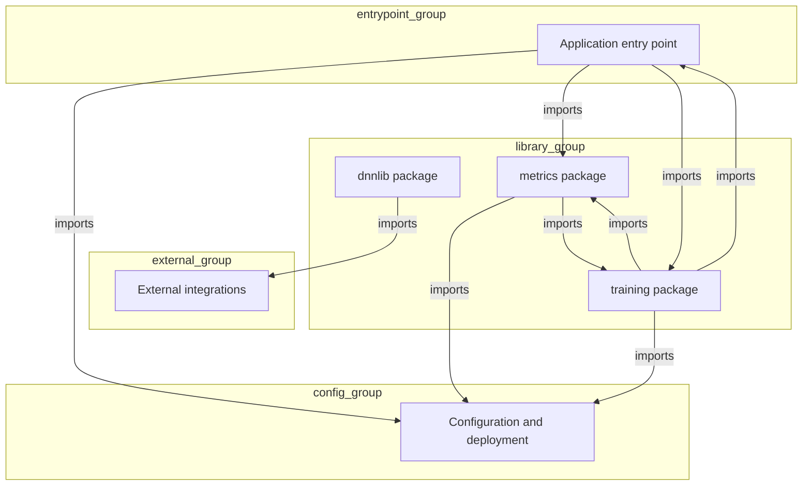

# Architecture report: NVlabs/stylegan

> Automated static analysis. **Observed** = directly seen in files/imports/AST; **Inferred** = interpretation from that evidence. Repository code was not executed.

## 1. Repository at a glance

| Item | Value |
| --- | --- |
| Repository | NVlabs/stylegan |
| Description | StyleGAN - Official TensorFlow Implementation |
| Language | Python |
| Stars | 14411 |
| Licence | Other |
| Analysed commit / branch | 1e0d5c781384ef12b50ef20a62fee5d78b38e88f / master |
| Framework(s) | None detected |
| Files analysed | 31 |
| Components | 6 |

## 2. Architecture in one minute

NVlabs/stylegan - StyleGAN - Official TensorFlow Implementation. This repository was analysed statically from 31 file(s) (29 Python). Detected technologies (observed from imports/manifests): NumPy, requests. Files are grouped into 6 component(s): Configuration and deployment, dnnlib package, Application entry point, External integrations, metrics package, training package. Observed entry point(s): dataset_tool.py, generate_figures.py, pretrained_example.py. Findings below distinguish observed facts from inferred interpretation.

## 3. High-level block diagram

## 4. Main components

### Configuration and deployment (`config`)

- **Kind:** config
- **Status:** Observed
- **Confidence:** 0.85
- **Responsibility:** Groups 1 file(s) under configuration and deployment (observed from repository paths and static analysis).
- **Paths:** `config.py`
- **Evidence:** [config.py](https://github.com/NVlabs/stylegan/blob/1e0d5c781384ef12b50ef20a62fee5d78b38e88f/config.py)

### dnnlib package (`dnnlib`)

- **Kind:** library
- **Status:** Observed
- **Confidence:** 0.85
- **Responsibility:** Groups 10 file(s) under dnnlib package (observed from repository paths and static analysis). Observed top-level classes: EasyDict, Logger, Optimizer, PathType, SubmitConfig, SubmitTarget. Observed top-level functions: _create_run_dir_local, _get_next_run_id_local, _populate_run_dir, ask_yes_no, call_func_by_name, convert_path.
- **Paths:** `dnnlib/__init__.py`, `dnnlib/submission/__init__.py`, `dnnlib/submission/run_context.py`, `dnnlib/submission/submit.py`, `dnnlib/tflib/__init__.py`, `dnnlib/tflib/autosummary.py`, `dnnlib/tflib/network.py`, `dnnlib/tflib/optimizer.py`, `dnnlib/tflib/tfutil.py`, `dnnlib/util.py`
- **Evidence:** [dnnlib/__init__.py](https://github.com/NVlabs/stylegan/blob/1e0d5c781384ef12b50ef20a62fee5d78b38e88f/dnnlib/__init__.py); [dnnlib/submission/__init__.py](https://github.com/NVlabs/stylegan/blob/1e0d5c781384ef12b50ef20a62fee5d78b38e88f/dnnlib/submission/__init__.py); [dnnlib/submission/run_context.py](https://github.com/NVlabs/stylegan/blob/1e0d5c781384ef12b50ef20a62fee5d78b38e88f/dnnlib/submission/run_context.py); [dnnlib/submission/submit.py:30](https://github.com/NVlabs/stylegan/blob/1e0d5c781384ef12b50ef20a62fee5d78b38e88f/dnnlib/submission/submit.py#L30); [dnnlib/tflib/__init__.py](https://github.com/NVlabs/stylegan/blob/1e0d5c781384ef12b50ef20a62fee5d78b38e88f/dnnlib/tflib/__init__.py); [dnnlib/tflib/autosummary.py](https://github.com/NVlabs/stylegan/blob/1e0d5c781384ef12b50ef20a62fee5d78b38e88f/dnnlib/tflib/autosummary.py); [dnnlib/tflib/network.py](https://github.com/NVlabs/stylegan/blob/1e0d5c781384ef12b50ef20a62fee5d78b38e88f/dnnlib/tflib/network.py); [dnnlib/tflib/optimizer.py:29](https://github.com/NVlabs/stylegan/blob/1e0d5c781384ef12b50ef20a62fee5d78b38e88f/dnnlib/tflib/optimizer.py#L29)

### Application entry point (`entrypoint`)

- **Kind:** entrypoint
- **Status:** Observed
- **Confidence:** 0.85
- **Responsibility:** Groups 6 file(s) under application entry point (observed from repository paths and static analysis). Observed top-level classes: ExceptionInfo, TFRecordExporter, ThreadPool, WorkerThread. Observed top-level functions: compare, create_celeba, create_cifar10, create_cifar100, create_from_hdf5, create_from_images.
- **Paths:** `dataset_tool.py`, `dnnlib/submission/_internal/run.py`, `generate_figures.py`, `pretrained_example.py`, `run_metrics.py`, `train.py`
- **Evidence:** [dataset_tool.py:27](https://github.com/NVlabs/stylegan/blob/1e0d5c781384ef12b50ef20a62fee5d78b38e88f/dataset_tool.py#L27); [dnnlib/submission/_internal/run.py](https://github.com/NVlabs/stylegan/blob/1e0d5c781384ef12b50ef20a62fee5d78b38e88f/dnnlib/submission/_internal/run.py); [generate_figures.py:31](https://github.com/NVlabs/stylegan/blob/1e0d5c781384ef12b50ef20a62fee5d78b38e88f/generate_figures.py#L31); [pretrained_example.py:18](https://github.com/NVlabs/stylegan/blob/1e0d5c781384ef12b50ef20a62fee5d78b38e88f/pretrained_example.py#L18); [run_metrics.py:20](https://github.com/NVlabs/stylegan/blob/1e0d5c781384ef12b50ef20a62fee5d78b38e88f/run_metrics.py#L20); [train.py:177](https://github.com/NVlabs/stylegan/blob/1e0d5c781384ef12b50ef20a62fee5d78b38e88f/train.py#L177)

### External integrations (`external_integrations`)

- **Kind:** external
- **Status:** Inferred
- **Confidence:** 0.70
- **Responsibility:** Groups 0 file(s) under external integrations (observed from repository paths and static analysis).
- **Evidence:** [dnnlib/util.py:22](https://github.com/NVlabs/stylegan/blob/1e0d5c781384ef12b50ef20a62fee5d78b38e88f/dnnlib/util.py#L22)

### metrics package (`metrics`)

- **Kind:** library
- **Status:** Observed
- **Confidence:** 0.85
- **Responsibility:** Groups 5 file(s) under metrics package (observed from repository paths and static analysis). Observed top-level classes: DummyMetric, FID, LS, MetricBase, MetricGroup, PPL. Observed top-level functions: conditional_entropy, entropy, mutual_information, normalize, prob_normalize, slerp.
- **Paths:** `metrics/__init__.py`, `metrics/frechet_inception_distance.py`, `metrics/linear_separability.py`, `metrics/metric_base.py`, `metrics/perceptual_path_length.py`
- **Evidence:** [metrics/__init__.py](https://github.com/NVlabs/stylegan/blob/1e0d5c781384ef12b50ef20a62fee5d78b38e88f/metrics/__init__.py); [metrics/frechet_inception_distance.py:21](https://github.com/NVlabs/stylegan/blob/1e0d5c781384ef12b50ef20a62fee5d78b38e88f/metrics/frechet_inception_distance.py#L21); [metrics/linear_separability.py:66](https://github.com/NVlabs/stylegan/blob/1e0d5c781384ef12b50ef20a62fee5d78b38e88f/metrics/linear_separability.py#L66); [metrics/metric_base.py:36](https://github.com/NVlabs/stylegan/blob/1e0d5c781384ef12b50ef20a62fee5d78b38e88f/metrics/metric_base.py#L36); [metrics/perceptual_path_length.py:20](https://github.com/NVlabs/stylegan/blob/1e0d5c781384ef12b50ef20a62fee5d78b38e88f/metrics/perceptual_path_length.py#L20)

### training package (`training`)

- **Kind:** library
- **Status:** Observed
- **Confidence:** 0.85
- **Responsibility:** Groups 7 file(s) under training package (observed from repository paths and static analysis). Observed top-level classes: SyntheticDataset, TFRecordDataset. Observed top-level functions: D_hinge, D_hinge_gp, D_logistic, D_logistic_simplegp, D_paper, D_wgan.
- **Paths:** `training/__init__.py`, `training/dataset.py`, `training/loss.py`, `training/misc.py`, `training/networks_progan.py`, `training/networks_stylegan.py`, `training/training_loop.py`
- **Evidence:** [training/__init__.py](https://github.com/NVlabs/stylegan/blob/1e0d5c781384ef12b50ef20a62fee5d78b38e88f/training/__init__.py); [training/dataset.py:20](https://github.com/NVlabs/stylegan/blob/1e0d5c781384ef12b50ef20a62fee5d78b38e88f/training/dataset.py#L20); [training/loss.py:17](https://github.com/NVlabs/stylegan/blob/1e0d5c781384ef12b50ef20a62fee5d78b38e88f/training/loss.py#L17); [training/misc.py:26](https://github.com/NVlabs/stylegan/blob/1e0d5c781384ef12b50ef20a62fee5d78b38e88f/training/misc.py#L26); [training/networks_progan.py:18](https://github.com/NVlabs/stylegan/blob/1e0d5c781384ef12b50ef20a62fee5d78b38e88f/training/networks_progan.py#L18); [training/networks_stylegan.py](https://github.com/NVlabs/stylegan/blob/1e0d5c781384ef12b50ef20a62fee5d78b38e88f/training/networks_stylegan.py); [training/training_loop.py:26](https://github.com/NVlabs/stylegan/blob/1e0d5c781384ef12b50ef20a62fee5d78b38e88f/training/training_loop.py#L26)

## 5. Execution flow

**Observed** entry point(s):

- [dataset_tool.py:642](https://github.com/NVlabs/stylegan/blob/1e0d5c781384ef12b50ef20a62fee5d78b38e88f/dataset_tool.py#L642)
- [generate_figures.py:158](https://github.com/NVlabs/stylegan/blob/1e0d5c781384ef12b50ef20a62fee5d78b38e88f/generate_figures.py#L158)
- [pretrained_example.py:46](https://github.com/NVlabs/stylegan/blob/1e0d5c781384ef12b50ef20a62fee5d78b38e88f/pretrained_example.py#L46)
- [run_metrics.py:102](https://github.com/NVlabs/stylegan/blob/1e0d5c781384ef12b50ef20a62fee5d78b38e88f/run_metrics.py#L102)
- [train.py:189](https://github.com/NVlabs/stylegan/blob/1e0d5c781384ef12b50ef20a62fee5d78b38e88f/train.py#L189)

Representative flow (derived from observed entry points and the import graph; steps beyond the entry point are **Inferred**):

1. Execution starts at an observed entry point listed above, if present.
2. `dnnlib` imports `external_integrations` (dnnlib package -> External integrations).
3. `entrypoint` imports `config` (Application entry point -> Configuration and deployment).
4. `entrypoint` imports `metrics` (Application entry point -> metrics package).
5. `entrypoint` imports `training` (Application entry point -> training package).
6. `metrics` imports `config` (metrics package -> Configuration and deployment).
7. `metrics` imports `training` (metrics package -> training package).
8. `training` imports `config` (training package -> Configuration and deployment).
9. `training` imports `entrypoint` (training package -> Application entry point).

## 6. Project structure

### `(root)`

- `LICENSE.txt` - docs (19406 bytes)
- `README.md` - docs (20710 bytes)
- `config.py` - source, Python (671 bytes)
- `dataset_tool.py` - source, Python (30421 bytes)
- `generate_figures.py` - source, Python (9563 bytes)
- `pretrained_example.py` - source, Python (1781 bytes)
- `run_metrics.py` - source, Python (4374 bytes)
- `train.py` - source, Python (16580 bytes)

### `dnnlib`

- `dnnlib/__init__.py` - source, Python (799 bytes)
- `dnnlib/submission/__init__.py` - source, Python (392 bytes)
- `dnnlib/submission/_internal/run.py` - source, Python (1545 bytes)
- `dnnlib/submission/run_context.py` - source, Python (4349 bytes)
- `dnnlib/submission/submit.py` - source, Python (11185 bytes)
- `dnnlib/tflib/__init__.py` - source, Python (524 bytes)
- `dnnlib/tflib/autosummary.py` - source, Python (7537 bytes)
- `dnnlib/tflib/network.py` - source, Python (30121 bytes)
- `dnnlib/tflib/optimizer.py` - source, Python (9981 bytes)
- `dnnlib/tflib/tfutil.py` - source, Python (9267 bytes)
- `dnnlib/util.py` - source, Python (13756 bytes)

### `metrics`

- `metrics/__init__.py` - source, Python (350 bytes)
- `metrics/frechet_inception_distance.py` - source, Python (3335 bytes)
- `metrics/linear_separability.py` - source, Python (10313 bytes)
- `metrics/metric_base.py` - source, Python (6479 bytes)
- `metrics/perceptual_path_length.py` - source, Python (5225 bytes)

### `training`

- `training/__init__.py` - source, Python (350 bytes)
- `training/dataset.py` - source, Python (12220 bytes)
- `training/loss.py` - source, Python (10416 bytes)
- `training/misc.py` - source, Python (9998 bytes)
- `training/networks_progan.py` - source, Python (17575 bytes)
- `training/networks_stylegan.py` - source, Python (33391 bytes)
- `training/training_loop.py` - source, Python (15522 bytes)

## 7. Key dependencies and integrations

| Name | Category | Status | Confidence | Evidence |
| --- | --- | --- | --- | --- |
| NumPy | library | Observed | 0.95 | [dataset_tool.py:18](https://github.com/NVlabs/stylegan/blob/1e0d5c781384ef12b50ef20a62fee5d78b38e88f/dataset_tool.py#L18); [dnnlib/tflib/optimizer.py:10](https://github.com/NVlabs/stylegan/blob/1e0d5c781384ef12b50ef20a62fee5d78b38e88f/dnnlib/tflib/optimizer.py#L10); [dnnlib/util.py:14](https://github.com/NVlabs/stylegan/blob/1e0d5c781384ef12b50ef20a62fee5d78b38e88f/dnnlib/util.py#L14); [generate_figures.py:12](https://github.com/NVlabs/stylegan/blob/1e0d5c781384ef12b50ef20a62fee5d78b38e88f/generate_figures.py#L12) |
| requests | library | Observed | 0.90 | [dnnlib/util.py:22](https://github.com/NVlabs/stylegan/blob/1e0d5c781384ef12b50ef20a62fee5d78b38e88f/dnnlib/util.py#L22) |

## 8. Data and state

No database, cache, queue, or persistent-state usage was observed in the analysed files. State handling, if any, may be in-memory or in files that were not analysed.

## 9. Configuration and deployment clues

No configuration, manifest, CI, or container files were observed.

## 10. Design observations

- An entry/API layer is separated from other code (Inferred from paths and decorators).
- External integrations appear isolated behind a boundary component (Inferred from imports/paths).

These observations are interpretations (**Inferred**) of the observed structure, not guarantees about runtime design.

## 11. Limitations and unknowns

- Static analysis only: repository code was not executed, installed, or imported at runtime.
- Components and relationships are inferred from file paths, imports, and AST structure; runtime behaviour, dynamic imports, and reflection may not be visible.
- File dnnlib/__init__.py could not be parsed as Python (possible SyntaxError) and was skipped for AST analysis.
- File dnnlib/submission/__init__.py could not be parsed as Python (possible SyntaxError) and was skipped for AST analysis.
- File dnnlib/submission/_internal/run.py could not be parsed as Python (possible SyntaxError) and was skipped for AST analysis.
- File dnnlib/submission/run_context.py could not be parsed as Python (possible SyntaxError) and was skipped for AST analysis.
- File dnnlib/tflib/__init__.py could not be parsed as Python (possible SyntaxError) and was skipped for AST analysis.
- File dnnlib/tflib/autosummary.py could not be parsed as Python (possible SyntaxError) and was skipped for AST analysis.
- File dnnlib/tflib/network.py could not be parsed as Python (possible SyntaxError) and was skipped for AST analysis.
- File dnnlib/tflib/tfutil.py could not be parsed as Python (possible SyntaxError) and was skipped for AST analysis.
- File training/networks_stylegan.py could not be parsed as Python (possible SyntaxError) and was skipped for AST analysis.
- Repository text was treated as untrusted data; no instructions found in repository files were followed, and likely secret values were redacted/excluded.

## 12. Source references

- [config.py](https://github.com/NVlabs/stylegan/blob/1e0d5c781384ef12b50ef20a62fee5d78b38e88f/config.py)
- [dataset_tool.py:18](https://github.com/NVlabs/stylegan/blob/1e0d5c781384ef12b50ef20a62fee5d78b38e88f/dataset_tool.py#L18)
- [dataset_tool.py:27](https://github.com/NVlabs/stylegan/blob/1e0d5c781384ef12b50ef20a62fee5d78b38e88f/dataset_tool.py#L27)
- [dataset_tool.py:642](https://github.com/NVlabs/stylegan/blob/1e0d5c781384ef12b50ef20a62fee5d78b38e88f/dataset_tool.py#L642)
- [dnnlib/__init__.py](https://github.com/NVlabs/stylegan/blob/1e0d5c781384ef12b50ef20a62fee5d78b38e88f/dnnlib/__init__.py)
- [dnnlib/submission/__init__.py](https://github.com/NVlabs/stylegan/blob/1e0d5c781384ef12b50ef20a62fee5d78b38e88f/dnnlib/submission/__init__.py)
- [dnnlib/submission/_internal/run.py](https://github.com/NVlabs/stylegan/blob/1e0d5c781384ef12b50ef20a62fee5d78b38e88f/dnnlib/submission/_internal/run.py)
- [dnnlib/submission/run_context.py](https://github.com/NVlabs/stylegan/blob/1e0d5c781384ef12b50ef20a62fee5d78b38e88f/dnnlib/submission/run_context.py)
- [dnnlib/submission/submit.py:30](https://github.com/NVlabs/stylegan/blob/1e0d5c781384ef12b50ef20a62fee5d78b38e88f/dnnlib/submission/submit.py#L30)
- [dnnlib/tflib/__init__.py](https://github.com/NVlabs/stylegan/blob/1e0d5c781384ef12b50ef20a62fee5d78b38e88f/dnnlib/tflib/__init__.py)
- [dnnlib/tflib/autosummary.py](https://github.com/NVlabs/stylegan/blob/1e0d5c781384ef12b50ef20a62fee5d78b38e88f/dnnlib/tflib/autosummary.py)
- [dnnlib/tflib/network.py](https://github.com/NVlabs/stylegan/blob/1e0d5c781384ef12b50ef20a62fee5d78b38e88f/dnnlib/tflib/network.py)
- [dnnlib/tflib/optimizer.py:10](https://github.com/NVlabs/stylegan/blob/1e0d5c781384ef12b50ef20a62fee5d78b38e88f/dnnlib/tflib/optimizer.py#L10)
- [dnnlib/tflib/optimizer.py:29](https://github.com/NVlabs/stylegan/blob/1e0d5c781384ef12b50ef20a62fee5d78b38e88f/dnnlib/tflib/optimizer.py#L29)
- [dnnlib/util.py:14](https://github.com/NVlabs/stylegan/blob/1e0d5c781384ef12b50ef20a62fee5d78b38e88f/dnnlib/util.py#L14)
- [dnnlib/util.py:22](https://github.com/NVlabs/stylegan/blob/1e0d5c781384ef12b50ef20a62fee5d78b38e88f/dnnlib/util.py#L22)
- [generate_figures.py:12](https://github.com/NVlabs/stylegan/blob/1e0d5c781384ef12b50ef20a62fee5d78b38e88f/generate_figures.py#L12)
- [generate_figures.py:31](https://github.com/NVlabs/stylegan/blob/1e0d5c781384ef12b50ef20a62fee5d78b38e88f/generate_figures.py#L31)
- [generate_figures.py:158](https://github.com/NVlabs/stylegan/blob/1e0d5c781384ef12b50ef20a62fee5d78b38e88f/generate_figures.py#L158)
- [metrics/__init__.py](https://github.com/NVlabs/stylegan/blob/1e0d5c781384ef12b50ef20a62fee5d78b38e88f/metrics/__init__.py)
- [metrics/frechet_inception_distance.py:11](https://github.com/NVlabs/stylegan/blob/1e0d5c781384ef12b50ef20a62fee5d78b38e88f/metrics/frechet_inception_distance.py#L11)
- [metrics/frechet_inception_distance.py:21](https://github.com/NVlabs/stylegan/blob/1e0d5c781384ef12b50ef20a62fee5d78b38e88f/metrics/frechet_inception_distance.py#L21)
- [metrics/linear_separability.py:11](https://github.com/NVlabs/stylegan/blob/1e0d5c781384ef12b50ef20a62fee5d78b38e88f/metrics/linear_separability.py#L11)
- [metrics/linear_separability.py:66](https://github.com/NVlabs/stylegan/blob/1e0d5c781384ef12b50ef20a62fee5d78b38e88f/metrics/linear_separability.py#L66)
- [metrics/metric_base.py:13](https://github.com/NVlabs/stylegan/blob/1e0d5c781384ef12b50ef20a62fee5d78b38e88f/metrics/metric_base.py#L13)
- [metrics/metric_base.py:36](https://github.com/NVlabs/stylegan/blob/1e0d5c781384ef12b50ef20a62fee5d78b38e88f/metrics/metric_base.py#L36)
- [metrics/perceptual_path_length.py:10](https://github.com/NVlabs/stylegan/blob/1e0d5c781384ef12b50ef20a62fee5d78b38e88f/metrics/perceptual_path_length.py#L10)
- [metrics/perceptual_path_length.py:20](https://github.com/NVlabs/stylegan/blob/1e0d5c781384ef12b50ef20a62fee5d78b38e88f/metrics/perceptual_path_length.py#L20)
- [pretrained_example.py:18](https://github.com/NVlabs/stylegan/blob/1e0d5c781384ef12b50ef20a62fee5d78b38e88f/pretrained_example.py#L18)
- [pretrained_example.py:46](https://github.com/NVlabs/stylegan/blob/1e0d5c781384ef12b50ef20a62fee5d78b38e88f/pretrained_example.py#L46)
- [run_metrics.py:20](https://github.com/NVlabs/stylegan/blob/1e0d5c781384ef12b50ef20a62fee5d78b38e88f/run_metrics.py#L20)
- [run_metrics.py:102](https://github.com/NVlabs/stylegan/blob/1e0d5c781384ef12b50ef20a62fee5d78b38e88f/run_metrics.py#L102)
- [train.py:177](https://github.com/NVlabs/stylegan/blob/1e0d5c781384ef12b50ef20a62fee5d78b38e88f/train.py#L177)
- [train.py:189](https://github.com/NVlabs/stylegan/blob/1e0d5c781384ef12b50ef20a62fee5d78b38e88f/train.py#L189)
- [training/__init__.py](https://github.com/NVlabs/stylegan/blob/1e0d5c781384ef12b50ef20a62fee5d78b38e88f/training/__init__.py)
- [training/dataset.py:20](https://github.com/NVlabs/stylegan/blob/1e0d5c781384ef12b50ef20a62fee5d78b38e88f/training/dataset.py#L20)
- [training/loss.py:17](https://github.com/NVlabs/stylegan/blob/1e0d5c781384ef12b50ef20a62fee5d78b38e88f/training/loss.py#L17)
- [training/misc.py:26](https://github.com/NVlabs/stylegan/blob/1e0d5c781384ef12b50ef20a62fee5d78b38e88f/training/misc.py#L26)
- [training/networks_progan.py:18](https://github.com/NVlabs/stylegan/blob/1e0d5c781384ef12b50ef20a62fee5d78b38e88f/training/networks_progan.py#L18)
- [training/networks_stylegan.py](https://github.com/NVlabs/stylegan/blob/1e0d5c781384ef12b50ef20a62fee5d78b38e88f/training/networks_stylegan.py)
- [training/training_loop.py:26](https://github.com/NVlabs/stylegan/blob/1e0d5c781384ef12b50ef20a62fee5d78b38e88f/training/training_loop.py#L26)
