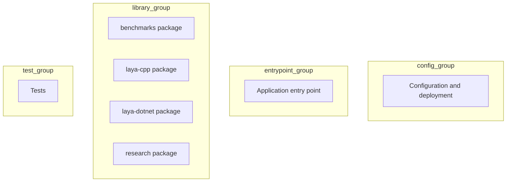

# Architecture report: NandhaKishorM/laya

> Automated static analysis. **Observed** = directly seen in files/imports/AST; **Inferred** = interpretation from that evidence. Repository code was not executed.

## 1. Repository at a glance

| Item | Value |
| --- | --- |
| Repository | NandhaKishorM/laya |
| Description | Non-autoregressive System 1 decision engine. Typed choice, score and yes/no decisions over any text in a single forward pass, in 100+ languages, with a router that picks the right checkpoint per request. |
| Language | Python |
| Stars | 35521 |
| Licence | Apache-2.0 |
| Analysed commit / branch | af8ada066685d66b3fc0b31e6c56b96def23fe2f / main |
| Framework(s) | FastAPI |
| Files analysed | 633 |
| Components | 7 |

## 2. Architecture in one minute

NandhaKishorM/laya - Non-autoregressive System 1 decision engine. Typed choice, score and yes/no decisions over any text in a single forward pass, in 100+ languages, with a router that picks the right checkpoint per requ…. This repository was analysed statically from 633 file(s) (72 Python). Detected technologies (observed from imports/manifests): GitHub Actions, FastAPI, NumPy, Docker, Docker Compose, pytest. Files are grouped into 7 component(s): benchmarks package, Configuration and deployment, Application entry point, laya-cpp package, laya-dotnet package, research package, Tests. Observed entry point(s): assets/make_logo.py, benchmarks/bench_compile.py, benchmarks/bench_compile_defaults.py. Findings below distinguish observed facts from inferred interpretation.

## 3. High-level block diagram

## 4. Main components

### benchmarks package (`benchmarks`)

- **Kind:** library
- **Status:** Observed
- **Confidence:** 0.85
- **Responsibility:** Groups 1 file(s) under benchmarks package (observed from repository paths and static analysis). Observed top-level functions: batch, fwd, qs, timeit.
- **Paths:** `benchmarks/bench_fast.py`
- **Evidence:** [benchmarks/bench_fast.py:35](https://github.com/NandhaKishorM/laya/blob/af8ada066685d66b3fc0b31e6c56b96def23fe2f/benchmarks/bench_fast.py#L35)

### Configuration and deployment (`config`)

- **Kind:** config
- **Status:** Observed
- **Confidence:** 0.85
- **Responsibility:** Groups 67 file(s) under configuration and deployment (observed from repository paths and static analysis).
- **Paths:** `Dockerfile`, `benchmarks/results-consistency-rtx4070.json`, `benchmarks/results-router-rtx4070.json`, `benchmarks/results-rtx4070.json`, `benchmarks/results/aoti_multilingual_rtx4070.json`, `benchmarks/results/cpu/diagnostic-plan.json`, `benchmarks/results/cpu/linux-english-latency.json`, `benchmarks/results/cpu/linux-english-long-options.json`, `benchmarks/results/cpu/linux-english-memory-baseline.json`, `benchmarks/results/cpu/linux-english-memory-selected.json`, `benchmarks/results/cpu/linux-environment.json`, `benchmarks/results/cpu/linux-multilingual-latency.json`, `benchmarks/results/cpu/linux-multilingual-long-options.json`, `benchmarks/results/cpu/linux-multilingual-memory-baseline.json`, `benchmarks/results/cpu/linux-multilingual-memory-selected.json`, `benchmarks/results/cpu/linux-typed-decisions-latency.json`, `benchmarks/results/cpu/linux-typed-decisions-long-options.json`, `benchmarks/results/cpu/linux-typed-decisions-memory-baseline.json`, `benchmarks/results/cpu/linux-typed-decisions-memory-selected.json`, `benchmarks/results/cpu/mac-english-diagnostic.json`, `benchmarks/results/cpu/mac-english-long-options.json`, `benchmarks/results/cpu/mac-english-memory-baseline.json`, `benchmarks/results/cpu/mac-english-memory-selected.json`, `benchmarks/results/cpu/mac-english-standard.json`, `benchmarks/results/cpu/mac-multilingual-ablation-head.json`, `benchmarks/results/cpu/mac-multilingual-ablation-windows.json`, `benchmarks/results/cpu/mac-multilingual-long-options.json`, `benchmarks/results/cpu/mac-multilingual-memory-baseline.json`, `benchmarks/results/cpu/mac-multilingual-memory-selected.json`, `benchmarks/results/cpu/mac-multilingual-standard.json`, `benchmarks/results/cpu/mac-typed-decisions-long-options.json`, `benchmarks/results/cpu/mac-typed-decisions-memory-baseline.json`, `benchmarks/results/cpu/mac-typed-decisions-memory-selected.json`, `benchmarks/results/cpu/mac-typed-decisions-standard.json`, `benchmarks/results/cpu/manifest.json`, `benchmarks/results/cpu/massive-en-summary.json`, `benchmarks/results/cpu/upstream/bench_latency-baseline.json`, `benchmarks/results/cpu/upstream/bench_latency-pr.json`, `benchmarks/results/cpu/upstream/bench_long_context-baseline.json`, `benchmarks/results/cpu/upstream/bench_long_context-pr.json`, `benchmarks/results/cpu/upstream/completed.json`, `benchmarks/results/cpu/upstream/device-repeat-completed.json`, `benchmarks/results/cpu/upstream/device-repeat-plan.json`, `benchmarks/results/cpu/upstream/manifest.json`, `benchmarks/results/cpu/upstream/plan.json`, `benchmarks/results/cpu/validation.json`, `benchmarks/results/fast_english_rtx4070.json`, `benchmarks/results/fast_multilingual_rtx4070.json`, `benchmarks/results/mps_autocast_english_m1pro.json`, `benchmarks/results/mps_autocast_english_m5pro.json`, `benchmarks/results/mps_autocast_multilingual_m1pro.json`, `benchmarks/results/mps_autocast_multilingual_m5pro.json`, `benchmarks/results/parity_english_fp16_rtx4070.json`, `benchmarks/results/parity_english_rtx4070.json`, `benchmarks/results/parity_multilingual_fp16_rtx4070.json`, `benchmarks/results/parity_multilingual_rtx4070.json`, `benchmarks/results/parity_typed_decisions_fp16_rtx4070.json`, `benchmarks/results/parity_typed_decisions_rtx4070.json`, `compose.cuda.yaml`, `compose.example.yml`, `compose.http.yaml`, `compose.modelscope.yaml`, `compose.spark.yaml`, `compose.yaml`, `laya-cpp/CMakePresets.json`, `laya-dotnet/global.json`, `laya-go/go.mod`
- **Evidence:** [Dockerfile](https://github.com/NandhaKishorM/laya/blob/af8ada066685d66b3fc0b31e6c56b96def23fe2f/Dockerfile); [benchmarks/results-consistency-rtx4070.json](https://github.com/NandhaKishorM/laya/blob/af8ada066685d66b3fc0b31e6c56b96def23fe2f/benchmarks/results-consistency-rtx4070.json); [benchmarks/results-router-rtx4070.json](https://github.com/NandhaKishorM/laya/blob/af8ada066685d66b3fc0b31e6c56b96def23fe2f/benchmarks/results-router-rtx4070.json); [benchmarks/results-rtx4070.json](https://github.com/NandhaKishorM/laya/blob/af8ada066685d66b3fc0b31e6c56b96def23fe2f/benchmarks/results-rtx4070.json); [benchmarks/results/aoti_multilingual_rtx4070.json](https://github.com/NandhaKishorM/laya/blob/af8ada066685d66b3fc0b31e6c56b96def23fe2f/benchmarks/results/aoti_multilingual_rtx4070.json); [benchmarks/results/cpu/diagnostic-plan.json](https://github.com/NandhaKishorM/laya/blob/af8ada066685d66b3fc0b31e6c56b96def23fe2f/benchmarks/results/cpu/diagnostic-plan.json); [benchmarks/results/cpu/linux-english-latency.json](https://github.com/NandhaKishorM/laya/blob/af8ada066685d66b3fc0b31e6c56b96def23fe2f/benchmarks/results/cpu/linux-english-latency.json); [benchmarks/results/cpu/linux-english-long-options.json](https://github.com/NandhaKishorM/laya/blob/af8ada066685d66b3fc0b31e6c56b96def23fe2f/benchmarks/results/cpu/linux-english-long-options.json)

### Application entry point (`entrypoint`)

- **Kind:** entrypoint
- **Status:** Observed
- **Confidence:** 0.85
- **Responsibility:** Groups 13 file(s) under application entry point (observed from repository paths and static analysis). Observed top-level functions: _refuse, _refuse_dtd, answers, arc_path, batch, bench.
- **Paths:** `assets/make_logo.py`, `benchmarks/bench_compile.py`, `benchmarks/bench_compile_defaults.py`, `benchmarks/bench_cpu.py`, `benchmarks/bench_mps_autocast.py`, `benchmarks/bench_predict_batch.py`, `benchmarks/compare_compile_defaults.py`, `benchmarks/parity_fast.py`, `benchmarks/plot_results.py`, `docker/check_torch.py`, `docker/entrypoint.py`, `docker/prefetch_modelscope.py`, `laya-cpp/scripts/check_test_xml.py`
- **Evidence:** [assets/make_logo.py:44](https://github.com/NandhaKishorM/laya/blob/af8ada066685d66b3fc0b31e6c56b96def23fe2f/assets/make_logo.py#L44); [benchmarks/bench_compile.py:25](https://github.com/NandhaKishorM/laya/blob/af8ada066685d66b3fc0b31e6c56b96def23fe2f/benchmarks/bench_compile.py#L25); [benchmarks/bench_compile_defaults.py:17](https://github.com/NandhaKishorM/laya/blob/af8ada066685d66b3fc0b31e6c56b96def23fe2f/benchmarks/bench_compile_defaults.py#L17); [benchmarks/bench_cpu.py:41](https://github.com/NandhaKishorM/laya/blob/af8ada066685d66b3fc0b31e6c56b96def23fe2f/benchmarks/bench_cpu.py#L41); [benchmarks/bench_mps_autocast.py:64](https://github.com/NandhaKishorM/laya/blob/af8ada066685d66b3fc0b31e6c56b96def23fe2f/benchmarks/bench_mps_autocast.py#L64); [benchmarks/bench_predict_batch.py:57](https://github.com/NandhaKishorM/laya/blob/af8ada066685d66b3fc0b31e6c56b96def23fe2f/benchmarks/bench_predict_batch.py#L57); [benchmarks/compare_compile_defaults.py:10](https://github.com/NandhaKishorM/laya/blob/af8ada066685d66b3fc0b31e6c56b96def23fe2f/benchmarks/compare_compile_defaults.py#L10); [benchmarks/parity_fast.py:38](https://github.com/NandhaKishorM/laya/blob/af8ada066685d66b3fc0b31e6c56b96def23fe2f/benchmarks/parity_fast.py#L38)

### laya-cpp package (`laya_cpp`)

- **Kind:** library
- **Status:** Observed
- **Confidence:** 0.85
- **Responsibility:** Groups 16 file(s) under laya-cpp package (observed from repository paths and static analysis).
- **Paths:** `laya-cpp/scripts/check_ort_root.sh`, `laya-cpp/src/agent.cpp`, `laya-cpp/src/collate.cpp`, `laya-cpp/src/decode.cpp`, `laya-cpp/src/infer.cpp`, `laya-cpp/src/lang.cpp`, `laya-cpp/src/onnx.cpp`, `laya-cpp/src/onnx_graph.cpp`, `laya-cpp/src/pyjson.cpp`, `laya-cpp/src/pyvalue.cpp`, `laya-cpp/src/schema.cpp`, `laya-cpp/src/sequence.cpp`, `laya-cpp/src/sha256.cpp`, `laya-cpp/src/tokenizer.cpp`, `laya-cpp/src/unicodedata.cpp`, `laya-cpp/src/version.cpp`
- **Evidence:** [laya-cpp/scripts/check_ort_root.sh](https://github.com/NandhaKishorM/laya/blob/af8ada066685d66b3fc0b31e6c56b96def23fe2f/laya-cpp/scripts/check_ort_root.sh); [laya-cpp/src/agent.cpp](https://github.com/NandhaKishorM/laya/blob/af8ada066685d66b3fc0b31e6c56b96def23fe2f/laya-cpp/src/agent.cpp); [laya-cpp/src/collate.cpp](https://github.com/NandhaKishorM/laya/blob/af8ada066685d66b3fc0b31e6c56b96def23fe2f/laya-cpp/src/collate.cpp); [laya-cpp/src/decode.cpp](https://github.com/NandhaKishorM/laya/blob/af8ada066685d66b3fc0b31e6c56b96def23fe2f/laya-cpp/src/decode.cpp); [laya-cpp/src/infer.cpp](https://github.com/NandhaKishorM/laya/blob/af8ada066685d66b3fc0b31e6c56b96def23fe2f/laya-cpp/src/infer.cpp); [laya-cpp/src/lang.cpp](https://github.com/NandhaKishorM/laya/blob/af8ada066685d66b3fc0b31e6c56b96def23fe2f/laya-cpp/src/lang.cpp); [laya-cpp/src/onnx.cpp](https://github.com/NandhaKishorM/laya/blob/af8ada066685d66b3fc0b31e6c56b96def23fe2f/laya-cpp/src/onnx.cpp); [laya-cpp/src/onnx_graph.cpp](https://github.com/NandhaKishorM/laya/blob/af8ada066685d66b3fc0b31e6c56b96def23fe2f/laya-cpp/src/onnx_graph.cpp)

### laya-dotnet package (`laya_dotnet`)

- **Kind:** library
- **Status:** Observed
- **Confidence:** 0.85
- **Responsibility:** Groups 34 file(s) under laya-dotnet package (observed from repository paths and static analysis).
- **Paths:** `laya-dotnet/samples/Laya.Benchmark/Program.cs`, `laya-dotnet/samples/Laya.Routing/DemoHashingEmbedder.cs`, `laya-dotnet/samples/Laya.Routing/Program.cs`, `laya-dotnet/samples/Laya.Sample/Program.cs`, `laya-dotnet/src/Laya/Answers.cs`, `laya-dotnet/src/Laya/Calibration.cs`, `laya-dotnet/src/Laya/CalibrationFile.cs`, `laya-dotnet/src/Laya/Collator.cs`, `laya-dotnet/src/Laya/ILayaLongPredictor.cs`, `laya-dotnet/src/Laya/ILayaPredictor.cs`, `laya-dotnet/src/Laya/LangGuess.cs`, `laya-dotnet/src/Laya/LangTemperatures.cs`, `laya-dotnet/src/Laya/LanguageDetection.cs`, `laya-dotnet/src/Laya/LayaBatch.cs`, `laya-dotnet/src/Laya/LayaConfig.cs`, `laya-dotnet/src/Laya/LayaEmail.cs`, `laya-dotnet/src/Laya/LayaEngine.cs`, `laya-dotnet/src/Laya/LayaOptions.cs`, `laya-dotnet/src/Laya/LayaPresets.cs`, `laya-dotnet/src/Laya/LayaRouter.cs`, `laya-dotnet/src/Laya/LayaShortlist.cs`, `laya-dotnet/src/Laya/LongPrediction.cs`, `laya-dotnet/src/Laya/MinConfidence.cs`, `laya-dotnet/src/Laya/ModelArtifacts.cs`, `laya-dotnet/src/Laya/PythonFloat.cs`, `laya-dotnet/src/Laya/PythonJson.cs`, `laya-dotnet/src/Laya/PythonJsonReader.cs`, `laya-dotnet/src/Laya/PythonStr.cs`, `laya-dotnet/src/Laya/PythonSum.cs`, `laya-dotnet/src/Laya/Questions.cs`, `laya-dotnet/src/Laya/SequenceBuilder.cs`, `laya-dotnet/src/Laya/Tokenization/HfTokenizer.cs`, `laya-dotnet/src/Laya/Tokenization/ILayaTokenizer.cs`, `laya-dotnet/src/Laya/WarnOnce.cs`
- **Evidence:** [laya-dotnet/samples/Laya.Benchmark/Program.cs](https://github.com/NandhaKishorM/laya/blob/af8ada066685d66b3fc0b31e6c56b96def23fe2f/laya-dotnet/samples/Laya.Benchmark/Program.cs); [laya-dotnet/samples/Laya.Routing/DemoHashingEmbedder.cs](https://github.com/NandhaKishorM/laya/blob/af8ada066685d66b3fc0b31e6c56b96def23fe2f/laya-dotnet/samples/Laya.Routing/DemoHashingEmbedder.cs); [laya-dotnet/samples/Laya.Routing/Program.cs](https://github.com/NandhaKishorM/laya/blob/af8ada066685d66b3fc0b31e6c56b96def23fe2f/laya-dotnet/samples/Laya.Routing/Program.cs); [laya-dotnet/samples/Laya.Sample/Program.cs](https://github.com/NandhaKishorM/laya/blob/af8ada066685d66b3fc0b31e6c56b96def23fe2f/laya-dotnet/samples/Laya.Sample/Program.cs); [laya-dotnet/src/Laya/Answers.cs](https://github.com/NandhaKishorM/laya/blob/af8ada066685d66b3fc0b31e6c56b96def23fe2f/laya-dotnet/src/Laya/Answers.cs); [laya-dotnet/src/Laya/Calibration.cs](https://github.com/NandhaKishorM/laya/blob/af8ada066685d66b3fc0b31e6c56b96def23fe2f/laya-dotnet/src/Laya/Calibration.cs); [laya-dotnet/src/Laya/CalibrationFile.cs](https://github.com/NandhaKishorM/laya/blob/af8ada066685d66b3fc0b31e6c56b96def23fe2f/laya-dotnet/src/Laya/CalibrationFile.cs); [laya-dotnet/src/Laya/Collator.cs](https://github.com/NandhaKishorM/laya/blob/af8ada066685d66b3fc0b31e6c56b96def23fe2f/laya-dotnet/src/Laya/Collator.cs)

### research package (`research`)

- **Kind:** library
- **Status:** Observed
- **Confidence:** 0.85
- **Responsibility:** Groups 2 file(s) under research package (observed from repository paths and static analysis).
- **Paths:** `research/__init__.py`, `research/eval/__init__.py`
- **Evidence:** [research/__init__.py](https://github.com/NandhaKishorM/laya/blob/af8ada066685d66b3fc0b31e6c56b96def23fe2f/research/__init__.py); [research/eval/__init__.py](https://github.com/NandhaKishorM/laya/blob/af8ada066685d66b3fc0b31e6c56b96def23fe2f/research/eval/__init__.py)

### Tests (`tests`)

- **Kind:** test
- **Status:** Observed
- **Confidence:** 0.85
- **Responsibility:** Groups 262 file(s) under tests (observed from repository paths and static analysis). Observed top-level classes: CheckerTest. Observed top-level functions: report, run.
- **Paths:** `laya-cpp/scripts/test_check_test_xml.py`, `laya-cpp/tests/agent_test.cpp`, `laya-cpp/tests/checkpoint.hpp`, `laya-cpp/tests/decode_test.cpp`, `laya-cpp/tests/foundation_test.cpp`, `laya-cpp/tests/golden.hpp`, `laya-cpp/tests/hardening_test.cpp`, `laya-cpp/tests/lang_boundary.inc`, `laya-cpp/tests/lang_test.cpp`, `laya-cpp/tests/onnx_hostile_graphs.inc`, `laya-cpp/tests/onnx_test.cpp`, `laya-cpp/tests/question_fixture.hpp`, `laya-cpp/tests/schema_test.cpp`, `laya-cpp/tests/sequence_test.cpp`, `laya-cpp/tests/stub_session.hpp`, `laya-cpp/tests/tokenizer_test.cpp`, `laya-cpp/tests/tools/laya_c2_cli.cpp`, `laya-cpp/tests/tools/laya_c3_cli.cpp`, `laya-cpp/tests/tools/laya_c4_cli.cpp`, `laya-cpp/tests/tools/laya_c5_cli.cpp`, `laya-cpp/tests/tools/laya_cli.cpp`, `laya-cpp/tests/tools/onnx_static_holder.cpp`, `laya-cpp/tests/unicode_digests.inc`, `laya-cpp/tests/version_test.cpp`, `laya-dotnet/tests/Laya.Tests/BatchPredictionTests.cs`, `laya-dotnet/tests/Laya.Tests/CalibrationFileTests.cs`, `laya-dotnet/tests/Laya.Tests/CalibrationFixture.cs`, `laya-dotnet/tests/Laya.Tests/CalibrationTests.cs`, `laya-dotnet/tests/Laya.Tests/CallOptions.cs`, `laya-dotnet/tests/Laya.Tests/CollatorTests.cs`, `laya-dotnet/tests/Laya.Tests/ConfidenceGateTests.cs`, `laya-dotnet/tests/Laya.Tests/ConfigFieldTypeTests.cs`, `laya-dotnet/tests/Laya.Tests/ConfigFileNewlineTests.cs`, `laya-dotnet/tests/Laya.Tests/DifferentialParityTests.cs`, `laya-dotnet/tests/Laya.Tests/GoldenData.cs`, `laya-dotnet/tests/Laya.Tests/HashingEmbedder.cs`, `laya-dotnet/tests/Laya.Tests/HashingEmbedderTests.cs`, `laya-dotnet/tests/Laya.Tests/HfTokenizerFallbackTests.cs`, `laya-dotnet/tests/Laya.Tests/LangGuessTests.cs`, `laya-dotnet/tests/Laya.Tests/LangTemperatureTests.cs`, `laya-dotnet/tests/Laya.Tests/LanguageDetectionTests.cs`, `laya-dotnet/tests/Laya.Tests/Laya.Tests.csproj`, `laya-dotnet/tests/Laya.Tests/LayaEmailTests.cs`, `laya-dotnet/tests/Laya.Tests/LayaRouterTests.cs`, `laya-dotnet/tests/Laya.Tests/LayaShortlistTests.cs`, `laya-dotnet/tests/Laya.Tests/LongPredictionTests.cs`, `laya-dotnet/tests/Laya.Tests/ModelArtifactsTests.cs`, `laya-dotnet/tests/Laya.Tests/PredictParityTests.Batch.cs`, `laya-dotnet/tests/Laya.Tests/PredictParityTests.Calibration.cs`, `laya-dotnet/tests/Laya.Tests/PredictParityTests.Long.cs`, `laya-dotnet/tests/Laya.Tests/PredictParityTests.cs`, `laya-dotnet/tests/Laya.Tests/PresetsTests.cs`, `laya-dotnet/tests/Laya.Tests/PythonJsonErrorTests.cs`, `laya-dotnet/tests/Laya.Tests/PythonJsonReaderTests.cs`, `laya-dotnet/tests/Laya.Tests/PythonJsonTests.cs`, `laya-dotnet/tests/Laya.Tests/ReviewParityTests.cs`, `laya-dotnet/tests/Laya.Tests/Round4Tests.cs`, `laya-dotnet/tests/Laya.Tests/RouterEndToEndTests.cs`, `laya-dotnet/tests/Laya.Tests/RoutingGoldenData.cs`, `laya-dotnet/tests/Laya.Tests/SequenceBuilderTests.cs`, `laya-dotnet/tests/Laya.Tests/ShapeSweepTests.cs`, `laya-dotnet/tests/Laya.Tests/ShortlistEndToEndTests.cs`, `laya-dotnet/tests/Laya.Tests/StateShapeTests.cs`, `laya-dotnet/tests/Laya.Tests/StubTokenizer.cs`, `laya-dotnet/tests/Laya.Tests/TemperatureConfigTests.cs`, `laya-dotnet/tests/Laya.Tests/TestArtifacts.cs`, `laya-dotnet/tests/Laya.Tests/TokenizerParityTests.cs`, `laya-dotnet/tests/Laya.Tests/UsageTests.cs`, `laya-dotnet/tests/Laya.Tests/golden/english/case_arabic.json`, `laya-dotnet/tests/Laya.Tests/golden/english/case_batch_budget_head_max_len.json`, `laya-dotnet/tests/Laya.Tests/golden/english/case_batch_budget_max_len.json`, `laya-dotnet/tests/Laya.Tests/golden/english/case_batch_budget_max_len_negative.json`, `laya-dotnet/tests/Laya.Tests/golden/english/case_batch_budget_max_len_zero.json`, `laya-dotnet/tests/Laya.Tests/golden/english/case_batch_chunked.json`, `laya-dotnet/tests/Laya.Tests/golden/english/case_batch_duplicate_states.json`, `laya-dotnet/tests/Laya.Tests/golden/english/case_batch_empty_both.json`, `laya-dotnet/tests/Laya.Tests/golden/english/case_batch_empty_questions.json`, `laya-dotnet/tests/Laya.Tests/golden/english/case_batch_empty_questions_with_options.json`, `laya-dotnet/tests/Laya.Tests/golden/english/case_batch_empty_states.json`, `laya-dotnet/tests/Laya.Tests/golden/english/case_batch_empty_states_invalid_questions.json`, `laya-dotnet/tests/Laya.Tests/golden/english/case_batch_lang_budgets.json`, `laya-dotnet/tests/Laya.Tests/golden/english/case_batch_lang_miss.json`, `laya-dotnet/tests/Laya.Tests/golden/english/case_batch_lang_region_tag.json`, `laya-dotnet/tests/Laya.Tests/golden/english/case_batch_lang_sorted.json`, `laya-dotnet/tests/Laya.Tests/golden/english/case_batch_min_confidence_bad_key.json`, `laya-dotnet/tests/Laya.Tests/golden/english/case_batch_min_confidence_before_none_state.json`, `laya-dotnet/tests/Laya.Tests/golden/english/case_batch_min_confidence_empty_questions.json`, `laya-dotnet/tests/Laya.Tests/golden/english/case_batch_min_confidence_empty_states.json`, `laya-dotnet/tests/Laya.Tests/golden/english/case_batch_min_confidence_invalid.json`, `laya-dotnet/tests/Laya.Tests/golden/english/case_batch_min_confidence_map.json`, `laya-dotnet/tests/Laya.Tests/golden/english/case_batch_min_confidence_map_default.json`, `laya-dotnet/tests/Laya.Tests/golden/english/case_batch_min_confidence_scalar.json`, `laya-dotnet/tests/Laya.Tests/golden/english/case_batch_min_confidence_zero.json`, `laya-dotnet/tests/Laya.Tests/golden/english/case_batch_mixed.json`, `laya-dotnet/tests/Laya.Tests/golden/english/case_batch_none_state.json`, `laya-dotnet/tests/Laya.Tests/golden/english/case_batch_one_state.json`, `laya-dotnet/tests/Laya.Tests/golden/english/case_batch_options_exceed_head.json`, `laya-dotnet/tests/Laya.Tests/golden/english/case_batch_single_question.json`, `laya-dotnet/tests/Laya.Tests/golden/english/case_batch_size_1.json`, `laya-dotnet/tests/Laya.Tests/golden/english/case_batch_size_3.json`, `laya-dotnet/tests/Laya.Tests/golden/english/case_batch_size_negative.json`, `laya-dotnet/tests/Laya.Tests/golden/english/case_batch_size_over_len.json`, `laya-dotnet/tests/Laya.Tests/golden/english/case_batch_size_zero.json`, `laya-dotnet/tests/Laya.Tests/golden/english/case_batch_sort_no_batch_size.json`, `laya-dotnet/tests/Laya.Tests/golden/english/case_batch_sort_off.json`, `laya-dotnet/tests/Laya.Tests/golden/english/case_batch_sort_on.json`, `laya-dotnet/tests/Laya.Tests/golden/english/case_batch_sort_partial_window.json`, `laya-dotnet/tests/Laya.Tests/golden/english/case_batch_sort_size_1.json`, `laya-dotnet/tests/Laya.Tests/golden/english/case_batch_sort_size_3.json`, `laya-dotnet/tests/Laya.Tests/golden/english/case_batch_sort_size_eq_len.json`, `laya-dotnet/tests/Laya.Tests/golden/english/case_batch_sort_size_over_len.json`, `laya-dotnet/tests/Laya.Tests/golden/english/case_batch_sort_size_zero.json`, `laya-dotnet/tests/Laya.Tests/golden/english/case_batch_sorted.json`, `laya-dotnet/tests/Laya.Tests/golden/english/case_batch_sorted_windows.json`, `laya-dotnet/tests/Laya.Tests/golden/english/case_batch_truncated.json`, `laya-dotnet/tests/Laya.Tests/golden/english/case_batch_truncated_sorted.json`, `laya-dotnet/tests/Laya.Tests/golden/english/case_batch_unsorted_windows.json`, `laya-dotnet/tests/Laya.Tests/golden/english/case_budget_both.json`, `laya-dotnet/tests/Laya.Tests/golden/english/case_budget_both_zero.json`, `laya-dotnet/tests/Laya.Tests/golden/english/case_budget_head_false.json`, `laya-dotnet/tests/Laya.Tests/golden/english/case_budget_head_max_len.json`, `laya-dotnet/tests/Laya.Tests/golden/english/case_budget_head_negative.json`, `laya-dotnet/tests/Laya.Tests/golden/english/case_budget_head_squeezed.json`, `laya-dotnet/tests/Laya.Tests/golden/english/case_budget_head_true.json`, `laya-dotnet/tests/Laya.Tests/golden/english/case_budget_head_zero.json`, `laya-dotnet/tests/Laya.Tests/golden/english/case_budget_max_len.json`, `laya-dotnet/tests/Laya.Tests/golden/english/case_budget_max_len_false.json`, `laya-dotnet/tests/Laya.Tests/golden/english/case_budget_max_len_negative.json`, `laya-dotnet/tests/Laya.Tests/golden/english/case_budget_max_len_tiny.json`, `laya-dotnet/tests/Laya.Tests/golden/english/case_budget_max_len_true.json`, `laya-dotnet/tests/Laya.Tests/golden/english/case_budget_max_len_zero.json`, `laya-dotnet/tests/Laya.Tests/golden/english/case_budget_with_lang.json`, `laya-dotnet/tests/Laya.Tests/golden/english/case_calibration_batch.json`, `laya-dotnet/tests/Laya.Tests/golden/english/case_calibration_batch_lang_override.json`, `laya-dotnet/tests/Laya.Tests/golden/english/case_calibration_batch_min_confidence.json`, `laya-dotnet/tests/Laya.Tests/golden/english/case_calibration_buckets.json`, `laya-dotnet/tests/Laya.Tests/golden/english/case_calibration_lang_buckets_skip_binning.json`, `laya-dotnet/tests/Laya.Tests/golden/english/case_calibration_lang_miss_bins.json`, `laya-dotnet/tests/Laya.Tests/golden/english/case_calibration_lang_null_entry_inherits_checkpoint.json`, `laya-dotnet/tests/Laya.Tests/golden/english/case_calibration_lang_override_skips_binning.json`, `laya-dotnet/tests/Laya.Tests/golden/english/case_calibration_long_lang_override.json`, `laya-dotnet/tests/Laya.Tests/golden/english/case_calibration_long_scan.json`, `laya-dotnet/tests/Laya.Tests/golden/english/case_calibration_long_single_window.json`, `laya-dotnet/tests/Laya.Tests/golden/english/case_calibration_min_confidence.json`, `laya-dotnet/tests/Laya.Tests/golden/english/case_calibration_min_confidence_buckets.json`, `laya-dotnet/tests/Laya.Tests/golden/english/case_calibration_min_confidence_lang_override.json`, `laya-dotnet/tests/Laya.Tests/golden/english/case_calibration_min_confidence_map.json`, `laya-dotnet/tests/Laya.Tests/golden/english/case_calibration_plain.json`, `laya-dotnet/tests/Laya.Tests/golden/english/case_calibration_table_without_lang.json`, `laya-dotnet/tests/Laya.Tests/golden/english/case_choice_criteria_list.json`, `laya-dotnet/tests/Laya.Tests/golden/english/case_cjk.json`, `laya-dotnet/tests/Laya.Tests/golden/english/case_criterion_shapes.json`, `laya-dotnet/tests/Laya.Tests/golden/english/case_dict_state.json`, `laya-dotnet/tests/Laya.Tests/golden/english/case_json_escaping.json`, `laya-dotnet/tests/Laya.Tests/golden/english/case_lang_clamped.json`, `laya-dotnet/tests/Laya.Tests/golden/english/case_lang_empty.json`, `laya-dotnet/tests/Laya.Tests/golden/english/case_lang_inherit_null_entry.json`, `laya-dotnet/tests/Laya.Tests/golden/english/case_lang_last_duplicate_wins.json`, `laya-dotnet/tests/Laya.Tests/golden/english/case_lang_miss.json`, `laya-dotnet/tests/Laya.Tests/golden/english/case_lang_own_buckets_inherited_temperature.json`, `laya-dotnet/tests/Laya.Tests/golden/english/case_lang_region_tag.json`, `laya-dotnet/tests/Laya.Tests/golden/english/case_lang_replace_de.json`, `laya-dotnet/tests/Laya.Tests/golden/english/case_lang_size_buckets.json`, `laya-dotnet/tests/Laya.Tests/golden/english/case_lang_size_buckets_checkpoint.json`, `laya-dotnet/tests/Laya.Tests/golden/english/case_lang_table_without_lang.json`, `laya-dotnet/tests/Laya.Tests/golden/english/case_lang_temperature_and_buckets.json`, `laya-dotnet/tests/Laya.Tests/golden/english/case_lang_underscore_miss.json`, `laya-dotnet/tests/Laya.Tests/golden/english/case_lang_uppercase.json`, `laya-dotnet/tests/Laya.Tests/golden/english/case_lang_with_min_confidence.json`, `laya-dotnet/tests/Laya.Tests/golden/english/case_list_state.json`, `laya-dotnet/tests/Laya.Tests/golden/english/case_long_clamp.json`, `laya-dotnet/tests/Laya.Tests/golden/english/case_long_dict.json`, `laya-dotnet/tests/Laya.Tests/golden/english/case_long_empty_questions.json`, `laya-dotnet/tests/Laya.Tests/golden/english/case_long_exact_limit.json`, `laya-dotnet/tests/Laya.Tests/golden/english/case_long_invalid_aggregate.json`, `laya-dotnet/tests/Laya.Tests/golden/english/case_long_invalid_stride.json`, `laya-dotnet/tests/Laya.Tests/golden/english/case_long_lang_miss.json`, `laya-dotnet/tests/Laya.Tests/golden/english/case_long_lang_scan.json`, `laya-dotnet/tests/Laya.Tests/golden/english/case_long_lang_single_window.json`, `laya-dotnet/tests/Laya.Tests/golden/english/case_long_list.json`, `laya-dotnet/tests/Laya.Tests/golden/english/case_long_multi_chunk.json`, `laya-dotnet/tests/Laya.Tests/golden/english/case_long_no_state_room.json`, `laya-dotnet/tests/Laya.Tests/golden/english/case_long_punctuation.json`, `laya-dotnet/tests/Laya.Tests/golden/english/case_long_room_fast_path.json`, `laya-dotnet/tests/Laya.Tests/golden/english/case_long_short.json`, `laya-dotnet/tests/Laya.Tests/golden/english/case_long_special_tokens.json`, `laya-dotnet/tests/Laya.Tests/golden/english/case_long_state.json`, `laya-dotnet/tests/Laya.Tests/golden/english/case_many_options.json`, `laya-dotnet/tests/Laya.Tests/golden/english/case_mask_injection.json`, `laya-dotnet/tests/Laya.Tests/golden/english/case_min_confidence_bad_key.json`, `laya-dotnet/tests/Laya.Tests/golden/english/case_min_confidence_empty_map.json`, `laya-dotnet/tests/Laya.Tests/golden/english/case_min_confidence_invalid.json`, `laya-dotnet/tests/Laya.Tests/golden/english/case_min_confidence_map.json`, `laya-dotnet/tests/Laya.Tests/golden/english/case_min_confidence_map_default.json`, `laya-dotnet/tests/Laya.Tests/golden/english/case_min_confidence_scalar.json`, `laya-dotnet/tests/Laya.Tests/golden/english/case_min_confidence_zero.json`, `laya-dotnet/tests/Laya.Tests/golden/english/case_nonstring_instructions.json`, `laya-dotnet/tests/Laya.Tests/golden/english/case_options_exceed_head.json`, `laya-dotnet/tests/Laya.Tests/golden/english/case_quickstart.json`, `laya-dotnet/tests/Laya.Tests/golden/english/case_sample_app_english.json`, `laya-dotnet/tests/Laya.Tests/golden/english/case_sample_app_hindi.json`, `laya-dotnet/tests/Laya.Tests/golden/english/case_shortlist_many_options.json`, `laya-dotnet/tests/Laya.Tests/golden/english/case_single_option.json`, `laya-dotnet/tests/Laya.Tests/golden/english/index.json`, `laya-dotnet/tests/Laya.Tests/golden/english/json_probe.json`, `laya-dotnet/tests/Laya.Tests/golden/english/meta.json`, `laya-dotnet/tests/Laya.Tests/golden/english/tokenizer_probe.json`, `laya-dotnet/tests/Laya.Tests/golden/multilingual/case_arabic.json`, `laya-dotnet/tests/Laya.Tests/golden/multilingual/case_batch_budget_head_max_len.json`, `laya-dotnet/tests/Laya.Tests/golden/multilingual/case_batch_budget_max_len.json`, `laya-dotnet/tests/Laya.Tests/golden/multilingual/case_batch_budget_max_len_negative.json`, `laya-dotnet/tests/Laya.Tests/golden/multilingual/case_batch_budget_max_len_zero.json`, `laya-dotnet/tests/Laya.Tests/golden/multilingual/case_batch_chunked.json`, `laya-dotnet/tests/Laya.Tests/golden/multilingual/case_batch_duplicate_states.json`, `laya-dotnet/tests/Laya.Tests/golden/multilingual/case_batch_empty_both.json`, `laya-dotnet/tests/Laya.Tests/golden/multilingual/case_batch_empty_questions.json`, `laya-dotnet/tests/Laya.Tests/golden/multilingual/case_batch_empty_questions_with_options.json`, `laya-dotnet/tests/Laya.Tests/golden/multilingual/case_batch_empty_states.json`, `laya-dotnet/tests/Laya.Tests/golden/multilingual/case_batch_empty_states_invalid_questions.json`, `laya-dotnet/tests/Laya.Tests/golden/multilingual/case_batch_lang_budgets.json`, `laya-dotnet/tests/Laya.Tests/golden/multilingual/case_batch_lang_miss.json`, `laya-dotnet/tests/Laya.Tests/golden/multilingual/case_batch_lang_region_tag.json`, `laya-dotnet/tests/Laya.Tests/golden/multilingual/case_batch_lang_sorted.json`, `laya-dotnet/tests/Laya.Tests/golden/multilingual/case_batch_min_confidence_bad_key.json`, `laya-dotnet/tests/Laya.Tests/golden/multilingual/case_batch_min_confidence_before_none_state.json`, `laya-dotnet/tests/Laya.Tests/golden/multilingual/case_batch_min_confidence_empty_questions.json`, `laya-dotnet/tests/Laya.Tests/golden/multilingual/case_batch_min_confidence_empty_states.json`, `laya-dotnet/tests/Laya.Tests/golden/multilingual/case_batch_min_confidence_invalid.json`, `laya-dotnet/tests/Laya.Tests/golden/multilingual/case_batch_min_confidence_map.json`, `laya-dotnet/tests/Laya.Tests/golden/multilingual/case_batch_min_confidence_map_default.json`, `laya-dotnet/tests/Laya.Tests/golden/multilingual/case_batch_min_confidence_scalar.json`, `laya-dotnet/tests/Laya.Tests/golden/multilingual/case_batch_min_confidence_zero.json`, `laya-dotnet/tests/Laya.Tests/golden/multilingual/case_batch_mixed.json`, `laya-dotnet/tests/Laya.Tests/golden/multilingual/case_batch_none_state.json`, `laya-dotnet/tests/Laya.Tests/golden/multilingual/case_batch_one_state.json`, `laya-dotnet/tests/Laya.Tests/golden/multilingual/case_batch_options_exceed_head.json`, `laya-dotnet/tests/Laya.Tests/golden/multilingual/case_batch_single_question.json`, `laya-dotnet/tests/Laya.Tests/golden/multilingual/case_batch_size_1.json`, `laya-dotnet/tests/Laya.Tests/golden/multilingual/case_batch_size_3.json`, `laya-dotnet/tests/Laya.Tests/golden/multilingual/case_batch_size_negative.json`, `laya-dotnet/tests/Laya.Tests/golden/multilingual/case_batch_size_over_len.json`, `laya-dotnet/tests/Laya.Tests/golden/multilingual/case_batch_size_zero.json`, `laya-dotnet/tests/Laya.Tests/golden/multilingual/case_batch_sort_no_batch_size.json`, `laya-dotnet/tests/Laya.Tests/golden/multilingual/case_batch_sort_off.json`, `laya-dotnet/tests/Laya.Tests/golden/multilingual/case_batch_sort_on.json`, `laya-dotnet/tests/Laya.Tests/golden/multilingual/case_batch_sort_partial_window.json`, `laya-dotnet/tests/Laya.Tests/golden/multilingual/case_batch_sort_size_1.json`, `laya-dotnet/tests/Laya.Tests/golden/multilingual/case_batch_sort_size_3.json`, `laya-dotnet/tests/Laya.Tests/golden/multilingual/case_batch_sort_size_eq_len.json`, `laya-dotnet/tests/Laya.Tests/golden/multilingual/case_batch_sort_size_over_len.json`, `laya-dotnet/tests/Laya.Tests/golden/multilingual/case_batch_sort_size_zero.json`, `laya-dotnet/tests/Laya.Tests/golden/multilingual/case_batch_sorted_windows.json`, `laya-dotnet/tests/Laya.Tests/golden/multilingual/case_budget_both_zero.json`, `laya-dotnet/tests/Laya.Tests/golden/multilingual/case_budget_max_len_false.json`, `laya-dotnet/tests/Laya.Tests/golden/multilingual/case_budget_max_len_negative.json`, `laya-dotnet/tests/Laya.Tests/golden/multilingual/case_budget_max_len_tiny.json`, `laya-dotnet/tests/Laya.Tests/golden/multilingual/case_budget_max_len_true.json`, `laya-dotnet/tests/Laya.Tests/golden/multilingual/case_budget_max_len_zero.json`, `laya-dotnet/tests/Laya.Tests/golden/multilingual/case_calibration_long_single_window.json`, `laya-dotnet/tests/Laya.Tests/golden/multilingual/case_long_invalid_aggregate.json`, `laya-dotnet/tests/Laya.Tests/golden/multilingual/case_long_invalid_stride.json`, `laya-dotnet/tests/Laya.Tests/golden/typed-decisions/case_batch_empty_both.json`
- **Evidence:** [laya-cpp/scripts/test_check_test_xml.py:13](https://github.com/NandhaKishorM/laya/blob/af8ada066685d66b3fc0b31e6c56b96def23fe2f/laya-cpp/scripts/test_check_test_xml.py#L13); [laya-cpp/tests/agent_test.cpp](https://github.com/NandhaKishorM/laya/blob/af8ada066685d66b3fc0b31e6c56b96def23fe2f/laya-cpp/tests/agent_test.cpp); [laya-cpp/tests/checkpoint.hpp](https://github.com/NandhaKishorM/laya/blob/af8ada066685d66b3fc0b31e6c56b96def23fe2f/laya-cpp/tests/checkpoint.hpp); [laya-cpp/tests/decode_test.cpp](https://github.com/NandhaKishorM/laya/blob/af8ada066685d66b3fc0b31e6c56b96def23fe2f/laya-cpp/tests/decode_test.cpp); [laya-cpp/tests/foundation_test.cpp](https://github.com/NandhaKishorM/laya/blob/af8ada066685d66b3fc0b31e6c56b96def23fe2f/laya-cpp/tests/foundation_test.cpp); [laya-cpp/tests/golden.hpp](https://github.com/NandhaKishorM/laya/blob/af8ada066685d66b3fc0b31e6c56b96def23fe2f/laya-cpp/tests/golden.hpp); [laya-cpp/tests/hardening_test.cpp](https://github.com/NandhaKishorM/laya/blob/af8ada066685d66b3fc0b31e6c56b96def23fe2f/laya-cpp/tests/hardening_test.cpp); [laya-cpp/tests/lang_boundary.inc](https://github.com/NandhaKishorM/laya/blob/af8ada066685d66b3fc0b31e6c56b96def23fe2f/laya-cpp/tests/lang_boundary.inc)

## 5. Execution flow

**Observed** entry point(s):

- [assets/make_logo.py:144](https://github.com/NandhaKishorM/laya/blob/af8ada066685d66b3fc0b31e6c56b96def23fe2f/assets/make_logo.py#L144)
- [benchmarks/bench_compile.py:63](https://github.com/NandhaKishorM/laya/blob/af8ada066685d66b3fc0b31e6c56b96def23fe2f/benchmarks/bench_compile.py#L63)
- [benchmarks/bench_compile_defaults.py:87](https://github.com/NandhaKishorM/laya/blob/af8ada066685d66b3fc0b31e6c56b96def23fe2f/benchmarks/bench_compile_defaults.py#L87)
- [benchmarks/bench_cpu.py:275](https://github.com/NandhaKishorM/laya/blob/af8ada066685d66b3fc0b31e6c56b96def23fe2f/benchmarks/bench_cpu.py#L275)
- [benchmarks/bench_mps_autocast.py:161](https://github.com/NandhaKishorM/laya/blob/af8ada066685d66b3fc0b31e6c56b96def23fe2f/benchmarks/bench_mps_autocast.py#L161)
- [benchmarks/bench_predict_batch.py:248](https://github.com/NandhaKishorM/laya/blob/af8ada066685d66b3fc0b31e6c56b96def23fe2f/benchmarks/bench_predict_batch.py#L248)
- [benchmarks/compare_compile_defaults.py:28](https://github.com/NandhaKishorM/laya/blob/af8ada066685d66b3fc0b31e6c56b96def23fe2f/benchmarks/compare_compile_defaults.py#L28)
- [benchmarks/parity_fast.py:103](https://github.com/NandhaKishorM/laya/blob/af8ada066685d66b3fc0b31e6c56b96def23fe2f/benchmarks/parity_fast.py#L103)
- [benchmarks/plot_results.py:121](https://github.com/NandhaKishorM/laya/blob/af8ada066685d66b3fc0b31e6c56b96def23fe2f/benchmarks/plot_results.py#L121)
- [docker/check_torch.py:88](https://github.com/NandhaKishorM/laya/blob/af8ada066685d66b3fc0b31e6c56b96def23fe2f/docker/check_torch.py#L88)
- [docker/entrypoint.py:46](https://github.com/NandhaKishorM/laya/blob/af8ada066685d66b3fc0b31e6c56b96def23fe2f/docker/entrypoint.py#L46)
- [docker/prefetch_modelscope.py:307](https://github.com/NandhaKishorM/laya/blob/af8ada066685d66b3fc0b31e6c56b96def23fe2f/docker/prefetch_modelscope.py#L307)

Representative flow (derived from observed entry points and the import graph; steps beyond the entry point are **Inferred**):

1. Execution starts at an observed entry point listed above, if present.
2. No internal import relationships between components were observed.

## 6. Project structure

### `(root)`

- `.dockerignore` - container (356 bytes)
- `.envrc` - other (10 bytes)
- `.gitattributes` - other (1300 bytes)
- `.gitignore` - other (1636 bytes)
- `.gitleaksignore` - other (1414 bytes)
- `AGENTS.md` - docs (2782 bytes)
- `BENCHMARKS.md` - docs (36144 bytes)
- `CODE_OF_CONDUCT.md` - docs (5217 bytes)
- `CONTRIBUTING.md` - docs (7935 bytes)
- `Dockerfile` - container (3801 bytes)
- `LICENSE` - docs (10173 bytes)
- `LOCAL_SETUP.md` - docs (15182 bytes)
- `README.md` - docs (136783 bytes)
- `SECURITY.md` - docs (8051 bytes)
- `compose.cuda.yaml` - config (1839 bytes)
- `compose.example.yml` - config (1423 bytes)
- `compose.http.yaml` - config (6920 bytes)
- `compose.modelscope.yaml` - config (3016 bytes)
- `compose.spark.yaml` - config (1744 bytes)
- `compose.yaml` - container (1693 bytes)
- `flake.lock` - other (1523 bytes)
- `flake.nix` - other (2315 bytes)

### `.github`

- `.github/ISSUE_TEMPLATE/bug_report.yml` - config (2233 bytes)
- `.github/ISSUE_TEMPLATE/config.yml` - config (329 bytes)
- `.github/ISSUE_TEMPLATE/feature_request.yml` - config (1569 bytes)
- `.github/PULL_REQUEST_TEMPLATE.md` - docs (520 bytes)
- `.github/dependabot.yml` - config (1407 bytes)
- `.github/workflows/ci.yml` - ci, YAML (18546 bytes)
- `.github/workflows/cpp.yml` - ci, YAML (14681 bytes)
- `.github/workflows/docker.yml` - ci, YAML (9857 bytes)
- `.github/workflows/docs.yml` - ci, YAML (2832 bytes)
- `.github/workflows/dotnet.yml` - ci, YAML (21923 bytes)
- `.github/workflows/evals.yml` - ci, YAML (4016 bytes)
- `.github/workflows/go.yml` - ci, YAML (15821 bytes)
- `.github/workflows/java.yml` - ci, YAML (41299 bytes)
- `.github/workflows/release-java.yml` - ci, YAML (8873 bytes)
- `.github/workflows/release-ts.yml` - ci, YAML (4414 bytes)
- `.github/workflows/release.yml` - ci, YAML (4016 bytes)
- `.github/workflows/rust.yml` - ci, YAML (10136 bytes)
- `.github/workflows/security.yml` - ci, YAML (12374 bytes)

### `assets`

- `assets/logo-lockup-dark.svg` - other (1575 bytes)
- `assets/logo-lockup.svg` - other (1575 bytes)
- `assets/logo-mark-ink.svg` - other (1305 bytes)
- `assets/logo-mark-mono.svg` - other (1365 bytes)
- `assets/logo-mark.svg` - other (1305 bytes)
- `assets/make_logo.py` - source, Python (5923 bytes)

### `benchmarks`

- `benchmarks/bench_compile.py` - source, Python (3618 bytes)
- `benchmarks/bench_compile_defaults.py` - source, Python (3772 bytes)
- `benchmarks/bench_cpu.py` - source, Python (14713 bytes)
- `benchmarks/bench_fast.py` - source, Python (7443 bytes)
- `benchmarks/bench_mps_autocast.py` - source, Python (8321 bytes)
- `benchmarks/bench_predict_batch.py` - source, Python (13156 bytes)
- `benchmarks/compare_compile_defaults.py` - source, Python (1106 bytes)
- `benchmarks/parity_fast.py` - source, Python (6797 bytes)
- `benchmarks/plot_results.py` - source, Python (4944 bytes)
- `benchmarks/results-consistency-rtx4070.json` - config (525 bytes)
- `benchmarks/results-router-rtx4070.json` - config (1310 bytes)
- `benchmarks/results-rtx4070.json` - config (4837 bytes)
- `benchmarks/results/aoti_multilingual_rtx4070.json` - config (15283 bytes)
- `benchmarks/results/compile-defaults/README.md` - docs (11231 bytes)
- `benchmarks/results/compile-defaults/baseline-cold.command` - other (331 bytes)
- `benchmarks/results/compile-defaults/baseline-cold.log` - other (8927 bytes)
- `benchmarks/results/compile-defaults/baseline-restart.command` - other (302 bytes)
- `benchmarks/results/compile-defaults/baseline-restart.log` - other (7896 bytes)
- `benchmarks/results/compile-defaults/cache-cold.command` - other (331 bytes)
- `benchmarks/results/compile-defaults/cache-cold.log` - other (9114 bytes)
- `benchmarks/results/compile-defaults/cache-final-tests.log` - other (447 bytes)
- `benchmarks/results/compile-defaults/cache-order-tests.log` - other (447 bytes)
- `benchmarks/results/compile-defaults/cache-quiet-cold.command` - other (329 bytes)
- `benchmarks/results/compile-defaults/cache-quiet-cold.log` - other (7723 bytes)
- `benchmarks/results/compile-defaults/cache-quiet-restart.command` - other (329 bytes)
- `benchmarks/results/compile-defaults/cache-quiet-restart.log` - other (7809 bytes)
- `benchmarks/results/compile-defaults/cache-restart.command` - other (331 bytes)
- `benchmarks/results/compile-defaults/cache-restart.log` - other (7805 bytes)
- `benchmarks/results/compile-defaults/cache-validation.log` - other (1098 bytes)
- `benchmarks/results/compile-defaults/cache-verified-cold.command` - other (332 bytes)
- `benchmarks/results/compile-defaults/cache-verified-cold.log` - other (8966 bytes)
- `benchmarks/results/compile-defaults/cache-verified-restart.command` - other (332 bytes)
- `benchmarks/results/compile-defaults/cache-verified-restart.log` - other (7753 bytes)
- `benchmarks/results/compile-defaults/cache-verified-validation.log` - other (1098 bytes)
- `benchmarks/results/compile-defaults/docs-install.log` - other (95 bytes)
- `benchmarks/results/compile-defaults/mode-cold.command` - other (353 bytes)
- `benchmarks/results/compile-defaults/mode-cold.log` - other (19440 bytes)
- `benchmarks/results/compile-defaults/mode-cuda-final.log` - other (75 bytes)
- `benchmarks/results/compile-defaults/mode-cuda-tests.log` - other (75 bytes)
- `benchmarks/results/compile-defaults/mode-default-reference.command` - other (332 bytes)
- `benchmarks/results/compile-defaults/mode-default-reference.log` - other (17606 bytes)
- `benchmarks/results/compile-defaults/mode-final-validation.log` - other (1168 bytes)
- `benchmarks/results/compile-defaults/mode-parity.log` - other (203 bytes)
- `benchmarks/results/compile-defaults/mode-regressions.log` - other (2394 bytes)
- `benchmarks/results/compile-defaults/mode-restart.command` - other (353 bytes)
- `benchmarks/results/compile-defaults/mode-restart.log` - other (18227 bytes)
- `benchmarks/results/compile-defaults/mode-validation.log` - other (1168 bytes)
- `benchmarks/results/compile-defaults/warmup-api.log` - other (48 bytes)
- `benchmarks/results/compile-defaults/warmup-cold.command` - other (288 bytes)
- `benchmarks/results/compile-defaults/warmup-cold.log` - other (9117 bytes)
- `benchmarks/results/compile-defaults/warmup-docs.log` - other (54 bytes)
- `benchmarks/results/compile-defaults/warmup-restart.command` - other (288 bytes)
- `benchmarks/results/compile-defaults/warmup-restart.log` - other (7982 bytes)
- `benchmarks/results/compile-defaults/warmup-tests.log` - other (383 bytes)
- `benchmarks/results/compile-defaults/warmup-validation.log` - other (1034 bytes)
- `benchmarks/results/cpu/CONTRIBUTOR_DIAGNOSTICS.md` - docs (15264 bytes)
- `benchmarks/results/cpu/README.md` - docs (14870 bytes)
- `benchmarks/results/cpu/diagnostic-plan.json` - config (706 bytes)
- `benchmarks/results/cpu/linux-english-latency.json` - config (13851 bytes)
- `benchmarks/results/cpu/linux-english-long-options.json` - config (6240 bytes)
- `benchmarks/results/cpu/linux-english-memory-baseline.json` - config (1641 bytes)
- `benchmarks/results/cpu/linux-english-memory-selected.json` - config (1629 bytes)
- `benchmarks/results/cpu/linux-environment.json` - config (1396 bytes)
- `benchmarks/results/cpu/linux-multilingual-latency.json` - config (13810 bytes)
- `benchmarks/results/cpu/linux-multilingual-long-options.json` - config (6187 bytes)
- `benchmarks/results/cpu/linux-multilingual-memory-baseline.json` - config (1653 bytes)
- `benchmarks/results/cpu/linux-multilingual-memory-selected.json` - config (1622 bytes)
- `benchmarks/results/cpu/linux-typed-decisions-latency.json` - config (13801 bytes)
- `benchmarks/results/cpu/linux-typed-decisions-long-options.json` - config (6213 bytes)
- `benchmarks/results/cpu/linux-typed-decisions-memory-baseline.json` - config (1654 bytes)
- `benchmarks/results/cpu/linux-typed-decisions-memory-selected.json` - config (1601 bytes)
- `benchmarks/results/cpu/mac-english-diagnostic.json` - config (3692 bytes)
- `benchmarks/results/cpu/mac-english-long-options.json` - config (6007 bytes)
- `benchmarks/results/cpu/mac-english-memory-baseline.json` - config (5687 bytes)
- `benchmarks/results/cpu/mac-english-memory-selected.json` - config (5947 bytes)
- `benchmarks/results/cpu/mac-english-standard.json` - config (86108 bytes)
- `benchmarks/results/cpu/mac-multilingual-ablation-head.json` - config (5943 bytes)
- `benchmarks/results/cpu/mac-multilingual-ablation-windows.json` - config (5952 bytes)
- `benchmarks/results/cpu/mac-multilingual-long-options.json` - config (5948 bytes)
- `benchmarks/results/cpu/mac-multilingual-memory-baseline.json` - config (5952 bytes)
- `benchmarks/results/cpu/mac-multilingual-memory-selected.json` - config (5810 bytes)
- `benchmarks/results/cpu/mac-multilingual-standard.json` - config (85842 bytes)
- `benchmarks/results/cpu/mac-typed-decisions-long-options.json` - config (5993 bytes)
- `benchmarks/results/cpu/mac-typed-decisions-memory-baseline.json` - config (5947 bytes)
- `benchmarks/results/cpu/mac-typed-decisions-memory-selected.json` - config (5821 bytes)
- `benchmarks/results/cpu/mac-typed-decisions-standard.json` - config (86007 bytes)
- `benchmarks/results/cpu/manifest.json` - config (6766 bytes)
- `benchmarks/results/cpu/massive-en-summary.json` - config (1046 bytes)
- `benchmarks/results/cpu/upstream/bench_devices-baseline.log` - other (1206 bytes)
- `benchmarks/results/cpu/upstream/bench_devices-pr.log` - other (1206 bytes)
- `benchmarks/results/cpu/upstream/bench_devices-repeat1-baseline.log` - other (1205 bytes)
- `benchmarks/results/cpu/upstream/bench_devices-repeat1-pr.log` - other (1205 bytes)
- `benchmarks/results/cpu/upstream/bench_devices-repeat2-baseline.log` - other (1205 bytes)
- `benchmarks/results/cpu/upstream/bench_devices-repeat2-pr.log` - other (1205 bytes)
- `benchmarks/results/cpu/upstream/bench_latency-baseline.json` - config (4876 bytes)
- `benchmarks/results/cpu/upstream/bench_latency-baseline.log` - other (3132 bytes)
- `benchmarks/results/cpu/upstream/bench_latency-pr.json` - config (4871 bytes)
- `benchmarks/results/cpu/upstream/bench_latency-pr.log` - other (3127 bytes)
- `benchmarks/results/cpu/upstream/bench_long_context-baseline.json` - config (77574 bytes)
- `benchmarks/results/cpu/upstream/bench_long_context-baseline.log` - other (906 bytes)
- `benchmarks/results/cpu/upstream/bench_long_context-pr.json` - config (77543 bytes)
- `benchmarks/results/cpu/upstream/bench_long_context-pr.log` - other (899 bytes)
- `benchmarks/results/cpu/upstream/completed.json` - config (831 bytes)
- `benchmarks/results/cpu/upstream/device-repeat-completed.json` - config (287 bytes)
- `benchmarks/results/cpu/upstream/device-repeat-plan.json` - config (840 bytes)
- `benchmarks/results/cpu/upstream/manifest.json` - config (5968 bytes)
- `benchmarks/results/cpu/upstream/plan.json` - config (1309 bytes)
- `benchmarks/results/cpu/validation.json` - config (9562 bytes)
- `benchmarks/results/fast_english_rtx4070.json` - config (1535 bytes)
- `benchmarks/results/fast_multilingual_rtx4070.json` - config (1551 bytes)
- `benchmarks/results/mps_autocast_english_m1pro.json` - config (3154 bytes)
- `benchmarks/results/mps_autocast_english_m5pro.json` - config (3157 bytes)
- `benchmarks/results/mps_autocast_multilingual_m1pro.json` - config (3143 bytes)
- `benchmarks/results/mps_autocast_multilingual_m5pro.json` - config (3146 bytes)
- `benchmarks/results/parity_english_fp16_rtx4070.json` - config (110501 bytes)
- `benchmarks/results/parity_english_rtx4070.json` - config (110437 bytes)
- `benchmarks/results/parity_multilingual_fp16_rtx4070.json` - config (111434 bytes)
- `benchmarks/results/parity_multilingual_rtx4070.json` - config (111299 bytes)
- `benchmarks/results/parity_typed_decisions_fp16_rtx4070.json` - config (111100 bytes)
- `benchmarks/results/parity_typed_decisions_rtx4070.json` - config (111073 bytes)

### `docker`

- `docker/check_torch.py` - source, Python (3971 bytes)
- `docker/entrypoint.py` - source, Python (2282 bytes)
- `docker/prefetch_modelscope.py` - source, Python (15011 bytes)

### `docs`

- `docs/.nav.yml` - config (578 bytes)
- `docs/agno.md` - docs (7194 bytes)
- `docs/benchmarks.md` - docs (6930 bytes)
- `docs/cli-mcp.md` - docs (25849 bytes)
- `docs/compile-and-fast-path.md` - docs (14339 bytes)
- `docs/crewai.md` - docs (11932 bytes)
- `docs/docker-platforms.md` - docs (6777 bytes)
- `docs/docker.md` - docs (22951 bytes)
- `docs/evals.md` - docs (40294 bytes)
- `docs/fast-backends.md` - docs (16948 bytes)
- `docs/finetune.md` - docs (19810 bytes)
- `docs/finetune_browser_agent.md` - docs (5347 bytes)
- `docs/guardrail-limitations.md` - docs (6791 bytes)
- `docs/hooks/.nav.yml` - config (231 bytes)
- `docs/hooks/api.md` - docs (26413 bytes)
- `docs/hooks/errors.md` - docs (10578 bytes)
- `docs/hooks/examples.md` - docs (12596 bytes)
- `docs/hooks/index.md` - docs (7453 bytes)
- `docs/hooks/lifecycle.md` - docs (13690 bytes)
- `docs/hooks/patterns.md` - docs (16852 bytes)
- `docs/hooks/tracing.md` - docs (6547 bytes)
- `docs/http-api.md` - docs (41896 bytes)
- `docs/index.md` - docs (2352 bytes)
- `docs/langchain.md` - docs (30440 bytes)
- `docs/llamaindex.md` - docs (11688 bytes)
- `docs/questions-and-answers.md` - docs (12091 bytes)
- `docs/reference/.nav.yml` - config (214 bytes)
- `docs/reference/agent.md` - docs (7123 bytes)
- `docs/reference/helpers.md` - docs (4004 bytes)
- `docs/reference/index.md` - docs (984 bytes)
- `docs/reference/langchain.md` - docs (400 bytes)
- `docs/reference/router.md` - docs (230 bytes)
- `docs/reference/train.md` - docs (1041 bytes)
- `docs/routing.md` - docs (17821 bytes)
- `docs/security.md` - docs (17641 bytes)
- `docs/staged-adoption.md` - docs (8749 bytes)
- `docs/structured.md` - docs (15591 bytes)
- `docs/tools.md` - docs (6372 bytes)
- `docs/typescript-sdk.md` - docs (7106 bytes)
- `docs/use-cases.md` - docs (17464 bytes)
- `docs/vegaml.md` - docs (10721 bytes)

### `examples`

- `examples/01_first_call_minimal.py` - source, Python (1480 bytes)
- `examples/02_hello_world_decision.py` - source, Python (1077 bytes)
- `examples/03_reading_the_result.py` - source, Python (6479 bytes)
- `examples/04_choice_question.py` - source, Python (2655 bytes)
- `examples/05_choice_criteria_design.py` - source, Python (3564 bytes)
- `examples/06_score_question.py` - source, Python (2566 bytes)
- `examples/07_score_levels.py` - source, Python (3708 bytes)
- `examples/08_noul_question.py` - source, Python (2580 bytes)
- `examples/09_noul_criteria_wording.py` - source, Python (3846 bytes)
- `examples/10_mixed_primitives_one_pass.py` - source, Python (1414 bytes)
- `examples/11_json_state.py` - source, Python (3218 bytes)
- `examples/12_state_wording_matters.py` - source, Python (6373 bytes)
- `examples/13_email_state_and_cleaning.py` - source, Python (5265 bytes)
- `examples/14_conversation_turns.py` - source, Python (3304 bytes)
- `examples/15_truncation_basics.py` - source, Python (5452 bytes)
- `examples/16_many_questions_one_pass.py` - source, Python (5205 bytes)
- `examples/17_timing_a_call.py` - source, Python (4935 bytes)
- `examples/18_confidence_gating.py` - source, Python (6300 bytes)
- `examples/19_many_states_loop.py` - source, Python (5002 bytes)
- `examples/20_which_checkpoint.py` - source, Python (5587 bytes)
- `examples/21_routing_without_running.py` - source, Python (5224 bytes)
- `examples/22_route_and_predict_multilingual.py` - source, Python (2764 bytes)
- `examples/23_local_offline_models.py` - source, Python (3759 bytes)
- `examples/24_preload_and_memory.py` - source, Python (5858 bytes)
- `examples/25_preset_email_phishing.py` - source, Python (5286 bytes)
- `examples/26_presets_triage.py` - source, Python (2850 bytes)
- `examples/27_presets_guardrails.py` - source, Python (3196 bytes)
- `examples/28_presets_moderation.py` - source, Python (5462 bytes)
- `examples/29_presets_model_router.py` - source, Python (3584 bytes)
- `examples/30_custom_schema_design.py` - source, Python (8531 bytes)
- `examples/31_structured_criteria.py` - source, Python (4871 bytes)
- `examples/32_typed_decisions_workflow.py` - source, Python (7201 bytes)
- `examples/33_high_cardinality_choice.py` - source, Python (9897 bytes)
- `examples/34_calibration_temperature.py` - source, Python (6535 bytes)
- `examples/35_device_selection_and_latency.py` - source, Python (8088 bytes)
- `examples/36_batch_throughput.py` - source, Python (4578 bytes)
- `examples/37_long_document.py` - source, Python (10282 bytes)
- `examples/38_multi_checkpoint_pipeline.py` - source, Python (6441 bytes)
- `examples/39_error_handling.py` - source, Python (6032 bytes)
- `examples/40_caching_and_monitoring.py` - source, Python (14047 bytes)
- `examples/41_production_triage_service.py` - source, Python (6732 bytes)
- `examples/42_fit_and_calibrate_vegaml.py` - source, Python (8203 bytes)
- `examples/README.md` - docs (9047 bytes)
- `examples/_common.py` - source, Python (7152 bytes)
- `examples/agno_quickstart.py` - source, Python (6534 bytes)
- `examples/crewai_quickstart.py` - source, Python (5694 bytes)
- `examples/data/routing_labels.csv` - data (4583 bytes)
- `examples/docker/quickstart.py` - source, Python (1236 bytes)
- `examples/docker/request.json` - config (745 bytes)
- `examples/evals/teacher_agreement.py` - source, Python (9270 bytes)
- `examples/hooks/README.md` - docs (523 bytes)
- `examples/hooks/audit.py` - source, Python (1855 bytes)
- `examples/hooks/cache.py` - source, Python (3531 bytes)
- `examples/hooks/otel.py` - source, Python (963 bytes)
- `examples/hooks/redact.py` - source, Python (930 bytes)
- `examples/http_route.py` - source, Python (2326 bytes)
- `examples/langchain_quickstart.py` - source, Python (5499 bytes)
- `examples/llamaindex_quickstart.py` - source, Python (6419 bytes)
- `examples/run_all.sh` - source, Shell (1530 bytes)
- `examples/tool_selection_quickstart.py` - source, Python (5581 bytes)

### `laya-cpp`

- `laya-cpp/.gitignore` - other (7 bytes)
- `laya-cpp/CMakeLists.txt` - docs (5513 bytes)
- `laya-cpp/CMakePresets.json` - config (1537 bytes)
- `laya-cpp/README.md` - docs (1477 bytes)
- `laya-cpp/cmake/check_compile_flags.cmake` - other (1823 bytes)
- `laya-cpp/cmake/check_discovery_time.cmake` - other (546 bytes)
- `laya-cpp/cmake/onnxruntime.cmake` - other (3628 bytes)
- `laya-cpp/include/laya/agent.hpp` - other (5255 bytes)
- `laya-cpp/include/laya/cancel.hpp` - other (632 bytes)
- `laya-cpp/include/laya/collate.hpp` - other (1531 bytes)
- `laya-cpp/include/laya/decode.hpp` - other (3982 bytes)
- `laya-cpp/include/laya/infer.hpp` - other (2886 bytes)
- `laya-cpp/include/laya/lang.hpp` - other (1882 bytes)
- `laya-cpp/include/laya/onnx.hpp` - other (1913 bytes)
- `laya-cpp/include/laya/onnx_graph.hpp` - other (1569 bytes)
- `laya-cpp/include/laya/pyjson.hpp` - other (1019 bytes)
- `laya-cpp/include/laya/pyvalue.hpp` - other (3310 bytes)
- `laya-cpp/include/laya/result.hpp` - other (1018 bytes)
- `laya-cpp/include/laya/schema.hpp` - other (6349 bytes)
- `laya-cpp/include/laya/sequence.hpp` - other (3350 bytes)
- `laya-cpp/include/laya/sha256.hpp` - other (968 bytes)
- `laya-cpp/include/laya/tokenizer.hpp` - other (4173 bytes)
- `laya-cpp/include/laya/unicodedata.hpp` - other (2263 bytes)
- `laya-cpp/include/laya/version.hpp` - other (127 bytes)
- `laya-cpp/scripts/check_ort_root.sh` - source, Shell (1761 bytes)
- `laya-cpp/scripts/check_test_xml.py` - source, Python (4612 bytes)
- `laya-cpp/scripts/fixtures/ctest-disabled-and-skipped.xml` - other (759 bytes)
- `laya-cpp/scripts/test_check_test_xml.py` - test, Python (5561 bytes)
- `laya-cpp/src/agent.cpp` - source, C++ (16164 bytes)
- `laya-cpp/src/cnum.hpp` - other (1461 bytes)
- `laya-cpp/src/collate.cpp` - source, C++ (3081 bytes)
- `laya-cpp/src/decode.cpp` - source, C++ (12904 bytes)
- `laya-cpp/src/infer.cpp` - source, C++ (3051 bytes)
- `laya-cpp/src/lang.cpp` - source, C++ (20779 bytes)
- `laya-cpp/src/lang_tables.inc` - other (11908 bytes)
- `laya-cpp/src/onnx.cpp` - source, C++ (10024 bytes)
- `laya-cpp/src/onnx_graph.cpp` - source, C++ (5525 bytes)
- `laya-cpp/src/pyjson.cpp` - source, C++ (3066 bytes)
- `laya-cpp/src/pyvalue.cpp` - source, C++ (12814 bytes)
- `laya-cpp/src/schema.cpp` - source, C++ (36810 bytes)
- `laya-cpp/src/sequence.cpp` - source, C++ (11922 bytes)
- `laya-cpp/src/sha256.cpp` - source, C++ (3771 bytes)
- `laya-cpp/src/tokenizer.cpp` - source, C++ (73420 bytes)
- `laya-cpp/src/unicodedata.cpp` - source, C++ (9139 bytes)
- `laya-cpp/src/unicodedata_tables.inc` - other (98171 bytes)
- `laya-cpp/src/version.cpp` - source, C++ (120 bytes)
- `laya-cpp/tests/agent_test.cpp` - test, C++ (30949 bytes)
- `laya-cpp/tests/checkpoint.hpp` - test (1984 bytes)
- `laya-cpp/tests/decode_test.cpp` - test, C++ (18523 bytes)
- `laya-cpp/tests/foundation_test.cpp` - test, C++ (11216 bytes)
- `laya-cpp/tests/golden.hpp` - test (4708 bytes)
- `laya-cpp/tests/hardening_test.cpp` - test, C++ (6183 bytes)
- `laya-cpp/tests/lang_boundary.inc` - test (2139 bytes)
- `laya-cpp/tests/lang_test.cpp` - test, C++ (6581 bytes)
- `laya-cpp/tests/onnx_hostile_graphs.inc` - test (1092 bytes)
- `laya-cpp/tests/onnx_test.cpp` - test, C++ (33914 bytes)
- `laya-cpp/tests/question_fixture.hpp` - test (1728 bytes)
- `laya-cpp/tests/schema_test.cpp` - test, C++ (11990 bytes)
- `laya-cpp/tests/sequence_test.cpp` - test, C++ (17329 bytes)
- `laya-cpp/tests/stub_session.hpp` - test (3254 bytes)
- `laya-cpp/tests/tokenizer_test.cpp` - test, C++ (50880 bytes)
- `laya-cpp/tests/tools/laya_c2_cli.cpp` - test, C++ (3669 bytes)
- `laya-cpp/tests/tools/laya_c3_cli.cpp` - test, C++ (6463 bytes)
- `laya-cpp/tests/tools/laya_c4_cli.cpp` - test, C++ (2659 bytes)
- `laya-cpp/tests/tools/laya_c5_cli.cpp` - test, C++ (1854 bytes)
- `laya-cpp/tests/tools/laya_cli.cpp` - test, C++ (3162 bytes)
- `laya-cpp/tests/tools/onnx_static_holder.cpp` - test, C++ (2215 bytes)
- `laya-cpp/tests/unicode_digests.inc` - test (498 bytes)
- `laya-cpp/tests/version_test.cpp` - test, C++ (168 bytes)

### `laya-dotnet`

- `laya-dotnet/.gitignore` - other (399 bytes)
- `laya-dotnet/CHANGELOG.md` - docs (13227 bytes)
- `laya-dotnet/Directory.Build.props` - other (333 bytes)
- `laya-dotnet/Laya.slnx` - other (433 bytes)
- `laya-dotnet/MODELS.md` - docs (20687 bytes)
- `laya-dotnet/README.md` - docs (68453 bytes)
- `laya-dotnet/global.json` - config (141 bytes)
- `laya-dotnet/samples/Laya.Benchmark/.gitignore` - other (118 bytes)
- `laya-dotnet/samples/Laya.Benchmark/Laya.Benchmark.csproj` - other (426 bytes)
- `laya-dotnet/samples/Laya.Benchmark/Program.cs` - source, C# (9501 bytes)
- `laya-dotnet/samples/Laya.Benchmark/README.md` - docs (5878 bytes)
- `laya-dotnet/samples/Laya.Routing/DemoHashingEmbedder.cs` - source, C# (4594 bytes)
- `laya-dotnet/samples/Laya.Routing/Laya.Routing.csproj` - other (335 bytes)
- `laya-dotnet/samples/Laya.Routing/Program.cs` - source, C# (17536 bytes)
- `laya-dotnet/samples/Laya.Routing/README.md` - docs (13714 bytes)
- `laya-dotnet/samples/Laya.Sample/.gitignore` - other (118 bytes)
- `laya-dotnet/samples/Laya.Sample/Laya.Sample.csproj` - other (335 bytes)
- `laya-dotnet/samples/Laya.Sample/Program.cs` - source, C# (7855 bytes)
- `laya-dotnet/samples/Laya.Sample/README.md` - docs (15740 bytes)
- `laya-dotnet/src/Laya/Answers.cs` - source, C# (16961 bytes)
- `laya-dotnet/src/Laya/Calibration.cs` - source, C# (10194 bytes)
- `laya-dotnet/src/Laya/CalibrationFile.cs` - source, C# (12255 bytes)
- `laya-dotnet/src/Laya/Collator.cs` - source, C# (5027 bytes)
- `laya-dotnet/src/Laya/ILayaLongPredictor.cs` - source, C# (2335 bytes)
- `laya-dotnet/src/Laya/ILayaPredictor.cs` - source, C# (1898 bytes)
- `laya-dotnet/src/Laya/LangGuess.cs` - source, C# (3339 bytes)
- `laya-dotnet/src/Laya/LangTemperatures.cs` - source, C# (6615 bytes)
- `laya-dotnet/src/Laya/LanguageDetection.cs` - source, C# (45112 bytes)
- `laya-dotnet/src/Laya/Laya.csproj` - other (2184 bytes)
- `laya-dotnet/src/Laya/LayaBatch.cs` - source, C# (8909 bytes)
- `laya-dotnet/src/Laya/LayaConfig.cs` - source, C# (13244 bytes)
- `laya-dotnet/src/Laya/LayaEmail.cs` - source, C# (18674 bytes)
- `laya-dotnet/src/Laya/LayaEngine.cs` - source, C# (39064 bytes)
- `laya-dotnet/src/Laya/LayaOptions.cs` - source, C# (10790 bytes)
- `laya-dotnet/src/Laya/LayaPresets.cs` - source, C# (7886 bytes)
- `laya-dotnet/src/Laya/LayaRouter.cs` - source, C# (45075 bytes)
- `laya-dotnet/src/Laya/LayaShortlist.cs` - source, C# (13954 bytes)
- `laya-dotnet/src/Laya/LongPrediction.cs` - source, C# (6889 bytes)
- `laya-dotnet/src/Laya/MinConfidence.cs` - source, C# (12225 bytes)
- `laya-dotnet/src/Laya/ModelArtifacts.cs` - source, C# (23763 bytes)
- `laya-dotnet/src/Laya/PythonFloat.cs` - source, C# (5591 bytes)
- `laya-dotnet/src/Laya/PythonJson.cs` - source, C# (17905 bytes)
- `laya-dotnet/src/Laya/PythonJsonReader.cs` - source, C# (23204 bytes)
- `laya-dotnet/src/Laya/PythonStr.cs` - source, C# (12582 bytes)
- `laya-dotnet/src/Laya/PythonSum.cs` - source, C# (1263 bytes)
- `laya-dotnet/src/Laya/Questions.cs` - source, C# (9114 bytes)
- `laya-dotnet/src/Laya/SequenceBuilder.cs` - source, C# (10234 bytes)
- `laya-dotnet/src/Laya/Tokenization/HfTokenizer.cs` - source, C# (21467 bytes)
- `laya-dotnet/src/Laya/Tokenization/ILayaTokenizer.cs` - source, C# (1977 bytes)
- `laya-dotnet/src/Laya/WarnOnce.cs` - source, C# (3026 bytes)
- `laya-dotnet/tests/Laya.Tests/BatchPredictionTests.cs` - test, C# (25650 bytes)
- `laya-dotnet/tests/Laya.Tests/CalibrationFileTests.cs` - test, C# (17256 bytes)
- `laya-dotnet/tests/Laya.Tests/CalibrationFixture.cs` - test, C# (2120 bytes)
- `laya-dotnet/tests/Laya.Tests/CalibrationTests.cs` - test, C# (7586 bytes)
- `laya-dotnet/tests/Laya.Tests/CallOptions.cs` - test, C# (3520 bytes)
- `laya-dotnet/tests/Laya.Tests/CollatorTests.cs` - test, C# (5489 bytes)
- `laya-dotnet/tests/Laya.Tests/ConfidenceGateTests.cs` - test, C# (22523 bytes)
- `laya-dotnet/tests/Laya.Tests/ConfigFieldTypeTests.cs` - test, C# (22616 bytes)
- `laya-dotnet/tests/Laya.Tests/ConfigFileNewlineTests.cs` - test, C# (2318 bytes)
- `laya-dotnet/tests/Laya.Tests/DifferentialParityTests.cs` - test, C# (12730 bytes)
- `laya-dotnet/tests/Laya.Tests/GoldenData.cs` - test, C# (14612 bytes)
- `laya-dotnet/tests/Laya.Tests/HashingEmbedder.cs` - test, C# (3968 bytes)
- `laya-dotnet/tests/Laya.Tests/HashingEmbedderTests.cs` - test, C# (2623 bytes)
- `laya-dotnet/tests/Laya.Tests/HfTokenizerFallbackTests.cs` - test, C# (9021 bytes)
- `laya-dotnet/tests/Laya.Tests/LangGuessTests.cs` - test, C# (5964 bytes)
- `laya-dotnet/tests/Laya.Tests/LangTemperatureTests.cs` - test, C# (24314 bytes)
- `laya-dotnet/tests/Laya.Tests/LanguageDetectionTests.cs` - test, C# (15965 bytes)
- `laya-dotnet/tests/Laya.Tests/Laya.Tests.csproj` - test (614 bytes)
- `laya-dotnet/tests/Laya.Tests/LayaEmailTests.cs` - test, C# (8293 bytes)
- `laya-dotnet/tests/Laya.Tests/LayaRouterTests.cs` - test, C# (24159 bytes)
- `laya-dotnet/tests/Laya.Tests/LayaShortlistTests.cs` - test, C# (21201 bytes)
- `laya-dotnet/tests/Laya.Tests/LongPredictionTests.cs` - test, C# (14961 bytes)
- `laya-dotnet/tests/Laya.Tests/ModelArtifactsTests.cs` - test, C# (6628 bytes)
- `laya-dotnet/tests/Laya.Tests/PredictParityTests.Batch.cs` - test, C# (9305 bytes)
- `laya-dotnet/tests/Laya.Tests/PredictParityTests.Calibration.cs` - test, C# (6411 bytes)
- `laya-dotnet/tests/Laya.Tests/PredictParityTests.Long.cs` - test, C# (8755 bytes)
- `laya-dotnet/tests/Laya.Tests/PredictParityTests.cs` - test, C# (14556 bytes)
- `laya-dotnet/tests/Laya.Tests/PresetsTests.cs` - test, C# (13443 bytes)
- `laya-dotnet/tests/Laya.Tests/PythonJsonErrorTests.cs` - test, C# (22997 bytes)
- `laya-dotnet/tests/Laya.Tests/PythonJsonReaderTests.cs` - test, C# (51028 bytes)
- `laya-dotnet/tests/Laya.Tests/PythonJsonTests.cs` - test, C# (8034 bytes)
- `laya-dotnet/tests/Laya.Tests/ReviewParityTests.cs` - test, C# (5840 bytes)
- `laya-dotnet/tests/Laya.Tests/Round4Tests.cs` - test, C# (10955 bytes)
- `laya-dotnet/tests/Laya.Tests/RouterEndToEndTests.cs` - test, C# (8501 bytes)
- `laya-dotnet/tests/Laya.Tests/RoutingGoldenData.cs` - test, C# (2564 bytes)
- `laya-dotnet/tests/Laya.Tests/SequenceBuilderTests.cs` - test, C# (11213 bytes)
- `laya-dotnet/tests/Laya.Tests/ShapeSweepTests.cs` - test, C# (14087 bytes)
- `laya-dotnet/tests/Laya.Tests/ShortlistEndToEndTests.cs` - test, C# (4108 bytes)
- `laya-dotnet/tests/Laya.Tests/StateShapeTests.cs` - test, C# (2780 bytes)
- `laya-dotnet/tests/Laya.Tests/StubTokenizer.cs` - test, C# (1790 bytes)
- `laya-dotnet/tests/Laya.Tests/TemperatureConfigTests.cs` - test, C# (8320 bytes)
- `laya-dotnet/tests/Laya.Tests/TestArtifacts.cs` - test, C# (19568 bytes)
- `laya-dotnet/tests/Laya.Tests/TokenizerParityTests.cs` - test, C# (7611 bytes)
- `laya-dotnet/tests/Laya.Tests/UsageTests.cs` - test, C# (6947 bytes)
- `laya-dotnet/tests/Laya.Tests/golden/english/case_arabic.json` - test (13847 bytes)
- `laya-dotnet/tests/Laya.Tests/golden/english/case_batch_budget_head_max_len.json` - test (13734 bytes)
- `laya-dotnet/tests/Laya.Tests/golden/english/case_batch_budget_max_len.json` - test (52650 bytes)
- `laya-dotnet/tests/Laya.Tests/golden/english/case_batch_budget_max_len_negative.json` - test (1137 bytes)
- `laya-dotnet/tests/Laya.Tests/golden/english/case_batch_budget_max_len_zero.json` - test (1131 bytes)
- `laya-dotnet/tests/Laya.Tests/golden/english/case_batch_chunked.json` - test (46451 bytes)
- `laya-dotnet/tests/Laya.Tests/golden/english/case_batch_duplicate_states.json` - test (5463 bytes)
- `laya-dotnet/tests/Laya.Tests/golden/english/case_batch_empty_both.json` - test (138 bytes)
- `laya-dotnet/tests/Laya.Tests/golden/english/case_batch_empty_questions.json` - test (698 bytes)
- `laya-dotnet/tests/Laya.Tests/golden/english/case_batch_empty_questions_with_options.json` - test (1465 bytes)
- `laya-dotnet/tests/Laya.Tests/golden/english/case_batch_empty_states.json` - test (683 bytes)
- `laya-dotnet/tests/Laya.Tests/golden/english/case_batch_empty_states_invalid_questions.json` - test (11589 bytes)
- `laya-dotnet/tests/Laya.Tests/golden/english/case_batch_lang_budgets.json` - test (44629 bytes)
- `laya-dotnet/tests/Laya.Tests/golden/english/case_batch_lang_miss.json` - test (14468 bytes)
- `laya-dotnet/tests/Laya.Tests/golden/english/case_batch_lang_region_tag.json` - test (14475 bytes)
- `laya-dotnet/tests/Laya.Tests/golden/english/case_batch_lang_sorted.json` - test (14728 bytes)
- `laya-dotnet/tests/Laya.Tests/golden/english/case_batch_min_confidence_bad_key.json` - test (1103 bytes)
- `laya-dotnet/tests/Laya.Tests/golden/english/case_batch_min_confidence_before_none_state.json` - test (1044 bytes)
- `laya-dotnet/tests/Laya.Tests/golden/english/case_batch_min_confidence_empty_questions.json` - test (1445 bytes)
- `laya-dotnet/tests/Laya.Tests/golden/english/case_batch_min_confidence_empty_states.json` - test (727 bytes)
- `laya-dotnet/tests/Laya.Tests/golden/english/case_batch_min_confidence_invalid.json` - test (1020 bytes)
- `laya-dotnet/tests/Laya.Tests/golden/english/case_batch_min_confidence_map.json` - test (15494 bytes)
- `laya-dotnet/tests/Laya.Tests/golden/english/case_batch_min_confidence_map_default.json` - test (6277 bytes)
- `laya-dotnet/tests/Laya.Tests/golden/english/case_batch_min_confidence_scalar.json` - test (15602 bytes)
- `laya-dotnet/tests/Laya.Tests/golden/english/case_batch_min_confidence_zero.json` - test (15378 bytes)
- `laya-dotnet/tests/Laya.Tests/golden/english/case_batch_mixed.json` - test (13583 bytes)
- `laya-dotnet/tests/Laya.Tests/golden/english/case_batch_none_state.json` - test (987 bytes)
- `laya-dotnet/tests/Laya.Tests/golden/english/case_batch_one_state.json` - test (2298 bytes)
- `laya-dotnet/tests/Laya.Tests/golden/english/case_batch_options_exceed_head.json` - test (12011 bytes)
- `laya-dotnet/tests/Laya.Tests/golden/english/case_batch_single_question.json` - test (3426 bytes)
- `laya-dotnet/tests/Laya.Tests/golden/english/case_batch_size_1.json` - test (13825 bytes)
- `laya-dotnet/tests/Laya.Tests/golden/english/case_batch_size_3.json` - test (13669 bytes)
- `laya-dotnet/tests/Laya.Tests/golden/english/case_batch_size_negative.json` - test (13615 bytes)
- `laya-dotnet/tests/Laya.Tests/golden/english/case_batch_size_over_len.json` - test (13616 bytes)
- `laya-dotnet/tests/Laya.Tests/golden/english/case_batch_size_zero.json` - test (13610 bytes)
- `laya-dotnet/tests/Laya.Tests/golden/english/case_batch_sort_no_batch_size.json` - test (38663 bytes)
- `laya-dotnet/tests/Laya.Tests/golden/english/case_batch_sort_off.json` - test (38933 bytes)
- `laya-dotnet/tests/Laya.Tests/golden/english/case_batch_sort_on.json` - test (38959 bytes)
- `laya-dotnet/tests/Laya.Tests/golden/english/case_batch_sort_partial_window.json` - test (6517 bytes)
- `laya-dotnet/tests/Laya.Tests/golden/english/case_batch_sort_size_1.json` - test (39282 bytes)
- `laya-dotnet/tests/Laya.Tests/golden/english/case_batch_sort_size_3.json` - test (38868 bytes)
- `laya-dotnet/tests/Laya.Tests/golden/english/case_batch_sort_size_eq_len.json` - test (38683 bytes)
- `laya-dotnet/tests/Laya.Tests/golden/english/case_batch_sort_size_over_len.json` - test (38685 bytes)
- `laya-dotnet/tests/Laya.Tests/golden/english/case_batch_sort_size_zero.json` - test (38680 bytes)
- `laya-dotnet/tests/Laya.Tests/golden/english/case_batch_sorted.json` - test (46509 bytes)
- `laya-dotnet/tests/Laya.Tests/golden/english/case_batch_sorted_windows.json` - test (27767 bytes)
- `laya-dotnet/tests/Laya.Tests/golden/english/case_batch_truncated.json` - test (52685 bytes)
- `laya-dotnet/tests/Laya.Tests/golden/english/case_batch_truncated_sorted.json` - test (52720 bytes)
- `laya-dotnet/tests/Laya.Tests/golden/english/case_batch_unsorted_windows.json` - test (27742 bytes)
- `laya-dotnet/tests/Laya.Tests/golden/english/case_budget_both.json` - test (115291 bytes)
- `laya-dotnet/tests/Laya.Tests/golden/english/case_budget_both_zero.json` - test (1487 bytes)
- `laya-dotnet/tests/Laya.Tests/golden/english/case_budget_head_false.json` - test (19156 bytes)
- `laya-dotnet/tests/Laya.Tests/golden/english/case_budget_head_max_len.json` - test (20671 bytes)
- `laya-dotnet/tests/Laya.Tests/golden/english/case_budget_head_negative.json` - test (19156 bytes)
- `laya-dotnet/tests/Laya.Tests/golden/english/case_budget_head_squeezed.json` - test (19966 bytes)
- `laya-dotnet/tests/Laya.Tests/golden/english/case_budget_head_true.json` - test (19154 bytes)
- `laya-dotnet/tests/Laya.Tests/golden/english/case_budget_head_zero.json` - test (19151 bytes)
- `laya-dotnet/tests/Laya.Tests/golden/english/case_budget_max_len.json` - test (106746 bytes)
- `laya-dotnet/tests/Laya.Tests/golden/english/case_budget_max_len_false.json` - test (1474 bytes)
- `laya-dotnet/tests/Laya.Tests/golden/english/case_budget_max_len_negative.json` - test (1475 bytes)
- `laya-dotnet/tests/Laya.Tests/golden/english/case_budget_max_len_tiny.json` - test (1471 bytes)
- `laya-dotnet/tests/Laya.Tests/golden/english/case_budget_max_len_true.json` - test (1472 bytes)
- `laya-dotnet/tests/Laya.Tests/golden/english/case_budget_max_len_zero.json` - test (1469 bytes)
- `laya-dotnet/tests/Laya.Tests/golden/english/case_budget_with_lang.json` - test (107650 bytes)
- `laya-dotnet/tests/Laya.Tests/golden/english/case_calibration_batch.json` - test (14716 bytes)
- `laya-dotnet/tests/Laya.Tests/golden/english/case_calibration_batch_lang_override.json` - test (11054 bytes)
- `laya-dotnet/tests/Laya.Tests/golden/english/case_calibration_batch_min_confidence.json` - test (11355 bytes)
- `laya-dotnet/tests/Laya.Tests/golden/english/case_calibration_buckets.json` - test (24906 bytes)
- `laya-dotnet/tests/Laya.Tests/golden/english/case_calibration_lang_buckets_skip_binning.json` - test (25823 bytes)
- `laya-dotnet/tests/Laya.Tests/golden/english/case_calibration_lang_miss_bins.json` - test (23625 bytes)
- `laya-dotnet/tests/Laya.Tests/golden/english/case_calibration_lang_null_entry_inherits_checkpoint.json` - test (23651 bytes)
- `laya-dotnet/tests/Laya.Tests/golden/english/case_calibration_lang_override_skips_binning.json` - test (23643 bytes)
- `laya-dotnet/tests/Laya.Tests/golden/english/case_calibration_long_lang_override.json` - test (44290 bytes)
- `laya-dotnet/tests/Laya.Tests/golden/english/case_calibration_long_scan.json` - test (43395 bytes)
- `laya-dotnet/tests/Laya.Tests/golden/english/case_calibration_long_single_window.json` - test (3281 bytes)
- `laya-dotnet/tests/Laya.Tests/golden/english/case_calibration_min_confidence.json` - test (23119 bytes)
- `laya-dotnet/tests/Laya.Tests/golden/english/case_calibration_min_confidence_buckets.json` - test (25278 bytes)
- `laya-dotnet/tests/Laya.Tests/golden/english/case_calibration_min_confidence_lang_override.json` - test (24017 bytes)
- `laya-dotnet/tests/Laya.Tests/golden/english/case_calibration_min_confidence_map.json` - test (23196 bytes)
- `laya-dotnet/tests/Laya.Tests/golden/english/case_calibration_plain.json` - test (22718 bytes)
- `laya-dotnet/tests/Laya.Tests/golden/english/case_calibration_table_without_lang.json` - test (23592 bytes)
- `laya-dotnet/tests/Laya.Tests/golden/english/case_choice_criteria_list.json` - test (3206 bytes)
- `laya-dotnet/tests/Laya.Tests/golden/english/case_cjk.json` - test (13263 bytes)
- `laya-dotnet/tests/Laya.Tests/golden/english/case_criterion_shapes.json` - test (10280 bytes)
- `laya-dotnet/tests/Laya.Tests/golden/english/case_dict_state.json` - test (5855 bytes)
- `laya-dotnet/tests/Laya.Tests/golden/english/case_json_escaping.json` - test (7151 bytes)
- `laya-dotnet/tests/Laya.Tests/golden/english/case_lang_clamped.json` - test (22575 bytes)
- `laya-dotnet/tests/Laya.Tests/golden/english/case_lang_empty.json` - test (22570 bytes)
- `laya-dotnet/tests/Laya.Tests/golden/english/case_lang_inherit_null_entry.json` - test (22586 bytes)
- `laya-dotnet/tests/Laya.Tests/golden/english/case_lang_last_duplicate_wins.json` - test (22588 bytes)
- `laya-dotnet/tests/Laya.Tests/golden/english/case_lang_miss.json` - test (22571 bytes)
- `laya-dotnet/tests/Laya.Tests/golden/english/case_lang_own_buckets_inherited_temperature.json` - test (22607 bytes)
- `laya-dotnet/tests/Laya.Tests/golden/english/case_lang_region_tag.json` - test (22581 bytes)
- `laya-dotnet/tests/Laya.Tests/golden/english/case_lang_replace_de.json` - test (22578 bytes)
- `laya-dotnet/tests/Laya.Tests/golden/english/case_lang_size_buckets.json` - test (24762 bytes)
- `laya-dotnet/tests/Laya.Tests/golden/english/case_lang_size_buckets_checkpoint.json` - test (24759 bytes)
- `laya-dotnet/tests/Laya.Tests/golden/english/case_lang_table_without_lang.json` - test (22548 bytes)
- `laya-dotnet/tests/Laya.Tests/golden/english/case_lang_temperature_and_buckets.json` - test (22593 bytes)
- `laya-dotnet/tests/Laya.Tests/golden/english/case_lang_underscore_miss.json` - test (22585 bytes)
- `laya-dotnet/tests/Laya.Tests/golden/english/case_lang_uppercase.json` - test (22577 bytes)
- `laya-dotnet/tests/Laya.Tests/golden/english/case_lang_with_min_confidence.json` - test (22960 bytes)
- `laya-dotnet/tests/Laya.Tests/golden/english/case_list_state.json` - test (5161 bytes)
- `laya-dotnet/tests/Laya.Tests/golden/english/case_long_clamp.json` - test (16142 bytes)
- `laya-dotnet/tests/Laya.Tests/golden/english/case_long_dict.json` - test (4778 bytes)
- `laya-dotnet/tests/Laya.Tests/golden/english/case_long_empty_questions.json` - test (2606 bytes)
- `laya-dotnet/tests/Laya.Tests/golden/english/case_long_exact_limit.json` - test (2622 bytes)
- `laya-dotnet/tests/Laya.Tests/golden/english/case_long_invalid_aggregate.json` - test (766 bytes)
- `laya-dotnet/tests/Laya.Tests/golden/english/case_long_invalid_stride.json` - test (876 bytes)
- `laya-dotnet/tests/Laya.Tests/golden/english/case_long_lang_miss.json` - test (43231 bytes)
- `laya-dotnet/tests/Laya.Tests/golden/english/case_long_lang_scan.json` - test (43233 bytes)
- `laya-dotnet/tests/Laya.Tests/golden/english/case_long_lang_single_window.json` - test (3119 bytes)
- `laya-dotnet/tests/Laya.Tests/golden/english/case_long_list.json` - test (5977 bytes)
- `laya-dotnet/tests/Laya.Tests/golden/english/case_long_multi_chunk.json` - test (39383 bytes)
- `laya-dotnet/tests/Laya.Tests/golden/english/case_long_no_state_room.json` - test (11801 bytes)
- `laya-dotnet/tests/Laya.Tests/golden/english/case_long_punctuation.json` - test (4684 bytes)
- `laya-dotnet/tests/Laya.Tests/golden/english/case_long_room_fast_path.json` - test (2957 bytes)
- `laya-dotnet/tests/Laya.Tests/golden/english/case_long_short.json` - test (2222 bytes)
- `laya-dotnet/tests/Laya.Tests/golden/english/case_long_special_tokens.json` - test (6732 bytes)
- `laya-dotnet/tests/Laya.Tests/golden/english/case_long_state.json` - test (111897 bytes)
- `laya-dotnet/tests/Laya.Tests/golden/english/case_many_options.json` - test (19614 bytes)
- `laya-dotnet/tests/Laya.Tests/golden/english/case_mask_injection.json` - test (3771 bytes)
- `laya-dotnet/tests/Laya.Tests/golden/english/case_min_confidence_bad_key.json` - test (1445 bytes)
- `laya-dotnet/tests/Laya.Tests/golden/english/case_min_confidence_empty_map.json` - test (1383 bytes)
- `laya-dotnet/tests/Laya.Tests/golden/english/case_min_confidence_invalid.json` - test (1363 bytes)
- `laya-dotnet/tests/Laya.Tests/golden/english/case_min_confidence_map.json` - test (22112 bytes)
- `laya-dotnet/tests/Laya.Tests/golden/english/case_min_confidence_map_default.json` - test (14299 bytes)
- `laya-dotnet/tests/Laya.Tests/golden/english/case_min_confidence_scalar.json` - test (22042 bytes)
- `laya-dotnet/tests/Laya.Tests/golden/english/case_min_confidence_zero.json` - test (22005 bytes)
- `laya-dotnet/tests/Laya.Tests/golden/english/case_nonstring_instructions.json` - test (6965 bytes)
- `laya-dotnet/tests/Laya.Tests/golden/english/case_options_exceed_head.json` - test (11734 bytes)
- `laya-dotnet/tests/Laya.Tests/golden/english/case_quickstart.json` - test (21674 bytes)
- `laya-dotnet/tests/Laya.Tests/golden/english/case_sample_app_english.json` - test (20445 bytes)
- `laya-dotnet/tests/Laya.Tests/golden/english/case_sample_app_hindi.json` - test (21191 bytes)
- `laya-dotnet/tests/Laya.Tests/golden/english/case_shortlist_many_options.json` - test (18719 bytes)
- `laya-dotnet/tests/Laya.Tests/golden/english/case_single_option.json` - test (2495 bytes)
- `laya-dotnet/tests/Laya.Tests/golden/english/index.json` - test (17477 bytes)
- `laya-dotnet/tests/Laya.Tests/golden/english/json_probe.json` - test (6884 bytes)
- `laya-dotnet/tests/Laya.Tests/golden/english/meta.json` - test (1912 bytes)
- `laya-dotnet/tests/Laya.Tests/golden/english/tokenizer_probe.json` - test (6303 bytes)
- `laya-dotnet/tests/Laya.Tests/golden/multilingual/case_arabic.json` - test (9103 bytes)
- `laya-dotnet/tests/Laya.Tests/golden/multilingual/case_batch_budget_head_max_len.json` - test (13732 bytes)
- `laya-dotnet/tests/Laya.Tests/golden/multilingual/case_batch_budget_max_len.json` - test (52654 bytes)
- `laya-dotnet/tests/Laya.Tests/golden/multilingual/case_batch_budget_max_len_negative.json` - test (1137 bytes)
- `laya-dotnet/tests/Laya.Tests/golden/multilingual/case_batch_budget_max_len_zero.json` - test (1131 bytes)
- `laya-dotnet/tests/Laya.Tests/golden/multilingual/case_batch_chunked.json` - test (46449 bytes)
- `laya-dotnet/tests/Laya.Tests/golden/multilingual/case_batch_duplicate_states.json` - test (5466 bytes)
- `laya-dotnet/tests/Laya.Tests/golden/multilingual/case_batch_empty_both.json` - test (138 bytes)
- `laya-dotnet/tests/Laya.Tests/golden/multilingual/case_batch_empty_questions.json` - test (698 bytes)
- `laya-dotnet/tests/Laya.Tests/golden/multilingual/case_batch_empty_questions_with_options.json` - test (1465 bytes)
- `laya-dotnet/tests/Laya.Tests/golden/multilingual/case_batch_empty_states.json` - test (683 bytes)
- `laya-dotnet/tests/Laya.Tests/golden/multilingual/case_batch_empty_states_invalid_questions.json` - test (11589 bytes)
- `laya-dotnet/tests/Laya.Tests/golden/multilingual/case_batch_lang_budgets.json` - test (44642 bytes)
- `laya-dotnet/tests/Laya.Tests/golden/multilingual/case_batch_lang_miss.json` - test (14466 bytes)
- `laya-dotnet/tests/Laya.Tests/golden/multilingual/case_batch_lang_region_tag.json` - test (14480 bytes)
- `laya-dotnet/tests/Laya.Tests/golden/multilingual/case_batch_lang_sorted.json` - test (14725 bytes)
- `laya-dotnet/tests/Laya.Tests/golden/multilingual/case_batch_min_confidence_bad_key.json` - test (1103 bytes)
- `laya-dotnet/tests/Laya.Tests/golden/multilingual/case_batch_min_confidence_before_none_state.json` - test (1044 bytes)
- `laya-dotnet/tests/Laya.Tests/golden/multilingual/case_batch_min_confidence_empty_questions.json` - test (1445 bytes)
- `laya-dotnet/tests/Laya.Tests/golden/multilingual/case_batch_min_confidence_empty_states.json` - test (727 bytes)
- `laya-dotnet/tests/Laya.Tests/golden/multilingual/case_batch_min_confidence_invalid.json` - test (1020 bytes)
- `laya-dotnet/tests/Laya.Tests/golden/multilingual/case_batch_min_confidence_map.json` - test (15498 bytes)
- `laya-dotnet/tests/Laya.Tests/golden/multilingual/case_batch_min_confidence_map_default.json` - test (6308 bytes)
- `laya-dotnet/tests/Laya.Tests/golden/multilingual/case_batch_min_confidence_scalar.json` - test (15637 bytes)
- `laya-dotnet/tests/Laya.Tests/golden/multilingual/case_batch_min_confidence_zero.json` - test (15376 bytes)
- `laya-dotnet/tests/Laya.Tests/golden/multilingual/case_batch_mixed.json` - test (13581 bytes)
- `laya-dotnet/tests/Laya.Tests/golden/multilingual/case_batch_none_state.json` - test (987 bytes)
- `laya-dotnet/tests/Laya.Tests/golden/multilingual/case_batch_one_state.json` - test (2299 bytes)
- `laya-dotnet/tests/Laya.Tests/golden/multilingual/case_batch_options_exceed_head.json` - test (12012 bytes)
- `laya-dotnet/tests/Laya.Tests/golden/multilingual/case_batch_single_question.json` - test (3429 bytes)
- `laya-dotnet/tests/Laya.Tests/golden/multilingual/case_batch_size_1.json` - test (13823 bytes)
- `laya-dotnet/tests/Laya.Tests/golden/multilingual/case_batch_size_3.json` - test (13667 bytes)
- `laya-dotnet/tests/Laya.Tests/golden/multilingual/case_batch_size_negative.json` - test (13613 bytes)
- `laya-dotnet/tests/Laya.Tests/golden/multilingual/case_batch_size_over_len.json` - test (13614 bytes)
- `laya-dotnet/tests/Laya.Tests/golden/multilingual/case_batch_size_zero.json` - test (13608 bytes)
- `laya-dotnet/tests/Laya.Tests/golden/multilingual/case_batch_sort_no_batch_size.json` - test (38664 bytes)
- `laya-dotnet/tests/Laya.Tests/golden/multilingual/case_batch_sort_off.json` - test (38934 bytes)
- `laya-dotnet/tests/Laya.Tests/golden/multilingual/case_batch_sort_on.json` - test (38960 bytes)
- `laya-dotnet/tests/Laya.Tests/golden/multilingual/case_batch_sort_partial_window.json` - test (6519 bytes)
- `laya-dotnet/tests/Laya.Tests/golden/multilingual/case_batch_sort_size_1.json` - test (39283 bytes)
- `laya-dotnet/tests/Laya.Tests/golden/multilingual/case_batch_sort_size_3.json` - test (38869 bytes)
- `laya-dotnet/tests/Laya.Tests/golden/multilingual/case_batch_sort_size_eq_len.json` - test (38684 bytes)
- `laya-dotnet/tests/Laya.Tests/golden/multilingual/case_batch_sort_size_over_len.json` - test (38686 bytes)
- `laya-dotnet/tests/Laya.Tests/golden/multilingual/case_batch_sort_size_zero.json` - test (38681 bytes)
- `laya-dotnet/tests/Laya.Tests/golden/multilingual/case_batch_sorted_windows.json` - test (27731 bytes)
- `laya-dotnet/tests/Laya.Tests/golden/multilingual/case_budget_both_zero.json` - test (1487 bytes)
- `laya-dotnet/tests/Laya.Tests/golden/multilingual/case_budget_max_len_false.json` - test (1474 bytes)
- `laya-dotnet/tests/Laya.Tests/golden/multilingual/case_budget_max_len_negative.json` - test (1475 bytes)
- `laya-dotnet/tests/Laya.Tests/golden/multilingual/case_budget_max_len_tiny.json` - test (1471 bytes)
- `laya-dotnet/tests/Laya.Tests/golden/multilingual/case_budget_max_len_true.json` - test (1472 bytes)
- `laya-dotnet/tests/Laya.Tests/golden/multilingual/case_budget_max_len_zero.json` - test (1469 bytes)
- `laya-dotnet/tests/Laya.Tests/golden/multilingual/case_calibration_long_single_window.json` - test (3281 bytes)
- `laya-dotnet/tests/Laya.Tests/golden/multilingual/case_long_invalid_aggregate.json` - test (766 bytes)
- `laya-dotnet/tests/Laya.Tests/golden/multilingual/case_long_invalid_stride.json` - test (876 bytes)
- `laya-dotnet/tests/Laya.Tests/golden/typed-decisions/case_batch_empty_both.json` - test (138 bytes)

### `laya-go`

- `laya-go/go.mod` - manifest (54 bytes)
- `laya-go/onnx/go.sum` - other (183 bytes)

### `research`

- `research/__init__.py` - source, Python (0 bytes)
- `research/benchmarks/es_phone_turns/train/.gitignore` - other (12 bytes)
- `research/eval/__init__.py` - source, Python (0 bytes)

### `sdk`

- `sdk/python/src/laya_client/py.typed` - other (1 bytes)

## 7. Key dependencies and integrations

| Name | Category | Status | Confidence | Evidence |
| --- | --- | --- | --- | --- |
| GitHub Actions | ci | Observed | 0.90 | [.github/workflows/ci.yml](https://github.com/NandhaKishorM/laya/blob/af8ada066685d66b3fc0b31e6c56b96def23fe2f/.github/workflows/ci.yml); [.github/workflows/cpp.yml](https://github.com/NandhaKishorM/laya/blob/af8ada066685d66b3fc0b31e6c56b96def23fe2f/.github/workflows/cpp.yml); [.github/workflows/docker.yml](https://github.com/NandhaKishorM/laya/blob/af8ada066685d66b3fc0b31e6c56b96def23fe2f/.github/workflows/docker.yml); [.github/workflows/docs.yml](https://github.com/NandhaKishorM/laya/blob/af8ada066685d66b3fc0b31e6c56b96def23fe2f/.github/workflows/docs.yml) |
| FastAPI | framework | Observed | 0.90 | [examples/http_route.py:13](https://github.com/NandhaKishorM/laya/blob/af8ada066685d66b3fc0b31e6c56b96def23fe2f/examples/http_route.py#L13) |
| NumPy | library | Observed | 0.95 | [benchmarks/bench_cpu.py:31](https://github.com/NandhaKishorM/laya/blob/af8ada066685d66b3fc0b31e6c56b96def23fe2f/benchmarks/bench_cpu.py#L31); [benchmarks/bench_fast.py:12](https://github.com/NandhaKishorM/laya/blob/af8ada066685d66b3fc0b31e6c56b96def23fe2f/benchmarks/bench_fast.py#L12); [benchmarks/parity_fast.py:15](https://github.com/NandhaKishorM/laya/blob/af8ada066685d66b3fc0b31e6c56b96def23fe2f/benchmarks/parity_fast.py#L15) |
| Docker | tooling | Observed | 0.90 | [.github/workflows/docker.yml:1](https://github.com/NandhaKishorM/laya/blob/af8ada066685d66b3fc0b31e6c56b96def23fe2f/.github/workflows/docker.yml#L1); [.github/workflows/security.yml:66](https://github.com/NandhaKishorM/laya/blob/af8ada066685d66b3fc0b31e6c56b96def23fe2f/.github/workflows/security.yml#L66); [Dockerfile](https://github.com/NandhaKishorM/laya/blob/af8ada066685d66b3fc0b31e6c56b96def23fe2f/Dockerfile) |
| Docker Compose | tooling | Observed | 0.85 | [compose.yaml](https://github.com/NandhaKishorM/laya/blob/af8ada066685d66b3fc0b31e6c56b96def23fe2f/compose.yaml) |
| pytest | tooling | Observed | 0.80 | [.github/workflows/ci.yml:107](https://github.com/NandhaKishorM/laya/blob/af8ada066685d66b3fc0b31e6c56b96def23fe2f/.github/workflows/ci.yml#L107); [.github/workflows/evals.yml:52](https://github.com/NandhaKishorM/laya/blob/af8ada066685d66b3fc0b31e6c56b96def23fe2f/.github/workflows/evals.yml#L52); [.github/workflows/release.yml:40](https://github.com/NandhaKishorM/laya/blob/af8ada066685d66b3fc0b31e6c56b96def23fe2f/.github/workflows/release.yml#L40) |
| unittest | tooling | Observed | 0.95 | [benchmarks/bench_cpu.py:23](https://github.com/NandhaKishorM/laya/blob/af8ada066685d66b3fc0b31e6c56b96def23fe2f/benchmarks/bench_cpu.py#L23); [laya-cpp/scripts/test_check_test_xml.py:7](https://github.com/NandhaKishorM/laya/blob/af8ada066685d66b3fc0b31e6c56b96def23fe2f/laya-cpp/scripts/test_check_test_xml.py#L7) |

## 8. Data and state

No database, cache, queue, or persistent-state usage was observed in the analysed files. State handling, if any, may be in-memory or in files that were not analysed.

## 9. Configuration and deployment clues

- `.dockerignore` (container)
- `.github/ISSUE_TEMPLATE/bug_report.yml` (config)
- `.github/ISSUE_TEMPLATE/config.yml` (config)
- `.github/ISSUE_TEMPLATE/feature_request.yml` (config)
- `.github/dependabot.yml` (config)
- `.github/workflows/ci.yml` (ci)
- `.github/workflows/cpp.yml` (ci)
- `.github/workflows/docker.yml` (ci)
- `.github/workflows/docs.yml` (ci)
- `.github/workflows/dotnet.yml` (ci)
- `.github/workflows/evals.yml` (ci)
- `.github/workflows/go.yml` (ci)
- `.github/workflows/java.yml` (ci)
- `.github/workflows/release-java.yml` (ci)
- `.github/workflows/release-ts.yml` (ci)
- `.github/workflows/release.yml` (ci)
- `.github/workflows/rust.yml` (ci)
- `.github/workflows/security.yml` (ci)
- `Dockerfile` (container)
- `benchmarks/results-consistency-rtx4070.json` (config)
- `benchmarks/results-router-rtx4070.json` (config)
- `benchmarks/results-rtx4070.json` (config)
- `benchmarks/results/aoti_multilingual_rtx4070.json` (config)
- `benchmarks/results/cpu/diagnostic-plan.json` (config)
- `benchmarks/results/cpu/linux-english-latency.json` (config)
- `benchmarks/results/cpu/linux-english-long-options.json` (config)
- `benchmarks/results/cpu/linux-english-memory-baseline.json` (config)
- `benchmarks/results/cpu/linux-english-memory-selected.json` (config)
- `benchmarks/results/cpu/linux-environment.json` (config)
- `benchmarks/results/cpu/linux-multilingual-latency.json` (config)
- `benchmarks/results/cpu/linux-multilingual-long-options.json` (config)
- `benchmarks/results/cpu/linux-multilingual-memory-baseline.json` (config)
- `benchmarks/results/cpu/linux-multilingual-memory-selected.json` (config)
- `benchmarks/results/cpu/linux-typed-decisions-latency.json` (config)
- `benchmarks/results/cpu/linux-typed-decisions-long-options.json` (config)
- `benchmarks/results/cpu/linux-typed-decisions-memory-baseline.json` (config)
- `benchmarks/results/cpu/linux-typed-decisions-memory-selected.json` (config)
- `benchmarks/results/cpu/mac-english-diagnostic.json` (config)
- `benchmarks/results/cpu/mac-english-long-options.json` (config)
- `benchmarks/results/cpu/mac-english-memory-baseline.json` (config)
- `benchmarks/results/cpu/mac-english-memory-selected.json` (config)
- `benchmarks/results/cpu/mac-english-standard.json` (config)
- `benchmarks/results/cpu/mac-multilingual-ablation-head.json` (config)
- `benchmarks/results/cpu/mac-multilingual-ablation-windows.json` (config)
- `benchmarks/results/cpu/mac-multilingual-long-options.json` (config)
- `benchmarks/results/cpu/mac-multilingual-memory-baseline.json` (config)
- `benchmarks/results/cpu/mac-multilingual-memory-selected.json` (config)
- `benchmarks/results/cpu/mac-multilingual-standard.json` (config)
- `benchmarks/results/cpu/mac-typed-decisions-long-options.json` (config)
- `benchmarks/results/cpu/mac-typed-decisions-memory-baseline.json` (config)
- `benchmarks/results/cpu/mac-typed-decisions-memory-selected.json` (config)
- `benchmarks/results/cpu/mac-typed-decisions-standard.json` (config)
- `benchmarks/results/cpu/manifest.json` (config)
- `benchmarks/results/cpu/massive-en-summary.json` (config)
- `benchmarks/results/cpu/upstream/bench_latency-baseline.json` (config)
- `benchmarks/results/cpu/upstream/bench_latency-pr.json` (config)
- `benchmarks/results/cpu/upstream/bench_long_context-baseline.json` (config)
- `benchmarks/results/cpu/upstream/bench_long_context-pr.json` (config)
- `benchmarks/results/cpu/upstream/completed.json` (config)
- `benchmarks/results/cpu/upstream/device-repeat-completed.json` (config)
- `benchmarks/results/cpu/upstream/device-repeat-plan.json` (config)
- `benchmarks/results/cpu/upstream/manifest.json` (config)
- `benchmarks/results/cpu/upstream/plan.json` (config)
- `benchmarks/results/cpu/validation.json` (config)
- `benchmarks/results/fast_english_rtx4070.json` (config)
- `benchmarks/results/fast_multilingual_rtx4070.json` (config)
- `benchmarks/results/mps_autocast_english_m1pro.json` (config)
- `benchmarks/results/mps_autocast_english_m5pro.json` (config)
- `benchmarks/results/mps_autocast_multilingual_m1pro.json` (config)
- `benchmarks/results/mps_autocast_multilingual_m5pro.json` (config)
- `benchmarks/results/parity_english_fp16_rtx4070.json` (config)
- `benchmarks/results/parity_english_rtx4070.json` (config)
- `benchmarks/results/parity_multilingual_fp16_rtx4070.json` (config)
- `benchmarks/results/parity_multilingual_rtx4070.json` (config)
- `benchmarks/results/parity_typed_decisions_fp16_rtx4070.json` (config)
- `benchmarks/results/parity_typed_decisions_rtx4070.json` (config)
- `compose.cuda.yaml` (config)
- `compose.example.yml` (config)
- `compose.http.yaml` (config)
- `compose.modelscope.yaml` (config)
- `compose.spark.yaml` (config)
- `compose.yaml` (container)
- `docs/.nav.yml` (config)
- `docs/hooks/.nav.yml` (config)
- `docs/reference/.nav.yml` (config)
- `examples/docker/request.json` (config)
- `laya-cpp/CMakePresets.json` (config)
- `laya-dotnet/global.json` (config)
- `laya-go/go.mod` (manifest)

## 10. Design observations

- An entry/API layer is separated from other code (Inferred from paths and decorators).
- Tests are present alongside source code (Observed from test file paths).

These observations are interpretations (**Inferred**) of the observed structure, not guarantees about runtime design.

## 11. Limitations and unknowns

- Static analysis only: repository code was not executed, installed, or imported at runtime.
- Components and relationships are inferred from file paths, imports, and AST structure; runtime behaviour, dynamic imports, and reflection may not be visible.
- Repository text was treated as untrusted data; no instructions found in repository files were followed, and likely secret values were redacted/excluded.

## 12. Source references

- [.github/workflows/ci.yml](https://github.com/NandhaKishorM/laya/blob/af8ada066685d66b3fc0b31e6c56b96def23fe2f/.github/workflows/ci.yml)
- [.github/workflows/ci.yml:107](https://github.com/NandhaKishorM/laya/blob/af8ada066685d66b3fc0b31e6c56b96def23fe2f/.github/workflows/ci.yml#L107)
- [.github/workflows/cpp.yml](https://github.com/NandhaKishorM/laya/blob/af8ada066685d66b3fc0b31e6c56b96def23fe2f/.github/workflows/cpp.yml)
- [.github/workflows/docker.yml](https://github.com/NandhaKishorM/laya/blob/af8ada066685d66b3fc0b31e6c56b96def23fe2f/.github/workflows/docker.yml)
- [.github/workflows/docker.yml:1](https://github.com/NandhaKishorM/laya/blob/af8ada066685d66b3fc0b31e6c56b96def23fe2f/.github/workflows/docker.yml#L1)
- [.github/workflows/docs.yml](https://github.com/NandhaKishorM/laya/blob/af8ada066685d66b3fc0b31e6c56b96def23fe2f/.github/workflows/docs.yml)
- [.github/workflows/dotnet.yml](https://github.com/NandhaKishorM/laya/blob/af8ada066685d66b3fc0b31e6c56b96def23fe2f/.github/workflows/dotnet.yml)
- [.github/workflows/evals.yml](https://github.com/NandhaKishorM/laya/blob/af8ada066685d66b3fc0b31e6c56b96def23fe2f/.github/workflows/evals.yml)
- [.github/workflows/evals.yml:52](https://github.com/NandhaKishorM/laya/blob/af8ada066685d66b3fc0b31e6c56b96def23fe2f/.github/workflows/evals.yml#L52)
- [.github/workflows/go.yml](https://github.com/NandhaKishorM/laya/blob/af8ada066685d66b3fc0b31e6c56b96def23fe2f/.github/workflows/go.yml)
- [.github/workflows/java.yml](https://github.com/NandhaKishorM/laya/blob/af8ada066685d66b3fc0b31e6c56b96def23fe2f/.github/workflows/java.yml)
- [.github/workflows/release.yml:40](https://github.com/NandhaKishorM/laya/blob/af8ada066685d66b3fc0b31e6c56b96def23fe2f/.github/workflows/release.yml#L40)
- [.github/workflows/security.yml:66](https://github.com/NandhaKishorM/laya/blob/af8ada066685d66b3fc0b31e6c56b96def23fe2f/.github/workflows/security.yml#L66)
- [Dockerfile](https://github.com/NandhaKishorM/laya/blob/af8ada066685d66b3fc0b31e6c56b96def23fe2f/Dockerfile)
- [assets/make_logo.py:44](https://github.com/NandhaKishorM/laya/blob/af8ada066685d66b3fc0b31e6c56b96def23fe2f/assets/make_logo.py#L44)
- [assets/make_logo.py:144](https://github.com/NandhaKishorM/laya/blob/af8ada066685d66b3fc0b31e6c56b96def23fe2f/assets/make_logo.py#L144)
- [benchmarks/bench_compile.py:25](https://github.com/NandhaKishorM/laya/blob/af8ada066685d66b3fc0b31e6c56b96def23fe2f/benchmarks/bench_compile.py#L25)
- [benchmarks/bench_compile.py:63](https://github.com/NandhaKishorM/laya/blob/af8ada066685d66b3fc0b31e6c56b96def23fe2f/benchmarks/bench_compile.py#L63)
- [benchmarks/bench_compile_defaults.py:17](https://github.com/NandhaKishorM/laya/blob/af8ada066685d66b3fc0b31e6c56b96def23fe2f/benchmarks/bench_compile_defaults.py#L17)
- [benchmarks/bench_compile_defaults.py:87](https://github.com/NandhaKishorM/laya/blob/af8ada066685d66b3fc0b31e6c56b96def23fe2f/benchmarks/bench_compile_defaults.py#L87)
- [benchmarks/bench_cpu.py:23](https://github.com/NandhaKishorM/laya/blob/af8ada066685d66b3fc0b31e6c56b96def23fe2f/benchmarks/bench_cpu.py#L23)
- [benchmarks/bench_cpu.py:31](https://github.com/NandhaKishorM/laya/blob/af8ada066685d66b3fc0b31e6c56b96def23fe2f/benchmarks/bench_cpu.py#L31)
- [benchmarks/bench_cpu.py:41](https://github.com/NandhaKishorM/laya/blob/af8ada066685d66b3fc0b31e6c56b96def23fe2f/benchmarks/bench_cpu.py#L41)
- [benchmarks/bench_cpu.py:275](https://github.com/NandhaKishorM/laya/blob/af8ada066685d66b3fc0b31e6c56b96def23fe2f/benchmarks/bench_cpu.py#L275)
- [benchmarks/bench_fast.py:12](https://github.com/NandhaKishorM/laya/blob/af8ada066685d66b3fc0b31e6c56b96def23fe2f/benchmarks/bench_fast.py#L12)
- [benchmarks/bench_fast.py:35](https://github.com/NandhaKishorM/laya/blob/af8ada066685d66b3fc0b31e6c56b96def23fe2f/benchmarks/bench_fast.py#L35)
- [benchmarks/bench_mps_autocast.py:64](https://github.com/NandhaKishorM/laya/blob/af8ada066685d66b3fc0b31e6c56b96def23fe2f/benchmarks/bench_mps_autocast.py#L64)
- [benchmarks/bench_mps_autocast.py:161](https://github.com/NandhaKishorM/laya/blob/af8ada066685d66b3fc0b31e6c56b96def23fe2f/benchmarks/bench_mps_autocast.py#L161)
- [benchmarks/bench_predict_batch.py:57](https://github.com/NandhaKishorM/laya/blob/af8ada066685d66b3fc0b31e6c56b96def23fe2f/benchmarks/bench_predict_batch.py#L57)
- [benchmarks/bench_predict_batch.py:248](https://github.com/NandhaKishorM/laya/blob/af8ada066685d66b3fc0b31e6c56b96def23fe2f/benchmarks/bench_predict_batch.py#L248)
- [benchmarks/compare_compile_defaults.py:10](https://github.com/NandhaKishorM/laya/blob/af8ada066685d66b3fc0b31e6c56b96def23fe2f/benchmarks/compare_compile_defaults.py#L10)
- [benchmarks/compare_compile_defaults.py:28](https://github.com/NandhaKishorM/laya/blob/af8ada066685d66b3fc0b31e6c56b96def23fe2f/benchmarks/compare_compile_defaults.py#L28)
- [benchmarks/parity_fast.py:15](https://github.com/NandhaKishorM/laya/blob/af8ada066685d66b3fc0b31e6c56b96def23fe2f/benchmarks/parity_fast.py#L15)
- [benchmarks/parity_fast.py:38](https://github.com/NandhaKishorM/laya/blob/af8ada066685d66b3fc0b31e6c56b96def23fe2f/benchmarks/parity_fast.py#L38)
- [benchmarks/parity_fast.py:103](https://github.com/NandhaKishorM/laya/blob/af8ada066685d66b3fc0b31e6c56b96def23fe2f/benchmarks/parity_fast.py#L103)
- [benchmarks/plot_results.py:121](https://github.com/NandhaKishorM/laya/blob/af8ada066685d66b3fc0b31e6c56b96def23fe2f/benchmarks/plot_results.py#L121)
- [benchmarks/results-consistency-rtx4070.json](https://github.com/NandhaKishorM/laya/blob/af8ada066685d66b3fc0b31e6c56b96def23fe2f/benchmarks/results-consistency-rtx4070.json)
- [benchmarks/results-router-rtx4070.json](https://github.com/NandhaKishorM/laya/blob/af8ada066685d66b3fc0b31e6c56b96def23fe2f/benchmarks/results-router-rtx4070.json)
- [benchmarks/results-rtx4070.json](https://github.com/NandhaKishorM/laya/blob/af8ada066685d66b3fc0b31e6c56b96def23fe2f/benchmarks/results-rtx4070.json)
- [benchmarks/results/aoti_multilingual_rtx4070.json](https://github.com/NandhaKishorM/laya/blob/af8ada066685d66b3fc0b31e6c56b96def23fe2f/benchmarks/results/aoti_multilingual_rtx4070.json)
- [benchmarks/results/cpu/diagnostic-plan.json](https://github.com/NandhaKishorM/laya/blob/af8ada066685d66b3fc0b31e6c56b96def23fe2f/benchmarks/results/cpu/diagnostic-plan.json)
- [benchmarks/results/cpu/linux-english-latency.json](https://github.com/NandhaKishorM/laya/blob/af8ada066685d66b3fc0b31e6c56b96def23fe2f/benchmarks/results/cpu/linux-english-latency.json)
- [benchmarks/results/cpu/linux-english-long-options.json](https://github.com/NandhaKishorM/laya/blob/af8ada066685d66b3fc0b31e6c56b96def23fe2f/benchmarks/results/cpu/linux-english-long-options.json)
- [compose.yaml](https://github.com/NandhaKishorM/laya/blob/af8ada066685d66b3fc0b31e6c56b96def23fe2f/compose.yaml)
- [docker/check_torch.py:88](https://github.com/NandhaKishorM/laya/blob/af8ada066685d66b3fc0b31e6c56b96def23fe2f/docker/check_torch.py#L88)
- [docker/entrypoint.py:46](https://github.com/NandhaKishorM/laya/blob/af8ada066685d66b3fc0b31e6c56b96def23fe2f/docker/entrypoint.py#L46)
- [docker/prefetch_modelscope.py:307](https://github.com/NandhaKishorM/laya/blob/af8ada066685d66b3fc0b31e6c56b96def23fe2f/docker/prefetch_modelscope.py#L307)
- [examples/http_route.py:13](https://github.com/NandhaKishorM/laya/blob/af8ada066685d66b3fc0b31e6c56b96def23fe2f/examples/http_route.py#L13)
- [laya-cpp/scripts/check_ort_root.sh](https://github.com/NandhaKishorM/laya/blob/af8ada066685d66b3fc0b31e6c56b96def23fe2f/laya-cpp/scripts/check_ort_root.sh)
- [laya-cpp/scripts/test_check_test_xml.py:7](https://github.com/NandhaKishorM/laya/blob/af8ada066685d66b3fc0b31e6c56b96def23fe2f/laya-cpp/scripts/test_check_test_xml.py#L7)
- [laya-cpp/scripts/test_check_test_xml.py:13](https://github.com/NandhaKishorM/laya/blob/af8ada066685d66b3fc0b31e6c56b96def23fe2f/laya-cpp/scripts/test_check_test_xml.py#L13)
- [laya-cpp/src/agent.cpp](https://github.com/NandhaKishorM/laya/blob/af8ada066685d66b3fc0b31e6c56b96def23fe2f/laya-cpp/src/agent.cpp)
- [laya-cpp/src/collate.cpp](https://github.com/NandhaKishorM/laya/blob/af8ada066685d66b3fc0b31e6c56b96def23fe2f/laya-cpp/src/collate.cpp)
- [laya-cpp/src/decode.cpp](https://github.com/NandhaKishorM/laya/blob/af8ada066685d66b3fc0b31e6c56b96def23fe2f/laya-cpp/src/decode.cpp)
- [laya-cpp/src/infer.cpp](https://github.com/NandhaKishorM/laya/blob/af8ada066685d66b3fc0b31e6c56b96def23fe2f/laya-cpp/src/infer.cpp)
- [laya-cpp/src/lang.cpp](https://github.com/NandhaKishorM/laya/blob/af8ada066685d66b3fc0b31e6c56b96def23fe2f/laya-cpp/src/lang.cpp)
- [laya-cpp/src/onnx.cpp](https://github.com/NandhaKishorM/laya/blob/af8ada066685d66b3fc0b31e6c56b96def23fe2f/laya-cpp/src/onnx.cpp)
- [laya-cpp/src/onnx_graph.cpp](https://github.com/NandhaKishorM/laya/blob/af8ada066685d66b3fc0b31e6c56b96def23fe2f/laya-cpp/src/onnx_graph.cpp)
- [laya-cpp/tests/agent_test.cpp](https://github.com/NandhaKishorM/laya/blob/af8ada066685d66b3fc0b31e6c56b96def23fe2f/laya-cpp/tests/agent_test.cpp)
- [laya-cpp/tests/checkpoint.hpp](https://github.com/NandhaKishorM/laya/blob/af8ada066685d66b3fc0b31e6c56b96def23fe2f/laya-cpp/tests/checkpoint.hpp)
- [laya-cpp/tests/decode_test.cpp](https://github.com/NandhaKishorM/laya/blob/af8ada066685d66b3fc0b31e6c56b96def23fe2f/laya-cpp/tests/decode_test.cpp)
- [laya-cpp/tests/foundation_test.cpp](https://github.com/NandhaKishorM/laya/blob/af8ada066685d66b3fc0b31e6c56b96def23fe2f/laya-cpp/tests/foundation_test.cpp)
- [laya-cpp/tests/golden.hpp](https://github.com/NandhaKishorM/laya/blob/af8ada066685d66b3fc0b31e6c56b96def23fe2f/laya-cpp/tests/golden.hpp)
- [laya-cpp/tests/hardening_test.cpp](https://github.com/NandhaKishorM/laya/blob/af8ada066685d66b3fc0b31e6c56b96def23fe2f/laya-cpp/tests/hardening_test.cpp)
- [laya-cpp/tests/lang_boundary.inc](https://github.com/NandhaKishorM/laya/blob/af8ada066685d66b3fc0b31e6c56b96def23fe2f/laya-cpp/tests/lang_boundary.inc)
- [laya-dotnet/samples/Laya.Benchmark/Program.cs](https://github.com/NandhaKishorM/laya/blob/af8ada066685d66b3fc0b31e6c56b96def23fe2f/laya-dotnet/samples/Laya.Benchmark/Program.cs)
- [laya-dotnet/samples/Laya.Routing/DemoHashingEmbedder.cs](https://github.com/NandhaKishorM/laya/blob/af8ada066685d66b3fc0b31e6c56b96def23fe2f/laya-dotnet/samples/Laya.Routing/DemoHashingEmbedder.cs)
- [laya-dotnet/samples/Laya.Routing/Program.cs](https://github.com/NandhaKishorM/laya/blob/af8ada066685d66b3fc0b31e6c56b96def23fe2f/laya-dotnet/samples/Laya.Routing/Program.cs)
- [laya-dotnet/samples/Laya.Sample/Program.cs](https://github.com/NandhaKishorM/laya/blob/af8ada066685d66b3fc0b31e6c56b96def23fe2f/laya-dotnet/samples/Laya.Sample/Program.cs)
- [laya-dotnet/src/Laya/Answers.cs](https://github.com/NandhaKishorM/laya/blob/af8ada066685d66b3fc0b31e6c56b96def23fe2f/laya-dotnet/src/Laya/Answers.cs)
- [laya-dotnet/src/Laya/Calibration.cs](https://github.com/NandhaKishorM/laya/blob/af8ada066685d66b3fc0b31e6c56b96def23fe2f/laya-dotnet/src/Laya/Calibration.cs)
- [laya-dotnet/src/Laya/CalibrationFile.cs](https://github.com/NandhaKishorM/laya/blob/af8ada066685d66b3fc0b31e6c56b96def23fe2f/laya-dotnet/src/Laya/CalibrationFile.cs)
- [laya-dotnet/src/Laya/Collator.cs](https://github.com/NandhaKishorM/laya/blob/af8ada066685d66b3fc0b31e6c56b96def23fe2f/laya-dotnet/src/Laya/Collator.cs)
- [research/__init__.py](https://github.com/NandhaKishorM/laya/blob/af8ada066685d66b3fc0b31e6c56b96def23fe2f/research/__init__.py)
- [research/eval/__init__.py](https://github.com/NandhaKishorM/laya/blob/af8ada066685d66b3fc0b31e6c56b96def23fe2f/research/eval/__init__.py)
