# Architecture report: NanmiCoder/MediaCrawler

> Automated static analysis. **Observed** = directly seen in files/imports/AST; **Inferred** = interpretation from that evidence. Repository code was not executed.

## 1. Repository at a glance

| Item | Value |
| --- | --- |
| Repository | NanmiCoder/MediaCrawler |
| Description | 小红书笔记 | 评论爬虫、抖音视频 | 评论爬虫、快手视频 | 评论爬虫、B 站视频 ｜ 评论爬虫、微博帖子 ｜ 评论爬虫、百度贴吧帖子 ｜ 百度贴吧评论回复爬虫  | 知乎问答文章｜评论爬虫 |
| Language | Python |
| Stars | 71120 |
| Licence | Other |
| Analysed commit / branch | 306ab4ca26c0e44fb87ede0e40e98748752815a6 / main |
| Framework(s) | FastAPI, React, Typer |
| Files analysed | 305 |
| Components | 19 |

## 2. Architecture in one minute

NanmiCoder/MediaCrawler - 小红书笔记 | 评论爬虫、抖音视频 | 评论爬虫、快手视频 | 评论爬虫、B 站视频 ｜ 评论爬虫、微博帖子 ｜ 评论爬虫、百度贴吧帖子 ｜ 百度贴吧评论回复爬虫  | 知乎问答文章｜评论爬虫. This repository was analysed statically from 305 file(s) (189 Python). Detected technologies (observed from imports/manifests): GitHub Actions, MongoDB, MySQL, PostgreSQL, Redis, SQLite. Files are grouped into 19 component(s): API layer, base package, cache package, cmd_arg package, Configuration and deployment, constant package, Core modules, Data layer. Observed entry point(s): api/main.py, cache/local_cache.py, cache/redis_cache.py. Findings below distinguish observed facts from inferred interpretation.

## 3. High-level block diagram

```mermaid
flowchart TD
    subgraph api_group
        api_layer["API layer"]
    end
    subgraph config_group
        config["Configuration and deployment"]
    end
    subgraph core_group
        core["Core modules"]
    end
    subgraph data_group
        data_layer["Data layer"]
    end
    subgraph entrypoint_group
        entrypoint["Application entry point"]
    end
    subgraph external_group
        external_integrations["External integrations"]
    end
    subgraph library_group
        base["base package"]
        cache["cache package"]
        cmd_arg["cmd_arg package"]
        constant["constant package"]
        libs["libs package"]
        media_downloader["media_downloader package"]
        media_platform["media_platform package"]
        model["model package"]
        proxy["proxy package"]
        store["store package"]
        tools["tools package"]
        webui["webui package"]
    end
    subgraph test_group
        tests["Tests"]
    end
    cache -->|imports| entrypoint
    core -->|imports| data_layer
    data_layer -->|imports| config
    data_layer -->|imports| tools
    entrypoint -->|imports| api_layer
    entrypoint -->|imports| base
    entrypoint -->|imports| cache
    entrypoint -->|imports| cmd_arg
    entrypoint -->|imports| config
    entrypoint -->|imports| constant
    entrypoint -->|imports| core
    entrypoint -->|imports| data_layer
    entrypoint -->|imports| external_integrations
    entrypoint -->|imports| media_platform
    entrypoint -->|imports| model
    entrypoint -->|imports| proxy
    entrypoint -->|imports| store
    entrypoint -->|imports| tools
    external_integrations -->|imports| base
    external_integrations -->|imports| config
    external_integrations -->|imports| constant
    external_integrations -->|imports| core
    external_integrations -->|imports| entrypoint
    external_integrations -->|imports| media_platform
    external_integrations -->|imports| model
    external_integrations -->|imports| proxy
    external_integrations -->|imports| tools
    media_downloader -->|imports| config
    media_downloader -->|imports| external_integrations
    media_downloader -->|imports| tools
    media_platform -->|imports| base
    media_platform -->|imports| cache
    media_platform -->|imports| config
    media_platform -->|imports| constant
    media_platform -->|imports| core
    media_platform -->|imports| entrypoint
    media_platform -->|imports| external_integrations
    media_platform -->|imports| media_downloader
    media_platform -->|imports| model
    media_platform -->|imports| store
    media_platform -->|imports| tools
    proxy -->|imports| cache
    proxy -->|imports| config
    proxy -->|imports| entrypoint
    proxy -->|imports| external_integrations
    proxy -->|imports| tools
    store -->|imports| base
    store -->|imports| config
    store -->|imports| core
    store -->|imports| data_layer
    store -->|imports| entrypoint
    store -->|imports| media_platform
    store -->|imports| model
    store -->|imports| tools
    tests -->|imports| api_layer
    tests -->|imports| cmd_arg
    tests -->|imports| config
    tests -->|imports| data_layer
    tests -->|imports| entrypoint
    tests -->|imports| external_integrations
    tests -->|imports| media_downloader
    tests -->|imports| media_platform
    tests -->|imports| model
    tests -->|imports| proxy
    tests -->|imports| store
    tests -->|imports| tools
    tools -->|imports| config
    tools -->|imports| entrypoint
    tools -->|imports| external_integrations
```

## 4. Main components

### API layer (`api_layer`)

- **Kind:** api
- **Status:** Observed
- **Confidence:** 0.85
- **Responsibility:** Groups 9 file(s) under api layer (observed from repository paths and static analysis). Observed routes: POST /start, POST /stop, GET /status, GET /logs, GET /files. Observed top-level classes: ConnectionManager, CrawlerManager, CrawlerStartRequest, CrawlerStatusResponse, CrawlerTypeEnum, DataFileInfo. Observed top-level functions: download_file, get_crawler_status, get_data_stats, get_file_content, get_file_info, get_logs.
- **Paths:** `api/__init__.py`, `api/routers/__init__.py`, `api/routers/crawler.py`, `api/routers/data.py`, `api/routers/websocket.py`, `api/schemas/__init__.py`, `api/schemas/crawler.py`, `api/services/__init__.py`, `api/services/crawler_manager.py`
- **Evidence:** [api/__init__.py](https://github.com/NanmiCoder/MediaCrawler/blob/306ab4ca26c0e44fb87ede0e40e98748752815a6/api/__init__.py); [api/routers/__init__.py](https://github.com/NanmiCoder/MediaCrawler/blob/306ab4ca26c0e44fb87ede0e40e98748752815a6/api/routers/__init__.py); [api/routers/crawler.py:28](https://github.com/NanmiCoder/MediaCrawler/blob/306ab4ca26c0e44fb87ede0e40e98748752815a6/api/routers/crawler.py#L28); [api/routers/data.py:33](https://github.com/NanmiCoder/MediaCrawler/blob/306ab4ca26c0e44fb87ede0e40e98748752815a6/api/routers/data.py#L33); [api/routers/websocket.py:29](https://github.com/NanmiCoder/MediaCrawler/blob/306ab4ca26c0e44fb87ede0e40e98748752815a6/api/routers/websocket.py#L29); [api/schemas/__init__.py](https://github.com/NanmiCoder/MediaCrawler/blob/306ab4ca26c0e44fb87ede0e40e98748752815a6/api/schemas/__init__.py); [api/schemas/crawler.py:27](https://github.com/NanmiCoder/MediaCrawler/blob/306ab4ca26c0e44fb87ede0e40e98748752815a6/api/schemas/crawler.py#L27); [api/services/__init__.py](https://github.com/NanmiCoder/MediaCrawler/blob/306ab4ca26c0e44fb87ede0e40e98748752815a6/api/services/__init__.py)

### base package (`base`)

- **Kind:** library
- **Status:** Observed
- **Confidence:** 0.85
- **Responsibility:** Groups 2 file(s) under base package (observed from repository paths and static analysis). Observed top-level classes: AbstractApiClient, AbstractCrawler, AbstractLogin, AbstractStore.
- **Paths:** `base/__init__.py`, `base/base_crawler.py`
- **Evidence:** [base/__init__.py](https://github.com/NanmiCoder/MediaCrawler/blob/306ab4ca26c0e44fb87ede0e40e98748752815a6/base/__init__.py); [base/base_crawler.py:26](https://github.com/NanmiCoder/MediaCrawler/blob/306ab4ca26c0e44fb87ede0e40e98748752815a6/base/base_crawler.py#L26)

### cache package (`cache`)

- **Kind:** library
- **Status:** Observed
- **Confidence:** 0.85
- **Responsibility:** Groups 3 file(s) under cache package (observed from repository paths and static analysis). Observed top-level classes: AbstractCache, CacheFactory.
- **Paths:** `cache/__init__.py`, `cache/abs_cache.py`, `cache/cache_factory.py`
- **Evidence:** [cache/__init__.py](https://github.com/NanmiCoder/MediaCrawler/blob/306ab4ca26c0e44fb87ede0e40e98748752815a6/cache/__init__.py); [cache/abs_cache.py:31](https://github.com/NanmiCoder/MediaCrawler/blob/306ab4ca26c0e44fb87ede0e40e98748752815a6/cache/abs_cache.py#L31); [cache/cache_factory.py:28](https://github.com/NanmiCoder/MediaCrawler/blob/306ab4ca26c0e44fb87ede0e40e98748752815a6/cache/cache_factory.py#L28)

### cmd_arg package (`cmd_arg`)

- **Kind:** library
- **Status:** Observed
- **Confidence:** 0.85
- **Responsibility:** Groups 1 file(s) under cmd_arg package (observed from repository paths and static analysis).
- **Paths:** `cmd_arg/__init__.py`
- **Evidence:** [cmd_arg/__init__.py](https://github.com/NanmiCoder/MediaCrawler/blob/306ab4ca26c0e44fb87ede0e40e98748752815a6/cmd_arg/__init__.py)

### Configuration and deployment (`config`)

- **Kind:** config
- **Status:** Observed
- **Confidence:** 0.85
- **Responsibility:** Groups 30 file(s) under configuration and deployment (observed from repository paths and static analysis).
- **Paths:** `config/__init__.py`, `config/base_config.py`, `config/bilibili_config.py`, `config/db_config.py`, `config/dy_config.py`, `config/ks_config.py`, `config/tieba_config.py`, `config/weibo_config.py`, `config/xhs_config.py`, `config/zhihu_config.py`, `mypy.ini`, `package.json`, `pyproject.toml`, `requirements.txt`, `webui/package.json`, `webui/src/components/config/CrawlerConfigPanel.tsx`, `webui/src/components/config/ParsedIdList.tsx`, `webui/src/i18n/locales/en-US/common.json`, `webui/src/i18n/locales/en-US/config.json`, `webui/src/i18n/locales/en-US/data.json`, `webui/src/i18n/locales/en-US/env.json`, `webui/src/i18n/locales/en-US/license.json`, `webui/src/i18n/locales/en-US/terminal.json`, `webui/src/i18n/locales/zh-CN/common.json`, `webui/src/i18n/locales/zh-CN/config.json`, `webui/src/i18n/locales/zh-CN/data.json`, `webui/src/i18n/locales/zh-CN/env.json`, `webui/src/i18n/locales/zh-CN/license.json`, `webui/src/i18n/locales/zh-CN/terminal.json`, `webui/tsconfig.json`
- **Evidence:** [config/__init__.py](https://github.com/NanmiCoder/MediaCrawler/blob/306ab4ca26c0e44fb87ede0e40e98748752815a6/config/__init__.py); [config/base_config.py](https://github.com/NanmiCoder/MediaCrawler/blob/306ab4ca26c0e44fb87ede0e40e98748752815a6/config/base_config.py); [config/bilibili_config.py](https://github.com/NanmiCoder/MediaCrawler/blob/306ab4ca26c0e44fb87ede0e40e98748752815a6/config/bilibili_config.py); [config/db_config.py](https://github.com/NanmiCoder/MediaCrawler/blob/306ab4ca26c0e44fb87ede0e40e98748752815a6/config/db_config.py); [config/dy_config.py](https://github.com/NanmiCoder/MediaCrawler/blob/306ab4ca26c0e44fb87ede0e40e98748752815a6/config/dy_config.py); [config/ks_config.py](https://github.com/NanmiCoder/MediaCrawler/blob/306ab4ca26c0e44fb87ede0e40e98748752815a6/config/ks_config.py); [config/tieba_config.py](https://github.com/NanmiCoder/MediaCrawler/blob/306ab4ca26c0e44fb87ede0e40e98748752815a6/config/tieba_config.py); [config/weibo_config.py](https://github.com/NanmiCoder/MediaCrawler/blob/306ab4ca26c0e44fb87ede0e40e98748752815a6/config/weibo_config.py)

### constant package (`constant`)

- **Kind:** library
- **Status:** Observed
- **Confidence:** 0.85
- **Responsibility:** Groups 3 file(s) under constant package (observed from repository paths and static analysis).
- **Paths:** `constant/__init__.py`, `constant/baidu_tieba.py`, `constant/zhihu.py`
- **Evidence:** [constant/__init__.py](https://github.com/NanmiCoder/MediaCrawler/blob/306ab4ca26c0e44fb87ede0e40e98748752815a6/constant/__init__.py); [constant/baidu_tieba.py](https://github.com/NanmiCoder/MediaCrawler/blob/306ab4ca26c0e44fb87ede0e40e98748752815a6/constant/baidu_tieba.py); [constant/zhihu.py](https://github.com/NanmiCoder/MediaCrawler/blob/306ab4ca26c0e44fb87ede0e40e98748752815a6/constant/zhihu.py)

### Core modules (`core`)

- **Kind:** core
- **Status:** Observed
- **Confidence:** 0.85
- **Responsibility:** Groups 1 file(s) under core modules (observed from repository paths and static analysis).
- **Paths:** `var.py`
- **Evidence:** [var.py](https://github.com/NanmiCoder/MediaCrawler/blob/306ab4ca26c0e44fb87ede0e40e98748752815a6/var.py)

### Data layer (`data_layer`)

- **Kind:** data
- **Status:** Observed
- **Confidence:** 0.85
- **Responsibility:** Groups 10 file(s) under data layer (observed from repository paths and static analysis). Observed top-level classes: BilibiliUpDynamic, BilibiliVideo, BilibiliVideoComment, DouyinAweme, DouyinAwemeComment, KuaishouVideo. Observed top-level functions: close, create_database_if_not_exists, create_tables, get_async_engine, get_session, init_db.
- **Paths:** `database/__init__.py`, `database/db.py`, `database/db_session.py`, `database/models.py`, `database/mongodb_store_base.py`, `webui/src/components/data/DataExplorer.tsx`, `webui/src/components/data/DataExplorerDialog.tsx`, `webui/src/components/data/FileCard.tsx`, `webui/src/components/data/preview/DataPreviewDialog.tsx`, `webui/src/components/data/preview/DataPreviewTable.tsx`
- **Evidence:** [database/__init__.py](https://github.com/NanmiCoder/MediaCrawler/blob/306ab4ca26c0e44fb87ede0e40e98748752815a6/database/__init__.py); [database/db.py:35](https://github.com/NanmiCoder/MediaCrawler/blob/306ab4ca26c0e44fb87ede0e40e98748752815a6/database/db.py#L35); [database/db_session.py:31](https://github.com/NanmiCoder/MediaCrawler/blob/306ab4ca26c0e44fb87ede0e40e98748752815a6/database/db_session.py#L31); [database/models.py:33](https://github.com/NanmiCoder/MediaCrawler/blob/306ab4ca26c0e44fb87ede0e40e98748752815a6/database/models.py#L33); [database/mongodb_store_base.py:27](https://github.com/NanmiCoder/MediaCrawler/blob/306ab4ca26c0e44fb87ede0e40e98748752815a6/database/mongodb_store_base.py#L27); [webui/src/components/data/DataExplorer.tsx](https://github.com/NanmiCoder/MediaCrawler/blob/306ab4ca26c0e44fb87ede0e40e98748752815a6/webui/src/components/data/DataExplorer.tsx); [webui/src/components/data/DataExplorerDialog.tsx](https://github.com/NanmiCoder/MediaCrawler/blob/306ab4ca26c0e44fb87ede0e40e98748752815a6/webui/src/components/data/DataExplorerDialog.tsx); [webui/src/components/data/FileCard.tsx](https://github.com/NanmiCoder/MediaCrawler/blob/306ab4ca26c0e44fb87ede0e40e98748752815a6/webui/src/components/data/FileCard.tsx)

### Application entry point (`entrypoint`)

- **Kind:** entrypoint
- **Status:** Observed
- **Confidence:** 0.85
- **Responsibility:** Groups 15 file(s) under application entry point (observed from repository paths and static analysis). Observed application object created via FastAPI, Typer. Observed routes: GET /, GET /api/health, GET /api/env/check, GET /api/config/platforms, GET /api/config/options. Observed top-level classes: BilibiliSign, CrawlerFactory, CrawlerTypeEnum, ExpiringLocalCache, InitDbOptionEnum, LoginTypeEnum. Observed top-level functions: _coerce_enum, _flush_excel_if_needed, _generate_wordcloud_if_needed, _inject_init_db_default, _normalize_argv, _normalize_tieba_creator_url.
- **Paths:** `api/main.py`, `cache/local_cache.py`, `cache/redis_cache.py`, `cmd_arg/arg.py`, `main.py`, `media_platform/bilibili/help.py`, `media_platform/douyin/help.py`, `media_platform/kuaishou/help.py`, `media_platform/tieba/help.py`, `media_platform/xhs/help.py`, `proxy/proxy_ip_pool.py`, `recv_sms.py`, `tools/easing.py`, `tools/file_header_manager.py`, `tools/time_util.py`
- **Evidence:** [api/main.py:40](https://github.com/NanmiCoder/MediaCrawler/blob/306ab4ca26c0e44fb87ede0e40e98748752815a6/api/main.py#L40); [cache/local_cache.py:34](https://github.com/NanmiCoder/MediaCrawler/blob/306ab4ca26c0e44fb87ede0e40e98748752815a6/cache/local_cache.py#L34); [cache/redis_cache.py:37](https://github.com/NanmiCoder/MediaCrawler/blob/306ab4ca26c0e44fb87ede0e40e98748752815a6/cache/redis_cache.py#L37); [cmd_arg/arg.py:157](https://github.com/NanmiCoder/MediaCrawler/blob/306ab4ca26c0e44fb87ede0e40e98748752815a6/cmd_arg/arg.py#L157); [main.py:50](https://github.com/NanmiCoder/MediaCrawler/blob/306ab4ca26c0e44fb87ede0e40e98748752815a6/main.py#L50); [media_platform/bilibili/help.py:35](https://github.com/NanmiCoder/MediaCrawler/blob/306ab4ca26c0e44fb87ede0e40e98748752815a6/media_platform/bilibili/help.py#L35); [media_platform/douyin/help.py:39](https://github.com/NanmiCoder/MediaCrawler/blob/306ab4ca26c0e44fb87ede0e40e98748752815a6/media_platform/douyin/help.py#L39); [media_platform/kuaishou/help.py:60](https://github.com/NanmiCoder/MediaCrawler/blob/306ab4ca26c0e44fb87ede0e40e98748752815a6/media_platform/kuaishou/help.py#L60)

### External integrations (`external_integrations`)

- **Kind:** external
- **Status:** Observed
- **Confidence:** 0.85
- **Responsibility:** Groups 7 file(s) under external integrations (observed from repository paths and static analysis). Observed top-level classes: BaiduTieBaClient, BilibiliClient, DouYinClient, KuaiShouClient, WeiboClient, XiaoHongShuClient. Observed top-level functions: _extract_pinned_comments.
- **Paths:** `media_platform/bilibili/client.py`, `media_platform/douyin/client.py`, `media_platform/kuaishou/client.py`, `media_platform/tieba/client.py`, `media_platform/weibo/client.py`, `media_platform/xhs/client.py`, `media_platform/zhihu/client.py`
- **Evidence:** [media_platform/bilibili/client.py:48](https://github.com/NanmiCoder/MediaCrawler/blob/306ab4ca26c0e44fb87ede0e40e98748752815a6/media_platform/bilibili/client.py#L48); [media_platform/douyin/client.py:47](https://github.com/NanmiCoder/MediaCrawler/blob/306ab4ca26c0e44fb87ede0e40e98748752815a6/media_platform/douyin/client.py#L47); [media_platform/kuaishou/client.py:45](https://github.com/NanmiCoder/MediaCrawler/blob/306ab4ca26c0e44fb87ede0e40e98748752815a6/media_platform/kuaishou/client.py#L45); [media_platform/tieba/client.py:42](https://github.com/NanmiCoder/MediaCrawler/blob/306ab4ca26c0e44fb87ede0e40e98748752815a6/media_platform/tieba/client.py#L42); [media_platform/weibo/client.py:49](https://github.com/NanmiCoder/MediaCrawler/blob/306ab4ca26c0e44fb87ede0e40e98748752815a6/media_platform/weibo/client.py#L49); [media_platform/xhs/client.py:56](https://github.com/NanmiCoder/MediaCrawler/blob/306ab4ca26c0e44fb87ede0e40e98748752815a6/media_platform/xhs/client.py#L56); [media_platform/zhihu/client.py:47](https://github.com/NanmiCoder/MediaCrawler/blob/306ab4ca26c0e44fb87ede0e40e98748752815a6/media_platform/zhihu/client.py#L47)

### libs package (`libs`)

- **Kind:** library
- **Status:** Observed
- **Confidence:** 0.85
- **Responsibility:** Groups 2 file(s) under libs package (observed from repository paths and static analysis).
- **Paths:** `libs/douyin.js`, `libs/zhihu.js`
- **Evidence:** [libs/douyin.js](https://github.com/NanmiCoder/MediaCrawler/blob/306ab4ca26c0e44fb87ede0e40e98748752815a6/libs/douyin.js); [libs/zhihu.js](https://github.com/NanmiCoder/MediaCrawler/blob/306ab4ca26c0e44fb87ede0e40e98748752815a6/libs/zhihu.js)

### media_downloader package (`media_downloader`)

- **Kind:** library
- **Status:** Observed
- **Confidence:** 0.85
- **Responsibility:** Groups 5 file(s) under media_downloader package (observed from repository paths and static analysis). Observed top-level classes: MediaDownloadError, MediaDownloader, MediaFatalError, MediaItem, MediaRetryableError, MediaType. Observed top-level functions: build_file_path, build_media_dir, build_media_path, ensure_within, ffmpeg_path, guess_extension.
- **Paths:** `media_downloader/__init__.py`, `media_downloader/downloader.py`, `media_downloader/ffmpeg.py`, `media_downloader/paths.py`, `media_downloader/types.py`
- **Evidence:** [media_downloader/__init__.py](https://github.com/NanmiCoder/MediaCrawler/blob/306ab4ca26c0e44fb87ede0e40e98748752815a6/media_downloader/__init__.py); [media_downloader/downloader.py:95](https://github.com/NanmiCoder/MediaCrawler/blob/306ab4ca26c0e44fb87ede0e40e98748752815a6/media_downloader/downloader.py#L95); [media_downloader/ffmpeg.py:43](https://github.com/NanmiCoder/MediaCrawler/blob/306ab4ca26c0e44fb87ede0e40e98748752815a6/media_downloader/ffmpeg.py#L43); [media_downloader/paths.py:84](https://github.com/NanmiCoder/MediaCrawler/blob/306ab4ca26c0e44fb87ede0e40e98748752815a6/media_downloader/paths.py#L84); [media_downloader/types.py:32](https://github.com/NanmiCoder/MediaCrawler/blob/306ab4ca26c0e44fb87ede0e40e98748752815a6/media_downloader/types.py#L32)

### media_platform package (`media_platform`)

- **Kind:** library
- **Status:** Observed
- **Confidence:** 0.85
- **Responsibility:** Groups 46 file(s) under media_platform package (observed from repository paths and static analysis). Observed top-level classes: BaiduTieBaLogin, BilibiliCrawler, BilibiliLogin, CommentOrderType, DataFetchError, DouYinCrawler. Observed top-level functions: _as_dict, _encode_chunk, _extract_origin_video_key, _extract_representation_url, _first_url, _image_url_of.
- **Paths:** `media_platform/__init__.py`, `media_platform/bilibili/__init__.py`, `media_platform/bilibili/core.py`, `media_platform/bilibili/exception.py`, `media_platform/bilibili/field.py`, `media_platform/bilibili/login.py`, `media_platform/bilibili/media.py`, `media_platform/douyin/__init__.py`, `media_platform/douyin/core.py`, `media_platform/douyin/exception.py`, `media_platform/douyin/field.py`, `media_platform/douyin/login.py`, `media_platform/douyin/media.py`, `media_platform/kuaishou/__init__.py`, `media_platform/kuaishou/core.py`, `media_platform/kuaishou/exception.py`, `media_platform/kuaishou/field.py`, `media_platform/kuaishou/graphql.py`, `media_platform/kuaishou/login.py`, `media_platform/kuaishou/media.py`, `media_platform/tieba/__init__.py`, `media_platform/tieba/core.py`, `media_platform/tieba/field.py`, `media_platform/tieba/login.py`, `media_platform/weibo/__init__.py`, `media_platform/weibo/core.py`, `media_platform/weibo/exception.py`, `media_platform/weibo/field.py`, `media_platform/weibo/help.py`, `media_platform/weibo/login.py`, `media_platform/weibo/media.py`, `media_platform/xhs/__init__.py`, `media_platform/xhs/core.py`, `media_platform/xhs/exception.py`, `media_platform/xhs/extractor.py`, `media_platform/xhs/field.py`, `media_platform/xhs/login.py`, `media_platform/xhs/media.py`, `media_platform/xhs/playwright_sign.py`, `media_platform/xhs/xhs_sign.py`, `media_platform/zhihu/__init__.py`, `media_platform/zhihu/core.py`, `media_platform/zhihu/exception.py`, `media_platform/zhihu/field.py`, `media_platform/zhihu/help.py`, `media_platform/zhihu/login.py`
- **Evidence:** [media_platform/__init__.py](https://github.com/NanmiCoder/MediaCrawler/blob/306ab4ca26c0e44fb87ede0e40e98748752815a6/media_platform/__init__.py); [media_platform/bilibili/__init__.py](https://github.com/NanmiCoder/MediaCrawler/blob/306ab4ca26c0e44fb87ede0e40e98748752815a6/media_platform/bilibili/__init__.py); [media_platform/bilibili/core.py:60](https://github.com/NanmiCoder/MediaCrawler/blob/306ab4ca26c0e44fb87ede0e40e98748752815a6/media_platform/bilibili/core.py#L60); [media_platform/bilibili/exception.py:29](https://github.com/NanmiCoder/MediaCrawler/blob/306ab4ca26c0e44fb87ede0e40e98748752815a6/media_platform/bilibili/exception.py#L29); [media_platform/bilibili/field.py:29](https://github.com/NanmiCoder/MediaCrawler/blob/306ab4ca26c0e44fb87ede0e40e98748752815a6/media_platform/bilibili/field.py#L29); [media_platform/bilibili/login.py:51](https://github.com/NanmiCoder/MediaCrawler/blob/306ab4ca26c0e44fb87ede0e40e98748752815a6/media_platform/bilibili/login.py#L51); [media_platform/bilibili/media.py:47](https://github.com/NanmiCoder/MediaCrawler/blob/306ab4ca26c0e44fb87ede0e40e98748752815a6/media_platform/bilibili/media.py#L47); [media_platform/douyin/__init__.py](https://github.com/NanmiCoder/MediaCrawler/blob/306ab4ca26c0e44fb87ede0e40e98748752815a6/media_platform/douyin/__init__.py)

### model package (`model`)

- **Kind:** library
- **Status:** Observed
- **Confidence:** 0.85
- **Responsibility:** Groups 8 file(s) under model package (observed from repository paths and static analysis). Observed top-level classes: CreatorUrlInfo, NoteUrlInfo, TiebaComment, TiebaCreator, TiebaNote, VideoUrlInfo.
- **Paths:** `model/__init__.py`, `model/m_baidu_tieba.py`, `model/m_bilibili.py`, `model/m_douyin.py`, `model/m_kuaishou.py`, `model/m_weibo.py`, `model/m_xiaohongshu.py`, `model/m_zhihu.py`
- **Evidence:** [model/__init__.py](https://github.com/NanmiCoder/MediaCrawler/blob/306ab4ca26c0e44fb87ede0e40e98748752815a6/model/__init__.py); [model/m_baidu_tieba.py:27](https://github.com/NanmiCoder/MediaCrawler/blob/306ab4ca26c0e44fb87ede0e40e98748752815a6/model/m_baidu_tieba.py#L27); [model/m_bilibili.py:35](https://github.com/NanmiCoder/MediaCrawler/blob/306ab4ca26c0e44fb87ede0e40e98748752815a6/model/m_bilibili.py#L35); [model/m_douyin.py:26](https://github.com/NanmiCoder/MediaCrawler/blob/306ab4ca26c0e44fb87ede0e40e98748752815a6/model/m_douyin.py#L26); [model/m_kuaishou.py:26](https://github.com/NanmiCoder/MediaCrawler/blob/306ab4ca26c0e44fb87ede0e40e98748752815a6/model/m_kuaishou.py#L26); [model/m_weibo.py](https://github.com/NanmiCoder/MediaCrawler/blob/306ab4ca26c0e44fb87ede0e40e98748752815a6/model/m_weibo.py); [model/m_xiaohongshu.py:27](https://github.com/NanmiCoder/MediaCrawler/blob/306ab4ca26c0e44fb87ede0e40e98748752815a6/model/m_xiaohongshu.py#L27); [model/m_zhihu.py:25](https://github.com/NanmiCoder/MediaCrawler/blob/306ab4ca26c0e44fb87ede0e40e98748752815a6/model/m_zhihu.py#L25)

### proxy package (`proxy`)

- **Kind:** library
- **Status:** Observed
- **Confidence:** 0.85
- **Responsibility:** Groups 8 file(s) under proxy package (observed from repository paths and static analysis). Observed top-level classes: IpCache, IpGetError, IpInfoModel, JiSuHttpProxy, KuaiDaiLiProxy, KuaidailiProxyModel. Observed top-level functions: new_jisu_http_proxy, new_kuai_daili_proxy, new_wandou_http_proxy, parse_kuaidaili_proxy.
- **Paths:** `proxy/__init__.py`, `proxy/base_proxy.py`, `proxy/providers/__init__.py`, `proxy/providers/jishu_http_proxy.py`, `proxy/providers/kuaidl_proxy.py`, `proxy/providers/wandou_http_proxy.py`, `proxy/proxy_mixin.py`, `proxy/types.py`
- **Evidence:** [proxy/__init__.py](https://github.com/NanmiCoder/MediaCrawler/blob/306ab4ca26c0e44fb87ede0e40e98748752815a6/proxy/__init__.py); [proxy/base_proxy.py:38](https://github.com/NanmiCoder/MediaCrawler/blob/306ab4ca26c0e44fb87ede0e40e98748752815a6/proxy/base_proxy.py#L38); [proxy/providers/__init__.py](https://github.com/NanmiCoder/MediaCrawler/blob/306ab4ca26c0e44fb87ede0e40e98748752815a6/proxy/providers/__init__.py); [proxy/providers/jishu_http_proxy.py:36](https://github.com/NanmiCoder/MediaCrawler/blob/306ab4ca26c0e44fb87ede0e40e98748752815a6/proxy/providers/jishu_http_proxy.py#L36); [proxy/providers/kuaidl_proxy.py:41](https://github.com/NanmiCoder/MediaCrawler/blob/306ab4ca26c0e44fb87ede0e40e98748752815a6/proxy/providers/kuaidl_proxy.py#L41); [proxy/providers/wandou_http_proxy.py:36](https://github.com/NanmiCoder/MediaCrawler/blob/306ab4ca26c0e44fb87ede0e40e98748752815a6/proxy/providers/wandou_http_proxy.py#L36); [proxy/proxy_mixin.py:34](https://github.com/NanmiCoder/MediaCrawler/blob/306ab4ca26c0e44fb87ede0e40e98748752815a6/proxy/proxy_mixin.py#L34); [proxy/types.py:32](https://github.com/NanmiCoder/MediaCrawler/blob/306ab4ca26c0e44fb87ede0e40e98748752815a6/proxy/types.py#L32)

### store package (`store`)

- **Kind:** library
- **Status:** Observed
- **Confidence:** 0.85
- **Responsibility:** Groups 16 file(s) under store package (observed from repository paths and static analysis). Observed top-level classes: BiliCsvStoreImplement, BiliDbStoreImplement, BiliExcelStoreImplement, BiliJsonStoreImplement, BiliJsonlStoreImplement, BiliMongoStoreImplement. Observed top-level functions: _extract_comment_image_list, _extract_music_download_url, _filter_model_fields, batch_update_bilibili_creator_dynamics, batch_update_bilibili_creator_fans, batch_update_bilibili_creator_followings.
- **Paths:** `store/__init__.py`, `store/bilibili/__init__.py`, `store/bilibili/_store_impl.py`, `store/douyin/__init__.py`, `store/douyin/_store_impl.py`, `store/excel_store_base.py`, `store/kuaishou/__init__.py`, `store/kuaishou/_store_impl.py`, `store/tieba/__init__.py`, `store/tieba/_store_impl.py`, `store/weibo/__init__.py`, `store/weibo/_store_impl.py`, `store/xhs/__init__.py`, `store/xhs/_store_impl.py`, `store/zhihu/__init__.py`, `store/zhihu/_store_impl.py`
- **Evidence:** [store/__init__.py](https://github.com/NanmiCoder/MediaCrawler/blob/306ab4ca26c0e44fb87ede0e40e98748752815a6/store/__init__.py); [store/bilibili/__init__.py:34](https://github.com/NanmiCoder/MediaCrawler/blob/306ab4ca26c0e44fb87ede0e40e98748752815a6/store/bilibili/__init__.py#L34); [store/bilibili/_store_impl.py:46](https://github.com/NanmiCoder/MediaCrawler/blob/306ab4ca26c0e44fb87ede0e40e98748752815a6/store/bilibili/_store_impl.py#L46); [store/douyin/__init__.py:34](https://github.com/NanmiCoder/MediaCrawler/blob/306ab4ca26c0e44fb87ede0e40e98748752815a6/store/douyin/__init__.py#L34); [store/douyin/_store_impl.py:43](https://github.com/NanmiCoder/MediaCrawler/blob/306ab4ca26c0e44fb87ede0e40e98748752815a6/store/douyin/_store_impl.py#L43); [store/excel_store_base.py:52](https://github.com/NanmiCoder/MediaCrawler/blob/306ab4ca26c0e44fb87ede0e40e98748752815a6/store/excel_store_base.py#L52); [store/kuaishou/__init__.py:34](https://github.com/NanmiCoder/MediaCrawler/blob/306ab4ca26c0e44fb87ede0e40e98748752815a6/store/kuaishou/__init__.py#L34); [store/kuaishou/_store_impl.py:45](https://github.com/NanmiCoder/MediaCrawler/blob/306ab4ca26c0e44fb87ede0e40e98748752815a6/store/kuaishou/_store_impl.py#L45)

### Tests (`tests`)

- **Kind:** test
- **Status:** Observed
- **Confidence:** 0.85
- **Responsibility:** Groups 39 file(s) under tests (observed from repository paths and static analysis). Observed routes: PATCH config.SAVE_DATA_OPTION, PATCH config.SAVE_DATA_OPTION, PATCH config.SAVE_DATA_OPTION, PATCH config.SAVE_DATA_OPTION, PATCH config.SAVE_DATA_OPTION. Observed top-level classes: DummyPage, FakeAsyncClient, FakeCacheClient, MediaTestServer, RequestRecord, TestExcelStoreBase. Observed top-level functions: _assert_no_forbidden, _assert_no_forbidden_keys, _assert_raw_values_absent, _attach_with_failed_discovery, _build_aweme_item, _build_comment_item.
- **Paths:** `test/__init__.py`, `test/test_db_sync.py`, `test/test_expiring_local_cache.py`, `test/test_mongodb_integration.py`, `test/test_proxy_ip_pool.py`, `test/test_redis_cache.py`, `test/test_utils.py`, `tests/__init__.py`, `tests/conftest.py`, `tests/media_server.py`, `tests/test_api_limits.py`, `tests/test_bilibili_client_comments.py`, `tests/test_bilibili_login_state.py`, `tests/test_cdp_browser.py`, `tests/test_cdp_browser_timeout_hint.py`, `tests/test_cmd_arg_media.py`, `tests/test_cmd_arg_tieba.py`, `tests/test_douyin_argus_header.py`, `tests/test_douyin_aweme_detail_params.py`, `tests/test_douyin_no_user_info.py`, `tests/test_douyin_url_parse.py`, `tests/test_excel_store.py`, `tests/test_ip_cache.py`, `tests/test_kuaishou_no_user_info.py`, `tests/test_kuaishou_unavailable_video.py`, `tests/test_kuaishou_url_parse.py`, `tests/test_media_core_integration.py`, `tests/test_media_downloader.py`, `tests/test_media_e2e.py`, `tests/test_media_extractors.py`, `tests/test_media_ffmpeg.py`, `tests/test_no_user_info.py`, `tests/test_static_proxy_provider.py`, `tests/test_store_factory.py`, `tests/test_tieba_client_pagination.py`, `tests/test_tieba_extractor.py`, `tests/test_weibo_no_user_info.py`, `tests/test_xhs_core_access_error.py`, `tests/test_xhs_raw_response_errors.py`
- **Evidence:** [test/__init__.py](https://github.com/NanmiCoder/MediaCrawler/blob/306ab4ca26c0e44fb87ede0e40e98748752815a6/test/__init__.py); [test/test_db_sync.py:35](https://github.com/NanmiCoder/MediaCrawler/blob/306ab4ca26c0e44fb87ede0e40e98748752815a6/test/test_db_sync.py#L35); [test/test_expiring_local_cache.py:33](https://github.com/NanmiCoder/MediaCrawler/blob/306ab4ca26c0e44fb87ede0e40e98748752815a6/test/test_expiring_local_cache.py#L33); [test/test_mongodb_integration.py:33](https://github.com/NanmiCoder/MediaCrawler/blob/306ab4ca26c0e44fb87ede0e40e98748752815a6/test/test_mongodb_integration.py#L33); [test/test_proxy_ip_pool.py:33](https://github.com/NanmiCoder/MediaCrawler/blob/306ab4ca26c0e44fb87ede0e40e98748752815a6/test/test_proxy_ip_pool.py#L33); [test/test_redis_cache.py:33](https://github.com/NanmiCoder/MediaCrawler/blob/306ab4ca26c0e44fb87ede0e40e98748752815a6/test/test_redis_cache.py#L33); [test/test_utils.py:30](https://github.com/NanmiCoder/MediaCrawler/blob/306ab4ca26c0e44fb87ede0e40e98748752815a6/test/test_utils.py#L30); [tests/__init__.py](https://github.com/NanmiCoder/MediaCrawler/blob/306ab4ca26c0e44fb87ede0e40e98748752815a6/tests/__init__.py)

### tools package (`tools`)

- **Kind:** library
- **Status:** Observed
- **Confidence:** 0.85
- **Responsibility:** Groups 11 file(s) under tools package (observed from repository paths and static analysis). Observed top-level classes: AsyncFileWriter, AsyncWordCloudGenerator, BrowserLauncher, CDPBrowserManager, Slide. Observed top-level functions: anonymize_user_id, convert_browser_context_cookies, convert_cookies, convert_str_cookie_to_dict, extract_text_from_html, extract_url_params_to_dict.
- **Paths:** `tools/__init__.py`, `tools/app_runner.py`, `tools/async_file_writer.py`, `tools/browser_launcher.py`, `tools/cdp_browser.py`, `tools/crawler_util.py`, `tools/httpx_util.py`, `tools/slider_util.py`, `tools/user_hash.py`, `tools/utils.py`, `tools/words.py`
- **Evidence:** [tools/__init__.py](https://github.com/NanmiCoder/MediaCrawler/blob/306ab4ca26c0e44fb87ede0e40e98748752815a6/tools/__init__.py); [tools/app_runner.py:32](https://github.com/NanmiCoder/MediaCrawler/blob/306ab4ca26c0e44fb87ede0e40e98748752815a6/tools/app_runner.py#L32); [tools/async_file_writer.py:30](https://github.com/NanmiCoder/MediaCrawler/blob/306ab4ca26c0e44fb87ede0e40e98748752815a6/tools/async_file_writer.py#L30); [tools/browser_launcher.py:34](https://github.com/NanmiCoder/MediaCrawler/blob/306ab4ca26c0e44fb87ede0e40e98748752815a6/tools/browser_launcher.py#L34); [tools/cdp_browser.py:36](https://github.com/NanmiCoder/MediaCrawler/blob/306ab4ca26c0e44fb87ede0e40e98748752815a6/tools/cdp_browser.py#L36); [tools/crawler_util.py:43](https://github.com/NanmiCoder/MediaCrawler/blob/306ab4ca26c0e44fb87ede0e40e98748752815a6/tools/crawler_util.py#L43); [tools/httpx_util.py:6](https://github.com/NanmiCoder/MediaCrawler/blob/306ab4ca26c0e44fb87ede0e40e98748752815a6/tools/httpx_util.py#L6); [tools/slider_util.py:34](https://github.com/NanmiCoder/MediaCrawler/blob/306ab4ca26c0e44fb87ede0e40e98748752815a6/tools/slider_util.py#L34)

### webui package (`webui`)

- **Kind:** library
- **Status:** Observed
- **Confidence:** 0.85
- **Responsibility:** Groups 35 file(s) under webui package (observed from repository paths and static analysis).
- **Paths:** `webui/postcss.config.js`, `webui/src/App.tsx`, `webui/src/components/console/Terminal.tsx`, `webui/src/components/console/TerminalLine.tsx`, `webui/src/components/env/EnvironmentCheck.tsx`, `webui/src/components/layout/AuthorFooter.tsx`, `webui/src/components/layout/LanguageSwitch.tsx`, `webui/src/components/layout/MainContent.tsx`, `webui/src/components/layout/Sidebar.tsx`, `webui/src/components/layout/ThemeToggle.tsx`, `webui/src/components/license/LicenseDisclaimer.tsx`, `webui/src/components/ui/accordion.tsx`, `webui/src/components/ui/badge.tsx`, `webui/src/components/ui/button.tsx`, `webui/src/components/ui/card.tsx`, `webui/src/components/ui/checkbox.tsx`, `webui/src/components/ui/dialog.tsx`, `webui/src/components/ui/input.tsx`, `webui/src/components/ui/label.tsx`, `webui/src/components/ui/scroll-area.tsx`, `webui/src/components/ui/select.tsx`, `webui/src/components/ui/tabs.tsx`, `webui/src/hooks/useCrawler.ts`, `webui/src/hooks/useWebSocket.ts`, `webui/src/i18n/index.ts`, `webui/src/lib/api.ts`, `webui/src/lib/urlParser.ts`, `webui/src/lib/utils.ts`, `webui/src/main.tsx`, `webui/src/store/crawlerStore.ts`, `webui/src/store/themeStore.ts`, `webui/src/types/crawler.ts`, `webui/src/vite-env.d.ts`, `webui/tailwind.config.ts`, `webui/vite.config.ts`
- **Evidence:** [webui/postcss.config.js](https://github.com/NanmiCoder/MediaCrawler/blob/306ab4ca26c0e44fb87ede0e40e98748752815a6/webui/postcss.config.js); [webui/src/App.tsx](https://github.com/NanmiCoder/MediaCrawler/blob/306ab4ca26c0e44fb87ede0e40e98748752815a6/webui/src/App.tsx); [webui/src/components/console/Terminal.tsx](https://github.com/NanmiCoder/MediaCrawler/blob/306ab4ca26c0e44fb87ede0e40e98748752815a6/webui/src/components/console/Terminal.tsx); [webui/src/components/console/TerminalLine.tsx](https://github.com/NanmiCoder/MediaCrawler/blob/306ab4ca26c0e44fb87ede0e40e98748752815a6/webui/src/components/console/TerminalLine.tsx); [webui/src/components/env/EnvironmentCheck.tsx](https://github.com/NanmiCoder/MediaCrawler/blob/306ab4ca26c0e44fb87ede0e40e98748752815a6/webui/src/components/env/EnvironmentCheck.tsx); [webui/src/components/layout/AuthorFooter.tsx](https://github.com/NanmiCoder/MediaCrawler/blob/306ab4ca26c0e44fb87ede0e40e98748752815a6/webui/src/components/layout/AuthorFooter.tsx); [webui/src/components/layout/LanguageSwitch.tsx](https://github.com/NanmiCoder/MediaCrawler/blob/306ab4ca26c0e44fb87ede0e40e98748752815a6/webui/src/components/layout/LanguageSwitch.tsx); [webui/src/components/layout/MainContent.tsx](https://github.com/NanmiCoder/MediaCrawler/blob/306ab4ca26c0e44fb87ede0e40e98748752815a6/webui/src/components/layout/MainContent.tsx)

## 5. Execution flow

**Observed** entry point(s):

- [api/main.py:40](https://github.com/NanmiCoder/MediaCrawler/blob/306ab4ca26c0e44fb87ede0e40e98748752815a6/api/main.py#L40)
- [cache/local_cache.py:131](https://github.com/NanmiCoder/MediaCrawler/blob/306ab4ca26c0e44fb87ede0e40e98748752815a6/cache/local_cache.py#L131)
- [cache/redis_cache.py:101](https://github.com/NanmiCoder/MediaCrawler/blob/306ab4ca26c0e44fb87ede0e40e98748752815a6/cache/redis_cache.py#L101)
- [cmd_arg/arg.py:157](https://github.com/NanmiCoder/MediaCrawler/blob/306ab4ca26c0e44fb87ede0e40e98748752815a6/cmd_arg/arg.py#L157)
- [main.py:145](https://github.com/NanmiCoder/MediaCrawler/blob/306ab4ca26c0e44fb87ede0e40e98748752815a6/main.py#L145)
- [media_platform/bilibili/help.py:134](https://github.com/NanmiCoder/MediaCrawler/blob/306ab4ca26c0e44fb87ede0e40e98748752815a6/media_platform/bilibili/help.py#L134)
- [media_platform/douyin/help.py:173](https://github.com/NanmiCoder/MediaCrawler/blob/306ab4ca26c0e44fb87ede0e40e98748752815a6/media_platform/douyin/help.py#L173)
- [media_platform/kuaishou/help.py:151](https://github.com/NanmiCoder/MediaCrawler/blob/306ab4ca26c0e44fb87ede0e40e98748752815a6/media_platform/kuaishou/help.py#L151)
- [media_platform/tieba/help.py:869](https://github.com/NanmiCoder/MediaCrawler/blob/306ab4ca26c0e44fb87ede0e40e98748752815a6/media_platform/tieba/help.py#L869)
- [media_platform/xhs/help.py:350](https://github.com/NanmiCoder/MediaCrawler/blob/306ab4ca26c0e44fb87ede0e40e98748752815a6/media_platform/xhs/help.py#L350)
- [proxy/proxy_ip_pool.py:221](https://github.com/NanmiCoder/MediaCrawler/blob/306ab4ca26c0e44fb87ede0e40e98748752815a6/proxy/proxy_ip_pool.py#L221)
- [recv_sms.py:33](https://github.com/NanmiCoder/MediaCrawler/blob/306ab4ca26c0e44fb87ede0e40e98748752815a6/recv_sms.py#L33)

**Observed** routes (from decorators):

- `GET /` -> `serve_frontend` in `api/main.py:70`
- `GET /api/health` -> `health_check` in `api/main.py:84`
- `GET /api/env/check` -> `check_environment` in `api/main.py:89`
- `GET /api/config/platforms` -> `get_platforms` in `api/main.py:151`
- `GET /api/config/options` -> `get_config_options` in `api/main.py:167`
- `POST /start` -> `start_crawler` in `api/routers/crawler.py:28`
- `POST /stop` -> `stop_crawler` in `api/routers/crawler.py:41`
- `GET /status` -> `get_crawler_status` in `api/routers/crawler.py:54`
- `GET /logs` -> `get_logs` in `api/routers/crawler.py:60`
- `GET /files` -> `list_data_files` in `api/routers/data.py:62`
- `GET /files/{file_path:path}` -> `get_file_content` in `api/routers/data.py:99`
- `GET /download/{file_path:path}` -> `download_file` in `api/routers/data.py:167`
- `GET /stats` -> `get_data_stats` in `api/routers/data.py:191`
- `POST /` -> `receive_sms_notification` in `recv_sms.py:56`
- `GET /` -> `not_found` in `recv_sms.py:83`
- `PATCH config.SAVE_DATA_OPTION` -> `test_create_csv_store` in `tests/test_store_factory.py:43`
- `PATCH config.SAVE_DATA_OPTION` -> `test_create_json_store` in `tests/test_store_factory.py:49`
- `PATCH config.SAVE_DATA_OPTION` -> `test_create_db_store` in `tests/test_store_factory.py:55`
- `PATCH config.SAVE_DATA_OPTION` -> `test_create_sqlite_store` in `tests/test_store_factory.py:61`
- `PATCH config.SAVE_DATA_OPTION` -> `test_create_mongodb_store` in `tests/test_store_factory.py:67`
- `PATCH config.SAVE_DATA_OPTION` -> `test_create_excel_store` in `tests/test_store_factory.py:73`
- `PATCH config.SAVE_DATA_OPTION` -> `test_create_jsonl_store` in `tests/test_store_factory.py:81`
- `PATCH config.SAVE_DATA_OPTION` -> `test_invalid_store_option` in `tests/test_store_factory.py:87`

Representative flow (derived from observed entry points and the import graph; steps beyond the entry point are **Inferred**):

1. Execution starts at an observed entry point listed above, if present.
2. `cache` imports `entrypoint` (cache package -> Application entry point).
3. `core` imports `data_layer` (Core modules -> Data layer).
4. `data_layer` imports `config` (Data layer -> Configuration and deployment).
5. `data_layer` imports `tools` (Data layer -> tools package).
6. `entrypoint` imports `api_layer` (Application entry point -> API layer).
7. `entrypoint` imports `base` (Application entry point -> base package).
8. `entrypoint` imports `cache` (Application entry point -> cache package).
9. `entrypoint` imports `cmd_arg` (Application entry point -> cmd_arg package).

## 6. Project structure

### `(root)`

- `.env.example` - config (943 bytes)
- `.gitattributes` - other (93 bytes)
- `.gitignore` - other (3363 bytes)
- `.pre-commit-config.yaml` - config (1348 bytes)
- `.python-version` - other (5 bytes)
- `LICENSE` - docs (4775 bytes)
- `README.md` - docs (23976 bytes)
- `README_en.md` - docs (22397 bytes)
- `README_es.md` - docs (25434 bytes)
- `main.py` - source, Python (5544 bytes)
- `mypy.ini` - config (143 bytes)
- `package.json` - manifest (272 bytes)
- `pyproject.toml` - manifest (1181 bytes)
- `recv_sms.py` - source, Python (2762 bytes)
- `requirements.txt` - manifest (504 bytes)
- `var.py` - source, Python (1344 bytes)

### `.github`

- `.github/CODEOWNERS` - other (582 bytes)
- `.github/FUNDING.yml` - config (18 bytes)
- `.github/ISSUE_TEMPLATE/bug_report.md` - docs (1106 bytes)
- `.github/ISSUE_TEMPLATE/quesiton.md` - docs (1204 bytes)
- `.github/workflows/deploy.yml` - ci, YAML (1964 bytes)

### `api`

- `api/__init__.py` - source, Python (883 bytes)
- `api/main.py` - source, Python (7279 bytes)
- `api/routers/__init__.py` - source, Python (1056 bytes)
- `api/routers/crawler.py` - source, Python (2622 bytes)
- `api/routers/data.py` - source, Python (8055 bytes)
- `api/routers/websocket.py` - source, Python (4857 bytes)
- `api/schemas/__init__.py` - source, Python (1205 bytes)
- `api/schemas/crawler.py` - source, Python (3088 bytes)
- `api/services/__init__.py` - source, Python (966 bytes)
- `api/services/crawler_manager.py` - source, Python (10973 bytes)

### `base`

- `base/__init__.py` - source, Python (848 bytes)
- `base/base_crawler.py` - source, Python (3229 bytes)

### `cache`

- `cache/__init__.py` - source, Python (849 bytes)
- `cache/abs_cache.py` - source, Python (2013 bytes)
- `cache/cache_factory.py` - source, Python (1651 bytes)
- `cache/local_cache.py` - source, Python (4158 bytes)
- `cache/redis_cache.py` - source, Python (3916 bytes)

### `cmd_arg`

- `cmd_arg/__init__.py` - source, Python (872 bytes)
- `cmd_arg/arg.py` - source, Python (16101 bytes)

### `config`

- `config/__init__.py` - source, Python (904 bytes)
- `config/base_config.py` - source, Python (6947 bytes)
- `config/bilibili_config.py` - source, Python (2372 bytes)
- `config/db_config.py` - source, Python (2796 bytes)
- `config/dy_config.py` - source, Python (2199 bytes)
- `config/ks_config.py` - source, Python (1810 bytes)
- `config/tieba_config.py` - source, Python (1202 bytes)
- `config/weibo_config.py` - source, Python (1531 bytes)
- `config/xhs_config.py` - source, Python (1602 bytes)
- `config/zhihu_config.py` - source, Python (1277 bytes)

### `constant`

- `constant/__init__.py` - source, Python (878 bytes)
- `constant/baidu_tieba.py` - source, Python (920 bytes)
- `constant/zhihu.py` - source, Python (1032 bytes)

### `database`

- `database/__init__.py` - source, Python (851 bytes)
- `database/db.py` - source, Python (1954 bytes)
- `database/db_session.py` - source, Python (4459 bytes)
- `database/models.py` - source, Python (17038 bytes)
- `database/mongodb_store_base.py` - source, Python (6046 bytes)

### `docs`

- `docs/.vitepress/config.mjs` - docs (3168 bytes)
- `docs/.vitepress/theme/DynamicAds.vue` - docs (1810 bytes)
- `docs/.vitepress/theme/MyLayout.vue` - docs (291 bytes)
- `docs/.vitepress/theme/custom.css` - docs (253 bytes)
- `docs/.vitepress/theme/index.js` - docs (225 bytes)
- `docs/CDP模式使用指南.md` - docs (8686 bytes)
- `docs/data_storage_guide.md` - docs (2768 bytes)
- `docs/excel_export_guide.md` - docs (6136 bytes)
- `docs/hit_stopwords.txt` - docs (5276 bytes)
- `docs/index.md` - docs (3861 bytes)
- `docs/mediacrawlerpro订阅.md` - docs (2417 bytes)
- `docs/proxylane/README.md` - docs (2893 bytes)
- `docs/proxylane/README_en.md` - docs (3030 bytes)
- `docs/代理使用.md` - docs (443 bytes)
- `docs/作者介绍.md` - docs (1155 bytes)
- `docs/原生环境管理文档.md` - docs (2107 bytes)
- `docs/常见问题.md` - docs (4310 bytes)
- `docs/微信交流群.md` - docs (479 bytes)
- `docs/快代理使用文档.md` - docs (1380 bytes)
- `docs/手机号登录说明.md` - docs (1290 bytes)
- `docs/捐赠名单.md` - docs (2662 bytes)
- `docs/知识付费介绍.md` - docs (263 bytes)
- `docs/词云图使用配置.md` - docs (1890 bytes)
- `docs/豌豆HTTP使用文档.md` - docs (1129 bytes)
- `docs/项目代码结构.md` - docs (3540 bytes)
- `docs/项目架构文档.md` - docs (22669 bytes)

### `libs`

- `libs/douyin.js` - source, JavaScript (15388 bytes)
- `libs/zhihu.js` - source, JavaScript (6529 bytes)

### `media_downloader`

- `media_downloader/__init__.py` - source, Python (1609 bytes)
- `media_downloader/downloader.py` - source, Python (26207 bytes)
- `media_downloader/ffmpeg.py` - source, Python (4047 bytes)
- `media_downloader/paths.py` - source, Python (6577 bytes)
- `media_downloader/types.py` - source, Python (2862 bytes)

### `media_platform`

- `media_platform/__init__.py` - source, Python (858 bytes)
- `media_platform/bilibili/__init__.py` - source, Python (988 bytes)
- `media_platform/bilibili/client.py` - source, Python (23013 bytes)
- `media_platform/bilibili/core.py` - source, Python (40851 bytes)
- `media_platform/bilibili/exception.py` - source, Python (1163 bytes)
- `media_platform/bilibili/field.py` - source, Python (1399 bytes)
- `media_platform/bilibili/help.py` - source, Python (5438 bytes)
- `media_platform/bilibili/login.py` - source, Python (7821 bytes)
- `media_platform/bilibili/media.py` - source, Python (7918 bytes)
- `media_platform/douyin/__init__.py` - source, Python (899 bytes)
- `media_platform/douyin/client.py` - source, Python (16708 bytes)
- `media_platform/douyin/core.py` - source, Python (20987 bytes)
- `media_platform/douyin/exception.py` - source, Python (1062 bytes)
- `media_platform/douyin/field.py` - source, Python (1462 bytes)
- `media_platform/douyin/help.py` - source, Python (7351 bytes)
- `media_platform/douyin/login.py` - source, Python (13499 bytes)
- `media_platform/douyin/media.py` - source, Python (6407 bytes)
- `media_platform/kuaishou/__init__.py` - source, Python (927 bytes)
- `media_platform/kuaishou/client.py` - source, Python (18985 bytes)
- `media_platform/kuaishou/core.py` - source, Python (24321 bytes)
- `media_platform/kuaishou/exception.py` - source, Python (1064 bytes)
- `media_platform/kuaishou/field.py` - source, Python (890 bytes)
- `media_platform/kuaishou/graphql.py` - source, Python (1781 bytes)
- `media_platform/kuaishou/graphql/comment_list.graphql` - other (715 bytes)
- `media_platform/kuaishou/graphql/search_query.graphql` - other (1618 bytes)
- `media_platform/kuaishou/graphql/video_detail.graphql` - other (1479 bytes)
- `media_platform/kuaishou/graphql/vision_profile.graphql` - other (440 bytes)
- `media_platform/kuaishou/graphql/vision_profile_photo_list.graphql` - other (1550 bytes)
- `media_platform/kuaishou/graphql/vision_profile_user_list.graphql` - other (290 bytes)
- `media_platform/kuaishou/graphql/vision_sub_comment_list.graphql` - other (469 bytes)
- `media_platform/kuaishou/help.py` - source, Python (7042 bytes)
- `media_platform/kuaishou/login.py` - source, Python (4960 bytes)
- `media_platform/kuaishou/media.py` - source, Python (4609 bytes)
- `media_platform/tieba/__init__.py` - source, Python (921 bytes)
- `media_platform/tieba/client.py` - source, Python (34850 bytes)
- `media_platform/tieba/core.py` - source, Python (27611 bytes)
- `media_platform/tieba/field.py` - source, Python (1245 bytes)
- `media_platform/tieba/help.py` - source, Python (37874 bytes)
- `media_platform/tieba/login.py` - source, Python (5568 bytes)
- `media_platform/tieba/test_data/note_sub_comments.html` - other (19999 bytes)
- `media_platform/tieba/test_data/search_keyword_notes.html` - other (10925 bytes)
- `media_platform/weibo/__init__.py` - source, Python (1058 bytes)
- `media_platform/weibo/client.py` - source, Python (14721 bytes)
- `media_platform/weibo/core.py` - source, Python (22246 bytes)
- `media_platform/weibo/exception.py` - source, Python (1160 bytes)
- `media_platform/weibo/field.py` - source, Python (1150 bytes)
- `media_platform/weibo/help.py` - source, Python (1682 bytes)
- `media_platform/weibo/login.py` - source, Python (5415 bytes)
- `media_platform/weibo/media.py` - source, Python (5962 bytes)
- `media_platform/xhs/__init__.py` - source, Python (922 bytes)
- `media_platform/xhs/client.py` - source, Python (25936 bytes)
- `media_platform/xhs/core.py` - source, Python (24407 bytes)
- `media_platform/xhs/exception.py` - source, Python (1258 bytes)
- `media_platform/xhs/extractor.py` - source, Python (2294 bytes)
- `media_platform/xhs/field.py` - source, Python (2230 bytes)
- `media_platform/xhs/help.py` - source, Python (11943 bytes)
- `media_platform/xhs/login.py` - source, Python (10943 bytes)
- `media_platform/xhs/media.py` - source, Python (8573 bytes)
- `media_platform/xhs/playwright_sign.py` - source, Python (2495 bytes)
- `media_platform/xhs/xhs_sign.py` - source, Python (6760 bytes)
- `media_platform/zhihu/__init__.py` - source, Python (921 bytes)
- `media_platform/zhihu/client.py` - source, Python (20467 bytes)
- `media_platform/zhihu/core.py` - source, Python (20555 bytes)
- `media_platform/zhihu/exception.py` - source, Python (1118 bytes)
- `media_platform/zhihu/field.py` - source, Python (1815 bytes)
- `media_platform/zhihu/help.py` - source, Python (15432 bytes)
- `media_platform/zhihu/login.py` - source, Python (4904 bytes)

### `model`

- `model/__init__.py` - source, Python (875 bytes)
- `model/m_baidu_tieba.py` - source, Python (3282 bytes)
- `model/m_bilibili.py` - source, Python (1790 bytes)
- `model/m_douyin.py` - source, Python (1264 bytes)
- `model/m_kuaishou.py` - source, Python (1248 bytes)
- `model/m_weibo.py` - source, Python (874 bytes)
- `model/m_xiaohongshu.py` - source, Python (1350 bytes)
- `model/m_zhihu.py` - source, Python (3820 bytes)

### `proxy`

- `proxy/__init__.py` - source, Python (1001 bytes)
- `proxy/base_proxy.py` - source, Python (2978 bytes)
- `proxy/providers/__init__.py` - source, Python (1108 bytes)
- `proxy/providers/jishu_http_proxy.py` - source, Python (4863 bytes)
- `proxy/providers/kuaidl_proxy.py` - source, Python (6694 bytes)
- `proxy/providers/wandou_http_proxy.py` - source, Python (4929 bytes)
- `proxy/proxy_ip_pool.py` - source, Python (7837 bytes)
- `proxy/proxy_mixin.py` - source, Python (2797 bytes)
- `proxy/types.py` - source, Python (2191 bytes)

### `store`

- `store/__init__.py` - source, Python (949 bytes)
- `store/bilibili/__init__.py` - source, Python (7714 bytes)
- `store/bilibili/_store_impl.py` - source, Python (11809 bytes)
- `store/douyin/__init__.py` - source, Python (6300 bytes)
- `store/douyin/_store_impl.py` - source, Python (8150 bytes)
- `store/excel_store_base.py` - source, Python (13962 bytes)
- `store/kuaishou/__init__.py` - source, Python (5158 bytes)
- `store/kuaishou/_store_impl.py` - source, Python (7970 bytes)
- `store/tieba/__init__.py` - source, Python (3611 bytes)
- `store/tieba/_store_impl.py` - source, Python (8290 bytes)
- `store/weibo/__init__.py` - source, Python (6248 bytes)
- `store/weibo/_store_impl.py` - source, Python (10174 bytes)
- `store/xhs/__init__.py` - source, Python (6275 bytes)
- `store/xhs/_store_impl.py` - source, Python (11542 bytes)
- `store/zhihu/__init__.py` - source, Python (4183 bytes)
- `store/zhihu/_store_impl.py` - source, Python (8450 bytes)

### `test`

- `test/__init__.py` - test, Python (874 bytes)
- `test/test_db_sync.py` - test, Python (9997 bytes)
- `test/test_expiring_local_cache.py` - test, Python (1911 bytes)
- `test/test_mongodb_integration.py` - test, Python (12286 bytes)
- `test/test_proxy_ip_pool.py` - test, Python (13691 bytes)
- `test/test_redis_cache.py` - test, Python (1904 bytes)
- `test/test_utils.py` - test, Python (2210 bytes)

### `tests`

- `tests/__init__.py` - test, Python (50 bytes)
- `tests/conftest.py` - test, Python (3122 bytes)
- `tests/media_server.py` - test, Python (15369 bytes)
- `tests/test_api_limits.py` - test, Python (5556 bytes)
- `tests/test_bilibili_client_comments.py` - test, Python (4939 bytes)
- `tests/test_bilibili_login_state.py` - test, Python (1952 bytes)
- `tests/test_cdp_browser.py` - test, Python (3196 bytes)
- `tests/test_cdp_browser_timeout_hint.py` - test, Python (2392 bytes)
- `tests/test_cmd_arg_media.py` - test, Python (2016 bytes)
- `tests/test_cmd_arg_tieba.py` - test, Python (1670 bytes)
- `tests/test_douyin_argus_header.py` - test, Python (2733 bytes)
- `tests/test_douyin_aweme_detail_params.py` - test, Python (3660 bytes)
- `tests/test_douyin_no_user_info.py` - test, Python (14360 bytes)
- `tests/test_douyin_url_parse.py` - test, Python (2576 bytes)
- `tests/test_excel_store.py` - test, Python (9685 bytes)
- `tests/test_ip_cache.py` - test, Python (2002 bytes)
- `tests/test_kuaishou_no_user_info.py` - test, Python (11865 bytes)
- `tests/test_kuaishou_unavailable_video.py` - test, Python (3844 bytes)
- `tests/test_kuaishou_url_parse.py` - test, Python (2378 bytes)
- `tests/test_media_core_integration.py` - test, Python (23499 bytes)
- `tests/test_media_downloader.py` - test, Python (31072 bytes)
- `tests/test_media_e2e.py` - test, Python (6870 bytes)
- `tests/test_media_extractors.py` - test, Python (36325 bytes)
- `tests/test_media_ffmpeg.py` - test, Python (4693 bytes)
- `tests/test_no_user_info.py` - test, Python (10108 bytes)
- `tests/test_static_proxy_provider.py` - test, Python (1644 bytes)
- `tests/test_store_factory.py` - test, Python (3794 bytes)
- `tests/test_tieba_client_pagination.py` - test, Python (3532 bytes)
- `tests/test_tieba_extractor.py` - test, Python (10100 bytes)
- `tests/test_weibo_no_user_info.py` - test, Python (10865 bytes)
- `tests/test_xhs_core_access_error.py` - test, Python (4099 bytes)
- `tests/test_xhs_raw_response_errors.py` - test, Python (5391 bytes)

### `tools`

- `tools/__init__.py` - source, Python (849 bytes)
- `tools/app_runner.py` - source, Python (3692 bytes)
- `tools/async_file_writer.py` - source, Python (6978 bytes)
- `tools/browser_launcher.py` - source, Python (11681 bytes)
- `tools/cdp_browser.py` - source, Python (23699 bytes)
- `tools/crawler_util.py` - source, Python (9647 bytes)
- `tools/easing.py` - source, Python (2385 bytes)
- `tools/file_header_manager.py` - source, Python (9738 bytes)
- `tools/httpx_util.py` - source, Python (472 bytes)
- `tools/slider_util.py` - source, Python (6552 bytes)
- `tools/time_util.py` - source, Python (3655 bytes)
- `tools/user_hash.py` - source, Python (1292 bytes)
- `tools/utils.py` - source, Python (1704 bytes)
- `tools/words.py` - source, Python (3404 bytes)

### `webui`

- `webui/.gitignore` - other (317 bytes)
- `webui/LICENSE` - docs (35149 bytes)
- `webui/index.html` - other (669 bytes)
- `webui/package.json` - manifest (1240 bytes)
- `webui/postcss.config.js` - source, JavaScript (80 bytes)
- `webui/public/vite.svg` - other (116 bytes)
- `webui/src/App.tsx` - source, TypeScript (2464 bytes)
- `webui/src/components/config/CrawlerConfigPanel.tsx` - source, TypeScript (17862 bytes)
- `webui/src/components/config/ParsedIdList.tsx` - source, TypeScript (2767 bytes)
- `webui/src/components/console/Terminal.tsx` - source, TypeScript (6411 bytes)
- `webui/src/components/console/TerminalLine.tsx` - source, TypeScript (1757 bytes)
- `webui/src/components/data/DataExplorer.tsx` - source, TypeScript (5484 bytes)
- `webui/src/components/data/DataExplorerDialog.tsx` - source, TypeScript (1109 bytes)
- `webui/src/components/data/FileCard.tsx` - source, TypeScript (5056 bytes)
- `webui/src/components/data/preview/DataPreviewDialog.tsx` - source, TypeScript (2975 bytes)
- `webui/src/components/data/preview/DataPreviewTable.tsx` - source, TypeScript (3600 bytes)
- `webui/src/components/env/EnvironmentCheck.tsx` - source, TypeScript (6139 bytes)
- `webui/src/components/layout/AuthorFooter.tsx` - source, TypeScript (3723 bytes)
- `webui/src/components/layout/LanguageSwitch.tsx` - source, TypeScript (1106 bytes)
- `webui/src/components/layout/MainContent.tsx` - source, TypeScript (331 bytes)
- `webui/src/components/layout/Sidebar.tsx` - source, TypeScript (3687 bytes)
- `webui/src/components/layout/ThemeToggle.tsx` - source, TypeScript (1445 bytes)
- `webui/src/components/license/LicenseDisclaimer.tsx` - source, TypeScript (5397 bytes)
- `webui/src/components/ui/accordion.tsx` - source, TypeScript (1976 bytes)
- `webui/src/components/ui/badge.tsx` - source, TypeScript (1557 bytes)
- `webui/src/components/ui/button.tsx` - source, TypeScript (2421 bytes)
- `webui/src/components/ui/card.tsx` - source, TypeScript (1996 bytes)
- `webui/src/components/ui/checkbox.tsx` - source, TypeScript (1380 bytes)
- `webui/src/components/ui/dialog.tsx` - source, TypeScript (3918 bytes)
- `webui/src/components/ui/input.tsx` - source, TypeScript (942 bytes)
- `webui/src/components/ui/label.tsx` - source, TypeScript (733 bytes)
- `webui/src/components/ui/scroll-area.tsx` - source, TypeScript (1641 bytes)
- `webui/src/components/ui/select.tsx` - source, TypeScript (5929 bytes)
- `webui/src/components/ui/tabs.tsx` - source, TypeScript (1913 bytes)
- `webui/src/hooks/useCrawler.ts` - source, TypeScript (2725 bytes)
- `webui/src/hooks/useWebSocket.ts` - source, TypeScript (2941 bytes)
- `webui/src/i18n/index.ts` - source, TypeScript (1456 bytes)
- `webui/src/i18n/locales/en-US/common.json` - config (524 bytes)
- `webui/src/i18n/locales/en-US/config.json` - config (3089 bytes)
- `webui/src/i18n/locales/en-US/data.json` - config (859 bytes)
- `webui/src/i18n/locales/en-US/env.json` - config (637 bytes)
- `webui/src/i18n/locales/en-US/license.json` - config (953 bytes)
- `webui/src/i18n/locales/en-US/terminal.json` - config (382 bytes)
- `webui/src/i18n/locales/zh-CN/common.json` - config (540 bytes)
- `webui/src/i18n/locales/zh-CN/config.json` - config (3095 bytes)
- `webui/src/i18n/locales/zh-CN/data.json` - config (820 bytes)
- `webui/src/i18n/locales/zh-CN/env.json` - config (627 bytes)
- `webui/src/i18n/locales/zh-CN/license.json` - config (887 bytes)
- `webui/src/i18n/locales/zh-CN/terminal.json` - config (365 bytes)
- `webui/src/index.css` - other (12498 bytes)
- `webui/src/lib/api.ts` - source, TypeScript (2427 bytes)
- `webui/src/lib/urlParser.ts` - source, TypeScript (3011 bytes)
- `webui/src/lib/utils.ts` - source, TypeScript (783 bytes)
- `webui/src/main.tsx` - source, TypeScript (629 bytes)
- `webui/src/store/crawlerStore.ts` - source, TypeScript (4466 bytes)
- `webui/src/store/themeStore.ts` - source, TypeScript (1910 bytes)
- `webui/src/types/crawler.ts` - source, TypeScript (1118 bytes)
- `webui/src/vite-env.d.ts` - source, TypeScript (38 bytes)
- `webui/tailwind.config.ts` - source, TypeScript (7291 bytes)
- `webui/tsconfig.json` - config (649 bytes)
- `webui/vite.config.ts` - source, TypeScript (500 bytes)

## 7. Key dependencies and integrations

| Name | Category | Status | Confidence | Evidence |
| --- | --- | --- | --- | --- |
| GitHub Actions | ci | Observed | 0.85 | [.github/workflows/deploy.yml](https://github.com/NanmiCoder/MediaCrawler/blob/306ab4ca26c0e44fb87ede0e40e98748752815a6/.github/workflows/deploy.yml) |
| MongoDB | database | Observed | 0.90 | [.env.example:15](https://github.com/NanmiCoder/MediaCrawler/blob/306ab4ca26c0e44fb87ede0e40e98748752815a6/.env.example#L15); [.env.example:16](https://github.com/NanmiCoder/MediaCrawler/blob/306ab4ca26c0e44fb87ede0e40e98748752815a6/.env.example#L16); [.env.example:17](https://github.com/NanmiCoder/MediaCrawler/blob/306ab4ca26c0e44fb87ede0e40e98748752815a6/.env.example#L17); [.env.example:18](https://github.com/NanmiCoder/MediaCrawler/blob/306ab4ca26c0e44fb87ede0e40e98748752815a6/.env.example#L18) |
| MySQL | database | Observed | 0.90 | [pyproject.toml:10](https://github.com/NanmiCoder/MediaCrawler/blob/306ab4ca26c0e44fb87ede0e40e98748752815a6/pyproject.toml#L10); [requirements.txt:7](https://github.com/NanmiCoder/MediaCrawler/blob/306ab4ca26c0e44fb87ede0e40e98748752815a6/requirements.txt#L7); [var.py:25](https://github.com/NanmiCoder/MediaCrawler/blob/306ab4ca26c0e44fb87ede0e40e98748752815a6/var.py#L25) |
| PostgreSQL | database | Observed | 0.85 | [.env.example:22](https://github.com/NanmiCoder/MediaCrawler/blob/306ab4ca26c0e44fb87ede0e40e98748752815a6/.env.example#L22); [.env.example:23](https://github.com/NanmiCoder/MediaCrawler/blob/306ab4ca26c0e44fb87ede0e40e98748752815a6/.env.example#L23); [.env.example:24](https://github.com/NanmiCoder/MediaCrawler/blob/306ab4ca26c0e44fb87ede0e40e98748752815a6/.env.example#L24); [.env.example:25](https://github.com/NanmiCoder/MediaCrawler/blob/306ab4ca26c0e44fb87ede0e40e98748752815a6/.env.example#L25) |
| Redis | database | Observed | 0.95 | [.env.example:9](https://github.com/NanmiCoder/MediaCrawler/blob/306ab4ca26c0e44fb87ede0e40e98748752815a6/.env.example#L9); [.env.example:10](https://github.com/NanmiCoder/MediaCrawler/blob/306ab4ca26c0e44fb87ede0e40e98748752815a6/.env.example#L10); [.env.example:11](https://github.com/NanmiCoder/MediaCrawler/blob/306ab4ca26c0e44fb87ede0e40e98748752815a6/.env.example#L11); [.env.example:12](https://github.com/NanmiCoder/MediaCrawler/blob/306ab4ca26c0e44fb87ede0e40e98748752815a6/.env.example#L12) |
| SQLite | database | Observed | 0.90 | [pyproject.toml:11](https://github.com/NanmiCoder/MediaCrawler/blob/306ab4ca26c0e44fb87ede0e40e98748752815a6/pyproject.toml#L11); [requirements.txt:21](https://github.com/NanmiCoder/MediaCrawler/blob/306ab4ca26c0e44fb87ede0e40e98748752815a6/requirements.txt#L21) |
| FastAPI | framework | Observed | 0.95 | [api/main.py:30](https://github.com/NanmiCoder/MediaCrawler/blob/306ab4ca26c0e44fb87ede0e40e98748752815a6/api/main.py#L30); [api/main.py:31](https://github.com/NanmiCoder/MediaCrawler/blob/306ab4ca26c0e44fb87ede0e40e98748752815a6/api/main.py#L31); [api/main.py:32](https://github.com/NanmiCoder/MediaCrawler/blob/306ab4ca26c0e44fb87ede0e40e98748752815a6/api/main.py#L32); [api/main.py:33](https://github.com/NanmiCoder/MediaCrawler/blob/306ab4ca26c0e44fb87ede0e40e98748752815a6/api/main.py#L33) |
| React | framework | Observed | 0.90 | [webui/package.json:13](https://github.com/NanmiCoder/MediaCrawler/blob/306ab4ca26c0e44fb87ede0e40e98748752815a6/webui/package.json#L13); [webui/package.json:28](https://github.com/NanmiCoder/MediaCrawler/blob/306ab4ca26c0e44fb87ede0e40e98748752815a6/webui/package.json#L28) |
| Typer | framework | Observed | 0.90 | [cmd_arg/arg.py:30](https://github.com/NanmiCoder/MediaCrawler/blob/306ab4ca26c0e44fb87ede0e40e98748752815a6/cmd_arg/arg.py#L30); [pyproject.toml:33](https://github.com/NanmiCoder/MediaCrawler/blob/306ab4ca26c0e44fb87ede0e40e98748752815a6/pyproject.toml#L33); [requirements.txt:5](https://github.com/NanmiCoder/MediaCrawler/blob/306ab4ca26c0e44fb87ede0e40e98748752815a6/requirements.txt#L5) |
| axios | library | Observed | 0.85 | [webui/package.json:21](https://github.com/NanmiCoder/MediaCrawler/blob/306ab4ca26c0e44fb87ede0e40e98748752815a6/webui/package.json#L21) |
| httpx | library | Observed | 0.95 | [media_downloader/downloader.py:47](https://github.com/NanmiCoder/MediaCrawler/blob/306ab4ca26c0e44fb87ede0e40e98748752815a6/media_downloader/downloader.py#L47); [media_platform/bilibili/client.py:30](https://github.com/NanmiCoder/MediaCrawler/blob/306ab4ca26c0e44fb87ede0e40e98748752815a6/media_platform/bilibili/client.py#L30); [media_platform/bilibili/exception.py:26](https://github.com/NanmiCoder/MediaCrawler/blob/306ab4ca26c0e44fb87ede0e40e98748752815a6/media_platform/bilibili/exception.py#L26); [media_platform/douyin/client.py:26](https://github.com/NanmiCoder/MediaCrawler/blob/306ab4ca26c0e44fb87ede0e40e98748752815a6/media_platform/douyin/client.py#L26) |
| NumPy | library | Observed | 0.95 | [tools/easing.py:28](https://github.com/NanmiCoder/MediaCrawler/blob/306ab4ca26c0e44fb87ede0e40e98748752815a6/tools/easing.py#L28); [tools/slider_util.py:31](https://github.com/NanmiCoder/MediaCrawler/blob/306ab4ca26c0e44fb87ede0e40e98748752815a6/tools/slider_util.py#L31) |
| pandas | library | Observed | 0.95 | [api/routers/data.py:138](https://github.com/NanmiCoder/MediaCrawler/blob/306ab4ca26c0e44fb87ede0e40e98748752815a6/api/routers/data.py#L138); [media_platform/bilibili/core.py:32](https://github.com/NanmiCoder/MediaCrawler/blob/306ab4ca26c0e44fb87ede0e40e98748752815a6/media_platform/bilibili/core.py#L32); [pyproject.toml:21](https://github.com/NanmiCoder/MediaCrawler/blob/306ab4ca26c0e44fb87ede0e40e98748752815a6/pyproject.toml#L21); [requirements.txt:20](https://github.com/NanmiCoder/MediaCrawler/blob/306ab4ca26c0e44fb87ede0e40e98748752815a6/requirements.txt#L20) |
| Pydantic | library | Observed | 0.95 | [api/schemas/crawler.py:21](https://github.com/NanmiCoder/MediaCrawler/blob/306ab4ca26c0e44fb87ede0e40e98748752815a6/api/schemas/crawler.py#L21); [model/m_baidu_tieba.py:24](https://github.com/NanmiCoder/MediaCrawler/blob/306ab4ca26c0e44fb87ede0e40e98748752815a6/model/m_baidu_tieba.py#L24); [model/m_bilibili.py:32](https://github.com/NanmiCoder/MediaCrawler/blob/306ab4ca26c0e44fb87ede0e40e98748752815a6/model/m_bilibili.py#L32); [model/m_douyin.py:23](https://github.com/NanmiCoder/MediaCrawler/blob/306ab4ca26c0e44fb87ede0e40e98748752815a6/model/m_douyin.py#L23) |
| requests | library | Observed | 0.90 | [media_platform/tieba/client.py:26](https://github.com/NanmiCoder/MediaCrawler/blob/306ab4ca26c0e44fb87ede0e40e98748752815a6/media_platform/tieba/client.py#L26); [pyproject.toml:30](https://github.com/NanmiCoder/MediaCrawler/blob/306ab4ca26c0e44fb87ede0e40e98748752815a6/pyproject.toml#L30); [requirements.txt:17](https://github.com/NanmiCoder/MediaCrawler/blob/306ab4ca26c0e44fb87ede0e40e98748752815a6/requirements.txt#L17) |
| SQLAlchemy | library | Observed | 0.95 | [database/db_session.py:19](https://github.com/NanmiCoder/MediaCrawler/blob/306ab4ca26c0e44fb87ede0e40e98748752815a6/database/db_session.py#L19); [database/db_session.py:20](https://github.com/NanmiCoder/MediaCrawler/blob/306ab4ca26c0e44fb87ede0e40e98748752815a6/database/db_session.py#L20); [database/db_session.py:21](https://github.com/NanmiCoder/MediaCrawler/blob/306ab4ca26c0e44fb87ede0e40e98748752815a6/database/db_session.py#L21); [database/models.py:27](https://github.com/NanmiCoder/MediaCrawler/blob/306ab4ca26c0e44fb87ede0e40e98748752815a6/database/models.py#L27) |
| Tailwind CSS | library | Observed | 0.85 | [webui/package.json:40](https://github.com/NanmiCoder/MediaCrawler/blob/306ab4ca26c0e44fb87ede0e40e98748752815a6/webui/package.json#L40) |
| Uvicorn | library | Observed | 0.95 | [api/main.py:29](https://github.com/NanmiCoder/MediaCrawler/blob/306ab4ca26c0e44fb87ede0e40e98748752815a6/api/main.py#L29); [pyproject.toml:34](https://github.com/NanmiCoder/MediaCrawler/blob/306ab4ca26c0e44fb87ede0e40e98748752815a6/pyproject.toml#L34); [recv_sms.py:24](https://github.com/NanmiCoder/MediaCrawler/blob/306ab4ca26c0e44fb87ede0e40e98748752815a6/recv_sms.py#L24); [requirements.txt:12](https://github.com/NanmiCoder/MediaCrawler/blob/306ab4ca26c0e44fb87ede0e40e98748752815a6/requirements.txt#L12) |
| Poetry | packaging | Observed | 0.85 | [pyproject.toml](https://github.com/NanmiCoder/MediaCrawler/blob/306ab4ca26c0e44fb87ede0e40e98748752815a6/pyproject.toml) |
| Alembic | tooling | Observed | 0.95 | [pyproject.toml:12](https://github.com/NanmiCoder/MediaCrawler/blob/306ab4ca26c0e44fb87ede0e40e98748752815a6/pyproject.toml#L12); [requirements.txt:24](https://github.com/NanmiCoder/MediaCrawler/blob/306ab4ca26c0e44fb87ede0e40e98748752815a6/requirements.txt#L24); [test/test_db_sync.py:138](https://github.com/NanmiCoder/MediaCrawler/blob/306ab4ca26c0e44fb87ede0e40e98748752815a6/test/test_db_sync.py#L138); [test/test_db_sync.py:139](https://github.com/NanmiCoder/MediaCrawler/blob/306ab4ca26c0e44fb87ede0e40e98748752815a6/test/test_db_sync.py#L139) |
| pytest | tooling | Observed | 0.95 | [pyproject.toml:38](https://github.com/NanmiCoder/MediaCrawler/blob/306ab4ca26c0e44fb87ede0e40e98748752815a6/pyproject.toml#L38); [requirements.txt:29](https://github.com/NanmiCoder/MediaCrawler/blob/306ab4ca26c0e44fb87ede0e40e98748752815a6/requirements.txt#L29); [test/test_utils.py:25](https://github.com/NanmiCoder/MediaCrawler/blob/306ab4ca26c0e44fb87ede0e40e98748752815a6/test/test_utils.py#L25); [tests/conftest.py:23](https://github.com/NanmiCoder/MediaCrawler/blob/306ab4ca26c0e44fb87ede0e40e98748752815a6/tests/conftest.py#L23) |
| TypeScript | tooling | Observed | 0.85 | [webui/package.json:42](https://github.com/NanmiCoder/MediaCrawler/blob/306ab4ca26c0e44fb87ede0e40e98748752815a6/webui/package.json#L42) |
| unittest | tooling | Observed | 0.95 | [test/test_expiring_local_cache.py:28](https://github.com/NanmiCoder/MediaCrawler/blob/306ab4ca26c0e44fb87ede0e40e98748752815a6/test/test_expiring_local_cache.py#L28); [test/test_mongodb_integration.py:20](https://github.com/NanmiCoder/MediaCrawler/blob/306ab4ca26c0e44fb87ede0e40e98748752815a6/test/test_mongodb_integration.py#L20); [test/test_proxy_ip_pool.py:26](https://github.com/NanmiCoder/MediaCrawler/blob/306ab4ca26c0e44fb87ede0e40e98748752815a6/test/test_proxy_ip_pool.py#L26); [test/test_proxy_ip_pool.py:27](https://github.com/NanmiCoder/MediaCrawler/blob/306ab4ca26c0e44fb87ede0e40e98748752815a6/test/test_proxy_ip_pool.py#L27) |
| Vite | tooling | Observed | 0.85 | [webui/package.json:7](https://github.com/NanmiCoder/MediaCrawler/blob/306ab4ca26c0e44fb87ede0e40e98748752815a6/webui/package.json#L7) |

## 8. Data and state

- **MongoDB** (Observed, confidence 0.90) - evidence: [.env.example:15](https://github.com/NanmiCoder/MediaCrawler/blob/306ab4ca26c0e44fb87ede0e40e98748752815a6/.env.example#L15); [.env.example:16](https://github.com/NanmiCoder/MediaCrawler/blob/306ab4ca26c0e44fb87ede0e40e98748752815a6/.env.example#L16); [.env.example:17](https://github.com/NanmiCoder/MediaCrawler/blob/306ab4ca26c0e44fb87ede0e40e98748752815a6/.env.example#L17); [.env.example:18](https://github.com/NanmiCoder/MediaCrawler/blob/306ab4ca26c0e44fb87ede0e40e98748752815a6/.env.example#L18)
- **MySQL** (Observed, confidence 0.90) - evidence: [pyproject.toml:10](https://github.com/NanmiCoder/MediaCrawler/blob/306ab4ca26c0e44fb87ede0e40e98748752815a6/pyproject.toml#L10); [requirements.txt:7](https://github.com/NanmiCoder/MediaCrawler/blob/306ab4ca26c0e44fb87ede0e40e98748752815a6/requirements.txt#L7); [var.py:25](https://github.com/NanmiCoder/MediaCrawler/blob/306ab4ca26c0e44fb87ede0e40e98748752815a6/var.py#L25)
- **PostgreSQL** (Observed, confidence 0.85) - evidence: [.env.example:22](https://github.com/NanmiCoder/MediaCrawler/blob/306ab4ca26c0e44fb87ede0e40e98748752815a6/.env.example#L22); [.env.example:23](https://github.com/NanmiCoder/MediaCrawler/blob/306ab4ca26c0e44fb87ede0e40e98748752815a6/.env.example#L23); [.env.example:24](https://github.com/NanmiCoder/MediaCrawler/blob/306ab4ca26c0e44fb87ede0e40e98748752815a6/.env.example#L24); [.env.example:25](https://github.com/NanmiCoder/MediaCrawler/blob/306ab4ca26c0e44fb87ede0e40e98748752815a6/.env.example#L25)
- **Redis** (Observed, confidence 0.95) - evidence: [.env.example:9](https://github.com/NanmiCoder/MediaCrawler/blob/306ab4ca26c0e44fb87ede0e40e98748752815a6/.env.example#L9); [.env.example:10](https://github.com/NanmiCoder/MediaCrawler/blob/306ab4ca26c0e44fb87ede0e40e98748752815a6/.env.example#L10); [.env.example:11](https://github.com/NanmiCoder/MediaCrawler/blob/306ab4ca26c0e44fb87ede0e40e98748752815a6/.env.example#L11); [.env.example:12](https://github.com/NanmiCoder/MediaCrawler/blob/306ab4ca26c0e44fb87ede0e40e98748752815a6/.env.example#L12)
- **SQLite** (Observed, confidence 0.90) - evidence: [pyproject.toml:11](https://github.com/NanmiCoder/MediaCrawler/blob/306ab4ca26c0e44fb87ede0e40e98748752815a6/pyproject.toml#L11); [requirements.txt:21](https://github.com/NanmiCoder/MediaCrawler/blob/306ab4ca26c0e44fb87ede0e40e98748752815a6/requirements.txt#L21)
- Data component `data_layer` (Observed): Groups 10 file(s) under data layer (observed from repository paths and static analysis). Observed top-level classes: BilibiliUpDynamic, BilibiliVideo, BilibiliVideoComment, DouyinAweme, DouyinAwemeComment, KuaishouVideo. Observed top-level functions: close, create_database_if_not_exists, create_tab…

## 9. Configuration and deployment clues

- `.env.example` (config)
- `.github/FUNDING.yml` (config)
- `.github/workflows/deploy.yml` (ci)
- `.pre-commit-config.yaml` (config)
- `mypy.ini` (config)
- `package.json` (manifest)
- `pyproject.toml` (manifest)
- `requirements.txt` (manifest)
- `webui/package.json` (manifest)
- `webui/src/i18n/locales/en-US/common.json` (config)
- `webui/src/i18n/locales/en-US/config.json` (config)
- `webui/src/i18n/locales/en-US/data.json` (config)
- `webui/src/i18n/locales/en-US/env.json` (config)
- `webui/src/i18n/locales/en-US/license.json` (config)
- `webui/src/i18n/locales/en-US/terminal.json` (config)
- `webui/src/i18n/locales/zh-CN/common.json` (config)
- `webui/src/i18n/locales/zh-CN/config.json` (config)
- `webui/src/i18n/locales/zh-CN/data.json` (config)
- `webui/src/i18n/locales/zh-CN/env.json` (config)
- `webui/src/i18n/locales/zh-CN/license.json` (config)
- `webui/src/i18n/locales/zh-CN/terminal.json` (config)
- `webui/tsconfig.json` (config)

Environment variable *names* seen in example env files (values never recorded):

- `.env.example`: `KDL_SECERT_ID`, `KDL_SIGNATURE`, `KDL_USER_NAME`, `KDL_USER_PWD`, `MONGODB_DB_NAME`, `MONGODB_HOST`, `MONGODB_PORT`, `MONGODB_PWD`, `MONGODB_USER`, `MYSQL_DB_HOST`, `MYSQL_DB_NAME`, `MYSQL_DB_PORT`, `MYSQL_DB_PWD`, `MYSQL_DB_USER`, `POSTGRES_DB_HOST`, `POSTGRES_DB_NAME`, `POSTGRES_DB_PORT`, `POSTGRES_DB_PWD`, `POSTGRES_DB_USER`, `REDIS_DB_HOST`, `REDIS_DB_NUM`, `REDIS_DB_PORT`, `REDIS_DB_PWD`, `WANDOU_APP_KEY`, `jisu_crypto`, `jisu_key`

## 10. Design observations

- An entry/API layer is separated from other code (Inferred from paths and decorators).
- Data-related code is grouped separately, suggesting a data-layer boundary (Inferred).
- Tests are present alongside source code (Observed from test file paths).
- External integrations appear isolated behind a boundary component (Inferred from imports/paths).

These observations are interpretations (**Inferred**) of the observed structure, not guarantees about runtime design.

## 11. Limitations and unknowns

- Static analysis only: repository code was not executed, installed, or imported at runtime.
- Components and relationships are inferred from file paths, imports, and AST structure; runtime behaviour, dynamic imports, and reflection may not be visible.
- 2 file(s) were skipped during inventory (2 x lockfile excluded).
- Repository text was treated as untrusted data; no instructions found in repository files were followed, and likely secret values were redacted/excluded.

## 12. Source references

- [.env.example:9](https://github.com/NanmiCoder/MediaCrawler/blob/306ab4ca26c0e44fb87ede0e40e98748752815a6/.env.example#L9)
- [.env.example:10](https://github.com/NanmiCoder/MediaCrawler/blob/306ab4ca26c0e44fb87ede0e40e98748752815a6/.env.example#L10)
- [.env.example:11](https://github.com/NanmiCoder/MediaCrawler/blob/306ab4ca26c0e44fb87ede0e40e98748752815a6/.env.example#L11)
- [.env.example:12](https://github.com/NanmiCoder/MediaCrawler/blob/306ab4ca26c0e44fb87ede0e40e98748752815a6/.env.example#L12)
- [.env.example:15](https://github.com/NanmiCoder/MediaCrawler/blob/306ab4ca26c0e44fb87ede0e40e98748752815a6/.env.example#L15)
- [.env.example:16](https://github.com/NanmiCoder/MediaCrawler/blob/306ab4ca26c0e44fb87ede0e40e98748752815a6/.env.example#L16)
- [.env.example:17](https://github.com/NanmiCoder/MediaCrawler/blob/306ab4ca26c0e44fb87ede0e40e98748752815a6/.env.example#L17)
- [.env.example:18](https://github.com/NanmiCoder/MediaCrawler/blob/306ab4ca26c0e44fb87ede0e40e98748752815a6/.env.example#L18)
- [.env.example:19](https://github.com/NanmiCoder/MediaCrawler/blob/306ab4ca26c0e44fb87ede0e40e98748752815a6/.env.example#L19)
- [.env.example:22](https://github.com/NanmiCoder/MediaCrawler/blob/306ab4ca26c0e44fb87ede0e40e98748752815a6/.env.example#L22)
- [.env.example:23](https://github.com/NanmiCoder/MediaCrawler/blob/306ab4ca26c0e44fb87ede0e40e98748752815a6/.env.example#L23)
- [.env.example:24](https://github.com/NanmiCoder/MediaCrawler/blob/306ab4ca26c0e44fb87ede0e40e98748752815a6/.env.example#L24)
- [.env.example:25](https://github.com/NanmiCoder/MediaCrawler/blob/306ab4ca26c0e44fb87ede0e40e98748752815a6/.env.example#L25)
- [.env.example:26](https://github.com/NanmiCoder/MediaCrawler/blob/306ab4ca26c0e44fb87ede0e40e98748752815a6/.env.example#L26)
- [.github/workflows/deploy.yml](https://github.com/NanmiCoder/MediaCrawler/blob/306ab4ca26c0e44fb87ede0e40e98748752815a6/.github/workflows/deploy.yml)
- [api/__init__.py](https://github.com/NanmiCoder/MediaCrawler/blob/306ab4ca26c0e44fb87ede0e40e98748752815a6/api/__init__.py)
- [api/main.py:29](https://github.com/NanmiCoder/MediaCrawler/blob/306ab4ca26c0e44fb87ede0e40e98748752815a6/api/main.py#L29)
- [api/main.py:30](https://github.com/NanmiCoder/MediaCrawler/blob/306ab4ca26c0e44fb87ede0e40e98748752815a6/api/main.py#L30)
- [api/main.py:31](https://github.com/NanmiCoder/MediaCrawler/blob/306ab4ca26c0e44fb87ede0e40e98748752815a6/api/main.py#L31)
- [api/main.py:32](https://github.com/NanmiCoder/MediaCrawler/blob/306ab4ca26c0e44fb87ede0e40e98748752815a6/api/main.py#L32)
- [api/main.py:33](https://github.com/NanmiCoder/MediaCrawler/blob/306ab4ca26c0e44fb87ede0e40e98748752815a6/api/main.py#L33)
- [api/main.py:40](https://github.com/NanmiCoder/MediaCrawler/blob/306ab4ca26c0e44fb87ede0e40e98748752815a6/api/main.py#L40)
- [api/routers/__init__.py](https://github.com/NanmiCoder/MediaCrawler/blob/306ab4ca26c0e44fb87ede0e40e98748752815a6/api/routers/__init__.py)
- [api/routers/crawler.py:19](https://github.com/NanmiCoder/MediaCrawler/blob/306ab4ca26c0e44fb87ede0e40e98748752815a6/api/routers/crawler.py#L19)
- [api/routers/crawler.py:28](https://github.com/NanmiCoder/MediaCrawler/blob/306ab4ca26c0e44fb87ede0e40e98748752815a6/api/routers/crawler.py#L28)
- [api/routers/data.py:24](https://github.com/NanmiCoder/MediaCrawler/blob/306ab4ca26c0e44fb87ede0e40e98748752815a6/api/routers/data.py#L24)
- [api/routers/data.py:25](https://github.com/NanmiCoder/MediaCrawler/blob/306ab4ca26c0e44fb87ede0e40e98748752815a6/api/routers/data.py#L25)
- [api/routers/data.py:33](https://github.com/NanmiCoder/MediaCrawler/blob/306ab4ca26c0e44fb87ede0e40e98748752815a6/api/routers/data.py#L33)
- [api/routers/data.py:138](https://github.com/NanmiCoder/MediaCrawler/blob/306ab4ca26c0e44fb87ede0e40e98748752815a6/api/routers/data.py#L138)
- [api/routers/websocket.py:22](https://github.com/NanmiCoder/MediaCrawler/blob/306ab4ca26c0e44fb87ede0e40e98748752815a6/api/routers/websocket.py#L22)
- [api/routers/websocket.py:29](https://github.com/NanmiCoder/MediaCrawler/blob/306ab4ca26c0e44fb87ede0e40e98748752815a6/api/routers/websocket.py#L29)
- [api/schemas/__init__.py](https://github.com/NanmiCoder/MediaCrawler/blob/306ab4ca26c0e44fb87ede0e40e98748752815a6/api/schemas/__init__.py)
- [api/schemas/crawler.py:21](https://github.com/NanmiCoder/MediaCrawler/blob/306ab4ca26c0e44fb87ede0e40e98748752815a6/api/schemas/crawler.py#L21)
- [api/schemas/crawler.py:27](https://github.com/NanmiCoder/MediaCrawler/blob/306ab4ca26c0e44fb87ede0e40e98748752815a6/api/schemas/crawler.py#L27)
- [api/services/__init__.py](https://github.com/NanmiCoder/MediaCrawler/blob/306ab4ca26c0e44fb87ede0e40e98748752815a6/api/services/__init__.py)
- [base/__init__.py](https://github.com/NanmiCoder/MediaCrawler/blob/306ab4ca26c0e44fb87ede0e40e98748752815a6/base/__init__.py)
- [base/base_crawler.py:26](https://github.com/NanmiCoder/MediaCrawler/blob/306ab4ca26c0e44fb87ede0e40e98748752815a6/base/base_crawler.py#L26)
- [cache/__init__.py](https://github.com/NanmiCoder/MediaCrawler/blob/306ab4ca26c0e44fb87ede0e40e98748752815a6/cache/__init__.py)
- [cache/abs_cache.py:31](https://github.com/NanmiCoder/MediaCrawler/blob/306ab4ca26c0e44fb87ede0e40e98748752815a6/cache/abs_cache.py#L31)
- [cache/cache_factory.py:28](https://github.com/NanmiCoder/MediaCrawler/blob/306ab4ca26c0e44fb87ede0e40e98748752815a6/cache/cache_factory.py#L28)
- [cache/local_cache.py:34](https://github.com/NanmiCoder/MediaCrawler/blob/306ab4ca26c0e44fb87ede0e40e98748752815a6/cache/local_cache.py#L34)
- [cache/local_cache.py:131](https://github.com/NanmiCoder/MediaCrawler/blob/306ab4ca26c0e44fb87ede0e40e98748752815a6/cache/local_cache.py#L131)
- [cache/redis_cache.py:30](https://github.com/NanmiCoder/MediaCrawler/blob/306ab4ca26c0e44fb87ede0e40e98748752815a6/cache/redis_cache.py#L30)
- [cache/redis_cache.py:31](https://github.com/NanmiCoder/MediaCrawler/blob/306ab4ca26c0e44fb87ede0e40e98748752815a6/cache/redis_cache.py#L31)
- [cache/redis_cache.py:37](https://github.com/NanmiCoder/MediaCrawler/blob/306ab4ca26c0e44fb87ede0e40e98748752815a6/cache/redis_cache.py#L37)
- [cache/redis_cache.py:101](https://github.com/NanmiCoder/MediaCrawler/blob/306ab4ca26c0e44fb87ede0e40e98748752815a6/cache/redis_cache.py#L101)
- [cmd_arg/__init__.py](https://github.com/NanmiCoder/MediaCrawler/blob/306ab4ca26c0e44fb87ede0e40e98748752815a6/cmd_arg/__init__.py)
- [cmd_arg/arg.py:30](https://github.com/NanmiCoder/MediaCrawler/blob/306ab4ca26c0e44fb87ede0e40e98748752815a6/cmd_arg/arg.py#L30)
- [cmd_arg/arg.py:157](https://github.com/NanmiCoder/MediaCrawler/blob/306ab4ca26c0e44fb87ede0e40e98748752815a6/cmd_arg/arg.py#L157)
- [config/__init__.py](https://github.com/NanmiCoder/MediaCrawler/blob/306ab4ca26c0e44fb87ede0e40e98748752815a6/config/__init__.py)
- [config/base_config.py](https://github.com/NanmiCoder/MediaCrawler/blob/306ab4ca26c0e44fb87ede0e40e98748752815a6/config/base_config.py)
- [config/bilibili_config.py](https://github.com/NanmiCoder/MediaCrawler/blob/306ab4ca26c0e44fb87ede0e40e98748752815a6/config/bilibili_config.py)
- [config/db_config.py](https://github.com/NanmiCoder/MediaCrawler/blob/306ab4ca26c0e44fb87ede0e40e98748752815a6/config/db_config.py)
- [config/dy_config.py](https://github.com/NanmiCoder/MediaCrawler/blob/306ab4ca26c0e44fb87ede0e40e98748752815a6/config/dy_config.py)
- [config/ks_config.py](https://github.com/NanmiCoder/MediaCrawler/blob/306ab4ca26c0e44fb87ede0e40e98748752815a6/config/ks_config.py)
- [config/tieba_config.py](https://github.com/NanmiCoder/MediaCrawler/blob/306ab4ca26c0e44fb87ede0e40e98748752815a6/config/tieba_config.py)
- [config/weibo_config.py](https://github.com/NanmiCoder/MediaCrawler/blob/306ab4ca26c0e44fb87ede0e40e98748752815a6/config/weibo_config.py)
- [constant/__init__.py](https://github.com/NanmiCoder/MediaCrawler/blob/306ab4ca26c0e44fb87ede0e40e98748752815a6/constant/__init__.py)
- [constant/baidu_tieba.py](https://github.com/NanmiCoder/MediaCrawler/blob/306ab4ca26c0e44fb87ede0e40e98748752815a6/constant/baidu_tieba.py)
- [constant/zhihu.py](https://github.com/NanmiCoder/MediaCrawler/blob/306ab4ca26c0e44fb87ede0e40e98748752815a6/constant/zhihu.py)
- [database/__init__.py](https://github.com/NanmiCoder/MediaCrawler/blob/306ab4ca26c0e44fb87ede0e40e98748752815a6/database/__init__.py)
- [database/db.py:35](https://github.com/NanmiCoder/MediaCrawler/blob/306ab4ca26c0e44fb87ede0e40e98748752815a6/database/db.py#L35)
- [database/db_session.py:19](https://github.com/NanmiCoder/MediaCrawler/blob/306ab4ca26c0e44fb87ede0e40e98748752815a6/database/db_session.py#L19)
- [database/db_session.py:20](https://github.com/NanmiCoder/MediaCrawler/blob/306ab4ca26c0e44fb87ede0e40e98748752815a6/database/db_session.py#L20)
- [database/db_session.py:21](https://github.com/NanmiCoder/MediaCrawler/blob/306ab4ca26c0e44fb87ede0e40e98748752815a6/database/db_session.py#L21)
- [database/db_session.py:31](https://github.com/NanmiCoder/MediaCrawler/blob/306ab4ca26c0e44fb87ede0e40e98748752815a6/database/db_session.py#L31)
- [database/models.py:27](https://github.com/NanmiCoder/MediaCrawler/blob/306ab4ca26c0e44fb87ede0e40e98748752815a6/database/models.py#L27)
- [database/models.py:28](https://github.com/NanmiCoder/MediaCrawler/blob/306ab4ca26c0e44fb87ede0e40e98748752815a6/database/models.py#L28)
- [database/models.py:29](https://github.com/NanmiCoder/MediaCrawler/blob/306ab4ca26c0e44fb87ede0e40e98748752815a6/database/models.py#L29)
- [database/models.py:33](https://github.com/NanmiCoder/MediaCrawler/blob/306ab4ca26c0e44fb87ede0e40e98748752815a6/database/models.py#L33)
- [database/mongodb_store_base.py:22](https://github.com/NanmiCoder/MediaCrawler/blob/306ab4ca26c0e44fb87ede0e40e98748752815a6/database/mongodb_store_base.py#L22)
- [database/mongodb_store_base.py:27](https://github.com/NanmiCoder/MediaCrawler/blob/306ab4ca26c0e44fb87ede0e40e98748752815a6/database/mongodb_store_base.py#L27)
- [libs/douyin.js](https://github.com/NanmiCoder/MediaCrawler/blob/306ab4ca26c0e44fb87ede0e40e98748752815a6/libs/douyin.js)
- [libs/zhihu.js](https://github.com/NanmiCoder/MediaCrawler/blob/306ab4ca26c0e44fb87ede0e40e98748752815a6/libs/zhihu.js)
- [main.py:50](https://github.com/NanmiCoder/MediaCrawler/blob/306ab4ca26c0e44fb87ede0e40e98748752815a6/main.py#L50)
- [main.py:145](https://github.com/NanmiCoder/MediaCrawler/blob/306ab4ca26c0e44fb87ede0e40e98748752815a6/main.py#L145)
- [media_downloader/__init__.py](https://github.com/NanmiCoder/MediaCrawler/blob/306ab4ca26c0e44fb87ede0e40e98748752815a6/media_downloader/__init__.py)
- [media_downloader/downloader.py:47](https://github.com/NanmiCoder/MediaCrawler/blob/306ab4ca26c0e44fb87ede0e40e98748752815a6/media_downloader/downloader.py#L47)
- [media_downloader/downloader.py:95](https://github.com/NanmiCoder/MediaCrawler/blob/306ab4ca26c0e44fb87ede0e40e98748752815a6/media_downloader/downloader.py#L95)
- [media_downloader/ffmpeg.py:43](https://github.com/NanmiCoder/MediaCrawler/blob/306ab4ca26c0e44fb87ede0e40e98748752815a6/media_downloader/ffmpeg.py#L43)
- [media_downloader/paths.py:84](https://github.com/NanmiCoder/MediaCrawler/blob/306ab4ca26c0e44fb87ede0e40e98748752815a6/media_downloader/paths.py#L84)
- [media_downloader/types.py:32](https://github.com/NanmiCoder/MediaCrawler/blob/306ab4ca26c0e44fb87ede0e40e98748752815a6/media_downloader/types.py#L32)
- [media_platform/__init__.py](https://github.com/NanmiCoder/MediaCrawler/blob/306ab4ca26c0e44fb87ede0e40e98748752815a6/media_platform/__init__.py)
- [media_platform/bilibili/__init__.py](https://github.com/NanmiCoder/MediaCrawler/blob/306ab4ca26c0e44fb87ede0e40e98748752815a6/media_platform/bilibili/__init__.py)
- [media_platform/bilibili/client.py:30](https://github.com/NanmiCoder/MediaCrawler/blob/306ab4ca26c0e44fb87ede0e40e98748752815a6/media_platform/bilibili/client.py#L30)
- [media_platform/bilibili/client.py:48](https://github.com/NanmiCoder/MediaCrawler/blob/306ab4ca26c0e44fb87ede0e40e98748752815a6/media_platform/bilibili/client.py#L48)
- [media_platform/bilibili/core.py:32](https://github.com/NanmiCoder/MediaCrawler/blob/306ab4ca26c0e44fb87ede0e40e98748752815a6/media_platform/bilibili/core.py#L32)
- [media_platform/bilibili/core.py:60](https://github.com/NanmiCoder/MediaCrawler/blob/306ab4ca26c0e44fb87ede0e40e98748752815a6/media_platform/bilibili/core.py#L60)
- [media_platform/bilibili/exception.py:26](https://github.com/NanmiCoder/MediaCrawler/blob/306ab4ca26c0e44fb87ede0e40e98748752815a6/media_platform/bilibili/exception.py#L26)
- [media_platform/bilibili/exception.py:29](https://github.com/NanmiCoder/MediaCrawler/blob/306ab4ca26c0e44fb87ede0e40e98748752815a6/media_platform/bilibili/exception.py#L29)
- [media_platform/bilibili/field.py:29](https://github.com/NanmiCoder/MediaCrawler/blob/306ab4ca26c0e44fb87ede0e40e98748752815a6/media_platform/bilibili/field.py#L29)
- [media_platform/bilibili/help.py:35](https://github.com/NanmiCoder/MediaCrawler/blob/306ab4ca26c0e44fb87ede0e40e98748752815a6/media_platform/bilibili/help.py#L35)
- [media_platform/bilibili/help.py:134](https://github.com/NanmiCoder/MediaCrawler/blob/306ab4ca26c0e44fb87ede0e40e98748752815a6/media_platform/bilibili/help.py#L134)
- [media_platform/bilibili/login.py:51](https://github.com/NanmiCoder/MediaCrawler/blob/306ab4ca26c0e44fb87ede0e40e98748752815a6/media_platform/bilibili/login.py#L51)
- [media_platform/bilibili/media.py:47](https://github.com/NanmiCoder/MediaCrawler/blob/306ab4ca26c0e44fb87ede0e40e98748752815a6/media_platform/bilibili/media.py#L47)
- [media_platform/douyin/__init__.py](https://github.com/NanmiCoder/MediaCrawler/blob/306ab4ca26c0e44fb87ede0e40e98748752815a6/media_platform/douyin/__init__.py)
- [media_platform/douyin/client.py:26](https://github.com/NanmiCoder/MediaCrawler/blob/306ab4ca26c0e44fb87ede0e40e98748752815a6/media_platform/douyin/client.py#L26)
- [media_platform/douyin/client.py:47](https://github.com/NanmiCoder/MediaCrawler/blob/306ab4ca26c0e44fb87ede0e40e98748752815a6/media_platform/douyin/client.py#L47)
- [media_platform/douyin/exception.py:21](https://github.com/NanmiCoder/MediaCrawler/blob/306ab4ca26c0e44fb87ede0e40e98748752815a6/media_platform/douyin/exception.py#L21)
- [media_platform/douyin/help.py:39](https://github.com/NanmiCoder/MediaCrawler/blob/306ab4ca26c0e44fb87ede0e40e98748752815a6/media_platform/douyin/help.py#L39)
- [media_platform/douyin/help.py:173](https://github.com/NanmiCoder/MediaCrawler/blob/306ab4ca26c0e44fb87ede0e40e98748752815a6/media_platform/douyin/help.py#L173)
- [media_platform/kuaishou/client.py:28](https://github.com/NanmiCoder/MediaCrawler/blob/306ab4ca26c0e44fb87ede0e40e98748752815a6/media_platform/kuaishou/client.py#L28)
- [media_platform/kuaishou/client.py:45](https://github.com/NanmiCoder/MediaCrawler/blob/306ab4ca26c0e44fb87ede0e40e98748752815a6/media_platform/kuaishou/client.py#L45)
- [media_platform/kuaishou/exception.py:21](https://github.com/NanmiCoder/MediaCrawler/blob/306ab4ca26c0e44fb87ede0e40e98748752815a6/media_platform/kuaishou/exception.py#L21)
- [media_platform/kuaishou/help.py:60](https://github.com/NanmiCoder/MediaCrawler/blob/306ab4ca26c0e44fb87ede0e40e98748752815a6/media_platform/kuaishou/help.py#L60)
- [media_platform/kuaishou/help.py:151](https://github.com/NanmiCoder/MediaCrawler/blob/306ab4ca26c0e44fb87ede0e40e98748752815a6/media_platform/kuaishou/help.py#L151)
- [media_platform/tieba/client.py:26](https://github.com/NanmiCoder/MediaCrawler/blob/306ab4ca26c0e44fb87ede0e40e98748752815a6/media_platform/tieba/client.py#L26)
- [media_platform/tieba/client.py:42](https://github.com/NanmiCoder/MediaCrawler/blob/306ab4ca26c0e44fb87ede0e40e98748752815a6/media_platform/tieba/client.py#L42)
- [media_platform/tieba/help.py:869](https://github.com/NanmiCoder/MediaCrawler/blob/306ab4ca26c0e44fb87ede0e40e98748752815a6/media_platform/tieba/help.py#L869)
- [media_platform/weibo/client.py:32](https://github.com/NanmiCoder/MediaCrawler/blob/306ab4ca26c0e44fb87ede0e40e98748752815a6/media_platform/weibo/client.py#L32)
- [media_platform/weibo/client.py:49](https://github.com/NanmiCoder/MediaCrawler/blob/306ab4ca26c0e44fb87ede0e40e98748752815a6/media_platform/weibo/client.py#L49)
- [media_platform/xhs/client.py:56](https://github.com/NanmiCoder/MediaCrawler/blob/306ab4ca26c0e44fb87ede0e40e98748752815a6/media_platform/xhs/client.py#L56)
- [media_platform/xhs/help.py:350](https://github.com/NanmiCoder/MediaCrawler/blob/306ab4ca26c0e44fb87ede0e40e98748752815a6/media_platform/xhs/help.py#L350)
- [media_platform/zhihu/client.py:47](https://github.com/NanmiCoder/MediaCrawler/blob/306ab4ca26c0e44fb87ede0e40e98748752815a6/media_platform/zhihu/client.py#L47)
- [model/__init__.py](https://github.com/NanmiCoder/MediaCrawler/blob/306ab4ca26c0e44fb87ede0e40e98748752815a6/model/__init__.py)
- [model/m_baidu_tieba.py:24](https://github.com/NanmiCoder/MediaCrawler/blob/306ab4ca26c0e44fb87ede0e40e98748752815a6/model/m_baidu_tieba.py#L24)
- [model/m_baidu_tieba.py:27](https://github.com/NanmiCoder/MediaCrawler/blob/306ab4ca26c0e44fb87ede0e40e98748752815a6/model/m_baidu_tieba.py#L27)
- [model/m_bilibili.py:32](https://github.com/NanmiCoder/MediaCrawler/blob/306ab4ca26c0e44fb87ede0e40e98748752815a6/model/m_bilibili.py#L32)
- [model/m_bilibili.py:35](https://github.com/NanmiCoder/MediaCrawler/blob/306ab4ca26c0e44fb87ede0e40e98748752815a6/model/m_bilibili.py#L35)
- [model/m_douyin.py:23](https://github.com/NanmiCoder/MediaCrawler/blob/306ab4ca26c0e44fb87ede0e40e98748752815a6/model/m_douyin.py#L23)
- [model/m_douyin.py:26](https://github.com/NanmiCoder/MediaCrawler/blob/306ab4ca26c0e44fb87ede0e40e98748752815a6/model/m_douyin.py#L26)
- [model/m_kuaishou.py:23](https://github.com/NanmiCoder/MediaCrawler/blob/306ab4ca26c0e44fb87ede0e40e98748752815a6/model/m_kuaishou.py#L23)
- [model/m_kuaishou.py:26](https://github.com/NanmiCoder/MediaCrawler/blob/306ab4ca26c0e44fb87ede0e40e98748752815a6/model/m_kuaishou.py#L26)
- [model/m_weibo.py](https://github.com/NanmiCoder/MediaCrawler/blob/306ab4ca26c0e44fb87ede0e40e98748752815a6/model/m_weibo.py)
- [model/m_xiaohongshu.py:24](https://github.com/NanmiCoder/MediaCrawler/blob/306ab4ca26c0e44fb87ede0e40e98748752815a6/model/m_xiaohongshu.py#L24)
- [model/m_xiaohongshu.py:27](https://github.com/NanmiCoder/MediaCrawler/blob/306ab4ca26c0e44fb87ede0e40e98748752815a6/model/m_xiaohongshu.py#L27)
- [model/m_zhihu.py:22](https://github.com/NanmiCoder/MediaCrawler/blob/306ab4ca26c0e44fb87ede0e40e98748752815a6/model/m_zhihu.py#L22)
- [model/m_zhihu.py:25](https://github.com/NanmiCoder/MediaCrawler/blob/306ab4ca26c0e44fb87ede0e40e98748752815a6/model/m_zhihu.py#L25)
- [proxy/__init__.py](https://github.com/NanmiCoder/MediaCrawler/blob/306ab4ca26c0e44fb87ede0e40e98748752815a6/proxy/__init__.py)
- [proxy/base_proxy.py:38](https://github.com/NanmiCoder/MediaCrawler/blob/306ab4ca26c0e44fb87ede0e40e98748752815a6/proxy/base_proxy.py#L38)
- [proxy/providers/__init__.py](https://github.com/NanmiCoder/MediaCrawler/blob/306ab4ca26c0e44fb87ede0e40e98748752815a6/proxy/providers/__init__.py)
- [proxy/providers/jishu_http_proxy.py:36](https://github.com/NanmiCoder/MediaCrawler/blob/306ab4ca26c0e44fb87ede0e40e98748752815a6/proxy/providers/jishu_http_proxy.py#L36)
- [proxy/providers/kuaidl_proxy.py:30](https://github.com/NanmiCoder/MediaCrawler/blob/306ab4ca26c0e44fb87ede0e40e98748752815a6/proxy/providers/kuaidl_proxy.py#L30)
- [proxy/providers/kuaidl_proxy.py:41](https://github.com/NanmiCoder/MediaCrawler/blob/306ab4ca26c0e44fb87ede0e40e98748752815a6/proxy/providers/kuaidl_proxy.py#L41)
- [proxy/providers/wandou_http_proxy.py:36](https://github.com/NanmiCoder/MediaCrawler/blob/306ab4ca26c0e44fb87ede0e40e98748752815a6/proxy/providers/wandou_http_proxy.py#L36)
- [proxy/proxy_ip_pool.py:221](https://github.com/NanmiCoder/MediaCrawler/blob/306ab4ca26c0e44fb87ede0e40e98748752815a6/proxy/proxy_ip_pool.py#L221)
- [proxy/proxy_mixin.py:34](https://github.com/NanmiCoder/MediaCrawler/blob/306ab4ca26c0e44fb87ede0e40e98748752815a6/proxy/proxy_mixin.py#L34)
- [proxy/types.py:32](https://github.com/NanmiCoder/MediaCrawler/blob/306ab4ca26c0e44fb87ede0e40e98748752815a6/proxy/types.py#L32)
- [pyproject.toml](https://github.com/NanmiCoder/MediaCrawler/blob/306ab4ca26c0e44fb87ede0e40e98748752815a6/pyproject.toml)
- [pyproject.toml:10](https://github.com/NanmiCoder/MediaCrawler/blob/306ab4ca26c0e44fb87ede0e40e98748752815a6/pyproject.toml#L10)
- [pyproject.toml:11](https://github.com/NanmiCoder/MediaCrawler/blob/306ab4ca26c0e44fb87ede0e40e98748752815a6/pyproject.toml#L11)
- [pyproject.toml:12](https://github.com/NanmiCoder/MediaCrawler/blob/306ab4ca26c0e44fb87ede0e40e98748752815a6/pyproject.toml#L12)
- [pyproject.toml:19](https://github.com/NanmiCoder/MediaCrawler/blob/306ab4ca26c0e44fb87ede0e40e98748752815a6/pyproject.toml#L19)
- [pyproject.toml:21](https://github.com/NanmiCoder/MediaCrawler/blob/306ab4ca26c0e44fb87ede0e40e98748752815a6/pyproject.toml#L21)
- [pyproject.toml:29](https://github.com/NanmiCoder/MediaCrawler/blob/306ab4ca26c0e44fb87ede0e40e98748752815a6/pyproject.toml#L29)
- [pyproject.toml:30](https://github.com/NanmiCoder/MediaCrawler/blob/306ab4ca26c0e44fb87ede0e40e98748752815a6/pyproject.toml#L30)
- [pyproject.toml:31](https://github.com/NanmiCoder/MediaCrawler/blob/306ab4ca26c0e44fb87ede0e40e98748752815a6/pyproject.toml#L31)
- [pyproject.toml:33](https://github.com/NanmiCoder/MediaCrawler/blob/306ab4ca26c0e44fb87ede0e40e98748752815a6/pyproject.toml#L33)
- [pyproject.toml:34](https://github.com/NanmiCoder/MediaCrawler/blob/306ab4ca26c0e44fb87ede0e40e98748752815a6/pyproject.toml#L34)
- [pyproject.toml:38](https://github.com/NanmiCoder/MediaCrawler/blob/306ab4ca26c0e44fb87ede0e40e98748752815a6/pyproject.toml#L38)
- [pyproject.toml:41](https://github.com/NanmiCoder/MediaCrawler/blob/306ab4ca26c0e44fb87ede0e40e98748752815a6/pyproject.toml#L41)
- [recv_sms.py:24](https://github.com/NanmiCoder/MediaCrawler/blob/306ab4ca26c0e44fb87ede0e40e98748752815a6/recv_sms.py#L24)
- [recv_sms.py:33](https://github.com/NanmiCoder/MediaCrawler/blob/306ab4ca26c0e44fb87ede0e40e98748752815a6/recv_sms.py#L33)
- [requirements.txt:5](https://github.com/NanmiCoder/MediaCrawler/blob/306ab4ca26c0e44fb87ede0e40e98748752815a6/requirements.txt#L5)
- [requirements.txt:7](https://github.com/NanmiCoder/MediaCrawler/blob/306ab4ca26c0e44fb87ede0e40e98748752815a6/requirements.txt#L7)
- [requirements.txt:8](https://github.com/NanmiCoder/MediaCrawler/blob/306ab4ca26c0e44fb87ede0e40e98748752815a6/requirements.txt#L8)
- [requirements.txt:12](https://github.com/NanmiCoder/MediaCrawler/blob/306ab4ca26c0e44fb87ede0e40e98748752815a6/requirements.txt#L12)
- [requirements.txt:17](https://github.com/NanmiCoder/MediaCrawler/blob/306ab4ca26c0e44fb87ede0e40e98748752815a6/requirements.txt#L17)
- [requirements.txt:20](https://github.com/NanmiCoder/MediaCrawler/blob/306ab4ca26c0e44fb87ede0e40e98748752815a6/requirements.txt#L20)
- [requirements.txt:21](https://github.com/NanmiCoder/MediaCrawler/blob/306ab4ca26c0e44fb87ede0e40e98748752815a6/requirements.txt#L21)
- [requirements.txt:24](https://github.com/NanmiCoder/MediaCrawler/blob/306ab4ca26c0e44fb87ede0e40e98748752815a6/requirements.txt#L24)
- [requirements.txt:26](https://github.com/NanmiCoder/MediaCrawler/blob/306ab4ca26c0e44fb87ede0e40e98748752815a6/requirements.txt#L26)
- [requirements.txt:27](https://github.com/NanmiCoder/MediaCrawler/blob/306ab4ca26c0e44fb87ede0e40e98748752815a6/requirements.txt#L27)
- [requirements.txt:29](https://github.com/NanmiCoder/MediaCrawler/blob/306ab4ca26c0e44fb87ede0e40e98748752815a6/requirements.txt#L29)
- [store/__init__.py](https://github.com/NanmiCoder/MediaCrawler/blob/306ab4ca26c0e44fb87ede0e40e98748752815a6/store/__init__.py)
- [store/bilibili/__init__.py:34](https://github.com/NanmiCoder/MediaCrawler/blob/306ab4ca26c0e44fb87ede0e40e98748752815a6/store/bilibili/__init__.py#L34)
- [store/bilibili/_store_impl.py:46](https://github.com/NanmiCoder/MediaCrawler/blob/306ab4ca26c0e44fb87ede0e40e98748752815a6/store/bilibili/_store_impl.py#L46)
- [store/douyin/__init__.py:34](https://github.com/NanmiCoder/MediaCrawler/blob/306ab4ca26c0e44fb87ede0e40e98748752815a6/store/douyin/__init__.py#L34)
- [store/douyin/_store_impl.py:43](https://github.com/NanmiCoder/MediaCrawler/blob/306ab4ca26c0e44fb87ede0e40e98748752815a6/store/douyin/_store_impl.py#L43)
- [store/excel_store_base.py:52](https://github.com/NanmiCoder/MediaCrawler/blob/306ab4ca26c0e44fb87ede0e40e98748752815a6/store/excel_store_base.py#L52)
- [store/kuaishou/__init__.py:34](https://github.com/NanmiCoder/MediaCrawler/blob/306ab4ca26c0e44fb87ede0e40e98748752815a6/store/kuaishou/__init__.py#L34)
- [store/kuaishou/_store_impl.py:45](https://github.com/NanmiCoder/MediaCrawler/blob/306ab4ca26c0e44fb87ede0e40e98748752815a6/store/kuaishou/_store_impl.py#L45)
- [test/__init__.py](https://github.com/NanmiCoder/MediaCrawler/blob/306ab4ca26c0e44fb87ede0e40e98748752815a6/test/__init__.py)
- [test/test_db_sync.py:35](https://github.com/NanmiCoder/MediaCrawler/blob/306ab4ca26c0e44fb87ede0e40e98748752815a6/test/test_db_sync.py#L35)
- [test/test_db_sync.py:138](https://github.com/NanmiCoder/MediaCrawler/blob/306ab4ca26c0e44fb87ede0e40e98748752815a6/test/test_db_sync.py#L138)
- [test/test_db_sync.py:139](https://github.com/NanmiCoder/MediaCrawler/blob/306ab4ca26c0e44fb87ede0e40e98748752815a6/test/test_db_sync.py#L139)
- [test/test_expiring_local_cache.py:28](https://github.com/NanmiCoder/MediaCrawler/blob/306ab4ca26c0e44fb87ede0e40e98748752815a6/test/test_expiring_local_cache.py#L28)
- [test/test_expiring_local_cache.py:33](https://github.com/NanmiCoder/MediaCrawler/blob/306ab4ca26c0e44fb87ede0e40e98748752815a6/test/test_expiring_local_cache.py#L33)
- [test/test_mongodb_integration.py:20](https://github.com/NanmiCoder/MediaCrawler/blob/306ab4ca26c0e44fb87ede0e40e98748752815a6/test/test_mongodb_integration.py#L20)
- [test/test_mongodb_integration.py:33](https://github.com/NanmiCoder/MediaCrawler/blob/306ab4ca26c0e44fb87ede0e40e98748752815a6/test/test_mongodb_integration.py#L33)
- [test/test_proxy_ip_pool.py:26](https://github.com/NanmiCoder/MediaCrawler/blob/306ab4ca26c0e44fb87ede0e40e98748752815a6/test/test_proxy_ip_pool.py#L26)
- [test/test_proxy_ip_pool.py:27](https://github.com/NanmiCoder/MediaCrawler/blob/306ab4ca26c0e44fb87ede0e40e98748752815a6/test/test_proxy_ip_pool.py#L27)
- [test/test_proxy_ip_pool.py:33](https://github.com/NanmiCoder/MediaCrawler/blob/306ab4ca26c0e44fb87ede0e40e98748752815a6/test/test_proxy_ip_pool.py#L33)
- [test/test_proxy_ip_pool.py:276](https://github.com/NanmiCoder/MediaCrawler/blob/306ab4ca26c0e44fb87ede0e40e98748752815a6/test/test_proxy_ip_pool.py#L276)
- [test/test_redis_cache.py:28](https://github.com/NanmiCoder/MediaCrawler/blob/306ab4ca26c0e44fb87ede0e40e98748752815a6/test/test_redis_cache.py#L28)
- [test/test_redis_cache.py:33](https://github.com/NanmiCoder/MediaCrawler/blob/306ab4ca26c0e44fb87ede0e40e98748752815a6/test/test_redis_cache.py#L33)
- [test/test_utils.py:23](https://github.com/NanmiCoder/MediaCrawler/blob/306ab4ca26c0e44fb87ede0e40e98748752815a6/test/test_utils.py#L23)
- [test/test_utils.py:25](https://github.com/NanmiCoder/MediaCrawler/blob/306ab4ca26c0e44fb87ede0e40e98748752815a6/test/test_utils.py#L25)
- [test/test_utils.py:30](https://github.com/NanmiCoder/MediaCrawler/blob/306ab4ca26c0e44fb87ede0e40e98748752815a6/test/test_utils.py#L30)
- [tests/__init__.py](https://github.com/NanmiCoder/MediaCrawler/blob/306ab4ca26c0e44fb87ede0e40e98748752815a6/tests/__init__.py)
- [tests/conftest.py:23](https://github.com/NanmiCoder/MediaCrawler/blob/306ab4ca26c0e44fb87ede0e40e98748752815a6/tests/conftest.py#L23)
- [tests/test_api_limits.py:2](https://github.com/NanmiCoder/MediaCrawler/blob/306ab4ca26c0e44fb87ede0e40e98748752815a6/tests/test_api_limits.py#L2)
- [tests/test_api_limits.py:4](https://github.com/NanmiCoder/MediaCrawler/blob/306ab4ca26c0e44fb87ede0e40e98748752815a6/tests/test_api_limits.py#L4)
- [tests/test_bilibili_client_comments.py:10](https://github.com/NanmiCoder/MediaCrawler/blob/306ab4ca26c0e44fb87ede0e40e98748752815a6/tests/test_bilibili_client_comments.py#L10)
- [tests/test_cdp_browser.py:4](https://github.com/NanmiCoder/MediaCrawler/blob/306ab4ca26c0e44fb87ede0e40e98748752815a6/tests/test_cdp_browser.py#L4)
- [tests/test_cdp_browser_timeout_hint.py:4](https://github.com/NanmiCoder/MediaCrawler/blob/306ab4ca26c0e44fb87ede0e40e98748752815a6/tests/test_cdp_browser_timeout_hint.py#L4)
- [tools/__init__.py](https://github.com/NanmiCoder/MediaCrawler/blob/306ab4ca26c0e44fb87ede0e40e98748752815a6/tools/__init__.py)
- [tools/app_runner.py:32](https://github.com/NanmiCoder/MediaCrawler/blob/306ab4ca26c0e44fb87ede0e40e98748752815a6/tools/app_runner.py#L32)
- [tools/async_file_writer.py:30](https://github.com/NanmiCoder/MediaCrawler/blob/306ab4ca26c0e44fb87ede0e40e98748752815a6/tools/async_file_writer.py#L30)
- [tools/browser_launcher.py:34](https://github.com/NanmiCoder/MediaCrawler/blob/306ab4ca26c0e44fb87ede0e40e98748752815a6/tools/browser_launcher.py#L34)
- [tools/cdp_browser.py:36](https://github.com/NanmiCoder/MediaCrawler/blob/306ab4ca26c0e44fb87ede0e40e98748752815a6/tools/cdp_browser.py#L36)
- [tools/crawler_util.py:43](https://github.com/NanmiCoder/MediaCrawler/blob/306ab4ca26c0e44fb87ede0e40e98748752815a6/tools/crawler_util.py#L43)
- [tools/easing.py:28](https://github.com/NanmiCoder/MediaCrawler/blob/306ab4ca26c0e44fb87ede0e40e98748752815a6/tools/easing.py#L28)
- [tools/httpx_util.py:6](https://github.com/NanmiCoder/MediaCrawler/blob/306ab4ca26c0e44fb87ede0e40e98748752815a6/tools/httpx_util.py#L6)
- [tools/slider_util.py:31](https://github.com/NanmiCoder/MediaCrawler/blob/306ab4ca26c0e44fb87ede0e40e98748752815a6/tools/slider_util.py#L31)
- [tools/slider_util.py:34](https://github.com/NanmiCoder/MediaCrawler/blob/306ab4ca26c0e44fb87ede0e40e98748752815a6/tools/slider_util.py#L34)
- [var.py](https://github.com/NanmiCoder/MediaCrawler/blob/306ab4ca26c0e44fb87ede0e40e98748752815a6/var.py)
- [var.py:25](https://github.com/NanmiCoder/MediaCrawler/blob/306ab4ca26c0e44fb87ede0e40e98748752815a6/var.py#L25)
- [webui/package.json:7](https://github.com/NanmiCoder/MediaCrawler/blob/306ab4ca26c0e44fb87ede0e40e98748752815a6/webui/package.json#L7)
- [webui/package.json:13](https://github.com/NanmiCoder/MediaCrawler/blob/306ab4ca26c0e44fb87ede0e40e98748752815a6/webui/package.json#L13)
- [webui/package.json:21](https://github.com/NanmiCoder/MediaCrawler/blob/306ab4ca26c0e44fb87ede0e40e98748752815a6/webui/package.json#L21)
- [webui/package.json:28](https://github.com/NanmiCoder/MediaCrawler/blob/306ab4ca26c0e44fb87ede0e40e98748752815a6/webui/package.json#L28)
- [webui/package.json:40](https://github.com/NanmiCoder/MediaCrawler/blob/306ab4ca26c0e44fb87ede0e40e98748752815a6/webui/package.json#L40)
- [webui/package.json:42](https://github.com/NanmiCoder/MediaCrawler/blob/306ab4ca26c0e44fb87ede0e40e98748752815a6/webui/package.json#L42)
- [webui/postcss.config.js](https://github.com/NanmiCoder/MediaCrawler/blob/306ab4ca26c0e44fb87ede0e40e98748752815a6/webui/postcss.config.js)
- [webui/src/App.tsx](https://github.com/NanmiCoder/MediaCrawler/blob/306ab4ca26c0e44fb87ede0e40e98748752815a6/webui/src/App.tsx)
- [webui/src/components/console/Terminal.tsx](https://github.com/NanmiCoder/MediaCrawler/blob/306ab4ca26c0e44fb87ede0e40e98748752815a6/webui/src/components/console/Terminal.tsx)
- [webui/src/components/console/TerminalLine.tsx](https://github.com/NanmiCoder/MediaCrawler/blob/306ab4ca26c0e44fb87ede0e40e98748752815a6/webui/src/components/console/TerminalLine.tsx)
- [webui/src/components/data/DataExplorer.tsx](https://github.com/NanmiCoder/MediaCrawler/blob/306ab4ca26c0e44fb87ede0e40e98748752815a6/webui/src/components/data/DataExplorer.tsx)
- [webui/src/components/data/DataExplorerDialog.tsx](https://github.com/NanmiCoder/MediaCrawler/blob/306ab4ca26c0e44fb87ede0e40e98748752815a6/webui/src/components/data/DataExplorerDialog.tsx)
- [webui/src/components/data/FileCard.tsx](https://github.com/NanmiCoder/MediaCrawler/blob/306ab4ca26c0e44fb87ede0e40e98748752815a6/webui/src/components/data/FileCard.tsx)
- [webui/src/components/env/EnvironmentCheck.tsx](https://github.com/NanmiCoder/MediaCrawler/blob/306ab4ca26c0e44fb87ede0e40e98748752815a6/webui/src/components/env/EnvironmentCheck.tsx)
- [webui/src/components/layout/AuthorFooter.tsx](https://github.com/NanmiCoder/MediaCrawler/blob/306ab4ca26c0e44fb87ede0e40e98748752815a6/webui/src/components/layout/AuthorFooter.tsx)
- [webui/src/components/layout/LanguageSwitch.tsx](https://github.com/NanmiCoder/MediaCrawler/blob/306ab4ca26c0e44fb87ede0e40e98748752815a6/webui/src/components/layout/LanguageSwitch.tsx)
- [webui/src/components/layout/MainContent.tsx](https://github.com/NanmiCoder/MediaCrawler/blob/306ab4ca26c0e44fb87ede0e40e98748752815a6/webui/src/components/layout/MainContent.tsx)
