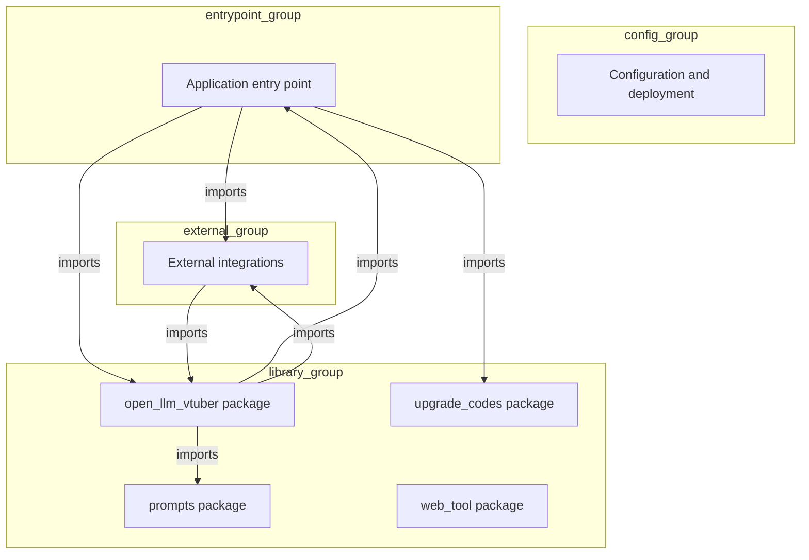

# Architecture report: Open-LLM-VTuber/Open-LLM-VTuber

> Automated static analysis. **Observed** = directly seen in files/imports/AST; **Inferred** = interpretation from that evidence. Repository code was not executed.

## 1. Repository at a glance

| Item | Value |
| --- | --- |
| Repository | Open-LLM-VTuber/Open-LLM-VTuber |
| Description | Talk to any LLM with hands-free voice interaction, voice interruption, and Live2D avatar running locally across platforms |
| Language | Python |
| Stars | 14709 |
| Licence | Other |
| Analysed commit / branch | 992309c0aa19845960228f880013d4685fde93b5 / main |
| Framework(s) | FastAPI, Starlette, Typer |
| Files analysed | 217 |
| Components | 7 |

## 2. Architecture in one minute

Open-LLM-VTuber/Open-LLM-VTuber - Talk to any LLM with hands-free voice interaction, voice interruption, and Live2D avatar running locally across platforms. This repository was analysed statically from 217 file(s) (125 Python). Detected technologies (observed from imports/manifests): GitHub Actions, FastAPI, Starlette, Typer, aiohttp, Click. Files are grouped into 7 component(s): Configuration and deployment, Application entry point, External integrations, open_llm_vtuber package, prompts package, upgrade_codes package, web_tool package. Observed entry point(s): run_server.py, scripts/run_bilibili_live.py, src/open_llm_vtuber/asr/azure_asr.py. Findings below distinguish observed facts from inferred interpretation.

## 3. High-level block diagram

## 4. Main components

### Configuration and deployment (`config`)

- **Kind:** config
- **Status:** Observed
- **Confidence:** 0.85
- **Responsibility:** Groups 39 file(s) under configuration and deployment (observed from repository paths and static analysis).
- **Paths:** `characters/en_nuke_debate.yaml`, `characters/en_unhelpful_ai.yaml`, `characters/zh_米粒.yaml`, `characters/zh_翻译腔.yaml`, `config_templates/conf.ZH.default.yaml`, `config_templates/conf.default.yaml`, `dockerfile`, `live2d-models/mao_pro/runtime/expressions/exp_01.exp3.json`, `live2d-models/mao_pro/runtime/expressions/exp_02.exp3.json`, `live2d-models/mao_pro/runtime/expressions/exp_03.exp3.json`, `live2d-models/mao_pro/runtime/expressions/exp_04.exp3.json`, `live2d-models/mao_pro/runtime/expressions/exp_05.exp3.json`, `live2d-models/mao_pro/runtime/expressions/exp_06.exp3.json`, `live2d-models/mao_pro/runtime/expressions/exp_07.exp3.json`, `live2d-models/mao_pro/runtime/expressions/exp_08.exp3.json`, `live2d-models/mao_pro/runtime/mao_pro.cdi3.json`, `live2d-models/mao_pro/runtime/mao_pro.model3.json`, `live2d-models/mao_pro/runtime/mao_pro.physics3.json`, `live2d-models/mao_pro/runtime/mao_pro.pose3.json`, `live2d-models/mao_pro/runtime/motions/mtn_01.motion3.json`, `live2d-models/mao_pro/runtime/motions/mtn_02.motion3.json`, `live2d-models/mao_pro/runtime/motions/mtn_03.motion3.json`, `live2d-models/mao_pro/runtime/motions/mtn_04.motion3.json`, `live2d-models/mao_pro/runtime/motions/special_01.motion3.json`, `live2d-models/mao_pro/runtime/motions/special_02.motion3.json`, `live2d-models/mao_pro/runtime/motions/special_03.motion3.json`, `live2d-models/shizuku/runtime/motion/01.motion3.json`, `live2d-models/shizuku/runtime/motion/02.motion3.json`, `live2d-models/shizuku/runtime/motion/03.motion3.json`, `live2d-models/shizuku/runtime/motion/04.motion3.json`, `live2d-models/shizuku/runtime/shizuku.cdi3.json`, `live2d-models/shizuku/runtime/shizuku.model3.json`, `live2d-models/shizuku/runtime/shizuku.physics3.json`, `live2d-models/shizuku/runtime/shizuku.pose3.json`, `mcp_servers.json`, `model_dict.json`, `pyproject.toml`, `requirements-bilibili.txt`, `requirements.txt`
- **Evidence:** [characters/en_nuke_debate.yaml](https://github.com/Open-LLM-VTuber/Open-LLM-VTuber/blob/992309c0aa19845960228f880013d4685fde93b5/characters/en_nuke_debate.yaml); [characters/en_unhelpful_ai.yaml](https://github.com/Open-LLM-VTuber/Open-LLM-VTuber/blob/992309c0aa19845960228f880013d4685fde93b5/characters/en_unhelpful_ai.yaml); [characters/zh_米粒.yaml](https://github.com/Open-LLM-VTuber/Open-LLM-VTuber/blob/992309c0aa19845960228f880013d4685fde93b5/characters/zh_%E7%B1%B3%E7%B2%92.yaml); [characters/zh_翻译腔.yaml](https://github.com/Open-LLM-VTuber/Open-LLM-VTuber/blob/992309c0aa19845960228f880013d4685fde93b5/characters/zh_%E7%BF%BB%E8%AF%91%E8%85%94.yaml); [config_templates/conf.ZH.default.yaml](https://github.com/Open-LLM-VTuber/Open-LLM-VTuber/blob/992309c0aa19845960228f880013d4685fde93b5/config_templates/conf.ZH.default.yaml); [config_templates/conf.default.yaml](https://github.com/Open-LLM-VTuber/Open-LLM-VTuber/blob/992309c0aa19845960228f880013d4685fde93b5/config_templates/conf.default.yaml); [dockerfile](https://github.com/Open-LLM-VTuber/Open-LLM-VTuber/blob/992309c0aa19845960228f880013d4685fde93b5/dockerfile); [live2d-models/mao_pro/runtime/expressions/exp_01.exp3.json](https://github.com/Open-LLM-VTuber/Open-LLM-VTuber/blob/992309c0aa19845960228f880013d4685fde93b5/live2d-models/mao_pro/runtime/expressions/exp_01.exp3.json)

### Application entry point (`entrypoint`)

- **Kind:** entrypoint
- **Status:** Observed
- **Confidence:** 0.85
- **Responsibility:** Groups 14 file(s) under application entry point (observed from repository paths and static analysis). Observed application object created via Group. Observed top-level classes: AvatarStaticFiles, CORSStaticFiles, ChatGroupManager, Config, Group, SileroVADConfig. Observed top-level functions: broadcast_to_group, check_and_extract_local_file, check_frontend_submodule, collect_all_key_paths, collect_leaf_key_paths, compare_yaml_keys.
- **Paths:** `run_server.py`, `scripts/run_bilibili_live.py`, `src/open_llm_vtuber/asr/azure_asr.py`, `src/open_llm_vtuber/asr/utils.py`, `src/open_llm_vtuber/chat_group.py`, `src/open_llm_vtuber/config_manager/main.py`, `src/open_llm_vtuber/mcpp/json_detector.py`, `src/open_llm_vtuber/server.py`, `src/open_llm_vtuber/tts/azure_tts.py`, `src/open_llm_vtuber/tts/pyttsx3_tts.py`, `src/open_llm_vtuber/tts/tts_factory.py`, `src/open_llm_vtuber/vad/silero.py`, `upgrade.py`, `upgrade_codes/compare_yaml.py`
- **Evidence:** [run_server.py:22](https://github.com/Open-LLM-VTuber/Open-LLM-VTuber/blob/992309c0aa19845960228f880013d4685fde93b5/run_server.py#L22); [scripts/run_bilibili_live.py:14](https://github.com/Open-LLM-VTuber/Open-LLM-VTuber/blob/992309c0aa19845960228f880013d4685fde93b5/scripts/run_bilibili_live.py#L14); [src/open_llm_vtuber/asr/azure_asr.py:14](https://github.com/Open-LLM-VTuber/Open-LLM-VTuber/blob/992309c0aa19845960228f880013d4685fde93b5/src/open_llm_vtuber/asr/azure_asr.py#L14); [src/open_llm_vtuber/asr/utils.py:9](https://github.com/Open-LLM-VTuber/Open-LLM-VTuber/blob/992309c0aa19845960228f880013d4685fde93b5/src/open_llm_vtuber/asr/utils.py#L9); [src/open_llm_vtuber/chat_group.py:22](https://github.com/Open-LLM-VTuber/Open-LLM-VTuber/blob/992309c0aa19845960228f880013d4685fde93b5/src/open_llm_vtuber/chat_group.py#L22); [src/open_llm_vtuber/config_manager/main.py:11](https://github.com/Open-LLM-VTuber/Open-LLM-VTuber/blob/992309c0aa19845960228f880013d4685fde93b5/src/open_llm_vtuber/config_manager/main.py#L11); [src/open_llm_vtuber/mcpp/json_detector.py:6](https://github.com/Open-LLM-VTuber/Open-LLM-VTuber/blob/992309c0aa19845960228f880013d4685fde93b5/src/open_llm_vtuber/mcpp/json_detector.py#L6); [src/open_llm_vtuber/server.py:23](https://github.com/Open-LLM-VTuber/Open-LLM-VTuber/blob/992309c0aa19845960228f880013d4685fde93b5/src/open_llm_vtuber/server.py#L23)

### External integrations (`external_integrations`)

- **Kind:** external
- **Status:** Observed
- **Confidence:** 0.85
- **Responsibility:** Groups 1 file(s) under external integrations (observed from repository paths and static analysis). Observed top-level classes: MCPClient.
- **Paths:** `src/open_llm_vtuber/mcpp/mcp_client.py`
- **Evidence:** [src/open_llm_vtuber/mcpp/mcp_client.py:17](https://github.com/Open-LLM-VTuber/Open-LLM-VTuber/blob/992309c0aa19845960228f880013d4685fde93b5/src/open_llm_vtuber/mcpp/mcp_client.py#L17)

### open_llm_vtuber package (`open_llm_vtuber`)

- **Kind:** library
- **Status:** Observed
- **Confidence:** 0.85
- **Responsibility:** Groups 96 file(s) under open_llm_vtuber package (observed from repository paths and static analysis). Observed top-level classes: ASRConfig, ASRFactory, ASRInterface, Actions, AgentConfig, AgentFactory. Observed top-level functions: _ensure_conf_dir, _filter_nested, _get_safe_history_path, _get_volume_by_chunks, _is_safe_filename, _sanitize_path_component.
- **Paths:** `src/open_llm_vtuber/__init__.py`, `src/open_llm_vtuber/agent/__init__.py`, `src/open_llm_vtuber/agent/agent_factory.py`, `src/open_llm_vtuber/agent/agents/__init__.py`, `src/open_llm_vtuber/agent/agents/agent_interface.py`, `src/open_llm_vtuber/agent/agents/basic_memory_agent.py`, `src/open_llm_vtuber/agent/agents/hume_ai.py`, `src/open_llm_vtuber/agent/agents/letta_agent.py`, `src/open_llm_vtuber/agent/agents/mem0_llm.py`, `src/open_llm_vtuber/agent/input_types.py`, `src/open_llm_vtuber/agent/output_types.py`, `src/open_llm_vtuber/agent/stateless_llm/__init__.py`, `src/open_llm_vtuber/agent/stateless_llm/claude_llm.py`, `src/open_llm_vtuber/agent/stateless_llm/llama_cpp_llm.py`, `src/open_llm_vtuber/agent/stateless_llm/ollama_llm.py`, `src/open_llm_vtuber/agent/stateless_llm/openai_compatible_llm.py`, `src/open_llm_vtuber/agent/stateless_llm/stateless_llm_interface.py`, `src/open_llm_vtuber/agent/stateless_llm/stateless_llm_with_template.py`, `src/open_llm_vtuber/agent/stateless_llm_factory.py`, `src/open_llm_vtuber/agent/transformers.py`, `src/open_llm_vtuber/asr/__init__.py`, `src/open_llm_vtuber/asr/asr_factory.py`, `src/open_llm_vtuber/asr/asr_interface.py`, `src/open_llm_vtuber/asr/faster_whisper_asr.py`, `src/open_llm_vtuber/asr/fun_asr.py`, `src/open_llm_vtuber/asr/groq_whisper_asr.py`, `src/open_llm_vtuber/asr/openai_whisper_asr.py`, `src/open_llm_vtuber/asr/sherpa_onnx_asr.py`, `src/open_llm_vtuber/asr/whisper_cpp_asr.py`, `src/open_llm_vtuber/chat_history_manager.py`, `src/open_llm_vtuber/config_manager/__init__.py`, `src/open_llm_vtuber/config_manager/agent.py`, `src/open_llm_vtuber/config_manager/asr.py`, `src/open_llm_vtuber/config_manager/character.py`, `src/open_llm_vtuber/config_manager/i18n.py`, `src/open_llm_vtuber/config_manager/live.py`, `src/open_llm_vtuber/config_manager/stateless_llm.py`, `src/open_llm_vtuber/config_manager/system.py`, `src/open_llm_vtuber/config_manager/tts.py`, `src/open_llm_vtuber/config_manager/tts_preprocessor.py`, `src/open_llm_vtuber/config_manager/utils.py`, `src/open_llm_vtuber/config_manager/vad.py`, `src/open_llm_vtuber/conversations/__init__.py`, `src/open_llm_vtuber/conversations/conversation_handler.py`, `src/open_llm_vtuber/conversations/conversation_utils.py`, `src/open_llm_vtuber/conversations/group_conversation.py`, `src/open_llm_vtuber/conversations/single_conversation.py`, `src/open_llm_vtuber/conversations/tts_manager.py`, `src/open_llm_vtuber/conversations/types.py`, `src/open_llm_vtuber/live/bilibili_live.py`, `src/open_llm_vtuber/live/live_interface.py`, `src/open_llm_vtuber/live2d_model.py`, `src/open_llm_vtuber/mcpp/server_registry.py`, `src/open_llm_vtuber/mcpp/tool_adapter.py`, `src/open_llm_vtuber/mcpp/tool_executor.py`, `src/open_llm_vtuber/mcpp/tool_manager.py`, `src/open_llm_vtuber/mcpp/types.py`, `src/open_llm_vtuber/mcpp/utils/path.py`, `src/open_llm_vtuber/message_handler.py`, `src/open_llm_vtuber/proxy_handler.py`, `src/open_llm_vtuber/proxy_message_queue.py`, `src/open_llm_vtuber/routes.py`, `src/open_llm_vtuber/service_context.py`, `src/open_llm_vtuber/translate/__init__.py`, `src/open_llm_vtuber/translate/deeplx.py`, `src/open_llm_vtuber/translate/tencent.py`, `src/open_llm_vtuber/translate/translate_factory.py`, `src/open_llm_vtuber/translate/translate_interface.py`, `src/open_llm_vtuber/tts/__init__.py`, `src/open_llm_vtuber/tts/bark_tts.py`, `src/open_llm_vtuber/tts/cartesia_tts.py`, `src/open_llm_vtuber/tts/coqui_tts.py`, `src/open_llm_vtuber/tts/cosyvoice2_tts.py`, `src/open_llm_vtuber/tts/cosyvoice_tts.py`, `src/open_llm_vtuber/tts/edge_tts.py`, `src/open_llm_vtuber/tts/elevenlabs_tts.py`, `src/open_llm_vtuber/tts/fish_api_tts.py`, `src/open_llm_vtuber/tts/gpt_sovits_tts.py`, `src/open_llm_vtuber/tts/melo_tts.py`, `src/open_llm_vtuber/tts/minimax_tts.py`, `src/open_llm_vtuber/tts/openai_tts.py`, `src/open_llm_vtuber/tts/piper_tts.py`, `src/open_llm_vtuber/tts/sherpa_onnx_tts.py`, `src/open_llm_vtuber/tts/siliconflow_tts.py`, `src/open_llm_vtuber/tts/spark_tts.py`, `src/open_llm_vtuber/tts/tts_interface.py`, `src/open_llm_vtuber/tts/x_tts.py`, `src/open_llm_vtuber/utils/__init__.py`, `src/open_llm_vtuber/utils/install_utils.py`, `src/open_llm_vtuber/utils/sentence_divider.py`, `src/open_llm_vtuber/utils/stream_audio.py`, `src/open_llm_vtuber/utils/tts_preprocessor.py`, `src/open_llm_vtuber/vad/__init__.py`, `src/open_llm_vtuber/vad/vad_factory.py`, `src/open_llm_vtuber/vad/vad_interface.py`, `src/open_llm_vtuber/websocket_handler.py`
- **Evidence:** [src/open_llm_vtuber/__init__.py](https://github.com/Open-LLM-VTuber/Open-LLM-VTuber/blob/992309c0aa19845960228f880013d4685fde93b5/src/open_llm_vtuber/__init__.py); [src/open_llm_vtuber/agent/__init__.py](https://github.com/Open-LLM-VTuber/Open-LLM-VTuber/blob/992309c0aa19845960228f880013d4685fde93b5/src/open_llm_vtuber/agent/__init__.py); [src/open_llm_vtuber/agent/agent_factory.py:15](https://github.com/Open-LLM-VTuber/Open-LLM-VTuber/blob/992309c0aa19845960228f880013d4685fde93b5/src/open_llm_vtuber/agent/agent_factory.py#L15); [src/open_llm_vtuber/agent/agents/__init__.py](https://github.com/Open-LLM-VTuber/Open-LLM-VTuber/blob/992309c0aa19845960228f880013d4685fde93b5/src/open_llm_vtuber/agent/agents/__init__.py); [src/open_llm_vtuber/agent/agents/agent_interface.py:9](https://github.com/Open-LLM-VTuber/Open-LLM-VTuber/blob/992309c0aa19845960228f880013d4685fde93b5/src/open_llm_vtuber/agent/agents/agent_interface.py#L9); [src/open_llm_vtuber/agent/agents/basic_memory_agent.py:33](https://github.com/Open-LLM-VTuber/Open-LLM-VTuber/blob/992309c0aa19845960228f880013d4685fde93b5/src/open_llm_vtuber/agent/agents/basic_memory_agent.py#L33); [src/open_llm_vtuber/agent/agents/hume_ai.py:15](https://github.com/Open-LLM-VTuber/Open-LLM-VTuber/blob/992309c0aa19845960228f880013d4685fde93b5/src/open_llm_vtuber/agent/agents/hume_ai.py#L15); [src/open_llm_vtuber/agent/agents/letta_agent.py:15](https://github.com/Open-LLM-VTuber/Open-LLM-VTuber/blob/992309c0aa19845960228f880013d4685fde93b5/src/open_llm_vtuber/agent/agents/letta_agent.py#L15)

### prompts package (`prompts`)

- **Kind:** library
- **Status:** Observed
- **Confidence:** 0.85
- **Responsibility:** Groups 2 file(s) under prompts package (observed from repository paths and static analysis). Observed top-level functions: _load_file_content, load_persona, load_util.
- **Paths:** `prompts/__init__.py`, `prompts/prompt_loader.py`
- **Evidence:** [prompts/__init__.py](https://github.com/Open-LLM-VTuber/Open-LLM-VTuber/blob/992309c0aa19845960228f880013d4685fde93b5/prompts/__init__.py); [prompts/prompt_loader.py:12](https://github.com/Open-LLM-VTuber/Open-LLM-VTuber/blob/992309c0aa19845960228f880013d4685fde93b5/prompts/prompt_loader.py#L12)

### upgrade_codes package (`upgrade_codes`)

- **Kind:** library
- **Status:** Observed
- **Confidence:** 0.85
- **Responsibility:** Groups 12 file(s) under upgrade_codes package (observed from repository paths and static analysis). Observed top-level classes: CommentSynchronizer, ConfigSynchronizer, UpgradeManager, UpgradeUtility, VersionUpgradeManager, to_v_1_2_1. Observed top-level functions: comment_diff_fn, extract_comments, get_comment_text, get_current_script_version, get_system_language, load_user_config.
- **Paths:** `upgrade_codes/__init__.py`, `upgrade_codes/config_sync.py`, `upgrade_codes/from_version/__init__.py`, `upgrade_codes/from_version/v_1_1_1.py`, `upgrade_codes/upgrade_core/__init__.py`, `upgrade_codes/upgrade_core/comment_diff_fn.py`, `upgrade_codes/upgrade_core/comment_sync.py`, `upgrade_codes/upgrade_core/constants.py`, `upgrade_codes/upgrade_core/language.py`, `upgrade_codes/upgrade_core/upgrade_utils.py`, `upgrade_codes/upgrade_manager.py`, `upgrade_codes/version_manager.py`
- **Evidence:** [upgrade_codes/__init__.py](https://github.com/Open-LLM-VTuber/Open-LLM-VTuber/blob/992309c0aa19845960228f880013d4685fde93b5/upgrade_codes/__init__.py); [upgrade_codes/config_sync.py:22](https://github.com/Open-LLM-VTuber/Open-LLM-VTuber/blob/992309c0aa19845960228f880013d4685fde93b5/upgrade_codes/config_sync.py#L22); [upgrade_codes/from_version/__init__.py](https://github.com/Open-LLM-VTuber/Open-LLM-VTuber/blob/992309c0aa19845960228f880013d4685fde93b5/upgrade_codes/from_version/__init__.py); [upgrade_codes/from_version/v_1_1_1.py:5](https://github.com/Open-LLM-VTuber/Open-LLM-VTuber/blob/992309c0aa19845960228f880013d4685fde93b5/upgrade_codes/from_version/v_1_1_1.py#L5); [upgrade_codes/upgrade_core/__init__.py](https://github.com/Open-LLM-VTuber/Open-LLM-VTuber/blob/992309c0aa19845960228f880013d4685fde93b5/upgrade_codes/upgrade_core/__init__.py); [upgrade_codes/upgrade_core/comment_diff_fn.py:6](https://github.com/Open-LLM-VTuber/Open-LLM-VTuber/blob/992309c0aa19845960228f880013d4685fde93b5/upgrade_codes/upgrade_core/comment_diff_fn.py#L6); [upgrade_codes/upgrade_core/comment_sync.py:8](https://github.com/Open-LLM-VTuber/Open-LLM-VTuber/blob/992309c0aa19845960228f880013d4685fde93b5/upgrade_codes/upgrade_core/comment_sync.py#L8); [upgrade_codes/upgrade_core/constants.py:18](https://github.com/Open-LLM-VTuber/Open-LLM-VTuber/blob/992309c0aa19845960228f880013d4685fde93b5/upgrade_codes/upgrade_core/constants.py#L18)

### web_tool package (`web_tool`)

- **Kind:** library
- **Status:** Observed
- **Confidence:** 0.85
- **Responsibility:** Groups 2 file(s) under web_tool package (observed from repository paths and static analysis).
- **Paths:** `web_tool/main.js`, `web_tool/recorder.js`
- **Evidence:** [web_tool/main.js](https://github.com/Open-LLM-VTuber/Open-LLM-VTuber/blob/992309c0aa19845960228f880013d4685fde93b5/web_tool/main.js); [web_tool/recorder.js](https://github.com/Open-LLM-VTuber/Open-LLM-VTuber/blob/992309c0aa19845960228f880013d4685fde93b5/web_tool/recorder.js)

## 5. Execution flow

**Observed** entry point(s):

- [run_server.py:167](https://github.com/Open-LLM-VTuber/Open-LLM-VTuber/blob/992309c0aa19845960228f880013d4685fde93b5/run_server.py#L167)
- [scripts/run_bilibili_live.py:56](https://github.com/Open-LLM-VTuber/Open-LLM-VTuber/blob/992309c0aa19845960228f880013d4685fde93b5/scripts/run_bilibili_live.py#L56)
- [src/open_llm_vtuber/asr/azure_asr.py:154](https://github.com/Open-LLM-VTuber/Open-LLM-VTuber/blob/992309c0aa19845960228f880013d4685fde93b5/src/open_llm_vtuber/asr/azure_asr.py#L154)
- [src/open_llm_vtuber/asr/utils.py:164](https://github.com/Open-LLM-VTuber/Open-LLM-VTuber/blob/992309c0aa19845960228f880013d4685fde93b5/src/open_llm_vtuber/asr/utils.py#L164)
- [src/open_llm_vtuber/chat_group.py:22](https://github.com/Open-LLM-VTuber/Open-LLM-VTuber/blob/992309c0aa19845960228f880013d4685fde93b5/src/open_llm_vtuber/chat_group.py#L22)
- [src/open_llm_vtuber/mcpp/json_detector.py:140](https://github.com/Open-LLM-VTuber/Open-LLM-VTuber/blob/992309c0aa19845960228f880013d4685fde93b5/src/open_llm_vtuber/mcpp/json_detector.py#L140)
- [src/open_llm_vtuber/tts/azure_tts.py:136](https://github.com/Open-LLM-VTuber/Open-LLM-VTuber/blob/992309c0aa19845960228f880013d4685fde93b5/src/open_llm_vtuber/tts/azure_tts.py#L136)
- [src/open_llm_vtuber/tts/pyttsx3_tts.py:40](https://github.com/Open-LLM-VTuber/Open-LLM-VTuber/blob/992309c0aa19845960228f880013d4685fde93b5/src/open_llm_vtuber/tts/pyttsx3_tts.py#L40)
- [src/open_llm_vtuber/tts/tts_factory.py:221](https://github.com/Open-LLM-VTuber/Open-LLM-VTuber/blob/992309c0aa19845960228f880013d4685fde93b5/src/open_llm_vtuber/tts/tts_factory.py#L221)
- [src/open_llm_vtuber/vad/silero.py:226](https://github.com/Open-LLM-VTuber/Open-LLM-VTuber/blob/992309c0aa19845960228f880013d4685fde93b5/src/open_llm_vtuber/vad/silero.py#L226)
- [upgrade.py:170](https://github.com/Open-LLM-VTuber/Open-LLM-VTuber/blob/992309c0aa19845960228f880013d4685fde93b5/upgrade.py#L170)
- [upgrade_codes/compare_yaml.py:74](https://github.com/Open-LLM-VTuber/Open-LLM-VTuber/blob/992309c0aa19845960228f880013d4685fde93b5/upgrade_codes/compare_yaml.py#L74)

Representative flow (derived from observed entry points and the import graph; steps beyond the entry point are **Inferred**):

1. Execution starts at an observed entry point listed above, if present.
2. `entrypoint` imports `external_integrations` (Application entry point -> External integrations).
3. `entrypoint` imports `open_llm_vtuber` (Application entry point -> open_llm_vtuber package).
4. `entrypoint` imports `upgrade_codes` (Application entry point -> upgrade_codes package).
5. `external_integrations` imports `open_llm_vtuber` (External integrations -> open_llm_vtuber package).
6. `open_llm_vtuber` imports `entrypoint` (open_llm_vtuber package -> Application entry point).
7. `open_llm_vtuber` imports `external_integrations` (open_llm_vtuber package -> External integrations).
8. `open_llm_vtuber` imports `prompts` (open_llm_vtuber package -> prompts package).

## 6. Project structure

### `(root)`

- `.dockerignore` - container (994 bytes)
- `.gitattributes` - other (31 bytes)
- `.gitignore` - other (1128 bytes)
- `.gitmodules` - other (117 bytes)
- `.pre-commit-config.yaml` - config (186 bytes)
- `.python-version` - other (5 bytes)
- `CLAUDE.md` - docs (6237 bytes)
- `CONTRIBUTING.md` - docs (342 bytes)
- `LICENSE` - docs (1216 bytes)
- `LICENSE-Live2D.md` - docs (57705 bytes)
- `README.CN.md` - docs (10280 bytes)
- `README.JP.md` - docs (14617 bytes)
- `README.KR.md` - docs (13124 bytes)
- `README.md` - docs (11536 bytes)
- `dockerfile` - container (2165 bytes)
- `mcp_servers.json` - config (250 bytes)
- `model_dict.json` - config (679 bytes)
- `pixi.lock` - other (89773 bytes)
- `pyproject.toml` - manifest (1840 bytes)
- `requirements-bilibili.txt` - manifest (783 bytes)
- `requirements.txt` - manifest (42047 bytes)
- `run_server.py` - source, Python (6916 bytes)
- `upgrade.py` - source, Python (5769 bytes)

### `.cursor`

- `.cursor/rules/olv-core-rules.mdc` - other (6107 bytes)

### `.gemini`

- `.gemini/GEMINI.md` - docs (6079 bytes)
- `.gemini/styleguide.md` - docs (12143 bytes)

### `.github`

- `.github/FUNDING.yml` - config (824 bytes)
- `.github/ISSUE_TEMPLATE/bug---question---get-help---bug---提问---求助.md` - docs (2217 bytes)
- `.github/ISSUE_TEMPLATE/feature-request---功能建议.md` - docs (2249 bytes)
- `.github/copilot-instructions.md` - docs (6079 bytes)
- `.github/workflows/codeql.yml` - ci, YAML (4301 bytes)
- `.github/workflows/create_release.yml` - ci, YAML (10106 bytes)
- `.github/workflows/docker-blacksmith.yml` - ci, YAML (6524 bytes)
- `.github/workflows/fossa_scan.yml` - ci, YAML (270 bytes)
- `.github/workflows/ruff.yml` - ci, YAML (162 bytes)
- `.github/workflows/update-requirements.yml` - ci, YAML (916 bytes)

### `backgrounds`

- `backgrounds/README.md` - docs (159 bytes)

### `characters`

- `characters/README.md` - docs (5554 bytes)
- `characters/en_nuke_debate.yaml` - config (744 bytes)
- `characters/en_unhelpful_ai.yaml` - config (375 bytes)
- `characters/zh_米粒.yaml` - config (414 bytes)
- `characters/zh_翻译腔.yaml` - config (1736 bytes)

### `config_templates`

- `config_templates/README.md` - docs (300 bytes)
- `config_templates/conf.ZH.default.yaml` - config (26287 bytes)
- `config_templates/conf.default.yaml` - config (25210 bytes)

### `doc`

- `doc/README.md` - docs (427 bytes)
- `doc/sample_conf/sherpaASRTTS_sense_voice_melo.yaml` - config (4936 bytes)
- `doc/sample_conf/sherpaASRTTS_sense_voice_piper_en.yaml` - config (4661 bytes)
- `doc/sample_conf/sherpaASRTTS_sense_voice_vits_zh.yaml` - config (4908 bytes)
- `doc/sample_conf/sherpaASR_paraformer.yaml` - config (3841 bytes)
- `doc/sample_conf/sherpaASR_sense_voice.yaml` - config (3784 bytes)

### `live2d-models`

- `live2d-models/mao_pro/ReadMe.txt` - docs (2595 bytes)
- `live2d-models/mao_pro/runtime/expressions/exp_01.exp3.json` - config (1981 bytes)
- `live2d-models/mao_pro/runtime/expressions/exp_02.exp3.json` - config (1981 bytes)
- `live2d-models/mao_pro/runtime/expressions/exp_03.exp3.json` - config (1981 bytes)
- `live2d-models/mao_pro/runtime/expressions/exp_04.exp3.json` - config (1985 bytes)
- `live2d-models/mao_pro/runtime/expressions/exp_05.exp3.json` - config (1986 bytes)
- `live2d-models/mao_pro/runtime/expressions/exp_06.exp3.json` - config (1985 bytes)
- `live2d-models/mao_pro/runtime/expressions/exp_07.exp3.json` - config (1987 bytes)
- `live2d-models/mao_pro/runtime/expressions/exp_08.exp3.json` - config (1982 bytes)
- `live2d-models/mao_pro/runtime/mao_pro.cdi3.json` - config (15929 bytes)
- `live2d-models/mao_pro/runtime/mao_pro.model3.json` - config (1645 bytes)
- `live2d-models/mao_pro/runtime/mao_pro.physics3.json` - config (21803 bytes)
- `live2d-models/mao_pro/runtime/mao_pro.pose3.json` - config (254 bytes)
- `live2d-models/mao_pro/runtime/motions/mtn_01.motion3.json` - config (27147 bytes)
- `live2d-models/mao_pro/runtime/motions/mtn_02.motion3.json` - config (23760 bytes)
- `live2d-models/mao_pro/runtime/motions/mtn_03.motion3.json` - config (22428 bytes)
- `live2d-models/mao_pro/runtime/motions/mtn_04.motion3.json` - config (26840 bytes)
- `live2d-models/mao_pro/runtime/motions/special_01.motion3.json` - config (33723 bytes)
- `live2d-models/mao_pro/runtime/motions/special_02.motion3.json` - config (41295 bytes)
- `live2d-models/mao_pro/runtime/motions/special_03.motion3.json` - config (47803 bytes)
- `live2d-models/shizuku/ReadMe.txt` - docs (2393 bytes)
- `live2d-models/shizuku/runtime/motion/01.motion3.json` - config (6081 bytes)
- `live2d-models/shizuku/runtime/motion/02.motion3.json` - config (11099 bytes)
- `live2d-models/shizuku/runtime/motion/03.motion3.json` - config (6587 bytes)
- `live2d-models/shizuku/runtime/motion/04.motion3.json` - config (6233 bytes)
- `live2d-models/shizuku/runtime/shizuku.cdi3.json` - config (6329 bytes)
- `live2d-models/shizuku/runtime/shizuku.model3.json` - config (917 bytes)
- `live2d-models/shizuku/runtime/shizuku.physics3.json` - config (4267 bytes)
- `live2d-models/shizuku/runtime/shizuku.pose3.json` - config (286 bytes)

### `prompts`

- `prompts/README.md` - docs (720 bytes)
- `prompts/__init__.py` - source, Python (0 bytes)
- `prompts/prompt_loader.py` - source, Python (2294 bytes)
- `prompts/utils/concise_style_prompt.txt` - docs (479 bytes)
- `prompts/utils/group_conversation_prompt.txt` - docs (396 bytes)
- `prompts/utils/live2d_expression_prompt.txt` - docs (572 bytes)
- `prompts/utils/live_prompt.txt` - docs (427 bytes)
- `prompts/utils/mcp_prompt.txt` - docs (1693 bytes)
- `prompts/utils/proactive_speak_prompt.txt` - docs (84 bytes)
- `prompts/utils/speakable_prompt.txt` - docs (1280 bytes)
- `prompts/utils/think_tag_prompt.txt` - docs (428 bytes)
- `prompts/utils/tool_guidance_prompt.txt` - docs (256 bytes)

### `scripts`

- `scripts/run_bilibili_live.py` - source, Python (2023 bytes)

### `src`

- `src/open_llm_vtuber/__init__.py` - source, Python (0 bytes)
- `src/open_llm_vtuber/agent/__init__.py` - source, Python (0 bytes)
- `src/open_llm_vtuber/agent/agent_factory.py` - source, Python (5393 bytes)
- `src/open_llm_vtuber/agent/agents/__init__.py` - source, Python (0 bytes)
- `src/open_llm_vtuber/agent/agents/agent_interface.py` - source, Python (1771 bytes)
- `src/open_llm_vtuber/agent/agents/basic_memory_agent.py` - source, Python (28012 bytes)
- `src/open_llm_vtuber/agent/agents/hume_ai.py` - source, Python (9099 bytes)
- `src/open_llm_vtuber/agent/agents/letta_agent.py` - source, Python (4431 bytes)
- `src/open_llm_vtuber/agent/agents/mem0_llm.py` - source, Python (0 bytes)
- `src/open_llm_vtuber/agent/input_types.py` - source, Python (2313 bytes)
- `src/open_llm_vtuber/agent/output_types.py` - source, Python (2259 bytes)
- `src/open_llm_vtuber/agent/stateless_llm/__init__.py` - source, Python (0 bytes)
- `src/open_llm_vtuber/agent/stateless_llm/claude_llm.py` - source, Python (11879 bytes)
- `src/open_llm_vtuber/agent/stateless_llm/llama_cpp_llm.py` - source, Python (2611 bytes)
- `src/open_llm_vtuber/agent/stateless_llm/ollama_llm.py` - source, Python (2565 bytes)
- `src/open_llm_vtuber/agent/stateless_llm/openai_compatible_llm.py` - source, Python (10717 bytes)
- `src/open_llm_vtuber/agent/stateless_llm/stateless_llm_interface.py` - source, Python (2328 bytes)
- `src/open_llm_vtuber/agent/stateless_llm/stateless_llm_with_template.py` - source, Python (6850 bytes)
- `src/open_llm_vtuber/agent/stateless_llm_factory.py` - source, Python (3173 bytes)
- `src/open_llm_vtuber/agent/transformers.py` - source, Python (7959 bytes)
- `src/open_llm_vtuber/asr/__init__.py` - source, Python (0 bytes)
- `src/open_llm_vtuber/asr/asr_factory.py` - source, Python (2434 bytes)
- `src/open_llm_vtuber/asr/asr_interface.py` - source, Python (1840 bytes)
- `src/open_llm_vtuber/asr/azure_asr.py` - source, Python (5354 bytes)
- `src/open_llm_vtuber/asr/faster_whisper_asr.py` - source, Python (1544 bytes)
- `src/open_llm_vtuber/asr/fun_asr.py` - source, Python (4983 bytes)
- `src/open_llm_vtuber/asr/groq_whisper_asr.py` - source, Python (1846 bytes)
- `src/open_llm_vtuber/asr/openai_whisper_asr.py` - source, Python (739 bytes)
- `src/open_llm_vtuber/asr/sherpa_onnx_asr.py` - source, Python (10234 bytes)
- `src/open_llm_vtuber/asr/utils.py` - source, Python (6230 bytes)
- `src/open_llm_vtuber/asr/whisper_cpp_asr.py` - source, Python (1097 bytes)
- `src/open_llm_vtuber/chat_group.py` - source, Python (12064 bytes)
- `src/open_llm_vtuber/chat_history_manager.py` - source, Python (12540 bytes)
- `src/open_llm_vtuber/config_manager/__init__.py` - source, Python (2831 bytes)
- `src/open_llm_vtuber/config_manager/agent.py` - source, Python (8726 bytes)
- `src/open_llm_vtuber/config_manager/asr.py` - source, Python (16640 bytes)
- `src/open_llm_vtuber/config_manager/character.py` - source, Python (3324 bytes)
- `src/open_llm_vtuber/config_manager/i18n.py` - source, Python (4302 bytes)
- `src/open_llm_vtuber/config_manager/live.py` - source, Python (1100 bytes)
- `src/open_llm_vtuber/config_manager/main.py` - source, Python (1022 bytes)
- `src/open_llm_vtuber/config_manager/stateless_llm.py` - source, Python (11209 bytes)
- `src/open_llm_vtuber/config_manager/system.py` - source, Python (1588 bytes)
- `src/open_llm_vtuber/config_manager/tts.py` - source, Python (32724 bytes)
- `src/open_llm_vtuber/config_manager/tts_preprocessor.py` - source, Python (4818 bytes)
- `src/open_llm_vtuber/config_manager/utils.py` - source, Python (5399 bytes)
- `src/open_llm_vtuber/config_manager/vad.py` - source, Python (2700 bytes)
- `src/open_llm_vtuber/conversations/__init__.py` - source, Python (0 bytes)
- `src/open_llm_vtuber/conversations/conversation_handler.py` - source, Python (7958 bytes)
- `src/open_llm_vtuber/conversations/conversation_utils.py` - source, Python (8050 bytes)
- `src/open_llm_vtuber/conversations/group_conversation.py` - source, Python (13865 bytes)
- `src/open_llm_vtuber/conversations/single_conversation.py` - source, Python (6675 bytes)
- `src/open_llm_vtuber/conversations/tts_manager.py` - source, Python (6542 bytes)
- `src/open_llm_vtuber/conversations/types.py` - source, Python (2033 bytes)
- `src/open_llm_vtuber/live/bilibili_live.py` - source, Python (12093 bytes)
- `src/open_llm_vtuber/live/live_interface.py` - source, Python (3528 bytes)
- `src/open_llm_vtuber/live2d_model.py` - source, Python (7183 bytes)
- `src/open_llm_vtuber/mcpp/json_detector.py` - source, Python (5317 bytes)
- `src/open_llm_vtuber/mcpp/mcp_client.py` - source, Python (7661 bytes)
- `src/open_llm_vtuber/mcpp/server_registry.py` - source, Python (3770 bytes)
- `src/open_llm_vtuber/mcpp/tool_adapter.py` - source, Python (10520 bytes)
- `src/open_llm_vtuber/mcpp/tool_executor.py` - source, Python (15699 bytes)
- `src/open_llm_vtuber/mcpp/tool_manager.py` - source, Python (1819 bytes)
- `src/open_llm_vtuber/mcpp/types.py` - source, Python (3099 bytes)
- `src/open_llm_vtuber/mcpp/utils/path.py` - source, Python (783 bytes)
- `src/open_llm_vtuber/message_handler.py` - source, Python (3093 bytes)
- `src/open_llm_vtuber/proxy_handler.py` - source, Python (12034 bytes)
- `src/open_llm_vtuber/proxy_message_queue.py` - source, Python (6546 bytes)
- `src/open_llm_vtuber/routes.py` - source, Python (9097 bytes)
- `src/open_llm_vtuber/server.py` - source, Python (5973 bytes)
- `src/open_llm_vtuber/service_context.py` - source, Python (23234 bytes)
- `src/open_llm_vtuber/translate/__init__.py` - source, Python (0 bytes)
- `src/open_llm_vtuber/translate/deeplx.py` - source, Python (965 bytes)
- `src/open_llm_vtuber/translate/tencent.py` - source, Python (4017 bytes)
- `src/open_llm_vtuber/translate/translate_factory.py` - source, Python (1152 bytes)
- `src/open_llm_vtuber/translate/translate_interface.py` - source, Python (235 bytes)
- `src/open_llm_vtuber/tts/__init__.py` - source, Python (0 bytes)
- `src/open_llm_vtuber/tts/azure_tts.py` - source, Python (5351 bytes)
- `src/open_llm_vtuber/tts/bark_tts.py` - source, Python (1929 bytes)
- `src/open_llm_vtuber/tts/cartesia_tts.py` - source, Python (5679 bytes)
- `src/open_llm_vtuber/tts/coqui_tts.py` - source, Python (4184 bytes)
- `src/open_llm_vtuber/tts/cosyvoice2_tts.py` - source, Python (1967 bytes)
- `src/open_llm_vtuber/tts/cosyvoice_tts.py` - source, Python (1786 bytes)
- `src/open_llm_vtuber/tts/edge_tts.py` - source, Python (1503 bytes)
- `src/open_llm_vtuber/tts/elevenlabs_tts.py` - source, Python (5244 bytes)
- `src/open_llm_vtuber/tts/fish_api_tts.py` - source, Python (1862 bytes)
- `src/open_llm_vtuber/tts/gpt_sovits_tts.py` - source, Python (2168 bytes)
- `src/open_llm_vtuber/tts/melo_tts.py` - source, Python (2006 bytes)
- `src/open_llm_vtuber/tts/minimax_tts.py` - source, Python (3157 bytes)
- `src/open_llm_vtuber/tts/openai_tts.py` - source, Python (5671 bytes)
- `src/open_llm_vtuber/tts/piper_tts.py` - source, Python (4221 bytes)
- `src/open_llm_vtuber/tts/pyttsx3_tts.py` - source, Python (1906 bytes)
- `src/open_llm_vtuber/tts/sherpa_onnx_tts.py` - source, Python (3486 bytes)
- `src/open_llm_vtuber/tts/siliconflow_tts.py` - source, Python (2480 bytes)
- `src/open_llm_vtuber/tts/spark_tts.py` - source, Python (2239 bytes)
- `src/open_llm_vtuber/tts/tts_factory.py` - source, Python (9805 bytes)
- `src/open_llm_vtuber/tts/tts_interface.py` - source, Python (2691 bytes)
- `src/open_llm_vtuber/tts/x_tts.py` - source, Python (1398 bytes)
- `src/open_llm_vtuber/utils/__init__.py` - source, Python (0 bytes)
- `src/open_llm_vtuber/utils/install_utils.py` - source, Python (4937 bytes)
- `src/open_llm_vtuber/utils/sentence_divider.py` - source, Python (20028 bytes)
- `src/open_llm_vtuber/utils/stream_audio.py` - source, Python (2877 bytes)
- `src/open_llm_vtuber/utils/tts_preprocessor.py` - source, Python (5679 bytes)
- `src/open_llm_vtuber/vad/__init__.py` - source, Python (0 bytes)
- `src/open_llm_vtuber/vad/silero.py` - source, Python (7642 bytes)
- `src/open_llm_vtuber/vad/vad_factory.py` - source, Python (689 bytes)
- `src/open_llm_vtuber/vad/vad_interface.py` - source, Python (377 bytes)
- `src/open_llm_vtuber/websocket_handler.py` - source, Python (23172 bytes)

### `upgrade_codes`

- `upgrade_codes/__init__.py` - source, Python (0 bytes)
- `upgrade_codes/compare_yaml.py` - source, Python (2966 bytes)
- `upgrade_codes/config_sync.py` - source, Python (12152 bytes)
- `upgrade_codes/from_version/__init__.py` - source, Python (0 bytes)
- `upgrade_codes/from_version/v_1_1_1.py` - source, Python (4346 bytes)
- `upgrade_codes/upgrade_core/__init__.py` - source, Python (0 bytes)
- `upgrade_codes/upgrade_core/comment_diff_fn.py` - source, Python (1604 bytes)
- `upgrade_codes/upgrade_core/comment_sync.py` - source, Python (2099 bytes)
- `upgrade_codes/upgrade_core/constants.py` - source, Python (16147 bytes)
- `upgrade_codes/upgrade_core/language.py` - source, Python (1777 bytes)
- `upgrade_codes/upgrade_core/upgrade_utils.py` - source, Python (4889 bytes)
- `upgrade_codes/upgrade_manager.py` - source, Python (2113 bytes)
- `upgrade_codes/version_manager.py` - source, Python (3580 bytes)

### `web_tool`

- `web_tool/README.md` - docs (904 bytes)
- `web_tool/index.html` - other (3737 bytes)
- `web_tool/main.js` - source, JavaScript (14162 bytes)
- `web_tool/recorder.js` - source, JavaScript (4471 bytes)

## 7. Key dependencies and integrations

| Name | Category | Status | Confidence | Evidence |
| --- | --- | --- | --- | --- |
| GitHub Actions | ci | Observed | 0.90 | [.github/workflows/codeql.yml](https://github.com/Open-LLM-VTuber/Open-LLM-VTuber/blob/992309c0aa19845960228f880013d4685fde93b5/.github/workflows/codeql.yml); [.github/workflows/create_release.yml](https://github.com/Open-LLM-VTuber/Open-LLM-VTuber/blob/992309c0aa19845960228f880013d4685fde93b5/.github/workflows/create_release.yml); [.github/workflows/docker-blacksmith.yml](https://github.com/Open-LLM-VTuber/Open-LLM-VTuber/blob/992309c0aa19845960228f880013d4685fde93b5/.github/workflows/docker-blacksmith.yml); [.github/workflows/fossa_scan.yml](https://github.com/Open-LLM-VTuber/Open-LLM-VTuber/blob/992309c0aa19845960228f880013d4685fde93b5/.github/workflows/fossa_scan.yml) |
| FastAPI | framework | Observed | 0.95 | [pyproject.toml:14](https://github.com/Open-LLM-VTuber/Open-LLM-VTuber/blob/992309c0aa19845960228f880013d4685fde93b5/pyproject.toml#L14); [requirements-bilibili.txt:8](https://github.com/Open-LLM-VTuber/Open-LLM-VTuber/blob/992309c0aa19845960228f880013d4685fde93b5/requirements-bilibili.txt#L8); [requirements.txt:12](https://github.com/Open-LLM-VTuber/Open-LLM-VTuber/blob/992309c0aa19845960228f880013d4685fde93b5/requirements.txt#L12); [src/open_llm_vtuber/chat_group.py:3](https://github.com/Open-LLM-VTuber/Open-LLM-VTuber/blob/992309c0aa19845960228f880013d4685fde93b5/src/open_llm_vtuber/chat_group.py#L3) |
| Starlette | framework | Observed | 0.95 | [requirements.txt:25](https://github.com/Open-LLM-VTuber/Open-LLM-VTuber/blob/992309c0aa19845960228f880013d4685fde93b5/requirements.txt#L25); [src/open_llm_vtuber/proxy_handler.py:8](https://github.com/Open-LLM-VTuber/Open-LLM-VTuber/blob/992309c0aa19845960228f880013d4685fde93b5/src/open_llm_vtuber/proxy_handler.py#L8); [src/open_llm_vtuber/routes.py:7](https://github.com/Open-LLM-VTuber/Open-LLM-VTuber/blob/992309c0aa19845960228f880013d4685fde93b5/src/open_llm_vtuber/routes.py#L7); [src/open_llm_vtuber/routes.py:8](https://github.com/Open-LLM-VTuber/Open-LLM-VTuber/blob/992309c0aa19845960228f880013d4685fde93b5/src/open_llm_vtuber/routes.py#L8) |
| Typer | framework | Observed | 0.85 | [requirements.txt:63](https://github.com/Open-LLM-VTuber/Open-LLM-VTuber/blob/992309c0aa19845960228f880013d4685fde93b5/requirements.txt#L63) |
| aiohttp | library | Observed | 0.95 | [pyproject.toml:47](https://github.com/Open-LLM-VTuber/Open-LLM-VTuber/blob/992309c0aa19845960228f880013d4685fde93b5/pyproject.toml#L47); [requirements-bilibili.txt:1](https://github.com/Open-LLM-VTuber/Open-LLM-VTuber/blob/992309c0aa19845960228f880013d4685fde93b5/requirements-bilibili.txt#L1); [requirements.txt:4](https://github.com/Open-LLM-VTuber/Open-LLM-VTuber/blob/992309c0aa19845960228f880013d4685fde93b5/requirements.txt#L4); [src/open_llm_vtuber/live/bilibili_live.py:8](https://github.com/Open-LLM-VTuber/Open-LLM-VTuber/blob/992309c0aa19845960228f880013d4685fde93b5/src/open_llm_vtuber/live/bilibili_live.py#L8) |
| Click | library | Observed | 0.85 | [requirements.txt:60](https://github.com/Open-LLM-VTuber/Open-LLM-VTuber/blob/992309c0aa19845960228f880013d4685fde93b5/requirements.txt#L60) |
| httpx | library | Observed | 0.95 | [pyproject.toml:16](https://github.com/Open-LLM-VTuber/Open-LLM-VTuber/blob/992309c0aa19845960228f880013d4685fde93b5/pyproject.toml#L16); [requirements-bilibili.txt:10](https://github.com/Open-LLM-VTuber/Open-LLM-VTuber/blob/992309c0aa19845960228f880013d4685fde93b5/requirements-bilibili.txt#L10); [requirements.txt:21](https://github.com/Open-LLM-VTuber/Open-LLM-VTuber/blob/992309c0aa19845960228f880013d4685fde93b5/requirements.txt#L21); [src/open_llm_vtuber/translate/deeplx.py:2](https://github.com/Open-LLM-VTuber/Open-LLM-VTuber/blob/992309c0aa19845960228f880013d4685fde93b5/src/open_llm_vtuber/translate/deeplx.py#L2) |
| NumPy | library | Observed | 0.95 | [pyproject.toml:20](https://github.com/Open-LLM-VTuber/Open-LLM-VTuber/blob/992309c0aa19845960228f880013d4685fde93b5/pyproject.toml#L20); [requirements-bilibili.txt:15](https://github.com/Open-LLM-VTuber/Open-LLM-VTuber/blob/992309c0aa19845960228f880013d4685fde93b5/requirements-bilibili.txt#L15); [requirements.txt:205](https://github.com/Open-LLM-VTuber/Open-LLM-VTuber/blob/992309c0aa19845960228f880013d4685fde93b5/requirements.txt#L205); [src/open_llm_vtuber/asr/asr_interface.py:2](https://github.com/Open-LLM-VTuber/Open-LLM-VTuber/blob/992309c0aa19845960228f880013d4685fde93b5/src/open_llm_vtuber/asr/asr_interface.py#L2) |
| Pydantic | library | Observed | 0.95 | [requirements.txt:14](https://github.com/Open-LLM-VTuber/Open-LLM-VTuber/blob/992309c0aa19845960228f880013d4685fde93b5/requirements.txt#L14); [src/open_llm_vtuber/config_manager/agent.py:6](https://github.com/Open-LLM-VTuber/Open-LLM-VTuber/blob/992309c0aa19845960228f880013d4685fde93b5/src/open_llm_vtuber/config_manager/agent.py#L6); [src/open_llm_vtuber/config_manager/asr.py:2](https://github.com/Open-LLM-VTuber/Open-LLM-VTuber/blob/992309c0aa19845960228f880013d4685fde93b5/src/open_llm_vtuber/config_manager/asr.py#L2); [src/open_llm_vtuber/config_manager/character.py:2](https://github.com/Open-LLM-VTuber/Open-LLM-VTuber/blob/992309c0aa19845960228f880013d4685fde93b5/src/open_llm_vtuber/config_manager/character.py#L2) |
| requests | library | Observed | 0.95 | [pyproject.toml:28](https://github.com/Open-LLM-VTuber/Open-LLM-VTuber/blob/992309c0aa19845960228f880013d4685fde93b5/pyproject.toml#L28); [requirements-bilibili.txt:23](https://github.com/Open-LLM-VTuber/Open-LLM-VTuber/blob/992309c0aa19845960228f880013d4685fde93b5/requirements-bilibili.txt#L23); [requirements.txt:48](https://github.com/Open-LLM-VTuber/Open-LLM-VTuber/blob/992309c0aa19845960228f880013d4685fde93b5/requirements.txt#L48); [src/open_llm_vtuber/agent/stateless_llm/ollama_llm.py:2](https://github.com/Open-LLM-VTuber/Open-LLM-VTuber/blob/992309c0aa19845960228f880013d4685fde93b5/src/open_llm_vtuber/agent/stateless_llm/ollama_llm.py#L2) |
| Uvicorn | library | Observed | 0.90 | [pyproject.toml:39](https://github.com/Open-LLM-VTuber/Open-LLM-VTuber/blob/992309c0aa19845960228f880013d4685fde93b5/pyproject.toml#L39); [requirements-bilibili.txt:34](https://github.com/Open-LLM-VTuber/Open-LLM-VTuber/blob/992309c0aa19845960228f880013d4685fde93b5/requirements-bilibili.txt#L34); [requirements.txt:64](https://github.com/Open-LLM-VTuber/Open-LLM-VTuber/blob/992309c0aa19845960228f880013d4685fde93b5/requirements.txt#L64); [run_server.py:9](https://github.com/Open-LLM-VTuber/Open-LLM-VTuber/blob/992309c0aa19845960228f880013d4685fde93b5/run_server.py#L9) |
| Poetry | packaging | Observed | 0.85 | [pyproject.toml](https://github.com/Open-LLM-VTuber/Open-LLM-VTuber/blob/992309c0aa19845960228f880013d4685fde93b5/pyproject.toml) |
| setuptools | packaging | Observed | 0.85 | [requirements.txt:1080](https://github.com/Open-LLM-VTuber/Open-LLM-VTuber/blob/992309c0aa19845960228f880013d4685fde93b5/requirements.txt#L1080) |
| Docker | tooling | Observed | 0.90 | [.github/workflows/docker-blacksmith.yml:1](https://github.com/Open-LLM-VTuber/Open-LLM-VTuber/blob/992309c0aa19845960228f880013d4685fde93b5/.github/workflows/docker-blacksmith.yml#L1); [dockerfile](https://github.com/Open-LLM-VTuber/Open-LLM-VTuber/blob/992309c0aa19845960228f880013d4685fde93b5/dockerfile) |

## 8. Data and state

No database, cache, queue, or persistent-state usage was observed in the analysed files. State handling, if any, may be in-memory or in files that were not analysed.

## 9. Configuration and deployment clues

- `.dockerignore` (container)
- `.github/FUNDING.yml` (config)
- `.github/workflows/codeql.yml` (ci)
- `.github/workflows/create_release.yml` (ci)
- `.github/workflows/docker-blacksmith.yml` (ci)
- `.github/workflows/fossa_scan.yml` (ci)
- `.github/workflows/ruff.yml` (ci)
- `.github/workflows/update-requirements.yml` (ci)
- `.pre-commit-config.yaml` (config)
- `characters/en_nuke_debate.yaml` (config)
- `characters/en_unhelpful_ai.yaml` (config)
- `characters/zh_米粒.yaml` (config)
- `characters/zh_翻译腔.yaml` (config)
- `config_templates/conf.ZH.default.yaml` (config)
- `config_templates/conf.default.yaml` (config)
- `doc/sample_conf/sherpaASRTTS_sense_voice_melo.yaml` (config)
- `doc/sample_conf/sherpaASRTTS_sense_voice_piper_en.yaml` (config)
- `doc/sample_conf/sherpaASRTTS_sense_voice_vits_zh.yaml` (config)
- `doc/sample_conf/sherpaASR_paraformer.yaml` (config)
- `doc/sample_conf/sherpaASR_sense_voice.yaml` (config)
- `dockerfile` (container)
- `live2d-models/mao_pro/runtime/expressions/exp_01.exp3.json` (config)
- `live2d-models/mao_pro/runtime/expressions/exp_02.exp3.json` (config)
- `live2d-models/mao_pro/runtime/expressions/exp_03.exp3.json` (config)
- `live2d-models/mao_pro/runtime/expressions/exp_04.exp3.json` (config)
- `live2d-models/mao_pro/runtime/expressions/exp_05.exp3.json` (config)
- `live2d-models/mao_pro/runtime/expressions/exp_06.exp3.json` (config)
- `live2d-models/mao_pro/runtime/expressions/exp_07.exp3.json` (config)
- `live2d-models/mao_pro/runtime/expressions/exp_08.exp3.json` (config)
- `live2d-models/mao_pro/runtime/mao_pro.cdi3.json` (config)
- `live2d-models/mao_pro/runtime/mao_pro.model3.json` (config)
- `live2d-models/mao_pro/runtime/mao_pro.physics3.json` (config)
- `live2d-models/mao_pro/runtime/mao_pro.pose3.json` (config)
- `live2d-models/mao_pro/runtime/motions/mtn_01.motion3.json` (config)
- `live2d-models/mao_pro/runtime/motions/mtn_02.motion3.json` (config)
- `live2d-models/mao_pro/runtime/motions/mtn_03.motion3.json` (config)
- `live2d-models/mao_pro/runtime/motions/mtn_04.motion3.json` (config)
- `live2d-models/mao_pro/runtime/motions/special_01.motion3.json` (config)
- `live2d-models/mao_pro/runtime/motions/special_02.motion3.json` (config)
- `live2d-models/mao_pro/runtime/motions/special_03.motion3.json` (config)
- `live2d-models/shizuku/runtime/motion/01.motion3.json` (config)
- `live2d-models/shizuku/runtime/motion/02.motion3.json` (config)
- `live2d-models/shizuku/runtime/motion/03.motion3.json` (config)
- `live2d-models/shizuku/runtime/motion/04.motion3.json` (config)
- `live2d-models/shizuku/runtime/shizuku.cdi3.json` (config)
- `live2d-models/shizuku/runtime/shizuku.model3.json` (config)
- `live2d-models/shizuku/runtime/shizuku.physics3.json` (config)
- `live2d-models/shizuku/runtime/shizuku.pose3.json` (config)
- `mcp_servers.json` (config)
- `model_dict.json` (config)
- `pyproject.toml` (manifest)
- `requirements-bilibili.txt` (manifest)
- `requirements.txt` (manifest)

## 10. Design observations

- An entry/API layer is separated from other code (Inferred from paths and decorators).
- External integrations appear isolated behind a boundary component (Inferred from imports/paths).

These observations are interpretations (**Inferred**) of the observed structure, not guarantees about runtime design.

## 11. Limitations and unknowns

- Static analysis only: repository code was not executed, installed, or imported at runtime.
- Components and relationships are inferred from file paths, imports, and AST structure; runtime behaviour, dynamic imports, and reflection may not be visible.
- Repository text was treated as untrusted data; no instructions found in repository files were followed, and likely secret values were redacted/excluded.

## 12. Source references

- [.github/workflows/codeql.yml](https://github.com/Open-LLM-VTuber/Open-LLM-VTuber/blob/992309c0aa19845960228f880013d4685fde93b5/.github/workflows/codeql.yml)
- [.github/workflows/create_release.yml](https://github.com/Open-LLM-VTuber/Open-LLM-VTuber/blob/992309c0aa19845960228f880013d4685fde93b5/.github/workflows/create_release.yml)
- [.github/workflows/docker-blacksmith.yml](https://github.com/Open-LLM-VTuber/Open-LLM-VTuber/blob/992309c0aa19845960228f880013d4685fde93b5/.github/workflows/docker-blacksmith.yml)
- [.github/workflows/docker-blacksmith.yml:1](https://github.com/Open-LLM-VTuber/Open-LLM-VTuber/blob/992309c0aa19845960228f880013d4685fde93b5/.github/workflows/docker-blacksmith.yml#L1)
- [.github/workflows/fossa_scan.yml](https://github.com/Open-LLM-VTuber/Open-LLM-VTuber/blob/992309c0aa19845960228f880013d4685fde93b5/.github/workflows/fossa_scan.yml)
- [.github/workflows/ruff.yml](https://github.com/Open-LLM-VTuber/Open-LLM-VTuber/blob/992309c0aa19845960228f880013d4685fde93b5/.github/workflows/ruff.yml)
- [.github/workflows/update-requirements.yml](https://github.com/Open-LLM-VTuber/Open-LLM-VTuber/blob/992309c0aa19845960228f880013d4685fde93b5/.github/workflows/update-requirements.yml)
- [characters/en_nuke_debate.yaml](https://github.com/Open-LLM-VTuber/Open-LLM-VTuber/blob/992309c0aa19845960228f880013d4685fde93b5/characters/en_nuke_debate.yaml)
- [characters/en_unhelpful_ai.yaml](https://github.com/Open-LLM-VTuber/Open-LLM-VTuber/blob/992309c0aa19845960228f880013d4685fde93b5/characters/en_unhelpful_ai.yaml)
- [characters/zh_米粒.yaml](https://github.com/Open-LLM-VTuber/Open-LLM-VTuber/blob/992309c0aa19845960228f880013d4685fde93b5/characters/zh_%E7%B1%B3%E7%B2%92.yaml)
- [characters/zh_翻译腔.yaml](https://github.com/Open-LLM-VTuber/Open-LLM-VTuber/blob/992309c0aa19845960228f880013d4685fde93b5/characters/zh_%E7%BF%BB%E8%AF%91%E8%85%94.yaml)
- [config_templates/conf.ZH.default.yaml](https://github.com/Open-LLM-VTuber/Open-LLM-VTuber/blob/992309c0aa19845960228f880013d4685fde93b5/config_templates/conf.ZH.default.yaml)
- [config_templates/conf.default.yaml](https://github.com/Open-LLM-VTuber/Open-LLM-VTuber/blob/992309c0aa19845960228f880013d4685fde93b5/config_templates/conf.default.yaml)
- [dockerfile](https://github.com/Open-LLM-VTuber/Open-LLM-VTuber/blob/992309c0aa19845960228f880013d4685fde93b5/dockerfile)
- [live2d-models/mao_pro/runtime/expressions/exp_01.exp3.json](https://github.com/Open-LLM-VTuber/Open-LLM-VTuber/blob/992309c0aa19845960228f880013d4685fde93b5/live2d-models/mao_pro/runtime/expressions/exp_01.exp3.json)
- [prompts/__init__.py](https://github.com/Open-LLM-VTuber/Open-LLM-VTuber/blob/992309c0aa19845960228f880013d4685fde93b5/prompts/__init__.py)
- [prompts/prompt_loader.py:12](https://github.com/Open-LLM-VTuber/Open-LLM-VTuber/blob/992309c0aa19845960228f880013d4685fde93b5/prompts/prompt_loader.py#L12)
- [pyproject.toml](https://github.com/Open-LLM-VTuber/Open-LLM-VTuber/blob/992309c0aa19845960228f880013d4685fde93b5/pyproject.toml)
- [pyproject.toml:14](https://github.com/Open-LLM-VTuber/Open-LLM-VTuber/blob/992309c0aa19845960228f880013d4685fde93b5/pyproject.toml#L14)
- [pyproject.toml:16](https://github.com/Open-LLM-VTuber/Open-LLM-VTuber/blob/992309c0aa19845960228f880013d4685fde93b5/pyproject.toml#L16)
- [pyproject.toml:20](https://github.com/Open-LLM-VTuber/Open-LLM-VTuber/blob/992309c0aa19845960228f880013d4685fde93b5/pyproject.toml#L20)
- [pyproject.toml:28](https://github.com/Open-LLM-VTuber/Open-LLM-VTuber/blob/992309c0aa19845960228f880013d4685fde93b5/pyproject.toml#L28)
- [pyproject.toml:39](https://github.com/Open-LLM-VTuber/Open-LLM-VTuber/blob/992309c0aa19845960228f880013d4685fde93b5/pyproject.toml#L39)
- [pyproject.toml:47](https://github.com/Open-LLM-VTuber/Open-LLM-VTuber/blob/992309c0aa19845960228f880013d4685fde93b5/pyproject.toml#L47)
- [requirements-bilibili.txt:1](https://github.com/Open-LLM-VTuber/Open-LLM-VTuber/blob/992309c0aa19845960228f880013d4685fde93b5/requirements-bilibili.txt#L1)
- [requirements-bilibili.txt:8](https://github.com/Open-LLM-VTuber/Open-LLM-VTuber/blob/992309c0aa19845960228f880013d4685fde93b5/requirements-bilibili.txt#L8)
- [requirements-bilibili.txt:10](https://github.com/Open-LLM-VTuber/Open-LLM-VTuber/blob/992309c0aa19845960228f880013d4685fde93b5/requirements-bilibili.txt#L10)
- [requirements-bilibili.txt:15](https://github.com/Open-LLM-VTuber/Open-LLM-VTuber/blob/992309c0aa19845960228f880013d4685fde93b5/requirements-bilibili.txt#L15)
- [requirements-bilibili.txt:23](https://github.com/Open-LLM-VTuber/Open-LLM-VTuber/blob/992309c0aa19845960228f880013d4685fde93b5/requirements-bilibili.txt#L23)
- [requirements-bilibili.txt:34](https://github.com/Open-LLM-VTuber/Open-LLM-VTuber/blob/992309c0aa19845960228f880013d4685fde93b5/requirements-bilibili.txt#L34)
- [requirements.txt:4](https://github.com/Open-LLM-VTuber/Open-LLM-VTuber/blob/992309c0aa19845960228f880013d4685fde93b5/requirements.txt#L4)
- [requirements.txt:12](https://github.com/Open-LLM-VTuber/Open-LLM-VTuber/blob/992309c0aa19845960228f880013d4685fde93b5/requirements.txt#L12)
- [requirements.txt:14](https://github.com/Open-LLM-VTuber/Open-LLM-VTuber/blob/992309c0aa19845960228f880013d4685fde93b5/requirements.txt#L14)
- [requirements.txt:21](https://github.com/Open-LLM-VTuber/Open-LLM-VTuber/blob/992309c0aa19845960228f880013d4685fde93b5/requirements.txt#L21)
- [requirements.txt:25](https://github.com/Open-LLM-VTuber/Open-LLM-VTuber/blob/992309c0aa19845960228f880013d4685fde93b5/requirements.txt#L25)
- [requirements.txt:48](https://github.com/Open-LLM-VTuber/Open-LLM-VTuber/blob/992309c0aa19845960228f880013d4685fde93b5/requirements.txt#L48)
- [requirements.txt:60](https://github.com/Open-LLM-VTuber/Open-LLM-VTuber/blob/992309c0aa19845960228f880013d4685fde93b5/requirements.txt#L60)
- [requirements.txt:63](https://github.com/Open-LLM-VTuber/Open-LLM-VTuber/blob/992309c0aa19845960228f880013d4685fde93b5/requirements.txt#L63)
- [requirements.txt:64](https://github.com/Open-LLM-VTuber/Open-LLM-VTuber/blob/992309c0aa19845960228f880013d4685fde93b5/requirements.txt#L64)
- [requirements.txt:205](https://github.com/Open-LLM-VTuber/Open-LLM-VTuber/blob/992309c0aa19845960228f880013d4685fde93b5/requirements.txt#L205)
- [requirements.txt:1080](https://github.com/Open-LLM-VTuber/Open-LLM-VTuber/blob/992309c0aa19845960228f880013d4685fde93b5/requirements.txt#L1080)
- [run_server.py:9](https://github.com/Open-LLM-VTuber/Open-LLM-VTuber/blob/992309c0aa19845960228f880013d4685fde93b5/run_server.py#L9)
- [run_server.py:22](https://github.com/Open-LLM-VTuber/Open-LLM-VTuber/blob/992309c0aa19845960228f880013d4685fde93b5/run_server.py#L22)
- [run_server.py:167](https://github.com/Open-LLM-VTuber/Open-LLM-VTuber/blob/992309c0aa19845960228f880013d4685fde93b5/run_server.py#L167)
- [scripts/run_bilibili_live.py:14](https://github.com/Open-LLM-VTuber/Open-LLM-VTuber/blob/992309c0aa19845960228f880013d4685fde93b5/scripts/run_bilibili_live.py#L14)
- [scripts/run_bilibili_live.py:56](https://github.com/Open-LLM-VTuber/Open-LLM-VTuber/blob/992309c0aa19845960228f880013d4685fde93b5/scripts/run_bilibili_live.py#L56)
- [src/open_llm_vtuber/__init__.py](https://github.com/Open-LLM-VTuber/Open-LLM-VTuber/blob/992309c0aa19845960228f880013d4685fde93b5/src/open_llm_vtuber/__init__.py)
- [src/open_llm_vtuber/agent/__init__.py](https://github.com/Open-LLM-VTuber/Open-LLM-VTuber/blob/992309c0aa19845960228f880013d4685fde93b5/src/open_llm_vtuber/agent/__init__.py)
- [src/open_llm_vtuber/agent/agent_factory.py:15](https://github.com/Open-LLM-VTuber/Open-LLM-VTuber/blob/992309c0aa19845960228f880013d4685fde93b5/src/open_llm_vtuber/agent/agent_factory.py#L15)
- [src/open_llm_vtuber/agent/agents/__init__.py](https://github.com/Open-LLM-VTuber/Open-LLM-VTuber/blob/992309c0aa19845960228f880013d4685fde93b5/src/open_llm_vtuber/agent/agents/__init__.py)
- [src/open_llm_vtuber/agent/agents/agent_interface.py:9](https://github.com/Open-LLM-VTuber/Open-LLM-VTuber/blob/992309c0aa19845960228f880013d4685fde93b5/src/open_llm_vtuber/agent/agents/agent_interface.py#L9)
- [src/open_llm_vtuber/agent/agents/basic_memory_agent.py:33](https://github.com/Open-LLM-VTuber/Open-LLM-VTuber/blob/992309c0aa19845960228f880013d4685fde93b5/src/open_llm_vtuber/agent/agents/basic_memory_agent.py#L33)
- [src/open_llm_vtuber/agent/agents/hume_ai.py:15](https://github.com/Open-LLM-VTuber/Open-LLM-VTuber/blob/992309c0aa19845960228f880013d4685fde93b5/src/open_llm_vtuber/agent/agents/hume_ai.py#L15)
- [src/open_llm_vtuber/agent/agents/letta_agent.py:15](https://github.com/Open-LLM-VTuber/Open-LLM-VTuber/blob/992309c0aa19845960228f880013d4685fde93b5/src/open_llm_vtuber/agent/agents/letta_agent.py#L15)
- [src/open_llm_vtuber/agent/stateless_llm/ollama_llm.py:2](https://github.com/Open-LLM-VTuber/Open-LLM-VTuber/blob/992309c0aa19845960228f880013d4685fde93b5/src/open_llm_vtuber/agent/stateless_llm/ollama_llm.py#L2)
- [src/open_llm_vtuber/agent/stateless_llm/stateless_llm_with_template.py:7](https://github.com/Open-LLM-VTuber/Open-LLM-VTuber/blob/992309c0aa19845960228f880013d4685fde93b5/src/open_llm_vtuber/agent/stateless_llm/stateless_llm_with_template.py#L7)
- [src/open_llm_vtuber/asr/asr_interface.py:2](https://github.com/Open-LLM-VTuber/Open-LLM-VTuber/blob/992309c0aa19845960228f880013d4685fde93b5/src/open_llm_vtuber/asr/asr_interface.py#L2)
- [src/open_llm_vtuber/asr/azure_asr.py:3](https://github.com/Open-LLM-VTuber/Open-LLM-VTuber/blob/992309c0aa19845960228f880013d4685fde93b5/src/open_llm_vtuber/asr/azure_asr.py#L3)
- [src/open_llm_vtuber/asr/azure_asr.py:14](https://github.com/Open-LLM-VTuber/Open-LLM-VTuber/blob/992309c0aa19845960228f880013d4685fde93b5/src/open_llm_vtuber/asr/azure_asr.py#L14)
- [src/open_llm_vtuber/asr/azure_asr.py:154](https://github.com/Open-LLM-VTuber/Open-LLM-VTuber/blob/992309c0aa19845960228f880013d4685fde93b5/src/open_llm_vtuber/asr/azure_asr.py#L154)
- [src/open_llm_vtuber/asr/faster_whisper_asr.py:1](https://github.com/Open-LLM-VTuber/Open-LLM-VTuber/blob/992309c0aa19845960228f880013d4685fde93b5/src/open_llm_vtuber/asr/faster_whisper_asr.py#L1)
- [src/open_llm_vtuber/asr/fun_asr.py:5](https://github.com/Open-LLM-VTuber/Open-LLM-VTuber/blob/992309c0aa19845960228f880013d4685fde93b5/src/open_llm_vtuber/asr/fun_asr.py#L5)
- [src/open_llm_vtuber/asr/groq_whisper_asr.py:3](https://github.com/Open-LLM-VTuber/Open-LLM-VTuber/blob/992309c0aa19845960228f880013d4685fde93b5/src/open_llm_vtuber/asr/groq_whisper_asr.py#L3)
- [src/open_llm_vtuber/asr/utils.py:2](https://github.com/Open-LLM-VTuber/Open-LLM-VTuber/blob/992309c0aa19845960228f880013d4685fde93b5/src/open_llm_vtuber/asr/utils.py#L2)
- [src/open_llm_vtuber/asr/utils.py:9](https://github.com/Open-LLM-VTuber/Open-LLM-VTuber/blob/992309c0aa19845960228f880013d4685fde93b5/src/open_llm_vtuber/asr/utils.py#L9)
- [src/open_llm_vtuber/asr/utils.py:164](https://github.com/Open-LLM-VTuber/Open-LLM-VTuber/blob/992309c0aa19845960228f880013d4685fde93b5/src/open_llm_vtuber/asr/utils.py#L164)
- [src/open_llm_vtuber/chat_group.py:3](https://github.com/Open-LLM-VTuber/Open-LLM-VTuber/blob/992309c0aa19845960228f880013d4685fde93b5/src/open_llm_vtuber/chat_group.py#L3)
- [src/open_llm_vtuber/chat_group.py:22](https://github.com/Open-LLM-VTuber/Open-LLM-VTuber/blob/992309c0aa19845960228f880013d4685fde93b5/src/open_llm_vtuber/chat_group.py#L22)
- [src/open_llm_vtuber/config_manager/agent.py:6](https://github.com/Open-LLM-VTuber/Open-LLM-VTuber/blob/992309c0aa19845960228f880013d4685fde93b5/src/open_llm_vtuber/config_manager/agent.py#L6)
- [src/open_llm_vtuber/config_manager/asr.py:2](https://github.com/Open-LLM-VTuber/Open-LLM-VTuber/blob/992309c0aa19845960228f880013d4685fde93b5/src/open_llm_vtuber/config_manager/asr.py#L2)
- [src/open_llm_vtuber/config_manager/character.py:2](https://github.com/Open-LLM-VTuber/Open-LLM-VTuber/blob/992309c0aa19845960228f880013d4685fde93b5/src/open_llm_vtuber/config_manager/character.py#L2)
- [src/open_llm_vtuber/config_manager/i18n.py:3](https://github.com/Open-LLM-VTuber/Open-LLM-VTuber/blob/992309c0aa19845960228f880013d4685fde93b5/src/open_llm_vtuber/config_manager/i18n.py#L3)
- [src/open_llm_vtuber/config_manager/live.py:1](https://github.com/Open-LLM-VTuber/Open-LLM-VTuber/blob/992309c0aa19845960228f880013d4685fde93b5/src/open_llm_vtuber/config_manager/live.py#L1)
- [src/open_llm_vtuber/config_manager/main.py:2](https://github.com/Open-LLM-VTuber/Open-LLM-VTuber/blob/992309c0aa19845960228f880013d4685fde93b5/src/open_llm_vtuber/config_manager/main.py#L2)
- [src/open_llm_vtuber/config_manager/main.py:11](https://github.com/Open-LLM-VTuber/Open-LLM-VTuber/blob/992309c0aa19845960228f880013d4685fde93b5/src/open_llm_vtuber/config_manager/main.py#L11)
- [src/open_llm_vtuber/config_manager/stateless_llm.py:3](https://github.com/Open-LLM-VTuber/Open-LLM-VTuber/blob/992309c0aa19845960228f880013d4685fde93b5/src/open_llm_vtuber/config_manager/stateless_llm.py#L3)
- [src/open_llm_vtuber/conversations/conversation_handler.py:6](https://github.com/Open-LLM-VTuber/Open-LLM-VTuber/blob/992309c0aa19845960228f880013d4685fde93b5/src/open_llm_vtuber/conversations/conversation_handler.py#L6)
- [src/open_llm_vtuber/conversations/group_conversation.py:5](https://github.com/Open-LLM-VTuber/Open-LLM-VTuber/blob/992309c0aa19845960228f880013d4685fde93b5/src/open_llm_vtuber/conversations/group_conversation.py#L5)
- [src/open_llm_vtuber/live/bilibili_live.py:8](https://github.com/Open-LLM-VTuber/Open-LLM-VTuber/blob/992309c0aa19845960228f880013d4685fde93b5/src/open_llm_vtuber/live/bilibili_live.py#L8)
- [src/open_llm_vtuber/mcpp/json_detector.py:6](https://github.com/Open-LLM-VTuber/Open-LLM-VTuber/blob/992309c0aa19845960228f880013d4685fde93b5/src/open_llm_vtuber/mcpp/json_detector.py#L6)
- [src/open_llm_vtuber/mcpp/json_detector.py:140](https://github.com/Open-LLM-VTuber/Open-LLM-VTuber/blob/992309c0aa19845960228f880013d4685fde93b5/src/open_llm_vtuber/mcpp/json_detector.py#L140)
- [src/open_llm_vtuber/mcpp/mcp_client.py:17](https://github.com/Open-LLM-VTuber/Open-LLM-VTuber/blob/992309c0aa19845960228f880013d4685fde93b5/src/open_llm_vtuber/mcpp/mcp_client.py#L17)
- [src/open_llm_vtuber/proxy_handler.py:5](https://github.com/Open-LLM-VTuber/Open-LLM-VTuber/blob/992309c0aa19845960228f880013d4685fde93b5/src/open_llm_vtuber/proxy_handler.py#L5)
- [src/open_llm_vtuber/proxy_handler.py:7](https://github.com/Open-LLM-VTuber/Open-LLM-VTuber/blob/992309c0aa19845960228f880013d4685fde93b5/src/open_llm_vtuber/proxy_handler.py#L7)
- [src/open_llm_vtuber/proxy_handler.py:8](https://github.com/Open-LLM-VTuber/Open-LLM-VTuber/blob/992309c0aa19845960228f880013d4685fde93b5/src/open_llm_vtuber/proxy_handler.py#L8)
- [src/open_llm_vtuber/routes.py:6](https://github.com/Open-LLM-VTuber/Open-LLM-VTuber/blob/992309c0aa19845960228f880013d4685fde93b5/src/open_llm_vtuber/routes.py#L6)
- [src/open_llm_vtuber/routes.py:7](https://github.com/Open-LLM-VTuber/Open-LLM-VTuber/blob/992309c0aa19845960228f880013d4685fde93b5/src/open_llm_vtuber/routes.py#L7)
- [src/open_llm_vtuber/routes.py:8](https://github.com/Open-LLM-VTuber/Open-LLM-VTuber/blob/992309c0aa19845960228f880013d4685fde93b5/src/open_llm_vtuber/routes.py#L8)
- [src/open_llm_vtuber/server.py:13](https://github.com/Open-LLM-VTuber/Open-LLM-VTuber/blob/992309c0aa19845960228f880013d4685fde93b5/src/open_llm_vtuber/server.py#L13)
- [src/open_llm_vtuber/server.py:14](https://github.com/Open-LLM-VTuber/Open-LLM-VTuber/blob/992309c0aa19845960228f880013d4685fde93b5/src/open_llm_vtuber/server.py#L14)
- [src/open_llm_vtuber/server.py:15](https://github.com/Open-LLM-VTuber/Open-LLM-VTuber/blob/992309c0aa19845960228f880013d4685fde93b5/src/open_llm_vtuber/server.py#L15)
- [src/open_llm_vtuber/server.py:23](https://github.com/Open-LLM-VTuber/Open-LLM-VTuber/blob/992309c0aa19845960228f880013d4685fde93b5/src/open_llm_vtuber/server.py#L23)
- [src/open_llm_vtuber/translate/deeplx.py:2](https://github.com/Open-LLM-VTuber/Open-LLM-VTuber/blob/992309c0aa19845960228f880013d4685fde93b5/src/open_llm_vtuber/translate/deeplx.py#L2)
- [src/open_llm_vtuber/translate/tencent.py:7](https://github.com/Open-LLM-VTuber/Open-LLM-VTuber/blob/992309c0aa19845960228f880013d4685fde93b5/src/open_llm_vtuber/translate/tencent.py#L7)
- [src/open_llm_vtuber/tts/azure_tts.py:136](https://github.com/Open-LLM-VTuber/Open-LLM-VTuber/blob/992309c0aa19845960228f880013d4685fde93b5/src/open_llm_vtuber/tts/azure_tts.py#L136)
- [src/open_llm_vtuber/tts/gpt_sovits_tts.py:6](https://github.com/Open-LLM-VTuber/Open-LLM-VTuber/blob/992309c0aa19845960228f880013d4685fde93b5/src/open_llm_vtuber/tts/gpt_sovits_tts.py#L6)
- [src/open_llm_vtuber/tts/minimax_tts.py:2](https://github.com/Open-LLM-VTuber/Open-LLM-VTuber/blob/992309c0aa19845960228f880013d4685fde93b5/src/open_llm_vtuber/tts/minimax_tts.py#L2)
- [src/open_llm_vtuber/tts/pyttsx3_tts.py:40](https://github.com/Open-LLM-VTuber/Open-LLM-VTuber/blob/992309c0aa19845960228f880013d4685fde93b5/src/open_llm_vtuber/tts/pyttsx3_tts.py#L40)
- [src/open_llm_vtuber/tts/tts_factory.py:221](https://github.com/Open-LLM-VTuber/Open-LLM-VTuber/blob/992309c0aa19845960228f880013d4685fde93b5/src/open_llm_vtuber/tts/tts_factory.py#L221)
- [src/open_llm_vtuber/vad/silero.py:226](https://github.com/Open-LLM-VTuber/Open-LLM-VTuber/blob/992309c0aa19845960228f880013d4685fde93b5/src/open_llm_vtuber/vad/silero.py#L226)
- [upgrade.py:170](https://github.com/Open-LLM-VTuber/Open-LLM-VTuber/blob/992309c0aa19845960228f880013d4685fde93b5/upgrade.py#L170)
- [upgrade_codes/__init__.py](https://github.com/Open-LLM-VTuber/Open-LLM-VTuber/blob/992309c0aa19845960228f880013d4685fde93b5/upgrade_codes/__init__.py)
- [upgrade_codes/compare_yaml.py:74](https://github.com/Open-LLM-VTuber/Open-LLM-VTuber/blob/992309c0aa19845960228f880013d4685fde93b5/upgrade_codes/compare_yaml.py#L74)
- [upgrade_codes/config_sync.py:22](https://github.com/Open-LLM-VTuber/Open-LLM-VTuber/blob/992309c0aa19845960228f880013d4685fde93b5/upgrade_codes/config_sync.py#L22)
- [upgrade_codes/from_version/__init__.py](https://github.com/Open-LLM-VTuber/Open-LLM-VTuber/blob/992309c0aa19845960228f880013d4685fde93b5/upgrade_codes/from_version/__init__.py)
- [upgrade_codes/from_version/v_1_1_1.py:5](https://github.com/Open-LLM-VTuber/Open-LLM-VTuber/blob/992309c0aa19845960228f880013d4685fde93b5/upgrade_codes/from_version/v_1_1_1.py#L5)
- [upgrade_codes/upgrade_core/__init__.py](https://github.com/Open-LLM-VTuber/Open-LLM-VTuber/blob/992309c0aa19845960228f880013d4685fde93b5/upgrade_codes/upgrade_core/__init__.py)
- [upgrade_codes/upgrade_core/comment_diff_fn.py:6](https://github.com/Open-LLM-VTuber/Open-LLM-VTuber/blob/992309c0aa19845960228f880013d4685fde93b5/upgrade_codes/upgrade_core/comment_diff_fn.py#L6)
- [upgrade_codes/upgrade_core/comment_sync.py:8](https://github.com/Open-LLM-VTuber/Open-LLM-VTuber/blob/992309c0aa19845960228f880013d4685fde93b5/upgrade_codes/upgrade_core/comment_sync.py#L8)
- [upgrade_codes/upgrade_core/constants.py:18](https://github.com/Open-LLM-VTuber/Open-LLM-VTuber/blob/992309c0aa19845960228f880013d4685fde93b5/upgrade_codes/upgrade_core/constants.py#L18)
- [web_tool/main.js](https://github.com/Open-LLM-VTuber/Open-LLM-VTuber/blob/992309c0aa19845960228f880013d4685fde93b5/web_tool/main.js)
- [web_tool/recorder.js](https://github.com/Open-LLM-VTuber/Open-LLM-VTuber/blob/992309c0aa19845960228f880013d4685fde93b5/web_tool/recorder.js)
