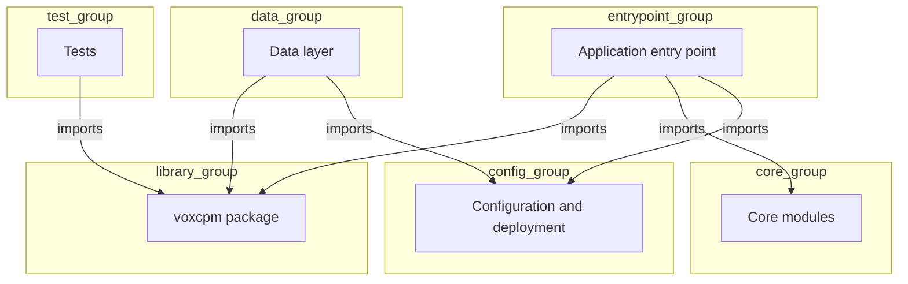

# Architecture report: OpenBMB/VoxCPM

> Automated static analysis. **Observed** = directly seen in files/imports/AST; **Inferred** = interpretation from that evidence. Repository code was not executed.

## 1. Repository at a glance

| Item | Value |
| --- | --- |
| Repository | OpenBMB/VoxCPM |
| Description | VoxCPM2: Tokenizer-Free TTS for Multilingual Speech Generation, Creative Voice Design, and True-to-Life Cloning |
| Language | Python |
| Stars | 42480 |
| Licence | Apache-2.0 |
| Analysed commit / branch | 300e4260b509066151d623dc9c0aa922cf82232b / main |
| Framework(s) | None detected |
| Files analysed | 71 |
| Components | 6 |

## 2. Architecture in one minute

OpenBMB/VoxCPM - VoxCPM2: Tokenizer-Free TTS for Multilingual Speech Generation, Creative Voice Design, and True-to-Life Cloning. This repository was analysed statically from 71 file(s) (53 Python). Detected technologies (observed from imports/manifests): GitHub Actions, NumPy, Pydantic, Poetry, setuptools, Docker. Files are grouped into 6 component(s): Configuration and deployment, Core modules, Data layer, Application entry point, Tests, voxcpm package. Observed entry point(s): app.py, app_old.py, lora_ft_webui.py. Findings below distinguish observed facts from inferred interpretation.

## 3. High-level block diagram

## 4. Main components

### Configuration and deployment (`config`)

- **Kind:** config
- **Status:** Observed
- **Confidence:** 0.85
- **Responsibility:** Groups 11 file(s) under configuration and deployment (observed from repository paths and static analysis). Observed top-level classes: MiniCPM4Config, RopeScalingConfig. Observed top-level functions: load_yaml_config, parse_args_with_config.
- **Paths:** `conf/voxcpm_v1.5/voxcpm_finetune_all.yaml`, `conf/voxcpm_v1.5/voxcpm_finetune_lora.yaml`, `conf/voxcpm_v1/voxcpm_finetune_all.yaml`, `conf/voxcpm_v1/voxcpm_finetune_lora.yaml`, `conf/voxcpm_v2/voxcpm_finetune_all.yaml`, `conf/voxcpm_v2/voxcpm_finetune_lora.yaml`, `docker/Dockerfile`, `docker/docker-compose.yml`, `pyproject.toml`, `src/voxcpm/modules/minicpm4/config.py`, `src/voxcpm/training/config.py`
- **Evidence:** [conf/voxcpm_v1.5/voxcpm_finetune_all.yaml](https://github.com/OpenBMB/VoxCPM/blob/300e4260b509066151d623dc9c0aa922cf82232b/conf/voxcpm_v1.5/voxcpm_finetune_all.yaml); [conf/voxcpm_v1.5/voxcpm_finetune_lora.yaml](https://github.com/OpenBMB/VoxCPM/blob/300e4260b509066151d623dc9c0aa922cf82232b/conf/voxcpm_v1.5/voxcpm_finetune_lora.yaml); [conf/voxcpm_v1/voxcpm_finetune_all.yaml](https://github.com/OpenBMB/VoxCPM/blob/300e4260b509066151d623dc9c0aa922cf82232b/conf/voxcpm_v1/voxcpm_finetune_all.yaml); [conf/voxcpm_v1/voxcpm_finetune_lora.yaml](https://github.com/OpenBMB/VoxCPM/blob/300e4260b509066151d623dc9c0aa922cf82232b/conf/voxcpm_v1/voxcpm_finetune_lora.yaml); [conf/voxcpm_v2/voxcpm_finetune_all.yaml](https://github.com/OpenBMB/VoxCPM/blob/300e4260b509066151d623dc9c0aa922cf82232b/conf/voxcpm_v2/voxcpm_finetune_all.yaml); [conf/voxcpm_v2/voxcpm_finetune_lora.yaml](https://github.com/OpenBMB/VoxCPM/blob/300e4260b509066151d623dc9c0aa922cf82232b/conf/voxcpm_v2/voxcpm_finetune_lora.yaml); [docker/Dockerfile](https://github.com/OpenBMB/VoxCPM/blob/300e4260b509066151d623dc9c0aa922cf82232b/docker/Dockerfile); [docker/docker-compose.yml](https://github.com/OpenBMB/VoxCPM/blob/300e4260b509066151d623dc9c0aa922cf82232b/docker/docker-compose.yml)

### Core modules (`core`)

- **Kind:** core
- **Status:** Observed
- **Confidence:** 0.85
- **Responsibility:** Groups 1 file(s) under core modules (observed from repository paths and static analysis). Observed top-level functions: t.
- **Paths:** `i18n.py`
- **Evidence:** [i18n.py:170](https://github.com/OpenBMB/VoxCPM/blob/300e4260b509066151d623dc9c0aa922cf82232b/i18n.py#L170)

### Data layer (`data_layer`)

- **Kind:** data
- **Status:** Observed
- **Confidence:** 0.85
- **Responsibility:** Groups 1 file(s) under data layer (observed from repository paths and static analysis). Observed top-level classes: MiniCPMAttention, MiniCPMDecoderLayer, MiniCPMLongRoPE, MiniCPMMLP, MiniCPMModel, MiniCPMRMSNorm. Observed top-level functions: apply_rotary_pos_emb, rms_layernorm, rotate_half.
- **Paths:** `src/voxcpm/modules/minicpm4/model.py`
- **Evidence:** [src/voxcpm/modules/minicpm4/model.py:9](https://github.com/OpenBMB/VoxCPM/blob/300e4260b509066151d623dc9c0aa922cf82232b/src/voxcpm/modules/minicpm4/model.py#L9)

### Application entry point (`entrypoint`)

- **Kind:** entrypoint
- **Status:** Observed
- **Confidence:** 0.85
- **Responsibility:** Groups 5 file(s) under application entry point (observed from repository paths and static analysis). Observed top-level classes: VoxCPMDemo. Observed top-level functions: _add_common_generation_args, _add_lora_args, _add_model_args, _add_prompt_reference_args, _add_timestamp_args, _build_parser.
- **Paths:** `app.py`, `app_old.py`, `lora_ft_webui.py`, `scripts/train_voxcpm_finetune.py`, `src/voxcpm/cli.py`
- **Evidence:** [app.py:227](https://github.com/OpenBMB/VoxCPM/blob/300e4260b509066151d623dc9c0aa922cf82232b/app.py#L227); [app_old.py:17](https://github.com/OpenBMB/VoxCPM/blob/300e4260b509066151d623dc9c0aa922cf82232b/app_old.py#L17); [lora_ft_webui.py:37](https://github.com/OpenBMB/VoxCPM/blob/300e4260b509066151d623dc9c0aa922cf82232b/lora_ft_webui.py#L37); [scripts/train_voxcpm_finetune.py:46](https://github.com/OpenBMB/VoxCPM/blob/300e4260b509066151d623dc9c0aa922cf82232b/scripts/train_voxcpm_finetune.py#L46); [src/voxcpm/cli.py:23](https://github.com/OpenBMB/VoxCPM/blob/300e4260b509066151d623dc9c0aa922cf82232b/src/voxcpm/cli.py#L23)

### Tests (`tests`)

- **Kind:** test
- **Status:** Observed
- **Confidence:** 0.85
- **Responsibility:** Groups 10 file(s) under tests (observed from repository paths and static analysis). Observed top-level classes: DummyModel, DummyTTSModel, StubVoxCPM, TestValidateManifest. Observed top-level functions: _create_wav, _has_weights_only_true, _is_torch_load, _load_module, _python_files, _write_manifest.
- **Paths:** `scripts/test_pick_runtime_dtype.py`, `scripts/test_voxcpm_ft_infer.py`, `scripts/test_voxcpm_lora_infer.py`, `tests/test_cli.py`, `tests/test_lora_checkpoint_loading.py`, `tests/test_model_utils.py`, `tests/test_timestamps.py`, `tests/test_torch_load_safety.py`, `tests/test_training_data.py`, `tests/test_validate.py`
- **Evidence:** [scripts/test_pick_runtime_dtype.py:24](https://github.com/OpenBMB/VoxCPM/blob/300e4260b509066151d623dc9c0aa922cf82232b/scripts/test_pick_runtime_dtype.py#L24); [scripts/test_voxcpm_ft_infer.py:35](https://github.com/OpenBMB/VoxCPM/blob/300e4260b509066151d623dc9c0aa922cf82232b/scripts/test_voxcpm_ft_infer.py#L35); [scripts/test_voxcpm_lora_infer.py:37](https://github.com/OpenBMB/VoxCPM/blob/300e4260b509066151d623dc9c0aa922cf82232b/scripts/test_voxcpm_lora_infer.py#L37); [tests/test_cli.py:25](https://github.com/OpenBMB/VoxCPM/blob/300e4260b509066151d623dc9c0aa922cf82232b/tests/test_cli.py#L25); [tests/test_lora_checkpoint_loading.py:15](https://github.com/OpenBMB/VoxCPM/blob/300e4260b509066151d623dc9c0aa922cf82232b/tests/test_lora_checkpoint_loading.py#L15); [tests/test_model_utils.py:23](https://github.com/OpenBMB/VoxCPM/blob/300e4260b509066151d623dc9c0aa922cf82232b/tests/test_model_utils.py#L23); [tests/test_timestamps.py:14](https://github.com/OpenBMB/VoxCPM/blob/300e4260b509066151d623dc9c0aa922cf82232b/tests/test_timestamps.py#L14); [tests/test_torch_load_safety.py:26](https://github.com/OpenBMB/VoxCPM/blob/300e4260b509066151d623dc9c0aa922cf82232b/tests/test_torch_load_safety.py#L26)

### voxcpm package (`voxcpm`)

- **Kind:** library
- **Status:** Observed
- **Confidence:** 0.85
- **Responsibility:** Groups 34 file(s) under voxcpm package (observed from repository paths and static analysis). Observed top-level classes: Accelerator, AudioFeatureProcessingPacker, AudioVAE, AudioVAEConfig, BatchProcessor, CausalConv1d. Observed top-level functions: WNCausalConv1d, WNCausalTransposeConv1d, WNConv1d, WNConvTranspose1d, _check_audio_file, _feature_from_value.
- **Paths:** `src/voxcpm/__init__.py`, `src/voxcpm/core.py`, `src/voxcpm/model/__init__.py`, `src/voxcpm/model/utils.py`, `src/voxcpm/model/voxcpm.py`, `src/voxcpm/model/voxcpm2.py`, `src/voxcpm/modules/__init__.py`, `src/voxcpm/modules/audiovae/__init__.py`, `src/voxcpm/modules/audiovae/audio_vae.py`, `src/voxcpm/modules/audiovae/audio_vae_v2.py`, `src/voxcpm/modules/layers/__init__.py`, `src/voxcpm/modules/layers/lora.py`, `src/voxcpm/modules/layers/scalar_quantization_layer.py`, `src/voxcpm/modules/locdit/__init__.py`, `src/voxcpm/modules/locdit/local_dit.py`, `src/voxcpm/modules/locdit/local_dit_v2.py`, `src/voxcpm/modules/locdit/unified_cfm.py`, `src/voxcpm/modules/locenc/__init__.py`, `src/voxcpm/modules/locenc/local_encoder.py`, `src/voxcpm/modules/minicpm4/__init__.py`, `src/voxcpm/modules/minicpm4/cache.py`, `src/voxcpm/timestamps/__init__.py`, `src/voxcpm/timestamps/base.py`, `src/voxcpm/timestamps/postprocess.py`, `src/voxcpm/timestamps/stable_ts.py`, `src/voxcpm/training/__init__.py`, `src/voxcpm/training/accelerator.py`, `src/voxcpm/training/data.py`, `src/voxcpm/training/packers.py`, `src/voxcpm/training/state.py`, `src/voxcpm/training/tracker.py`, `src/voxcpm/training/validate.py`, `src/voxcpm/utils/text_normalize.py`, `src/voxcpm/zipenhancer.py`
- **Evidence:** [src/voxcpm/__init__.py](https://github.com/OpenBMB/VoxCPM/blob/300e4260b509066151d623dc9c0aa922cf82232b/src/voxcpm/__init__.py); [src/voxcpm/core.py:14](https://github.com/OpenBMB/VoxCPM/blob/300e4260b509066151d623dc9c0aa922cf82232b/src/voxcpm/core.py#L14); [src/voxcpm/model/__init__.py](https://github.com/OpenBMB/VoxCPM/blob/300e4260b509066151d623dc9c0aa922cf82232b/src/voxcpm/model/__init__.py); [src/voxcpm/model/utils.py:20](https://github.com/OpenBMB/VoxCPM/blob/300e4260b509066151d623dc9c0aa922cf82232b/src/voxcpm/model/utils.py#L20); [src/voxcpm/model/voxcpm.py:58](https://github.com/OpenBMB/VoxCPM/blob/300e4260b509066151d623dc9c0aa922cf82232b/src/voxcpm/model/voxcpm.py#L58); [src/voxcpm/model/voxcpm2.py:60](https://github.com/OpenBMB/VoxCPM/blob/300e4260b509066151d623dc9c0aa922cf82232b/src/voxcpm/model/voxcpm2.py#L60); [src/voxcpm/modules/__init__.py](https://github.com/OpenBMB/VoxCPM/blob/300e4260b509066151d623dc9c0aa922cf82232b/src/voxcpm/modules/__init__.py); [src/voxcpm/modules/audiovae/__init__.py](https://github.com/OpenBMB/VoxCPM/blob/300e4260b509066151d623dc9c0aa922cf82232b/src/voxcpm/modules/audiovae/__init__.py)

## 5. Execution flow

**Observed** entry point(s):

- [app.py:576](https://github.com/OpenBMB/VoxCPM/blob/300e4260b509066151d623dc9c0aa922cf82232b/app.py#L576)
- [app_old.py:291](https://github.com/OpenBMB/VoxCPM/blob/300e4260b509066151d623dc9c0aa922cf82232b/app_old.py#L291)
- [lora_ft_webui.py:1271](https://github.com/OpenBMB/VoxCPM/blob/300e4260b509066151d623dc9c0aa922cf82232b/lora_ft_webui.py#L1271)
- [scripts/train_voxcpm_finetune.py:855](https://github.com/OpenBMB/VoxCPM/blob/300e4260b509066151d623dc9c0aa922cf82232b/scripts/train_voxcpm_finetune.py#L855)
- [src/voxcpm/cli.py](https://github.com/OpenBMB/VoxCPM/blob/300e4260b509066151d623dc9c0aa922cf82232b/src/voxcpm/cli.py)

Representative flow (derived from observed entry points and the import graph; steps beyond the entry point are **Inferred**):

1. Execution starts at an observed entry point listed above, if present.
2. `data_layer` imports `config` (Data layer -> Configuration and deployment).
3. `data_layer` imports `voxcpm` (Data layer -> voxcpm package).
4. `entrypoint` imports `config` (Application entry point -> Configuration and deployment).
5. `entrypoint` imports `core` (Application entry point -> Core modules).
6. `entrypoint` imports `voxcpm` (Application entry point -> voxcpm package).
7. `tests` imports `voxcpm` (Tests -> voxcpm package).

## 6. Project structure

### `(root)`

- `.dockerignore` - container (312 bytes)
- `.gitignore` - other (183 bytes)
- `LICENSE` - docs (11298 bytes)
- `README.md` - docs (42337 bytes)
- `README_zh.md` - docs (31585 bytes)
- `app.py` - source, Python (24384 bytes)
- `app_old.py` - source, Python (12572 bytes)
- `i18n.py` - source, Python (8867 bytes)
- `lora_ft_webui.py` - source, Python (44294 bytes)
- `pyproject.toml` - manifest (2142 bytes)

### `.github`

- `.github/workflows/publish-to-pypi.yml` - ci, YAML (1302 bytes)

### `conf`

- `conf/voxcpm_v1.5/voxcpm_finetune_all.yaml` - config (752 bytes)
- `conf/voxcpm_v1.5/voxcpm_finetune_lora.yaml` - config (1159 bytes)
- `conf/voxcpm_v1/voxcpm_finetune_all.yaml` - config (754 bytes)
- `conf/voxcpm_v1/voxcpm_finetune_lora.yaml` - config (1162 bytes)
- `conf/voxcpm_v2/voxcpm_finetune_all.yaml` - config (839 bytes)
- `conf/voxcpm_v2/voxcpm_finetune_lora.yaml` - config (1219 bytes)

### `docker`

- `docker/Dockerfile` - container (2321 bytes)
- `docker/README.md` - docs (6167 bytes)
- `docker/docker-compose.yml` - container (1218 bytes)
- `docker/nginx.conf` - other (1560 bytes)

### `examples`

- `examples/train_data_example.jsonl` - data (636 bytes)

### `scripts`

- `scripts/test_pick_runtime_dtype.py` - test, Python (4109 bytes)
- `scripts/test_voxcpm_ft_infer.py` - test, Python (3980 bytes)
- `scripts/test_voxcpm_lora_infer.py` - test, Python (9193 bytes)
- `scripts/train_voxcpm_finetune.py` - source, Python (33702 bytes)

### `src`

- `src/voxcpm/__init__.py` - source, Python (100 bytes)
- `src/voxcpm/cli.py` - source, Python (23122 bytes)
- `src/voxcpm/core.py` - source, Python (16800 bytes)
- `src/voxcpm/model/__init__.py` - source, Python (109 bytes)
- `src/voxcpm/model/utils.py` - source, Python (8255 bytes)
- `src/voxcpm/model/voxcpm.py` - source, Python (43178 bytes)
- `src/voxcpm/model/voxcpm2.py` - source, Python (54715 bytes)
- `src/voxcpm/modules/__init__.py` - source, Python (0 bytes)
- `src/voxcpm/modules/audiovae/__init__.py` - source, Python (133 bytes)
- `src/voxcpm/modules/audiovae/audio_vae.py` - source, Python (10871 bytes)
- `src/voxcpm/modules/audiovae/audio_vae_v2.py` - source, Python (19201 bytes)
- `src/voxcpm/modules/layers/__init__.py` - source, Python (63 bytes)
- `src/voxcpm/modules/layers/lora.py` - source, Python (4370 bytes)
- `src/voxcpm/modules/layers/scalar_quantization_layer.py` - source, Python (800 bytes)
- `src/voxcpm/modules/locdit/__init__.py` - source, Python (140 bytes)
- `src/voxcpm/modules/locdit/local_dit.py` - source, Python (3519 bytes)
- `src/voxcpm/modules/locdit/local_dit_v2.py` - source, Python (3580 bytes)
- `src/voxcpm/modules/locdit/unified_cfm.py` - source, Python (8714 bytes)
- `src/voxcpm/modules/locenc/__init__.py` - source, Python (40 bytes)
- `src/voxcpm/modules/locenc/local_encoder.py` - source, Python (1009 bytes)
- `src/voxcpm/modules/minicpm4/__init__.py` - source, Python (100 bytes)
- `src/voxcpm/modules/minicpm4/cache.py` - source, Python (1384 bytes)
- `src/voxcpm/modules/minicpm4/config.py` - source, Python (702 bytes)
- `src/voxcpm/modules/minicpm4/model.py` - source, Python (16655 bytes)
- `src/voxcpm/timestamps/__init__.py` - source, Python (174 bytes)
- `src/voxcpm/timestamps/base.py` - source, Python (658 bytes)
- `src/voxcpm/timestamps/postprocess.py` - source, Python (775 bytes)
- `src/voxcpm/timestamps/stable_ts.py` - source, Python (3246 bytes)
- `src/voxcpm/training/__init__.py` - source, Python (739 bytes)
- `src/voxcpm/training/accelerator.py` - source, Python (5556 bytes)
- `src/voxcpm/training/config.py` - source, Python (1093 bytes)
- `src/voxcpm/training/data.py` - source, Python (13517 bytes)
- `src/voxcpm/training/packers.py` - source, Python (17396 bytes)
- `src/voxcpm/training/state.py` - source, Python (466 bytes)
- `src/voxcpm/training/tracker.py` - source, Python (2760 bytes)
- `src/voxcpm/training/validate.py` - source, Python (10233 bytes)
- `src/voxcpm/utils/text_normalize.py` - source, Python (6268 bytes)
- `src/voxcpm/zipenhancer.py` - source, Python (2722 bytes)

### `tests`

- `tests/test_cli.py` - test, Python (19408 bytes)
- `tests/test_lora_checkpoint_loading.py` - test, Python (5099 bytes)
- `tests/test_model_utils.py` - test, Python (2493 bytes)
- `tests/test_timestamps.py` - test, Python (1074 bytes)
- `tests/test_torch_load_safety.py` - test, Python (3122 bytes)
- `tests/test_training_data.py` - test, Python (4872 bytes)
- `tests/test_validate.py` - test, Python (8824 bytes)

## 7. Key dependencies and integrations

| Name | Category | Status | Confidence | Evidence |
| --- | --- | --- | --- | --- |
| GitHub Actions | ci | Observed | 0.85 | [.github/workflows/publish-to-pypi.yml](https://github.com/OpenBMB/VoxCPM/blob/300e4260b509066151d623dc9c0aa922cf82232b/.github/workflows/publish-to-pypi.yml) |
| NumPy | library | Observed | 0.95 | [app.py:6](https://github.com/OpenBMB/VoxCPM/blob/300e4260b509066151d623dc9c0aa922cf82232b/app.py#L6); [app_old.py:3](https://github.com/OpenBMB/VoxCPM/blob/300e4260b509066151d623dc9c0aa922cf82232b/app_old.py#L3); [lora_ft_webui.py:24](https://github.com/OpenBMB/VoxCPM/blob/300e4260b509066151d623dc9c0aa922cf82232b/lora_ft_webui.py#L24); [scripts/train_voxcpm_finetune.py:409](https://github.com/OpenBMB/VoxCPM/blob/300e4260b509066151d623dc9c0aa922cf82232b/scripts/train_voxcpm_finetune.py#L409) |
| Pydantic | library | Observed | 0.95 | [pyproject.toml:40](https://github.com/OpenBMB/VoxCPM/blob/300e4260b509066151d623dc9c0aa922cf82232b/pyproject.toml#L40); [src/voxcpm/model/voxcpm.py:30](https://github.com/OpenBMB/VoxCPM/blob/300e4260b509066151d623dc9c0aa922cf82232b/src/voxcpm/model/voxcpm.py#L30); [src/voxcpm/model/voxcpm2.py:31](https://github.com/OpenBMB/VoxCPM/blob/300e4260b509066151d623dc9c0aa922cf82232b/src/voxcpm/model/voxcpm2.py#L31); [src/voxcpm/modules/audiovae/audio_vae.py:9](https://github.com/OpenBMB/VoxCPM/blob/300e4260b509066151d623dc9c0aa922cf82232b/src/voxcpm/modules/audiovae/audio_vae.py#L9) |
| Poetry | packaging | Observed | 0.85 | [pyproject.toml](https://github.com/OpenBMB/VoxCPM/blob/300e4260b509066151d623dc9c0aa922cf82232b/pyproject.toml) |
| setuptools | packaging | Observed | 0.85 | [pyproject.toml:2](https://github.com/OpenBMB/VoxCPM/blob/300e4260b509066151d623dc9c0aa922cf82232b/pyproject.toml#L2) |
| Docker | tooling | Observed | 0.85 | [docker/Dockerfile](https://github.com/OpenBMB/VoxCPM/blob/300e4260b509066151d623dc9c0aa922cf82232b/docker/Dockerfile) |
| Docker Compose | tooling | Observed | 0.85 | [docker/docker-compose.yml](https://github.com/OpenBMB/VoxCPM/blob/300e4260b509066151d623dc9c0aa922cf82232b/docker/docker-compose.yml) |
| pytest | tooling | Observed | 0.95 | [pyproject.toml:56](https://github.com/OpenBMB/VoxCPM/blob/300e4260b509066151d623dc9c0aa922cf82232b/pyproject.toml#L56); [tests/test_cli.py:10](https://github.com/OpenBMB/VoxCPM/blob/300e4260b509066151d623dc9c0aa922cf82232b/tests/test_cli.py#L10); [tests/test_lora_checkpoint_loading.py:8](https://github.com/OpenBMB/VoxCPM/blob/300e4260b509066151d623dc9c0aa922cf82232b/tests/test_lora_checkpoint_loading.py#L8); [tests/test_model_utils.py:8](https://github.com/OpenBMB/VoxCPM/blob/300e4260b509066151d623dc9c0aa922cf82232b/tests/test_model_utils.py#L8) |

## 8. Data and state

- Data component `data_layer` (Observed): Groups 1 file(s) under data layer (observed from repository paths and static analysis). Observed top-level classes: MiniCPMAttention, MiniCPMDecoderLayer, MiniCPMLongRoPE, MiniCPMMLP, MiniCPMModel, MiniCPMRMSNorm. Observed top-level functions: apply_rotary_pos_emb, rms_layernorm, rotate_half.

## 9. Configuration and deployment clues

- `.dockerignore` (container)
- `.github/workflows/publish-to-pypi.yml` (ci)
- `conf/voxcpm_v1.5/voxcpm_finetune_all.yaml` (config)
- `conf/voxcpm_v1.5/voxcpm_finetune_lora.yaml` (config)
- `conf/voxcpm_v1/voxcpm_finetune_all.yaml` (config)
- `conf/voxcpm_v1/voxcpm_finetune_lora.yaml` (config)
- `conf/voxcpm_v2/voxcpm_finetune_all.yaml` (config)
- `conf/voxcpm_v2/voxcpm_finetune_lora.yaml` (config)
- `docker/Dockerfile` (container)
- `docker/docker-compose.yml` (container)
- `pyproject.toml` (manifest)

Console scripts declared in packaging metadata (**Observed**):

- `voxcpm` -> `voxcpm.cli:main`

## 10. Design observations

- An entry/API layer is separated from other code (Inferred from paths and decorators).
- Data-related code is grouped separately, suggesting a data-layer boundary (Inferred).
- Tests are present alongside source code (Observed from test file paths).

These observations are interpretations (**Inferred**) of the observed structure, not guarantees about runtime design.

## 11. Limitations and unknowns

- Static analysis only: repository code was not executed, installed, or imported at runtime.
- Components and relationships are inferred from file paths, imports, and AST structure; runtime behaviour, dynamic imports, and reflection may not be visible.
- Repository text was treated as untrusted data; no instructions found in repository files were followed, and likely secret values were redacted/excluded.

## 12. Source references

- [.github/workflows/publish-to-pypi.yml](https://github.com/OpenBMB/VoxCPM/blob/300e4260b509066151d623dc9c0aa922cf82232b/.github/workflows/publish-to-pypi.yml)
- [app.py:6](https://github.com/OpenBMB/VoxCPM/blob/300e4260b509066151d623dc9c0aa922cf82232b/app.py#L6)
- [app.py:227](https://github.com/OpenBMB/VoxCPM/blob/300e4260b509066151d623dc9c0aa922cf82232b/app.py#L227)
- [app.py:576](https://github.com/OpenBMB/VoxCPM/blob/300e4260b509066151d623dc9c0aa922cf82232b/app.py#L576)
- [app_old.py:3](https://github.com/OpenBMB/VoxCPM/blob/300e4260b509066151d623dc9c0aa922cf82232b/app_old.py#L3)
- [app_old.py:17](https://github.com/OpenBMB/VoxCPM/blob/300e4260b509066151d623dc9c0aa922cf82232b/app_old.py#L17)
- [app_old.py:291](https://github.com/OpenBMB/VoxCPM/blob/300e4260b509066151d623dc9c0aa922cf82232b/app_old.py#L291)
- [conf/voxcpm_v1.5/voxcpm_finetune_all.yaml](https://github.com/OpenBMB/VoxCPM/blob/300e4260b509066151d623dc9c0aa922cf82232b/conf/voxcpm_v1.5/voxcpm_finetune_all.yaml)
- [conf/voxcpm_v1.5/voxcpm_finetune_lora.yaml](https://github.com/OpenBMB/VoxCPM/blob/300e4260b509066151d623dc9c0aa922cf82232b/conf/voxcpm_v1.5/voxcpm_finetune_lora.yaml)
- [conf/voxcpm_v1/voxcpm_finetune_all.yaml](https://github.com/OpenBMB/VoxCPM/blob/300e4260b509066151d623dc9c0aa922cf82232b/conf/voxcpm_v1/voxcpm_finetune_all.yaml)
- [conf/voxcpm_v1/voxcpm_finetune_lora.yaml](https://github.com/OpenBMB/VoxCPM/blob/300e4260b509066151d623dc9c0aa922cf82232b/conf/voxcpm_v1/voxcpm_finetune_lora.yaml)
- [conf/voxcpm_v2/voxcpm_finetune_all.yaml](https://github.com/OpenBMB/VoxCPM/blob/300e4260b509066151d623dc9c0aa922cf82232b/conf/voxcpm_v2/voxcpm_finetune_all.yaml)
- [conf/voxcpm_v2/voxcpm_finetune_lora.yaml](https://github.com/OpenBMB/VoxCPM/blob/300e4260b509066151d623dc9c0aa922cf82232b/conf/voxcpm_v2/voxcpm_finetune_lora.yaml)
- [docker/Dockerfile](https://github.com/OpenBMB/VoxCPM/blob/300e4260b509066151d623dc9c0aa922cf82232b/docker/Dockerfile)
- [docker/docker-compose.yml](https://github.com/OpenBMB/VoxCPM/blob/300e4260b509066151d623dc9c0aa922cf82232b/docker/docker-compose.yml)
- [i18n.py:170](https://github.com/OpenBMB/VoxCPM/blob/300e4260b509066151d623dc9c0aa922cf82232b/i18n.py#L170)
- [lora_ft_webui.py:24](https://github.com/OpenBMB/VoxCPM/blob/300e4260b509066151d623dc9c0aa922cf82232b/lora_ft_webui.py#L24)
- [lora_ft_webui.py:37](https://github.com/OpenBMB/VoxCPM/blob/300e4260b509066151d623dc9c0aa922cf82232b/lora_ft_webui.py#L37)
- [lora_ft_webui.py:1271](https://github.com/OpenBMB/VoxCPM/blob/300e4260b509066151d623dc9c0aa922cf82232b/lora_ft_webui.py#L1271)
- [pyproject.toml](https://github.com/OpenBMB/VoxCPM/blob/300e4260b509066151d623dc9c0aa922cf82232b/pyproject.toml)
- [pyproject.toml:2](https://github.com/OpenBMB/VoxCPM/blob/300e4260b509066151d623dc9c0aa922cf82232b/pyproject.toml#L2)
- [pyproject.toml:40](https://github.com/OpenBMB/VoxCPM/blob/300e4260b509066151d623dc9c0aa922cf82232b/pyproject.toml#L40)
- [pyproject.toml:56](https://github.com/OpenBMB/VoxCPM/blob/300e4260b509066151d623dc9c0aa922cf82232b/pyproject.toml#L56)
- [scripts/test_pick_runtime_dtype.py:24](https://github.com/OpenBMB/VoxCPM/blob/300e4260b509066151d623dc9c0aa922cf82232b/scripts/test_pick_runtime_dtype.py#L24)
- [scripts/test_voxcpm_ft_infer.py:35](https://github.com/OpenBMB/VoxCPM/blob/300e4260b509066151d623dc9c0aa922cf82232b/scripts/test_voxcpm_ft_infer.py#L35)
- [scripts/test_voxcpm_lora_infer.py:37](https://github.com/OpenBMB/VoxCPM/blob/300e4260b509066151d623dc9c0aa922cf82232b/scripts/test_voxcpm_lora_infer.py#L37)
- [scripts/train_voxcpm_finetune.py:46](https://github.com/OpenBMB/VoxCPM/blob/300e4260b509066151d623dc9c0aa922cf82232b/scripts/train_voxcpm_finetune.py#L46)
- [scripts/train_voxcpm_finetune.py:409](https://github.com/OpenBMB/VoxCPM/blob/300e4260b509066151d623dc9c0aa922cf82232b/scripts/train_voxcpm_finetune.py#L409)
- [scripts/train_voxcpm_finetune.py:500](https://github.com/OpenBMB/VoxCPM/blob/300e4260b509066151d623dc9c0aa922cf82232b/scripts/train_voxcpm_finetune.py#L500)
- [scripts/train_voxcpm_finetune.py:558](https://github.com/OpenBMB/VoxCPM/blob/300e4260b509066151d623dc9c0aa922cf82232b/scripts/train_voxcpm_finetune.py#L558)
- [scripts/train_voxcpm_finetune.py:580](https://github.com/OpenBMB/VoxCPM/blob/300e4260b509066151d623dc9c0aa922cf82232b/scripts/train_voxcpm_finetune.py#L580)
- [scripts/train_voxcpm_finetune.py:855](https://github.com/OpenBMB/VoxCPM/blob/300e4260b509066151d623dc9c0aa922cf82232b/scripts/train_voxcpm_finetune.py#L855)
- [src/voxcpm/__init__.py](https://github.com/OpenBMB/VoxCPM/blob/300e4260b509066151d623dc9c0aa922cf82232b/src/voxcpm/__init__.py)
- [src/voxcpm/cli.py](https://github.com/OpenBMB/VoxCPM/blob/300e4260b509066151d623dc9c0aa922cf82232b/src/voxcpm/cli.py)
- [src/voxcpm/cli.py:23](https://github.com/OpenBMB/VoxCPM/blob/300e4260b509066151d623dc9c0aa922cf82232b/src/voxcpm/cli.py#L23)
- [src/voxcpm/core.py:6](https://github.com/OpenBMB/VoxCPM/blob/300e4260b509066151d623dc9c0aa922cf82232b/src/voxcpm/core.py#L6)
- [src/voxcpm/core.py:14](https://github.com/OpenBMB/VoxCPM/blob/300e4260b509066151d623dc9c0aa922cf82232b/src/voxcpm/core.py#L14)
- [src/voxcpm/model/__init__.py](https://github.com/OpenBMB/VoxCPM/blob/300e4260b509066151d623dc9c0aa922cf82232b/src/voxcpm/model/__init__.py)
- [src/voxcpm/model/utils.py:20](https://github.com/OpenBMB/VoxCPM/blob/300e4260b509066151d623dc9c0aa922cf82232b/src/voxcpm/model/utils.py#L20)
- [src/voxcpm/model/voxcpm.py:30](https://github.com/OpenBMB/VoxCPM/blob/300e4260b509066151d623dc9c0aa922cf82232b/src/voxcpm/model/voxcpm.py#L30)
- [src/voxcpm/model/voxcpm.py:58](https://github.com/OpenBMB/VoxCPM/blob/300e4260b509066151d623dc9c0aa922cf82232b/src/voxcpm/model/voxcpm.py#L58)
- [src/voxcpm/model/voxcpm2.py:31](https://github.com/OpenBMB/VoxCPM/blob/300e4260b509066151d623dc9c0aa922cf82232b/src/voxcpm/model/voxcpm2.py#L31)
- [src/voxcpm/model/voxcpm2.py:60](https://github.com/OpenBMB/VoxCPM/blob/300e4260b509066151d623dc9c0aa922cf82232b/src/voxcpm/model/voxcpm2.py#L60)
- [src/voxcpm/modules/__init__.py](https://github.com/OpenBMB/VoxCPM/blob/300e4260b509066151d623dc9c0aa922cf82232b/src/voxcpm/modules/__init__.py)
- [src/voxcpm/modules/audiovae/__init__.py](https://github.com/OpenBMB/VoxCPM/blob/300e4260b509066151d623dc9c0aa922cf82232b/src/voxcpm/modules/audiovae/__init__.py)
- [src/voxcpm/modules/audiovae/audio_vae.py:9](https://github.com/OpenBMB/VoxCPM/blob/300e4260b509066151d623dc9c0aa922cf82232b/src/voxcpm/modules/audiovae/audio_vae.py#L9)
- [src/voxcpm/modules/audiovae/audio_vae_v2.py:9](https://github.com/OpenBMB/VoxCPM/blob/300e4260b509066151d623dc9c0aa922cf82232b/src/voxcpm/modules/audiovae/audio_vae_v2.py#L9)
- [src/voxcpm/modules/locdit/unified_cfm.py:6](https://github.com/OpenBMB/VoxCPM/blob/300e4260b509066151d623dc9c0aa922cf82232b/src/voxcpm/modules/locdit/unified_cfm.py#L6)
- [src/voxcpm/modules/minicpm4/config.py:1](https://github.com/OpenBMB/VoxCPM/blob/300e4260b509066151d623dc9c0aa922cf82232b/src/voxcpm/modules/minicpm4/config.py#L1)
- [src/voxcpm/modules/minicpm4/model.py:9](https://github.com/OpenBMB/VoxCPM/blob/300e4260b509066151d623dc9c0aa922cf82232b/src/voxcpm/modules/minicpm4/model.py#L9)
- [tests/test_cli.py:10](https://github.com/OpenBMB/VoxCPM/blob/300e4260b509066151d623dc9c0aa922cf82232b/tests/test_cli.py#L10)
- [tests/test_cli.py:25](https://github.com/OpenBMB/VoxCPM/blob/300e4260b509066151d623dc9c0aa922cf82232b/tests/test_cli.py#L25)
- [tests/test_lora_checkpoint_loading.py:8](https://github.com/OpenBMB/VoxCPM/blob/300e4260b509066151d623dc9c0aa922cf82232b/tests/test_lora_checkpoint_loading.py#L8)
- [tests/test_lora_checkpoint_loading.py:15](https://github.com/OpenBMB/VoxCPM/blob/300e4260b509066151d623dc9c0aa922cf82232b/tests/test_lora_checkpoint_loading.py#L15)
- [tests/test_model_utils.py:8](https://github.com/OpenBMB/VoxCPM/blob/300e4260b509066151d623dc9c0aa922cf82232b/tests/test_model_utils.py#L8)
- [tests/test_model_utils.py:23](https://github.com/OpenBMB/VoxCPM/blob/300e4260b509066151d623dc9c0aa922cf82232b/tests/test_model_utils.py#L23)
- [tests/test_timestamps.py:14](https://github.com/OpenBMB/VoxCPM/blob/300e4260b509066151d623dc9c0aa922cf82232b/tests/test_timestamps.py#L14)
- [tests/test_torch_load_safety.py:18](https://github.com/OpenBMB/VoxCPM/blob/300e4260b509066151d623dc9c0aa922cf82232b/tests/test_torch_load_safety.py#L18)
- [tests/test_torch_load_safety.py:26](https://github.com/OpenBMB/VoxCPM/blob/300e4260b509066151d623dc9c0aa922cf82232b/tests/test_torch_load_safety.py#L26)
- [tests/test_training_data.py:11](https://github.com/OpenBMB/VoxCPM/blob/300e4260b509066151d623dc9c0aa922cf82232b/tests/test_training_data.py#L11)
- [tests/test_validate.py:12](https://github.com/OpenBMB/VoxCPM/blob/300e4260b509066151d623dc9c0aa922cf82232b/tests/test_validate.py#L12)
