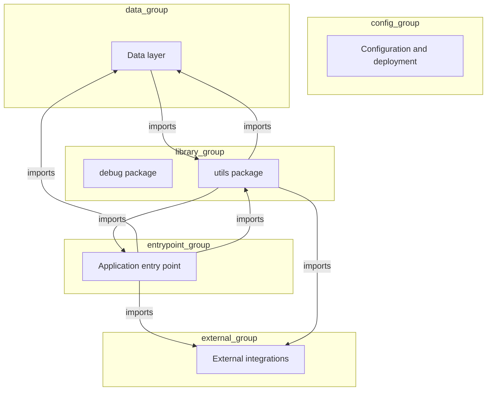

# Architecture report: OpenEthan/SMSBoom

> Automated static analysis. **Observed** = directly seen in files/imports/AST; **Inferred** = interpretation from that evidence. Repository code was not executed.

## 1. Repository at a glance

| Item | Value |
| --- | --- |
| Repository | OpenEthan/SMSBoom |
| Description | SMSBoom - Deprecate: Due to judicial reasons, the repository has been suspended! |
| Language | Python |
| Stars | 15073 |
| Licence | Apache-2.0 |
| Analysed commit / branch | 38ccbeccb05fab66442988b38b559062d7cf92d8 / main |
| Framework(s) | None detected |
| Files analysed | 21 |
| Components | 6 |

## 2. Architecture in one minute

OpenEthan/SMSBoom - SMSBoom - Deprecate: Due to judicial reasons, the repository has been suspended!. This repository was analysed statically from 21 file(s) (10 Python). Detected technologies (observed from imports/manifests): GitHub Actions, SQLite, Click, httpx, Pydantic, requests. Files are grouped into 6 component(s): Configuration and deployment, Data layer, debug package, Application entry point, External integrations, utils package. Observed entry point(s): debug/spider-api.py, debug/tou_api.py, smsboom.py. Findings below distinguish observed facts from inferred interpretation.

## 3. High-level block diagram

## 4. Main components

### Configuration and deployment (`config`)

- **Kind:** config
- **Status:** Observed
- **Confidence:** 0.85
- **Responsibility:** Groups 6 file(s) under configuration and deployment (observed from repository paths and static analysis).
- **Paths:** `Dockerfile`, `GETAPI.json`, `api.json`, `debug/api_tou.json`, `debug/hz-web.json`, `debug/touapi.json`
- **Evidence:** [Dockerfile](https://github.com/OpenEthan/SMSBoom/blob/38ccbeccb05fab66442988b38b559062d7cf92d8/Dockerfile); [GETAPI.json](https://github.com/OpenEthan/SMSBoom/blob/38ccbeccb05fab66442988b38b559062d7cf92d8/GETAPI.json); [api.json](https://github.com/OpenEthan/SMSBoom/blob/38ccbeccb05fab66442988b38b559062d7cf92d8/api.json); [debug/api_tou.json](https://github.com/OpenEthan/SMSBoom/blob/38ccbeccb05fab66442988b38b559062d7cf92d8/debug/api_tou.json); [debug/hz-web.json](https://github.com/OpenEthan/SMSBoom/blob/38ccbeccb05fab66442988b38b559062d7cf92d8/debug/hz-web.json); [debug/touapi.json](https://github.com/OpenEthan/SMSBoom/blob/38ccbeccb05fab66442988b38b559062d7cf92d8/debug/touapi.json)

### Data layer (`data_layer`)

- **Kind:** data
- **Status:** Observed
- **Confidence:** 0.85
- **Responsibility:** Groups 1 file(s) under data layer (observed from repository paths and static analysis). Observed top-level classes: API.
- **Paths:** `utils/models.py`
- **Evidence:** [utils/models.py:12](https://github.com/OpenEthan/SMSBoom/blob/38ccbeccb05fab66442988b38b559062d7cf92d8/utils/models.py#L12)

### debug package (`debug`)

- **Kind:** library
- **Status:** Observed
- **Confidence:** 0.85
- **Responsibility:** Groups 2 file(s) under debug package (observed from repository paths and static analysis).
- **Paths:** `debug/__init__.py`, `debug/api.js`
- **Evidence:** [debug/__init__.py](https://github.com/OpenEthan/SMSBoom/blob/38ccbeccb05fab66442988b38b559062d7cf92d8/debug/__init__.py); [debug/api.js](https://github.com/OpenEthan/SMSBoom/blob/38ccbeccb05fab66442988b38b559062d7cf92d8/debug/api.js)

### Application entry point (`entrypoint`)

- **Kind:** entrypoint
- **Status:** Observed
- **Confidence:** 0.85
- **Responsibility:** Groups 5 file(s) under application entry point (observed from repository paths and static analysis). Observed top-level classes: API, Application, InputWidget, SMS. Observed top-level functions: asyncRun, cli, load_api_web, load_getapi, load_json, load_proxies.
- **Paths:** `debug/spider-api.py`, `debug/tou_api.py`, `smsboom.py`, `smsboom_GUI.py`, `utils/log.py`
- **Evidence:** [debug/spider-api.py:35](https://github.com/OpenEthan/SMSBoom/blob/38ccbeccb05fab66442988b38b559062d7cf92d8/debug/spider-api.py#L35); [debug/tou_api.py:11](https://github.com/OpenEthan/SMSBoom/blob/38ccbeccb05fab66442988b38b559062d7cf92d8/debug/tou_api.py#L11); [smsboom.py:26](https://github.com/OpenEthan/SMSBoom/blob/38ccbeccb05fab66442988b38b559062d7cf92d8/smsboom.py#L26); [smsboom_GUI.py:5](https://github.com/OpenEthan/SMSBoom/blob/38ccbeccb05fab66442988b38b559062d7cf92d8/smsboom_GUI.py#L5); [utils/log.py](https://github.com/OpenEthan/SMSBoom/blob/38ccbeccb05fab66442988b38b559062d7cf92d8/utils/log.py)

### External integrations (`external_integrations`)

- **Kind:** external
- **Status:** Inferred
- **Confidence:** 0.70
- **Responsibility:** Groups 0 file(s) under external integrations (observed from repository paths and static analysis).
- **Evidence:** [debug/spider-api.py:5](https://github.com/OpenEthan/SMSBoom/blob/38ccbeccb05fab66442988b38b559062d7cf92d8/debug/spider-api.py#L5); [debug/spider-api.py:6](https://github.com/OpenEthan/SMSBoom/blob/38ccbeccb05fab66442988b38b559062d7cf92d8/debug/spider-api.py#L6); [debug/spider-api.py:16](https://github.com/OpenEthan/SMSBoom/blob/38ccbeccb05fab66442988b38b559062d7cf92d8/debug/spider-api.py#L16); [smsboom.py:16](https://github.com/OpenEthan/SMSBoom/blob/38ccbeccb05fab66442988b38b559062d7cf92d8/smsboom.py#L16); [utils/req.py:3](https://github.com/OpenEthan/SMSBoom/blob/38ccbeccb05fab66442988b38b559062d7cf92d8/utils/req.py#L3); [utils/req.py:4](https://github.com/OpenEthan/SMSBoom/blob/38ccbeccb05fab66442988b38b559062d7cf92d8/utils/req.py#L4)

### utils package (`utils`)

- **Kind:** library
- **Status:** Observed
- **Confidence:** 0.85
- **Responsibility:** Groups 3 file(s) under utils package (observed from repository paths and static analysis). Observed top-level classes: Sql. Observed top-level functions: asyncReqs, callback, default_header_user_agent, reqAPI, reqFunc, reqFuncByProxy.
- **Paths:** `utils/__init__.py`, `utils/req.py`, `utils/sql.py`
- **Evidence:** [utils/__init__.py:338](https://github.com/OpenEthan/SMSBoom/blob/38ccbeccb05fab66442988b38b559062d7cf92d8/utils/__init__.py#L338); [utils/req.py:15](https://github.com/OpenEthan/SMSBoom/blob/38ccbeccb05fab66442988b38b559062d7cf92d8/utils/req.py#L15); [utils/sql.py:8](https://github.com/OpenEthan/SMSBoom/blob/38ccbeccb05fab66442988b38b559062d7cf92d8/utils/sql.py#L8)

## 5. Execution flow

**Observed** entry point(s):

- [debug/spider-api.py:175](https://github.com/OpenEthan/SMSBoom/blob/38ccbeccb05fab66442988b38b559062d7cf92d8/debug/spider-api.py#L175)
- [debug/tou_api.py:39](https://github.com/OpenEthan/SMSBoom/blob/38ccbeccb05fab66442988b38b559062d7cf92d8/debug/tou_api.py#L39)
- [smsboom.py:105](https://github.com/OpenEthan/SMSBoom/blob/38ccbeccb05fab66442988b38b559062d7cf92d8/smsboom.py#L105)
- [smsboom_GUI.py:51](https://github.com/OpenEthan/SMSBoom/blob/38ccbeccb05fab66442988b38b559062d7cf92d8/smsboom_GUI.py#L51)
- [utils/log.py:43](https://github.com/OpenEthan/SMSBoom/blob/38ccbeccb05fab66442988b38b559062d7cf92d8/utils/log.py#L43)

Representative flow (derived from observed entry points and the import graph; steps beyond the entry point are **Inferred**):

1. Execution starts at an observed entry point listed above, if present.
2. `data_layer` imports `utils` (Data layer -> utils package).
3. `entrypoint` imports `data_layer` (Application entry point -> Data layer).
4. `entrypoint` imports `external_integrations` (Application entry point -> External integrations).
5. `entrypoint` imports `utils` (Application entry point -> utils package).
6. `utils` imports `data_layer` (utils package -> Data layer).
7. `utils` imports `entrypoint` (utils package -> Application entry point).
8. `utils` imports `external_integrations` (utils package -> External integrations).

## 6. Project structure

### `(root)`

- `.gitignore` - other (3122 bytes)
- `Dockerfile` - container (170 bytes)
- `GETAPI.json` - config (124217 bytes)
- `LICENSE` - docs (11339 bytes)
- `README.md` - docs (7080 bytes)
- `api.json` - config (24809 bytes)
- `smsboom.py` - source, Python (7452 bytes)
- `smsboom_GUI.py` - source, Python (1563 bytes)

### `.github`

- `.github/workflows/run.yaml` - ci, YAML (794 bytes)

### `debug`

- `debug/__init__.py` - source, Python (0 bytes)
- `debug/api.js` - source, JavaScript (25213 bytes)
- `debug/api_tou.json` - config (12450 bytes)
- `debug/hz-web.json` - config (1522 bytes)
- `debug/spider-api.py` - source, Python (6643 bytes)
- `debug/tou_api.py` - source, Python (931 bytes)
- `debug/touapi.json` - config (12706 bytes)

### `utils`

- `utils/__init__.py` - source, Python (25872 bytes)
- `utils/log.py` - source, Python (1460 bytes)
- `utils/models.py` - source, Python (1761 bytes)
- `utils/req.py` - source, Python (4873 bytes)
- `utils/sql.py` - source, Python (1833 bytes)

## 7. Key dependencies and integrations

| Name | Category | Status | Confidence | Evidence |
| --- | --- | --- | --- | --- |
| GitHub Actions | ci | Observed | 0.85 | [.github/workflows/run.yaml](https://github.com/OpenEthan/SMSBoom/blob/38ccbeccb05fab66442988b38b559062d7cf92d8/.github/workflows/run.yaml) |
| SQLite | database | Observed | 0.90 | [utils/sql.py:5](https://github.com/OpenEthan/SMSBoom/blob/38ccbeccb05fab66442988b38b559062d7cf92d8/utils/sql.py#L5) |
| Click | library | Observed | 0.95 | [debug/spider-api.py:15](https://github.com/OpenEthan/SMSBoom/blob/38ccbeccb05fab66442988b38b559062d7cf92d8/debug/spider-api.py#L15); [smsboom.py:15](https://github.com/OpenEthan/SMSBoom/blob/38ccbeccb05fab66442988b38b559062d7cf92d8/smsboom.py#L15) |
| httpx | library | Observed | 0.95 | [debug/spider-api.py:5](https://github.com/OpenEthan/SMSBoom/blob/38ccbeccb05fab66442988b38b559062d7cf92d8/debug/spider-api.py#L5); [smsboom.py:16](https://github.com/OpenEthan/SMSBoom/blob/38ccbeccb05fab66442988b38b559062d7cf92d8/smsboom.py#L16); [utils/req.py:3](https://github.com/OpenEthan/SMSBoom/blob/38ccbeccb05fab66442988b38b559062d7cf92d8/utils/req.py#L3); [utils/req.py:4](https://github.com/OpenEthan/SMSBoom/blob/38ccbeccb05fab66442988b38b559062d7cf92d8/utils/req.py#L4) |
| Pydantic | library | Observed | 0.95 | [debug/tou_api.py:5](https://github.com/OpenEthan/SMSBoom/blob/38ccbeccb05fab66442988b38b559062d7cf92d8/debug/tou_api.py#L5); [utils/models.py:3](https://github.com/OpenEthan/SMSBoom/blob/38ccbeccb05fab66442988b38b559062d7cf92d8/utils/models.py#L3) |
| requests | library | Observed | 0.90 | [debug/spider-api.py:6](https://github.com/OpenEthan/SMSBoom/blob/38ccbeccb05fab66442988b38b559062d7cf92d8/debug/spider-api.py#L6) |
| Docker | tooling | Observed | 0.85 | [Dockerfile](https://github.com/OpenEthan/SMSBoom/blob/38ccbeccb05fab66442988b38b559062d7cf92d8/Dockerfile) |

## 8. Data and state

- **SQLite** (Observed, confidence 0.90) - evidence: [utils/sql.py:5](https://github.com/OpenEthan/SMSBoom/blob/38ccbeccb05fab66442988b38b559062d7cf92d8/utils/sql.py#L5)
- Data component `data_layer` (Observed): Groups 1 file(s) under data layer (observed from repository paths and static analysis). Observed top-level classes: API.

## 9. Configuration and deployment clues

- `.github/workflows/run.yaml` (ci)
- `Dockerfile` (container)
- `GETAPI.json` (config)
- `api.json` (config)
- `debug/api_tou.json` (config)
- `debug/hz-web.json` (config)
- `debug/touapi.json` (config)

## 10. Design observations

- An entry/API layer is separated from other code (Inferred from paths and decorators).
- Data-related code is grouped separately, suggesting a data-layer boundary (Inferred).
- External integrations appear isolated behind a boundary component (Inferred from imports/paths).

These observations are interpretations (**Inferred**) of the observed structure, not guarantees about runtime design.

## 11. Limitations and unknowns

- Static analysis only: repository code was not executed, installed, or imported at runtime.
- Components and relationships are inferred from file paths, imports, and AST structure; runtime behaviour, dynamic imports, and reflection may not be visible.
- Repository text was treated as untrusted data; no instructions found in repository files were followed, and likely secret values were redacted/excluded.
- The GitHub repository was marked archived at selection time.

## 12. Source references

- [.github/workflows/run.yaml](https://github.com/OpenEthan/SMSBoom/blob/38ccbeccb05fab66442988b38b559062d7cf92d8/.github/workflows/run.yaml)
- [Dockerfile](https://github.com/OpenEthan/SMSBoom/blob/38ccbeccb05fab66442988b38b559062d7cf92d8/Dockerfile)
- [GETAPI.json](https://github.com/OpenEthan/SMSBoom/blob/38ccbeccb05fab66442988b38b559062d7cf92d8/GETAPI.json)
- [api.json](https://github.com/OpenEthan/SMSBoom/blob/38ccbeccb05fab66442988b38b559062d7cf92d8/api.json)
- [debug/__init__.py](https://github.com/OpenEthan/SMSBoom/blob/38ccbeccb05fab66442988b38b559062d7cf92d8/debug/__init__.py)
- [debug/api.js](https://github.com/OpenEthan/SMSBoom/blob/38ccbeccb05fab66442988b38b559062d7cf92d8/debug/api.js)
- [debug/api_tou.json](https://github.com/OpenEthan/SMSBoom/blob/38ccbeccb05fab66442988b38b559062d7cf92d8/debug/api_tou.json)
- [debug/hz-web.json](https://github.com/OpenEthan/SMSBoom/blob/38ccbeccb05fab66442988b38b559062d7cf92d8/debug/hz-web.json)
- [debug/spider-api.py:5](https://github.com/OpenEthan/SMSBoom/blob/38ccbeccb05fab66442988b38b559062d7cf92d8/debug/spider-api.py#L5)
- [debug/spider-api.py:6](https://github.com/OpenEthan/SMSBoom/blob/38ccbeccb05fab66442988b38b559062d7cf92d8/debug/spider-api.py#L6)
- [debug/spider-api.py:15](https://github.com/OpenEthan/SMSBoom/blob/38ccbeccb05fab66442988b38b559062d7cf92d8/debug/spider-api.py#L15)
- [debug/spider-api.py:16](https://github.com/OpenEthan/SMSBoom/blob/38ccbeccb05fab66442988b38b559062d7cf92d8/debug/spider-api.py#L16)
- [debug/spider-api.py:35](https://github.com/OpenEthan/SMSBoom/blob/38ccbeccb05fab66442988b38b559062d7cf92d8/debug/spider-api.py#L35)
- [debug/spider-api.py:175](https://github.com/OpenEthan/SMSBoom/blob/38ccbeccb05fab66442988b38b559062d7cf92d8/debug/spider-api.py#L175)
- [debug/tou_api.py:5](https://github.com/OpenEthan/SMSBoom/blob/38ccbeccb05fab66442988b38b559062d7cf92d8/debug/tou_api.py#L5)
- [debug/tou_api.py:11](https://github.com/OpenEthan/SMSBoom/blob/38ccbeccb05fab66442988b38b559062d7cf92d8/debug/tou_api.py#L11)
- [debug/tou_api.py:39](https://github.com/OpenEthan/SMSBoom/blob/38ccbeccb05fab66442988b38b559062d7cf92d8/debug/tou_api.py#L39)
- [debug/touapi.json](https://github.com/OpenEthan/SMSBoom/blob/38ccbeccb05fab66442988b38b559062d7cf92d8/debug/touapi.json)
- [smsboom.py:15](https://github.com/OpenEthan/SMSBoom/blob/38ccbeccb05fab66442988b38b559062d7cf92d8/smsboom.py#L15)
- [smsboom.py:16](https://github.com/OpenEthan/SMSBoom/blob/38ccbeccb05fab66442988b38b559062d7cf92d8/smsboom.py#L16)
- [smsboom.py:26](https://github.com/OpenEthan/SMSBoom/blob/38ccbeccb05fab66442988b38b559062d7cf92d8/smsboom.py#L26)
- [smsboom.py:105](https://github.com/OpenEthan/SMSBoom/blob/38ccbeccb05fab66442988b38b559062d7cf92d8/smsboom.py#L105)
- [smsboom_GUI.py:5](https://github.com/OpenEthan/SMSBoom/blob/38ccbeccb05fab66442988b38b559062d7cf92d8/smsboom_GUI.py#L5)
- [smsboom_GUI.py:51](https://github.com/OpenEthan/SMSBoom/blob/38ccbeccb05fab66442988b38b559062d7cf92d8/smsboom_GUI.py#L51)
- [utils/__init__.py:338](https://github.com/OpenEthan/SMSBoom/blob/38ccbeccb05fab66442988b38b559062d7cf92d8/utils/__init__.py#L338)
- [utils/log.py](https://github.com/OpenEthan/SMSBoom/blob/38ccbeccb05fab66442988b38b559062d7cf92d8/utils/log.py)
- [utils/log.py:43](https://github.com/OpenEthan/SMSBoom/blob/38ccbeccb05fab66442988b38b559062d7cf92d8/utils/log.py#L43)
- [utils/models.py:3](https://github.com/OpenEthan/SMSBoom/blob/38ccbeccb05fab66442988b38b559062d7cf92d8/utils/models.py#L3)
- [utils/models.py:12](https://github.com/OpenEthan/SMSBoom/blob/38ccbeccb05fab66442988b38b559062d7cf92d8/utils/models.py#L12)
- [utils/req.py:3](https://github.com/OpenEthan/SMSBoom/blob/38ccbeccb05fab66442988b38b559062d7cf92d8/utils/req.py#L3)
- [utils/req.py:4](https://github.com/OpenEthan/SMSBoom/blob/38ccbeccb05fab66442988b38b559062d7cf92d8/utils/req.py#L4)
- [utils/req.py:15](https://github.com/OpenEthan/SMSBoom/blob/38ccbeccb05fab66442988b38b559062d7cf92d8/utils/req.py#L15)
- [utils/sql.py:5](https://github.com/OpenEthan/SMSBoom/blob/38ccbeccb05fab66442988b38b559062d7cf92d8/utils/sql.py#L5)
- [utils/sql.py:8](https://github.com/OpenEthan/SMSBoom/blob/38ccbeccb05fab66442988b38b559062d7cf92d8/utils/sql.py#L8)
