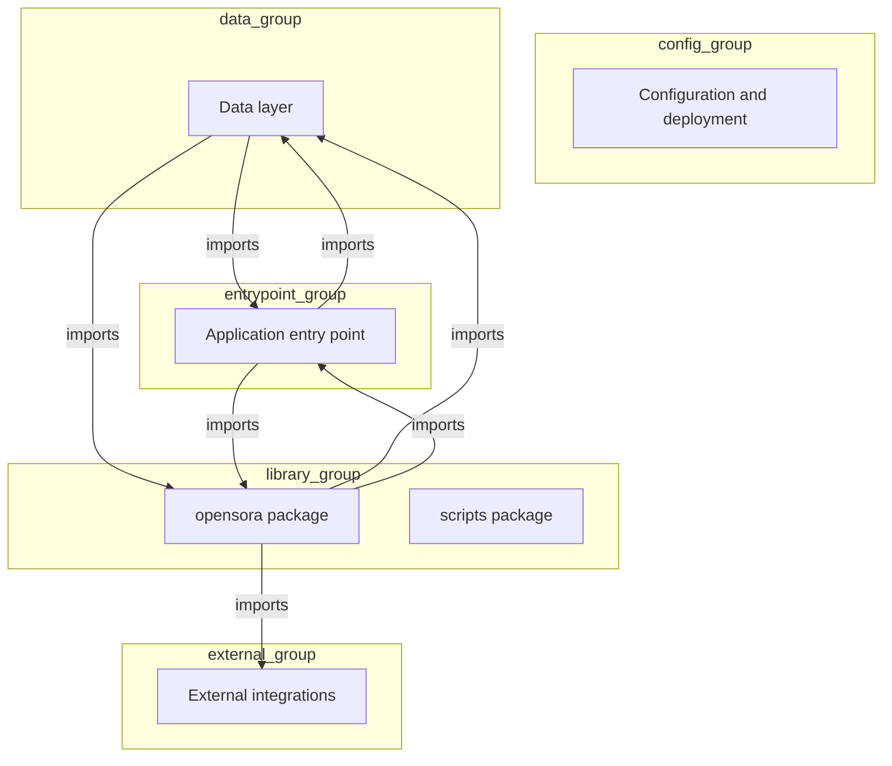

# Architecture report: PKU-YuanGroup/Open-Sora-Plan

> Automated static analysis. **Observed** = directly seen in files/imports/AST; **Inferred** = interpretation from that evidence. Repository code was not executed.

## 1. Repository at a glance

| Item | Value |
| --- | --- |
| Repository | PKU-YuanGroup/Open-Sora-Plan |
| Description | This project aim to reproduce Sora (Open AI T2V model), we wish the open source community contribute to this project. |
| Language | Python |
| Stars | 12199 |
| Licence | MIT |
| Analysed commit / branch | f7fa604f4e3a523d6b973e4c89a5620ed1aff65a / main |
| Framework(s) | FastAPI |
| Files analysed | 179 |
| Components | 6 |

## 2. Architecture in one minute

PKU-YuanGroup/Open-Sora-Plan - This project aim to reproduce Sora (Open AI T2V model), we wish the open source community contribute to this project.. This repository was analysed statically from 179 file(s) (120 Python). Detected technologies (observed from imports/manifests): GitHub Actions, FastAPI, NumPy, pandas, Pydantic, requests. Files are grouped into 6 component(s): Configuration and deployment, Data layer, Application entry point, External integrations, opensora package, scripts package. Observed entry point(s): opensora/dataset/__init__.py, opensora/dataset/transform.py, opensora/models/causalvideovae/dataset/transform.py. Findings below distinguish observed facts from inferred interpretation.

## 3. High-level block diagram

## 4. Main components

### Configuration and deployment (`config`)

- **Kind:** config
- **Status:** Observed
- **Confidence:** 0.85
- **Responsibility:** Groups 18 file(s) under configuration and deployment (observed from repository paths and static analysis).
- **Paths:** `opensora/models/diffusion/curope/setup.py`, `opensora/models/frame_interpolation/cfgs/AMT-G.yaml`, `pyproject.toml`, `scripts/accelerate_configs/ddp_config.yaml`, `scripts/accelerate_configs/deepspeed_zero2_config.yaml`, `scripts/accelerate_configs/deepspeed_zero2_offload_config.yaml`, `scripts/accelerate_configs/deepspeed_zero3_config.yaml`, `scripts/accelerate_configs/deepspeed_zero3_offload_config.yaml`, `scripts/accelerate_configs/default_config.yaml`, `scripts/accelerate_configs/multi_node_example.yaml`, `scripts/accelerate_configs/multi_node_example_by_ddp.yaml`, `scripts/accelerate_configs/zero2.json`, `scripts/accelerate_configs/zero2_npu.json`, `scripts/accelerate_configs/zero2_offload.json`, `scripts/accelerate_configs/zero3.json`, `scripts/accelerate_configs/zero3_offload.json`, `scripts/causalvae/wfvae_4dim.json`, `scripts/train_configs/mask_config.yaml`
- **Evidence:** [opensora/models/diffusion/curope/setup.py](https://github.com/PKU-YuanGroup/Open-Sora-Plan/blob/f7fa604f4e3a523d6b973e4c89a5620ed1aff65a/opensora/models/diffusion/curope/setup.py); [opensora/models/frame_interpolation/cfgs/AMT-G.yaml](https://github.com/PKU-YuanGroup/Open-Sora-Plan/blob/f7fa604f4e3a523d6b973e4c89a5620ed1aff65a/opensora/models/frame_interpolation/cfgs/AMT-G.yaml); [pyproject.toml](https://github.com/PKU-YuanGroup/Open-Sora-Plan/blob/f7fa604f4e3a523d6b973e4c89a5620ed1aff65a/pyproject.toml); [scripts/accelerate_configs/ddp_config.yaml](https://github.com/PKU-YuanGroup/Open-Sora-Plan/blob/f7fa604f4e3a523d6b973e4c89a5620ed1aff65a/scripts/accelerate_configs/ddp_config.yaml); [scripts/accelerate_configs/deepspeed_zero2_config.yaml](https://github.com/PKU-YuanGroup/Open-Sora-Plan/blob/f7fa604f4e3a523d6b973e4c89a5620ed1aff65a/scripts/accelerate_configs/deepspeed_zero2_config.yaml); [scripts/accelerate_configs/deepspeed_zero2_offload_config.yaml](https://github.com/PKU-YuanGroup/Open-Sora-Plan/blob/f7fa604f4e3a523d6b973e4c89a5620ed1aff65a/scripts/accelerate_configs/deepspeed_zero2_offload_config.yaml); [scripts/accelerate_configs/deepspeed_zero3_config.yaml](https://github.com/PKU-YuanGroup/Open-Sora-Plan/blob/f7fa604f4e3a523d6b973e4c89a5620ed1aff65a/scripts/accelerate_configs/deepspeed_zero3_config.yaml); [scripts/accelerate_configs/deepspeed_zero3_offload_config.yaml](https://github.com/PKU-YuanGroup/Open-Sora-Plan/blob/f7fa604f4e3a523d6b973e4c89a5620ed1aff65a/scripts/accelerate_configs/deepspeed_zero3_offload_config.yaml)

### Data layer (`data_layer`)

- **Kind:** data
- **Status:** Observed
- **Confidence:** 0.85
- **Responsibility:** Groups 71 file(s) under data layer (observed from repository paths and static analysis). Observed top-level classes: Attention, AttnBlock3D, AttnBlock3DFix, AverageMeter, AverageMeterGroups, BasicEncoder. Observed top-level functions: Normalize, OpenSoraInpaint_v1_3_2B_122, TemporalRandomCrop, _format_video_shape, _symmetric_matrix_square_root, adopt_weight.
- **Paths:** `opensora/models/__init__.py`, `opensora/models/causalvideovae/__init__.py`, `opensora/models/causalvideovae/dataset/__init__.py`, `opensora/models/causalvideovae/dataset/ddp_sampler.py`, `opensora/models/causalvideovae/dataset/video_dataset.py`, `opensora/models/causalvideovae/eval/fvd/styleganv/fvd.py`, `opensora/models/causalvideovae/eval/fvd/videogpt/fvd.py`, `opensora/models/causalvideovae/eval/fvd/videogpt/pytorch_i3d.py`, `opensora/models/causalvideovae/eval/script/cal_clip_score.sh`, `opensora/models/causalvideovae/eval/script/cal_fvd.sh`, `opensora/models/causalvideovae/eval/script/cal_lpips.sh`, `opensora/models/causalvideovae/eval/script/cal_psnr.sh`, `opensora/models/causalvideovae/eval/script/cal_ssim.sh`, `opensora/models/causalvideovae/model/__init__.py`, `opensora/models/causalvideovae/model/configuration_videobase.py`, `opensora/models/causalvideovae/model/dataset_videobase.py`, `opensora/models/causalvideovae/model/ema_model.py`, `opensora/models/causalvideovae/model/losses/__init__.py`, `opensora/models/causalvideovae/model/losses/discriminator.py`, `opensora/models/causalvideovae/model/losses/lpips.py`, `opensora/models/causalvideovae/model/losses/perceptual_loss.py`, `opensora/models/causalvideovae/model/modeling_videobase.py`, `opensora/models/causalvideovae/model/modules/__init__.py`, `opensora/models/causalvideovae/model/modules/attention.py`, `opensora/models/causalvideovae/model/modules/block.py`, `opensora/models/causalvideovae/model/modules/conv.py`, `opensora/models/causalvideovae/model/modules/normalize.py`, `opensora/models/causalvideovae/model/modules/ops.py`, `opensora/models/causalvideovae/model/modules/quant.py`, `opensora/models/causalvideovae/model/modules/resnet_block.py`, `opensora/models/causalvideovae/model/modules/updownsample.py`, `opensora/models/causalvideovae/model/modules/wavelet.py`, `opensora/models/causalvideovae/model/registry.py`, `opensora/models/causalvideovae/model/trainer_videobase.py`, `opensora/models/causalvideovae/model/utils/__init__.py`, `opensora/models/causalvideovae/model/utils/distrib_utils.py`, `opensora/models/causalvideovae/model/utils/module_utils.py`, `opensora/models/causalvideovae/model/utils/scheduler_utils.py`, `opensora/models/causalvideovae/model/utils/video_utils.py`, `opensora/models/causalvideovae/model/utils/wavelet_utils.py`, `opensora/models/causalvideovae/model/vae/__init__.py`, `opensora/models/causalvideovae/model/vae/modeling_causalvae.py`, `opensora/models/causalvideovae/model/vae/modeling_wfvae.py`, `opensora/models/causalvideovae/utils/__init__.py`, `opensora/models/causalvideovae/utils/dataset_utils.py`, `opensora/models/causalvideovae/utils/downloader.py`, `opensora/models/causalvideovae/utils/video_utils.py`, `opensora/models/diffusion/__init__.py`, `opensora/models/diffusion/common.py`, `opensora/models/diffusion/curope/__init__.py`, `opensora/models/diffusion/curope/curope.cpp`, `opensora/models/diffusion/curope/curope3d.py`, `opensora/models/diffusion/opensora_v1_3/__init__.py`, `opensora/models/diffusion/opensora_v1_3/modeling_inpaint.py`, `opensora/models/diffusion/opensora_v1_3/modules.py`, `opensora/models/frame_interpolation/networks/AMT-G.py`, `opensora/models/frame_interpolation/networks/__init__.py`, `opensora/models/frame_interpolation/networks/blocks/__init__.py`, `opensora/models/frame_interpolation/networks/blocks/feat_enc.py`, `opensora/models/frame_interpolation/networks/blocks/ifrnet.py`, `opensora/models/frame_interpolation/networks/blocks/multi_flow.py`, `opensora/models/frame_interpolation/networks/blocks/raft.py`, `opensora/models/frame_interpolation/utils/__init__.py`, `opensora/models/frame_interpolation/utils/build_utils.py`, `opensora/models/frame_interpolation/utils/dist_utils.py`, `opensora/models/frame_interpolation/utils/flow_utils.py`, `opensora/models/frame_interpolation/utils/utils.py`, `opensora/models/prompt_refiner/train.py`, `opensora/models/text_encoder/__init__.py`, `opensora/models/text_encoder/clip.py`, `opensora/models/text_encoder/t5.py`
- **Evidence:** [opensora/models/__init__.py](https://github.com/PKU-YuanGroup/Open-Sora-Plan/blob/f7fa604f4e3a523d6b973e4c89a5620ed1aff65a/opensora/models/__init__.py); [opensora/models/causalvideovae/__init__.py:15](https://github.com/PKU-YuanGroup/Open-Sora-Plan/blob/f7fa604f4e3a523d6b973e4c89a5620ed1aff65a/opensora/models/causalvideovae/__init__.py#L15); [opensora/models/causalvideovae/dataset/__init__.py](https://github.com/PKU-YuanGroup/Open-Sora-Plan/blob/f7fa604f4e3a523d6b973e4c89a5620ed1aff65a/opensora/models/causalvideovae/dataset/__init__.py); [opensora/models/causalvideovae/dataset/ddp_sampler.py:9](https://github.com/PKU-YuanGroup/Open-Sora-Plan/blob/f7fa604f4e3a523d6b973e4c89a5620ed1aff65a/opensora/models/causalvideovae/dataset/ddp_sampler.py#L9); [opensora/models/causalvideovae/dataset/video_dataset.py:19](https://github.com/PKU-YuanGroup/Open-Sora-Plan/blob/f7fa604f4e3a523d6b973e4c89a5620ed1aff65a/opensora/models/causalvideovae/dataset/video_dataset.py#L19); [opensora/models/causalvideovae/eval/fvd/styleganv/fvd.py:9](https://github.com/PKU-YuanGroup/Open-Sora-Plan/blob/f7fa604f4e3a523d6b973e4c89a5620ed1aff65a/opensora/models/causalvideovae/eval/fvd/styleganv/fvd.py#L9); [opensora/models/causalvideovae/eval/fvd/videogpt/fvd.py:8](https://github.com/PKU-YuanGroup/Open-Sora-Plan/blob/f7fa604f4e3a523d6b973e4c89a5620ed1aff65a/opensora/models/causalvideovae/eval/fvd/videogpt/fvd.py#L8); [opensora/models/causalvideovae/eval/fvd/videogpt/pytorch_i3d.py:7](https://github.com/PKU-YuanGroup/Open-Sora-Plan/blob/f7fa604f4e3a523d6b973e4c89a5620ed1aff65a/opensora/models/causalvideovae/eval/fvd/videogpt/pytorch_i3d.py#L7)

### Application entry point (`entrypoint`)

- **Kind:** entrypoint
- **Status:** Observed
- **Confidence:** 0.85
- **Responsibility:** Groups 21 file(s) under application entry point (observed from repository paths and static analysis). Observed top-level classes: BaseMaskGenerator, BaseNoiseAdder, CenterCropResizeVideo, CenterCropVideo, ClearMaskGenerator, ContinuationMaskGenerator. Observed top-level functions: OpenSoraT2V_v1_3_2B_122, _is_tensor_video_clip, add_aesthetic_notice_image, add_aesthetic_notice_video, add_high_aesthetic_notice_image, add_high_aesthetic_notice_image_human.
- **Paths:** `opensora/dataset/__init__.py`, `opensora/dataset/transform.py`, `opensora/models/causalvideovae/dataset/transform.py`, `opensora/models/causalvideovae/eval/cal_fvd.py`, `opensora/models/causalvideovae/eval/cal_lpips.py`, `opensora/models/causalvideovae/eval/cal_psnr.py`, `opensora/models/causalvideovae/eval/cal_ssim.py`, `opensora/models/causalvideovae/eval/eval.py`, `opensora/models/causalvideovae/sample/rec_video_vae.py`, `opensora/models/diffusion/opensora_v1_3/modeling_opensora.py`, `opensora/models/frame_interpolation/interpolation.py`, `opensora/models/prompt_refiner/inference.py`, `opensora/models/prompt_refiner/merge.py`, `opensora/sample/rec_image.py`, `opensora/sample/rec_video.py`, `opensora/sample/sample.py`, `opensora/train/train_causalvae.py`, `opensora/train/train_inpaint.py`, `opensora/train/train_t2v_diffusers.py`, `opensora/utils/mask_utils.py`, `opensora/utils/utils.py`
- **Evidence:** [opensora/dataset/__init__.py:19](https://github.com/PKU-YuanGroup/Open-Sora-Plan/blob/f7fa604f4e3a523d6b973e4c89a5620ed1aff65a/opensora/dataset/__init__.py#L19); [opensora/dataset/transform.py:12](https://github.com/PKU-YuanGroup/Open-Sora-Plan/blob/f7fa604f4e3a523d6b973e4c89a5620ed1aff65a/opensora/dataset/transform.py#L12); [opensora/models/causalvideovae/dataset/transform.py:7](https://github.com/PKU-YuanGroup/Open-Sora-Plan/blob/f7fa604f4e3a523d6b973e4c89a5620ed1aff65a/opensora/models/causalvideovae/dataset/transform.py#L7); [opensora/models/causalvideovae/eval/cal_fvd.py:5](https://github.com/PKU-YuanGroup/Open-Sora-Plan/blob/f7fa604f4e3a523d6b973e4c89a5620ed1aff65a/opensora/models/causalvideovae/eval/cal_fvd.py#L5); [opensora/models/causalvideovae/eval/cal_lpips.py:15](https://github.com/PKU-YuanGroup/Open-Sora-Plan/blob/f7fa604f4e3a523d6b973e4c89a5620ed1aff65a/opensora/models/causalvideovae/eval/cal_lpips.py#L15); [opensora/models/causalvideovae/eval/cal_psnr.py:6](https://github.com/PKU-YuanGroup/Open-Sora-Plan/blob/f7fa604f4e3a523d6b973e4c89a5620ed1aff65a/opensora/models/causalvideovae/eval/cal_psnr.py#L6); [opensora/models/causalvideovae/eval/cal_ssim.py:6](https://github.com/PKU-YuanGroup/Open-Sora-Plan/blob/f7fa604f4e3a523d6b973e4c89a5620ed1aff65a/opensora/models/causalvideovae/eval/cal_ssim.py#L6); [opensora/models/causalvideovae/eval/eval.py:26](https://github.com/PKU-YuanGroup/Open-Sora-Plan/blob/f7fa604f4e3a523d6b973e4c89a5620ed1aff65a/opensora/models/causalvideovae/eval/eval.py#L26)

### External integrations (`external_integrations`)

- **Kind:** external
- **Status:** Inferred
- **Confidence:** 0.70
- **Responsibility:** Groups 0 file(s) under external integrations (observed from repository paths and static analysis).
- **Evidence:** [opensora/utils/taming_download.py:4](https://github.com/PKU-YuanGroup/Open-Sora-Plan/blob/f7fa604f4e3a523d6b973e4c89a5620ed1aff65a/opensora/utils/taming_download.py#L4)

### opensora package (`opensora`)

- **Kind:** library
- **Status:** Observed
- **Confidence:** 0.85
- **Responsibility:** Groups 31 file(s) under opensora package (observed from repository paths and static analysis). Observed top-level classes: BF16_Optimizer, COMM_INFO, CheckOverflow, Collate, DataSetProg, DecordDecoder. Observed top-level functions: _all_to_all, _get_padded_tensor, _handle_overflow, _single_all_to_all, align_dense_tensors, all_gather_dp_groups.
- **Paths:** `opensora/__init__.py`, `opensora/acceleration/__init__.py`, `opensora/acceleration/communications.py`, `opensora/acceleration/parallel_states.py`, `opensora/adaptor/__init__.py`, `opensora/adaptor/bf16_optimizer.py`, `opensora/adaptor/engine.py`, `opensora/adaptor/modules.py`, `opensora/adaptor/stage_1_and_2.py`, `opensora/adaptor/utils.py`, `opensora/adaptor/zp_manager.py`, `opensora/dataset/inpaint_dataset.py`, `opensora/dataset/t2v_datasets.py`, `opensora/dataset/virtual_disk.py`, `opensora/npu_config.py`, `opensora/sample/caption_refiner.py`, `opensora/sample/pipeline_inpaint.py`, `opensora/sample/pipeline_opensora.py`, `opensora/serve/gradio_utils.py`, `opensora/serve/gradio_web_server.py`, `opensora/serve/gradio_web_server_i2v.py`, `opensora/utils/communications.py`, `opensora/utils/dataset_utils.py`, `opensora/utils/downloader.py`, `opensora/utils/ema.py`, `opensora/utils/ema_utils.py`, `opensora/utils/freeinit_utils.py`, `opensora/utils/lora_utils.py`, `opensora/utils/parallel_states.py`, `opensora/utils/sample_utils.py`, `opensora/utils/taming_download.py`
- **Evidence:** [opensora/__init__.py](https://github.com/PKU-YuanGroup/Open-Sora-Plan/blob/f7fa604f4e3a523d6b973e4c89a5620ed1aff65a/opensora/__init__.py); [opensora/acceleration/__init__.py](https://github.com/PKU-YuanGroup/Open-Sora-Plan/blob/f7fa604f4e3a523d6b973e4c89a5620ed1aff65a/opensora/acceleration/__init__.py); [opensora/acceleration/communications.py:10](https://github.com/PKU-YuanGroup/Open-Sora-Plan/blob/f7fa604f4e3a523d6b973e4c89a5620ed1aff65a/opensora/acceleration/communications.py#L10); [opensora/acceleration/parallel_states.py:11](https://github.com/PKU-YuanGroup/Open-Sora-Plan/blob/f7fa604f4e3a523d6b973e4c89a5620ed1aff65a/opensora/acceleration/parallel_states.py#L11); [opensora/adaptor/__init__.py](https://github.com/PKU-YuanGroup/Open-Sora-Plan/blob/f7fa604f4e3a523d6b973e4c89a5620ed1aff65a/opensora/adaptor/__init__.py); [opensora/adaptor/bf16_optimizer.py:30](https://github.com/PKU-YuanGroup/Open-Sora-Plan/blob/f7fa604f4e3a523d6b973e4c89a5620ed1aff65a/opensora/adaptor/bf16_optimizer.py#L30); [opensora/adaptor/engine.py:123](https://github.com/PKU-YuanGroup/Open-Sora-Plan/blob/f7fa604f4e3a523d6b973e4c89a5620ed1aff65a/opensora/adaptor/engine.py#L123); [opensora/adaptor/modules.py:6](https://github.com/PKU-YuanGroup/Open-Sora-Plan/blob/f7fa604f4e3a523d6b973e4c89a5620ed1aff65a/opensora/adaptor/modules.py#L6)

### scripts package (`scripts`)

- **Kind:** library
- **Status:** Observed
- **Confidence:** 0.85
- **Responsibility:** Groups 13 file(s) under scripts package (observed from repository paths and static analysis).
- **Paths:** `scripts/causalvae/eval.sh`, `scripts/causalvae/prepare_eval.sh`, `scripts/causalvae/rec_image.sh`, `scripts/causalvae/rec_video.sh`, `scripts/causalvae/train.sh`, `scripts/text_condition/gpu/sample_inpaint_v1_3.sh`, `scripts/text_condition/gpu/sample_t2v_v1_3.sh`, `scripts/text_condition/gpu/train_inpaint_v1_3.sh`, `scripts/text_condition/gpu/train_t2v_v1_3.sh`, `scripts/text_condition/npu/sample_inpaint_v1_3.sh`, `scripts/text_condition/npu/sample_t2v_v1_3.sh`, `scripts/text_condition/npu/train_inpaint_v1_3.sh`, `scripts/text_condition/npu/train_t2v_v1_3.sh`
- **Evidence:** [scripts/causalvae/eval.sh](https://github.com/PKU-YuanGroup/Open-Sora-Plan/blob/f7fa604f4e3a523d6b973e4c89a5620ed1aff65a/scripts/causalvae/eval.sh); [scripts/causalvae/prepare_eval.sh](https://github.com/PKU-YuanGroup/Open-Sora-Plan/blob/f7fa604f4e3a523d6b973e4c89a5620ed1aff65a/scripts/causalvae/prepare_eval.sh); [scripts/causalvae/rec_image.sh](https://github.com/PKU-YuanGroup/Open-Sora-Plan/blob/f7fa604f4e3a523d6b973e4c89a5620ed1aff65a/scripts/causalvae/rec_image.sh); [scripts/causalvae/rec_video.sh](https://github.com/PKU-YuanGroup/Open-Sora-Plan/blob/f7fa604f4e3a523d6b973e4c89a5620ed1aff65a/scripts/causalvae/rec_video.sh); [scripts/causalvae/train.sh](https://github.com/PKU-YuanGroup/Open-Sora-Plan/blob/f7fa604f4e3a523d6b973e4c89a5620ed1aff65a/scripts/causalvae/train.sh); [scripts/text_condition/gpu/sample_inpaint_v1_3.sh](https://github.com/PKU-YuanGroup/Open-Sora-Plan/blob/f7fa604f4e3a523d6b973e4c89a5620ed1aff65a/scripts/text_condition/gpu/sample_inpaint_v1_3.sh); [scripts/text_condition/gpu/sample_t2v_v1_3.sh](https://github.com/PKU-YuanGroup/Open-Sora-Plan/blob/f7fa604f4e3a523d6b973e4c89a5620ed1aff65a/scripts/text_condition/gpu/sample_t2v_v1_3.sh); [scripts/text_condition/gpu/train_inpaint_v1_3.sh](https://github.com/PKU-YuanGroup/Open-Sora-Plan/blob/f7fa604f4e3a523d6b973e4c89a5620ed1aff65a/scripts/text_condition/gpu/train_inpaint_v1_3.sh)

## 5. Execution flow

**Observed** entry point(s):

- [opensora/dataset/__init__.py:57](https://github.com/PKU-YuanGroup/Open-Sora-Plan/blob/f7fa604f4e3a523d6b973e4c89a5620ed1aff65a/opensora/dataset/__init__.py#L57)
- [opensora/dataset/transform.py:843](https://github.com/PKU-YuanGroup/Open-Sora-Plan/blob/f7fa604f4e3a523d6b973e4c89a5620ed1aff65a/opensora/dataset/transform.py#L843)
- [opensora/models/causalvideovae/dataset/transform.py:521](https://github.com/PKU-YuanGroup/Open-Sora-Plan/blob/f7fa604f4e3a523d6b973e4c89a5620ed1aff65a/opensora/models/causalvideovae/dataset/transform.py#L521)
- [opensora/models/causalvideovae/eval/cal_fvd.py:84](https://github.com/PKU-YuanGroup/Open-Sora-Plan/blob/f7fa604f4e3a523d6b973e4c89a5620ed1aff65a/opensora/models/causalvideovae/eval/cal_fvd.py#L84)
- [opensora/models/causalvideovae/eval/cal_lpips.py:96](https://github.com/PKU-YuanGroup/Open-Sora-Plan/blob/f7fa604f4e3a523d6b973e4c89a5620ed1aff65a/opensora/models/causalvideovae/eval/cal_lpips.py#L96)
- [opensora/models/causalvideovae/eval/cal_psnr.py:96](https://github.com/PKU-YuanGroup/Open-Sora-Plan/blob/f7fa604f4e3a523d6b973e4c89a5620ed1aff65a/opensora/models/causalvideovae/eval/cal_psnr.py#L96)
- [opensora/models/causalvideovae/eval/cal_ssim.py:112](https://github.com/PKU-YuanGroup/Open-Sora-Plan/blob/f7fa604f4e3a523d6b973e4c89a5620ed1aff65a/opensora/models/causalvideovae/eval/cal_ssim.py#L112)
- [opensora/models/causalvideovae/eval/eval.py:185](https://github.com/PKU-YuanGroup/Open-Sora-Plan/blob/f7fa604f4e3a523d6b973e4c89a5620ed1aff65a/opensora/models/causalvideovae/eval/eval.py#L185)
- [opensora/models/causalvideovae/sample/rec_video_vae.py:87](https://github.com/PKU-YuanGroup/Open-Sora-Plan/blob/f7fa604f4e3a523d6b973e4c89a5620ed1aff65a/opensora/models/causalvideovae/sample/rec_video_vae.py#L87)
- [opensora/models/diffusion/opensora_v1_3/modeling_opensora.py:307](https://github.com/PKU-YuanGroup/Open-Sora-Plan/blob/f7fa604f4e3a523d6b973e4c89a5620ed1aff65a/opensora/models/diffusion/opensora_v1_3/modeling_opensora.py#L307)
- [opensora/models/frame_interpolation/interpolation.py:177](https://github.com/PKU-YuanGroup/Open-Sora-Plan/blob/f7fa604f4e3a523d6b973e4c89a5620ed1aff65a/opensora/models/frame_interpolation/interpolation.py#L177)
- [opensora/models/prompt_refiner/inference.py:34](https://github.com/PKU-YuanGroup/Open-Sora-Plan/blob/f7fa604f4e3a523d6b973e4c89a5620ed1aff65a/opensora/models/prompt_refiner/inference.py#L34)

Representative flow (derived from observed entry points and the import graph; steps beyond the entry point are **Inferred**):

1. Execution starts at an observed entry point listed above, if present.
2. `data_layer` imports `entrypoint` (Data layer -> Application entry point).
3. `data_layer` imports `opensora` (Data layer -> opensora package).
4. `entrypoint` imports `data_layer` (Application entry point -> Data layer).
5. `entrypoint` imports `opensora` (Application entry point -> opensora package).
6. `opensora` imports `data_layer` (opensora package -> Data layer).
7. `opensora` imports `entrypoint` (opensora package -> Application entry point).
8. `opensora` imports `external_integrations` (opensora package -> External integrations).

## 6. Project structure

### `(root)`

- `.gitignore` - other (1103 bytes)
- `LICENSE` - docs (1078 bytes)
- `README.md` - docs (15015 bytes)
- `pyproject.toml` - manifest (1922 bytes)

### `.github`

- `.github/workflows/docker_build.yml` - ci, YAML (931 bytes)

### `docs`

- `docs/Contribution_Guidelines.md` - docs (3040 bytes)
- `docs/Prompt_Refiner.md` - docs (2140 bytes)
- `docs/Report-v1.0.0-cn.md` - docs (11009 bytes)
- `docs/Report-v1.0.0.md` - docs (13288 bytes)
- `docs/Report-v1.1.0.md` - docs (27079 bytes)
- `docs/Report-v1.2.0.md` - docs (18091 bytes)
- `docs/Report-v1.3.0.md` - docs (43212 bytes)
- `docs/Report-v1.5.0.md` - docs (20964 bytes)
- `docs/Report-v1.5.0_cn.md` - docs (18017 bytes)
- `docs/VAE.md` - docs (3414 bytes)

### `examples`

- `examples/cond_pix_path.txt` - docs (68 bytes)
- `examples/cond_prompt.txt` - docs (146 bytes)
- `examples/rec_image.py` - source, Python (2376 bytes)
- `examples/rec_video.py` - source, Python (5931 bytes)
- `examples/sora.txt` - docs (11597 bytes)

### `opensora`

- `opensora/__init__.py` - source, Python (2 bytes)
- `opensora/acceleration/__init__.py` - source, Python (0 bytes)
- `opensora/acceleration/communications.py` - source, Python (5884 bytes)
- `opensora/acceleration/parallel_states.py` - source, Python (1993 bytes)
- `opensora/adaptor/__init__.py` - source, Python (0 bytes)
- `opensora/adaptor/bf16_optimizer.py` - source, Python (20349 bytes)
- `opensora/adaptor/engine.py` - source, Python (166017 bytes)
- `opensora/adaptor/modules.py` - source, Python (899 bytes)
- `opensora/adaptor/stage_1_and_2.py` - source, Python (120982 bytes)
- `opensora/adaptor/utils.py` - source, Python (39237 bytes)
- `opensora/adaptor/zp_manager.py` - source, Python (885 bytes)
- `opensora/dataset/__init__.py` - source, Python (5033 bytes)
- `opensora/dataset/inpaint_dataset.py` - source, Python (11260 bytes)
- `opensora/dataset/t2v_datasets.py` - source, Python (29639 bytes)
- `opensora/dataset/transform.py` - source, Python (30532 bytes)
- `opensora/dataset/virtual_disk.py` - source, Python (8263 bytes)
- `opensora/models/__init__.py` - source, Python (68 bytes)
- `opensora/models/causalvideovae/__init__.py` - source, Python (3860 bytes)
- `opensora/models/causalvideovae/dataset/__init__.py` - source, Python (0 bytes)
- `opensora/models/causalvideovae/dataset/ddp_sampler.py` - source, Python (6493 bytes)
- `opensora/models/causalvideovae/dataset/transform.py` - source, Python (18157 bytes)
- `opensora/models/causalvideovae/dataset/video_dataset.py` - source, Python (8184 bytes)
- `opensora/models/causalvideovae/eval/cal_fvd.py` - source, Python (2540 bytes)
- `opensora/models/causalvideovae/eval/cal_lpips.py` - source, Python (2786 bytes)
- `opensora/models/causalvideovae/eval/cal_psnr.py` - source, Python (2510 bytes)
- `opensora/models/causalvideovae/eval/cal_ssim.py` - source, Python (3506 bytes)
- `opensora/models/causalvideovae/eval/eval.py` - source, Python (6170 bytes)
- `opensora/models/causalvideovae/eval/fvd/styleganv/fvd.py` - source, Python (3116 bytes)
- `opensora/models/causalvideovae/eval/fvd/videogpt/fvd.py` - source, Python (5368 bytes)
- `opensora/models/causalvideovae/eval/fvd/videogpt/pytorch_i3d.py` - source, Python (13385 bytes)
- `opensora/models/causalvideovae/eval/script/cal_clip_score.sh` - source, Shell (584 bytes)
- `opensora/models/causalvideovae/eval/script/cal_fvd.sh` - source, Shell (248 bytes)
- `opensora/models/causalvideovae/eval/script/cal_lpips.sh` - source, Shell (218 bytes)
- `opensora/models/causalvideovae/eval/script/cal_psnr.sh` - source, Shell (251 bytes)
- `opensora/models/causalvideovae/eval/script/cal_ssim.sh` - source, Shell (250 bytes)
- `opensora/models/causalvideovae/model/__init__.py` - source, Python (88 bytes)
- `opensora/models/causalvideovae/model/configuration_videobase.py` - source, Python (1657 bytes)
- `opensora/models/causalvideovae/model/dataset_videobase.py` - source, Python (4263 bytes)
- `opensora/models/causalvideovae/model/ema_model.py` - source, Python (1027 bytes)
- `opensora/models/causalvideovae/model/losses/__init__.py` - source, Python (54 bytes)
- `opensora/models/causalvideovae/model/losses/discriminator.py` - source, Python (5100 bytes)
- `opensora/models/causalvideovae/model/losses/lpips.py` - source, Python (4824 bytes)
- `opensora/models/causalvideovae/model/losses/perceptual_loss.py` - source, Python (7913 bytes)
- `opensora/models/causalvideovae/model/modeling_videobase.py` - source, Python (1982 bytes)
- `opensora/models/causalvideovae/model/modules/__init__.py` - source, Python (173 bytes)
- `opensora/models/causalvideovae/model/modules/attention.py` - source, Python (4159 bytes)
- `opensora/models/causalvideovae/model/modules/block.py` - source, Python (137 bytes)
- `opensora/models/causalvideovae/model/modules/conv.py` - source, Python (3816 bytes)
- `opensora/models/causalvideovae/model/modules/normalize.py` - source, Python (1333 bytes)
- `opensora/models/causalvideovae/model/modules/ops.py` - source, Python (1514 bytes)
- `opensora/models/causalvideovae/model/modules/quant.py` - source, Python (3618 bytes)
- `opensora/models/causalvideovae/model/modules/resnet_block.py` - source, Python (5588 bytes)
- `opensora/models/causalvideovae/model/modules/updownsample.py` - source, Python (12194 bytes)
- `opensora/models/causalvideovae/model/modules/wavelet.py` - source, Python (11716 bytes)
- `opensora/models/causalvideovae/model/registry.py` - source, Python (329 bytes)
- `opensora/models/causalvideovae/model/trainer_videobase.py` - source, Python (966 bytes)
- `opensora/models/causalvideovae/model/utils/__init__.py` - source, Python (0 bytes)
- `opensora/models/causalvideovae/model/utils/distrib_utils.py` - source, Python (1653 bytes)
- `opensora/models/causalvideovae/model/utils/module_utils.py` - source, Python (574 bytes)
- `opensora/models/causalvideovae/model/utils/scheduler_utils.py` - source, Python (260 bytes)
- `opensora/models/causalvideovae/model/utils/video_utils.py` - source, Python (256 bytes)
- `opensora/models/causalvideovae/model/utils/wavelet_utils.py` - source, Python (10096 bytes)
- `opensora/models/causalvideovae/model/vae/__init__.py` - source, Python (135 bytes)
- `opensora/models/causalvideovae/model/vae/modeling_causalvae.py` - source, Python (23523 bytes)
- `opensora/models/causalvideovae/model/vae/modeling_wfvae.py` - source, Python (19452 bytes)
- `opensora/models/causalvideovae/sample/rec_video_vae.py` - source, Python (4261 bytes)
- `opensora/models/causalvideovae/utils/__init__.py` - source, Python (0 bytes)
- `opensora/models/causalvideovae/utils/dataset_utils.py` - source, Python (1318 bytes)
- `opensora/models/causalvideovae/utils/downloader.py` - source, Python (492 bytes)
- `opensora/models/causalvideovae/utils/video_utils.py` - source, Python (2096 bytes)
- `opensora/models/diffusion/__init__.py` - source, Python (568 bytes)
- `opensora/models/diffusion/common.py` - source, Python (5139 bytes)
- `opensora/models/diffusion/curope/__init__.py` - source, Python (160 bytes)
- `opensora/models/diffusion/curope/curope.cpp` - source, C++ (2472 bytes)
- `opensora/models/diffusion/curope/curope3d.py` - source, Python (1558 bytes)
- `opensora/models/diffusion/curope/kernels.cu` - other (3935 bytes)
- `opensora/models/diffusion/curope/setup.py` - manifest, Python (1116 bytes)
- `opensora/models/diffusion/opensora_v1_3/__init__.py` - source, Python (0 bytes)
- `opensora/models/diffusion/opensora_v1_3/modeling_inpaint.py` - source, Python (6069 bytes)
- `opensora/models/diffusion/opensora_v1_3/modeling_opensora.py` - source, Python (16654 bytes)
- `opensora/models/diffusion/opensora_v1_3/modules.py` - source, Python (18752 bytes)
- `opensora/models/frame_interpolation/cfgs/AMT-G.yaml` - config (113 bytes)
- `opensora/models/frame_interpolation/interpolation.py` - source, Python (6643 bytes)
- `opensora/models/frame_interpolation/networks/AMT-G.py` - source, Python (8009 bytes)
- `opensora/models/frame_interpolation/networks/__init__.py` - source, Python (0 bytes)
- `opensora/models/frame_interpolation/networks/blocks/__init__.py` - source, Python (0 bytes)
- `opensora/models/frame_interpolation/networks/blocks/feat_enc.py` - source, Python (11300 bytes)
- `opensora/models/frame_interpolation/networks/blocks/ifrnet.py` - source, Python (4260 bytes)
- `opensora/models/frame_interpolation/networks/blocks/multi_flow.py` - source, Python (3000 bytes)
- `opensora/models/frame_interpolation/networks/blocks/raft.py` - source, Python (8113 bytes)
- `opensora/models/frame_interpolation/readme.md` - docs (1200 bytes)
- `opensora/models/frame_interpolation/utils/__init__.py` - source, Python (0 bytes)
- `opensora/models/frame_interpolation/utils/build_utils.py` - source, Python (323 bytes)
- `opensora/models/frame_interpolation/utils/dist_utils.py` - source, Python (1460 bytes)
- `opensora/models/frame_interpolation/utils/flow_utils.py` - source, Python (4325 bytes)
- `opensora/models/frame_interpolation/utils/utils.py` - source, Python (8257 bytes)
- `opensora/models/prompt_refiner/inference.py` - source, Python (1804 bytes)
- `opensora/models/prompt_refiner/merge.py` - source, Python (3287 bytes)
- `opensora/models/prompt_refiner/train.py` - source, Python (3354 bytes)
- `opensora/models/text_encoder/__init__.py` - source, Python (762 bytes)
- `opensora/models/text_encoder/clip.py` - source, Python (985 bytes)
- `opensora/models/text_encoder/t5.py` - source, Python (676 bytes)
- `opensora/npu_config.py` - source, Python (16043 bytes)
- `opensora/sample/caption_refiner.py` - source, Python (1629 bytes)
- `opensora/sample/pipeline_inpaint.py` - source, Python (28844 bytes)
- `opensora/sample/pipeline_opensora.py` - source, Python (35668 bytes)
- `opensora/sample/rec_image.py` - source, Python (2377 bytes)
- `opensora/sample/rec_video.py` - source, Python (5952 bytes)
- `opensora/sample/sample.py` - source, Python (1465 bytes)
- `opensora/serve/gradio_utils.py` - source, Python (20126 bytes)
- `opensora/serve/gradio_web_server.py` - source, Python (10555 bytes)
- `opensora/serve/gradio_web_server_i2v.py` - source, Python (11290 bytes)
- `opensora/serve/style.css` - other (41 bytes)
- `opensora/train/train_causalvae.py` - source, Python (24304 bytes)
- `opensora/train/train_inpaint.py` - source, Python (53905 bytes)
- `opensora/train/train_t2v_diffusers.py` - source, Python (60704 bytes)
- `opensora/utils/communications.py` - source, Python (5453 bytes)
- `opensora/utils/dataset_utils.py` - source, Python (18434 bytes)
- `opensora/utils/downloader.py` - source, Python (492 bytes)
- `opensora/utils/ema.py` - source, Python (13521 bytes)
- `opensora/utils/ema_utils.py` - source, Python (2531 bytes)
- `opensora/utils/freeinit_utils.py` - source, Python (4663 bytes)
- `opensora/utils/lora_utils.py` - source, Python (1645 bytes)
- `opensora/utils/mask_utils.py` - source, Python (9875 bytes)
- `opensora/utils/parallel_states.py` - source, Python (1495 bytes)
- `opensora/utils/sample_utils.py` - source, Python (21776 bytes)
- `opensora/utils/taming_download.py` - source, Python (4528 bytes)
- `opensora/utils/utils.py` - source, Python (18385 bytes)

### `scripts`

- `scripts/accelerate_configs/ddp_config.yaml` - config (230 bytes)
- `scripts/accelerate_configs/deepspeed_zero2_config.yaml` - config (324 bytes)
- `scripts/accelerate_configs/deepspeed_zero2_offload_config.yaml` - config (331 bytes)
- `scripts/accelerate_configs/deepspeed_zero3_config.yaml` - config (323 bytes)
- `scripts/accelerate_configs/deepspeed_zero3_offload_config.yaml` - config (331 bytes)
- `scripts/accelerate_configs/default_config.yaml` - config (265 bytes)
- `scripts/accelerate_configs/hostfile` - other (332 bytes)
- `scripts/accelerate_configs/multi_node_example.yaml` - config (462 bytes)
- `scripts/accelerate_configs/multi_node_example_by_ddp.yaml` - config (278 bytes)
- `scripts/accelerate_configs/zero2.json` - config (621 bytes)
- `scripts/accelerate_configs/zero2_npu.json` - config (640 bytes)
- `scripts/accelerate_configs/zero2_offload.json` - config (760 bytes)
- `scripts/accelerate_configs/zero3.json` - config (864 bytes)
- `scripts/accelerate_configs/zero3_offload.json` - config (955 bytes)
- `scripts/causalvae/eval.sh` - source, Shell (690 bytes)
- `scripts/causalvae/prepare_eval.sh` - source, Shell (787 bytes)
- `scripts/causalvae/rec_image.sh` - source, Shell (290 bytes)
- `scripts/causalvae/rec_video.sh` - source, Shell (381 bytes)
- `scripts/causalvae/train.sh` - source, Shell (1421 bytes)
- `scripts/causalvae/wfvae_4dim.json` - config (836 bytes)
- `scripts/slurm/placeholder` - other (0 bytes)
- `scripts/text_condition/gpu/sample_inpaint_v1_3.sh` - source, Shell (958 bytes)
- `scripts/text_condition/gpu/sample_t2v_v1_3.sh` - source, Shell (933 bytes)
- `scripts/text_condition/gpu/train_inpaint_v1_3.sh` - source, Shell (2055 bytes)
- `scripts/text_condition/gpu/train_t2v_v1_3.sh` - source, Shell (1974 bytes)
- `scripts/text_condition/npu/sample_inpaint_v1_3.sh` - source, Shell (1065 bytes)
- `scripts/text_condition/npu/sample_t2v_v1_3.sh` - source, Shell (770 bytes)
- `scripts/text_condition/npu/train_inpaint_v1_3.sh` - source, Shell (2217 bytes)
- `scripts/text_condition/npu/train_t2v_v1_3.sh` - source, Shell (2018 bytes)
- `scripts/train_configs/mask_config.yaml` - config (257 bytes)
- `scripts/train_data/merge_data.txt` - docs (137 bytes)

## 7. Key dependencies and integrations

| Name | Category | Status | Confidence | Evidence |
| --- | --- | --- | --- | --- |
| GitHub Actions | ci | Observed | 0.85 | [.github/workflows/docker_build.yml](https://github.com/PKU-YuanGroup/Open-Sora-Plan/blob/f7fa604f4e3a523d6b973e4c89a5620ed1aff65a/.github/workflows/docker_build.yml) |
| FastAPI | framework | Observed | 0.85 | [pyproject.toml:17](https://github.com/PKU-YuanGroup/Open-Sora-Plan/blob/f7fa604f4e3a523d6b973e4c89a5620ed1aff65a/pyproject.toml#L17) |
| NumPy | library | Observed | 0.95 | [examples/rec_image.py:8](https://github.com/PKU-YuanGroup/Open-Sora-Plan/blob/f7fa604f4e3a523d6b973e4c89a5620ed1aff65a/examples/rec_image.py#L8); [examples/rec_video.py:7](https://github.com/PKU-YuanGroup/Open-Sora-Plan/blob/f7fa604f4e3a523d6b973e4c89a5620ed1aff65a/examples/rec_video.py#L7); [examples/rec_video.py:8](https://github.com/PKU-YuanGroup/Open-Sora-Plan/blob/f7fa604f4e3a523d6b973e4c89a5620ed1aff65a/examples/rec_video.py#L8); [opensora/adaptor/utils.py:29](https://github.com/PKU-YuanGroup/Open-Sora-Plan/blob/f7fa604f4e3a523d6b973e4c89a5620ed1aff65a/opensora/adaptor/utils.py#L29) |
| pandas | library | Observed | 0.95 | [opensora/dataset/inpaint_dataset.py:21](https://github.com/PKU-YuanGroup/Open-Sora-Plan/blob/f7fa604f4e3a523d6b973e4c89a5620ed1aff65a/opensora/dataset/inpaint_dataset.py#L21); [opensora/dataset/t2v_datasets.py:21](https://github.com/PKU-YuanGroup/Open-Sora-Plan/blob/f7fa604f4e3a523d6b973e4c89a5620ed1aff65a/opensora/dataset/t2v_datasets.py#L21); [opensora/models/prompt_refiner/train.py:2](https://github.com/PKU-YuanGroup/Open-Sora-Plan/blob/f7fa604f4e3a523d6b973e4c89a5620ed1aff65a/opensora/models/prompt_refiner/train.py#L2); [pyproject.toml:19](https://github.com/PKU-YuanGroup/Open-Sora-Plan/blob/f7fa604f4e3a523d6b973e4c89a5620ed1aff65a/pyproject.toml#L19) |
| Pydantic | library | Observed | 0.85 | [pyproject.toml:24](https://github.com/PKU-YuanGroup/Open-Sora-Plan/blob/f7fa604f4e3a523d6b973e4c89a5620ed1aff65a/pyproject.toml#L24) |
| requests | library | Observed | 0.90 | [opensora/utils/taming_download.py:4](https://github.com/PKU-YuanGroup/Open-Sora-Plan/blob/f7fa604f4e3a523d6b973e4c89a5620ed1aff65a/opensora/utils/taming_download.py#L4); [pyproject.toml:21](https://github.com/PKU-YuanGroup/Open-Sora-Plan/blob/f7fa604f4e3a523d6b973e4c89a5620ed1aff65a/pyproject.toml#L21) |
| Uvicorn | library | Observed | 0.85 | [pyproject.toml:22](https://github.com/PKU-YuanGroup/Open-Sora-Plan/blob/f7fa604f4e3a523d6b973e4c89a5620ed1aff65a/pyproject.toml#L22) |
| Poetry | packaging | Observed | 0.85 | [pyproject.toml](https://github.com/PKU-YuanGroup/Open-Sora-Plan/blob/f7fa604f4e3a523d6b973e4c89a5620ed1aff65a/pyproject.toml) |
| setuptools | packaging | Observed | 0.90 | [opensora/models/diffusion/curope/setup.py:4](https://github.com/PKU-YuanGroup/Open-Sora-Plan/blob/f7fa604f4e3a523d6b973e4c89a5620ed1aff65a/opensora/models/diffusion/curope/setup.py#L4); [pyproject.toml:2](https://github.com/PKU-YuanGroup/Open-Sora-Plan/blob/f7fa604f4e3a523d6b973e4c89a5620ed1aff65a/pyproject.toml#L2) |
| Docker | tooling | Observed | 0.70 | [.github/workflows/docker_build.yml:1](https://github.com/PKU-YuanGroup/Open-Sora-Plan/blob/f7fa604f4e3a523d6b973e4c89a5620ed1aff65a/.github/workflows/docker_build.yml#L1) |

## 8. Data and state

- Data component `data_layer` (Observed): Groups 71 file(s) under data layer (observed from repository paths and static analysis). Observed top-level classes: Attention, AttnBlock3D, AttnBlock3DFix, AverageMeter, AverageMeterGroups, BasicEncoder. Observed top-level functions: Normalize, OpenSoraInpaint_v1_3_2B_122, TemporalRandomCrop, _for…

## 9. Configuration and deployment clues

- `.github/workflows/docker_build.yml` (ci)
- `opensora/models/diffusion/curope/setup.py` (manifest)
- `opensora/models/frame_interpolation/cfgs/AMT-G.yaml` (config)
- `pyproject.toml` (manifest)
- `scripts/accelerate_configs/ddp_config.yaml` (config)
- `scripts/accelerate_configs/deepspeed_zero2_config.yaml` (config)
- `scripts/accelerate_configs/deepspeed_zero2_offload_config.yaml` (config)
- `scripts/accelerate_configs/deepspeed_zero3_config.yaml` (config)
- `scripts/accelerate_configs/deepspeed_zero3_offload_config.yaml` (config)
- `scripts/accelerate_configs/default_config.yaml` (config)
- `scripts/accelerate_configs/multi_node_example.yaml` (config)
- `scripts/accelerate_configs/multi_node_example_by_ddp.yaml` (config)
- `scripts/accelerate_configs/zero2.json` (config)
- `scripts/accelerate_configs/zero2_npu.json` (config)
- `scripts/accelerate_configs/zero2_offload.json` (config)
- `scripts/accelerate_configs/zero3.json` (config)
- `scripts/accelerate_configs/zero3_offload.json` (config)
- `scripts/causalvae/wfvae_4dim.json` (config)
- `scripts/train_configs/mask_config.yaml` (config)

## 10. Design observations

- An entry/API layer is separated from other code (Inferred from paths and decorators).
- Data-related code is grouped separately, suggesting a data-layer boundary (Inferred).
- External integrations appear isolated behind a boundary component (Inferred from imports/paths).

These observations are interpretations (**Inferred**) of the observed structure, not guarantees about runtime design.

## 11. Limitations and unknowns

- Static analysis only: repository code was not executed, installed, or imported at runtime.
- Components and relationships are inferred from file paths, imports, and AST structure; runtime behaviour, dynamic imports, and reflection may not be visible.
- Repository text was treated as untrusted data; no instructions found in repository files were followed, and likely secret values were redacted/excluded.

## 12. Source references

- [.github/workflows/docker_build.yml](https://github.com/PKU-YuanGroup/Open-Sora-Plan/blob/f7fa604f4e3a523d6b973e4c89a5620ed1aff65a/.github/workflows/docker_build.yml)
- [.github/workflows/docker_build.yml:1](https://github.com/PKU-YuanGroup/Open-Sora-Plan/blob/f7fa604f4e3a523d6b973e4c89a5620ed1aff65a/.github/workflows/docker_build.yml#L1)
- [examples/rec_image.py:8](https://github.com/PKU-YuanGroup/Open-Sora-Plan/blob/f7fa604f4e3a523d6b973e4c89a5620ed1aff65a/examples/rec_image.py#L8)
- [examples/rec_video.py:7](https://github.com/PKU-YuanGroup/Open-Sora-Plan/blob/f7fa604f4e3a523d6b973e4c89a5620ed1aff65a/examples/rec_video.py#L7)
- [examples/rec_video.py:8](https://github.com/PKU-YuanGroup/Open-Sora-Plan/blob/f7fa604f4e3a523d6b973e4c89a5620ed1aff65a/examples/rec_video.py#L8)
- [opensora/__init__.py](https://github.com/PKU-YuanGroup/Open-Sora-Plan/blob/f7fa604f4e3a523d6b973e4c89a5620ed1aff65a/opensora/__init__.py)
- [opensora/acceleration/__init__.py](https://github.com/PKU-YuanGroup/Open-Sora-Plan/blob/f7fa604f4e3a523d6b973e4c89a5620ed1aff65a/opensora/acceleration/__init__.py)
- [opensora/acceleration/communications.py:10](https://github.com/PKU-YuanGroup/Open-Sora-Plan/blob/f7fa604f4e3a523d6b973e4c89a5620ed1aff65a/opensora/acceleration/communications.py#L10)
- [opensora/acceleration/parallel_states.py:11](https://github.com/PKU-YuanGroup/Open-Sora-Plan/blob/f7fa604f4e3a523d6b973e4c89a5620ed1aff65a/opensora/acceleration/parallel_states.py#L11)
- [opensora/adaptor/__init__.py](https://github.com/PKU-YuanGroup/Open-Sora-Plan/blob/f7fa604f4e3a523d6b973e4c89a5620ed1aff65a/opensora/adaptor/__init__.py)
- [opensora/adaptor/bf16_optimizer.py:30](https://github.com/PKU-YuanGroup/Open-Sora-Plan/blob/f7fa604f4e3a523d6b973e4c89a5620ed1aff65a/opensora/adaptor/bf16_optimizer.py#L30)
- [opensora/adaptor/engine.py:123](https://github.com/PKU-YuanGroup/Open-Sora-Plan/blob/f7fa604f4e3a523d6b973e4c89a5620ed1aff65a/opensora/adaptor/engine.py#L123)
- [opensora/adaptor/modules.py:6](https://github.com/PKU-YuanGroup/Open-Sora-Plan/blob/f7fa604f4e3a523d6b973e4c89a5620ed1aff65a/opensora/adaptor/modules.py#L6)
- [opensora/adaptor/utils.py:29](https://github.com/PKU-YuanGroup/Open-Sora-Plan/blob/f7fa604f4e3a523d6b973e4c89a5620ed1aff65a/opensora/adaptor/utils.py#L29)
- [opensora/adaptor/utils.py:103](https://github.com/PKU-YuanGroup/Open-Sora-Plan/blob/f7fa604f4e3a523d6b973e4c89a5620ed1aff65a/opensora/adaptor/utils.py#L103)
- [opensora/adaptor/utils.py:573](https://github.com/PKU-YuanGroup/Open-Sora-Plan/blob/f7fa604f4e3a523d6b973e4c89a5620ed1aff65a/opensora/adaptor/utils.py#L573)
- [opensora/adaptor/utils.py:598](https://github.com/PKU-YuanGroup/Open-Sora-Plan/blob/f7fa604f4e3a523d6b973e4c89a5620ed1aff65a/opensora/adaptor/utils.py#L598)
- [opensora/dataset/__init__.py:19](https://github.com/PKU-YuanGroup/Open-Sora-Plan/blob/f7fa604f4e3a523d6b973e4c89a5620ed1aff65a/opensora/dataset/__init__.py#L19)
- [opensora/dataset/__init__.py:57](https://github.com/PKU-YuanGroup/Open-Sora-Plan/blob/f7fa604f4e3a523d6b973e4c89a5620ed1aff65a/opensora/dataset/__init__.py#L57)
- [opensora/dataset/__init__.py:133](https://github.com/PKU-YuanGroup/Open-Sora-Plan/blob/f7fa604f4e3a523d6b973e4c89a5620ed1aff65a/opensora/dataset/__init__.py#L133)
- [opensora/dataset/inpaint_dataset.py:21](https://github.com/PKU-YuanGroup/Open-Sora-Plan/blob/f7fa604f4e3a523d6b973e4c89a5620ed1aff65a/opensora/dataset/inpaint_dataset.py#L21)
- [opensora/dataset/t2v_datasets.py:21](https://github.com/PKU-YuanGroup/Open-Sora-Plan/blob/f7fa604f4e3a523d6b973e4c89a5620ed1aff65a/opensora/dataset/t2v_datasets.py#L21)
- [opensora/dataset/transform.py:12](https://github.com/PKU-YuanGroup/Open-Sora-Plan/blob/f7fa604f4e3a523d6b973e4c89a5620ed1aff65a/opensora/dataset/transform.py#L12)
- [opensora/dataset/transform.py:843](https://github.com/PKU-YuanGroup/Open-Sora-Plan/blob/f7fa604f4e3a523d6b973e4c89a5620ed1aff65a/opensora/dataset/transform.py#L843)
- [opensora/models/__init__.py](https://github.com/PKU-YuanGroup/Open-Sora-Plan/blob/f7fa604f4e3a523d6b973e4c89a5620ed1aff65a/opensora/models/__init__.py)
- [opensora/models/causalvideovae/__init__.py:15](https://github.com/PKU-YuanGroup/Open-Sora-Plan/blob/f7fa604f4e3a523d6b973e4c89a5620ed1aff65a/opensora/models/causalvideovae/__init__.py#L15)
- [opensora/models/causalvideovae/dataset/__init__.py](https://github.com/PKU-YuanGroup/Open-Sora-Plan/blob/f7fa604f4e3a523d6b973e4c89a5620ed1aff65a/opensora/models/causalvideovae/dataset/__init__.py)
- [opensora/models/causalvideovae/dataset/ddp_sampler.py:9](https://github.com/PKU-YuanGroup/Open-Sora-Plan/blob/f7fa604f4e3a523d6b973e4c89a5620ed1aff65a/opensora/models/causalvideovae/dataset/ddp_sampler.py#L9)
- [opensora/models/causalvideovae/dataset/transform.py:7](https://github.com/PKU-YuanGroup/Open-Sora-Plan/blob/f7fa604f4e3a523d6b973e4c89a5620ed1aff65a/opensora/models/causalvideovae/dataset/transform.py#L7)
- [opensora/models/causalvideovae/dataset/transform.py:521](https://github.com/PKU-YuanGroup/Open-Sora-Plan/blob/f7fa604f4e3a523d6b973e4c89a5620ed1aff65a/opensora/models/causalvideovae/dataset/transform.py#L521)
- [opensora/models/causalvideovae/dataset/video_dataset.py:19](https://github.com/PKU-YuanGroup/Open-Sora-Plan/blob/f7fa604f4e3a523d6b973e4c89a5620ed1aff65a/opensora/models/causalvideovae/dataset/video_dataset.py#L19)
- [opensora/models/causalvideovae/eval/cal_fvd.py:5](https://github.com/PKU-YuanGroup/Open-Sora-Plan/blob/f7fa604f4e3a523d6b973e4c89a5620ed1aff65a/opensora/models/causalvideovae/eval/cal_fvd.py#L5)
- [opensora/models/causalvideovae/eval/cal_fvd.py:84](https://github.com/PKU-YuanGroup/Open-Sora-Plan/blob/f7fa604f4e3a523d6b973e4c89a5620ed1aff65a/opensora/models/causalvideovae/eval/cal_fvd.py#L84)
- [opensora/models/causalvideovae/eval/cal_lpips.py:15](https://github.com/PKU-YuanGroup/Open-Sora-Plan/blob/f7fa604f4e3a523d6b973e4c89a5620ed1aff65a/opensora/models/causalvideovae/eval/cal_lpips.py#L15)
- [opensora/models/causalvideovae/eval/cal_lpips.py:96](https://github.com/PKU-YuanGroup/Open-Sora-Plan/blob/f7fa604f4e3a523d6b973e4c89a5620ed1aff65a/opensora/models/causalvideovae/eval/cal_lpips.py#L96)
- [opensora/models/causalvideovae/eval/cal_psnr.py:6](https://github.com/PKU-YuanGroup/Open-Sora-Plan/blob/f7fa604f4e3a523d6b973e4c89a5620ed1aff65a/opensora/models/causalvideovae/eval/cal_psnr.py#L6)
- [opensora/models/causalvideovae/eval/cal_psnr.py:96](https://github.com/PKU-YuanGroup/Open-Sora-Plan/blob/f7fa604f4e3a523d6b973e4c89a5620ed1aff65a/opensora/models/causalvideovae/eval/cal_psnr.py#L96)
- [opensora/models/causalvideovae/eval/cal_ssim.py:6](https://github.com/PKU-YuanGroup/Open-Sora-Plan/blob/f7fa604f4e3a523d6b973e4c89a5620ed1aff65a/opensora/models/causalvideovae/eval/cal_ssim.py#L6)
- [opensora/models/causalvideovae/eval/cal_ssim.py:112](https://github.com/PKU-YuanGroup/Open-Sora-Plan/blob/f7fa604f4e3a523d6b973e4c89a5620ed1aff65a/opensora/models/causalvideovae/eval/cal_ssim.py#L112)
- [opensora/models/causalvideovae/eval/eval.py:26](https://github.com/PKU-YuanGroup/Open-Sora-Plan/blob/f7fa604f4e3a523d6b973e4c89a5620ed1aff65a/opensora/models/causalvideovae/eval/eval.py#L26)
- [opensora/models/causalvideovae/eval/eval.py:185](https://github.com/PKU-YuanGroup/Open-Sora-Plan/blob/f7fa604f4e3a523d6b973e4c89a5620ed1aff65a/opensora/models/causalvideovae/eval/eval.py#L185)
- [opensora/models/causalvideovae/eval/fvd/styleganv/fvd.py:9](https://github.com/PKU-YuanGroup/Open-Sora-Plan/blob/f7fa604f4e3a523d6b973e4c89a5620ed1aff65a/opensora/models/causalvideovae/eval/fvd/styleganv/fvd.py#L9)
- [opensora/models/causalvideovae/eval/fvd/videogpt/fvd.py:8](https://github.com/PKU-YuanGroup/Open-Sora-Plan/blob/f7fa604f4e3a523d6b973e4c89a5620ed1aff65a/opensora/models/causalvideovae/eval/fvd/videogpt/fvd.py#L8)
- [opensora/models/causalvideovae/eval/fvd/videogpt/pytorch_i3d.py:7](https://github.com/PKU-YuanGroup/Open-Sora-Plan/blob/f7fa604f4e3a523d6b973e4c89a5620ed1aff65a/opensora/models/causalvideovae/eval/fvd/videogpt/pytorch_i3d.py#L7)
- [opensora/models/causalvideovae/sample/rec_video_vae.py:87](https://github.com/PKU-YuanGroup/Open-Sora-Plan/blob/f7fa604f4e3a523d6b973e4c89a5620ed1aff65a/opensora/models/causalvideovae/sample/rec_video_vae.py#L87)
- [opensora/models/diffusion/curope/setup.py](https://github.com/PKU-YuanGroup/Open-Sora-Plan/blob/f7fa604f4e3a523d6b973e4c89a5620ed1aff65a/opensora/models/diffusion/curope/setup.py)
- [opensora/models/diffusion/curope/setup.py:4](https://github.com/PKU-YuanGroup/Open-Sora-Plan/blob/f7fa604f4e3a523d6b973e4c89a5620ed1aff65a/opensora/models/diffusion/curope/setup.py#L4)
- [opensora/models/diffusion/opensora_v1_3/modeling_opensora.py:307](https://github.com/PKU-YuanGroup/Open-Sora-Plan/blob/f7fa604f4e3a523d6b973e4c89a5620ed1aff65a/opensora/models/diffusion/opensora_v1_3/modeling_opensora.py#L307)
- [opensora/models/frame_interpolation/cfgs/AMT-G.yaml](https://github.com/PKU-YuanGroup/Open-Sora-Plan/blob/f7fa604f4e3a523d6b973e4c89a5620ed1aff65a/opensora/models/frame_interpolation/cfgs/AMT-G.yaml)
- [opensora/models/frame_interpolation/interpolation.py:177](https://github.com/PKU-YuanGroup/Open-Sora-Plan/blob/f7fa604f4e3a523d6b973e4c89a5620ed1aff65a/opensora/models/frame_interpolation/interpolation.py#L177)
- [opensora/models/prompt_refiner/inference.py:34](https://github.com/PKU-YuanGroup/Open-Sora-Plan/blob/f7fa604f4e3a523d6b973e4c89a5620ed1aff65a/opensora/models/prompt_refiner/inference.py#L34)
- [opensora/models/prompt_refiner/train.py:2](https://github.com/PKU-YuanGroup/Open-Sora-Plan/blob/f7fa604f4e3a523d6b973e4c89a5620ed1aff65a/opensora/models/prompt_refiner/train.py#L2)
- [opensora/utils/taming_download.py:4](https://github.com/PKU-YuanGroup/Open-Sora-Plan/blob/f7fa604f4e3a523d6b973e4c89a5620ed1aff65a/opensora/utils/taming_download.py#L4)
- [pyproject.toml](https://github.com/PKU-YuanGroup/Open-Sora-Plan/blob/f7fa604f4e3a523d6b973e4c89a5620ed1aff65a/pyproject.toml)
- [pyproject.toml:2](https://github.com/PKU-YuanGroup/Open-Sora-Plan/blob/f7fa604f4e3a523d6b973e4c89a5620ed1aff65a/pyproject.toml#L2)
- [pyproject.toml:17](https://github.com/PKU-YuanGroup/Open-Sora-Plan/blob/f7fa604f4e3a523d6b973e4c89a5620ed1aff65a/pyproject.toml#L17)
- [pyproject.toml:19](https://github.com/PKU-YuanGroup/Open-Sora-Plan/blob/f7fa604f4e3a523d6b973e4c89a5620ed1aff65a/pyproject.toml#L19)
- [pyproject.toml:21](https://github.com/PKU-YuanGroup/Open-Sora-Plan/blob/f7fa604f4e3a523d6b973e4c89a5620ed1aff65a/pyproject.toml#L21)
- [pyproject.toml:22](https://github.com/PKU-YuanGroup/Open-Sora-Plan/blob/f7fa604f4e3a523d6b973e4c89a5620ed1aff65a/pyproject.toml#L22)
- [pyproject.toml:24](https://github.com/PKU-YuanGroup/Open-Sora-Plan/blob/f7fa604f4e3a523d6b973e4c89a5620ed1aff65a/pyproject.toml#L24)
- [scripts/accelerate_configs/ddp_config.yaml](https://github.com/PKU-YuanGroup/Open-Sora-Plan/blob/f7fa604f4e3a523d6b973e4c89a5620ed1aff65a/scripts/accelerate_configs/ddp_config.yaml)
- [scripts/accelerate_configs/deepspeed_zero2_config.yaml](https://github.com/PKU-YuanGroup/Open-Sora-Plan/blob/f7fa604f4e3a523d6b973e4c89a5620ed1aff65a/scripts/accelerate_configs/deepspeed_zero2_config.yaml)
- [scripts/accelerate_configs/deepspeed_zero2_offload_config.yaml](https://github.com/PKU-YuanGroup/Open-Sora-Plan/blob/f7fa604f4e3a523d6b973e4c89a5620ed1aff65a/scripts/accelerate_configs/deepspeed_zero2_offload_config.yaml)
- [scripts/accelerate_configs/deepspeed_zero3_config.yaml](https://github.com/PKU-YuanGroup/Open-Sora-Plan/blob/f7fa604f4e3a523d6b973e4c89a5620ed1aff65a/scripts/accelerate_configs/deepspeed_zero3_config.yaml)
- [scripts/accelerate_configs/deepspeed_zero3_offload_config.yaml](https://github.com/PKU-YuanGroup/Open-Sora-Plan/blob/f7fa604f4e3a523d6b973e4c89a5620ed1aff65a/scripts/accelerate_configs/deepspeed_zero3_offload_config.yaml)
- [scripts/causalvae/eval.sh](https://github.com/PKU-YuanGroup/Open-Sora-Plan/blob/f7fa604f4e3a523d6b973e4c89a5620ed1aff65a/scripts/causalvae/eval.sh)
- [scripts/causalvae/prepare_eval.sh](https://github.com/PKU-YuanGroup/Open-Sora-Plan/blob/f7fa604f4e3a523d6b973e4c89a5620ed1aff65a/scripts/causalvae/prepare_eval.sh)
- [scripts/causalvae/rec_image.sh](https://github.com/PKU-YuanGroup/Open-Sora-Plan/blob/f7fa604f4e3a523d6b973e4c89a5620ed1aff65a/scripts/causalvae/rec_image.sh)
- [scripts/causalvae/rec_video.sh](https://github.com/PKU-YuanGroup/Open-Sora-Plan/blob/f7fa604f4e3a523d6b973e4c89a5620ed1aff65a/scripts/causalvae/rec_video.sh)
- [scripts/causalvae/train.sh](https://github.com/PKU-YuanGroup/Open-Sora-Plan/blob/f7fa604f4e3a523d6b973e4c89a5620ed1aff65a/scripts/causalvae/train.sh)
- [scripts/text_condition/gpu/sample_inpaint_v1_3.sh](https://github.com/PKU-YuanGroup/Open-Sora-Plan/blob/f7fa604f4e3a523d6b973e4c89a5620ed1aff65a/scripts/text_condition/gpu/sample_inpaint_v1_3.sh)
- [scripts/text_condition/gpu/sample_t2v_v1_3.sh](https://github.com/PKU-YuanGroup/Open-Sora-Plan/blob/f7fa604f4e3a523d6b973e4c89a5620ed1aff65a/scripts/text_condition/gpu/sample_t2v_v1_3.sh)
- [scripts/text_condition/gpu/train_inpaint_v1_3.sh](https://github.com/PKU-YuanGroup/Open-Sora-Plan/blob/f7fa604f4e3a523d6b973e4c89a5620ed1aff65a/scripts/text_condition/gpu/train_inpaint_v1_3.sh)
