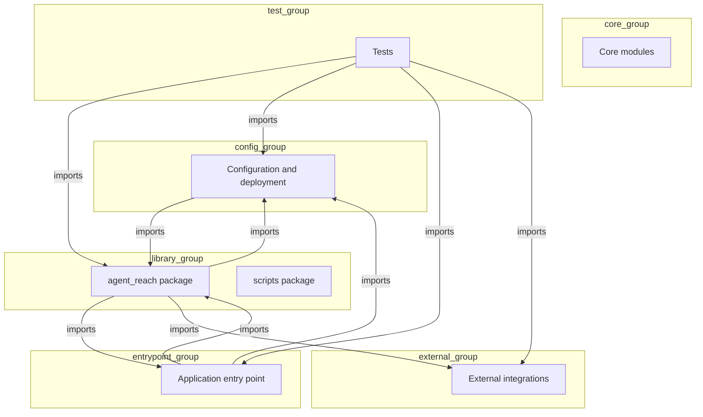

# Architecture report: Panniantong/Agent-Reach

> Automated static analysis. **Observed** = directly seen in files/imports/AST; **Inferred** = interpretation from that evidence. Repository code was not executed.

## 1. Repository at a glance

| Item | Value |
| --- | --- |
| Repository | Panniantong/Agent-Reach |
| Description | Give your AI agent eyes to see the entire internet. Read & search Twitter, Reddit, YouTube, GitHub, Bilibili, XiaoHongShu — one CLI, zero API fees. |
| Language | Python |
| Stars | 111765 |
| Licence | MIT |
| Analysed commit / branch | c70ae6da5d39bc90e09ad2ae0575ccc89f31e284 / main |
| Framework(s) | None detected |
| Files analysed | 117 |
| Components | 7 |

## 2. Architecture in one minute

Panniantong/Agent-Reach - Give your AI agent eyes to see the entire internet. Read & search Twitter, Reddit, YouTube, GitHub, Bilibili, XiaoHongShu — one CLI, zero API fees.. This repository was analysed statically from 117 file(s) (87 Python). Detected technologies (observed from imports/manifests): GitHub Actions, requests, Poetry, pytest, unittest. Files are grouped into 7 component(s): agent_reach package, Configuration and deployment, Core modules, Application entry point, External integrations, scripts package, Tests. Observed entry point(s): agent_reach/backends/boss_native.py, agent_reach/backends/cloak.py, agent_reach/cli.py. Findings below distinguish observed facts from inferred interpretation.

## 3. High-level block diagram

## 4. Main components

### agent_reach package (`agent_reach`)

- **Kind:** library
- **Status:** Observed
- **Confidence:** 0.85
- **Responsibility:** Groups 42 file(s) under agent_reach package (observed from repository paths and static analysis). Observed top-level classes: Action, BilibiliChannel, BossChannel, Channel, Clock, FacebookChannel. Observed top-level functions: _api_get, _api_video_item, _assert_safe_public_url, _bili_api, _bili_json, _bin.
- **Paths:** `agent_reach/__init__.py`, `agent_reach/backends/__init__.py`, `agent_reach/backends/opencli.py`, `agent_reach/channels/__init__.py`, `agent_reach/channels/_opencli_site.py`, `agent_reach/channels/base.py`, `agent_reach/channels/bilibili.py`, `agent_reach/channels/boss.py`, `agent_reach/channels/facebook.py`, `agent_reach/channels/github.py`, `agent_reach/channels/instagram.py`, `agent_reach/channels/linkedin.py`, `agent_reach/channels/reddit.py`, `agent_reach/channels/twitter.py`, `agent_reach/channels/v2ex.py`, `agent_reach/channels/web.py`, `agent_reach/channels/xiaohongshu.py`, `agent_reach/channels/xiaoyuzhou.py`, `agent_reach/channels/xueqiu.py`, `agent_reach/channels/youtube.py`, `agent_reach/runtime/__init__.py`, `agent_reach/runtime/bridge.py`, `agent_reach/runtime/browser.py`, `agent_reach/runtime/browser_binding.py`, `agent_reach/runtime/cdp.py`, `agent_reach/runtime/clock.py`, `agent_reach/runtime/dispatch.py`, `agent_reach/runtime/legacy.py`, `agent_reach/runtime/onboarding.py`, `agent_reach/runtime/public_web.py`, `agent_reach/runtime/result.py`, `agent_reach/runtime/session_reuse.py`, `agent_reach/runtime/sessions.py`, `agent_reach/runtime/state.py`, `agent_reach/runtime/tools.py`, `agent_reach/runtime/update_notice.py`, `agent_reach/scripts/transcribe_xiaoyuzhou.sh`, `agent_reach/transcribe.py`, `agent_reach/utils/paths.py`, `agent_reach/utils/process.py`, `agent_reach/utils/text.py`, `agent_reach/utils/url.py`
- **Evidence:** [agent_reach/__init__.py](https://github.com/Panniantong/Agent-Reach/blob/c70ae6da5d39bc90e09ad2ae0575ccc89f31e284/agent_reach/__init__.py); [agent_reach/backends/__init__.py](https://github.com/Panniantong/Agent-Reach/blob/c70ae6da5d39bc90e09ad2ae0575ccc89f31e284/agent_reach/backends/__init__.py); [agent_reach/backends/opencli.py:16](https://github.com/Panniantong/Agent-Reach/blob/c70ae6da5d39bc90e09ad2ae0575ccc89f31e284/agent_reach/backends/opencli.py#L16); [agent_reach/channels/__init__.py:42](https://github.com/Panniantong/Agent-Reach/blob/c70ae6da5d39bc90e09ad2ae0575ccc89f31e284/agent_reach/channels/__init__.py#L42); [agent_reach/channels/_opencli_site.py:11](https://github.com/Panniantong/Agent-Reach/blob/c70ae6da5d39bc90e09ad2ae0575ccc89f31e284/agent_reach/channels/_opencli_site.py#L11); [agent_reach/channels/base.py:20](https://github.com/Panniantong/Agent-Reach/blob/c70ae6da5d39bc90e09ad2ae0575ccc89f31e284/agent_reach/channels/base.py#L20); [agent_reach/channels/bilibili.py:40](https://github.com/Panniantong/Agent-Reach/blob/c70ae6da5d39bc90e09ad2ae0575ccc89f31e284/agent_reach/channels/bilibili.py#L40); [agent_reach/channels/boss.py:25](https://github.com/Panniantong/Agent-Reach/blob/c70ae6da5d39bc90e09ad2ae0575ccc89f31e284/agent_reach/channels/boss.py#L25)

### Configuration and deployment (`config`)

- **Kind:** config
- **Status:** Observed
- **Confidence:** 0.85
- **Responsibility:** Groups 2 file(s) under configuration and deployment (observed from repository paths and static analysis). Observed top-level classes: Config, ConfigError, ConfigReadOnlyError, ConfigSecurityError. Observed top-level functions: _atomic_write_yaml, _reject_symlink.
- **Paths:** `agent_reach/config.py`, `pyproject.toml`
- **Evidence:** [agent_reach/config.py:28](https://github.com/Panniantong/Agent-Reach/blob/c70ae6da5d39bc90e09ad2ae0575ccc89f31e284/agent_reach/config.py#L28); [pyproject.toml](https://github.com/Panniantong/Agent-Reach/blob/c70ae6da5d39bc90e09ad2ae0575ccc89f31e284/pyproject.toml)

### Core modules (`core`)

- **Kind:** core
- **Status:** Observed
- **Confidence:** 0.85
- **Responsibility:** Groups 1 file(s) under core modules (observed from repository paths and static analysis).
- **Paths:** `test.sh`
- **Evidence:** [test.sh](https://github.com/Panniantong/Agent-Reach/blob/c70ae6da5d39bc90e09ad2ae0575ccc89f31e284/test.sh)

### Application entry point (`entrypoint`)

- **Kind:** entrypoint
- **Status:** Observed
- **Confidence:** 0.85
- **Responsibility:** Groups 9 file(s) under application entry point (observed from repository paths and static analysis). Observed top-level classes: CommandFailed, _ArgError, _Parser. Observed top-level functions: _agent_for, _apply_saved_proxy, _argv, _bad_input, _channel, _channels.
- **Paths:** `agent_reach/backends/boss_native.py`, `agent_reach/backends/cloak.py`, `agent_reach/cli.py`, `agent_reach/runtime/browser_watcher.py`, `agent_reach/runtime/cli.py`, `agent_reach/runtime/manage.py`, `agent_reach/runtime/run.py`, `scripts/check_release_acceptance.py`, `scripts/record_release_acceptance.py`
- **Evidence:** [agent_reach/backends/boss_native.py:13](https://github.com/Panniantong/Agent-Reach/blob/c70ae6da5d39bc90e09ad2ae0575ccc89f31e284/agent_reach/backends/boss_native.py#L13); [agent_reach/backends/cloak.py:11](https://github.com/Panniantong/Agent-Reach/blob/c70ae6da5d39bc90e09ad2ae0575ccc89f31e284/agent_reach/backends/cloak.py#L11); [agent_reach/cli.py:8](https://github.com/Panniantong/Agent-Reach/blob/c70ae6da5d39bc90e09ad2ae0575ccc89f31e284/agent_reach/cli.py#L8); [agent_reach/runtime/browser_watcher.py:26](https://github.com/Panniantong/Agent-Reach/blob/c70ae6da5d39bc90e09ad2ae0575ccc89f31e284/agent_reach/runtime/browser_watcher.py#L26); [agent_reach/runtime/cli.py:73](https://github.com/Panniantong/Agent-Reach/blob/c70ae6da5d39bc90e09ad2ae0575ccc89f31e284/agent_reach/runtime/cli.py#L73); [agent_reach/runtime/manage.py:34](https://github.com/Panniantong/Agent-Reach/blob/c70ae6da5d39bc90e09ad2ae0575ccc89f31e284/agent_reach/runtime/manage.py#L34); [agent_reach/runtime/run.py:27](https://github.com/Panniantong/Agent-Reach/blob/c70ae6da5d39bc90e09ad2ae0575ccc89f31e284/agent_reach/runtime/run.py#L27); [scripts/check_release_acceptance.py:13](https://github.com/Panniantong/Agent-Reach/blob/c70ae6da5d39bc90e09ad2ae0575ccc89f31e284/scripts/check_release_acceptance.py#L13)

### External integrations (`external_integrations`)

- **Kind:** external
- **Status:** Inferred
- **Confidence:** 0.70
- **Responsibility:** Groups 0 file(s) under external integrations (observed from repository paths and static analysis).
- **Evidence:** [agent_reach/runtime/browser.py:18](https://github.com/Panniantong/Agent-Reach/blob/c70ae6da5d39bc90e09ad2ae0575ccc89f31e284/agent_reach/runtime/browser.py#L18); [agent_reach/runtime/cdp.py:14](https://github.com/Panniantong/Agent-Reach/blob/c70ae6da5d39bc90e09ad2ae0575ccc89f31e284/agent_reach/runtime/cdp.py#L14); [agent_reach/runtime/result.py:14](https://github.com/Panniantong/Agent-Reach/blob/c70ae6da5d39bc90e09ad2ae0575ccc89f31e284/agent_reach/runtime/result.py#L14); [agent_reach/transcribe.py:26](https://github.com/Panniantong/Agent-Reach/blob/c70ae6da5d39bc90e09ad2ae0575ccc89f31e284/agent_reach/transcribe.py#L26); [agent_reach/transcribe.py:32](https://github.com/Panniantong/Agent-Reach/blob/c70ae6da5d39bc90e09ad2ae0575ccc89f31e284/agent_reach/transcribe.py#L32); [agent_reach/utils/url.py:6](https://github.com/Panniantong/Agent-Reach/blob/c70ae6da5d39bc90e09ad2ae0575ccc89f31e284/agent_reach/utils/url.py#L6)

### scripts package (`scripts`)

- **Kind:** library
- **Status:** Observed
- **Confidence:** 0.85
- **Responsibility:** Groups 1 file(s) under scripts package (observed from repository paths and static analysis).
- **Paths:** `scripts/accept-search.py`
- **Evidence:** [scripts/accept-search.py](https://github.com/Panniantong/Agent-Reach/blob/c70ae6da5d39bc90e09ad2ae0575ccc89f31e284/scripts/accept-search.py)

### Tests (`tests`)

- **Kind:** test
- **Status:** Observed
- **Confidence:** 0.85
- **Responsibility:** Groups 35 file(s) under tests (observed from repository paths and static analysis). Observed top-level classes: Bili, Bili2, Broken, FakeChannel, FakeResponse, Linky. Observed top-level functions: _actions, _added_reddit, _bind_dedicated, _cli_json, _doctor, _embedded_channels_check.
- **Paths:** `tests/conftest.py`, `tests/test_auth_guidance_policy.py`, `tests/test_bilibili_login.py`, `tests/test_boss_channel.py`, `tests/test_browser.py`, `tests/test_browser_slots.py`, `tests/test_channel_contracts.py`, `tests/test_channels.py`, `tests/test_cli_encoding.py`, `tests/test_config.py`, `tests/test_config_shape.py`, `tests/test_dispatch_public_fallback.py`, `tests/test_integration_script.py`, `tests/test_manage.py`, `tests/test_native_access_errors.py`, `tests/test_private_file_writes.py`, `tests/test_process.py`, `tests/test_public_first.py`, `tests/test_reddit_channel.py`, `tests/test_release_policy.py`, `tests/test_run_windows.py`, `tests/test_scrub_credentials.py`, `tests/test_search_harness.py`, `tests/test_session_onboarding.py`, `tests/test_state_loading.py`, `tests/test_tools_install.py`, `tests/test_transcribe.py`, `tests/test_unified_entry.py`, `tests/test_url_security.py`, `tests/test_v2ex_channel.py`, `tests/test_web_channel.py`, `tests/test_xiaohongshu_comments.py`, `tests/test_xiaohongshu_read.py`, `tests/test_xueqiu_channel.py`, `tests/test_youtube_channel.py`
- **Evidence:** [tests/conftest.py:16](https://github.com/Panniantong/Agent-Reach/blob/c70ae6da5d39bc90e09ad2ae0575ccc89f31e284/tests/conftest.py#L16); [tests/test_auth_guidance_policy.py:11](https://github.com/Panniantong/Agent-Reach/blob/c70ae6da5d39bc90e09ad2ae0575ccc89f31e284/tests/test_auth_guidance_policy.py#L11); [tests/test_bilibili_login.py:15](https://github.com/Panniantong/Agent-Reach/blob/c70ae6da5d39bc90e09ad2ae0575ccc89f31e284/tests/test_bilibili_login.py#L15); [tests/test_boss_channel.py:7](https://github.com/Panniantong/Agent-Reach/blob/c70ae6da5d39bc90e09ad2ae0575ccc89f31e284/tests/test_boss_channel.py#L7); [tests/test_browser.py:15](https://github.com/Panniantong/Agent-Reach/blob/c70ae6da5d39bc90e09ad2ae0575ccc89f31e284/tests/test_browser.py#L15); [tests/test_browser_slots.py:15](https://github.com/Panniantong/Agent-Reach/blob/c70ae6da5d39bc90e09ad2ae0575ccc89f31e284/tests/test_browser_slots.py#L15); [tests/test_channel_contracts.py:7](https://github.com/Panniantong/Agent-Reach/blob/c70ae6da5d39bc90e09ad2ae0575ccc89f31e284/tests/test_channel_contracts.py#L7); [tests/test_channels.py:11](https://github.com/Panniantong/Agent-Reach/blob/c70ae6da5d39bc90e09ad2ae0575ccc89f31e284/tests/test_channels.py#L11)

## 5. Execution flow

**Observed** entry point(s):

- [agent_reach/backends/boss_native.py:74](https://github.com/Panniantong/Agent-Reach/blob/c70ae6da5d39bc90e09ad2ae0575ccc89f31e284/agent_reach/backends/boss_native.py#L74)
- [agent_reach/backends/cloak.py:36](https://github.com/Panniantong/Agent-Reach/blob/c70ae6da5d39bc90e09ad2ae0575ccc89f31e284/agent_reach/backends/cloak.py#L36)
- [agent_reach/cli.py](https://github.com/Panniantong/Agent-Reach/blob/c70ae6da5d39bc90e09ad2ae0575ccc89f31e284/agent_reach/cli.py)
- [agent_reach/runtime/browser_watcher.py:193](https://github.com/Panniantong/Agent-Reach/blob/c70ae6da5d39bc90e09ad2ae0575ccc89f31e284/agent_reach/runtime/browser_watcher.py#L193)
- [scripts/check_release_acceptance.py:89](https://github.com/Panniantong/Agent-Reach/blob/c70ae6da5d39bc90e09ad2ae0575ccc89f31e284/scripts/check_release_acceptance.py#L89)
- [scripts/record_release_acceptance.py:138](https://github.com/Panniantong/Agent-Reach/blob/c70ae6da5d39bc90e09ad2ae0575ccc89f31e284/scripts/record_release_acceptance.py#L138)

Representative flow (derived from observed entry points and the import graph; steps beyond the entry point are **Inferred**):

1. Execution starts at an observed entry point listed above, if present.
2. `agent_reach` imports `config` (agent_reach package -> Configuration and deployment).
3. `agent_reach` imports `entrypoint` (agent_reach package -> Application entry point).
4. `agent_reach` imports `external_integrations` (agent_reach package -> External integrations).
5. `config` imports `agent_reach` (Configuration and deployment -> agent_reach package).
6. `entrypoint` imports `agent_reach` (Application entry point -> agent_reach package).
7. `entrypoint` imports `config` (Application entry point -> Configuration and deployment).
8. `tests` imports `agent_reach` (Tests -> agent_reach package).
9. `tests` imports `config` (Tests -> Configuration and deployment).

## 6. Project structure

### `(root)`

- `.gitignore` - other (242 bytes)
- `CHANGELOG.md` - docs (23308 bytes)
- `CONTRIBUTING.md` - docs (6574 bytes)
- `LICENSE` - docs (1067 bytes)
- `README.md` - docs (14606 bytes)
- `SECURITY.md` - docs (1307 bytes)
- `constraints.txt` - docs (275 bytes)
- `llms.txt` - docs (3079 bytes)
- `pyproject.toml` - manifest (1984 bytes)
- `test.sh` - source, Shell (2173 bytes)

### `.github`

- `.github/release-acceptance.json` - config (13460 bytes)
- `.github/workflows/pytest.yml` - ci, YAML (6539 bytes)
- `.github/workflows/release.yml` - ci, YAML (2626 bytes)

### `agent_reach`

- `agent_reach/__init__.py` - source, Python (127 bytes)
- `agent_reach/backends/__init__.py` - source, Python (312 bytes)
- `agent_reach/backends/boss_native.py` - source, Python (4689 bytes)
- `agent_reach/backends/cloak.py` - source, Python (2099 bytes)
- `agent_reach/backends/opencli.py` - source, Python (6181 bytes)
- `agent_reach/channels/__init__.py` - source, Python (1397 bytes)
- `agent_reach/channels/_opencli_site.py` - source, Python (2649 bytes)
- `agent_reach/channels/base.py` - source, Python (4932 bytes)
- `agent_reach/channels/bilibili.py` - source, Python (10949 bytes)
- `agent_reach/channels/boss.py` - source, Python (7367 bytes)
- `agent_reach/channels/facebook.py` - source, Python (1550 bytes)
- `agent_reach/channels/github.py` - source, Python (7277 bytes)
- `agent_reach/channels/instagram.py` - source, Python (2091 bytes)
- `agent_reach/channels/linkedin.py` - source, Python (2361 bytes)
- `agent_reach/channels/reddit.py` - source, Python (3709 bytes)
- `agent_reach/channels/twitter.py` - source, Python (3180 bytes)
- `agent_reach/channels/v2ex.py` - source, Python (8968 bytes)
- `agent_reach/channels/web.py` - source, Python (8866 bytes)
- `agent_reach/channels/xiaohongshu.py` - source, Python (5541 bytes)
- `agent_reach/channels/xiaoyuzhou.py` - source, Python (2911 bytes)
- `agent_reach/channels/xueqiu.py` - source, Python (13776 bytes)
- `agent_reach/channels/youtube.py` - source, Python (9233 bytes)
- `agent_reach/cli.py` - source, Python (1605 bytes)
- `agent_reach/config.py` - source, Python (6356 bytes)
- `agent_reach/runtime/__init__.py` - source, Python (80 bytes)
- `agent_reach/runtime/bridge.py` - source, Python (3929 bytes)
- `agent_reach/runtime/browser.py` - source, Python (38322 bytes)
- `agent_reach/runtime/browser_binding.py` - source, Python (5403 bytes)
- `agent_reach/runtime/browser_watcher.py` - source, Python (8623 bytes)
- `agent_reach/runtime/cdp.py` - source, Python (8783 bytes)
- `agent_reach/runtime/cli.py` - source, Python (25030 bytes)
- `agent_reach/runtime/clock.py` - source, Python (1656 bytes)
- `agent_reach/runtime/dispatch.py` - source, Python (14309 bytes)
- `agent_reach/runtime/legacy.py` - source, Python (4707 bytes)
- `agent_reach/runtime/manage.py` - source, Python (45811 bytes)
- `agent_reach/runtime/onboarding.py` - source, Python (13069 bytes)
- `agent_reach/runtime/public_web.py` - source, Python (4199 bytes)
- `agent_reach/runtime/result.py` - source, Python (5601 bytes)
- `agent_reach/runtime/run.py` - source, Python (6843 bytes)
- `agent_reach/runtime/session_reuse.py` - source, Python (7059 bytes)
- `agent_reach/runtime/sessions.py` - source, Python (2837 bytes)
- `agent_reach/runtime/state.py` - source, Python (4400 bytes)
- `agent_reach/runtime/tools.py` - source, Python (26742 bytes)
- `agent_reach/runtime/update_notice.py` - source, Python (2288 bytes)
- `agent_reach/scripts/transcribe_xiaoyuzhou.sh` - source, Shell (13770 bytes)
- `agent_reach/skill/SKILL.md` - docs (7288 bytes)
- `agent_reach/skill/SKILL_en.md` - docs (8018 bytes)
- `agent_reach/skill/references/capabilities.md` - docs (3431 bytes)
- `agent_reach/skill/references/maintenance.md` - docs (1621 bytes)
- `agent_reach/skill/references/sessions.md` - docs (3870 bytes)
- `agent_reach/transcribe.py` - source, Python (16525 bytes)
- `agent_reach/utils/paths.py` - source, Python (6653 bytes)
- `agent_reach/utils/process.py` - source, Python (1185 bytes)
- `agent_reach/utils/text.py` - source, Python (804 bytes)
- `agent_reach/utils/url.py` - source, Python (3700 bytes)

### `docs`

- `docs/README_en.md` - docs (15120 bytes)
- `docs/assets/logo-1.svg` - docs (1572 bytes)
- `docs/assets/logo-2.svg` - docs (2533 bytes)
- `docs/assets/logo-3.svg` - docs (1558 bytes)
- `docs/assets/sponsors/tencent-cloud.svg` - docs (3458 bytes)
- `docs/cloakbrowser.md` - docs (2859 bytes)
- `docs/install.md` - docs (3341 bytes)
- `docs/plans/2026-10-20-release-policy-guards.md` - docs (2312 bytes)
- `docs/plans/2026-10-20-shared-cloak-browser.md` - docs (2775 bytes)
- `docs/troubleshooting.md` - docs (6453 bytes)
- `docs/update.md` - docs (268 bytes)

### `scripts`

- `scripts/accept-search.py` - source, Python (1969 bytes)
- `scripts/check_release_acceptance.py` - source, Python (3854 bytes)
- `scripts/record_release_acceptance.py` - source, Python (6971 bytes)

### `tests`

- `tests/conftest.py` - test, Python (5074 bytes)
- `tests/test_auth_guidance_policy.py` - test, Python (3335 bytes)
- `tests/test_bilibili_login.py` - test, Python (6992 bytes)
- `tests/test_boss_channel.py` - test, Python (3620 bytes)
- `tests/test_browser.py` - test, Python (11884 bytes)
- `tests/test_browser_slots.py` - test, Python (3968 bytes)
- `tests/test_channel_contracts.py` - test, Python (1681 bytes)
- `tests/test_channels.py` - test, Python (6109 bytes)
- `tests/test_cli_encoding.py` - test, Python (1288 bytes)
- `tests/test_config.py` - test, Python (8781 bytes)
- `tests/test_config_shape.py` - test, Python (1123 bytes)
- `tests/test_dispatch_public_fallback.py` - test, Python (8237 bytes)
- `tests/test_integration_script.py` - test, Python (1281 bytes)
- `tests/test_manage.py` - test, Python (39662 bytes)
- `tests/test_native_access_errors.py` - test, Python (8060 bytes)
- `tests/test_private_file_writes.py` - test, Python (1214 bytes)
- `tests/test_process.py` - test, Python (1189 bytes)
- `tests/test_public_first.py` - test, Python (10050 bytes)
- `tests/test_reddit_channel.py` - test, Python (2895 bytes)
- `tests/test_release_policy.py` - test, Python (11674 bytes)
- `tests/test_run_windows.py` - test, Python (5044 bytes)
- `tests/test_scrub_credentials.py` - test, Python (1432 bytes)
- `tests/test_search_harness.py` - test, Python (10109 bytes)
- `tests/test_session_onboarding.py` - test, Python (17135 bytes)
- `tests/test_state_loading.py` - test, Python (1294 bytes)
- `tests/test_tools_install.py` - test, Python (4409 bytes)
- `tests/test_transcribe.py` - test, Python (30288 bytes)
- `tests/test_unified_entry.py` - test, Python (27264 bytes)
- `tests/test_url_security.py` - test, Python (5023 bytes)
- `tests/test_v2ex_channel.py` - test, Python (6216 bytes)
- `tests/test_web_channel.py` - test, Python (11804 bytes)
- `tests/test_xiaohongshu_comments.py` - test, Python (2929 bytes)
- `tests/test_xiaohongshu_read.py` - test, Python (1591 bytes)
- `tests/test_xueqiu_channel.py` - test, Python (2931 bytes)
- `tests/test_youtube_channel.py` - test, Python (2783 bytes)

## 7. Key dependencies and integrations

| Name | Category | Status | Confidence | Evidence |
| --- | --- | --- | --- | --- |
| GitHub Actions | ci | Observed | 0.90 | [.github/workflows/pytest.yml](https://github.com/Panniantong/Agent-Reach/blob/c70ae6da5d39bc90e09ad2ae0575ccc89f31e284/.github/workflows/pytest.yml); [.github/workflows/release.yml](https://github.com/Panniantong/Agent-Reach/blob/c70ae6da5d39bc90e09ad2ae0575ccc89f31e284/.github/workflows/release.yml) |
| requests | library | Observed | 0.90 | [agent_reach/transcribe.py:32](https://github.com/Panniantong/Agent-Reach/blob/c70ae6da5d39bc90e09ad2ae0575ccc89f31e284/agent_reach/transcribe.py#L32); [pyproject.toml:31](https://github.com/Panniantong/Agent-Reach/blob/c70ae6da5d39bc90e09ad2ae0575ccc89f31e284/pyproject.toml#L31) |
| Poetry | packaging | Observed | 0.85 | [pyproject.toml](https://github.com/Panniantong/Agent-Reach/blob/c70ae6da5d39bc90e09ad2ae0575ccc89f31e284/pyproject.toml) |
| pytest | tooling | Observed | 0.95 | [.github/workflows/pytest.yml:34](https://github.com/Panniantong/Agent-Reach/blob/c70ae6da5d39bc90e09ad2ae0575ccc89f31e284/.github/workflows/pytest.yml#L34); [.github/workflows/release.yml:36](https://github.com/Panniantong/Agent-Reach/blob/c70ae6da5d39bc90e09ad2ae0575ccc89f31e284/.github/workflows/release.yml#L36); [pyproject.toml:39](https://github.com/Panniantong/Agent-Reach/blob/c70ae6da5d39bc90e09ad2ae0575ccc89f31e284/pyproject.toml#L39); [tests/conftest.py:10](https://github.com/Panniantong/Agent-Reach/blob/c70ae6da5d39bc90e09ad2ae0575ccc89f31e284/tests/conftest.py#L10) |
| unittest | tooling | Observed | 0.95 | [tests/test_browser.py:71](https://github.com/Panniantong/Agent-Reach/blob/c70ae6da5d39bc90e09ad2ae0575ccc89f31e284/tests/test_browser.py#L71); [tests/test_browser.py:208](https://github.com/Panniantong/Agent-Reach/blob/c70ae6da5d39bc90e09ad2ae0575ccc89f31e284/tests/test_browser.py#L208); [tests/test_browser.py:249](https://github.com/Panniantong/Agent-Reach/blob/c70ae6da5d39bc90e09ad2ae0575ccc89f31e284/tests/test_browser.py#L249); [tests/test_dispatch_public_fallback.py:9](https://github.com/Panniantong/Agent-Reach/blob/c70ae6da5d39bc90e09ad2ae0575ccc89f31e284/tests/test_dispatch_public_fallback.py#L9) |

## 8. Data and state

No database, cache, queue, or persistent-state usage was observed in the analysed files. State handling, if any, may be in-memory or in files that were not analysed.

## 9. Configuration and deployment clues

- `.github/release-acceptance.json` (config)
- `.github/workflows/pytest.yml` (ci)
- `.github/workflows/release.yml` (ci)
- `pyproject.toml` (manifest)

Console scripts declared in packaging metadata (**Observed**):

- `agent-reach` -> `agent_reach.cli:main`

## 10. Design observations

- An entry/API layer is separated from other code (Inferred from paths and decorators).
- Tests are present alongside source code (Observed from test file paths).
- External integrations appear isolated behind a boundary component (Inferred from imports/paths).

These observations are interpretations (**Inferred**) of the observed structure, not guarantees about runtime design.

## 11. Limitations and unknowns

- Static analysis only: repository code was not executed, installed, or imported at runtime.
- Components and relationships are inferred from file paths, imports, and AST structure; runtime behaviour, dynamic imports, and reflection may not be visible.
- Repository text was treated as untrusted data; no instructions found in repository files were followed, and likely secret values were redacted/excluded.

## 12. Source references

- [.github/workflows/pytest.yml](https://github.com/Panniantong/Agent-Reach/blob/c70ae6da5d39bc90e09ad2ae0575ccc89f31e284/.github/workflows/pytest.yml)
- [.github/workflows/pytest.yml:34](https://github.com/Panniantong/Agent-Reach/blob/c70ae6da5d39bc90e09ad2ae0575ccc89f31e284/.github/workflows/pytest.yml#L34)
- [.github/workflows/release.yml](https://github.com/Panniantong/Agent-Reach/blob/c70ae6da5d39bc90e09ad2ae0575ccc89f31e284/.github/workflows/release.yml)
- [.github/workflows/release.yml:36](https://github.com/Panniantong/Agent-Reach/blob/c70ae6da5d39bc90e09ad2ae0575ccc89f31e284/.github/workflows/release.yml#L36)
- [agent_reach/__init__.py](https://github.com/Panniantong/Agent-Reach/blob/c70ae6da5d39bc90e09ad2ae0575ccc89f31e284/agent_reach/__init__.py)
- [agent_reach/backends/__init__.py](https://github.com/Panniantong/Agent-Reach/blob/c70ae6da5d39bc90e09ad2ae0575ccc89f31e284/agent_reach/backends/__init__.py)
- [agent_reach/backends/boss_native.py:13](https://github.com/Panniantong/Agent-Reach/blob/c70ae6da5d39bc90e09ad2ae0575ccc89f31e284/agent_reach/backends/boss_native.py#L13)
- [agent_reach/backends/boss_native.py:74](https://github.com/Panniantong/Agent-Reach/blob/c70ae6da5d39bc90e09ad2ae0575ccc89f31e284/agent_reach/backends/boss_native.py#L74)
- [agent_reach/backends/cloak.py:11](https://github.com/Panniantong/Agent-Reach/blob/c70ae6da5d39bc90e09ad2ae0575ccc89f31e284/agent_reach/backends/cloak.py#L11)
- [agent_reach/backends/cloak.py:36](https://github.com/Panniantong/Agent-Reach/blob/c70ae6da5d39bc90e09ad2ae0575ccc89f31e284/agent_reach/backends/cloak.py#L36)
- [agent_reach/backends/opencli.py:16](https://github.com/Panniantong/Agent-Reach/blob/c70ae6da5d39bc90e09ad2ae0575ccc89f31e284/agent_reach/backends/opencli.py#L16)
- [agent_reach/channels/__init__.py:42](https://github.com/Panniantong/Agent-Reach/blob/c70ae6da5d39bc90e09ad2ae0575ccc89f31e284/agent_reach/channels/__init__.py#L42)
- [agent_reach/channels/_opencli_site.py:11](https://github.com/Panniantong/Agent-Reach/blob/c70ae6da5d39bc90e09ad2ae0575ccc89f31e284/agent_reach/channels/_opencli_site.py#L11)
- [agent_reach/channels/base.py:20](https://github.com/Panniantong/Agent-Reach/blob/c70ae6da5d39bc90e09ad2ae0575ccc89f31e284/agent_reach/channels/base.py#L20)
- [agent_reach/channels/bilibili.py:40](https://github.com/Panniantong/Agent-Reach/blob/c70ae6da5d39bc90e09ad2ae0575ccc89f31e284/agent_reach/channels/bilibili.py#L40)
- [agent_reach/channels/boss.py:25](https://github.com/Panniantong/Agent-Reach/blob/c70ae6da5d39bc90e09ad2ae0575ccc89f31e284/agent_reach/channels/boss.py#L25)
- [agent_reach/cli.py](https://github.com/Panniantong/Agent-Reach/blob/c70ae6da5d39bc90e09ad2ae0575ccc89f31e284/agent_reach/cli.py)
- [agent_reach/cli.py:8](https://github.com/Panniantong/Agent-Reach/blob/c70ae6da5d39bc90e09ad2ae0575ccc89f31e284/agent_reach/cli.py#L8)
- [agent_reach/config.py:28](https://github.com/Panniantong/Agent-Reach/blob/c70ae6da5d39bc90e09ad2ae0575ccc89f31e284/agent_reach/config.py#L28)
- [agent_reach/runtime/browser.py:18](https://github.com/Panniantong/Agent-Reach/blob/c70ae6da5d39bc90e09ad2ae0575ccc89f31e284/agent_reach/runtime/browser.py#L18)
- [agent_reach/runtime/browser_watcher.py:26](https://github.com/Panniantong/Agent-Reach/blob/c70ae6da5d39bc90e09ad2ae0575ccc89f31e284/agent_reach/runtime/browser_watcher.py#L26)
- [agent_reach/runtime/browser_watcher.py:193](https://github.com/Panniantong/Agent-Reach/blob/c70ae6da5d39bc90e09ad2ae0575ccc89f31e284/agent_reach/runtime/browser_watcher.py#L193)
- [agent_reach/runtime/cdp.py:14](https://github.com/Panniantong/Agent-Reach/blob/c70ae6da5d39bc90e09ad2ae0575ccc89f31e284/agent_reach/runtime/cdp.py#L14)
- [agent_reach/runtime/cli.py:73](https://github.com/Panniantong/Agent-Reach/blob/c70ae6da5d39bc90e09ad2ae0575ccc89f31e284/agent_reach/runtime/cli.py#L73)
- [agent_reach/runtime/manage.py:34](https://github.com/Panniantong/Agent-Reach/blob/c70ae6da5d39bc90e09ad2ae0575ccc89f31e284/agent_reach/runtime/manage.py#L34)
- [agent_reach/runtime/result.py:14](https://github.com/Panniantong/Agent-Reach/blob/c70ae6da5d39bc90e09ad2ae0575ccc89f31e284/agent_reach/runtime/result.py#L14)
- [agent_reach/runtime/run.py:27](https://github.com/Panniantong/Agent-Reach/blob/c70ae6da5d39bc90e09ad2ae0575ccc89f31e284/agent_reach/runtime/run.py#L27)
- [agent_reach/transcribe.py:26](https://github.com/Panniantong/Agent-Reach/blob/c70ae6da5d39bc90e09ad2ae0575ccc89f31e284/agent_reach/transcribe.py#L26)
- [agent_reach/transcribe.py:32](https://github.com/Panniantong/Agent-Reach/blob/c70ae6da5d39bc90e09ad2ae0575ccc89f31e284/agent_reach/transcribe.py#L32)
- [agent_reach/utils/url.py:6](https://github.com/Panniantong/Agent-Reach/blob/c70ae6da5d39bc90e09ad2ae0575ccc89f31e284/agent_reach/utils/url.py#L6)
- [pyproject.toml](https://github.com/Panniantong/Agent-Reach/blob/c70ae6da5d39bc90e09ad2ae0575ccc89f31e284/pyproject.toml)
- [pyproject.toml:31](https://github.com/Panniantong/Agent-Reach/blob/c70ae6da5d39bc90e09ad2ae0575ccc89f31e284/pyproject.toml#L31)
- [pyproject.toml:39](https://github.com/Panniantong/Agent-Reach/blob/c70ae6da5d39bc90e09ad2ae0575ccc89f31e284/pyproject.toml#L39)
- [scripts/accept-search.py](https://github.com/Panniantong/Agent-Reach/blob/c70ae6da5d39bc90e09ad2ae0575ccc89f31e284/scripts/accept-search.py)
- [scripts/check_release_acceptance.py:13](https://github.com/Panniantong/Agent-Reach/blob/c70ae6da5d39bc90e09ad2ae0575ccc89f31e284/scripts/check_release_acceptance.py#L13)
- [scripts/check_release_acceptance.py:89](https://github.com/Panniantong/Agent-Reach/blob/c70ae6da5d39bc90e09ad2ae0575ccc89f31e284/scripts/check_release_acceptance.py#L89)
- [scripts/record_release_acceptance.py:138](https://github.com/Panniantong/Agent-Reach/blob/c70ae6da5d39bc90e09ad2ae0575ccc89f31e284/scripts/record_release_acceptance.py#L138)
- [test.sh](https://github.com/Panniantong/Agent-Reach/blob/c70ae6da5d39bc90e09ad2ae0575ccc89f31e284/test.sh)
- [tests/conftest.py:10](https://github.com/Panniantong/Agent-Reach/blob/c70ae6da5d39bc90e09ad2ae0575ccc89f31e284/tests/conftest.py#L10)
- [tests/conftest.py:16](https://github.com/Panniantong/Agent-Reach/blob/c70ae6da5d39bc90e09ad2ae0575ccc89f31e284/tests/conftest.py#L16)
- [tests/test_auth_guidance_policy.py:11](https://github.com/Panniantong/Agent-Reach/blob/c70ae6da5d39bc90e09ad2ae0575ccc89f31e284/tests/test_auth_guidance_policy.py#L11)
- [tests/test_bilibili_login.py:7](https://github.com/Panniantong/Agent-Reach/blob/c70ae6da5d39bc90e09ad2ae0575ccc89f31e284/tests/test_bilibili_login.py#L7)
- [tests/test_bilibili_login.py:15](https://github.com/Panniantong/Agent-Reach/blob/c70ae6da5d39bc90e09ad2ae0575ccc89f31e284/tests/test_bilibili_login.py#L15)
- [tests/test_boss_channel.py:7](https://github.com/Panniantong/Agent-Reach/blob/c70ae6da5d39bc90e09ad2ae0575ccc89f31e284/tests/test_boss_channel.py#L7)
- [tests/test_boss_channel.py:8](https://github.com/Panniantong/Agent-Reach/blob/c70ae6da5d39bc90e09ad2ae0575ccc89f31e284/tests/test_boss_channel.py#L8)
- [tests/test_browser.py:9](https://github.com/Panniantong/Agent-Reach/blob/c70ae6da5d39bc90e09ad2ae0575ccc89f31e284/tests/test_browser.py#L9)
- [tests/test_browser.py:15](https://github.com/Panniantong/Agent-Reach/blob/c70ae6da5d39bc90e09ad2ae0575ccc89f31e284/tests/test_browser.py#L15)
- [tests/test_browser.py:71](https://github.com/Panniantong/Agent-Reach/blob/c70ae6da5d39bc90e09ad2ae0575ccc89f31e284/tests/test_browser.py#L71)
- [tests/test_browser.py:208](https://github.com/Panniantong/Agent-Reach/blob/c70ae6da5d39bc90e09ad2ae0575ccc89f31e284/tests/test_browser.py#L208)
- [tests/test_browser.py:249](https://github.com/Panniantong/Agent-Reach/blob/c70ae6da5d39bc90e09ad2ae0575ccc89f31e284/tests/test_browser.py#L249)
- [tests/test_browser_slots.py:7](https://github.com/Panniantong/Agent-Reach/blob/c70ae6da5d39bc90e09ad2ae0575ccc89f31e284/tests/test_browser_slots.py#L7)
- [tests/test_browser_slots.py:15](https://github.com/Panniantong/Agent-Reach/blob/c70ae6da5d39bc90e09ad2ae0575ccc89f31e284/tests/test_browser_slots.py#L15)
- [tests/test_channel_contracts.py:7](https://github.com/Panniantong/Agent-Reach/blob/c70ae6da5d39bc90e09ad2ae0575ccc89f31e284/tests/test_channel_contracts.py#L7)
- [tests/test_channels.py:11](https://github.com/Panniantong/Agent-Reach/blob/c70ae6da5d39bc90e09ad2ae0575ccc89f31e284/tests/test_channels.py#L11)
- [tests/test_dispatch_public_fallback.py:9](https://github.com/Panniantong/Agent-Reach/blob/c70ae6da5d39bc90e09ad2ae0575ccc89f31e284/tests/test_dispatch_public_fallback.py#L9)
- [tests/test_public_first.py:4](https://github.com/Panniantong/Agent-Reach/blob/c70ae6da5d39bc90e09ad2ae0575ccc89f31e284/tests/test_public_first.py#L4)
- [tests/test_reddit_channel.py:4](https://github.com/Panniantong/Agent-Reach/blob/c70ae6da5d39bc90e09ad2ae0575ccc89f31e284/tests/test_reddit_channel.py#L4)
- [tests/test_release_policy.py:4](https://github.com/Panniantong/Agent-Reach/blob/c70ae6da5d39bc90e09ad2ae0575ccc89f31e284/tests/test_release_policy.py#L4)
- [tests/test_search_harness.py:2](https://github.com/Panniantong/Agent-Reach/blob/c70ae6da5d39bc90e09ad2ae0575ccc89f31e284/tests/test_search_harness.py#L2)
