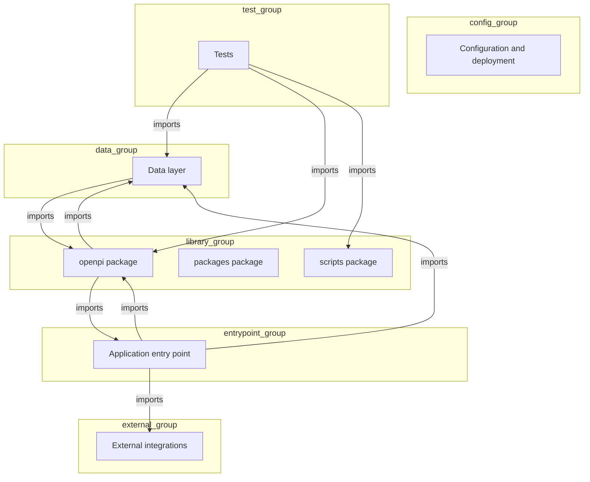

# Architecture report: Physical-Intelligence/openpi

> Automated static analysis. **Observed** = directly seen in files/imports/AST; **Inferred** = interpretation from that evidence. Repository code was not executed.

## 1. Repository at a glance

| Item | Value |
| --- | --- |
| Repository | Physical-Intelligence/openpi |
| Description | Not provided |
| Language | Python |
| Stars | 14648 |
| Licence | Apache-2.0 |
| Analysed commit / branch | 215abfb217dbac7d5f1273282331b9b1866c0479 / main |
| Framework(s) | None detected |
| Files analysed | 139 |
| Components | 8 |

## 2. Architecture in one minute

Physical-Intelligence/openpi. This repository was analysed statically from 139 file(s) (91 Python). Detected technologies (observed from imports/manifests): GitHub Actions, NumPy, pandas, Pydantic, requests, Poetry. Files are grouped into 8 component(s): Configuration and deployment, Data layer, Application entry point, External integrations, openpi package, packages package, scripts package, Tests. Observed entry point(s): scripts/compute_norm_stats.py, scripts/serve_policy.py, scripts/train.py. Findings below distinguish observed facts from inferred interpretation.

## 3. High-level block diagram

## 4. Main components

### Configuration and deployment (`config`)

- **Kind:** config
- **Status:** Observed
- **Confidence:** 0.85
- **Responsibility:** Groups 3 file(s) under configuration and deployment (observed from repository paths and static analysis).
- **Paths:** `packages/openpi-client/pyproject.toml`, `pyproject.toml`, `scripts/docker/compose.yml`
- **Evidence:** [packages/openpi-client/pyproject.toml](https://github.com/Physical-Intelligence/openpi/blob/215abfb217dbac7d5f1273282331b9b1866c0479/packages/openpi-client/pyproject.toml); [pyproject.toml](https://github.com/Physical-Intelligence/openpi/blob/215abfb217dbac7d5f1273282331b9b1866c0479/pyproject.toml); [scripts/docker/compose.yml](https://github.com/Physical-Intelligence/openpi/blob/215abfb217dbac7d5f1273282331b9b1866c0479/scripts/docker/compose.yml)

### Data layer (`data_layer`)

- **Kind:** data
- **Status:** Observed
- **Confidence:** 0.85
- **Responsibility:** Groups 17 file(s) under data layer (observed from repository paths and static analysis). Observed top-level classes: AddPositionEmbs, Attention, BaseModel, BaseModelConfig, BinningTokenizer, Block. Observed top-level functions: Module, _apply_rope, _gated_residual, _name, _trunc_normal_, apply_rotary_pos_emb.
- **Paths:** `src/openpi/models/__init__.py`, `src/openpi/models/gemma.py`, `src/openpi/models/gemma_fast.py`, `src/openpi/models/lora.py`, `src/openpi/models/model.py`, `src/openpi/models/pi0.py`, `src/openpi/models/pi0_config.py`, `src/openpi/models/pi0_fast.py`, `src/openpi/models/siglip.py`, `src/openpi/models/tokenizer.py`, `src/openpi/models/utils/fsq_tokenizer.py`, `src/openpi/models/vit.py`, `src/openpi/models_pytorch/transformers_replace/models/gemma/configuration_gemma.py`, `src/openpi/models_pytorch/transformers_replace/models/gemma/modeling_gemma.py`, `src/openpi/models_pytorch/transformers_replace/models/paligemma/modeling_paligemma.py`, `src/openpi/models_pytorch/transformers_replace/models/siglip/check.py`, `src/openpi/models_pytorch/transformers_replace/models/siglip/modeling_siglip.py`
- **Evidence:** [src/openpi/models/__init__.py](https://github.com/Physical-Intelligence/openpi/blob/215abfb217dbac7d5f1273282331b9b1866c0479/src/openpi/models/__init__.py); [src/openpi/models/gemma.py:45](https://github.com/Physical-Intelligence/openpi/blob/215abfb217dbac7d5f1273282331b9b1866c0479/src/openpi/models/gemma.py#L45); [src/openpi/models/gemma_fast.py:35](https://github.com/Physical-Intelligence/openpi/blob/215abfb217dbac7d5f1273282331b9b1866c0479/src/openpi/models/gemma_fast.py#L35); [src/openpi/models/lora.py:12](https://github.com/Physical-Intelligence/openpi/blob/215abfb217dbac7d5f1273282331b9b1866c0479/src/openpi/models/lora.py#L12); [src/openpi/models/model.py:30](https://github.com/Physical-Intelligence/openpi/blob/215abfb217dbac7d5f1273282331b9b1866c0479/src/openpi/models/model.py#L30); [src/openpi/models/pi0.py:19](https://github.com/Physical-Intelligence/openpi/blob/215abfb217dbac7d5f1273282331b9b1866c0479/src/openpi/models/pi0.py#L19); [src/openpi/models/pi0_config.py:19](https://github.com/Physical-Intelligence/openpi/blob/215abfb217dbac7d5f1273282331b9b1866c0479/src/openpi/models/pi0_config.py#L19); [src/openpi/models/pi0_fast.py:23](https://github.com/Physical-Intelligence/openpi/blob/215abfb217dbac7d5f1273282331b9b1866c0479/src/openpi/models/pi0_fast.py#L23)

### Application entry point (`entrypoint`)

- **Kind:** entrypoint
- **Status:** Observed
- **Confidence:** 0.85
- **Responsibility:** Groups 5 file(s) under application entry point (observed from repository paths and static analysis). Observed application object created via Group. Observed top-level classes: Args, AssetsConfig, Checkpoint, DataConfig, DataConfigFactory, Default. Observed top-level functions: _load_weights_and_validate, build_datasets, cleanup_ddp, cli, create_default_policy, create_policy.
- **Paths:** `scripts/compute_norm_stats.py`, `scripts/serve_policy.py`, `scripts/train.py`, `scripts/train_pytorch.py`, `src/openpi/training/config.py`
- **Evidence:** [scripts/compute_norm_stats.py:19](https://github.com/Physical-Intelligence/openpi/blob/215abfb217dbac7d5f1273282331b9b1866c0479/scripts/compute_norm_stats.py#L19); [scripts/serve_policy.py:14](https://github.com/Physical-Intelligence/openpi/blob/215abfb217dbac7d5f1273282331b9b1866c0479/scripts/serve_policy.py#L14); [scripts/train.py:31](https://github.com/Physical-Intelligence/openpi/blob/215abfb217dbac7d5f1273282331b9b1866c0479/scripts/train.py#L31); [scripts/train_pytorch.py:50](https://github.com/Physical-Intelligence/openpi/blob/215abfb217dbac7d5f1273282331b9b1866c0479/scripts/train_pytorch.py#L50); [src/openpi/training/config.py:259](https://github.com/Physical-Intelligence/openpi/blob/215abfb217dbac7d5f1273282331b9b1866c0479/src/openpi/training/config.py#L259)

### External integrations (`external_integrations`)

- **Kind:** external
- **Status:** Inferred
- **Confidence:** 0.70
- **Responsibility:** Groups 0 file(s) under external integrations (observed from repository paths and static analysis).
- **Evidence:** [scripts/serve_policy.py:4](https://github.com/Physical-Intelligence/openpi/blob/215abfb217dbac7d5f1273282331b9b1866c0479/scripts/serve_policy.py#L4)

### openpi package (`openpi`)

- **Kind:** library
- **Status:** Observed
- **Confidence:** 0.85
- **Responsibility:** Groups 26 file(s) under openpi package (observed from repository paths and static analysis). Observed top-level classes: AbsoluteActions, AdamW, AlohaInputs, AlohaOutputs, Callback, CallbackHandler. Observed top-level functions: _assert_quantile_stats, _check_dataclass_annotations, _collate_fn, _decode_aloha, _decode_state, _download_fsspec.
- **Paths:** `src/openpi/__init__.py`, `src/openpi/models_pytorch/gemma_pytorch.py`, `src/openpi/models_pytorch/pi0_pytorch.py`, `src/openpi/models_pytorch/preprocessing_pytorch.py`, `src/openpi/policies/aloha_policy.py`, `src/openpi/policies/droid_policy.py`, `src/openpi/policies/libero_policy.py`, `src/openpi/policies/policy.py`, `src/openpi/policies/policy_config.py`, `src/openpi/serving/websocket_policy_server.py`, `src/openpi/shared/__init__.py`, `src/openpi/shared/array_typing.py`, `src/openpi/shared/download.py`, `src/openpi/shared/image_tools.py`, `src/openpi/shared/nnx_utils.py`, `src/openpi/shared/normalize.py`, `src/openpi/training/checkpoints.py`, `src/openpi/training/data_loader.py`, `src/openpi/training/droid_rlds_dataset.py`, `src/openpi/training/misc/polaris_config.py`, `src/openpi/training/misc/roboarena_config.py`, `src/openpi/training/optimizer.py`, `src/openpi/training/sharding.py`, `src/openpi/training/utils.py`, `src/openpi/training/weight_loaders.py`, `src/openpi/transforms.py`
- **Evidence:** [src/openpi/__init__.py](https://github.com/Physical-Intelligence/openpi/blob/215abfb217dbac7d5f1273282331b9b1866c0479/src/openpi/__init__.py); [src/openpi/models_pytorch/gemma_pytorch.py:11](https://github.com/Physical-Intelligence/openpi/blob/215abfb217dbac7d5f1273282331b9b1866c0479/src/openpi/models_pytorch/gemma_pytorch.py#L11); [src/openpi/models_pytorch/pi0_pytorch.py:14](https://github.com/Physical-Intelligence/openpi/blob/215abfb217dbac7d5f1273282331b9b1866c0479/src/openpi/models_pytorch/pi0_pytorch.py#L14); [src/openpi/models_pytorch/preprocessing_pytorch.py:20](https://github.com/Physical-Intelligence/openpi/blob/215abfb217dbac7d5f1273282331b9b1866c0479/src/openpi/models_pytorch/preprocessing_pytorch.py#L20); [src/openpi/policies/aloha_policy.py:10](https://github.com/Physical-Intelligence/openpi/blob/215abfb217dbac7d5f1273282331b9b1866c0479/src/openpi/policies/aloha_policy.py#L10); [src/openpi/policies/droid_policy.py:10](https://github.com/Physical-Intelligence/openpi/blob/215abfb217dbac7d5f1273282331b9b1866c0479/src/openpi/policies/droid_policy.py#L10); [src/openpi/policies/libero_policy.py:10](https://github.com/Physical-Intelligence/openpi/blob/215abfb217dbac7d5f1273282331b9b1866c0479/src/openpi/policies/libero_policy.py#L10); [src/openpi/policies/policy.py:24](https://github.com/Physical-Intelligence/openpi/blob/215abfb217dbac7d5f1273282331b9b1866c0479/src/openpi/policies/policy.py#L24)

### packages package (`packages`)

- **Kind:** library
- **Status:** Observed
- **Confidence:** 0.85
- **Responsibility:** Groups 11 file(s) under packages package (observed from repository paths and static analysis). Observed top-level classes: ActionChunkBroker, Agent, BasePolicy, Environment, PolicyAgent, Runtime. Observed top-level functions: _resize_with_pad_pil, convert_to_uint8, pack_array, resize_with_pad, unpack_array.
- **Paths:** `packages/openpi-client/src/openpi_client/__init__.py`, `packages/openpi-client/src/openpi_client/action_chunk_broker.py`, `packages/openpi-client/src/openpi_client/base_policy.py`, `packages/openpi-client/src/openpi_client/image_tools.py`, `packages/openpi-client/src/openpi_client/msgpack_numpy.py`, `packages/openpi-client/src/openpi_client/runtime/agent.py`, `packages/openpi-client/src/openpi_client/runtime/agents/policy_agent.py`, `packages/openpi-client/src/openpi_client/runtime/environment.py`, `packages/openpi-client/src/openpi_client/runtime/runtime.py`, `packages/openpi-client/src/openpi_client/runtime/subscriber.py`, `packages/openpi-client/src/openpi_client/websocket_client_policy.py`
- **Evidence:** [packages/openpi-client/src/openpi_client/__init__.py](https://github.com/Physical-Intelligence/openpi/blob/215abfb217dbac7d5f1273282331b9b1866c0479/packages/openpi-client/src/openpi_client/__init__.py); [packages/openpi-client/src/openpi_client/action_chunk_broker.py:10](https://github.com/Physical-Intelligence/openpi/blob/215abfb217dbac7d5f1273282331b9b1866c0479/packages/openpi-client/src/openpi_client/action_chunk_broker.py#L10); [packages/openpi-client/src/openpi_client/base_policy.py:5](https://github.com/Physical-Intelligence/openpi/blob/215abfb217dbac7d5f1273282331b9b1866c0479/packages/openpi-client/src/openpi_client/base_policy.py#L5); [packages/openpi-client/src/openpi_client/image_tools.py:5](https://github.com/Physical-Intelligence/openpi/blob/215abfb217dbac7d5f1273282331b9b1866c0479/packages/openpi-client/src/openpi_client/image_tools.py#L5); [packages/openpi-client/src/openpi_client/msgpack_numpy.py:21](https://github.com/Physical-Intelligence/openpi/blob/215abfb217dbac7d5f1273282331b9b1866c0479/packages/openpi-client/src/openpi_client/msgpack_numpy.py#L21); [packages/openpi-client/src/openpi_client/runtime/agent.py:4](https://github.com/Physical-Intelligence/openpi/blob/215abfb217dbac7d5f1273282331b9b1866c0479/packages/openpi-client/src/openpi_client/runtime/agent.py#L4); [packages/openpi-client/src/openpi_client/runtime/agents/policy_agent.py:7](https://github.com/Physical-Intelligence/openpi/blob/215abfb217dbac7d5f1273282331b9b1866c0479/packages/openpi-client/src/openpi_client/runtime/agents/policy_agent.py#L7); [packages/openpi-client/src/openpi_client/runtime/environment.py:4](https://github.com/Physical-Intelligence/openpi/blob/215abfb217dbac7d5f1273282331b9b1866c0479/packages/openpi-client/src/openpi_client/runtime/environment.py#L4)

### scripts package (`scripts`)

- **Kind:** library
- **Status:** Observed
- **Confidence:** 0.85
- **Responsibility:** Groups 3 file(s) under scripts package (observed from repository paths and static analysis).
- **Paths:** `scripts/__init__.py`, `scripts/docker/install_docker_ubuntu22.sh`, `scripts/docker/install_nvidia_container_toolkit.sh`
- **Evidence:** [scripts/__init__.py](https://github.com/Physical-Intelligence/openpi/blob/215abfb217dbac7d5f1273282331b9b1866c0479/scripts/__init__.py); [scripts/docker/install_docker_ubuntu22.sh](https://github.com/Physical-Intelligence/openpi/blob/215abfb217dbac7d5f1273282331b9b1866c0479/scripts/docker/install_docker_ubuntu22.sh); [scripts/docker/install_nvidia_container_toolkit.sh](https://github.com/Physical-Intelligence/openpi/blob/215abfb217dbac7d5f1273282331b9b1866c0479/scripts/docker/install_nvidia_container_toolkit.sh)

### Tests (`tests`)

- **Kind:** test
- **Status:** Observed
- **Confidence:** 0.85
- **Responsibility:** Groups 14 file(s) under tests (observed from repository paths and static analysis). Observed top-level functions: _check, _get_frozen_state, pytest_configure, set_jax_cpu_backend_if_no_gpu, set_openpi_data_home, test_absolute_actions.
- **Paths:** `packages/openpi-client/src/openpi_client/image_tools_test.py`, `packages/openpi-client/src/openpi_client/msgpack_numpy_test.py`, `scripts/train_test.py`, `src/openpi/conftest.py`, `src/openpi/models/lora_test.py`, `src/openpi/models/model_test.py`, `src/openpi/models/pi0_test.py`, `src/openpi/models/tokenizer_test.py`, `src/openpi/policies/policy_test.py`, `src/openpi/shared/download_test.py`, `src/openpi/shared/image_tools_test.py`, `src/openpi/shared/normalize_test.py`, `src/openpi/training/data_loader_test.py`, `src/openpi/transforms_test.py`
- **Evidence:** [packages/openpi-client/src/openpi_client/image_tools_test.py:6](https://github.com/Physical-Intelligence/openpi/blob/215abfb217dbac7d5f1273282331b9b1866c0479/packages/openpi-client/src/openpi_client/image_tools_test.py#L6); [packages/openpi-client/src/openpi_client/msgpack_numpy_test.py:8](https://github.com/Physical-Intelligence/openpi/blob/215abfb217dbac7d5f1273282331b9b1866c0479/packages/openpi-client/src/openpi_client/msgpack_numpy_test.py#L8); [scripts/train_test.py:15](https://github.com/Physical-Intelligence/openpi/blob/215abfb217dbac7d5f1273282331b9b1866c0479/scripts/train_test.py#L15); [src/openpi/conftest.py:7](https://github.com/Physical-Intelligence/openpi/blob/215abfb217dbac7d5f1273282331b9b1866c0479/src/openpi/conftest.py#L7); [src/openpi/models/lora_test.py:8](https://github.com/Physical-Intelligence/openpi/blob/215abfb217dbac7d5f1273282331b9b1866c0479/src/openpi/models/lora_test.py#L8); [src/openpi/models/model_test.py:12](https://github.com/Physical-Intelligence/openpi/blob/215abfb217dbac7d5f1273282331b9b1866c0479/src/openpi/models/model_test.py#L12); [src/openpi/models/pi0_test.py:7](https://github.com/Physical-Intelligence/openpi/blob/215abfb217dbac7d5f1273282331b9b1866c0479/src/openpi/models/pi0_test.py#L7); [src/openpi/models/tokenizer_test.py:6](https://github.com/Physical-Intelligence/openpi/blob/215abfb217dbac7d5f1273282331b9b1866c0479/src/openpi/models/tokenizer_test.py#L6)

## 5. Execution flow

**Observed** entry point(s):

- [scripts/compute_norm_stats.py:116](https://github.com/Physical-Intelligence/openpi/blob/215abfb217dbac7d5f1273282331b9b1866c0479/scripts/compute_norm_stats.py#L116)
- [scripts/serve_policy.py:120](https://github.com/Physical-Intelligence/openpi/blob/215abfb217dbac7d5f1273282331b9b1866c0479/scripts/serve_policy.py#L120)
- [scripts/train.py:279](https://github.com/Physical-Intelligence/openpi/blob/215abfb217dbac7d5f1273282331b9b1866c0479/scripts/train.py#L279)
- [scripts/train_pytorch.py:631](https://github.com/Physical-Intelligence/openpi/blob/215abfb217dbac7d5f1273282331b9b1866c0479/scripts/train_pytorch.py#L631)
- [src/openpi/training/config.py:259](https://github.com/Physical-Intelligence/openpi/blob/215abfb217dbac7d5f1273282331b9b1866c0479/src/openpi/training/config.py#L259)

Representative flow (derived from observed entry points and the import graph; steps beyond the entry point are **Inferred**):

1. Execution starts at an observed entry point listed above, if present.
2. `data_layer` imports `openpi` (Data layer -> openpi package).
3. `entrypoint` imports `data_layer` (Application entry point -> Data layer).
4. `entrypoint` imports `external_integrations` (Application entry point -> External integrations).
5. `entrypoint` imports `openpi` (Application entry point -> openpi package).
6. `openpi` imports `data_layer` (openpi package -> Data layer).
7. `openpi` imports `entrypoint` (openpi package -> Application entry point).
8. `tests` imports `data_layer` (Tests -> Data layer).
9. `tests` imports `openpi` (Tests -> openpi package).

## 6. Project structure

### `(root)`

- `.dockerignore` - container (23 bytes)
- `.gitignore` - other (3194 bytes)
- `.gitmodules` - other (237 bytes)
- `.pre-commit-config.yaml` - config (336 bytes)
- `.python-version` - other (4 bytes)
- `CONTRIBUTING.md` - docs (3364 bytes)
- `LICENSE` - docs (11356 bytes)
- `LICENSE_GEMMA.txt` - docs (8431 bytes)
- `README.md` - docs (23254 bytes)
- `pyproject.toml` - manifest (3110 bytes)

### `.github`

- `.github/CODEOWNERS` - other (632 bytes)
- `.github/workflows/pre-commit.yml` - ci, YAML (308 bytes)
- `.github/workflows/test.yml` - ci, YAML (669 bytes)

### `.vscode`

- `.vscode/settings.json` - config (264 bytes)

### `docs`

- `docs/docker.md` - docs (1989 bytes)
- `docs/norm_stats.md` - docs (5245 bytes)
- `docs/remote_inference.md` - docs (3601 bytes)

### `examples`

- `examples/aloha_real/Dockerfile` - container (2650 bytes)
- `examples/aloha_real/README.md` - docs (6440 bytes)
- `examples/aloha_real/compose.yml` - container (1440 bytes)
- `examples/aloha_real/constants.py` - source, Python (3296 bytes)
- `examples/aloha_real/convert_aloha_data_to_lerobot.py` - source, Python (7515 bytes)
- `examples/aloha_real/env.py` - source, Python (1741 bytes)
- `examples/aloha_real/main.py` - source, Python (1408 bytes)
- `examples/aloha_real/real_env.py` - source, Python (8650 bytes)
- `examples/aloha_real/requirements.in` - other (183 bytes)
- `examples/aloha_real/requirements.txt` - manifest (3337 bytes)
- `examples/aloha_real/robot_utils.py` - source, Python (9867 bytes)
- `examples/aloha_real/video_display.py` - source, Python (958 bytes)
- `examples/aloha_sim/Dockerfile` - container (1488 bytes)
- `examples/aloha_sim/README.md` - docs (732 bytes)
- `examples/aloha_sim/compose.yml` - container (963 bytes)
- `examples/aloha_sim/env.py` - source, Python (1942 bytes)
- `examples/aloha_sim/main.py` - source, Python (1370 bytes)
- `examples/aloha_sim/requirements.in` - other (91 bytes)
- `examples/aloha_sim/requirements.txt` - manifest (2629 bytes)
- `examples/aloha_sim/saver.py` - source, Python (1270 bytes)
- `examples/convert_jax_model_to_pytorch.py` - source, Python (27520 bytes)
- `examples/droid/README.md` - docs (6870 bytes)
- `examples/droid/README_train.md` - docs (7547 bytes)
- `examples/droid/compute_droid_nonidle_ranges.py` - source, Python (4872 bytes)
- `examples/droid/convert_droid_data_to_lerobot.py` - source, Python (17080 bytes)
- `examples/droid/main.py` - source, Python (9825 bytes)
- `examples/inference.ipynb` - other (5419 bytes)
- `examples/libero/Dockerfile` - container (2615 bytes)
- `examples/libero/README.md` - docs (2551 bytes)
- `examples/libero/compose.yml` - container (1349 bytes)
- `examples/libero/convert_libero_data_to_lerobot.py` - source, Python (3766 bytes)
- `examples/libero/main.py` - source, Python (9194 bytes)
- `examples/libero/requirements.in` - other (177 bytes)
- `examples/libero/requirements.txt` - manifest (2842 bytes)
- `examples/policy_records.ipynb` - other (3395 bytes)
- `examples/simple_client/Dockerfile` - container (1256 bytes)
- `examples/simple_client/README.md` - docs (589 bytes)
- `examples/simple_client/compose.yml` - container (968 bytes)
- `examples/simple_client/main.py` - source, Python (6281 bytes)
- `examples/simple_client/requirements.in` - other (42 bytes)
- `examples/simple_client/requirements.txt` - manifest (810 bytes)
- `examples/ur5/README.md` - docs (5846 bytes)

### `packages`

- `packages/openpi-client/pyproject.toml` - manifest (388 bytes)
- `packages/openpi-client/src/openpi_client/__init__.py` - source, Python (22 bytes)
- `packages/openpi-client/src/openpi_client/action_chunk_broker.py` - source, Python (1404 bytes)
- `packages/openpi-client/src/openpi_client/base_policy.py` - source, Python (271 bytes)
- `packages/openpi-client/src/openpi_client/image_tools.py` - source, Python (2426 bytes)
- `packages/openpi-client/src/openpi_client/image_tools_test.py` - test, Python (1411 bytes)
- `packages/openpi-client/src/openpi_client/msgpack_numpy.py` - source, Python (1944 bytes)
- `packages/openpi-client/src/openpi_client/msgpack_numpy_test.py` - test, Python (1643 bytes)
- `packages/openpi-client/src/openpi_client/runtime/agent.py` - source, Python (465 bytes)
- `packages/openpi-client/src/openpi_client/runtime/agents/policy_agent.py` - source, Python (509 bytes)
- `packages/openpi-client/src/openpi_client/runtime/environment.py` - source, Python (1044 bytes)
- `packages/openpi-client/src/openpi_client/runtime/runtime.py` - source, Python (3049 bytes)
- `packages/openpi-client/src/openpi_client/runtime/subscriber.py` - source, Python (500 bytes)
- `packages/openpi-client/src/openpi_client/websocket_client_policy.py` - source, Python (2131 bytes)

### `scripts`

- `scripts/__init__.py` - source, Python (0 bytes)
- `scripts/compute_norm_stats.py` - source, Python (4042 bytes)
- `scripts/docker/compose.yml` - container (814 bytes)
- `scripts/docker/install_docker_ubuntu22.sh` - source, Shell (1529 bytes)
- `scripts/docker/install_nvidia_container_toolkit.sh` - source, Shell (986 bytes)
- `scripts/docker/serve_policy.Dockerfile` - other (1916 bytes)
- `scripts/serve_policy.py` - source, Python (3687 bytes)
- `scripts/train.py` - source, Python (10488 bytes)
- `scripts/train_pytorch.py` - source, Python (25938 bytes)
- `scripts/train_test.py` - test, Python (718 bytes)

### `src`

- `src/openpi/__init__.py` - source, Python (0 bytes)
- `src/openpi/conftest.py` - test, Python (339 bytes)
- `src/openpi/models/__init__.py` - source, Python (0 bytes)
- `src/openpi/models/gemma.py` - source, Python (17146 bytes)
- `src/openpi/models/gemma_fast.py` - source, Python (15643 bytes)
- `src/openpi/models/lora.py` - source, Python (5342 bytes)
- `src/openpi/models/lora_test.py` - test, Python (3138 bytes)
- `src/openpi/models/model.py` - source, Python (12270 bytes)
- `src/openpi/models/model_test.py` - test, Python (2966 bytes)
- `src/openpi/models/pi0.py` - source, Python (12887 bytes)
- `src/openpi/models/pi0_config.py` - source, Python (4435 bytes)
- `src/openpi/models/pi0_fast.py` - source, Python (13209 bytes)
- `src/openpi/models/pi0_test.py` - test, Python (1631 bytes)
- `src/openpi/models/siglip.py` - source, Python (12078 bytes)
- `src/openpi/models/tokenizer.py` - source, Python (17517 bytes)
- `src/openpi/models/tokenizer_test.py` - test, Python (807 bytes)
- `src/openpi/models/utils/fsq_tokenizer.py` - source, Python (15928 bytes)
- `src/openpi/models/vit.py` - source, Python (10266 bytes)
- `src/openpi/models_pytorch/gemma_pytorch.py` - source, Python (13480 bytes)
- `src/openpi/models_pytorch/pi0_pytorch.py` - source, Python (19128 bytes)
- `src/openpi/models_pytorch/preprocessing_pytorch.py` - source, Python (7264 bytes)
- `src/openpi/models_pytorch/transformers_replace/models/gemma/configuration_gemma.py` - source, Python (8958 bytes)
- `src/openpi/models_pytorch/transformers_replace/models/gemma/modeling_gemma.py` - source, Python (36392 bytes)
- `src/openpi/models_pytorch/transformers_replace/models/paligemma/modeling_paligemma.py` - source, Python (27688 bytes)
- `src/openpi/models_pytorch/transformers_replace/models/siglip/check.py` - source, Python (133 bytes)
- `src/openpi/models_pytorch/transformers_replace/models/siglip/modeling_siglip.py` - source, Python (50231 bytes)
- `src/openpi/policies/aloha_policy.py` - source, Python (7543 bytes)
- `src/openpi/policies/droid_policy.py` - source, Python (3188 bytes)
- `src/openpi/policies/libero_policy.py` - source, Python (4322 bytes)
- `src/openpi/policies/policy.py` - source, Python (5344 bytes)
- `src/openpi/policies/policy_config.py` - source, Python (4107 bytes)
- `src/openpi/policies/policy_test.py` - test, Python (1127 bytes)
- `src/openpi/py.typed` - other (0 bytes)
- `src/openpi/serving/websocket_policy_server.py` - source, Python (3051 bytes)
- `src/openpi/shared/__init__.py` - source, Python (0 bytes)
- `src/openpi/shared/array_typing.py` - source, Python (3402 bytes)
- `src/openpi/shared/download.py` - source, Python (8862 bytes)
- `src/openpi/shared/download_test.py` - test, Python (1490 bytes)
- `src/openpi/shared/image_tools.py` - source, Python (4665 bytes)
- `src/openpi/shared/image_tools_test.py` - test, Python (1418 bytes)
- `src/openpi/shared/nnx_utils.py` - source, Python (2844 bytes)
- `src/openpi/shared/normalize.py` - source, Python (5529 bytes)
- `src/openpi/shared/normalize_test.py` - test, Python (1521 bytes)
- `src/openpi/training/checkpoints.py` - source, Python (5763 bytes)
- `src/openpi/training/config.py` - source, Python (44594 bytes)
- `src/openpi/training/data_loader.py` - source, Python (19977 bytes)
- `src/openpi/training/data_loader_test.py` - test, Python (2487 bytes)
- `src/openpi/training/droid_rlds_dataset.py` - source, Python (10886 bytes)
- `src/openpi/training/misc/polaris_config.py` - source, Python (9624 bytes)
- `src/openpi/training/misc/roboarena_config.py` - source, Python (4804 bytes)
- `src/openpi/training/optimizer.py` - source, Python (3202 bytes)
- `src/openpi/training/sharding.py` - source, Python (4099 bytes)
- `src/openpi/training/utils.py` - source, Python (1217 bytes)
- `src/openpi/training/weight_loaders.py` - source, Python (3738 bytes)
- `src/openpi/transforms.py` - source, Python (15752 bytes)
- `src/openpi/transforms_test.py` - test, Python (4111 bytes)

## 7. Key dependencies and integrations

| Name | Category | Status | Confidence | Evidence |
| --- | --- | --- | --- | --- |
| GitHub Actions | ci | Observed | 0.90 | [.github/workflows/pre-commit.yml](https://github.com/Physical-Intelligence/openpi/blob/215abfb217dbac7d5f1273282331b9b1866c0479/.github/workflows/pre-commit.yml); [.github/workflows/test.yml](https://github.com/Physical-Intelligence/openpi/blob/215abfb217dbac7d5f1273282331b9b1866c0479/.github/workflows/test.yml) |
| NumPy | library | Observed | 0.95 | [examples/aloha_real/convert_aloha_data_to_lerobot.py:16](https://github.com/Physical-Intelligence/openpi/blob/215abfb217dbac7d5f1273282331b9b1866c0479/examples/aloha_real/convert_aloha_data_to_lerobot.py#L16); [examples/aloha_real/real_env.py:9](https://github.com/Physical-Intelligence/openpi/blob/215abfb217dbac7d5f1273282331b9b1866c0479/examples/aloha_real/real_env.py#L9); [examples/aloha_real/requirements.txt:67](https://github.com/Physical-Intelligence/openpi/blob/215abfb217dbac7d5f1273282331b9b1866c0479/examples/aloha_real/requirements.txt#L67); [examples/aloha_real/robot_utils.py:12](https://github.com/Physical-Intelligence/openpi/blob/215abfb217dbac7d5f1273282331b9b1866c0479/examples/aloha_real/robot_utils.py#L12) |
| pandas | library | Observed | 0.90 | [examples/droid/main.py:14](https://github.com/Physical-Intelligence/openpi/blob/215abfb217dbac7d5f1273282331b9b1866c0479/examples/droid/main.py#L14) |
| Pydantic | library | Observed | 0.90 | [src/openpi/shared/normalize.py:6](https://github.com/Physical-Intelligence/openpi/blob/215abfb217dbac7d5f1273282331b9b1866c0479/src/openpi/shared/normalize.py#L6) |
| requests | library | Observed | 0.90 | [examples/aloha_real/requirements.txt:12](https://github.com/Physical-Intelligence/openpi/blob/215abfb217dbac7d5f1273282331b9b1866c0479/examples/aloha_real/requirements.txt#L12); [examples/aloha_sim/requirements.txt:10](https://github.com/Physical-Intelligence/openpi/blob/215abfb217dbac7d5f1273282331b9b1866c0479/examples/aloha_sim/requirements.txt#L10); [examples/libero/requirements.txt:6](https://github.com/Physical-Intelligence/openpi/blob/215abfb217dbac7d5f1273282331b9b1866c0479/examples/libero/requirements.txt#L6) |
| Poetry | packaging | Observed | 0.90 | [packages/openpi-client/pyproject.toml](https://github.com/Physical-Intelligence/openpi/blob/215abfb217dbac7d5f1273282331b9b1866c0479/packages/openpi-client/pyproject.toml); [pyproject.toml](https://github.com/Physical-Intelligence/openpi/blob/215abfb217dbac7d5f1273282331b9b1866c0479/pyproject.toml) |
| setuptools | packaging | Observed | 0.90 | [examples/aloha_real/requirements.txt:130](https://github.com/Physical-Intelligence/openpi/blob/215abfb217dbac7d5f1273282331b9b1866c0479/examples/aloha_real/requirements.txt#L130); [examples/aloha_sim/requirements.txt:107](https://github.com/Physical-Intelligence/openpi/blob/215abfb217dbac7d5f1273282331b9b1866c0479/examples/aloha_sim/requirements.txt#L107); [examples/libero/requirements.txt:94](https://github.com/Physical-Intelligence/openpi/blob/215abfb217dbac7d5f1273282331b9b1866c0479/examples/libero/requirements.txt#L94) |
| Docker | tooling | Observed | 0.90 | [examples/aloha_real/Dockerfile](https://github.com/Physical-Intelligence/openpi/blob/215abfb217dbac7d5f1273282331b9b1866c0479/examples/aloha_real/Dockerfile); [examples/aloha_sim/Dockerfile](https://github.com/Physical-Intelligence/openpi/blob/215abfb217dbac7d5f1273282331b9b1866c0479/examples/aloha_sim/Dockerfile); [examples/libero/Dockerfile](https://github.com/Physical-Intelligence/openpi/blob/215abfb217dbac7d5f1273282331b9b1866c0479/examples/libero/Dockerfile); [examples/simple_client/Dockerfile](https://github.com/Physical-Intelligence/openpi/blob/215abfb217dbac7d5f1273282331b9b1866c0479/examples/simple_client/Dockerfile) |
| Docker Compose | tooling | Observed | 0.90 | [examples/aloha_real/compose.yml](https://github.com/Physical-Intelligence/openpi/blob/215abfb217dbac7d5f1273282331b9b1866c0479/examples/aloha_real/compose.yml); [examples/aloha_sim/compose.yml](https://github.com/Physical-Intelligence/openpi/blob/215abfb217dbac7d5f1273282331b9b1866c0479/examples/aloha_sim/compose.yml); [examples/libero/compose.yml](https://github.com/Physical-Intelligence/openpi/blob/215abfb217dbac7d5f1273282331b9b1866c0479/examples/libero/compose.yml); [examples/simple_client/compose.yml](https://github.com/Physical-Intelligence/openpi/blob/215abfb217dbac7d5f1273282331b9b1866c0479/examples/simple_client/compose.yml) |
| pytest | tooling | Observed | 0.95 | [.github/workflows/test.yml:31](https://github.com/Physical-Intelligence/openpi/blob/215abfb217dbac7d5f1273282331b9b1866c0479/.github/workflows/test.yml#L31); [packages/openpi-client/src/openpi_client/msgpack_numpy_test.py:2](https://github.com/Physical-Intelligence/openpi/blob/215abfb217dbac7d5f1273282331b9b1866c0479/packages/openpi-client/src/openpi_client/msgpack_numpy_test.py#L2); [scripts/train_test.py:5](https://github.com/Physical-Intelligence/openpi/blob/215abfb217dbac7d5f1273282331b9b1866c0479/scripts/train_test.py#L5); [src/openpi/conftest.py:4](https://github.com/Physical-Intelligence/openpi/blob/215abfb217dbac7d5f1273282331b9b1866c0479/src/openpi/conftest.py#L4) |

## 8. Data and state

- Data component `data_layer` (Observed): Groups 17 file(s) under data layer (observed from repository paths and static analysis). Observed top-level classes: AddPositionEmbs, Attention, BaseModel, BaseModelConfig, BinningTokenizer, Block. Observed top-level functions: Module, _apply_rope, _gated_residual, _name, _trunc_normal_, apply_rota…

## 9. Configuration and deployment clues

- `.dockerignore` (container)
- `.github/workflows/pre-commit.yml` (ci)
- `.github/workflows/test.yml` (ci)
- `.pre-commit-config.yaml` (config)
- `.vscode/settings.json` (config)
- `examples/aloha_real/Dockerfile` (container)
- `examples/aloha_real/compose.yml` (container)
- `examples/aloha_real/requirements.txt` (manifest)
- `examples/aloha_sim/Dockerfile` (container)
- `examples/aloha_sim/compose.yml` (container)
- `examples/aloha_sim/requirements.txt` (manifest)
- `examples/libero/Dockerfile` (container)
- `examples/libero/compose.yml` (container)
- `examples/libero/requirements.txt` (manifest)
- `examples/simple_client/Dockerfile` (container)
- `examples/simple_client/compose.yml` (container)
- `examples/simple_client/requirements.txt` (manifest)
- `packages/openpi-client/pyproject.toml` (manifest)
- `pyproject.toml` (manifest)
- `scripts/docker/compose.yml` (container)

## 10. Design observations

- An entry/API layer is separated from other code (Inferred from paths and decorators).
- Data-related code is grouped separately, suggesting a data-layer boundary (Inferred).
- Tests are present alongside source code (Observed from test file paths).
- External integrations appear isolated behind a boundary component (Inferred from imports/paths).

These observations are interpretations (**Inferred**) of the observed structure, not guarantees about runtime design.

## 11. Limitations and unknowns

- Static analysis only: repository code was not executed, installed, or imported at runtime.
- Components and relationships are inferred from file paths, imports, and AST structure; runtime behaviour, dynamic imports, and reflection may not be visible.
- Repository text was treated as untrusted data; no instructions found in repository files were followed, and likely secret values were redacted/excluded.

## 12. Source references

- [.github/workflows/pre-commit.yml](https://github.com/Physical-Intelligence/openpi/blob/215abfb217dbac7d5f1273282331b9b1866c0479/.github/workflows/pre-commit.yml)
- [.github/workflows/test.yml](https://github.com/Physical-Intelligence/openpi/blob/215abfb217dbac7d5f1273282331b9b1866c0479/.github/workflows/test.yml)
- [.github/workflows/test.yml:31](https://github.com/Physical-Intelligence/openpi/blob/215abfb217dbac7d5f1273282331b9b1866c0479/.github/workflows/test.yml#L31)
- [examples/aloha_real/Dockerfile](https://github.com/Physical-Intelligence/openpi/blob/215abfb217dbac7d5f1273282331b9b1866c0479/examples/aloha_real/Dockerfile)
- [examples/aloha_real/compose.yml](https://github.com/Physical-Intelligence/openpi/blob/215abfb217dbac7d5f1273282331b9b1866c0479/examples/aloha_real/compose.yml)
- [examples/aloha_real/convert_aloha_data_to_lerobot.py:16](https://github.com/Physical-Intelligence/openpi/blob/215abfb217dbac7d5f1273282331b9b1866c0479/examples/aloha_real/convert_aloha_data_to_lerobot.py#L16)
- [examples/aloha_real/real_env.py:9](https://github.com/Physical-Intelligence/openpi/blob/215abfb217dbac7d5f1273282331b9b1866c0479/examples/aloha_real/real_env.py#L9)
- [examples/aloha_real/requirements.txt:12](https://github.com/Physical-Intelligence/openpi/blob/215abfb217dbac7d5f1273282331b9b1866c0479/examples/aloha_real/requirements.txt#L12)
- [examples/aloha_real/requirements.txt:67](https://github.com/Physical-Intelligence/openpi/blob/215abfb217dbac7d5f1273282331b9b1866c0479/examples/aloha_real/requirements.txt#L67)
- [examples/aloha_real/requirements.txt:130](https://github.com/Physical-Intelligence/openpi/blob/215abfb217dbac7d5f1273282331b9b1866c0479/examples/aloha_real/requirements.txt#L130)
- [examples/aloha_real/robot_utils.py:12](https://github.com/Physical-Intelligence/openpi/blob/215abfb217dbac7d5f1273282331b9b1866c0479/examples/aloha_real/robot_utils.py#L12)
- [examples/aloha_real/video_display.py:2](https://github.com/Physical-Intelligence/openpi/blob/215abfb217dbac7d5f1273282331b9b1866c0479/examples/aloha_real/video_display.py#L2)
- [examples/aloha_sim/Dockerfile](https://github.com/Physical-Intelligence/openpi/blob/215abfb217dbac7d5f1273282331b9b1866c0479/examples/aloha_sim/Dockerfile)
- [examples/aloha_sim/compose.yml](https://github.com/Physical-Intelligence/openpi/blob/215abfb217dbac7d5f1273282331b9b1866c0479/examples/aloha_sim/compose.yml)
- [examples/aloha_sim/env.py:3](https://github.com/Physical-Intelligence/openpi/blob/215abfb217dbac7d5f1273282331b9b1866c0479/examples/aloha_sim/env.py#L3)
- [examples/aloha_sim/requirements.txt:10](https://github.com/Physical-Intelligence/openpi/blob/215abfb217dbac7d5f1273282331b9b1866c0479/examples/aloha_sim/requirements.txt#L10)
- [examples/aloha_sim/requirements.txt:67](https://github.com/Physical-Intelligence/openpi/blob/215abfb217dbac7d5f1273282331b9b1866c0479/examples/aloha_sim/requirements.txt#L67)
- [examples/aloha_sim/requirements.txt:107](https://github.com/Physical-Intelligence/openpi/blob/215abfb217dbac7d5f1273282331b9b1866c0479/examples/aloha_sim/requirements.txt#L107)
- [examples/aloha_sim/saver.py:5](https://github.com/Physical-Intelligence/openpi/blob/215abfb217dbac7d5f1273282331b9b1866c0479/examples/aloha_sim/saver.py#L5)
- [examples/droid/main.py:14](https://github.com/Physical-Intelligence/openpi/blob/215abfb217dbac7d5f1273282331b9b1866c0479/examples/droid/main.py#L14)
- [examples/libero/Dockerfile](https://github.com/Physical-Intelligence/openpi/blob/215abfb217dbac7d5f1273282331b9b1866c0479/examples/libero/Dockerfile)
- [examples/libero/compose.yml](https://github.com/Physical-Intelligence/openpi/blob/215abfb217dbac7d5f1273282331b9b1866c0479/examples/libero/compose.yml)
- [examples/libero/requirements.txt:6](https://github.com/Physical-Intelligence/openpi/blob/215abfb217dbac7d5f1273282331b9b1866c0479/examples/libero/requirements.txt#L6)
- [examples/libero/requirements.txt:94](https://github.com/Physical-Intelligence/openpi/blob/215abfb217dbac7d5f1273282331b9b1866c0479/examples/libero/requirements.txt#L94)
- [examples/simple_client/Dockerfile](https://github.com/Physical-Intelligence/openpi/blob/215abfb217dbac7d5f1273282331b9b1866c0479/examples/simple_client/Dockerfile)
- [examples/simple_client/compose.yml](https://github.com/Physical-Intelligence/openpi/blob/215abfb217dbac7d5f1273282331b9b1866c0479/examples/simple_client/compose.yml)
- [packages/openpi-client/pyproject.toml](https://github.com/Physical-Intelligence/openpi/blob/215abfb217dbac7d5f1273282331b9b1866c0479/packages/openpi-client/pyproject.toml)
- [packages/openpi-client/src/openpi_client/__init__.py](https://github.com/Physical-Intelligence/openpi/blob/215abfb217dbac7d5f1273282331b9b1866c0479/packages/openpi-client/src/openpi_client/__init__.py)
- [packages/openpi-client/src/openpi_client/action_chunk_broker.py:10](https://github.com/Physical-Intelligence/openpi/blob/215abfb217dbac7d5f1273282331b9b1866c0479/packages/openpi-client/src/openpi_client/action_chunk_broker.py#L10)
- [packages/openpi-client/src/openpi_client/base_policy.py:5](https://github.com/Physical-Intelligence/openpi/blob/215abfb217dbac7d5f1273282331b9b1866c0479/packages/openpi-client/src/openpi_client/base_policy.py#L5)
- [packages/openpi-client/src/openpi_client/image_tools.py:5](https://github.com/Physical-Intelligence/openpi/blob/215abfb217dbac7d5f1273282331b9b1866c0479/packages/openpi-client/src/openpi_client/image_tools.py#L5)
- [packages/openpi-client/src/openpi_client/image_tools_test.py:6](https://github.com/Physical-Intelligence/openpi/blob/215abfb217dbac7d5f1273282331b9b1866c0479/packages/openpi-client/src/openpi_client/image_tools_test.py#L6)
- [packages/openpi-client/src/openpi_client/msgpack_numpy.py:21](https://github.com/Physical-Intelligence/openpi/blob/215abfb217dbac7d5f1273282331b9b1866c0479/packages/openpi-client/src/openpi_client/msgpack_numpy.py#L21)
- [packages/openpi-client/src/openpi_client/msgpack_numpy_test.py:2](https://github.com/Physical-Intelligence/openpi/blob/215abfb217dbac7d5f1273282331b9b1866c0479/packages/openpi-client/src/openpi_client/msgpack_numpy_test.py#L2)
- [packages/openpi-client/src/openpi_client/msgpack_numpy_test.py:8](https://github.com/Physical-Intelligence/openpi/blob/215abfb217dbac7d5f1273282331b9b1866c0479/packages/openpi-client/src/openpi_client/msgpack_numpy_test.py#L8)
- [packages/openpi-client/src/openpi_client/runtime/agent.py:4](https://github.com/Physical-Intelligence/openpi/blob/215abfb217dbac7d5f1273282331b9b1866c0479/packages/openpi-client/src/openpi_client/runtime/agent.py#L4)
- [packages/openpi-client/src/openpi_client/runtime/agents/policy_agent.py:7](https://github.com/Physical-Intelligence/openpi/blob/215abfb217dbac7d5f1273282331b9b1866c0479/packages/openpi-client/src/openpi_client/runtime/agents/policy_agent.py#L7)
- [packages/openpi-client/src/openpi_client/runtime/environment.py:4](https://github.com/Physical-Intelligence/openpi/blob/215abfb217dbac7d5f1273282331b9b1866c0479/packages/openpi-client/src/openpi_client/runtime/environment.py#L4)
- [pyproject.toml](https://github.com/Physical-Intelligence/openpi/blob/215abfb217dbac7d5f1273282331b9b1866c0479/pyproject.toml)
- [scripts/__init__.py](https://github.com/Physical-Intelligence/openpi/blob/215abfb217dbac7d5f1273282331b9b1866c0479/scripts/__init__.py)
- [scripts/compute_norm_stats.py:19](https://github.com/Physical-Intelligence/openpi/blob/215abfb217dbac7d5f1273282331b9b1866c0479/scripts/compute_norm_stats.py#L19)
- [scripts/compute_norm_stats.py:116](https://github.com/Physical-Intelligence/openpi/blob/215abfb217dbac7d5f1273282331b9b1866c0479/scripts/compute_norm_stats.py#L116)
- [scripts/docker/compose.yml](https://github.com/Physical-Intelligence/openpi/blob/215abfb217dbac7d5f1273282331b9b1866c0479/scripts/docker/compose.yml)
- [scripts/docker/install_docker_ubuntu22.sh](https://github.com/Physical-Intelligence/openpi/blob/215abfb217dbac7d5f1273282331b9b1866c0479/scripts/docker/install_docker_ubuntu22.sh)
- [scripts/docker/install_nvidia_container_toolkit.sh](https://github.com/Physical-Intelligence/openpi/blob/215abfb217dbac7d5f1273282331b9b1866c0479/scripts/docker/install_nvidia_container_toolkit.sh)
- [scripts/serve_policy.py:4](https://github.com/Physical-Intelligence/openpi/blob/215abfb217dbac7d5f1273282331b9b1866c0479/scripts/serve_policy.py#L4)
- [scripts/serve_policy.py:14](https://github.com/Physical-Intelligence/openpi/blob/215abfb217dbac7d5f1273282331b9b1866c0479/scripts/serve_policy.py#L14)
- [scripts/serve_policy.py:120](https://github.com/Physical-Intelligence/openpi/blob/215abfb217dbac7d5f1273282331b9b1866c0479/scripts/serve_policy.py#L120)
- [scripts/train.py:31](https://github.com/Physical-Intelligence/openpi/blob/215abfb217dbac7d5f1273282331b9b1866c0479/scripts/train.py#L31)
- [scripts/train.py:279](https://github.com/Physical-Intelligence/openpi/blob/215abfb217dbac7d5f1273282331b9b1866c0479/scripts/train.py#L279)
- [scripts/train_pytorch.py:50](https://github.com/Physical-Intelligence/openpi/blob/215abfb217dbac7d5f1273282331b9b1866c0479/scripts/train_pytorch.py#L50)
- [scripts/train_pytorch.py:631](https://github.com/Physical-Intelligence/openpi/blob/215abfb217dbac7d5f1273282331b9b1866c0479/scripts/train_pytorch.py#L631)
- [scripts/train_test.py:5](https://github.com/Physical-Intelligence/openpi/blob/215abfb217dbac7d5f1273282331b9b1866c0479/scripts/train_test.py#L5)
- [scripts/train_test.py:15](https://github.com/Physical-Intelligence/openpi/blob/215abfb217dbac7d5f1273282331b9b1866c0479/scripts/train_test.py#L15)
- [src/openpi/__init__.py](https://github.com/Physical-Intelligence/openpi/blob/215abfb217dbac7d5f1273282331b9b1866c0479/src/openpi/__init__.py)
- [src/openpi/conftest.py:4](https://github.com/Physical-Intelligence/openpi/blob/215abfb217dbac7d5f1273282331b9b1866c0479/src/openpi/conftest.py#L4)
- [src/openpi/conftest.py:7](https://github.com/Physical-Intelligence/openpi/blob/215abfb217dbac7d5f1273282331b9b1866c0479/src/openpi/conftest.py#L7)
- [src/openpi/models/__init__.py](https://github.com/Physical-Intelligence/openpi/blob/215abfb217dbac7d5f1273282331b9b1866c0479/src/openpi/models/__init__.py)
- [src/openpi/models/gemma.py:45](https://github.com/Physical-Intelligence/openpi/blob/215abfb217dbac7d5f1273282331b9b1866c0479/src/openpi/models/gemma.py#L45)
- [src/openpi/models/gemma_fast.py:35](https://github.com/Physical-Intelligence/openpi/blob/215abfb217dbac7d5f1273282331b9b1866c0479/src/openpi/models/gemma_fast.py#L35)
- [src/openpi/models/lora.py:12](https://github.com/Physical-Intelligence/openpi/blob/215abfb217dbac7d5f1273282331b9b1866c0479/src/openpi/models/lora.py#L12)
- [src/openpi/models/lora_test.py:8](https://github.com/Physical-Intelligence/openpi/blob/215abfb217dbac7d5f1273282331b9b1866c0479/src/openpi/models/lora_test.py#L8)
- [src/openpi/models/model.py:30](https://github.com/Physical-Intelligence/openpi/blob/215abfb217dbac7d5f1273282331b9b1866c0479/src/openpi/models/model.py#L30)
- [src/openpi/models/model_test.py:3](https://github.com/Physical-Intelligence/openpi/blob/215abfb217dbac7d5f1273282331b9b1866c0479/src/openpi/models/model_test.py#L3)
- [src/openpi/models/model_test.py:12](https://github.com/Physical-Intelligence/openpi/blob/215abfb217dbac7d5f1273282331b9b1866c0479/src/openpi/models/model_test.py#L12)
- [src/openpi/models/pi0.py:19](https://github.com/Physical-Intelligence/openpi/blob/215abfb217dbac7d5f1273282331b9b1866c0479/src/openpi/models/pi0.py#L19)
- [src/openpi/models/pi0_config.py:19](https://github.com/Physical-Intelligence/openpi/blob/215abfb217dbac7d5f1273282331b9b1866c0479/src/openpi/models/pi0_config.py#L19)
- [src/openpi/models/pi0_fast.py:23](https://github.com/Physical-Intelligence/openpi/blob/215abfb217dbac7d5f1273282331b9b1866c0479/src/openpi/models/pi0_fast.py#L23)
- [src/openpi/models/pi0_test.py:7](https://github.com/Physical-Intelligence/openpi/blob/215abfb217dbac7d5f1273282331b9b1866c0479/src/openpi/models/pi0_test.py#L7)
- [src/openpi/models/tokenizer_test.py:6](https://github.com/Physical-Intelligence/openpi/blob/215abfb217dbac7d5f1273282331b9b1866c0479/src/openpi/models/tokenizer_test.py#L6)
- [src/openpi/models_pytorch/gemma_pytorch.py:11](https://github.com/Physical-Intelligence/openpi/blob/215abfb217dbac7d5f1273282331b9b1866c0479/src/openpi/models_pytorch/gemma_pytorch.py#L11)
- [src/openpi/models_pytorch/pi0_pytorch.py:14](https://github.com/Physical-Intelligence/openpi/blob/215abfb217dbac7d5f1273282331b9b1866c0479/src/openpi/models_pytorch/pi0_pytorch.py#L14)
- [src/openpi/models_pytorch/preprocessing_pytorch.py:20](https://github.com/Physical-Intelligence/openpi/blob/215abfb217dbac7d5f1273282331b9b1866c0479/src/openpi/models_pytorch/preprocessing_pytorch.py#L20)
- [src/openpi/policies/aloha_policy.py:10](https://github.com/Physical-Intelligence/openpi/blob/215abfb217dbac7d5f1273282331b9b1866c0479/src/openpi/policies/aloha_policy.py#L10)
- [src/openpi/policies/droid_policy.py:10](https://github.com/Physical-Intelligence/openpi/blob/215abfb217dbac7d5f1273282331b9b1866c0479/src/openpi/policies/droid_policy.py#L10)
- [src/openpi/policies/libero_policy.py:10](https://github.com/Physical-Intelligence/openpi/blob/215abfb217dbac7d5f1273282331b9b1866c0479/src/openpi/policies/libero_policy.py#L10)
- [src/openpi/policies/policy.py:24](https://github.com/Physical-Intelligence/openpi/blob/215abfb217dbac7d5f1273282331b9b1866c0479/src/openpi/policies/policy.py#L24)
- [src/openpi/policies/policy_test.py:2](https://github.com/Physical-Intelligence/openpi/blob/215abfb217dbac7d5f1273282331b9b1866c0479/src/openpi/policies/policy_test.py#L2)
- [src/openpi/shared/download_test.py:3](https://github.com/Physical-Intelligence/openpi/blob/215abfb217dbac7d5f1273282331b9b1866c0479/src/openpi/shared/download_test.py#L3)
- [src/openpi/shared/normalize.py:6](https://github.com/Physical-Intelligence/openpi/blob/215abfb217dbac7d5f1273282331b9b1866c0479/src/openpi/shared/normalize.py#L6)
- [src/openpi/training/config.py:259](https://github.com/Physical-Intelligence/openpi/blob/215abfb217dbac7d5f1273282331b9b1866c0479/src/openpi/training/config.py#L259)
- [src/openpi/transforms_test.py:2](https://github.com/Physical-Intelligence/openpi/blob/215abfb217dbac7d5f1273282331b9b1866c0479/src/openpi/transforms_test.py#L2)
