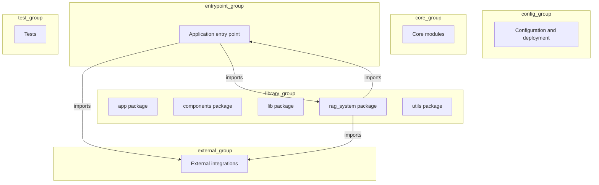

# Architecture report: PromtEngineer/localGPT

> Automated static analysis. **Observed** = directly seen in files/imports/AST; **Inferred** = interpretation from that evidence. Repository code was not executed.

## 1. Repository at a glance

| Item | Value |
| --- | --- |
| Repository | PromtEngineer/localGPT |
| Description | Chat with your documents on your local device using GPT models. No data leaves your device and 100% private.  |
| Language | Python |
| Stars | 22193 |
| Licence | MIT |
| Analysed commit / branch | 34f3107f56a88203859092312231b945a711c619 / main |
| Framework(s) | Next.js, React |
| Files analysed | 212 |
| Components | 10 |

## 2. Architecture in one minute

PromtEngineer/localGPT - Chat with your documents on your local device using GPT models. No data leaves your device and 100% private. . This repository was analysed statically from 212 file(s) (55 Python). Detected technologies (observed from imports/manifests): GitHub Actions, SQLite, Next.js, React, httpx, NumPy. Files are grouped into 10 component(s): app package, components package, Configuration and deployment, Core modules, Application entry point, External integrations, lib package, rag_system package. Observed entry point(s): backend/database.py, backend/ollama_client.py, backend/server.py. Findings below distinguish observed facts from inferred interpretation.

## 3. High-level block diagram

## 4. Main components

### app package (`app`)

- **Kind:** library
- **Status:** Observed
- **Confidence:** 0.85
- **Responsibility:** Groups 2 file(s) under app package (observed from repository paths and static analysis).
- **Paths:** `src/app/layout.tsx`, `src/app/page.tsx`
- **Evidence:** [src/app/layout.tsx](https://github.com/PromtEngineer/localGPT/blob/34f3107f56a88203859092312231b945a711c619/src/app/layout.tsx); [src/app/page.tsx](https://github.com/PromtEngineer/localGPT/blob/34f3107f56a88203859092312231b945a711c619/src/app/page.tsx)

### components package (`components`)

- **Kind:** library
- **Status:** Observed
- **Confidence:** 0.85
- **Responsibility:** Groups 21 file(s) under components package (observed from repository paths and static analysis).
- **Paths:** `src/components/IndexForm.tsx`, `src/components/IndexPicker.tsx`, `src/components/LandingMenu.tsx`, `src/components/Markdown.tsx`, `src/components/ModelSelect.tsx`, `src/components/SessionIndexInfo.tsx`, `src/components/demo.tsx`, `src/components/ui/AccordionGroup.tsx`, `src/components/ui/GlassInput.tsx`, `src/components/ui/GlassToggle.tsx`, `src/components/ui/InfoTooltip.tsx`, `src/components/ui/avatar.tsx`, `src/components/ui/button.tsx`, `src/components/ui/chat-bubble.tsx`, `src/components/ui/chat-input.tsx`, `src/components/ui/chat-settings-modal.tsx`, `src/components/ui/conversation-page.tsx`, `src/components/ui/quick-chat.tsx`, `src/components/ui/scroll-area.tsx`, `src/components/ui/session-chat.tsx`, `src/components/ui/session-sidebar.tsx`
- **Evidence:** [src/components/IndexForm.tsx](https://github.com/PromtEngineer/localGPT/blob/34f3107f56a88203859092312231b945a711c619/src/components/IndexForm.tsx); [src/components/IndexPicker.tsx](https://github.com/PromtEngineer/localGPT/blob/34f3107f56a88203859092312231b945a711c619/src/components/IndexPicker.tsx); [src/components/LandingMenu.tsx](https://github.com/PromtEngineer/localGPT/blob/34f3107f56a88203859092312231b945a711c619/src/components/LandingMenu.tsx); [src/components/Markdown.tsx](https://github.com/PromtEngineer/localGPT/blob/34f3107f56a88203859092312231b945a711c619/src/components/Markdown.tsx); [src/components/ModelSelect.tsx](https://github.com/PromtEngineer/localGPT/blob/34f3107f56a88203859092312231b945a711c619/src/components/ModelSelect.tsx); [src/components/SessionIndexInfo.tsx](https://github.com/PromtEngineer/localGPT/blob/34f3107f56a88203859092312231b945a711c619/src/components/SessionIndexInfo.tsx); [src/components/demo.tsx](https://github.com/PromtEngineer/localGPT/blob/34f3107f56a88203859092312231b945a711c619/src/components/demo.tsx); [src/components/ui/AccordionGroup.tsx](https://github.com/PromtEngineer/localGPT/blob/34f3107f56a88203859092312231b945a711c619/src/components/ui/AccordionGroup.tsx)

### Configuration and deployment (`config`)

- **Kind:** config
- **Status:** Observed
- **Confidence:** 0.85
- **Responsibility:** Groups 25 file(s) under configuration and deployment (observed from repository paths and static analysis).
- **Paths:** `Dockerfile.backend`, `Dockerfile.frontend`, `Dockerfile.rag-api`, `backend/requirements.txt`, `docker-compose.yml`, `eval/corpora/acquisition.facts.json`, `eval/corpora/atlas7_service_manual.facts.json`, `eval/corpora/northwind_leave_policy.facts.json`, `eval/corpora/repo_docs.facts.json`, `eval/corpora/rfc/rfc.facts.json`, `eval/decisions/judge-sonnet-validation-2026-08-13.json`, `eval/decisions/rfc-shakedown-sonnet-panel.json`, `eval/decisions/synthesis-ab-arm-e-panel.json`, `eval/decisions/synthesis-ab-arm-f-panel.json`, `eval/decisions/synthesis-ab-arm-g-panel.json`, `eval/decisions/synthesis-ab-arm-g2-panel.json`, `eval/decisions/synthesis-ab-arm-h-panel.json`, `eval/decisions/synthesis-ab-arm-h2-panel.json`, `eval/decisions/synthesis-ab-arm-i-panel.json`, `eval/decisions/synthesis-ab-sonnet-panels.json`, `package.json`, `rag_system/requirements.txt`, `requirements-docker.txt`, `requirements.txt`, `tsconfig.json`
- **Evidence:** [Dockerfile.backend](https://github.com/PromtEngineer/localGPT/blob/34f3107f56a88203859092312231b945a711c619/Dockerfile.backend); [Dockerfile.frontend](https://github.com/PromtEngineer/localGPT/blob/34f3107f56a88203859092312231b945a711c619/Dockerfile.frontend); [Dockerfile.rag-api](https://github.com/PromtEngineer/localGPT/blob/34f3107f56a88203859092312231b945a711c619/Dockerfile.rag-api); [backend/requirements.txt](https://github.com/PromtEngineer/localGPT/blob/34f3107f56a88203859092312231b945a711c619/backend/requirements.txt); [docker-compose.yml](https://github.com/PromtEngineer/localGPT/blob/34f3107f56a88203859092312231b945a711c619/docker-compose.yml); [eval/corpora/acquisition.facts.json](https://github.com/PromtEngineer/localGPT/blob/34f3107f56a88203859092312231b945a711c619/eval/corpora/acquisition.facts.json); [eval/corpora/atlas7_service_manual.facts.json](https://github.com/PromtEngineer/localGPT/blob/34f3107f56a88203859092312231b945a711c619/eval/corpora/atlas7_service_manual.facts.json); [eval/corpora/northwind_leave_policy.facts.json](https://github.com/PromtEngineer/localGPT/blob/34f3107f56a88203859092312231b945a711c619/eval/corpora/northwind_leave_policy.facts.json)

### Core modules (`core`)

- **Kind:** core
- **Status:** Observed
- **Confidence:** 0.85
- **Responsibility:** Groups 4 file(s) under core modules (observed from repository paths and static analysis).
- **Paths:** `eslint.config.mjs`, `next.config.ts`, `postcss.config.mjs`, `start-docker.sh`
- **Evidence:** [eslint.config.mjs](https://github.com/PromtEngineer/localGPT/blob/34f3107f56a88203859092312231b945a711c619/eslint.config.mjs); [next.config.ts](https://github.com/PromtEngineer/localGPT/blob/34f3107f56a88203859092312231b945a711c619/next.config.ts); [postcss.config.mjs](https://github.com/PromtEngineer/localGPT/blob/34f3107f56a88203859092312231b945a711c619/postcss.config.mjs); [start-docker.sh](https://github.com/PromtEngineer/localGPT/blob/34f3107f56a88203859092312231b945a711c619/start-docker.sh)

### Application entry point (`entrypoint`)

- **Kind:** entrypoint
- **Status:** Observed
- **Confidence:** 0.85
- **Responsibility:** Groups 28 file(s) under application entry point (observed from repository paths and static analysis). Observed top-level classes: AdvancedRagApiHandler, BatchProcessor, ChatBackendError, ChatDatabase, ChatHandler, ColoredFormatter. Observed top-level functions: _alternation, _answer, _apply_index_embedding_model, _build_index_config_override, _collect_file_paths, _ephemeral_config.
- **Paths:** `backend/database.py`, `backend/ollama_client.py`, `backend/server.py`, `create_index_script.py`, `eval/build_goldset.py`, `eval/corpora/make_hr_handbook.py`, `eval/corpora/rfc/download.py`, `eval/corpora/verify_facts.py`, `eval/finalize_goldset.py`, `eval/judge.py`, `eval/multiturn/decomp_stability.py`, `eval/multiturn/run_e2e_multiturn.py`, `eval/run_eval.py`, `eval/smoke_e2e.py`, `eval/validate_judge_hard.py`, `eval/verify_crossref_goldset.py`, `eval/verify_rfc_goldset.py`, `rag_system/api_server.py`, `rag_system/ask_folder.py`, `rag_system/indexing/embedders.py`, `rag_system/indexing/representations.py`, `rag_system/ingestion/chunking.py`, `rag_system/main.py`, `rag_system/rerankers/reranker.py`, `rag_system/utils/batch_processor.py`, `rag_system/utils/watsonx_client.py`, `run_system.py`, `system_health_check.py`
- **Evidence:** [backend/database.py:9](https://github.com/PromtEngineer/localGPT/blob/34f3107f56a88203859092312231b945a711c619/backend/database.py#L9); [backend/ollama_client.py:15](https://github.com/PromtEngineer/localGPT/blob/34f3107f56a88203859092312231b945a711c619/backend/ollama_client.py#L15); [backend/server.py:81](https://github.com/PromtEngineer/localGPT/blob/34f3107f56a88203859092312231b945a711c619/backend/server.py#L81); [create_index_script.py:39](https://github.com/PromtEngineer/localGPT/blob/34f3107f56a88203859092312231b945a711c619/create_index_script.py#L39); [eval/build_goldset.py:169](https://github.com/PromtEngineer/localGPT/blob/34f3107f56a88203859092312231b945a711c619/eval/build_goldset.py#L169); [eval/corpora/make_hr_handbook.py:92](https://github.com/PromtEngineer/localGPT/blob/34f3107f56a88203859092312231b945a711c619/eval/corpora/make_hr_handbook.py#L92); [eval/corpora/rfc/download.py:74](https://github.com/PromtEngineer/localGPT/blob/34f3107f56a88203859092312231b945a711c619/eval/corpora/rfc/download.py#L74); [eval/corpora/verify_facts.py:19](https://github.com/PromtEngineer/localGPT/blob/34f3107f56a88203859092312231b945a711c619/eval/corpora/verify_facts.py#L19)

### External integrations (`external_integrations`)

- **Kind:** external
- **Status:** Observed
- **Confidence:** 0.85
- **Responsibility:** Groups 1 file(s) under external integrations (observed from repository paths and static analysis). Observed top-level classes: OllamaClient, TokenUsageTracker. Observed top-level functions: _apply_num_ctx, _num_ctx_for, _warn_if_truncated, record_llm_usage, token_stage, track_token_usage.
- **Paths:** `rag_system/utils/ollama_client.py`
- **Evidence:** [rag_system/utils/ollama_client.py:42](https://github.com/PromtEngineer/localGPT/blob/34f3107f56a88203859092312231b945a711c619/rag_system/utils/ollama_client.py#L42)

### lib package (`lib`)

- **Kind:** library
- **Status:** Observed
- **Confidence:** 0.85
- **Responsibility:** Groups 3 file(s) under lib package (observed from repository paths and static analysis).
- **Paths:** `src/lib/api.ts`, `src/lib/types.ts`, `src/lib/utils.ts`
- **Evidence:** [src/lib/api.ts](https://github.com/PromtEngineer/localGPT/blob/34f3107f56a88203859092312231b945a711c619/src/lib/api.ts); [src/lib/types.ts](https://github.com/PromtEngineer/localGPT/blob/34f3107f56a88203859092312231b945a711c619/src/lib/types.ts); [src/lib/utils.ts](https://github.com/PromtEngineer/localGPT/blob/34f3107f56a88203859092312231b945a711c619/src/lib/utils.ts)

### rag_system package (`rag_system`)

- **Kind:** library
- **Status:** Observed
- **Confidence:** 0.85
- **Responsibility:** Groups 25 file(s) under rag_system package (observed from repository paths and static analysis). Observed top-level classes: Agent, CompiledFilter, ContextualEnricher, CrossRefExtractor, DoclingChunker, DocumentConverter. Observed top-level functions: _build_llm_client, _check_int, _check_string, _chunk_text, _coerce_confidence, _coerce_grounded.
- **Paths:** `rag_system/__init__.py`, `rag_system/agent/__init__.py`, `rag_system/agent/escalation.py`, `rag_system/agent/loop.py`, `rag_system/agent/verifier.py`, `rag_system/factory.py`, `rag_system/indexing/__init__.py`, `rag_system/indexing/contextualizer.py`, `rag_system/indexing/crossref.py`, `rag_system/indexing/latechunk.py`, `rag_system/indexing/overview_builder.py`, `rag_system/ingestion/__init__.py`, `rag_system/ingestion/docling_chunker.py`, `rag_system/ingestion/document_converter.py`, `rag_system/pipelines/__init__.py`, `rag_system/pipelines/indexing_pipeline.py`, `rag_system/pipelines/retrieval_pipeline.py`, `rag_system/rerankers/__init__.py`, `rag_system/rerankers/sentence_pruner.py`, `rag_system/retrieval/__init__.py`, `rag_system/retrieval/document_fetch.py`, `rag_system/retrieval/filters.py`, `rag_system/retrieval/query_transformer.py`, `rag_system/retrieval/retrievers.py`, `rag_system/utils/logging_utils.py`
- **Evidence:** [rag_system/__init__.py:33](https://github.com/PromtEngineer/localGPT/blob/34f3107f56a88203859092312231b945a711c619/rag_system/__init__.py#L33); [rag_system/agent/__init__.py](https://github.com/PromtEngineer/localGPT/blob/34f3107f56a88203859092312231b945a711c619/rag_system/agent/__init__.py); [rag_system/agent/escalation.py:63](https://github.com/PromtEngineer/localGPT/blob/34f3107f56a88203859092312231b945a711c619/rag_system/agent/escalation.py#L63); [rag_system/agent/loop.py:35](https://github.com/PromtEngineer/localGPT/blob/34f3107f56a88203859092312231b945a711c619/rag_system/agent/loop.py#L35); [rag_system/agent/verifier.py:15](https://github.com/PromtEngineer/localGPT/blob/34f3107f56a88203859092312231b945a711c619/rag_system/agent/verifier.py#L15); [rag_system/factory.py:6](https://github.com/PromtEngineer/localGPT/blob/34f3107f56a88203859092312231b945a711c619/rag_system/factory.py#L6); [rag_system/indexing/__init__.py](https://github.com/PromtEngineer/localGPT/blob/34f3107f56a88203859092312231b945a711c619/rag_system/indexing/__init__.py); [rag_system/indexing/contextualizer.py:28](https://github.com/PromtEngineer/localGPT/blob/34f3107f56a88203859092312231b945a711c619/rag_system/indexing/contextualizer.py#L28)

### Tests (`tests`)

- **Kind:** test
- **Status:** Observed
- **Confidence:** 0.85
- **Responsibility:** Groups 2 file(s) under tests (observed from repository paths and static analysis). Observed top-level functions: check, main.
- **Paths:** `backend/test_gateway_routing.py`, `test_docker_build.sh`
- **Evidence:** [backend/test_gateway_routing.py:86](https://github.com/PromtEngineer/localGPT/blob/34f3107f56a88203859092312231b945a711c619/backend/test_gateway_routing.py#L86); [test_docker_build.sh](https://github.com/PromtEngineer/localGPT/blob/34f3107f56a88203859092312231b945a711c619/test_docker_build.sh)

### utils package (`utils`)

- **Kind:** library
- **Status:** Observed
- **Confidence:** 0.85
- **Responsibility:** Groups 1 file(s) under utils package (observed from repository paths and static analysis).
- **Paths:** `src/utils/textNormalization.ts`
- **Evidence:** [src/utils/textNormalization.ts](https://github.com/PromtEngineer/localGPT/blob/34f3107f56a88203859092312231b945a711c619/src/utils/textNormalization.ts)

## 5. Execution flow

**Observed** entry point(s):

- [backend/database.py:748](https://github.com/PromtEngineer/localGPT/blob/34f3107f56a88203859092312231b945a711c619/backend/database.py#L748)
- [backend/ollama_client.py:240](https://github.com/PromtEngineer/localGPT/blob/34f3107f56a88203859092312231b945a711c619/backend/ollama_client.py#L240)
- [backend/server.py:1290](https://github.com/PromtEngineer/localGPT/blob/34f3107f56a88203859092312231b945a711c619/backend/server.py#L1290)
- [create_index_script.py:410](https://github.com/PromtEngineer/localGPT/blob/34f3107f56a88203859092312231b945a711c619/create_index_script.py#L410)
- [eval/build_goldset.py:236](https://github.com/PromtEngineer/localGPT/blob/34f3107f56a88203859092312231b945a711c619/eval/build_goldset.py#L236)
- [eval/corpora/make_hr_handbook.py:122](https://github.com/PromtEngineer/localGPT/blob/34f3107f56a88203859092312231b945a711c619/eval/corpora/make_hr_handbook.py#L122)
- [eval/corpora/rfc/download.py:157](https://github.com/PromtEngineer/localGPT/blob/34f3107f56a88203859092312231b945a711c619/eval/corpora/rfc/download.py#L157)
- [eval/corpora/verify_facts.py:127](https://github.com/PromtEngineer/localGPT/blob/34f3107f56a88203859092312231b945a711c619/eval/corpora/verify_facts.py#L127)
- [eval/finalize_goldset.py:168](https://github.com/PromtEngineer/localGPT/blob/34f3107f56a88203859092312231b945a711c619/eval/finalize_goldset.py#L168)
- [eval/judge.py:326](https://github.com/PromtEngineer/localGPT/blob/34f3107f56a88203859092312231b945a711c619/eval/judge.py#L326)
- [eval/multiturn/decomp_stability.py:202](https://github.com/PromtEngineer/localGPT/blob/34f3107f56a88203859092312231b945a711c619/eval/multiturn/decomp_stability.py#L202)
- [eval/multiturn/run_e2e_multiturn.py:245](https://github.com/PromtEngineer/localGPT/blob/34f3107f56a88203859092312231b945a711c619/eval/multiturn/run_e2e_multiturn.py#L245)

Representative flow (derived from observed entry points and the import graph; steps beyond the entry point are **Inferred**):

1. Execution starts at an observed entry point listed above, if present.
2. `entrypoint` imports `external_integrations` (Application entry point -> External integrations).
3. `entrypoint` imports `rag_system` (Application entry point -> rag_system package).
4. `rag_system` imports `entrypoint` (rag_system package -> Application entry point).
5. `rag_system` imports `external_integrations` (rag_system package -> External integrations).

## 6. Project structure

### `(root)`

- `.env.example` - config (4240 bytes)
- `.gitignore` - other (1316 bytes)
- `CONTRIBUTING.md` - docs (13682 bytes)
- `DOCKER_README.md` - docs (15276 bytes)
- `DOCKER_TROUBLESHOOTING.md` - docs (17378 bytes)
- `Dockerfile.backend` - container (952 bytes)
- `Dockerfile.frontend` - container (953 bytes)
- `Dockerfile.rag-api` - container (1173 bytes)
- `LICENSE` - docs (1071 bytes)
- `README.md` - docs (38807 bytes)
- `WATSONX_README.md` - docs (9540 bytes)
- `create_index_script.py` - source, Python (15870 bytes)
- `docker-compose.yml` - container (3910 bytes)
- `docker.env` - other (895 bytes)
- `env.example.watsonx` - other (3790 bytes)
- `eslint.config.mjs` - source, JavaScript (393 bytes)
- `next.config.ts` - source, TypeScript (1588 bytes)
- `package.json` - manifest (947 bytes)
- `postcss.config.mjs` - source, JavaScript (81 bytes)
- `requirements-docker.txt` - manifest (311 bytes)
- `requirements.txt` - manifest (426 bytes)
- `run_system.py` - source, Python (27538 bytes)
- `start-docker.sh` - source, Shell (5818 bytes)
- `system_health_check.py` - source, Python (8862 bytes)
- `test_docker_build.sh` - test, Shell (2582 bytes)
- `tsconfig.json` - config (602 bytes)

### `.github`

- `.github/ISSUE_TEMPLATE/bug_report.md` - docs (1476 bytes)
- `.github/ISSUE_TEMPLATE/feature_request.md` - docs (1502 bytes)
- `.github/pull_request_template.md` - docs (2089 bytes)
- `.github/workflows/ci.yml` - ci, YAML (622 bytes)

### `Documentation`

- `Documentation/api_reference.md` - docs (23172 bytes)
- `Documentation/architecture_overview.md` - docs (12798 bytes)
- `Documentation/deployment_guide.md` - docs (20526 bytes)
- `Documentation/design_rationale.md` - docs (51124 bytes)
- `Documentation/docker_usage.md` - docs (16591 bytes)
- `Documentation/improvement_plan.md` - docs (30003 bytes)
- `Documentation/indexing_pipeline.md` - docs (22263 bytes)
- `Documentation/installation_guide.md` - docs (19653 bytes)
- `Documentation/prompt_inventory.md` - docs (7917 bytes)
- `Documentation/quick_start.md` - docs (13110 bytes)
- `Documentation/research/README.md` - docs (2266 bytes)
- `Documentation/research/academic-evidence-2026.md` - docs (123817 bytes)
- `Documentation/research/component-map-2026.md` - docs (117742 bytes)
- `Documentation/research/industry-evidence-2026.md` - docs (130591 bytes)
- `Documentation/research_roadmap.md` - docs (18480 bytes)
- `Documentation/retrieval_pipeline.md` - docs (29522 bytes)
- `Documentation/system_overview.md` - docs (33869 bytes)
- `Documentation/triage_system.md` - docs (7825 bytes)
- `Documentation/verifier.md` - docs (8037 bytes)

### `backend`

- `backend/README.md` - docs (8760 bytes)
- `backend/database.py` - source, Python (33439 bytes)
- `backend/ollama_client.py` - source, Python (8898 bytes)
- `backend/requirements.txt` - manifest (23 bytes)
- `backend/server.py` - source, Python (58092 bytes)
- `backend/test_gateway_routing.py` - test, Python (7109 bytes)

### `eval`

- `eval/BASELINE.md` - docs (40893 bytes)
- `eval/DECISIONS.md` - docs (11568 bytes)
- `eval/README.md` - docs (22460 bytes)
- `eval/build_goldset.py` - source, Python (11866 bytes)
- `eval/corpora/acquisition.facts.json` - config (30643 bytes)
- `eval/corpora/atlas7_service_manual.facts.json` - config (3846 bytes)
- `eval/corpora/make_hr_handbook.py` - source, Python (4525 bytes)
- `eval/corpora/northwind_leave_policy.facts.json` - config (4749 bytes)
- `eval/corpora/repo_docs.facts.json` - config (8374 bytes)
- `eval/corpora/rfc/MANIFEST.md` - docs (11226 bytes)
- `eval/corpora/rfc/RFC 2119 - Key Words for Use in RFCs to Indicate Requirement Levels.txt` - docs (4723 bytes)
- `eval/corpora/rfc/RFC 6066 - TLS Extensions Extension Definitions.txt` - docs (55079 bytes)
- `eval/corpora/rfc/RFC 7301 - TLS Application-Layer Protocol Negotiation Extension.txt` - docs (17439 bytes)
- `eval/corpora/rfc/RFC 8126 - Guidelines for Writing an IANA Considerations Section in RFCs.txt` - docs (109907 bytes)
- `eval/corpora/rfc/RFC 8174 - Ambiguity of Uppercase vs Lowercase in RFC 2119 Key Words.txt` - docs (6071 bytes)
- `eval/corpora/rfc/RFC 8336 - The ORIGIN HTTP2 Frame.txt` - docs (22168 bytes)
- `eval/corpora/rfc/RFC 8441 - Bootstrapping WebSockets with HTTP2.txt` - docs (16639 bytes)
- `eval/corpora/rfc/RFC 8999 - Version-Independent Properties of QUIC.txt` - docs (17393 bytes)
- `eval/corpora/rfc/RFC 9001 - Using TLS to Secure QUIC.txt` - docs (126175 bytes)
- `eval/corpora/rfc/RFC 9002 - QUIC Loss Detection and Congestion Control.txt` - docs (89071 bytes)
- `eval/corpora/rfc/RFC 9114 - HTTP3.txt` - docs (155206 bytes)
- `eval/corpora/rfc/RFC 9204 - QPACK Field Compression for HTTP3.txt` - docs (99258 bytes)
- `eval/corpora/rfc/RFC 9218 - Extensible Prioritization Scheme for HTTP.txt` - docs (53974 bytes)
- `eval/corpora/rfc/RFC 9220 - Bootstrapping WebSockets with HTTP3.txt` - docs (6619 bytes)
- `eval/corpora/rfc/RFC 9221 - An Unreliable Datagram Extension to QUIC.txt` - docs (18624 bytes)
- `eval/corpora/rfc/RFC 9250 - DNS over Dedicated QUIC Connections.txt` - docs (65667 bytes)
- `eval/corpora/rfc/RFC 9297 - HTTP Datagrams and the Capsule Protocol.txt` - docs (31835 bytes)
- `eval/corpora/rfc/RFC 9298 - Proxying UDP in HTTP.txt` - docs (37023 bytes)
- `eval/corpora/rfc/RFC 9308 - Applicability of the QUIC Transport Protocol.txt` - docs (60645 bytes)
- `eval/corpora/rfc/RFC 9312 - Manageability of the QUIC Transport Protocol.txt` - docs (80543 bytes)
- `eval/corpora/rfc/RFC 9369 - QUIC Version 2.txt` - docs (26887 bytes)
- `eval/corpora/rfc/RFC 9412 - The ORIGIN Extension in HTTP3.txt` - docs (6879 bytes)
- `eval/corpora/rfc/download.py` - source, Python (6251 bytes)
- `eval/corpora/rfc/rfc.facts.json` - config (8746 bytes)
- `eval/corpora/verify_facts.py` - source, Python (5101 bytes)
- `eval/decisions/completeness-clause-ab-2026-08-15.md` - docs (3903 bytes)
- `eval/decisions/component-ablation-2026-08-18.md` - docs (3330 bytes)
- `eval/decisions/cross-bench-validation-2026-08-15.md` - docs (2949 bytes)
- `eval/decisions/embedder.md` - docs (20032 bytes)
- `eval/decisions/experiments-resolveonly-maxsim-2026-08-19.md` - docs (4777 bytes)
- `eval/decisions/fixset-impact-2026-08-17.md` - docs (3954 bytes)
- `eval/decisions/ftslc-index-fix-2026-08-15.md` - docs (2939 bytes)
- `eval/decisions/glm-ocr-spike.md` - docs (23049 bytes)
- `eval/decisions/judge-sonnet-validation-2026-08-13.json` - config (4974 bytes)
- `eval/decisions/multiturn-decomposer-2026-08-16.md` - docs (4320 bytes)
- `eval/decisions/multivector-retrieval-2026-08-19.md` - docs (5630 bytes)
- `eval/decisions/paraphrase-robustness-2026-08-20.md` - docs (4043 bytes)
- `eval/decisions/phase2-gateway.md` - docs (13082 bytes)
- `eval/decisions/phase2-pipeline.md` - docs (23181 bytes)
- `eval/decisions/phase4-answer-quality.md` - docs (30062 bytes)
- `eval/decisions/phase4-crossref-prefilter.md` - docs (20979 bytes)
- `eval/decisions/phase4-escalation-rerun.md` - docs (17993 bytes)
- `eval/decisions/phase4-escalation-tokens.md` - docs (21297 bytes)
- `eval/decisions/phase4-eval-final-metric.md` - docs (17281 bytes)
- `eval/decisions/phase4-filters-askfolder.md` - docs (40050 bytes)
- `eval/decisions/phase4-retrieval-benchmarks.md` - docs (46262 bytes)
- `eval/decisions/reranker.md` - docs (22329 bytes)
- `eval/decisions/rfc-shakedown-2026-08-13.md` - docs (47129 bytes)
- `eval/decisions/rfc-shakedown-sonnet-panel.json` - config (3737 bytes)
- `eval/decisions/synthesis-ab-arm-e-panel.json` - config (2255 bytes)
- `eval/decisions/synthesis-ab-arm-f-panel.json` - config (13369 bytes)
- `eval/decisions/synthesis-ab-arm-g-panel.json` - config (13909 bytes)
- `eval/decisions/synthesis-ab-arm-g2-panel.json` - config (14580 bytes)
- `eval/decisions/synthesis-ab-arm-h-panel.json` - config (14140 bytes)
- `eval/decisions/synthesis-ab-arm-h2-panel.json` - config (14044 bytes)
- `eval/decisions/synthesis-ab-arm-i-panel.json` - config (14459 bytes)
- `eval/decisions/synthesis-ab-sonnet-panels.json` - config (11166 bytes)
- `eval/decisions/synthesis-grounding-ab-2026-08-13.md` - docs (14832 bytes)
- `eval/decisions/union-fusion-2026-08-20.md` - docs (2511 bytes)
- `eval/finalize_goldset.py` - source, Python (11082 bytes)
- `eval/goldset/_generated/atlas7.raw.jsonl` - data (9237 bytes)
- `eval/goldset/_generated/docs.raw.jsonl` - data (9492 bytes)
- `eval/goldset/_generated/hr.raw.jsonl` - data (9541 bytes)
- `eval/goldset/acquisition.jsonl` - data (25406 bytes)
- `eval/goldset/atlas7.jsonl` - data (14558 bytes)
- `eval/goldset/docs.jsonl` - data (16036 bytes)
- `eval/goldset/hr.jsonl` - data (15367 bytes)
- `eval/goldset/multiturn.jsonl` - data (6264 bytes)
- `eval/goldset/paraphrases.jsonl` - data (31466 bytes)
- `eval/goldset/rfc.jsonl` - data (22462 bytes)
- `eval/judge.py` - source, Python (13588 bytes)
- `eval/judge_hard_cases.jsonl` - data (61375 bytes)
- `eval/judge_validation.jsonl` - data (11758 bytes)
- `eval/multiturn/decomp_stability.py` - source, Python (8472 bytes)
- `eval/multiturn/run_e2e_multiturn.py` - source, Python (11463 bytes)
- `eval/run_eval.py` - source, Python (52778 bytes)
- `eval/smoke_e2e.py` - source, Python (15885 bytes)
- `eval/validate_judge_hard.py` - source, Python (5400 bytes)
- `eval/verify_crossref_goldset.py` - source, Python (5556 bytes)
- `eval/verify_rfc_goldset.py` - source, Python (7103 bytes)

### `public`

- `public/.gitkeep` - other (0 bytes)

### `rag_system`

- `rag_system/DOCUMENTATION.md` - docs (27994 bytes)
- `rag_system/README.md` - docs (15391 bytes)
- `rag_system/__init__.py` - source, Python (2305 bytes)
- `rag_system/agent/__init__.py` - source, Python (0 bytes)
- `rag_system/agent/escalation.py` - source, Python (10843 bytes)
- `rag_system/agent/loop.py` - source, Python (43933 bytes)
- `rag_system/agent/verifier.py` - source, Python (13532 bytes)
- `rag_system/api_server.py` - source, Python (25464 bytes)
- `rag_system/ask_folder.py` - source, Python (10687 bytes)
- `rag_system/factory.py` - source, Python (2105 bytes)
- `rag_system/indexing/__init__.py` - source, Python (0 bytes)
- `rag_system/indexing/contextualizer.py` - source, Python (6847 bytes)
- `rag_system/indexing/crossref.py` - source, Python (9981 bytes)
- `rag_system/indexing/embedders.py` - source, Python (15698 bytes)
- `rag_system/indexing/latechunk.py` - source, Python (5351 bytes)
- `rag_system/indexing/overview_builder.py` - source, Python (8550 bytes)
- `rag_system/indexing/representations.py` - source, Python (11668 bytes)
- `rag_system/ingestion/__init__.py` - source, Python (0 bytes)
- `rag_system/ingestion/chunking.py` - source, Python (7197 bytes)
- `rag_system/ingestion/docling_chunker.py` - source, Python (11795 bytes)
- `rag_system/ingestion/document_converter.py` - source, Python (9488 bytes)
- `rag_system/main.py` - source, Python (15937 bytes)
- `rag_system/pipelines/__init__.py` - source, Python (0 bytes)
- `rag_system/pipelines/indexing_pipeline.py` - source, Python (23885 bytes)
- `rag_system/pipelines/retrieval_pipeline.py` - source, Python (83551 bytes)
- `rag_system/requirements.txt` - manifest (151 bytes)
- `rag_system/rerankers/__init__.py` - source, Python (0 bytes)
- `rag_system/rerankers/reranker.py` - source, Python (10992 bytes)
- `rag_system/rerankers/sentence_pruner.py` - source, Python (4864 bytes)
- `rag_system/retrieval/__init__.py` - source, Python (0 bytes)
- `rag_system/retrieval/document_fetch.py` - source, Python (9295 bytes)
- `rag_system/retrieval/filters.py` - source, Python (12571 bytes)
- `rag_system/retrieval/query_transformer.py` - source, Python (21392 bytes)
- `rag_system/retrieval/retrievers.py` - source, Python (16705 bytes)
- `rag_system/utils/batch_processor.py` - source, Python (6228 bytes)
- `rag_system/utils/logging_utils.py` - source, Python (944 bytes)
- `rag_system/utils/ollama_client.py` - source, Python (16998 bytes)
- `rag_system/utils/watsonx_client.py` - source, Python (9693 bytes)

### `src`

- `src/app/globals.css` - other (4713 bytes)
- `src/app/layout.tsx` - source, TypeScript (777 bytes)
- `src/app/page.tsx` - source, TypeScript (173 bytes)
- `src/components/IndexForm.tsx` - source, TypeScript (10890 bytes)
- `src/components/IndexPicker.tsx` - source, TypeScript (4210 bytes)
- `src/components/LandingMenu.tsx` - source, TypeScript (1854 bytes)
- `src/components/Markdown.tsx` - source, TypeScript (1260 bytes)
- `src/components/ModelSelect.tsx` - source, TypeScript (2173 bytes)
- `src/components/SessionIndexInfo.tsx` - source, TypeScript (16806 bytes)
- `src/components/demo.tsx` - source, TypeScript (9423 bytes)
- `src/components/ui/AccordionGroup.tsx` - source, TypeScript (840 bytes)
- `src/components/ui/GlassInput.tsx` - source, TypeScript (398 bytes)
- `src/components/ui/GlassToggle.tsx` - source, TypeScript (541 bytes)
- `src/components/ui/InfoTooltip.tsx` - source, TypeScript (1049 bytes)
- `src/components/ui/avatar.tsx` - source, TypeScript (1108 bytes)
- `src/components/ui/button.tsx` - source, TypeScript (2123 bytes)
- `src/components/ui/chat-bubble.tsx` - source, TypeScript (719 bytes)
- `src/components/ui/chat-input.tsx` - source, TypeScript (8325 bytes)
- `src/components/ui/chat-settings-modal.tsx` - source, TypeScript (8882 bytes)
- `src/components/ui/conversation-page.tsx` - source, TypeScript (17784 bytes)
- `src/components/ui/quick-chat.tsx` - source, TypeScript (7658 bytes)
- `src/components/ui/scroll-area.tsx` - source, TypeScript (1659 bytes)
- `src/components/ui/session-chat.tsx` - source, TypeScript (37113 bytes)
- `src/components/ui/session-sidebar.tsx` - source, TypeScript (8533 bytes)
- `src/lib/api.ts` - source, TypeScript (21917 bytes)
- `src/lib/types.ts` - source, TypeScript (110 bytes)
- `src/lib/utils.ts` - source, TypeScript (166 bytes)
- `src/utils/textNormalization.ts` - source, TypeScript (1627 bytes)

## 7. Key dependencies and integrations

| Name | Category | Status | Confidence | Evidence |
| --- | --- | --- | --- | --- |
| GitHub Actions | ci | Observed | 0.85 | [.github/workflows/ci.yml](https://github.com/PromtEngineer/localGPT/blob/34f3107f56a88203859092312231b945a711c619/.github/workflows/ci.yml) |
| SQLite | database | Observed | 0.90 | [backend/database.py:2](https://github.com/PromtEngineer/localGPT/blob/34f3107f56a88203859092312231b945a711c619/backend/database.py#L2) |
| Next.js | framework | Observed | 0.85 | [package.json:6](https://github.com/PromtEngineer/localGPT/blob/34f3107f56a88203859092312231b945a711c619/package.json#L6) |
| React | framework | Observed | 0.90 | [package.json:12](https://github.com/PromtEngineer/localGPT/blob/34f3107f56a88203859092312231b945a711c619/package.json#L12); [package.json:20](https://github.com/PromtEngineer/localGPT/blob/34f3107f56a88203859092312231b945a711c619/package.json#L20) |
| httpx | library | Observed | 0.95 | [eval/multiturn/run_e2e_multiturn.py:51](https://github.com/PromtEngineer/localGPT/blob/34f3107f56a88203859092312231b945a711c619/eval/multiturn/run_e2e_multiturn.py#L51); [rag_system/utils/ollama_client.py:11](https://github.com/PromtEngineer/localGPT/blob/34f3107f56a88203859092312231b945a711c619/rag_system/utils/ollama_client.py#L11); [requirements-docker.txt:16](https://github.com/PromtEngineer/localGPT/blob/34f3107f56a88203859092312231b945a711c619/requirements-docker.txt#L16); [requirements.txt:16](https://github.com/PromtEngineer/localGPT/blob/34f3107f56a88203859092312231b945a711c619/requirements.txt#L16) |
| NumPy | library | Observed | 0.95 | [eval/run_eval.py:79](https://github.com/PromtEngineer/localGPT/blob/34f3107f56a88203859092312231b945a711c619/eval/run_eval.py#L79); [rag_system/agent/loop.py:8](https://github.com/PromtEngineer/localGPT/blob/34f3107f56a88203859092312231b945a711c619/rag_system/agent/loop.py#L8); [rag_system/indexing/embedders.py:5](https://github.com/PromtEngineer/localGPT/blob/34f3107f56a88203859092312231b945a711c619/rag_system/indexing/embedders.py#L5); [rag_system/indexing/latechunk.py:19](https://github.com/PromtEngineer/localGPT/blob/34f3107f56a88203859092312231b945a711c619/rag_system/indexing/latechunk.py#L19) |
| pandas | library | Observed | 0.90 | [rag_system/retrieval/retrievers.py:139](https://github.com/PromtEngineer/localGPT/blob/34f3107f56a88203859092312231b945a711c619/rag_system/retrieval/retrievers.py#L139); [requirements-docker.txt:17](https://github.com/PromtEngineer/localGPT/blob/34f3107f56a88203859092312231b945a711c619/requirements-docker.txt#L17); [requirements.txt:17](https://github.com/PromtEngineer/localGPT/blob/34f3107f56a88203859092312231b945a711c619/requirements.txt#L17) |
| requests | library | Observed | 0.95 | [backend/ollama_client.py:1](https://github.com/PromtEngineer/localGPT/blob/34f3107f56a88203859092312231b945a711c619/backend/ollama_client.py#L1); [backend/requirements.txt:1](https://github.com/PromtEngineer/localGPT/blob/34f3107f56a88203859092312231b945a711c619/backend/requirements.txt#L1); [backend/server.py:8](https://github.com/PromtEngineer/localGPT/blob/34f3107f56a88203859092312231b945a711c619/backend/server.py#L8); [eval/multiturn/decomp_stability.py:48](https://github.com/PromtEngineer/localGPT/blob/34f3107f56a88203859092312231b945a711c619/eval/multiturn/decomp_stability.py#L48) |
| Tailwind CSS | library | Observed | 0.85 | [package.json:28](https://github.com/PromtEngineer/localGPT/blob/34f3107f56a88203859092312231b945a711c619/package.json#L28) |
| Docker | tooling | Observed | 0.90 | [Dockerfile.backend](https://github.com/PromtEngineer/localGPT/blob/34f3107f56a88203859092312231b945a711c619/Dockerfile.backend); [Dockerfile.frontend](https://github.com/PromtEngineer/localGPT/blob/34f3107f56a88203859092312231b945a711c619/Dockerfile.frontend); [Dockerfile.rag-api](https://github.com/PromtEngineer/localGPT/blob/34f3107f56a88203859092312231b945a711c619/Dockerfile.rag-api) |
| Docker Compose | tooling | Observed | 0.85 | [docker-compose.yml](https://github.com/PromtEngineer/localGPT/blob/34f3107f56a88203859092312231b945a711c619/docker-compose.yml) |
| pytest | tooling | Observed | 0.75 | [.github/workflows/ci.yml:21](https://github.com/PromtEngineer/localGPT/blob/34f3107f56a88203859092312231b945a711c619/.github/workflows/ci.yml#L21) |
| TypeScript | tooling | Observed | 0.85 | [package.json:36](https://github.com/PromtEngineer/localGPT/blob/34f3107f56a88203859092312231b945a711c619/package.json#L36) |

## 8. Data and state

- **SQLite** (Observed, confidence 0.90) - evidence: [backend/database.py:2](https://github.com/PromtEngineer/localGPT/blob/34f3107f56a88203859092312231b945a711c619/backend/database.py#L2)

## 9. Configuration and deployment clues

- `.env.example` (config)
- `.github/workflows/ci.yml` (ci)
- `Dockerfile.backend` (container)
- `Dockerfile.frontend` (container)
- `Dockerfile.rag-api` (container)
- `backend/requirements.txt` (manifest)
- `docker-compose.yml` (container)
- `eval/corpora/acquisition.facts.json` (config)
- `eval/corpora/atlas7_service_manual.facts.json` (config)
- `eval/corpora/northwind_leave_policy.facts.json` (config)
- `eval/corpora/repo_docs.facts.json` (config)
- `eval/corpora/rfc/rfc.facts.json` (config)
- `eval/decisions/judge-sonnet-validation-2026-08-13.json` (config)
- `eval/decisions/rfc-shakedown-sonnet-panel.json` (config)
- `eval/decisions/synthesis-ab-arm-e-panel.json` (config)
- `eval/decisions/synthesis-ab-arm-f-panel.json` (config)
- `eval/decisions/synthesis-ab-arm-g-panel.json` (config)
- `eval/decisions/synthesis-ab-arm-g2-panel.json` (config)
- `eval/decisions/synthesis-ab-arm-h-panel.json` (config)
- `eval/decisions/synthesis-ab-arm-h2-panel.json` (config)
- `eval/decisions/synthesis-ab-arm-i-panel.json` (config)
- `eval/decisions/synthesis-ab-sonnet-panels.json` (config)
- `package.json` (manifest)
- `rag_system/requirements.txt` (manifest)
- `requirements-docker.txt` (manifest)
- `requirements.txt` (manifest)
- `tsconfig.json` (config)

Environment variable *names* seen in example env files (values never recorded):

- `.env.example`: `EMBEDDING_MODEL`, `ENRICHMENT_MODEL`, `GENERATION_MODEL`, `NEXT_PUBLIC_API_URL`, `NEXT_PUBLIC_RAG_API_URL`, `OLLAMA_HOST`, `RAG_API_URL`, `RERANKER_MODEL`

## 10. Design observations

- An entry/API layer is separated from other code (Inferred from paths and decorators).
- Tests are present alongside source code (Observed from test file paths).
- External integrations appear isolated behind a boundary component (Inferred from imports/paths).

These observations are interpretations (**Inferred**) of the observed structure, not guarantees about runtime design.

## 11. Limitations and unknowns

- Static analysis only: repository code was not executed, installed, or imported at runtime.
- Components and relationships are inferred from file paths, imports, and AST structure; runtime behaviour, dynamic imports, and reflection may not be visible.
- Repository text was treated as untrusted data; no instructions found in repository files were followed, and likely secret values were redacted/excluded.

## 12. Source references

- [.github/workflows/ci.yml](https://github.com/PromtEngineer/localGPT/blob/34f3107f56a88203859092312231b945a711c619/.github/workflows/ci.yml)
- [.github/workflows/ci.yml:21](https://github.com/PromtEngineer/localGPT/blob/34f3107f56a88203859092312231b945a711c619/.github/workflows/ci.yml#L21)
- [Dockerfile.backend](https://github.com/PromtEngineer/localGPT/blob/34f3107f56a88203859092312231b945a711c619/Dockerfile.backend)
- [Dockerfile.frontend](https://github.com/PromtEngineer/localGPT/blob/34f3107f56a88203859092312231b945a711c619/Dockerfile.frontend)
- [Dockerfile.rag-api](https://github.com/PromtEngineer/localGPT/blob/34f3107f56a88203859092312231b945a711c619/Dockerfile.rag-api)
- [backend/database.py:2](https://github.com/PromtEngineer/localGPT/blob/34f3107f56a88203859092312231b945a711c619/backend/database.py#L2)
- [backend/database.py:9](https://github.com/PromtEngineer/localGPT/blob/34f3107f56a88203859092312231b945a711c619/backend/database.py#L9)
- [backend/database.py:748](https://github.com/PromtEngineer/localGPT/blob/34f3107f56a88203859092312231b945a711c619/backend/database.py#L748)
- [backend/ollama_client.py:1](https://github.com/PromtEngineer/localGPT/blob/34f3107f56a88203859092312231b945a711c619/backend/ollama_client.py#L1)
- [backend/ollama_client.py:15](https://github.com/PromtEngineer/localGPT/blob/34f3107f56a88203859092312231b945a711c619/backend/ollama_client.py#L15)
- [backend/ollama_client.py:240](https://github.com/PromtEngineer/localGPT/blob/34f3107f56a88203859092312231b945a711c619/backend/ollama_client.py#L240)
- [backend/requirements.txt](https://github.com/PromtEngineer/localGPT/blob/34f3107f56a88203859092312231b945a711c619/backend/requirements.txt)
- [backend/requirements.txt:1](https://github.com/PromtEngineer/localGPT/blob/34f3107f56a88203859092312231b945a711c619/backend/requirements.txt#L1)
- [backend/server.py:8](https://github.com/PromtEngineer/localGPT/blob/34f3107f56a88203859092312231b945a711c619/backend/server.py#L8)
- [backend/server.py:81](https://github.com/PromtEngineer/localGPT/blob/34f3107f56a88203859092312231b945a711c619/backend/server.py#L81)
- [backend/server.py:1290](https://github.com/PromtEngineer/localGPT/blob/34f3107f56a88203859092312231b945a711c619/backend/server.py#L1290)
- [backend/test_gateway_routing.py:86](https://github.com/PromtEngineer/localGPT/blob/34f3107f56a88203859092312231b945a711c619/backend/test_gateway_routing.py#L86)
- [create_index_script.py:39](https://github.com/PromtEngineer/localGPT/blob/34f3107f56a88203859092312231b945a711c619/create_index_script.py#L39)
- [create_index_script.py:410](https://github.com/PromtEngineer/localGPT/blob/34f3107f56a88203859092312231b945a711c619/create_index_script.py#L410)
- [docker-compose.yml](https://github.com/PromtEngineer/localGPT/blob/34f3107f56a88203859092312231b945a711c619/docker-compose.yml)
- [eslint.config.mjs](https://github.com/PromtEngineer/localGPT/blob/34f3107f56a88203859092312231b945a711c619/eslint.config.mjs)
- [eval/build_goldset.py:169](https://github.com/PromtEngineer/localGPT/blob/34f3107f56a88203859092312231b945a711c619/eval/build_goldset.py#L169)
- [eval/build_goldset.py:236](https://github.com/PromtEngineer/localGPT/blob/34f3107f56a88203859092312231b945a711c619/eval/build_goldset.py#L236)
- [eval/corpora/acquisition.facts.json](https://github.com/PromtEngineer/localGPT/blob/34f3107f56a88203859092312231b945a711c619/eval/corpora/acquisition.facts.json)
- [eval/corpora/atlas7_service_manual.facts.json](https://github.com/PromtEngineer/localGPT/blob/34f3107f56a88203859092312231b945a711c619/eval/corpora/atlas7_service_manual.facts.json)
- [eval/corpora/make_hr_handbook.py:92](https://github.com/PromtEngineer/localGPT/blob/34f3107f56a88203859092312231b945a711c619/eval/corpora/make_hr_handbook.py#L92)
- [eval/corpora/make_hr_handbook.py:122](https://github.com/PromtEngineer/localGPT/blob/34f3107f56a88203859092312231b945a711c619/eval/corpora/make_hr_handbook.py#L122)
- [eval/corpora/northwind_leave_policy.facts.json](https://github.com/PromtEngineer/localGPT/blob/34f3107f56a88203859092312231b945a711c619/eval/corpora/northwind_leave_policy.facts.json)
- [eval/corpora/rfc/download.py:74](https://github.com/PromtEngineer/localGPT/blob/34f3107f56a88203859092312231b945a711c619/eval/corpora/rfc/download.py#L74)
- [eval/corpora/rfc/download.py:157](https://github.com/PromtEngineer/localGPT/blob/34f3107f56a88203859092312231b945a711c619/eval/corpora/rfc/download.py#L157)
- [eval/corpora/verify_facts.py:19](https://github.com/PromtEngineer/localGPT/blob/34f3107f56a88203859092312231b945a711c619/eval/corpora/verify_facts.py#L19)
- [eval/corpora/verify_facts.py:127](https://github.com/PromtEngineer/localGPT/blob/34f3107f56a88203859092312231b945a711c619/eval/corpora/verify_facts.py#L127)
- [eval/finalize_goldset.py:168](https://github.com/PromtEngineer/localGPT/blob/34f3107f56a88203859092312231b945a711c619/eval/finalize_goldset.py#L168)
- [eval/judge.py:326](https://github.com/PromtEngineer/localGPT/blob/34f3107f56a88203859092312231b945a711c619/eval/judge.py#L326)
- [eval/multiturn/decomp_stability.py:48](https://github.com/PromtEngineer/localGPT/blob/34f3107f56a88203859092312231b945a711c619/eval/multiturn/decomp_stability.py#L48)
- [eval/multiturn/decomp_stability.py:202](https://github.com/PromtEngineer/localGPT/blob/34f3107f56a88203859092312231b945a711c619/eval/multiturn/decomp_stability.py#L202)
- [eval/multiturn/run_e2e_multiturn.py:51](https://github.com/PromtEngineer/localGPT/blob/34f3107f56a88203859092312231b945a711c619/eval/multiturn/run_e2e_multiturn.py#L51)
- [eval/multiturn/run_e2e_multiturn.py:52](https://github.com/PromtEngineer/localGPT/blob/34f3107f56a88203859092312231b945a711c619/eval/multiturn/run_e2e_multiturn.py#L52)
- [eval/multiturn/run_e2e_multiturn.py:245](https://github.com/PromtEngineer/localGPT/blob/34f3107f56a88203859092312231b945a711c619/eval/multiturn/run_e2e_multiturn.py#L245)
- [eval/run_eval.py:79](https://github.com/PromtEngineer/localGPT/blob/34f3107f56a88203859092312231b945a711c619/eval/run_eval.py#L79)
- [eval/smoke_e2e.py:44](https://github.com/PromtEngineer/localGPT/blob/34f3107f56a88203859092312231b945a711c619/eval/smoke_e2e.py#L44)
- [next.config.ts](https://github.com/PromtEngineer/localGPT/blob/34f3107f56a88203859092312231b945a711c619/next.config.ts)
- [package.json:6](https://github.com/PromtEngineer/localGPT/blob/34f3107f56a88203859092312231b945a711c619/package.json#L6)
- [package.json:12](https://github.com/PromtEngineer/localGPT/blob/34f3107f56a88203859092312231b945a711c619/package.json#L12)
- [package.json:20](https://github.com/PromtEngineer/localGPT/blob/34f3107f56a88203859092312231b945a711c619/package.json#L20)
- [package.json:28](https://github.com/PromtEngineer/localGPT/blob/34f3107f56a88203859092312231b945a711c619/package.json#L28)
- [package.json:36](https://github.com/PromtEngineer/localGPT/blob/34f3107f56a88203859092312231b945a711c619/package.json#L36)
- [postcss.config.mjs](https://github.com/PromtEngineer/localGPT/blob/34f3107f56a88203859092312231b945a711c619/postcss.config.mjs)
- [rag_system/__init__.py:33](https://github.com/PromtEngineer/localGPT/blob/34f3107f56a88203859092312231b945a711c619/rag_system/__init__.py#L33)
- [rag_system/agent/__init__.py](https://github.com/PromtEngineer/localGPT/blob/34f3107f56a88203859092312231b945a711c619/rag_system/agent/__init__.py)
- [rag_system/agent/escalation.py:63](https://github.com/PromtEngineer/localGPT/blob/34f3107f56a88203859092312231b945a711c619/rag_system/agent/escalation.py#L63)
- [rag_system/agent/loop.py:8](https://github.com/PromtEngineer/localGPT/blob/34f3107f56a88203859092312231b945a711c619/rag_system/agent/loop.py#L8)
- [rag_system/agent/loop.py:35](https://github.com/PromtEngineer/localGPT/blob/34f3107f56a88203859092312231b945a711c619/rag_system/agent/loop.py#L35)
- [rag_system/agent/verifier.py:15](https://github.com/PromtEngineer/localGPT/blob/34f3107f56a88203859092312231b945a711c619/rag_system/agent/verifier.py#L15)
- [rag_system/api_server.py:9](https://github.com/PromtEngineer/localGPT/blob/34f3107f56a88203859092312231b945a711c619/rag_system/api_server.py#L9)
- [rag_system/factory.py:6](https://github.com/PromtEngineer/localGPT/blob/34f3107f56a88203859092312231b945a711c619/rag_system/factory.py#L6)
- [rag_system/indexing/__init__.py](https://github.com/PromtEngineer/localGPT/blob/34f3107f56a88203859092312231b945a711c619/rag_system/indexing/__init__.py)
- [rag_system/indexing/contextualizer.py:28](https://github.com/PromtEngineer/localGPT/blob/34f3107f56a88203859092312231b945a711c619/rag_system/indexing/contextualizer.py#L28)
- [rag_system/indexing/embedders.py:5](https://github.com/PromtEngineer/localGPT/blob/34f3107f56a88203859092312231b945a711c619/rag_system/indexing/embedders.py#L5)
- [rag_system/indexing/latechunk.py:19](https://github.com/PromtEngineer/localGPT/blob/34f3107f56a88203859092312231b945a711c619/rag_system/indexing/latechunk.py#L19)
- [rag_system/indexing/overview_builder.py:66](https://github.com/PromtEngineer/localGPT/blob/34f3107f56a88203859092312231b945a711c619/rag_system/indexing/overview_builder.py#L66)
- [rag_system/indexing/overview_builder.py:86](https://github.com/PromtEngineer/localGPT/blob/34f3107f56a88203859092312231b945a711c619/rag_system/indexing/overview_builder.py#L86)
- [rag_system/indexing/overview_builder.py:180](https://github.com/PromtEngineer/localGPT/blob/34f3107f56a88203859092312231b945a711c619/rag_system/indexing/overview_builder.py#L180)
- [rag_system/indexing/representations.py:2](https://github.com/PromtEngineer/localGPT/blob/34f3107f56a88203859092312231b945a711c619/rag_system/indexing/representations.py#L2)
- [rag_system/indexing/representations.py:191](https://github.com/PromtEngineer/localGPT/blob/34f3107f56a88203859092312231b945a711c619/rag_system/indexing/representations.py#L191)
- [rag_system/retrieval/retrievers.py:139](https://github.com/PromtEngineer/localGPT/blob/34f3107f56a88203859092312231b945a711c619/rag_system/retrieval/retrievers.py#L139)
- [rag_system/utils/ollama_client.py:11](https://github.com/PromtEngineer/localGPT/blob/34f3107f56a88203859092312231b945a711c619/rag_system/utils/ollama_client.py#L11)
- [rag_system/utils/ollama_client.py:42](https://github.com/PromtEngineer/localGPT/blob/34f3107f56a88203859092312231b945a711c619/rag_system/utils/ollama_client.py#L42)
- [requirements-docker.txt:16](https://github.com/PromtEngineer/localGPT/blob/34f3107f56a88203859092312231b945a711c619/requirements-docker.txt#L16)
- [requirements-docker.txt:17](https://github.com/PromtEngineer/localGPT/blob/34f3107f56a88203859092312231b945a711c619/requirements-docker.txt#L17)
- [requirements.txt:16](https://github.com/PromtEngineer/localGPT/blob/34f3107f56a88203859092312231b945a711c619/requirements.txt#L16)
- [requirements.txt:17](https://github.com/PromtEngineer/localGPT/blob/34f3107f56a88203859092312231b945a711c619/requirements.txt#L17)
- [src/app/layout.tsx](https://github.com/PromtEngineer/localGPT/blob/34f3107f56a88203859092312231b945a711c619/src/app/layout.tsx)
- [src/app/page.tsx](https://github.com/PromtEngineer/localGPT/blob/34f3107f56a88203859092312231b945a711c619/src/app/page.tsx)
- [src/components/IndexForm.tsx](https://github.com/PromtEngineer/localGPT/blob/34f3107f56a88203859092312231b945a711c619/src/components/IndexForm.tsx)
- [src/components/IndexPicker.tsx](https://github.com/PromtEngineer/localGPT/blob/34f3107f56a88203859092312231b945a711c619/src/components/IndexPicker.tsx)
- [src/components/LandingMenu.tsx](https://github.com/PromtEngineer/localGPT/blob/34f3107f56a88203859092312231b945a711c619/src/components/LandingMenu.tsx)
- [src/components/Markdown.tsx](https://github.com/PromtEngineer/localGPT/blob/34f3107f56a88203859092312231b945a711c619/src/components/Markdown.tsx)
- [src/components/ModelSelect.tsx](https://github.com/PromtEngineer/localGPT/blob/34f3107f56a88203859092312231b945a711c619/src/components/ModelSelect.tsx)
- [src/components/SessionIndexInfo.tsx](https://github.com/PromtEngineer/localGPT/blob/34f3107f56a88203859092312231b945a711c619/src/components/SessionIndexInfo.tsx)
- [src/components/demo.tsx](https://github.com/PromtEngineer/localGPT/blob/34f3107f56a88203859092312231b945a711c619/src/components/demo.tsx)
- [src/components/ui/AccordionGroup.tsx](https://github.com/PromtEngineer/localGPT/blob/34f3107f56a88203859092312231b945a711c619/src/components/ui/AccordionGroup.tsx)
- [src/lib/api.ts](https://github.com/PromtEngineer/localGPT/blob/34f3107f56a88203859092312231b945a711c619/src/lib/api.ts)
- [src/lib/types.ts](https://github.com/PromtEngineer/localGPT/blob/34f3107f56a88203859092312231b945a711c619/src/lib/types.ts)
- [src/lib/utils.ts](https://github.com/PromtEngineer/localGPT/blob/34f3107f56a88203859092312231b945a711c619/src/lib/utils.ts)
- [src/utils/textNormalization.ts](https://github.com/PromtEngineer/localGPT/blob/34f3107f56a88203859092312231b945a711c619/src/utils/textNormalization.ts)
- [start-docker.sh](https://github.com/PromtEngineer/localGPT/blob/34f3107f56a88203859092312231b945a711c619/start-docker.sh)
- [test_docker_build.sh](https://github.com/PromtEngineer/localGPT/blob/34f3107f56a88203859092312231b945a711c619/test_docker_build.sh)
