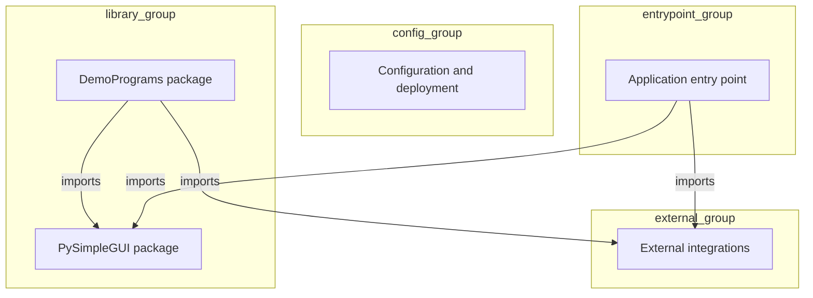

# Architecture report: PySimpleGUI/PySimpleGUI

> Automated static analysis. **Observed** = directly seen in files/imports/AST; **Inferred** = interpretation from that evidence. Repository code was not executed.

## 1. Repository at a glance

| Item | Value |
| --- | --- |
| Repository | PySimpleGUI/PySimpleGUI |
| Description | Python GUIs for Humans! Create any GUI simple or complicated in a way that's intuitive.  Launched in 2018. NEW for 2026 - the LGPL3 Version 6.  Transforms tkinter, Qt, WxPython, and Remi into a simple, intuitive, and fun experience for both hobbyists and expert users.  |
| Language | Python |
| Stars | 13820 |
| Licence | LGPL-3.0 |
| Analysed commit / branch | 00de5ab857f56014294cb0a5c725a96d32eb7af6 / master |
| Framework(s) | None detected |
| Files analysed | 352 |
| Components | 5 |

## 2. Architecture in one minute

PySimpleGUI/PySimpleGUI - Python GUIs for Humans! Create any GUI simple or complicated in a way that's intuitive.  Launched in 2018. NEW for 2026 - the LGPL3 Version 6.  Transforms tkinter, Qt, WxPython, and Remi into a simpl…. This repository was analysed statically from 352 file(s) (339 Python). Detected technologies (observed from imports/manifests): GitHub Actions, NumPy, pandas, requests, setuptools. Files are grouped into 5 component(s): Configuration and deployment, DemoPrograms package, Application entry point, External integrations, PySimpleGUI package. Observed entry point(s): DemoPrograms/Browser_START_HERE_Demo_Programs_Browser.py, DemoPrograms/Demo_All_Elements.py, DemoPrograms/Demo_Auto_Save_Window_Position.py. Findings below distinguish observed facts from inferred interpretation.

## 3. High-level block diagram

## 4. Main components

### Configuration and deployment (`config`)

- **Kind:** config
- **Status:** Observed
- **Confidence:** 0.85
- **Responsibility:** Groups 2 file(s) under configuration and deployment (observed from repository paths and static analysis). Observed top-level functions: readme.
- **Paths:** `requirements.txt`, `setup.py`
- **Evidence:** [requirements.txt](https://github.com/PySimpleGUI/PySimpleGUI/blob/00de5ab857f56014294cb0a5c725a96d32eb7af6/requirements.txt); [setup.py:4](https://github.com/PySimpleGUI/PySimpleGUI/blob/00de5ab857f56014294cb0a5c725a96d32eb7af6/setup.py#L4)

### DemoPrograms package (`demoprograms`)

- **Kind:** library
- **Status:** Observed
- **Confidence:** 0.85
- **Responsibility:** Groups 175 file(s) under demoprograms package (observed from repository paths and static analysis). Observed top-level classes: Ball, Item, Playfield, SampleGUI, Toolbar. Observed top-level functions: ArtistBoxplot2, AxesGrid, Battleship, ChatBotWithHistory, Collapsible, ColumnFixedSize.
- **Paths:** `DemoPrograms/Demo_All_Elements_Simple.py`, `DemoPrograms/Demo_Animated_GIFs.py`, `DemoPrograms/Demo_Animated_GIFs_Using_PIL.py`, `DemoPrograms/Demo_Bar_Chart.py`, `DemoPrograms/Demo_Borderless_Window.py`, `DemoPrograms/Demo_Button_Click.py`, `DemoPrograms/Demo_Button_Events_From_Browse.py`, `DemoPrograms/Demo_Button_Func_Calls.py`, `DemoPrograms/Demo_Button_States.py`, `DemoPrograms/Demo_Buttons_Base64_Simple.py`, `DemoPrograms/Demo_Buttons_Mac.py`, `DemoPrograms/Demo_Calendar.py`, `DemoPrograms/Demo_Canvas.py`, `DemoPrograms/Demo_Chat.py`, `DemoPrograms/Demo_Chat_With_History.py`, `DemoPrograms/Demo_Chatterbot.py`, `DemoPrograms/Demo_Chatterbot_With_TTS.py`, `DemoPrograms/Demo_Class_Wrapper.py`, `DemoPrograms/Demo_Close_Attempted_Event.py`, `DemoPrograms/Demo_Color_Names.py`, `DemoPrograms/Demo_Color_Names_Smaller_List.py`, `DemoPrograms/Demo_Column_And_Frames.py`, `DemoPrograms/Demo_Column_Collapsible_Sections.py`, `DemoPrograms/Demo_Column_Elem_Swap_Entire_Window.py`, `DemoPrograms/Demo_Column_Fixed_Size_Justified_Elements.py`, `DemoPrograms/Demo_Columns.py`, `DemoPrograms/Demo_Combo_Filechooser_With_History_And_Clear.py`, `DemoPrograms/Demo_Compact_Layouts_Element_Renaming.py`, `DemoPrograms/Demo_Crossword_Puzzle.py`, `DemoPrograms/Demo_Cursor_Previewer.py`, `DemoPrograms/Demo_Cursors.py`, `DemoPrograms/Demo_Dashboard.py`, `DemoPrograms/Demo_Date_Chooser.py`, `DemoPrograms/Demo_Debugger_Built_Into_PSG.py`, `DemoPrograms/Demo_Debugger_Button.py`, `DemoPrograms/Demo_Debugger_ImWatchingYou.py`, `DemoPrograms/Demo_Design_Pattern_Multiple_Windows3.py`, `DemoPrograms/Demo_Design_Pattern_Multiple_Windows_OLD METHOD.py`, `DemoPrograms/Demo_Design_Pattern_Persistent_Window.py`, `DemoPrograms/Demo_Design_Patterns.py`, `DemoPrograms/Demo_Desktop_Widget_CPU_Utilization_Simple.py`, `DemoPrograms/Demo_Desktop_Widget_Email_Notification.py`, `DemoPrograms/Demo_Desktop_Widget_Postit_3_Lines.py`, `DemoPrograms/Demo_Desktop_Widget_Timer.py`, `DemoPrograms/Demo_Disable_Elements.py`, `DemoPrograms/Demo_Edit_Me_Option.py`, `DemoPrograms/Demo_Emojis.py`, `DemoPrograms/Demo_Event_Callback_Simulation.py`, `DemoPrograms/Demo_Exception_Traceback_Popup.py`, `DemoPrograms/Demo_Font_Previewer.py`, `DemoPrograms/Demo_Font_Sizer.py`, `DemoPrograms/Demo_Font_String.py`, `DemoPrograms/Demo_Frame_Based_Dashboard.py`, `DemoPrograms/Demo_Game_Frontend_Battleship.py`, `DemoPrograms/Demo_Game_Frontend_Battleship_No_List_Comprehensions.py`, `DemoPrograms/Demo_Game_Frontend_Battleship_Single_List_Comprehension.py`, `DemoPrograms/Demo_Google_TTS.py`, `DemoPrograms/Demo_Graph_Ball_Game.py`, `DemoPrograms/Demo_Graph_Bar_Chart_Dual_Axis.py`, `DemoPrograms/Demo_Graph_Drag_Rectangle.py`, `DemoPrograms/Demo_Graph_Drag_Rectangle_Super_Simple.py`, `DemoPrograms/Demo_Graph_Drawing.py`, `DemoPrograms/Demo_Graph_Drawing_And_Dragging_Figures.py`, `DemoPrograms/Demo_Graph_Drawing_And_Dragging_Figures_2_Windows.py`, `DemoPrograms/Demo_Graph_Elem_Image_Album.py`, `DemoPrograms/Demo_Graph_Elem_Image_Album_No_PIL.py`, `DemoPrograms/Demo_Graph_Element_Sine_Wave.py`, `DemoPrograms/Demo_Graph_Window_Resize.py`, `DemoPrograms/Demo_Hello_World.py`, `DemoPrograms/Demo_Hotkey.py`, `DemoPrograms/Demo_IP_Address_Entry.py`, `DemoPrograms/Demo_Image_Elem_Image_Viewer_PIL_Based.py`, `DemoPrograms/Demo_Image_Elem_Splash_Screen.py`, `DemoPrograms/Demo_Image_From_URL.py`, `DemoPrograms/Demo_Img_Viewer.py`, `DemoPrograms/Demo_Input_Validation.py`, `DemoPrograms/Demo_Invisible_Elements.py`, `DemoPrograms/Demo_Invisible_Elements_Pinning.py`, `DemoPrograms/Demo_Justification_Columns.py`, `DemoPrograms/Demo_Justification_Using_Stretch_Elements.py`, `DemoPrograms/Demo_Keyboard.py`, `DemoPrograms/Demo_Keyboard_ENTER_Presses_Button.py`, `DemoPrograms/Demo_Keyboard_Realtime.py`, `DemoPrograms/Demo_Keypad.py`, `DemoPrograms/Demo_LED_Indicators.py`, `DemoPrograms/Demo_LED_Indicators_Text_Based.py`, `DemoPrograms/Demo_Layout_Extend.py`, `DemoPrograms/Demo_Layout_Generation.py`, `DemoPrograms/Demo_Layout_Vertical_Centered_Using_Sizer_Element.py`, `DemoPrograms/Demo_Layout_Vertical_Centered_Using_VPush_Element.py`, `DemoPrograms/Demo_Layouts_Using_Walrus_Operator.py`, `DemoPrograms/Demo_Listbox_Search_Filter.py`, `DemoPrograms/Demo_Listbox_Using_Objects.py`, `DemoPrograms/Demo_Look_And_Feel_Theme_Browser.py`, `DemoPrograms/Demo_Look_And_Feel_Theme_Dump.py`, `DemoPrograms/Demo_Main_Control_Test_Panel.py`, `DemoPrograms/Demo_Matplotlib_Browser.py`, `DemoPrograms/Demo_Matplotlib_Browser_Paned.py`, `DemoPrograms/Demo_Matplotlib_Embedded_Toolbar.py`, `DemoPrograms/Demo_Matplotlib_Grid_of_Graphs_Using_PIL.py`, `DemoPrograms/Demo_Matplotlib_PyLab.py`, `DemoPrograms/Demo_Matplotlib_Two_Windows.py`, `DemoPrograms/Demo_Media_Player.py`, `DemoPrograms/Demo_Menus.py`, `DemoPrograms/Demo_Multi_Window_read_all_windows.py`, `DemoPrograms/Demo_Multiline_Multicolored_Text.py`, `DemoPrograms/Demo_Multiple_Windows_Experimental.py`, `DemoPrograms/Demo_Multiple_Windows_read_all_windows_25_lines.py`, `DemoPrograms/Demo_Multithreaded_Long_Shell_Operation_Animated.py`, `DemoPrograms/Demo_Net_API_Download_Image.py`, `DemoPrograms/Demo_Net_API_Download_Image_jpg.py`, `DemoPrograms/Demo_Notification_Window_Alpha_Channel.py`, `DemoPrograms/Demo_OpenCV.py`, `DemoPrograms/Demo_OpenCV_4_Line_Program.py`, `DemoPrograms/Demo_OpenCV_7_Line_Program.py`, `DemoPrograms/Demo_OpenCV_Draw_On_Webcam_Image.py`, `DemoPrograms/Demo_OpenCV_Simple_GUI.py`, `DemoPrograms/Demo_OpenCV_Webcam.py`, `DemoPrograms/Demo_OpenCV_Webcam_ASCII.py`, `DemoPrograms/Demo_OpenCV_Webcam_Minimal.py`, `DemoPrograms/Demo_PDF_Viewer.py`, `DemoPrograms/Demo_PIL_Color_Picker.py`, `DemoPrograms/Demo_PNG_Thumbnail_Viewer.py`, `DemoPrograms/Demo_Paned_Window.py`, `DemoPrograms/Demo_Pi_LEDs.py`, `DemoPrograms/Demo_Pip_Installs.py`, `DemoPrograms/Demo_Popup_Custom.py`, `DemoPrograms/Demo_Popups.py`, `DemoPrograms/Demo_Progress_Meter_Simulated.py`, `DemoPrograms/Demo_Progress_Meters.py`, `DemoPrograms/Demo_PyCharm_Self_Edit.py`, `DemoPrograms/Demo_PyGame_Integration.py`, `DemoPrograms/Demo_Pyplot_Bar_Chart.py`, `DemoPrograms/Demo_Pyplot_Bar_Chart2.py`, `DemoPrograms/Demo_Save_Window_As_Image.py`, `DemoPrograms/Demo_Script_Launcher_ANSI_Color_Output.py`, `DemoPrograms/Demo_Script_Launcher_Realtime_Output.py`, `DemoPrograms/Demo_Script_Parameters.py`, `DemoPrograms/Demo_Separator_Elements.py`, `DemoPrograms/Demo_Settings_Save_Load.py`, `DemoPrograms/Demo_Sort_Visualizer.py`, `DemoPrograms/Demo_Spin_Element_Wraps_Around.py`, `DemoPrograms/Demo_Spinner_Compound_Element.py`, `DemoPrograms/Demo_Stdout.py`, `DemoPrograms/Demo_Sudoku_1_Line.py`, `DemoPrograms/Demo_Super_Simple_Form.py`, `DemoPrograms/Demo_System_Tray_GUI_Window_Design_Pattern.py`, `DemoPrograms/Demo_System_Tray_Icon.py`, `DemoPrograms/Demo_TTK_Scrollbars.py`, `DemoPrograms/Demo_Table_CSV.py`, `DemoPrograms/Demo_Table_Checkmark.py`, `DemoPrograms/Demo_Table_Element.py`, `DemoPrograms/Demo_Table_Element_Header_or_Cell_Clicks.py`, `DemoPrograms/Demo_Table_Pandas.py`, `DemoPrograms/Demo_Table_Simulation.py`, `DemoPrograms/Demo_Table_Simulation_Arrow_Keys.py`, `DemoPrograms/Demo_Tabs.py`, `DemoPrograms/Demo_Tabs_Nested.py`, `DemoPrograms/Demo_Tabs_Simple.py`, `DemoPrograms/Demo_Text_Element_Autosize.py`, `DemoPrograms/Demo_Theme_Browser.py`, `DemoPrograms/Demo_Theme_Previewer_Dark.py`, `DemoPrograms/Demo_Time_Chooser.py`, `DemoPrograms/Demo_Titlebar_Element.py`, `DemoPrograms/Demo_Tooltips.py`, `DemoPrograms/Demo_Tree_Element.py`, `DemoPrograms/Demo_Turtle.py`, `DemoPrograms/Demo_Unicode_Characters.py`, `DemoPrograms/Demo_User_Settings_Browse_File_Folder.py`, `DemoPrograms/Demo_Watermark_Window.py`, `DemoPrograms/Demo_Window_Config_Events.py`, `DemoPrograms/Demo_Window_Disappear.py`, `DemoPrograms/Demo_Window_Location_Finder.py`, `DemoPrograms/Demo_YouTube_Intro.py`, `DemoPrograms/Demo_one_line_progress_meter.py`
- **Evidence:** [DemoPrograms/Demo_All_Elements_Simple.py:16](https://github.com/PySimpleGUI/PySimpleGUI/blob/00de5ab857f56014294cb0a5c725a96d32eb7af6/DemoPrograms/Demo_All_Elements_Simple.py#L16); [DemoPrograms/Demo_Animated_GIFs.py](https://github.com/PySimpleGUI/PySimpleGUI/blob/00de5ab857f56014294cb0a5c725a96d32eb7af6/DemoPrograms/Demo_Animated_GIFs.py); [DemoPrograms/Demo_Animated_GIFs_Using_PIL.py](https://github.com/PySimpleGUI/PySimpleGUI/blob/00de5ab857f56014294cb0a5c725a96d32eb7af6/DemoPrograms/Demo_Animated_GIFs_Using_PIL.py); [DemoPrograms/Demo_Bar_Chart.py](https://github.com/PySimpleGUI/PySimpleGUI/blob/00de5ab857f56014294cb0a5c725a96d32eb7af6/DemoPrograms/Demo_Bar_Chart.py); [DemoPrograms/Demo_Borderless_Window.py](https://github.com/PySimpleGUI/PySimpleGUI/blob/00de5ab857f56014294cb0a5c725a96d32eb7af6/DemoPrograms/Demo_Borderless_Window.py); [DemoPrograms/Demo_Button_Click.py](https://github.com/PySimpleGUI/PySimpleGUI/blob/00de5ab857f56014294cb0a5c725a96d32eb7af6/DemoPrograms/Demo_Button_Click.py); [DemoPrograms/Demo_Button_Events_From_Browse.py](https://github.com/PySimpleGUI/PySimpleGUI/blob/00de5ab857f56014294cb0a5c725a96d32eb7af6/DemoPrograms/Demo_Button_Events_From_Browse.py); [DemoPrograms/Demo_Button_Func_Calls.py:22](https://github.com/PySimpleGUI/PySimpleGUI/blob/00de5ab857f56014294cb0a5c725a96d32eb7af6/DemoPrograms/Demo_Button_Func_Calls.py#L22)

### Application entry point (`entrypoint`)

- **Kind:** entrypoint
- **Status:** Observed
- **Confidence:** 0.85
- **Responsibility:** Groups 162 file(s) under application entry point (observed from repository paths and static analysis). Observed application object created via Group. Observed top-level classes: Ball, BtnInfo, DashGraph, G, GUI, Gauge. Observed top-level functions: CPU_thread, Check, CustomMeter, DarkButton, DownloadSubtitlesGUI, ExecuteCommandSubprocess.
- **Paths:** `DemoPrograms/Browser_START_HERE_Demo_Programs_Browser.py`, `DemoPrograms/Demo_All_Elements.py`, `DemoPrograms/Demo_Auto_Save_Window_Position.py`, `DemoPrograms/Demo_Base64_Image_Encoder.py`, `DemoPrograms/Demo_Base64_Single_Image_Encoder.py`, `DemoPrograms/Demo_Button_Can_Button_Images.py`, `DemoPrograms/Demo_Button_Simulated_With_Highlighting_Using_Bind.py`, `DemoPrograms/Demo_Button_Toggle.py`, `DemoPrograms/Demo_Button_Toggle2.py`, `DemoPrograms/Demo_Button_Toggle_Simple_Graphic.py`, `DemoPrograms/Demo_Buttons_Base64_User_Settings.py`, `DemoPrograms/Demo_Buttons_Nice_Graphics.py`, `DemoPrograms/Demo_Buttons_Realtime.py`, `DemoPrograms/Demo_CLI_or_GUI.py`, `DemoPrograms/Demo_Checkboxes_Custom.py`, `DemoPrograms/Demo_Color_Chooser_Custom.py`, `DemoPrograms/Demo_Color_Swatches.py`, `DemoPrograms/Demo_Compare_Files.py`, `DemoPrograms/Demo_Demo_Programs_Browser.py`, `DemoPrograms/Demo_Design_Pattern_Multiple_Windows.py`, `DemoPrograms/Demo_Design_Pattern_Multiple_Windows1.py`, `DemoPrograms/Demo_Design_Pattern_Multiple_Windows2.py`, `DemoPrograms/Demo_Design_Pattern_Multiple_Windows_Both_Visible.py`, `DemoPrograms/Demo_Design_Pattern_Save_Theme.py`, `DemoPrograms/Demo_Desktop_Floating_Toolbar.py`, `DemoPrograms/Demo_Desktop_Widget_CPU_Dashboard.py`, `DemoPrograms/Demo_Desktop_Widget_CPU_Gauge.py`, `DemoPrograms/Demo_Desktop_Widget_CPU_Graph.py`, `DemoPrograms/Demo_Desktop_Widget_CPU_Grid_Of_Gauges.py`, `DemoPrograms/Demo_Desktop_Widget_CPU_Square.py`, `DemoPrograms/Demo_Desktop_Widget_CPU_Top_Processes.py`, `DemoPrograms/Demo_Desktop_Widget_Count_To_A_Goal.py`, `DemoPrograms/Demo_Desktop_Widget_Date.py`, `DemoPrograms/Demo_Desktop_Widget_Days_Counter.py`, `DemoPrograms/Demo_Desktop_Widget_Digital_Picture_Frame.py`, `DemoPrograms/Demo_Desktop_Widget_Drive_Usage.py`, `DemoPrograms/Demo_Desktop_Widget_Drive_Usage_Gauges.py`, `DemoPrograms/Demo_Desktop_Widget_Launcher_Bar.py`, `DemoPrograms/Demo_Desktop_Widget_Manual_Counter.py`, `DemoPrograms/Demo_Desktop_Widget_Postit.py`, `DemoPrograms/Demo_Desktop_Widget_RAM_Gauge.py`, `DemoPrograms/Demo_Desktop_Widget_RAM_Square.py`, `DemoPrograms/Demo_Desktop_Widget_Template.py`, `DemoPrograms/Demo_Desktop_Widget_Time_Handwritten.py`, `DemoPrograms/Demo_Desktop_Widget_Weather.py`, `DemoPrograms/Demo_Desktop_Widget_psutil_Dashboard.py`, `DemoPrograms/Demo_Dispatchers.py`, `DemoPrograms/Demo_Drag_and_Drop.py`, `DemoPrograms/Demo_DuplicateFileFinder.py`, `DemoPrograms/Demo_EXE_Maker.py`, `DemoPrograms/Demo_Email_Send.py`, `DemoPrograms/Demo_Event_Binding.py`, `DemoPrograms/Demo_Execute_Py.py`, `DemoPrograms/Demo_Fill_Form.py`, `DemoPrograms/Demo_Floating_Toolbar.py`, `DemoPrograms/Demo_Focus_Navigation_Using_Arrow_Keys.py`, `DemoPrograms/Demo_Frame_For_Screen_Captures.py`, `DemoPrograms/Demo_Game_Wordle.py`, `DemoPrograms/Demo_GitHub_File_Copier.py`, `DemoPrograms/Demo_GoodColors.py`, `DemoPrograms/Demo_GoodColors_2.py`, `DemoPrograms/Demo_Graph_Custom_Progress_Meter.py`, `DemoPrograms/Demo_Graph_Elem_CPU_Meter.py`, `DemoPrograms/Demo_Graph_Element.py`, `DemoPrograms/Demo_Graph_Noise.py`, `DemoPrograms/Demo_Graph_pymunk_2D_Graphics.py`, `DemoPrograms/Demo_Graph_pymunk_Desktop_Balls.py`, `DemoPrograms/Demo_HowDoI.py`, `DemoPrograms/Demo_Image_Viewer_Thumbnails.py`, `DemoPrograms/Demo_Input_Auto_Complete.py`, `DemoPrograms/Demo_Input_Save_Last_Used_Entry_In_User_Settings.py`, `DemoPrograms/Demo_Layout_Add_and_Delete_Rows.py`, `DemoPrograms/Demo_Layout_Reuse_Effect.py`, `DemoPrograms/Demo_Layout_Vertical.py`, `DemoPrograms/Demo_Layout_Vertical_Centered.py`, `DemoPrograms/Demo_Long_Operations.py`, `DemoPrograms/Demo_MIDI_Player.py`, `DemoPrograms/Demo_Machine_Learning.py`, `DemoPrograms/Demo_Matplotlib_Animated.py`, `DemoPrograms/Demo_Matplotlib_Animated_Scatter.py`, `DemoPrograms/Demo_Matplotlib_Embedded_TEMPLATE.py`, `DemoPrograms/Demo_Matplotlib_Image_Elem.py`, `DemoPrograms/Demo_Matplotlib_Image_Elem_Spetrogram_Animated.py`, `DemoPrograms/Demo_Matplotlib_Image_Elem_Spetrogram_Animated_Threaded.py`, `DemoPrograms/Demo_Matplotlib_Ping_Graph_Large.py`, `DemoPrograms/Demo_Matplotlib_Styles.py`, `DemoPrograms/Demo_Menu_With_Toolbar.py`, `DemoPrograms/Demo_Menubar_Custom.py`, `DemoPrograms/Demo_Menubar_Custom_and_Traditional.py`, `DemoPrograms/Demo_Mini_Window.py`, `DemoPrograms/Demo_Mouseover_Images.py`, `DemoPrograms/Demo_Multiline_Elem_Input_Justification.py`, `DemoPrograms/Demo_Multiline_Right_Click_Menu_Clipboard.py`, `DemoPrograms/Demo_Multiline_cprint_Printing.py`, `DemoPrograms/Demo_Multithreaded_Animated_Shell_Command.py`, `DemoPrograms/Demo_Multithreaded_Calling_Popup.py`, `DemoPrograms/Demo_Multithreaded_DataPump.py`, `DemoPrograms/Demo_Multithreaded_Delegate_Appear_To_Make_PSG_Calls_From_Thread.py`, `DemoPrograms/Demo_Multithreaded_Different_Threads.py`, `DemoPrograms/Demo_Multithreaded_Long_Task_Simple.py`, `DemoPrograms/Demo_Multithreaded_Long_Tasks.py`, `DemoPrograms/Demo_Multithreaded_Multiple_Threads.py`, `DemoPrograms/Demo_Multithreaded_ProgressBar.py`, `DemoPrograms/Demo_Multithreaded_Signal_Thread_To_End.py`, `DemoPrograms/Demo_Multithreaded_Write_Event_Value.py`, `DemoPrograms/Demo_Multithreaded_Write_Event_Value_MultiWindow.py`, `DemoPrograms/Demo_Multithreaded_popup.py`, `DemoPrograms/Demo_Nice_Buttons.py`, `DemoPrograms/Demo_NonBlocking_Form.py`, `DemoPrograms/Demo_Notification_Window_Fade_In_Out.py`, `DemoPrograms/Demo_Notification_Window_Multiprocessing.py`, `DemoPrograms/Demo_Notify_Integration.py`, `DemoPrograms/Demo_PIL_Use.py`, `DemoPrograms/Demo_PNG_Viewer.py`, `DemoPrograms/Demo_Password_Login.py`, `DemoPrograms/Demo_Pong_Multiple_Platforms.py`, `DemoPrograms/Demo_Post_An_Issue.py`, `DemoPrograms/Demo_Program_Desktop_Widget_LED_Clock_Weather.py`, `DemoPrograms/Demo_Progres_Meter_With_Numeric_Using_Graph_Element.py`, `DemoPrograms/Demo_PyCharm_Diff_2_Files.py`, `DemoPrograms/Demo_PyCharm_Launcher.py`, `DemoPrograms/Demo_PyGame_Snake_Game.py`, `DemoPrograms/Demo_Radio_Buttons_Simulated.py`, `DemoPrograms/Demo_Reddit_Search.py`, `DemoPrograms/Demo_SDK_Help_Func_Parms.py`, `DemoPrograms/Demo_SDK_Help_Init_Update_Parms.py`, `DemoPrograms/Demo_Save_Any_Window_As_Image.py`, `DemoPrograms/Demo_Save_Windows_As_Images.py`, `DemoPrograms/Demo_Script_Launcher.py`, `DemoPrograms/Demo_Simple_Material_Feel.py`, `DemoPrograms/Demo_Status_Bar.py`, `DemoPrograms/Demo_Sudoku.py`, `DemoPrograms/Demo_System_Tray_Icon_Using_psgtray.py`, `DemoPrograms/Demo_System_Tray_Icon_psgtray_No_Window.py`, `DemoPrograms/Demo_System_Tray_Reminder.py`, `DemoPrograms/Demo_Theme_Add_Your_Own.py`, `DemoPrograms/Demo_Theme_Change_Your_Windows_Theme.py`, `DemoPrograms/Demo_Theme_Color_Swatches.py`, `DemoPrograms/Demo_Theme_Custom_Saved_In_UserSettings.py`, `DemoPrograms/Demo_Theme_Dark_Custom_Elements_Check_Toggle_Buttons.py`, `DemoPrograms/Demo_Timer_API_State_Machine.py`, `DemoPrograms/Demo_Timer_Periodic.py`, `DemoPrograms/Demo_Titlebar_Custom_Async.py`, `DemoPrograms/Demo_Titlebar_Custom_Dark_Theme.py`, `DemoPrograms/Demo_Titlebar_Custom_Multiple_Combinations.py`, `DemoPrograms/Demo_Touch_Keyboard.py`, `DemoPrograms/Demo_User_Setting_Save_Window_Inputs.py`, `DemoPrograms/Demo_User_Settings.py`, `DemoPrograms/Demo_User_Settings_As_Simple_Database.py`, `DemoPrograms/Demo_User_Settings_Auto_Load_and_Save.py`, `DemoPrograms/Demo_User_Settings_Class.py`, `DemoPrograms/Demo_User_Settings_Class_Remember_Input_and_Combo.py`, `DemoPrograms/Demo_User_Settings_Config_INI_Format.py`, `DemoPrograms/Demo_User_Settings_Element_setting_Parameter.py`, `DemoPrograms/Demo_User_Settings_Remember_Input_and_Combo.py`, `DemoPrograms/Demo_Window_Open_Multiple_Times.py`, `DemoPrograms/Demo_Window_Pin_On_Top.py`, `DemoPrograms/Demo_Window_Relative_Location.py`, `DemoPrograms/Demo_Youtube-dl_Frontend.py`, `DemoPrograms/Demo_psutil_Kill_Processes.py`, `DemoPrograms/Demo_psutil_Kill_Python_Processes.py`, `PySimpleGUI/__main__.py`
- **Evidence:** [DemoPrograms/Browser_START_HERE_Demo_Programs_Browser.py:80](https://github.com/PySimpleGUI/PySimpleGUI/blob/00de5ab857f56014294cb0a5c725a96d32eb7af6/DemoPrograms/Browser_START_HERE_Demo_Programs_Browser.py#L80); [DemoPrograms/Demo_All_Elements.py:21](https://github.com/PySimpleGUI/PySimpleGUI/blob/00de5ab857f56014294cb0a5c725a96d32eb7af6/DemoPrograms/Demo_All_Elements.py#L21); [DemoPrograms/Demo_Auto_Save_Window_Position.py:14](https://github.com/PySimpleGUI/PySimpleGUI/blob/00de5ab857f56014294cb0a5c725a96d32eb7af6/DemoPrograms/Demo_Auto_Save_Window_Position.py#L14); [DemoPrograms/Demo_Base64_Image_Encoder.py:16](https://github.com/PySimpleGUI/PySimpleGUI/blob/00de5ab857f56014294cb0a5c725a96d32eb7af6/DemoPrograms/Demo_Base64_Image_Encoder.py#L16); [DemoPrograms/Demo_Base64_Single_Image_Encoder.py:28](https://github.com/PySimpleGUI/PySimpleGUI/blob/00de5ab857f56014294cb0a5c725a96d32eb7af6/DemoPrograms/Demo_Base64_Single_Image_Encoder.py#L28); [DemoPrograms/Demo_Button_Can_Button_Images.py:20](https://github.com/PySimpleGUI/PySimpleGUI/blob/00de5ab857f56014294cb0a5c725a96d32eb7af6/DemoPrograms/Demo_Button_Can_Button_Images.py#L20); [DemoPrograms/Demo_Button_Simulated_With_Highlighting_Using_Bind.py:30](https://github.com/PySimpleGUI/PySimpleGUI/blob/00de5ab857f56014294cb0a5c725a96d32eb7af6/DemoPrograms/Demo_Button_Simulated_With_Highlighting_Using_Bind.py#L30); [DemoPrograms/Demo_Button_Toggle.py:15](https://github.com/PySimpleGUI/PySimpleGUI/blob/00de5ab857f56014294cb0a5c725a96d32eb7af6/DemoPrograms/Demo_Button_Toggle.py#L15)

### External integrations (`external_integrations`)

- **Kind:** external
- **Status:** Inferred
- **Confidence:** 0.70
- **Responsibility:** Groups 0 file(s) under external integrations (observed from repository paths and static analysis).
- **Evidence:** [DemoPrograms/Demo_Graph_Ball_Game.py:5](https://github.com/PySimpleGUI/PySimpleGUI/blob/00de5ab857f56014294cb0a5c725a96d32eb7af6/DemoPrograms/Demo_Graph_Ball_Game.py#L5); [DemoPrograms/Demo_Graph_pymunk_2D_Graphics.py:5](https://github.com/PySimpleGUI/PySimpleGUI/blob/00de5ab857f56014294cb0a5c725a96d32eb7af6/DemoPrograms/Demo_Graph_pymunk_2D_Graphics.py#L5); [DemoPrograms/Demo_Program_Desktop_Widget_LED_Clock_Weather.py:5](https://github.com/PySimpleGUI/PySimpleGUI/blob/00de5ab857f56014294cb0a5c725a96d32eb7af6/DemoPrograms/Demo_Program_Desktop_Widget_LED_Clock_Weather.py#L5)

### PySimpleGUI package (`pysimplegui`)

- **Kind:** library
- **Status:** Observed
- **Confidence:** 0.85
- **Responsibility:** Groups 1 file(s) under pysimplegui package (observed from repository paths and static analysis).
- **Paths:** `PySimpleGUI/__init__.py`
- **Evidence:** [PySimpleGUI/__init__.py](https://github.com/PySimpleGUI/PySimpleGUI/blob/00de5ab857f56014294cb0a5c725a96d32eb7af6/PySimpleGUI/__init__.py)

## 5. Execution flow

**Observed** entry point(s):

- [DemoPrograms/Browser_START_HERE_Demo_Programs_Browser.py:1106](https://github.com/PySimpleGUI/PySimpleGUI/blob/00de5ab857f56014294cb0a5c725a96d32eb7af6/DemoPrograms/Browser_START_HERE_Demo_Programs_Browser.py#L1106)
- [DemoPrograms/Demo_All_Elements.py:160](https://github.com/PySimpleGUI/PySimpleGUI/blob/00de5ab857f56014294cb0a5c725a96d32eb7af6/DemoPrograms/Demo_All_Elements.py#L160)
- [DemoPrograms/Demo_Auto_Save_Window_Position.py:45](https://github.com/PySimpleGUI/PySimpleGUI/blob/00de5ab857f56014294cb0a5c725a96d32eb7af6/DemoPrograms/Demo_Auto_Save_Window_Position.py#L45)
- [DemoPrograms/Demo_Base64_Image_Encoder.py:42](https://github.com/PySimpleGUI/PySimpleGUI/blob/00de5ab857f56014294cb0a5c725a96d32eb7af6/DemoPrograms/Demo_Base64_Image_Encoder.py#L42)
- [DemoPrograms/Demo_Base64_Single_Image_Encoder.py:39](https://github.com/PySimpleGUI/PySimpleGUI/blob/00de5ab857f56014294cb0a5c725a96d32eb7af6/DemoPrograms/Demo_Base64_Single_Image_Encoder.py#L39)
- [DemoPrograms/Demo_Button_Can_Button_Images.py:44](https://github.com/PySimpleGUI/PySimpleGUI/blob/00de5ab857f56014294cb0a5c725a96d32eb7af6/DemoPrograms/Demo_Button_Can_Button_Images.py#L44)
- [DemoPrograms/Demo_Button_Simulated_With_Highlighting_Using_Bind.py:80](https://github.com/PySimpleGUI/PySimpleGUI/blob/00de5ab857f56014294cb0a5c725a96d32eb7af6/DemoPrograms/Demo_Button_Simulated_With_Highlighting_Using_Bind.py#L80)
- [DemoPrograms/Demo_Button_Toggle.py:38](https://github.com/PySimpleGUI/PySimpleGUI/blob/00de5ab857f56014294cb0a5c725a96d32eb7af6/DemoPrograms/Demo_Button_Toggle.py#L38)
- [DemoPrograms/Demo_Button_Toggle2.py:107](https://github.com/PySimpleGUI/PySimpleGUI/blob/00de5ab857f56014294cb0a5c725a96d32eb7af6/DemoPrograms/Demo_Button_Toggle2.py#L107)
- [DemoPrograms/Demo_Button_Toggle_Simple_Graphic.py:34](https://github.com/PySimpleGUI/PySimpleGUI/blob/00de5ab857f56014294cb0a5c725a96d32eb7af6/DemoPrograms/Demo_Button_Toggle_Simple_Graphic.py#L34)
- [DemoPrograms/Demo_Buttons_Base64_User_Settings.py:82](https://github.com/PySimpleGUI/PySimpleGUI/blob/00de5ab857f56014294cb0a5c725a96d32eb7af6/DemoPrograms/Demo_Buttons_Base64_User_Settings.py#L82)
- [DemoPrograms/Demo_Buttons_Nice_Graphics.py:86](https://github.com/PySimpleGUI/PySimpleGUI/blob/00de5ab857f56014294cb0a5c725a96d32eb7af6/DemoPrograms/Demo_Buttons_Nice_Graphics.py#L86)

Representative flow (derived from observed entry points and the import graph; steps beyond the entry point are **Inferred**):

1. Execution starts at an observed entry point listed above, if present.
2. `demoprograms` imports `external_integrations` (DemoPrograms package -> External integrations).
3. `demoprograms` imports `pysimplegui` (DemoPrograms package -> PySimpleGUI package).
4. `entrypoint` imports `external_integrations` (Application entry point -> External integrations).
5. `entrypoint` imports `pysimplegui` (Application entry point -> PySimpleGUI package).

## 6. Project structure

### `(root)`

- `.gitignore` - other (81 bytes)
- `CONTRIBUTING.md` - docs (1112 bytes)
- `LICENSE.txt` - docs (7651 bytes)
- `README.md` - docs (13580 bytes)
- `requirements.txt` - manifest (0 bytes)
- `setup.py` - manifest, Python (2511 bytes)

### `.github`

- `.github/ISSUE_TEMPLATE/config.yml` - config (28 bytes)
- `.github/ISSUE_TEMPLATE/issue-form---must-fill-in-this-form-with-every-new-issue-submitted.md` - docs (2456 bytes)
- `.github/PULL_REQUEST_TEMPLATE/pull_request_template.md` - docs (165 bytes)
- `.github/workflows/close_prs.yml` - ci, YAML (839 bytes)

### `DemoPrograms`

- `DemoPrograms/Browser_START_HERE_Demo_Programs_Browser.py` - source, Python (49862 bytes)
- `DemoPrograms/Demo_All_Elements.py` - source, Python (8588 bytes)
- `DemoPrograms/Demo_All_Elements_Simple.py` - source, Python (4765 bytes)
- `DemoPrograms/Demo_Animated_GIFs.py` - source, Python (192563 bytes)
- `DemoPrograms/Demo_Animated_GIFs_Using_PIL.py` - source, Python (1458 bytes)
- `DemoPrograms/Demo_Auto_Save_Window_Position.py` - source, Python (1550 bytes)
- `DemoPrograms/Demo_Bar_Chart.py` - source, Python (1977 bytes)
- `DemoPrograms/Demo_Base64_Image_Encoder.py` - source, Python (1360 bytes)
- `DemoPrograms/Demo_Base64_Single_Image_Encoder.py` - source, Python (1943 bytes)
- `DemoPrograms/Demo_Borderless_Window.py` - source, Python (1480 bytes)
- `DemoPrograms/Demo_Button_Can_Button_Images.py` - source, Python (129453 bytes)
- `DemoPrograms/Demo_Button_Click.py` - source, Python (1013 bytes)
- `DemoPrograms/Demo_Button_Events_From_Browse.py` - source, Python (1214 bytes)
- `DemoPrograms/Demo_Button_Func_Calls.py` - source, Python (1277 bytes)
- `DemoPrograms/Demo_Button_Simulated_With_Highlighting_Using_Bind.py` - source, Python (3371 bytes)
- `DemoPrograms/Demo_Button_States.py` - source, Python (2672 bytes)
- `DemoPrograms/Demo_Button_Toggle.py` - source, Python (13155 bytes)
- `DemoPrograms/Demo_Button_Toggle2.py` - source, Python (15359 bytes)
- `DemoPrograms/Demo_Button_Toggle_Simple_Graphic.py` - source, Python (4156 bytes)
- `DemoPrograms/Demo_Buttons_Base64_Simple.py` - source, Python (2800 bytes)
- `DemoPrograms/Demo_Buttons_Base64_User_Settings.py` - source, Python (120079 bytes)
- `DemoPrograms/Demo_Buttons_Mac.py` - source, Python (8842 bytes)
- `DemoPrograms/Demo_Buttons_Nice_Graphics.py` - source, Python (31398 bytes)
- `DemoPrograms/Demo_Buttons_Realtime.py` - source, Python (2246 bytes)
- `DemoPrograms/Demo_CLI_or_GUI.py` - source, Python (637 bytes)
- `DemoPrograms/Demo_Calendar.py` - source, Python (1652 bytes)
- `DemoPrograms/Demo_Canvas.py` - source, Python (588 bytes)
- `DemoPrograms/Demo_Chat.py` - source, Python (1261 bytes)
- `DemoPrograms/Demo_Chat_With_History.py` - source, Python (2649 bytes)
- `DemoPrograms/Demo_Chatterbot.py` - source, Python (3331 bytes)
- `DemoPrograms/Demo_Chatterbot_With_TTS.py` - source, Python (3319 bytes)
- `DemoPrograms/Demo_Checkboxes_Custom.py` - source, Python (10153 bytes)
- `DemoPrograms/Demo_Class_Wrapper.py` - source, Python (3518 bytes)
- `DemoPrograms/Demo_Close_Attempted_Event.py` - source, Python (728 bytes)
- `DemoPrograms/Demo_Color_Chooser_Custom.py` - source, Python (23494 bytes)
- `DemoPrograms/Demo_Color_Names.py` - source, Python (21344 bytes)
- `DemoPrograms/Demo_Color_Names_Smaller_List.py` - source, Python (8639 bytes)
- `DemoPrograms/Demo_Color_Swatches.py` - source, Python (21813 bytes)
- `DemoPrograms/Demo_Column_And_Frames.py` - source, Python (3240 bytes)
- `DemoPrograms/Demo_Column_Collapsible_Sections.py` - source, Python (3689 bytes)
- `DemoPrograms/Demo_Column_Elem_Swap_Entire_Window.py` - source, Python (1994 bytes)
- `DemoPrograms/Demo_Column_Fixed_Size_Justified_Elements.py` - source, Python (3016 bytes)
- `DemoPrograms/Demo_Columns.py` - source, Python (1071 bytes)
- `DemoPrograms/Demo_Combo_Filechooser_With_History_And_Clear.py` - source, Python (1862 bytes)
- `DemoPrograms/Demo_Compact_Layouts_Element_Renaming.py` - source, Python (2240 bytes)
- `DemoPrograms/Demo_Compare_Files.py` - source, Python (1467 bytes)
- `DemoPrograms/Demo_Crossword_Puzzle.py` - source, Python (1807 bytes)
- `DemoPrograms/Demo_Cursor_Previewer.py` - source, Python (1303 bytes)
- `DemoPrograms/Demo_Cursors.py` - source, Python (2375 bytes)
- `DemoPrograms/Demo_Dashboard.py` - source, Python (2460 bytes)
- `DemoPrograms/Demo_Date_Chooser.py` - source, Python (7737 bytes)
- `DemoPrograms/Demo_Debugger_Built_Into_PSG.py` - source, Python (2212 bytes)
- `DemoPrograms/Demo_Debugger_Button.py` - source, Python (1873 bytes)
- `DemoPrograms/Demo_Debugger_ImWatchingYou.py` - source, Python (2121 bytes)
- `DemoPrograms/Demo_Demo_Programs_Browser.py` - source, Python (32363 bytes)
- `DemoPrograms/Demo_Design_Pattern_Multiple_Windows.py` - source, Python (1954 bytes)
- `DemoPrograms/Demo_Design_Pattern_Multiple_Windows1.py` - source, Python (1457 bytes)
- `DemoPrograms/Demo_Design_Pattern_Multiple_Windows2.py` - source, Python (1432 bytes)
- `DemoPrograms/Demo_Design_Pattern_Multiple_Windows3.py` - source, Python (1474 bytes)
- `DemoPrograms/Demo_Design_Pattern_Multiple_Windows_Both_Visible.py` - source, Python (2369 bytes)
- `DemoPrograms/Demo_Design_Pattern_Multiple_Windows_OLD METHOD.py` - source, Python (2253 bytes)
- `DemoPrograms/Demo_Design_Pattern_Persistent_Window.py` - source, Python (609 bytes)
- `DemoPrograms/Demo_Design_Pattern_Save_Theme.py` - source, Python (1459 bytes)
- `DemoPrograms/Demo_Design_Patterns.py` - source, Python (2413 bytes)
- `DemoPrograms/Demo_Desktop_Floating_Toolbar.py` - source, Python (3305 bytes)
- `DemoPrograms/Demo_Desktop_Widget_CPU_Dashboard.py` - source, Python (5592 bytes)
- `DemoPrograms/Demo_Desktop_Widget_CPU_Gauge.py` - source, Python (15125 bytes)
- `DemoPrograms/Demo_Desktop_Widget_CPU_Graph.py` - source, Python (2366 bytes)
- `DemoPrograms/Demo_Desktop_Widget_CPU_Grid_Of_Gauges.py` - source, Python (17746 bytes)
- `DemoPrograms/Demo_Desktop_Widget_CPU_Square.py` - source, Python (2749 bytes)
- `DemoPrograms/Demo_Desktop_Widget_CPU_Top_Processes.py` - source, Python (4655 bytes)
- `DemoPrograms/Demo_Desktop_Widget_CPU_Utilization_Simple.py` - source, Python (1345 bytes)
- `DemoPrograms/Demo_Desktop_Widget_Count_To_A_Goal.py` - source, Python (21125 bytes)
- `DemoPrograms/Demo_Desktop_Widget_Date.py` - source, Python (9478 bytes)
- `DemoPrograms/Demo_Desktop_Widget_Days_Counter.py` - source, Python (8086 bytes)
- `DemoPrograms/Demo_Desktop_Widget_Digital_Picture_Frame.py` - source, Python (13382 bytes)
- `DemoPrograms/Demo_Desktop_Widget_Drive_Usage.py` - source, Python (4825 bytes)
- `DemoPrograms/Demo_Desktop_Widget_Drive_Usage_Gauges.py` - source, Python (16974 bytes)
- `DemoPrograms/Demo_Desktop_Widget_Email_Notification.py` - source, Python (6093 bytes)
- `DemoPrograms/Demo_Desktop_Widget_Launcher_Bar.py` - source, Python (7735 bytes)
- `DemoPrograms/Demo_Desktop_Widget_Manual_Counter.py` - source, Python (8981 bytes)
- `DemoPrograms/Demo_Desktop_Widget_Postit.py` - source, Python (3287 bytes)
- `DemoPrograms/Demo_Desktop_Widget_Postit_3_Lines.py` - source, Python (1409 bytes)
- `DemoPrograms/Demo_Desktop_Widget_RAM_Gauge.py` - source, Python (14994 bytes)
- `DemoPrograms/Demo_Desktop_Widget_RAM_Square.py` - source, Python (2924 bytes)
- `DemoPrograms/Demo_Desktop_Widget_Template.py` - source, Python (9529 bytes)
- `DemoPrograms/Demo_Desktop_Widget_Time_Handwritten.py` - source, Python (67077 bytes)
- `DemoPrograms/Demo_Desktop_Widget_Timer.py` - source, Python (3003 bytes)
- `DemoPrograms/Demo_Desktop_Widget_Weather.py` - source, Python (14589 bytes)
- `DemoPrograms/Demo_Desktop_Widget_psutil_Dashboard.py` - source, Python (5815 bytes)
- `DemoPrograms/Demo_Disable_Elements.py` - source, Python (2407 bytes)
- `DemoPrograms/Demo_Dispatchers.py` - source, Python (3744 bytes)
- `DemoPrograms/Demo_Drag_and_Drop.py` - source, Python (1876 bytes)
- `DemoPrograms/Demo_Drag_and_Drop_Onto_Icon.pyw` - other (7222 bytes)
- `DemoPrograms/Demo_DuplicateFileFinder.py` - source, Python (2471 bytes)
- `DemoPrograms/Demo_EXE_Maker.py` - source, Python (3497 bytes)
- `DemoPrograms/Demo_Edit_Me_Option.py` - source, Python (1490 bytes)
- `DemoPrograms/Demo_Email_Send.py` - source, Python (5010 bytes)
- `DemoPrograms/Demo_Emojis.py` - source, Python (1189 bytes)
- `DemoPrograms/Demo_Event_Binding.py` - source, Python (1922 bytes)
- `DemoPrograms/Demo_Event_Callback_Simulation.py` - source, Python (2317 bytes)
- `DemoPrograms/Demo_Exception_Traceback_Popup.py` - source, Python (873 bytes)
- `DemoPrograms/Demo_Execute_Py.py` - source, Python (2091 bytes)
- `DemoPrograms/Demo_Fill_Form.py` - source, Python (3284 bytes)
- `DemoPrograms/Demo_Floating_Toolbar.py` - source, Python (10931 bytes)
- `DemoPrograms/Demo_Focus_Navigation_Using_Arrow_Keys.py` - source, Python (2100 bytes)
- `DemoPrograms/Demo_Font_Previewer.py` - source, Python (1454 bytes)
- `DemoPrograms/Demo_Font_Sizer.py` - source, Python (1131 bytes)
- `DemoPrograms/Demo_Font_String.py` - source, Python (1343 bytes)
- `DemoPrograms/Demo_Frame_Based_Dashboard.py` - source, Python (4003 bytes)
- `DemoPrograms/Demo_Frame_For_Screen_Captures.py` - source, Python (2158 bytes)
- `DemoPrograms/Demo_Game_Frontend_Battleship.py` - source, Python (1287 bytes)
- `DemoPrograms/Demo_Game_Frontend_Battleship_No_List_Comprehensions.py` - source, Python (1446 bytes)
- `DemoPrograms/Demo_Game_Frontend_Battleship_Single_List_Comprehension.py` - source, Python (1391 bytes)
- `DemoPrograms/Demo_Game_Wordle.py` - source, Python (3957 bytes)
- `DemoPrograms/Demo_GitHub_File_Copier.py` - source, Python (17608 bytes)
- `DemoPrograms/Demo_GoodColors.py` - source, Python (2809 bytes)
- `DemoPrograms/Demo_GoodColors_2.py` - source, Python (1773 bytes)
- `DemoPrograms/Demo_Google_TTS.py` - source, Python (1335 bytes)
- `DemoPrograms/Demo_Graph_Ball_Game.py` - source, Python (4208 bytes)
- `DemoPrograms/Demo_Graph_Bar_Chart_Dual_Axis.py` - source, Python (1987 bytes)
- `DemoPrograms/Demo_Graph_Custom_Progress_Meter.py` - source, Python (2372 bytes)
- `DemoPrograms/Demo_Graph_Drag_Rectangle.py` - source, Python (1986 bytes)
- `DemoPrograms/Demo_Graph_Drag_Rectangle_Super_Simple.py` - source, Python (1799 bytes)
- `DemoPrograms/Demo_Graph_Drawing.py` - source, Python (1505 bytes)
- `DemoPrograms/Demo_Graph_Drawing_And_Dragging_Figures.py` - source, Python (16762 bytes)
- `DemoPrograms/Demo_Graph_Drawing_And_Dragging_Figures_2_Windows.py` - source, Python (16895 bytes)
- `DemoPrograms/Demo_Graph_Elem_CPU_Meter.py` - source, Python (108385 bytes)
- `DemoPrograms/Demo_Graph_Elem_Image_Album.py` - source, Python (3573 bytes)
- `DemoPrograms/Demo_Graph_Elem_Image_Album_No_PIL.py` - source, Python (2392 bytes)
- `DemoPrograms/Demo_Graph_Element.py` - source, Python (3638 bytes)
- `DemoPrograms/Demo_Graph_Element_Sine_Wave.py` - source, Python (3082 bytes)
- `DemoPrograms/Demo_Graph_Noise.py` - source, Python (2521 bytes)
- `DemoPrograms/Demo_Graph_Window_Resize.py` - source, Python (1708 bytes)
- `DemoPrograms/Demo_Graph_pymunk_2D_Graphics.py` - source, Python (3375 bytes)
- `DemoPrograms/Demo_Graph_pymunk_Desktop_Balls.py` - source, Python (4495 bytes)
- `DemoPrograms/Demo_Hello_World.py` - source, Python (596 bytes)
- `DemoPrograms/Demo_Hotkey.py` - source, Python (914 bytes)
- `DemoPrograms/Demo_HowDoI.py` - source, Python (4095 bytes)
- `DemoPrograms/Demo_IP_Address_Entry.py` - source, Python (1850 bytes)
- `DemoPrograms/Demo_Image_Elem_Image_Viewer_PIL_Based.py` - source, Python (4328 bytes)
- `DemoPrograms/Demo_Image_Elem_Splash_Screen.py` - source, Python (36394 bytes)
- `DemoPrograms/Demo_Image_From_URL.py` - source, Python (971 bytes)
- `DemoPrograms/Demo_Image_Viewer_Thumbnails.py` - source, Python (5810 bytes)
- `DemoPrograms/Demo_Img_Viewer.py` - source, Python (4170 bytes)
- `DemoPrograms/Demo_Input_Auto_Complete.py` - source, Python (4174 bytes)
- `DemoPrograms/Demo_Input_Save_Last_Used_Entry_In_User_Settings.py` - source, Python (1145 bytes)
- `DemoPrograms/Demo_Input_Validation.py` - source, Python (854 bytes)
- `DemoPrograms/Demo_Invisible_Elements.py` - source, Python (1146 bytes)
- `DemoPrograms/Demo_Invisible_Elements_Pinning.py` - source, Python (1815 bytes)
- `DemoPrograms/Demo_Justification_Columns.py` - source, Python (1380 bytes)
- `DemoPrograms/Demo_Justification_Using_Stretch_Elements.py` - source, Python (1298 bytes)
- `DemoPrograms/Demo_Keyboard.py` - source, Python (889 bytes)
- `DemoPrograms/Demo_Keyboard_ENTER_Presses_Button.py` - source, Python (1943 bytes)
- `DemoPrograms/Demo_Keyboard_Realtime.py` - source, Python (663 bytes)
- `DemoPrograms/Demo_Keypad.py` - source, Python (1669 bytes)
- `DemoPrograms/Demo_LED_Indicators.py` - source, Python (1730 bytes)
- `DemoPrograms/Demo_LED_Indicators_Text_Based.py` - source, Python (1359 bytes)
- `DemoPrograms/Demo_Layout_Add_and_Delete_Rows.py` - source, Python (2638 bytes)
- `DemoPrograms/Demo_Layout_Extend.py` - source, Python (1924 bytes)
- `DemoPrograms/Demo_Layout_Generation.py` - source, Python (12648 bytes)
- `DemoPrograms/Demo_Layout_Reuse_Effect.py` - source, Python (2205 bytes)
- `DemoPrograms/Demo_Layout_Vertical.py` - source, Python (4384 bytes)
- `DemoPrograms/Demo_Layout_Vertical_Centered.py` - source, Python (1609 bytes)
- `DemoPrograms/Demo_Layout_Vertical_Centered_Using_Sizer_Element.py` - source, Python (1605 bytes)
- `DemoPrograms/Demo_Layout_Vertical_Centered_Using_VPush_Element.py` - source, Python (1165 bytes)
- `DemoPrograms/Demo_Layouts_Using_Walrus_Operator.py` - source, Python (1125 bytes)
- `DemoPrograms/Demo_Listbox_Search_Filter.py` - source, Python (1203 bytes)
- `DemoPrograms/Demo_Listbox_Using_Objects.py` - source, Python (1441 bytes)
- `DemoPrograms/Demo_Long_Operations.py` - source, Python (5953 bytes)
- `DemoPrograms/Demo_Look_And_Feel_Theme_Browser.py` - source, Python (1135 bytes)
- `DemoPrograms/Demo_Look_And_Feel_Theme_Dump.py` - source, Python (1658 bytes)
- `DemoPrograms/Demo_MIDI_Player.py` - source, Python (53644 bytes)
- `DemoPrograms/Demo_Machine_Learning.py` - source, Python (3756 bytes)
- `DemoPrograms/Demo_Main_Control_Test_Panel.py` - source, Python (326 bytes)
- `DemoPrograms/Demo_Matplotlib_Animated.py` - source, Python (2453 bytes)
- `DemoPrograms/Demo_Matplotlib_Animated_Scatter.py` - source, Python (1606 bytes)
- `DemoPrograms/Demo_Matplotlib_Browser.py` - source, Python (31672 bytes)
- `DemoPrograms/Demo_Matplotlib_Browser_Paned.py` - source, Python (31690 bytes)
- `DemoPrograms/Demo_Matplotlib_Embedded_TEMPLATE.py` - source, Python (6102 bytes)
- `DemoPrograms/Demo_Matplotlib_Embedded_Toolbar.py` - source, Python (2585 bytes)
- `DemoPrograms/Demo_Matplotlib_Grid_of_Graphs_Using_PIL.py` - source, Python (32466 bytes)
- `DemoPrograms/Demo_Matplotlib_Image_Elem.py` - source, Python (3973 bytes)
- `DemoPrograms/Demo_Matplotlib_Image_Elem_Spetrogram_Animated.py` - source, Python (5158 bytes)
- `DemoPrograms/Demo_Matplotlib_Image_Elem_Spetrogram_Animated_Threaded.py` - source, Python (6174 bytes)
- `DemoPrograms/Demo_Matplotlib_Ping_Graph_Large.py` - source, Python (4566 bytes)
- `DemoPrograms/Demo_Matplotlib_PyLab.py` - source, Python (1672 bytes)
- `DemoPrograms/Demo_Matplotlib_Styles.py` - source, Python (6749 bytes)
- `DemoPrograms/Demo_Matplotlib_Two_Windows.py` - source, Python (1022 bytes)
- `DemoPrograms/Demo_Media_Player.py` - source, Python (1615 bytes)
- `DemoPrograms/Demo_Menu_With_Toolbar.py` - source, Python (25666 bytes)
- `DemoPrograms/Demo_Menubar_Custom.py` - source, Python (3777 bytes)
- `DemoPrograms/Demo_Menubar_Custom_and_Traditional.py` - source, Python (5571 bytes)
- `DemoPrograms/Demo_Menus.py` - source, Python (2568 bytes)
- `DemoPrograms/Demo_Mini_Window.py` - source, Python (8241 bytes)
- `DemoPrograms/Demo_Mouseover_Images.py` - source, Python (4630 bytes)
- `DemoPrograms/Demo_Multi_Window_read_all_windows.py` - source, Python (1875 bytes)
- `DemoPrograms/Demo_Multiline_Elem_Input_Justification.py` - source, Python (1945 bytes)
- `DemoPrograms/Demo_Multiline_Multicolored_Text.py` - source, Python (2410 bytes)
- `DemoPrograms/Demo_Multiline_Right_Click_Menu_Clipboard.py` - source, Python (2479 bytes)
- `DemoPrograms/Demo_Multiline_cprint_Printing.py` - source, Python (24189 bytes)
- `DemoPrograms/Demo_Multiple_Windows_Experimental.py` - source, Python (1253 bytes)
- `DemoPrograms/Demo_Multiple_Windows_read_all_windows_25_lines.py` - source, Python (1536 bytes)
- `DemoPrograms/Demo_Multithreaded_Animated_Shell_Command.py` - source, Python (1349 bytes)
- `DemoPrograms/Demo_Multithreaded_Calling_Popup.py` - source, Python (2433 bytes)
- `DemoPrograms/Demo_Multithreaded_DataPump.py` - source, Python (6460 bytes)
- `DemoPrograms/Demo_Multithreaded_Delegate_Appear_To_Make_PSG_Calls_From_Thread.py` - source, Python (6467 bytes)
- `DemoPrograms/Demo_Multithreaded_Different_Threads.py` - source, Python (5901 bytes)
- `DemoPrograms/Demo_Multithreaded_Long_Shell_Operation_Animated.py` - source, Python (1104 bytes)
- `DemoPrograms/Demo_Multithreaded_Long_Task_Simple.py` - source, Python (4314 bytes)
- `DemoPrograms/Demo_Multithreaded_Long_Tasks.py` - source, Python (2956 bytes)
- `DemoPrograms/Demo_Multithreaded_Multiple_Threads.py` - source, Python (4674 bytes)
- `DemoPrograms/Demo_Multithreaded_ProgressBar.py` - source, Python (3828 bytes)
- `DemoPrograms/Demo_Multithreaded_Signal_Thread_To_End.py` - source, Python (2738 bytes)
- `DemoPrograms/Demo_Multithreaded_Write_Event_Value.py` - source, Python (2595 bytes)
- `DemoPrograms/Demo_Multithreaded_Write_Event_Value_MultiWindow.py` - source, Python (3384 bytes)
- `DemoPrograms/Demo_Multithreaded_popup.py` - source, Python (2974 bytes)
- `DemoPrograms/Demo_Net_API_Download_Image.py` - source, Python (550 bytes)
- `DemoPrograms/Demo_Net_API_Download_Image_jpg.py` - source, Python (1431 bytes)
- `DemoPrograms/Demo_Nice_Buttons.py` - source, Python (31063 bytes)
- `DemoPrograms/Demo_NonBlocking_Form.py` - source, Python (2707 bytes)
- `DemoPrograms/Demo_Notification_Window_Alpha_Channel.py` - source, Python (2417 bytes)
- `DemoPrograms/Demo_Notification_Window_Fade_In_Out.py` - source, Python (5994 bytes)
- `DemoPrograms/Demo_Notification_Window_Multiprocessing.py` - source, Python (8372 bytes)
- `DemoPrograms/Demo_Notify_Integration.py` - source, Python (2977 bytes)
- `DemoPrograms/Demo_OpenCV.py` - source, Python (2948 bytes)
- `DemoPrograms/Demo_OpenCV_4_Line_Program.py` - source, Python (356 bytes)
- `DemoPrograms/Demo_OpenCV_7_Line_Program.py` - source, Python (1225 bytes)
- `DemoPrograms/Demo_OpenCV_Draw_On_Webcam_Image.py` - source, Python (1894 bytes)
- `DemoPrograms/Demo_OpenCV_Simple_GUI.py` - source, Python (3366 bytes)
- `DemoPrograms/Demo_OpenCV_Webcam.py` - source, Python (1588 bytes)
- `DemoPrograms/Demo_OpenCV_Webcam_ASCII.py` - source, Python (3286 bytes)
- `DemoPrograms/Demo_OpenCV_Webcam_Minimal.py` - source, Python (1451 bytes)
- `DemoPrograms/Demo_PDF_Viewer.py` - source, Python (5419 bytes)
- `DemoPrograms/Demo_PIL_Color_Picker.py` - source, Python (2471 bytes)
- `DemoPrograms/Demo_PIL_Use.py` - source, Python (4337 bytes)
- `DemoPrograms/Demo_PNG_Thumbnail_Viewer.py` - source, Python (6286 bytes)
- `DemoPrograms/Demo_PNG_Viewer.py` - source, Python (3773 bytes)
- `DemoPrograms/Demo_Paned_Window.py` - source, Python (2140 bytes)
- `DemoPrograms/Demo_Password_Login.py` - source, Python (3082 bytes)
- `DemoPrograms/Demo_Pi_LEDs.py` - source, Python (1766 bytes)
- `DemoPrograms/Demo_Pip_Installs.py` - source, Python (1856 bytes)
- `DemoPrograms/Demo_Pong_Multiple_Platforms.py` - source, Python (6615 bytes)
- `DemoPrograms/Demo_Popup_Custom.py` - source, Python (1345 bytes)
- `DemoPrograms/Demo_Popups.py` - source, Python (1209 bytes)
- `DemoPrograms/Demo_Post_An_Issue.py` - source, Python (17599 bytes)
- `DemoPrograms/Demo_Program_Desktop_Widget_LED_Clock_Weather.py` - source, Python (87144 bytes)
- `DemoPrograms/Demo_Progres_Meter_With_Numeric_Using_Graph_Element.py` - source, Python (3931 bytes)
- `DemoPrograms/Demo_Progress_Meter_Simulated.py` - source, Python (810 bytes)
- `DemoPrograms/Demo_Progress_Meters.py` - source, Python (8518 bytes)
- `DemoPrograms/Demo_PyCharm_Diff_2_Files.py` - source, Python (3197 bytes)
- `DemoPrograms/Demo_PyCharm_Launcher.py` - source, Python (3682 bytes)
- `DemoPrograms/Demo_PyCharm_Self_Edit.py` - source, Python (1047 bytes)
- `DemoPrograms/Demo_PyGame_Integration.py` - source, Python (1494 bytes)
- `DemoPrograms/Demo_PyGame_Snake_Game.py` - source, Python (4348 bytes)
- `DemoPrograms/Demo_Pyplot_Bar_Chart.py` - source, Python (2354 bytes)
- `DemoPrograms/Demo_Pyplot_Bar_Chart2.py` - source, Python (2577 bytes)
- `DemoPrograms/Demo_Radio_Buttons_Simulated.py` - source, Python (6627 bytes)
- `DemoPrograms/Demo_Reddit_Search.py` - source, Python (15092 bytes)
- `DemoPrograms/Demo_SDK_Help_Func_Parms.py` - source, Python (4521 bytes)
- `DemoPrograms/Demo_SDK_Help_Init_Update_Parms.py` - source, Python (4473 bytes)
- `DemoPrograms/Demo_Save_Any_Window_As_Image.py` - source, Python (1995 bytes)
- `DemoPrograms/Demo_Save_Window_As_Image.py` - source, Python (1862 bytes)
- `DemoPrograms/Demo_Save_Windows_As_Images.py` - source, Python (5438 bytes)
- `DemoPrograms/Demo_Script_Launcher.py` - source, Python (2808 bytes)
- `DemoPrograms/Demo_Script_Launcher_ANSI_Color_Output.py` - source, Python (5578 bytes)
- `DemoPrograms/Demo_Script_Launcher_Realtime_Output.py` - source, Python (1125 bytes)
- `DemoPrograms/Demo_Script_Parameters.py` - source, Python (1019 bytes)
- `DemoPrograms/Demo_Separator_Elements.py` - source, Python (1226 bytes)
- `DemoPrograms/Demo_Settings_Save_Load.py` - source, Python (4457 bytes)
- `DemoPrograms/Demo_Simple_Material_Feel.py` - source, Python (45001 bytes)
- `DemoPrograms/Demo_Smart_Desktop_Icon.pyw` - other (2251 bytes)
- `DemoPrograms/Demo_Sort_Visualizer.py` - source, Python (2284 bytes)
- `DemoPrograms/Demo_Spin_Element_Wraps_Around.py` - source, Python (1446 bytes)
- `DemoPrograms/Demo_Spinner_Compound_Element.py` - source, Python (1328 bytes)
- `DemoPrograms/Demo_Status_Bar.py` - source, Python (1852 bytes)
- `DemoPrograms/Demo_Stdout.py` - source, Python (810 bytes)
- `DemoPrograms/Demo_Sudoku.py` - source, Python (5931 bytes)
- `DemoPrograms/Demo_Sudoku_1_Line.py` - source, Python (747 bytes)
- `DemoPrograms/Demo_Super_Simple_Form.py` - source, Python (835 bytes)
- `DemoPrograms/Demo_System_Tray_GUI_Window_Design_Pattern.py` - source, Python (3065 bytes)
- `DemoPrograms/Demo_System_Tray_Icon.py` - source, Python (1410 bytes)
- `DemoPrograms/Demo_System_Tray_Icon_Using_psgtray.py` - source, Python (3174 bytes)
- `DemoPrograms/Demo_System_Tray_Icon_psgtray_No_Window.py` - source, Python (2535 bytes)
- `DemoPrograms/Demo_System_Tray_Reminder.py` - source, Python (24967 bytes)
- `DemoPrograms/Demo_TTK_Scrollbars.py` - source, Python (4898 bytes)
- `DemoPrograms/Demo_Table_CSV.py` - source, Python (1536 bytes)
- `DemoPrograms/Demo_Table_Checkmark.py` - source, Python (4295 bytes)
- `DemoPrograms/Demo_Table_Element.py` - source, Python (2639 bytes)
- `DemoPrograms/Demo_Table_Element_Header_or_Cell_Clicks.py` - source, Python (4834 bytes)
- `DemoPrograms/Demo_Table_Pandas.py` - source, Python (1973 bytes)
- `DemoPrograms/Demo_Table_Simulation.py` - source, Python (3452 bytes)
- `DemoPrograms/Demo_Table_Simulation_Arrow_Keys.py` - source, Python (3697 bytes)
- `DemoPrograms/Demo_Tabs.py` - source, Python (2503 bytes)
- `DemoPrograms/Demo_Tabs_Nested.py` - source, Python (2288 bytes)
- `DemoPrograms/Demo_Tabs_Simple.py` - source, Python (2078 bytes)
- `DemoPrograms/Demo_Text_Element_Autosize.py` - source, Python (1914 bytes)
- `DemoPrograms/Demo_Theme_Add_Your_Own.py` - source, Python (9302 bytes)
- `DemoPrograms/Demo_Theme_Browser.py` - source, Python (1085 bytes)
- `DemoPrograms/Demo_Theme_Change_Your_Windows_Theme.py` - source, Python (1377 bytes)
- `DemoPrograms/Demo_Theme_Color_Swatches.py` - source, Python (4212 bytes)
- `DemoPrograms/Demo_Theme_Custom_Saved_In_UserSettings.py` - source, Python (3808 bytes)
- `DemoPrograms/Demo_Theme_Dark_Custom_Elements_Check_Toggle_Buttons.py` - source, Python (65211 bytes)
- `DemoPrograms/Demo_Theme_Previewer_Dark.py` - source, Python (1819 bytes)
- `DemoPrograms/Demo_Time_Chooser.py` - source, Python (3201 bytes)
- `DemoPrograms/Demo_Timer_API_State_Machine.py` - source, Python (3602 bytes)
- `DemoPrograms/Demo_Timer_Periodic.py` - source, Python (3732 bytes)
- `DemoPrograms/Demo_Titlebar_Custom_Async.py` - source, Python (5069 bytes)
- `DemoPrograms/Demo_Titlebar_Custom_Dark_Theme.py` - source, Python (4261 bytes)
- `DemoPrograms/Demo_Titlebar_Custom_Multiple_Combinations.py` - source, Python (6784 bytes)
- `DemoPrograms/Demo_Titlebar_Element.py` - source, Python (1468 bytes)
- `DemoPrograms/Demo_Tooltips.py` - source, Python (1120 bytes)
- `DemoPrograms/Demo_Touch_Keyboard.py` - source, Python (3598 bytes)
- `DemoPrograms/Demo_Tree_Element.py` - source, Python (3361 bytes)
- `DemoPrograms/Demo_Turtle.py` - source, Python (2290 bytes)
- `DemoPrograms/Demo_Unicode_Characters.py` - source, Python (4406 bytes)
- `DemoPrograms/Demo_User_Setting_Save_Window_Inputs.py` - source, Python (2343 bytes)
- `DemoPrograms/Demo_User_Settings.py` - source, Python (4279 bytes)
- `DemoPrograms/Demo_User_Settings_As_Simple_Database.py` - source, Python (3185 bytes)
- `DemoPrograms/Demo_User_Settings_Auto_Load_and_Save.py` - source, Python (2453 bytes)
- `DemoPrograms/Demo_User_Settings_Browse_File_Folder.py` - source, Python (3092 bytes)
- `DemoPrograms/Demo_User_Settings_Class.py` - source, Python (5182 bytes)
- `DemoPrograms/Demo_User_Settings_Class_Remember_Input_and_Combo.py` - source, Python (1457 bytes)
- `DemoPrograms/Demo_User_Settings_Config_INI_Format.py` - source, Python (3669 bytes)
- `DemoPrograms/Demo_User_Settings_Element_setting_Parameter.py` - source, Python (1331 bytes)
- `DemoPrograms/Demo_User_Settings_Remember_Input_and_Combo.py` - source, Python (1580 bytes)
- `DemoPrograms/Demo_Watermark_Window.py` - source, Python (4086 bytes)
- `DemoPrograms/Demo_Window_Config_Events.py` - source, Python (1510 bytes)
- `DemoPrograms/Demo_Window_Disappear.py` - source, Python (528 bytes)
- `DemoPrograms/Demo_Window_Location_Finder.py` - source, Python (2094 bytes)
- `DemoPrograms/Demo_Window_Open_Multiple_Times.py` - source, Python (1680 bytes)
- `DemoPrograms/Demo_Window_Pin_On_Top.py` - source, Python (2891 bytes)
- `DemoPrograms/Demo_Window_Relative_Location.py` - source, Python (1944 bytes)
- `DemoPrograms/Demo_YouTube_Intro.py` - source, Python (326 bytes)
- `DemoPrograms/Demo_Youtube-dl_Frontend.py` - source, Python (2972 bytes)
- `DemoPrograms/Demo_one_line_progress_meter.py` - source, Python (2558 bytes)
- `DemoPrograms/Demo_psutil_Kill_Processes.py` - source, Python (6302 bytes)
- `DemoPrograms/Demo_psutil_Kill_Python_Processes.py` - source, Python (10719 bytes)

### `PySimpleGUI`

- `PySimpleGUI/CONTRIBUTING.md` - docs (1112 bytes)
- `PySimpleGUI/LICENSE.txt` - docs (7651 bytes)
- `PySimpleGUI/__init__.py` - source, Python (65 bytes)
- `PySimpleGUI/__main__.py` - source, Python (66 bytes)

## 7. Key dependencies and integrations

| Name | Category | Status | Confidence | Evidence |
| --- | --- | --- | --- | --- |
| GitHub Actions | ci | Observed | 0.85 | [.github/workflows/close_prs.yml](https://github.com/PySimpleGUI/PySimpleGUI/blob/00de5ab857f56014294cb0a5c725a96d32eb7af6/.github/workflows/close_prs.yml) |
| NumPy | library | Observed | 0.95 | [DemoPrograms/Demo_Matplotlib_Animated_Scatter.py:5](https://github.com/PySimpleGUI/PySimpleGUI/blob/00de5ab857f56014294cb0a5c725a96d32eb7af6/DemoPrograms/Demo_Matplotlib_Animated_Scatter.py#L5); [DemoPrograms/Demo_Matplotlib_Browser.py:26](https://github.com/PySimpleGUI/PySimpleGUI/blob/00de5ab857f56014294cb0a5c725a96d32eb7af6/DemoPrograms/Demo_Matplotlib_Browser.py#L26); [DemoPrograms/Demo_Matplotlib_Browser.py:31](https://github.com/PySimpleGUI/PySimpleGUI/blob/00de5ab857f56014294cb0a5c725a96d32eb7af6/DemoPrograms/Demo_Matplotlib_Browser.py#L31); [DemoPrograms/Demo_Matplotlib_Browser.py:62](https://github.com/PySimpleGUI/PySimpleGUI/blob/00de5ab857f56014294cb0a5c725a96d32eb7af6/DemoPrograms/Demo_Matplotlib_Browser.py#L62) |
| pandas | library | Observed | 0.90 | [DemoPrograms/Demo_Table_Pandas.py:3](https://github.com/PySimpleGUI/PySimpleGUI/blob/00de5ab857f56014294cb0a5c725a96d32eb7af6/DemoPrograms/Demo_Table_Pandas.py#L3) |
| requests | library | Observed | 0.90 | [DemoPrograms/Demo_Program_Desktop_Widget_LED_Clock_Weather.py:5](https://github.com/PySimpleGUI/PySimpleGUI/blob/00de5ab857f56014294cb0a5c725a96d32eb7af6/DemoPrograms/Demo_Program_Desktop_Widget_LED_Clock_Weather.py#L5) |
| setuptools | packaging | Observed | 0.90 | [setup.py:1](https://github.com/PySimpleGUI/PySimpleGUI/blob/00de5ab857f56014294cb0a5c725a96d32eb7af6/setup.py#L1) |

## 8. Data and state

No database, cache, queue, or persistent-state usage was observed in the analysed files. State handling, if any, may be in-memory or in files that were not analysed.

## 9. Configuration and deployment clues

- `.github/ISSUE_TEMPLATE/config.yml` (config)
- `.github/workflows/close_prs.yml` (ci)
- `requirements.txt` (manifest)
- `setup.py` (manifest)

Console scripts declared in packaging metadata (**Observed**):

- `psghelp` -> `PySimpleGUI.PySimpleGUI:main_sdk_help`
- `psghome` -> `PySimpleGUI.PySimpleGUI:_main_entry_point`
- `psgmain` -> `PySimpleGUI.PySimpleGUI:_main_entry_point`
- `psgsettings` -> `PySimpleGUI.PySimpleGUI:main_global_pysimplegui_settings`
- `psgupgrade` -> `PySimpleGUI.PySimpleGUI:_upgrade_entry_point`
- `psgver` -> `PySimpleGUI.PySimpleGUI:main_get_debug_data`

## 10. Design observations

- An entry/API layer is separated from other code (Inferred from paths and decorators).
- External integrations appear isolated behind a boundary component (Inferred from imports/paths).

These observations are interpretations (**Inferred**) of the observed structure, not guarantees about runtime design.

## 11. Limitations and unknowns

- Static analysis only: repository code was not executed, installed, or imported at runtime.
- Components and relationships are inferred from file paths, imports, and AST structure; runtime behaviour, dynamic imports, and reflection may not be visible.
- Repository text was treated as untrusted data; no instructions found in repository files were followed, and likely secret values were redacted/excluded.

## 12. Source references

- [.github/workflows/close_prs.yml](https://github.com/PySimpleGUI/PySimpleGUI/blob/00de5ab857f56014294cb0a5c725a96d32eb7af6/.github/workflows/close_prs.yml)
- [DemoPrograms/Browser_START_HERE_Demo_Programs_Browser.py:80](https://github.com/PySimpleGUI/PySimpleGUI/blob/00de5ab857f56014294cb0a5c725a96d32eb7af6/DemoPrograms/Browser_START_HERE_Demo_Programs_Browser.py#L80)
- [DemoPrograms/Browser_START_HERE_Demo_Programs_Browser.py:1106](https://github.com/PySimpleGUI/PySimpleGUI/blob/00de5ab857f56014294cb0a5c725a96d32eb7af6/DemoPrograms/Browser_START_HERE_Demo_Programs_Browser.py#L1106)
- [DemoPrograms/Demo_All_Elements.py:21](https://github.com/PySimpleGUI/PySimpleGUI/blob/00de5ab857f56014294cb0a5c725a96d32eb7af6/DemoPrograms/Demo_All_Elements.py#L21)
- [DemoPrograms/Demo_All_Elements.py:160](https://github.com/PySimpleGUI/PySimpleGUI/blob/00de5ab857f56014294cb0a5c725a96d32eb7af6/DemoPrograms/Demo_All_Elements.py#L160)
- [DemoPrograms/Demo_All_Elements_Simple.py:16](https://github.com/PySimpleGUI/PySimpleGUI/blob/00de5ab857f56014294cb0a5c725a96d32eb7af6/DemoPrograms/Demo_All_Elements_Simple.py#L16)
- [DemoPrograms/Demo_Animated_GIFs.py](https://github.com/PySimpleGUI/PySimpleGUI/blob/00de5ab857f56014294cb0a5c725a96d32eb7af6/DemoPrograms/Demo_Animated_GIFs.py)
- [DemoPrograms/Demo_Animated_GIFs_Using_PIL.py](https://github.com/PySimpleGUI/PySimpleGUI/blob/00de5ab857f56014294cb0a5c725a96d32eb7af6/DemoPrograms/Demo_Animated_GIFs_Using_PIL.py)
- [DemoPrograms/Demo_Auto_Save_Window_Position.py:14](https://github.com/PySimpleGUI/PySimpleGUI/blob/00de5ab857f56014294cb0a5c725a96d32eb7af6/DemoPrograms/Demo_Auto_Save_Window_Position.py#L14)
- [DemoPrograms/Demo_Auto_Save_Window_Position.py:45](https://github.com/PySimpleGUI/PySimpleGUI/blob/00de5ab857f56014294cb0a5c725a96d32eb7af6/DemoPrograms/Demo_Auto_Save_Window_Position.py#L45)
- [DemoPrograms/Demo_Bar_Chart.py](https://github.com/PySimpleGUI/PySimpleGUI/blob/00de5ab857f56014294cb0a5c725a96d32eb7af6/DemoPrograms/Demo_Bar_Chart.py)
- [DemoPrograms/Demo_Base64_Image_Encoder.py:16](https://github.com/PySimpleGUI/PySimpleGUI/blob/00de5ab857f56014294cb0a5c725a96d32eb7af6/DemoPrograms/Demo_Base64_Image_Encoder.py#L16)
- [DemoPrograms/Demo_Base64_Image_Encoder.py:42](https://github.com/PySimpleGUI/PySimpleGUI/blob/00de5ab857f56014294cb0a5c725a96d32eb7af6/DemoPrograms/Demo_Base64_Image_Encoder.py#L42)
- [DemoPrograms/Demo_Base64_Single_Image_Encoder.py:28](https://github.com/PySimpleGUI/PySimpleGUI/blob/00de5ab857f56014294cb0a5c725a96d32eb7af6/DemoPrograms/Demo_Base64_Single_Image_Encoder.py#L28)
- [DemoPrograms/Demo_Base64_Single_Image_Encoder.py:39](https://github.com/PySimpleGUI/PySimpleGUI/blob/00de5ab857f56014294cb0a5c725a96d32eb7af6/DemoPrograms/Demo_Base64_Single_Image_Encoder.py#L39)
- [DemoPrograms/Demo_Borderless_Window.py](https://github.com/PySimpleGUI/PySimpleGUI/blob/00de5ab857f56014294cb0a5c725a96d32eb7af6/DemoPrograms/Demo_Borderless_Window.py)
- [DemoPrograms/Demo_Button_Can_Button_Images.py:20](https://github.com/PySimpleGUI/PySimpleGUI/blob/00de5ab857f56014294cb0a5c725a96d32eb7af6/DemoPrograms/Demo_Button_Can_Button_Images.py#L20)
- [DemoPrograms/Demo_Button_Can_Button_Images.py:44](https://github.com/PySimpleGUI/PySimpleGUI/blob/00de5ab857f56014294cb0a5c725a96d32eb7af6/DemoPrograms/Demo_Button_Can_Button_Images.py#L44)
- [DemoPrograms/Demo_Button_Click.py](https://github.com/PySimpleGUI/PySimpleGUI/blob/00de5ab857f56014294cb0a5c725a96d32eb7af6/DemoPrograms/Demo_Button_Click.py)
- [DemoPrograms/Demo_Button_Events_From_Browse.py](https://github.com/PySimpleGUI/PySimpleGUI/blob/00de5ab857f56014294cb0a5c725a96d32eb7af6/DemoPrograms/Demo_Button_Events_From_Browse.py)
- [DemoPrograms/Demo_Button_Func_Calls.py:22](https://github.com/PySimpleGUI/PySimpleGUI/blob/00de5ab857f56014294cb0a5c725a96d32eb7af6/DemoPrograms/Demo_Button_Func_Calls.py#L22)
- [DemoPrograms/Demo_Button_Simulated_With_Highlighting_Using_Bind.py:30](https://github.com/PySimpleGUI/PySimpleGUI/blob/00de5ab857f56014294cb0a5c725a96d32eb7af6/DemoPrograms/Demo_Button_Simulated_With_Highlighting_Using_Bind.py#L30)
- [DemoPrograms/Demo_Button_Simulated_With_Highlighting_Using_Bind.py:80](https://github.com/PySimpleGUI/PySimpleGUI/blob/00de5ab857f56014294cb0a5c725a96d32eb7af6/DemoPrograms/Demo_Button_Simulated_With_Highlighting_Using_Bind.py#L80)
- [DemoPrograms/Demo_Button_Toggle.py:15](https://github.com/PySimpleGUI/PySimpleGUI/blob/00de5ab857f56014294cb0a5c725a96d32eb7af6/DemoPrograms/Demo_Button_Toggle.py#L15)
- [DemoPrograms/Demo_Button_Toggle.py:38](https://github.com/PySimpleGUI/PySimpleGUI/blob/00de5ab857f56014294cb0a5c725a96d32eb7af6/DemoPrograms/Demo_Button_Toggle.py#L38)
- [DemoPrograms/Demo_Button_Toggle2.py:107](https://github.com/PySimpleGUI/PySimpleGUI/blob/00de5ab857f56014294cb0a5c725a96d32eb7af6/DemoPrograms/Demo_Button_Toggle2.py#L107)
- [DemoPrograms/Demo_Button_Toggle_Simple_Graphic.py:34](https://github.com/PySimpleGUI/PySimpleGUI/blob/00de5ab857f56014294cb0a5c725a96d32eb7af6/DemoPrograms/Demo_Button_Toggle_Simple_Graphic.py#L34)
- [DemoPrograms/Demo_Buttons_Base64_User_Settings.py:82](https://github.com/PySimpleGUI/PySimpleGUI/blob/00de5ab857f56014294cb0a5c725a96d32eb7af6/DemoPrograms/Demo_Buttons_Base64_User_Settings.py#L82)
- [DemoPrograms/Demo_Buttons_Nice_Graphics.py:86](https://github.com/PySimpleGUI/PySimpleGUI/blob/00de5ab857f56014294cb0a5c725a96d32eb7af6/DemoPrograms/Demo_Buttons_Nice_Graphics.py#L86)
- [DemoPrograms/Demo_Graph_Ball_Game.py:5](https://github.com/PySimpleGUI/PySimpleGUI/blob/00de5ab857f56014294cb0a5c725a96d32eb7af6/DemoPrograms/Demo_Graph_Ball_Game.py#L5)
- [DemoPrograms/Demo_Graph_pymunk_2D_Graphics.py:5](https://github.com/PySimpleGUI/PySimpleGUI/blob/00de5ab857f56014294cb0a5c725a96d32eb7af6/DemoPrograms/Demo_Graph_pymunk_2D_Graphics.py#L5)
- [DemoPrograms/Demo_Matplotlib_Animated_Scatter.py:5](https://github.com/PySimpleGUI/PySimpleGUI/blob/00de5ab857f56014294cb0a5c725a96d32eb7af6/DemoPrograms/Demo_Matplotlib_Animated_Scatter.py#L5)
- [DemoPrograms/Demo_Matplotlib_Browser.py:26](https://github.com/PySimpleGUI/PySimpleGUI/blob/00de5ab857f56014294cb0a5c725a96d32eb7af6/DemoPrograms/Demo_Matplotlib_Browser.py#L26)
- [DemoPrograms/Demo_Matplotlib_Browser.py:31](https://github.com/PySimpleGUI/PySimpleGUI/blob/00de5ab857f56014294cb0a5c725a96d32eb7af6/DemoPrograms/Demo_Matplotlib_Browser.py#L31)
- [DemoPrograms/Demo_Matplotlib_Browser.py:62](https://github.com/PySimpleGUI/PySimpleGUI/blob/00de5ab857f56014294cb0a5c725a96d32eb7af6/DemoPrograms/Demo_Matplotlib_Browser.py#L62)
- [DemoPrograms/Demo_Matplotlib_Browser.py:111](https://github.com/PySimpleGUI/PySimpleGUI/blob/00de5ab857f56014294cb0a5c725a96d32eb7af6/DemoPrograms/Demo_Matplotlib_Browser.py#L111)
- [DemoPrograms/Demo_Matplotlib_Browser.py:196](https://github.com/PySimpleGUI/PySimpleGUI/blob/00de5ab857f56014294cb0a5c725a96d32eb7af6/DemoPrograms/Demo_Matplotlib_Browser.py#L196)
- [DemoPrograms/Demo_Matplotlib_Browser.py:218](https://github.com/PySimpleGUI/PySimpleGUI/blob/00de5ab857f56014294cb0a5c725a96d32eb7af6/DemoPrograms/Demo_Matplotlib_Browser.py#L218)
- [DemoPrograms/Demo_Matplotlib_Browser.py:266](https://github.com/PySimpleGUI/PySimpleGUI/blob/00de5ab857f56014294cb0a5c725a96d32eb7af6/DemoPrograms/Demo_Matplotlib_Browser.py#L266)
- [DemoPrograms/Demo_Program_Desktop_Widget_LED_Clock_Weather.py:5](https://github.com/PySimpleGUI/PySimpleGUI/blob/00de5ab857f56014294cb0a5c725a96d32eb7af6/DemoPrograms/Demo_Program_Desktop_Widget_LED_Clock_Weather.py#L5)
- [DemoPrograms/Demo_Table_Pandas.py:3](https://github.com/PySimpleGUI/PySimpleGUI/blob/00de5ab857f56014294cb0a5c725a96d32eb7af6/DemoPrograms/Demo_Table_Pandas.py#L3)
- [PySimpleGUI/__init__.py](https://github.com/PySimpleGUI/PySimpleGUI/blob/00de5ab857f56014294cb0a5c725a96d32eb7af6/PySimpleGUI/__init__.py)
- [requirements.txt](https://github.com/PySimpleGUI/PySimpleGUI/blob/00de5ab857f56014294cb0a5c725a96d32eb7af6/requirements.txt)
- [setup.py:1](https://github.com/PySimpleGUI/PySimpleGUI/blob/00de5ab857f56014294cb0a5c725a96d32eb7af6/setup.py#L1)
- [setup.py:4](https://github.com/PySimpleGUI/PySimpleGUI/blob/00de5ab857f56014294cb0a5c725a96d32eb7af6/setup.py#L4)
