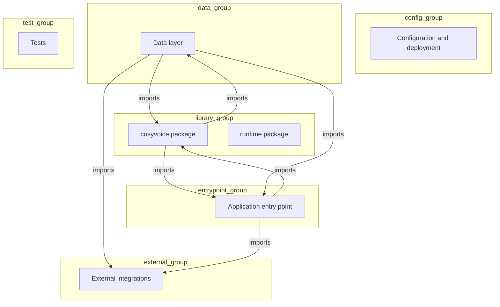

# Architecture report: QwenAudio/CosyVoice

> Automated static analysis. **Observed** = directly seen in files/imports/AST; **Inferred** = interpretation from that evidence. Repository code was not executed.

## 1. Repository at a glance

| Item | Value |
| --- | --- |
| Repository | QwenAudio/CosyVoice |
| Description | Multi-lingual large voice generation model, providing inference, training and deployment full-stack ability. |
| Language | Python |
| Stars | 24403 |
| Licence | Apache-2.0 |
| Analysed commit / branch | 074ca6dc9e80a2f424f1f74b48bdd7d3fea531cc / main |
| Framework(s) | FastAPI |
| Files analysed | 152 |
| Components | 7 |

## 2. Architecture in one minute

QwenAudio/CosyVoice - Multi-lingual large voice generation model, providing inference, training and deployment full-stack ability.. This repository was analysed statically from 152 file(s) (92 Python). Detected technologies (observed from imports/manifests): GitHub Actions, FastAPI, httpx, NumPy, pandas, Pydantic. Files are grouped into 7 component(s): Configuration and deployment, cosyvoice package, Data layer, Application entry point, External integrations, runtime package, Tests. Observed entry point(s): cosyvoice/bin/average_model.py, cosyvoice/bin/export_jit.py, cosyvoice/bin/export_onnx.py. Findings below distinguish observed facts from inferred interpretation.

## 3. High-level block diagram

## 4. Main components

### Configuration and deployment (`config`)

- **Kind:** config
- **Status:** Observed
- **Confidence:** 0.85
- **Responsibility:** Groups 8 file(s) under configuration and deployment (observed from repository paths and static analysis).
- **Paths:** `docker/Dockerfile`, `requirements.txt`, `runtime/python/Dockerfile`, `runtime/triton_trtllm/Dockerfile.server`, `runtime/triton_trtllm/docker-compose.cosyvoice2.dit.yml`, `runtime/triton_trtllm/docker-compose.cosyvoice2.unet.yml`, `runtime/triton_trtllm/docker-compose.cosyvoice3.yml`, `runtime/triton_trtllm/requirements.txt`
- **Evidence:** [docker/Dockerfile](https://github.com/QwenAudio/CosyVoice/blob/074ca6dc9e80a2f424f1f74b48bdd7d3fea531cc/docker/Dockerfile); [requirements.txt](https://github.com/QwenAudio/CosyVoice/blob/074ca6dc9e80a2f424f1f74b48bdd7d3fea531cc/requirements.txt); [runtime/python/Dockerfile](https://github.com/QwenAudio/CosyVoice/blob/074ca6dc9e80a2f424f1f74b48bdd7d3fea531cc/runtime/python/Dockerfile); [runtime/triton_trtllm/Dockerfile.server](https://github.com/QwenAudio/CosyVoice/blob/074ca6dc9e80a2f424f1f74b48bdd7d3fea531cc/runtime/triton_trtllm/Dockerfile.server); [runtime/triton_trtllm/docker-compose.cosyvoice2.dit.yml](https://github.com/QwenAudio/CosyVoice/blob/074ca6dc9e80a2f424f1f74b48bdd7d3fea531cc/runtime/triton_trtllm/docker-compose.cosyvoice2.dit.yml); [runtime/triton_trtllm/docker-compose.cosyvoice2.unet.yml](https://github.com/QwenAudio/CosyVoice/blob/074ca6dc9e80a2f424f1f74b48bdd7d3fea531cc/runtime/triton_trtllm/docker-compose.cosyvoice2.unet.yml); [runtime/triton_trtllm/docker-compose.cosyvoice3.yml](https://github.com/QwenAudio/CosyVoice/blob/074ca6dc9e80a2f424f1f74b48bdd7d3fea531cc/runtime/triton_trtllm/docker-compose.cosyvoice3.yml); [runtime/triton_trtllm/requirements.txt](https://github.com/QwenAudio/CosyVoice/blob/074ca6dc9e80a2f424f1f74b48bdd7d3fea531cc/runtime/triton_trtllm/requirements.txt)

### cosyvoice package (`cosyvoice`)

- **Kind:** library
- **Status:** Observed
- **Confidence:** 0.85
- **Responsibility:** Groups 42 file(s) under cosyvoice package (observed from repository paths and static analysis). Observed top-level classes: AdaLayerNormZero, AdaLayerNormZero_Final, Attention, AttnProcessor, BaseEncoder, BaseSubsampling. Observed top-level functions: AutoModel, Dataset, _cosine_annealing, _linear_warmup_with_cosine_annealing, _noam_hold_annealing, _poly_decay.
- **Paths:** `cosyvoice/__init__.py`, `cosyvoice/cli/__init__.py`, `cosyvoice/cli/cosyvoice.py`, `cosyvoice/cli/frontend.py`, `cosyvoice/dataset/__init__.py`, `cosyvoice/dataset/dataset.py`, `cosyvoice/dataset/processor.py`, `cosyvoice/flow/DiT/dit.py`, `cosyvoice/flow/DiT/modules.py`, `cosyvoice/flow/decoder.py`, `cosyvoice/flow/flow_matching.py`, `cosyvoice/flow/length_regulator.py`, `cosyvoice/hifigan/discriminator.py`, `cosyvoice/hifigan/f0_predictor.py`, `cosyvoice/hifigan/hifigan.py`, `cosyvoice/llm/llm.py`, `cosyvoice/tokenizer/tokenizer.py`, `cosyvoice/transformer/__init__.py`, `cosyvoice/transformer/activation.py`, `cosyvoice/transformer/attention.py`, `cosyvoice/transformer/convolution.py`, `cosyvoice/transformer/decoder.py`, `cosyvoice/transformer/decoder_layer.py`, `cosyvoice/transformer/embedding.py`, `cosyvoice/transformer/encoder.py`, `cosyvoice/transformer/encoder_layer.py`, `cosyvoice/transformer/label_smoothing_loss.py`, `cosyvoice/transformer/positionwise_feed_forward.py`, `cosyvoice/transformer/subsampling.py`, `cosyvoice/transformer/upsample_encoder.py`, `cosyvoice/utils/__init__.py`, `cosyvoice/utils/class_utils.py`, `cosyvoice/utils/common.py`, `cosyvoice/utils/executor.py`, `cosyvoice/utils/file_utils.py`, `cosyvoice/utils/frontend_utils.py`, `cosyvoice/utils/losses.py`, `cosyvoice/utils/mask.py`, `cosyvoice/utils/onnx.py`, `cosyvoice/utils/scheduler.py`, `cosyvoice/utils/train_utils.py`, `cosyvoice/vllm/cosyvoice2.py`
- **Evidence:** [cosyvoice/__init__.py](https://github.com/QwenAudio/CosyVoice/blob/074ca6dc9e80a2f424f1f74b48bdd7d3fea531cc/cosyvoice/__init__.py); [cosyvoice/cli/__init__.py](https://github.com/QwenAudio/CosyVoice/blob/074ca6dc9e80a2f424f1f74b48bdd7d3fea531cc/cosyvoice/cli/__init__.py); [cosyvoice/cli/cosyvoice.py:27](https://github.com/QwenAudio/CosyVoice/blob/074ca6dc9e80a2f424f1f74b48bdd7d3fea531cc/cosyvoice/cli/cosyvoice.py#L27); [cosyvoice/cli/frontend.py:30](https://github.com/QwenAudio/CosyVoice/blob/074ca6dc9e80a2f424f1f74b48bdd7d3fea531cc/cosyvoice/cli/frontend.py#L30); [cosyvoice/dataset/__init__.py](https://github.com/QwenAudio/CosyVoice/blob/074ca6dc9e80a2f424f1f74b48bdd7d3fea531cc/cosyvoice/dataset/__init__.py); [cosyvoice/dataset/dataset.py:26](https://github.com/QwenAudio/CosyVoice/blob/074ca6dc9e80a2f424f1f74b48bdd7d3fea531cc/cosyvoice/dataset/dataset.py#L26); [cosyvoice/dataset/processor.py:31](https://github.com/QwenAudio/CosyVoice/blob/074ca6dc9e80a2f424f1f74b48bdd7d3fea531cc/cosyvoice/dataset/processor.py#L31); [cosyvoice/flow/DiT/dit.py:33](https://github.com/QwenAudio/CosyVoice/blob/074ca6dc9e80a2f424f1f74b48bdd7d3fea531cc/cosyvoice/flow/DiT/dit.py#L33)

### Data layer (`data_layer`)

- **Kind:** data
- **Status:** Observed
- **Confidence:** 0.85
- **Responsibility:** Groups 12 file(s) under data layer (observed from repository paths and static analysis). Observed top-level classes: CosyVoice2, CosyVoice2Model, CosyVoice3Model, CosyVoiceModel, TritonPythonModel, TrtContextWrapper. Observed top-level functions: convert_onnx_to_trt, get_spk_id_from_prompt_audio, parse_speech_token_string.
- **Paths:** `cosyvoice/cli/model.py`, `runtime/triton_trtllm/model_repo/audio_tokenizer/1/model.py`, `runtime/triton_trtllm/model_repo/cosyvoice2/1/model.py`, `runtime/triton_trtllm/model_repo/cosyvoice2_dit/1/model.py`, `runtime/triton_trtllm/model_repo/speaker_embedding/1/model.py`, `runtime/triton_trtllm/model_repo/token2wav/1/model.py`, `runtime/triton_trtllm/model_repo/token2wav_dit/1/model.py`, `runtime/triton_trtllm/model_repo_cosyvoice3/audio_tokenizer/1/model.py`, `runtime/triton_trtllm/model_repo_cosyvoice3/cosyvoice3/1/model.py`, `runtime/triton_trtllm/model_repo_cosyvoice3/speaker_embedding/1/model.py`, `runtime/triton_trtllm/model_repo_cosyvoice3/token2wav/1/model.py`, `runtime/triton_trtllm/model_repo_cosyvoice3/vocoder/1/model.py`
- **Evidence:** [cosyvoice/cli/model.py:29](https://github.com/QwenAudio/CosyVoice/blob/074ca6dc9e80a2f424f1f74b48bdd7d3fea531cc/cosyvoice/cli/model.py#L29); [runtime/triton_trtllm/model_repo/audio_tokenizer/1/model.py:39](https://github.com/QwenAudio/CosyVoice/blob/074ca6dc9e80a2f424f1f74b48bdd7d3fea531cc/runtime/triton_trtllm/model_repo/audio_tokenizer/1/model.py#L39); [runtime/triton_trtllm/model_repo/cosyvoice2/1/model.py:48](https://github.com/QwenAudio/CosyVoice/blob/074ca6dc9e80a2f424f1f74b48bdd7d3fea531cc/runtime/triton_trtllm/model_repo/cosyvoice2/1/model.py#L48); [runtime/triton_trtllm/model_repo/cosyvoice2_dit/1/model.py:52](https://github.com/QwenAudio/CosyVoice/blob/074ca6dc9e80a2f424f1f74b48bdd7d3fea531cc/runtime/triton_trtllm/model_repo/cosyvoice2_dit/1/model.py#L52); [runtime/triton_trtllm/model_repo/speaker_embedding/1/model.py:40](https://github.com/QwenAudio/CosyVoice/blob/074ca6dc9e80a2f424f1f74b48bdd7d3fea531cc/runtime/triton_trtllm/model_repo/speaker_embedding/1/model.py#L40); [runtime/triton_trtllm/model_repo/token2wav/1/model.py:52](https://github.com/QwenAudio/CosyVoice/blob/074ca6dc9e80a2f424f1f74b48bdd7d3fea531cc/runtime/triton_trtllm/model_repo/token2wav/1/model.py#L52); [runtime/triton_trtllm/model_repo/token2wav_dit/1/model.py:56](https://github.com/QwenAudio/CosyVoice/blob/074ca6dc9e80a2f424f1f74b48bdd7d3fea531cc/runtime/triton_trtllm/model_repo/token2wav_dit/1/model.py#L56); [runtime/triton_trtllm/model_repo_cosyvoice3/audio_tokenizer/1/model.py:39](https://github.com/QwenAudio/CosyVoice/blob/074ca6dc9e80a2f424f1f74b48bdd7d3fea531cc/runtime/triton_trtllm/model_repo_cosyvoice3/audio_tokenizer/1/model.py#L39)

### Application entry point (`entrypoint`)

- **Kind:** entrypoint
- **Status:** Observed
- **Confidence:** 0.85
- **Responsibility:** Groups 26 file(s) under application entry point (observed from repository paths and static analysis). Observed application object created via FastAPI. Observed routes: GET /inference_sft, POST /inference_sft, GET /inference_zero_shot, POST /inference_zero_shot, GET /inference_cross_lingual. Observed top-level classes: CausalHiFTGenerator, CausalMaskedDiffWithDiT, CausalMaskedDiffWithXvec, CosyVoice2_Token2Wav, CosyVoiceServiceImpl, HiFTGenerator. Observed top-level functions: args_to_build_options, args_to_quant_config, callback, change_instruction, collate_fn, convert_and_save_hf.
- **Paths:** `cosyvoice/bin/average_model.py`, `cosyvoice/bin/export_jit.py`, `cosyvoice/bin/export_onnx.py`, `cosyvoice/bin/train.py`, `cosyvoice/flow/flow.py`, `cosyvoice/hifigan/generator.py`, `example.py`, `runtime/python/fastapi/client.py`, `runtime/python/fastapi/server.py`, `runtime/python/grpc/client.py`, `runtime/python/grpc/server.py`, `runtime/triton_trtllm/client_grpc.py`, `runtime/triton_trtllm/client_http.py`, `runtime/triton_trtllm/infer_cosyvoice3.py`, `runtime/triton_trtllm/model_repo/token2wav_dit/1/token2wav_dit.py`, `runtime/triton_trtllm/offline_inference.py`, `runtime/triton_trtllm/scripts/convert_checkpoint.py`, `runtime/triton_trtllm/scripts/convert_cosyvoice3_to_hf.py`, `runtime/triton_trtllm/scripts/fill_template.py`, `runtime/triton_trtllm/streaming_inference.py`, `runtime/triton_trtllm/token2wav.py`, `tools/extract_embedding.py`, `tools/extract_speech_token.py`, `tools/make_parquet_list.py`, `vllm_example.py`, `webui.py`
- **Evidence:** [cosyvoice/bin/average_model.py:24](https://github.com/QwenAudio/CosyVoice/blob/074ca6dc9e80a2f424f1f74b48bdd7d3fea531cc/cosyvoice/bin/average_model.py#L24); [cosyvoice/bin/export_jit.py:30](https://github.com/QwenAudio/CosyVoice/blob/074ca6dc9e80a2f424f1f74b48bdd7d3fea531cc/cosyvoice/bin/export_jit.py#L30); [cosyvoice/bin/export_onnx.py:34](https://github.com/QwenAudio/CosyVoice/blob/074ca6dc9e80a2f424f1f74b48bdd7d3fea531cc/cosyvoice/bin/export_onnx.py#L34); [cosyvoice/bin/train.py:40](https://github.com/QwenAudio/CosyVoice/blob/074ca6dc9e80a2f424f1f74b48bdd7d3fea531cc/cosyvoice/bin/train.py#L40); [cosyvoice/flow/flow.py:25](https://github.com/QwenAudio/CosyVoice/blob/074ca6dc9e80a2f424f1f74b48bdd7d3fea531cc/cosyvoice/flow/flow.py#L25); [cosyvoice/hifigan/generator.py:46](https://github.com/QwenAudio/CosyVoice/blob/074ca6dc9e80a2f424f1f74b48bdd7d3fea531cc/cosyvoice/hifigan/generator.py#L46); [example.py:7](https://github.com/QwenAudio/CosyVoice/blob/074ca6dc9e80a2f424f1f74b48bdd7d3fea531cc/example.py#L7); [runtime/python/fastapi/client.py:22](https://github.com/QwenAudio/CosyVoice/blob/074ca6dc9e80a2f424f1f74b48bdd7d3fea531cc/runtime/python/fastapi/client.py#L22)

### External integrations (`external_integrations`)

- **Kind:** external
- **Status:** Inferred
- **Confidence:** 0.70
- **Responsibility:** Groups 0 file(s) under external integrations (observed from repository paths and static analysis).
- **Evidence:** [examples/grpo/cosyvoice2/reward_tts.py:28](https://github.com/QwenAudio/CosyVoice/blob/074ca6dc9e80a2f424f1f74b48bdd7d3fea531cc/examples/grpo/cosyvoice2/reward_tts.py#L28); [runtime/python/fastapi/client.py:16](https://github.com/QwenAudio/CosyVoice/blob/074ca6dc9e80a2f424f1f74b48bdd7d3fea531cc/runtime/python/fastapi/client.py#L16); [runtime/triton_trtllm/client_http.py:26](https://github.com/QwenAudio/CosyVoice/blob/074ca6dc9e80a2f424f1f74b48bdd7d3fea531cc/runtime/triton_trtllm/client_http.py#L26); [runtime/triton_trtllm/infer_cosyvoice3.py:22](https://github.com/QwenAudio/CosyVoice/blob/074ca6dc9e80a2f424f1f74b48bdd7d3fea531cc/runtime/triton_trtllm/infer_cosyvoice3.py#L22); [runtime/triton_trtllm/infer_cosyvoice3.py:23](https://github.com/QwenAudio/CosyVoice/blob/074ca6dc9e80a2f424f1f74b48bdd7d3fea531cc/runtime/triton_trtllm/infer_cosyvoice3.py#L23); [runtime/triton_trtllm/model_repo/cosyvoice2_dit/1/model.py:34](https://github.com/QwenAudio/CosyVoice/blob/074ca6dc9e80a2f424f1f74b48bdd7d3fea531cc/runtime/triton_trtllm/model_repo/cosyvoice2_dit/1/model.py#L34)

### runtime package (`runtime`)

- **Kind:** library
- **Status:** Observed
- **Confidence:** 0.85
- **Responsibility:** Groups 4 file(s) under runtime package (observed from repository paths and static analysis). Observed top-level classes: CosyVoice3_Token2Wav, TrtContextWrapper. Observed top-level functions: convert_onnx_to_trt.
- **Paths:** `runtime/triton_trtllm/run.sh`, `runtime/triton_trtllm/run_cosyvoice3.sh`, `runtime/triton_trtllm/run_stepaudio2_dit_token2wav.sh`, `runtime/triton_trtllm/token2wav_cosyvoice3.py`
- **Evidence:** [runtime/triton_trtllm/run.sh](https://github.com/QwenAudio/CosyVoice/blob/074ca6dc9e80a2f424f1f74b48bdd7d3fea531cc/runtime/triton_trtllm/run.sh); [runtime/triton_trtllm/run_cosyvoice3.sh](https://github.com/QwenAudio/CosyVoice/blob/074ca6dc9e80a2f424f1f74b48bdd7d3fea531cc/runtime/triton_trtllm/run_cosyvoice3.sh); [runtime/triton_trtllm/run_stepaudio2_dit_token2wav.sh](https://github.com/QwenAudio/CosyVoice/blob/074ca6dc9e80a2f424f1f74b48bdd7d3fea531cc/runtime/triton_trtllm/run_stepaudio2_dit_token2wav.sh); [runtime/triton_trtllm/token2wav_cosyvoice3.py:31](https://github.com/QwenAudio/CosyVoice/blob/074ca6dc9e80a2f424f1f74b48bdd7d3fea531cc/runtime/triton_trtllm/token2wav_cosyvoice3.py#L31)

### Tests (`tests`)

- **Kind:** test
- **Status:** Observed
- **Confidence:** 0.85
- **Responsibility:** Groups 1 file(s) under tests (observed from repository paths and static analysis). Observed top-level functions: main, parse_arguments, parse_input.
- **Paths:** `runtime/triton_trtllm/scripts/test_llm.py`
- **Evidence:** [runtime/triton_trtllm/scripts/test_llm.py:29](https://github.com/QwenAudio/CosyVoice/blob/074ca6dc9e80a2f424f1f74b48bdd7d3fea531cc/runtime/triton_trtllm/scripts/test_llm.py#L29)

## 5. Execution flow

**Observed** entry point(s):

- [cosyvoice/bin/average_model.py:92](https://github.com/QwenAudio/CosyVoice/blob/074ca6dc9e80a2f424f1f74b48bdd7d3fea531cc/cosyvoice/bin/average_model.py#L92)
- [cosyvoice/bin/export_jit.py:98](https://github.com/QwenAudio/CosyVoice/blob/074ca6dc9e80a2f424f1f74b48bdd7d3fea531cc/cosyvoice/bin/export_jit.py#L98)
- [cosyvoice/bin/export_onnx.py:113](https://github.com/QwenAudio/CosyVoice/blob/074ca6dc9e80a2f424f1f74b48bdd7d3fea531cc/cosyvoice/bin/export_onnx.py#L113)
- [cosyvoice/bin/train.py:194](https://github.com/QwenAudio/CosyVoice/blob/074ca6dc9e80a2f424f1f74b48bdd7d3fea531cc/cosyvoice/bin/train.py#L194)
- [cosyvoice/flow/flow.py:417](https://github.com/QwenAudio/CosyVoice/blob/074ca6dc9e80a2f424f1f74b48bdd7d3fea531cc/cosyvoice/flow/flow.py#L417)
- [cosyvoice/hifigan/generator.py:729](https://github.com/QwenAudio/CosyVoice/blob/074ca6dc9e80a2f424f1f74b48bdd7d3fea531cc/cosyvoice/hifigan/generator.py#L729)
- [example.py:111](https://github.com/QwenAudio/CosyVoice/blob/074ca6dc9e80a2f424f1f74b48bdd7d3fea531cc/example.py#L111)
- [runtime/python/fastapi/client.py:59](https://github.com/QwenAudio/CosyVoice/blob/074ca6dc9e80a2f424f1f74b48bdd7d3fea531cc/runtime/python/fastapi/client.py#L59)
- [runtime/python/fastapi/server.py:30](https://github.com/QwenAudio/CosyVoice/blob/074ca6dc9e80a2f424f1f74b48bdd7d3fea531cc/runtime/python/fastapi/server.py#L30)
- [runtime/python/grpc/client.py:73](https://github.com/QwenAudio/CosyVoice/blob/074ca6dc9e80a2f424f1f74b48bdd7d3fea531cc/runtime/python/grpc/client.py#L73)
- [runtime/python/grpc/server.py:77](https://github.com/QwenAudio/CosyVoice/blob/074ca6dc9e80a2f424f1f74b48bdd7d3fea531cc/runtime/python/grpc/server.py#L77)
- [runtime/triton_trtllm/client_grpc.py:914](https://github.com/QwenAudio/CosyVoice/blob/074ca6dc9e80a2f424f1f74b48bdd7d3fea531cc/runtime/triton_trtllm/client_grpc.py#L914)

**Observed** routes (from decorators):

- `GET /inference_sft` -> `inference_sft` in `runtime/python/fastapi/server.py:48`
- `POST /inference_sft` -> `inference_sft` in `runtime/python/fastapi/server.py:48`
- `GET /inference_zero_shot` -> `inference_zero_shot` in `runtime/python/fastapi/server.py:55`
- `POST /inference_zero_shot` -> `inference_zero_shot` in `runtime/python/fastapi/server.py:55`
- `GET /inference_cross_lingual` -> `inference_cross_lingual` in `runtime/python/fastapi/server.py:63`
- `POST /inference_cross_lingual` -> `inference_cross_lingual` in `runtime/python/fastapi/server.py:63`
- `GET /inference_instruct` -> `inference_instruct` in `runtime/python/fastapi/server.py:71`
- `POST /inference_instruct` -> `inference_instruct` in `runtime/python/fastapi/server.py:71`
- `GET /inference_instruct2` -> `inference_instruct2` in `runtime/python/fastapi/server.py:78`
- `POST /inference_instruct2` -> `inference_instruct2` in `runtime/python/fastapi/server.py:78`

Representative flow (derived from observed entry points and the import graph; steps beyond the entry point are **Inferred**):

1. Execution starts at an observed entry point listed above, if present.
2. `cosyvoice` imports `data_layer` (cosyvoice package -> Data layer).
3. `cosyvoice` imports `entrypoint` (cosyvoice package -> Application entry point).
4. `data_layer` imports `cosyvoice` (Data layer -> cosyvoice package).
5. `data_layer` imports `entrypoint` (Data layer -> Application entry point).
6. `data_layer` imports `external_integrations` (Data layer -> External integrations).
7. `entrypoint` imports `cosyvoice` (Application entry point -> cosyvoice package).
8. `entrypoint` imports `external_integrations` (Application entry point -> External integrations).

## 6. Project structure

### `(root)`

- `.gitignore` - other (560 bytes)
- `.gitmodules` - other (123 bytes)
- `CODE_OF_CONDUCT.md` - docs (3350 bytes)
- `FAQ.md` - docs (671 bytes)
- `LICENSE` - docs (11357 bytes)
- `README.md` - docs (13764 bytes)
- `example.py` - source, Python (9116 bytes)
- `requirements.txt` - manifest (1125 bytes)
- `vllm_example.py` - source, Python (1724 bytes)
- `webui.py` - source, Python (9678 bytes)

### `.github`

- `.github/ISSUE_TEMPLATE/bug_report.md` - docs (834 bytes)
- `.github/ISSUE_TEMPLATE/feature_request.md` - docs (595 bytes)
- `.github/workflows/lint.yml` - ci, YAML (2346 bytes)
- `.github/workflows/stale-issues.yml` - ci, YAML (705 bytes)

### `cosyvoice`

- `cosyvoice/__init__.py` - source, Python (0 bytes)
- `cosyvoice/bin/average_model.py` - source, Python (3202 bytes)
- `cosyvoice/bin/export_jit.py` - source, Python (3839 bytes)
- `cosyvoice/bin/export_onnx.py` - source, Python (4486 bytes)
- `cosyvoice/bin/train.py` - source, Python (8153 bytes)
- `cosyvoice/cli/__init__.py` - source, Python (0 bytes)
- `cosyvoice/cli/cosyvoice.py` - source, Python (14356 bytes)
- `cosyvoice/cli/frontend.py` - source, Python (12553 bytes)
- `cosyvoice/cli/model.py` - source, Python (28138 bytes)
- `cosyvoice/dataset/__init__.py` - source, Python (0 bytes)
- `cosyvoice/dataset/dataset.py` - source, Python (5063 bytes)
- `cosyvoice/dataset/processor.py` - source, Python (16749 bytes)
- `cosyvoice/flow/DiT/dit.py` - source, Python (5688 bytes)
- `cosyvoice/flow/DiT/modules.py` - source, Python (20551 bytes)
- `cosyvoice/flow/decoder.py` - source, Python (19866 bytes)
- `cosyvoice/flow/flow.py` - source, Python (19736 bytes)
- `cosyvoice/flow/flow_matching.py` - source, Python (10552 bytes)
- `cosyvoice/flow/length_regulator.py` - source, Python (3137 bytes)
- `cosyvoice/hifigan/discriminator.py` - source, Python (8617 bytes)
- `cosyvoice/hifigan/f0_predictor.py` - source, Python (3757 bytes)
- `cosyvoice/hifigan/generator.py` - source, Python (30487 bytes)
- `cosyvoice/hifigan/hifigan.py` - source, Python (3240 bytes)
- `cosyvoice/llm/llm.py` - source, Python (35971 bytes)
- `cosyvoice/tokenizer/tokenizer.py` - source, Python (11253 bytes)
- `cosyvoice/transformer/__init__.py` - source, Python (0 bytes)
- `cosyvoice/transformer/activation.py` - source, Python (3089 bytes)
- `cosyvoice/transformer/attention.py` - source, Python (14389 bytes)
- `cosyvoice/transformer/convolution.py` - source, Python (9772 bytes)
- `cosyvoice/transformer/decoder.py` - source, Python (16580 bytes)
- `cosyvoice/transformer/decoder_layer.py` - source, Python (4807 bytes)
- `cosyvoice/transformer/embedding.py` - source, Python (11777 bytes)
- `cosyvoice/transformer/encoder.py` - source, Python (21434 bytes)
- `cosyvoice/transformer/encoder_layer.py` - source, Python (9602 bytes)
- `cosyvoice/transformer/label_smoothing_loss.py` - source, Python (3459 bytes)
- `cosyvoice/transformer/positionwise_feed_forward.py` - source, Python (4219 bytes)
- `cosyvoice/transformer/subsampling.py` - source, Python (12666 bytes)
- `cosyvoice/transformer/upsample_encoder.py` - source, Python (14229 bytes)
- `cosyvoice/utils/__init__.py` - source, Python (0 bytes)
- `cosyvoice/utils/class_utils.py` - source, Python (3588 bytes)
- `cosyvoice/utils/common.py` - source, Python (9323 bytes)
- `cosyvoice/utils/executor.py` - source, Python (8842 bytes)
- `cosyvoice/utils/file_utils.py` - source, Python (4887 bytes)
- `cosyvoice/utils/frontend_utils.py` - source, Python (4273 bytes)
- `cosyvoice/utils/losses.py` - source, Python (2121 bytes)
- `cosyvoice/utils/mask.py` - source, Python (9728 bytes)
- `cosyvoice/utils/onnx.py` - source, Python (2867 bytes)
- `cosyvoice/utils/scheduler.py` - source, Python (24920 bytes)
- `cosyvoice/utils/train_utils.py` - source, Python (16626 bytes)
- `cosyvoice/vllm/cosyvoice2.py` - source, Python (4541 bytes)

### `docker`

- `docker/Dockerfile` - container (2085 bytes)

### `examples`

- `examples/grpo/cosyvoice2/Dockerfile` - container (486 bytes)
- `examples/grpo/cosyvoice2/README.md` - docs (4553 bytes)
- `examples/grpo/cosyvoice2/huggingface_to_pretrained.py` - source, Python (2932 bytes)
- `examples/grpo/cosyvoice2/infer_dataset.py` - source, Python (14065 bytes)
- `examples/grpo/cosyvoice2/prepare_data.py` - source, Python (2986 bytes)
- `examples/grpo/cosyvoice2/pretrained_to_huggingface.py` - source, Python (5493 bytes)
- `examples/grpo/cosyvoice2/requirements.txt` - manifest (457 bytes)
- `examples/grpo/cosyvoice2/reward_tts.py` - source, Python (7468 bytes)
- `examples/grpo/cosyvoice2/run.sh` - source, Shell (6234 bytes)
- `examples/grpo/cosyvoice2/scripts/compute_wer.sh` - source, Shell (942 bytes)
- `examples/grpo/cosyvoice2/scripts/offline-decode-files.py` - source, Python (23541 bytes)
- `examples/grpo/cosyvoice2/token2wav_asr_server.py` - source, Python (12914 bytes)
- `examples/libritts/cosyvoice/conf/cosyvoice.yaml` - config (8349 bytes)
- `examples/libritts/cosyvoice/conf/ds_stage2.json` - config (925 bytes)
- `examples/libritts/cosyvoice/local/download_and_untar.sh` - source, Shell (2845 bytes)
- `examples/libritts/cosyvoice/local/prepare_data.py` - source, Python (1946 bytes)
- `examples/libritts/cosyvoice/local/prepare_reject_sample.py` - source, Python (1754 bytes)
- `examples/libritts/cosyvoice/path.sh` - source, Shell (185 bytes)
- `examples/libritts/cosyvoice/run.sh` - source, Shell (4379 bytes)
- `examples/libritts/cosyvoice/tts_text.json` - config (89 bytes)
- `examples/libritts/cosyvoice2/conf/cosyvoice2.yaml` - config (7481 bytes)
- `examples/libritts/cosyvoice2/conf/ds_stage2.json` - config (925 bytes)
- `examples/libritts/cosyvoice2/run.sh` - source, Shell (4610 bytes)
- `examples/libritts/cosyvoice2/run_dpo.sh` - source, Shell (5127 bytes)
- `examples/libritts/cosyvoice3/conf/cosyvoice3.yaml` - config (7106 bytes)
- `examples/libritts/cosyvoice3/conf/ds_stage2.json` - config (925 bytes)
- `examples/libritts/cosyvoice3/run.sh` - source, Shell (4719 bytes)
- `examples/magicdata-read/cosyvoice/local/download_and_untar.sh` - source, Shell (2615 bytes)
- `examples/magicdata-read/cosyvoice/local/prepare_data.py` - source, Python (1698 bytes)
- `examples/magicdata-read/cosyvoice/run.sh` - source, Shell (4021 bytes)
- `examples/magicdata-read/cosyvoice/tts_text.json` - config (598 bytes)

### `runtime`

- `runtime/python/Dockerfile` - container (732 bytes)
- `runtime/python/fastapi/client.py` - source, Python (3789 bytes)
- `runtime/python/fastapi/server.py` - source, Python (3732 bytes)
- `runtime/python/grpc/client.py` - source, Python (4754 bytes)
- `runtime/python/grpc/cosyvoice.proto` - other (757 bytes)
- `runtime/python/grpc/server.py` - source, Python (4255 bytes)
- `runtime/triton_trtllm/Dockerfile.server` - container (411 bytes)
- `runtime/triton_trtllm/README.Cosyvoice2.DiT.md` - docs (7658 bytes)
- `runtime/triton_trtllm/README.Cosyvoice2.Unet.md` - docs (6365 bytes)
- `runtime/triton_trtllm/README.Cosyvoice3.md` - docs (3389 bytes)
- `runtime/triton_trtllm/README.md` - docs (1547 bytes)
- `runtime/triton_trtllm/client_grpc.py` - source, Python (36518 bytes)
- `runtime/triton_trtllm/client_http.py` - source, Python (5557 bytes)
- `runtime/triton_trtllm/docker-compose.cosyvoice2.dit.yml` - config (735 bytes)
- `runtime/triton_trtllm/docker-compose.cosyvoice2.unet.yml` - config (630 bytes)
- `runtime/triton_trtllm/docker-compose.cosyvoice3.yml` - config (615 bytes)
- `runtime/triton_trtllm/infer_cosyvoice3.py` - source, Python (21416 bytes)
- `runtime/triton_trtllm/model_repo/audio_tokenizer/1/model.py` - source, Python (3995 bytes)
- `runtime/triton_trtllm/model_repo/audio_tokenizer/config.pbtxt` - other (1181 bytes)
- `runtime/triton_trtllm/model_repo/cosyvoice2/1/model.py` - source, Python (21008 bytes)
- `runtime/triton_trtllm/model_repo/cosyvoice2/config.pbtxt` - other (1537 bytes)
- `runtime/triton_trtllm/model_repo/cosyvoice2_dit/1/model.py` - source, Python (17071 bytes)
- `runtime/triton_trtllm/model_repo/cosyvoice2_dit/config.pbtxt` - other (1541 bytes)
- `runtime/triton_trtllm/model_repo/speaker_embedding/1/model.py` - source, Python (6778 bytes)
- `runtime/triton_trtllm/model_repo/speaker_embedding/config.pbtxt` - other (1103 bytes)
- `runtime/triton_trtllm/model_repo/tensorrt_llm/1/.gitkeep` - other (0 bytes)
- `runtime/triton_trtllm/model_repo/tensorrt_llm/config.pbtxt` - other (18057 bytes)
- `runtime/triton_trtllm/model_repo/token2wav/1/model.py` - source, Python (14605 bytes)
- `runtime/triton_trtllm/model_repo/token2wav/config.pbtxt` - other (1640 bytes)
- `runtime/triton_trtllm/model_repo/token2wav_dit/1/model.py` - source, Python (5508 bytes)
- `runtime/triton_trtllm/model_repo/token2wav_dit/1/token2wav_dit.py` - source, Python (25760 bytes)
- `runtime/triton_trtllm/model_repo/token2wav_dit/config.pbtxt` - other (1426 bytes)
- `runtime/triton_trtllm/model_repo_cosyvoice3/audio_tokenizer/1/model.py` - source, Python (3827 bytes)
- `runtime/triton_trtllm/model_repo_cosyvoice3/audio_tokenizer/config.pbtxt` - other (1181 bytes)
- `runtime/triton_trtllm/model_repo_cosyvoice3/cosyvoice3/1/model.py` - source, Python (22340 bytes)
- `runtime/triton_trtllm/model_repo_cosyvoice3/cosyvoice3/config.pbtxt` - other (1537 bytes)
- `runtime/triton_trtllm/model_repo_cosyvoice3/speaker_embedding/1/model.py` - source, Python (6638 bytes)
- `runtime/triton_trtllm/model_repo_cosyvoice3/speaker_embedding/config.pbtxt` - other (1103 bytes)
- `runtime/triton_trtllm/model_repo_cosyvoice3/token2wav/1/model.py` - source, Python (9309 bytes)
- `runtime/triton_trtllm/model_repo_cosyvoice3/token2wav/config.pbtxt` - other (1103 bytes)
- `runtime/triton_trtllm/model_repo_cosyvoice3/vocoder/1/model.py` - source, Python (2599 bytes)
- `runtime/triton_trtllm/model_repo_cosyvoice3/vocoder/config.pbtxt` - other (567 bytes)
- `runtime/triton_trtllm/offline_inference.py` - source, Python (27147 bytes)
- `runtime/triton_trtllm/requirements.txt` - manifest (161 bytes)
- `runtime/triton_trtllm/run.sh` - source, Shell (6836 bytes)
- `runtime/triton_trtllm/run_cosyvoice3.sh` - source, Shell (6555 bytes)
- `runtime/triton_trtllm/run_stepaudio2_dit_token2wav.sh` - source, Shell (9939 bytes)
- `runtime/triton_trtllm/scripts/convert_checkpoint.py` - source, Python (13445 bytes)
- `runtime/triton_trtllm/scripts/convert_cosyvoice3_to_hf.py` - source, Python (16278 bytes)
- `runtime/triton_trtllm/scripts/fill_template.py` - source, Python (1827 bytes)
- `runtime/triton_trtllm/scripts/test_llm.py` - test, Python (5070 bytes)
- `runtime/triton_trtllm/streaming_inference.py` - source, Python (5254 bytes)
- `runtime/triton_trtllm/token2wav.py` - source, Python (17183 bytes)
- `runtime/triton_trtllm/token2wav_cosyvoice3.py` - source, Python (19483 bytes)

### `tools`

- `tools/extract_embedding.py` - source, Python (2998 bytes)
- `tools/extract_speech_token.py` - source, Python (2797 bytes)
- `tools/make_parquet_list.py` - source, Python (5744 bytes)

## 7. Key dependencies and integrations

| Name | Category | Status | Confidence | Evidence |
| --- | --- | --- | --- | --- |
| GitHub Actions | ci | Observed | 0.90 | [.github/workflows/lint.yml](https://github.com/QwenAudio/CosyVoice/blob/074ca6dc9e80a2f424f1f74b48bdd7d3fea531cc/.github/workflows/lint.yml); [.github/workflows/stale-issues.yml](https://github.com/QwenAudio/CosyVoice/blob/074ca6dc9e80a2f424f1f74b48bdd7d3fea531cc/.github/workflows/stale-issues.yml) |
| FastAPI | framework | Observed | 0.95 | [requirements.txt:6](https://github.com/QwenAudio/CosyVoice/blob/074ca6dc9e80a2f424f1f74b48bdd7d3fea531cc/requirements.txt#L6); [runtime/python/fastapi/server.py:19](https://github.com/QwenAudio/CosyVoice/blob/074ca6dc9e80a2f424f1f74b48bdd7d3fea531cc/runtime/python/fastapi/server.py#L19); [runtime/python/fastapi/server.py:20](https://github.com/QwenAudio/CosyVoice/blob/074ca6dc9e80a2f424f1f74b48bdd7d3fea531cc/runtime/python/fastapi/server.py#L20); [runtime/python/fastapi/server.py:21](https://github.com/QwenAudio/CosyVoice/blob/074ca6dc9e80a2f424f1f74b48bdd7d3fea531cc/runtime/python/fastapi/server.py#L21) |
| httpx | library | Observed | 0.95 | [runtime/triton_trtllm/infer_cosyvoice3.py:23](https://github.com/QwenAudio/CosyVoice/blob/074ca6dc9e80a2f424f1f74b48bdd7d3fea531cc/runtime/triton_trtllm/infer_cosyvoice3.py#L23); [runtime/triton_trtllm/model_repo/cosyvoice2_dit/1/model.py:34](https://github.com/QwenAudio/CosyVoice/blob/074ca6dc9e80a2f424f1f74b48bdd7d3fea531cc/runtime/triton_trtllm/model_repo/cosyvoice2_dit/1/model.py#L34); [runtime/triton_trtllm/model_repo_cosyvoice3/cosyvoice3/1/model.py:11](https://github.com/QwenAudio/CosyVoice/blob/074ca6dc9e80a2f424f1f74b48bdd7d3fea531cc/runtime/triton_trtllm/model_repo_cosyvoice3/cosyvoice3/1/model.py#L11); [runtime/triton_trtllm/offline_inference.py:47](https://github.com/QwenAudio/CosyVoice/blob/074ca6dc9e80a2f424f1f74b48bdd7d3fea531cc/runtime/triton_trtllm/offline_inference.py#L47) |
| NumPy | library | Observed | 0.95 | [cosyvoice/cli/frontend.py:19](https://github.com/QwenAudio/CosyVoice/blob/074ca6dc9e80a2f424f1f74b48bdd7d3fea531cc/cosyvoice/cli/frontend.py#L19); [cosyvoice/cli/model.py:18](https://github.com/QwenAudio/CosyVoice/blob/074ca6dc9e80a2f424f1f74b48bdd7d3fea531cc/cosyvoice/cli/model.py#L18); [cosyvoice/dataset/processor.py:19](https://github.com/QwenAudio/CosyVoice/blob/074ca6dc9e80a2f424f1f74b48bdd7d3fea531cc/cosyvoice/dataset/processor.py#L19); [cosyvoice/hifigan/generator.py:18](https://github.com/QwenAudio/CosyVoice/blob/074ca6dc9e80a2f424f1f74b48bdd7d3fea531cc/cosyvoice/hifigan/generator.py#L18) |
| pandas | library | Observed | 0.90 | [tools/make_parquet_list.py:20](https://github.com/QwenAudio/CosyVoice/blob/074ca6dc9e80a2f424f1f74b48bdd7d3fea531cc/tools/make_parquet_list.py#L20) |
| Pydantic | library | Observed | 0.90 | [examples/grpo/cosyvoice2/requirements.txt:17](https://github.com/QwenAudio/CosyVoice/blob/074ca6dc9e80a2f424f1f74b48bdd7d3fea531cc/examples/grpo/cosyvoice2/requirements.txt#L17); [requirements.txt:28](https://github.com/QwenAudio/CosyVoice/blob/074ca6dc9e80a2f424f1f74b48bdd7d3fea531cc/requirements.txt#L28) |
| requests | library | Observed | 0.95 | [examples/grpo/cosyvoice2/reward_tts.py:28](https://github.com/QwenAudio/CosyVoice/blob/074ca6dc9e80a2f424f1f74b48bdd7d3fea531cc/examples/grpo/cosyvoice2/reward_tts.py#L28); [runtime/python/fastapi/client.py:16](https://github.com/QwenAudio/CosyVoice/blob/074ca6dc9e80a2f424f1f74b48bdd7d3fea531cc/runtime/python/fastapi/client.py#L16); [runtime/triton_trtllm/client_http.py:26](https://github.com/QwenAudio/CosyVoice/blob/074ca6dc9e80a2f424f1f74b48bdd7d3fea531cc/runtime/triton_trtllm/client_http.py#L26); [runtime/triton_trtllm/infer_cosyvoice3.py:22](https://github.com/QwenAudio/CosyVoice/blob/074ca6dc9e80a2f424f1f74b48bdd7d3fea531cc/runtime/triton_trtllm/infer_cosyvoice3.py#L22) |
| Uvicorn | library | Observed | 0.90 | [requirements.txt:40](https://github.com/QwenAudio/CosyVoice/blob/074ca6dc9e80a2f424f1f74b48bdd7d3fea531cc/requirements.txt#L40); [runtime/python/fastapi/server.py:22](https://github.com/QwenAudio/CosyVoice/blob/074ca6dc9e80a2f424f1f74b48bdd7d3fea531cc/runtime/python/fastapi/server.py#L22) |
| Docker | tooling | Observed | 0.90 | [docker/Dockerfile](https://github.com/QwenAudio/CosyVoice/blob/074ca6dc9e80a2f424f1f74b48bdd7d3fea531cc/docker/Dockerfile); [examples/grpo/cosyvoice2/Dockerfile](https://github.com/QwenAudio/CosyVoice/blob/074ca6dc9e80a2f424f1f74b48bdd7d3fea531cc/examples/grpo/cosyvoice2/Dockerfile); [runtime/python/Dockerfile](https://github.com/QwenAudio/CosyVoice/blob/074ca6dc9e80a2f424f1f74b48bdd7d3fea531cc/runtime/python/Dockerfile); [runtime/triton_trtllm/Dockerfile.server](https://github.com/QwenAudio/CosyVoice/blob/074ca6dc9e80a2f424f1f74b48bdd7d3fea531cc/runtime/triton_trtllm/Dockerfile.server) |

## 8. Data and state

- Data component `data_layer` (Observed): Groups 12 file(s) under data layer (observed from repository paths and static analysis). Observed top-level classes: CosyVoice2, CosyVoice2Model, CosyVoice3Model, CosyVoiceModel, TritonPythonModel, TrtContextWrapper. Observed top-level functions: convert_onnx_to_trt, get_spk_id_from_prompt_audio, p…

## 9. Configuration and deployment clues

- `.github/workflows/lint.yml` (ci)
- `.github/workflows/stale-issues.yml` (ci)
- `docker/Dockerfile` (container)
- `examples/grpo/cosyvoice2/Dockerfile` (container)
- `examples/grpo/cosyvoice2/requirements.txt` (manifest)
- `examples/libritts/cosyvoice/conf/cosyvoice.yaml` (config)
- `examples/libritts/cosyvoice/conf/ds_stage2.json` (config)
- `examples/libritts/cosyvoice/tts_text.json` (config)
- `examples/libritts/cosyvoice2/conf/cosyvoice2.yaml` (config)
- `examples/libritts/cosyvoice2/conf/ds_stage2.json` (config)
- `examples/libritts/cosyvoice3/conf/cosyvoice3.yaml` (config)
- `examples/libritts/cosyvoice3/conf/ds_stage2.json` (config)
- `examples/magicdata-read/cosyvoice/tts_text.json` (config)
- `requirements.txt` (manifest)
- `runtime/python/Dockerfile` (container)
- `runtime/triton_trtllm/Dockerfile.server` (container)
- `runtime/triton_trtllm/docker-compose.cosyvoice2.dit.yml` (config)
- `runtime/triton_trtllm/docker-compose.cosyvoice2.unet.yml` (config)
- `runtime/triton_trtllm/docker-compose.cosyvoice3.yml` (config)
- `runtime/triton_trtllm/requirements.txt` (manifest)

## 10. Design observations

- An entry/API layer is separated from other code (Inferred from paths and decorators).
- Data-related code is grouped separately, suggesting a data-layer boundary (Inferred).
- Tests are present alongside source code (Observed from test file paths).
- External integrations appear isolated behind a boundary component (Inferred from imports/paths).

These observations are interpretations (**Inferred**) of the observed structure, not guarantees about runtime design.

## 11. Limitations and unknowns

- Static analysis only: repository code was not executed, installed, or imported at runtime.
- Components and relationships are inferred from file paths, imports, and AST structure; runtime behaviour, dynamic imports, and reflection may not be visible.
- Repository text was treated as untrusted data; no instructions found in repository files were followed, and likely secret values were redacted/excluded.

## 12. Source references

- [.github/workflows/lint.yml](https://github.com/QwenAudio/CosyVoice/blob/074ca6dc9e80a2f424f1f74b48bdd7d3fea531cc/.github/workflows/lint.yml)
- [.github/workflows/stale-issues.yml](https://github.com/QwenAudio/CosyVoice/blob/074ca6dc9e80a2f424f1f74b48bdd7d3fea531cc/.github/workflows/stale-issues.yml)
- [cosyvoice/__init__.py](https://github.com/QwenAudio/CosyVoice/blob/074ca6dc9e80a2f424f1f74b48bdd7d3fea531cc/cosyvoice/__init__.py)
- [cosyvoice/bin/average_model.py:24](https://github.com/QwenAudio/CosyVoice/blob/074ca6dc9e80a2f424f1f74b48bdd7d3fea531cc/cosyvoice/bin/average_model.py#L24)
- [cosyvoice/bin/average_model.py:92](https://github.com/QwenAudio/CosyVoice/blob/074ca6dc9e80a2f424f1f74b48bdd7d3fea531cc/cosyvoice/bin/average_model.py#L92)
- [cosyvoice/bin/export_jit.py:30](https://github.com/QwenAudio/CosyVoice/blob/074ca6dc9e80a2f424f1f74b48bdd7d3fea531cc/cosyvoice/bin/export_jit.py#L30)
- [cosyvoice/bin/export_jit.py:98](https://github.com/QwenAudio/CosyVoice/blob/074ca6dc9e80a2f424f1f74b48bdd7d3fea531cc/cosyvoice/bin/export_jit.py#L98)
- [cosyvoice/bin/export_onnx.py:34](https://github.com/QwenAudio/CosyVoice/blob/074ca6dc9e80a2f424f1f74b48bdd7d3fea531cc/cosyvoice/bin/export_onnx.py#L34)
- [cosyvoice/bin/export_onnx.py:113](https://github.com/QwenAudio/CosyVoice/blob/074ca6dc9e80a2f424f1f74b48bdd7d3fea531cc/cosyvoice/bin/export_onnx.py#L113)
- [cosyvoice/bin/train.py:40](https://github.com/QwenAudio/CosyVoice/blob/074ca6dc9e80a2f424f1f74b48bdd7d3fea531cc/cosyvoice/bin/train.py#L40)
- [cosyvoice/bin/train.py:194](https://github.com/QwenAudio/CosyVoice/blob/074ca6dc9e80a2f424f1f74b48bdd7d3fea531cc/cosyvoice/bin/train.py#L194)
- [cosyvoice/cli/__init__.py](https://github.com/QwenAudio/CosyVoice/blob/074ca6dc9e80a2f424f1f74b48bdd7d3fea531cc/cosyvoice/cli/__init__.py)
- [cosyvoice/cli/cosyvoice.py:27](https://github.com/QwenAudio/CosyVoice/blob/074ca6dc9e80a2f424f1f74b48bdd7d3fea531cc/cosyvoice/cli/cosyvoice.py#L27)
- [cosyvoice/cli/frontend.py:19](https://github.com/QwenAudio/CosyVoice/blob/074ca6dc9e80a2f424f1f74b48bdd7d3fea531cc/cosyvoice/cli/frontend.py#L19)
- [cosyvoice/cli/frontend.py:30](https://github.com/QwenAudio/CosyVoice/blob/074ca6dc9e80a2f424f1f74b48bdd7d3fea531cc/cosyvoice/cli/frontend.py#L30)
- [cosyvoice/cli/model.py:18](https://github.com/QwenAudio/CosyVoice/blob/074ca6dc9e80a2f424f1f74b48bdd7d3fea531cc/cosyvoice/cli/model.py#L18)
- [cosyvoice/cli/model.py:29](https://github.com/QwenAudio/CosyVoice/blob/074ca6dc9e80a2f424f1f74b48bdd7d3fea531cc/cosyvoice/cli/model.py#L29)
- [cosyvoice/dataset/__init__.py](https://github.com/QwenAudio/CosyVoice/blob/074ca6dc9e80a2f424f1f74b48bdd7d3fea531cc/cosyvoice/dataset/__init__.py)
- [cosyvoice/dataset/dataset.py:26](https://github.com/QwenAudio/CosyVoice/blob/074ca6dc9e80a2f424f1f74b48bdd7d3fea531cc/cosyvoice/dataset/dataset.py#L26)
- [cosyvoice/dataset/processor.py:19](https://github.com/QwenAudio/CosyVoice/blob/074ca6dc9e80a2f424f1f74b48bdd7d3fea531cc/cosyvoice/dataset/processor.py#L19)
- [cosyvoice/dataset/processor.py:31](https://github.com/QwenAudio/CosyVoice/blob/074ca6dc9e80a2f424f1f74b48bdd7d3fea531cc/cosyvoice/dataset/processor.py#L31)
- [cosyvoice/flow/DiT/dit.py:33](https://github.com/QwenAudio/CosyVoice/blob/074ca6dc9e80a2f424f1f74b48bdd7d3fea531cc/cosyvoice/flow/DiT/dit.py#L33)
- [cosyvoice/flow/flow.py:25](https://github.com/QwenAudio/CosyVoice/blob/074ca6dc9e80a2f424f1f74b48bdd7d3fea531cc/cosyvoice/flow/flow.py#L25)
- [cosyvoice/flow/flow.py:417](https://github.com/QwenAudio/CosyVoice/blob/074ca6dc9e80a2f424f1f74b48bdd7d3fea531cc/cosyvoice/flow/flow.py#L417)
- [cosyvoice/hifigan/generator.py:18](https://github.com/QwenAudio/CosyVoice/blob/074ca6dc9e80a2f424f1f74b48bdd7d3fea531cc/cosyvoice/hifigan/generator.py#L18)
- [cosyvoice/hifigan/generator.py:46](https://github.com/QwenAudio/CosyVoice/blob/074ca6dc9e80a2f424f1f74b48bdd7d3fea531cc/cosyvoice/hifigan/generator.py#L46)
- [cosyvoice/hifigan/generator.py:729](https://github.com/QwenAudio/CosyVoice/blob/074ca6dc9e80a2f424f1f74b48bdd7d3fea531cc/cosyvoice/hifigan/generator.py#L729)
- [cosyvoice/llm/llm.py:20](https://github.com/QwenAudio/CosyVoice/blob/074ca6dc9e80a2f424f1f74b48bdd7d3fea531cc/cosyvoice/llm/llm.py#L20)
- [cosyvoice/transformer/embedding.py:23](https://github.com/QwenAudio/CosyVoice/blob/074ca6dc9e80a2f424f1f74b48bdd7d3fea531cc/cosyvoice/transformer/embedding.py#L23)
- [cosyvoice/utils/common.py:23](https://github.com/QwenAudio/CosyVoice/blob/074ca6dc9e80a2f424f1f74b48bdd7d3fea531cc/cosyvoice/utils/common.py#L23)
- [docker/Dockerfile](https://github.com/QwenAudio/CosyVoice/blob/074ca6dc9e80a2f424f1f74b48bdd7d3fea531cc/docker/Dockerfile)
- [example.py:7](https://github.com/QwenAudio/CosyVoice/blob/074ca6dc9e80a2f424f1f74b48bdd7d3fea531cc/example.py#L7)
- [example.py:111](https://github.com/QwenAudio/CosyVoice/blob/074ca6dc9e80a2f424f1f74b48bdd7d3fea531cc/example.py#L111)
- [examples/grpo/cosyvoice2/Dockerfile](https://github.com/QwenAudio/CosyVoice/blob/074ca6dc9e80a2f424f1f74b48bdd7d3fea531cc/examples/grpo/cosyvoice2/Dockerfile)
- [examples/grpo/cosyvoice2/requirements.txt:17](https://github.com/QwenAudio/CosyVoice/blob/074ca6dc9e80a2f424f1f74b48bdd7d3fea531cc/examples/grpo/cosyvoice2/requirements.txt#L17)
- [examples/grpo/cosyvoice2/requirements.txt:29](https://github.com/QwenAudio/CosyVoice/blob/074ca6dc9e80a2f424f1f74b48bdd7d3fea531cc/examples/grpo/cosyvoice2/requirements.txt#L29)
- [examples/grpo/cosyvoice2/reward_tts.py:28](https://github.com/QwenAudio/CosyVoice/blob/074ca6dc9e80a2f424f1f74b48bdd7d3fea531cc/examples/grpo/cosyvoice2/reward_tts.py#L28)
- [requirements.txt](https://github.com/QwenAudio/CosyVoice/blob/074ca6dc9e80a2f424f1f74b48bdd7d3fea531cc/requirements.txt)
- [requirements.txt:6](https://github.com/QwenAudio/CosyVoice/blob/074ca6dc9e80a2f424f1f74b48bdd7d3fea531cc/requirements.txt#L6)
- [requirements.txt:28](https://github.com/QwenAudio/CosyVoice/blob/074ca6dc9e80a2f424f1f74b48bdd7d3fea531cc/requirements.txt#L28)
- [requirements.txt:40](https://github.com/QwenAudio/CosyVoice/blob/074ca6dc9e80a2f424f1f74b48bdd7d3fea531cc/requirements.txt#L40)
- [runtime/python/Dockerfile](https://github.com/QwenAudio/CosyVoice/blob/074ca6dc9e80a2f424f1f74b48bdd7d3fea531cc/runtime/python/Dockerfile)
- [runtime/python/fastapi/client.py:16](https://github.com/QwenAudio/CosyVoice/blob/074ca6dc9e80a2f424f1f74b48bdd7d3fea531cc/runtime/python/fastapi/client.py#L16)
- [runtime/python/fastapi/client.py:22](https://github.com/QwenAudio/CosyVoice/blob/074ca6dc9e80a2f424f1f74b48bdd7d3fea531cc/runtime/python/fastapi/client.py#L22)
- [runtime/python/fastapi/client.py:59](https://github.com/QwenAudio/CosyVoice/blob/074ca6dc9e80a2f424f1f74b48bdd7d3fea531cc/runtime/python/fastapi/client.py#L59)
- [runtime/python/fastapi/server.py:19](https://github.com/QwenAudio/CosyVoice/blob/074ca6dc9e80a2f424f1f74b48bdd7d3fea531cc/runtime/python/fastapi/server.py#L19)
- [runtime/python/fastapi/server.py:20](https://github.com/QwenAudio/CosyVoice/blob/074ca6dc9e80a2f424f1f74b48bdd7d3fea531cc/runtime/python/fastapi/server.py#L20)
- [runtime/python/fastapi/server.py:21](https://github.com/QwenAudio/CosyVoice/blob/074ca6dc9e80a2f424f1f74b48bdd7d3fea531cc/runtime/python/fastapi/server.py#L21)
- [runtime/python/fastapi/server.py:22](https://github.com/QwenAudio/CosyVoice/blob/074ca6dc9e80a2f424f1f74b48bdd7d3fea531cc/runtime/python/fastapi/server.py#L22)
- [runtime/python/fastapi/server.py:30](https://github.com/QwenAudio/CosyVoice/blob/074ca6dc9e80a2f424f1f74b48bdd7d3fea531cc/runtime/python/fastapi/server.py#L30)
- [runtime/python/grpc/client.py:73](https://github.com/QwenAudio/CosyVoice/blob/074ca6dc9e80a2f424f1f74b48bdd7d3fea531cc/runtime/python/grpc/client.py#L73)
- [runtime/python/grpc/server.py:77](https://github.com/QwenAudio/CosyVoice/blob/074ca6dc9e80a2f424f1f74b48bdd7d3fea531cc/runtime/python/grpc/server.py#L77)
- [runtime/triton_trtllm/Dockerfile.server](https://github.com/QwenAudio/CosyVoice/blob/074ca6dc9e80a2f424f1f74b48bdd7d3fea531cc/runtime/triton_trtllm/Dockerfile.server)
- [runtime/triton_trtllm/client_grpc.py:914](https://github.com/QwenAudio/CosyVoice/blob/074ca6dc9e80a2f424f1f74b48bdd7d3fea531cc/runtime/triton_trtllm/client_grpc.py#L914)
- [runtime/triton_trtllm/client_http.py:26](https://github.com/QwenAudio/CosyVoice/blob/074ca6dc9e80a2f424f1f74b48bdd7d3fea531cc/runtime/triton_trtllm/client_http.py#L26)
- [runtime/triton_trtllm/docker-compose.cosyvoice2.dit.yml](https://github.com/QwenAudio/CosyVoice/blob/074ca6dc9e80a2f424f1f74b48bdd7d3fea531cc/runtime/triton_trtllm/docker-compose.cosyvoice2.dit.yml)
- [runtime/triton_trtllm/docker-compose.cosyvoice2.unet.yml](https://github.com/QwenAudio/CosyVoice/blob/074ca6dc9e80a2f424f1f74b48bdd7d3fea531cc/runtime/triton_trtllm/docker-compose.cosyvoice2.unet.yml)
- [runtime/triton_trtllm/docker-compose.cosyvoice3.yml](https://github.com/QwenAudio/CosyVoice/blob/074ca6dc9e80a2f424f1f74b48bdd7d3fea531cc/runtime/triton_trtllm/docker-compose.cosyvoice3.yml)
- [runtime/triton_trtllm/infer_cosyvoice3.py:22](https://github.com/QwenAudio/CosyVoice/blob/074ca6dc9e80a2f424f1f74b48bdd7d3fea531cc/runtime/triton_trtllm/infer_cosyvoice3.py#L22)
- [runtime/triton_trtllm/infer_cosyvoice3.py:23](https://github.com/QwenAudio/CosyVoice/blob/074ca6dc9e80a2f424f1f74b48bdd7d3fea531cc/runtime/triton_trtllm/infer_cosyvoice3.py#L23)
- [runtime/triton_trtllm/model_repo/audio_tokenizer/1/model.py:39](https://github.com/QwenAudio/CosyVoice/blob/074ca6dc9e80a2f424f1f74b48bdd7d3fea531cc/runtime/triton_trtllm/model_repo/audio_tokenizer/1/model.py#L39)
- [runtime/triton_trtllm/model_repo/cosyvoice2/1/model.py:48](https://github.com/QwenAudio/CosyVoice/blob/074ca6dc9e80a2f424f1f74b48bdd7d3fea531cc/runtime/triton_trtllm/model_repo/cosyvoice2/1/model.py#L48)
- [runtime/triton_trtllm/model_repo/cosyvoice2_dit/1/model.py:34](https://github.com/QwenAudio/CosyVoice/blob/074ca6dc9e80a2f424f1f74b48bdd7d3fea531cc/runtime/triton_trtllm/model_repo/cosyvoice2_dit/1/model.py#L34)
- [runtime/triton_trtllm/model_repo/cosyvoice2_dit/1/model.py:52](https://github.com/QwenAudio/CosyVoice/blob/074ca6dc9e80a2f424f1f74b48bdd7d3fea531cc/runtime/triton_trtllm/model_repo/cosyvoice2_dit/1/model.py#L52)
- [runtime/triton_trtllm/model_repo/speaker_embedding/1/model.py:40](https://github.com/QwenAudio/CosyVoice/blob/074ca6dc9e80a2f424f1f74b48bdd7d3fea531cc/runtime/triton_trtllm/model_repo/speaker_embedding/1/model.py#L40)
- [runtime/triton_trtllm/model_repo/token2wav/1/model.py:52](https://github.com/QwenAudio/CosyVoice/blob/074ca6dc9e80a2f424f1f74b48bdd7d3fea531cc/runtime/triton_trtllm/model_repo/token2wav/1/model.py#L52)
- [runtime/triton_trtllm/model_repo/token2wav_dit/1/model.py:56](https://github.com/QwenAudio/CosyVoice/blob/074ca6dc9e80a2f424f1f74b48bdd7d3fea531cc/runtime/triton_trtllm/model_repo/token2wav_dit/1/model.py#L56)
- [runtime/triton_trtllm/model_repo_cosyvoice3/audio_tokenizer/1/model.py:39](https://github.com/QwenAudio/CosyVoice/blob/074ca6dc9e80a2f424f1f74b48bdd7d3fea531cc/runtime/triton_trtllm/model_repo_cosyvoice3/audio_tokenizer/1/model.py#L39)
- [runtime/triton_trtllm/model_repo_cosyvoice3/cosyvoice3/1/model.py:11](https://github.com/QwenAudio/CosyVoice/blob/074ca6dc9e80a2f424f1f74b48bdd7d3fea531cc/runtime/triton_trtllm/model_repo_cosyvoice3/cosyvoice3/1/model.py#L11)
- [runtime/triton_trtllm/offline_inference.py:45](https://github.com/QwenAudio/CosyVoice/blob/074ca6dc9e80a2f424f1f74b48bdd7d3fea531cc/runtime/triton_trtllm/offline_inference.py#L45)
- [runtime/triton_trtllm/offline_inference.py:47](https://github.com/QwenAudio/CosyVoice/blob/074ca6dc9e80a2f424f1f74b48bdd7d3fea531cc/runtime/triton_trtllm/offline_inference.py#L47)
- [runtime/triton_trtllm/requirements.txt](https://github.com/QwenAudio/CosyVoice/blob/074ca6dc9e80a2f424f1f74b48bdd7d3fea531cc/runtime/triton_trtllm/requirements.txt)
- [runtime/triton_trtllm/run.sh](https://github.com/QwenAudio/CosyVoice/blob/074ca6dc9e80a2f424f1f74b48bdd7d3fea531cc/runtime/triton_trtllm/run.sh)
- [runtime/triton_trtllm/run_cosyvoice3.sh](https://github.com/QwenAudio/CosyVoice/blob/074ca6dc9e80a2f424f1f74b48bdd7d3fea531cc/runtime/triton_trtllm/run_cosyvoice3.sh)
- [runtime/triton_trtllm/run_stepaudio2_dit_token2wav.sh](https://github.com/QwenAudio/CosyVoice/blob/074ca6dc9e80a2f424f1f74b48bdd7d3fea531cc/runtime/triton_trtllm/run_stepaudio2_dit_token2wav.sh)
- [runtime/triton_trtllm/scripts/test_llm.py:29](https://github.com/QwenAudio/CosyVoice/blob/074ca6dc9e80a2f424f1f74b48bdd7d3fea531cc/runtime/triton_trtllm/scripts/test_llm.py#L29)
- [runtime/triton_trtllm/token2wav_cosyvoice3.py:31](https://github.com/QwenAudio/CosyVoice/blob/074ca6dc9e80a2f424f1f74b48bdd7d3fea531cc/runtime/triton_trtllm/token2wav_cosyvoice3.py#L31)
- [tools/make_parquet_list.py:20](https://github.com/QwenAudio/CosyVoice/blob/074ca6dc9e80a2f424f1f74b48bdd7d3fea531cc/tools/make_parquet_list.py#L20)
