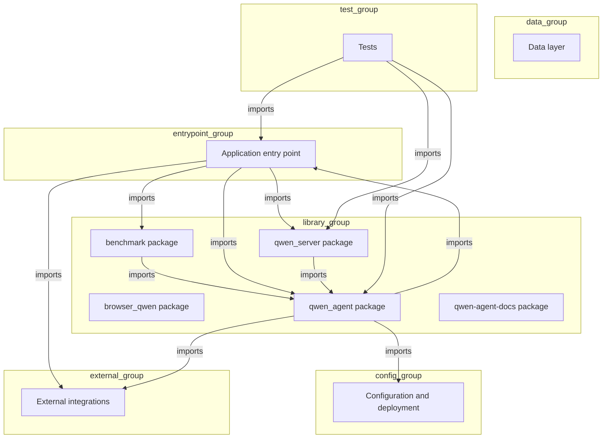

# Architecture report: QwenLM/Qwen-Agent

> Automated static analysis. **Observed** = directly seen in files/imports/AST; **Inferred** = interpretation from that evidence. Repository code was not executed.

## 1. Repository at a glance

| Item | Value |
| --- | --- |
| Repository | QwenLM/Qwen-Agent |
| Description | Agent framework and applications built upon Qwen>=3.0, featuring Function Calling, MCP, Code Interpreter, RAG, Chrome extension, etc. |
| Language | Python |
| Stars | 17258 |
| Licence | Apache-2.0 |
| Analysed commit / branch | 31a4d36d123688581a9e9744427272b33ce940e0 / main |
| Framework(s) | FastAPI, Next.js |
| Files analysed | 304 |
| Components | 10 |

## 2. Architecture in one minute

QwenLM/Qwen-Agent - Agent framework and applications built upon Qwen>=3.0, featuring Function Calling, MCP, Code Interpreter, RAG, Chrome extension, etc.. This repository was analysed statically from 304 file(s) (220 Python). Detected technologies (observed from imports/manifests): GitHub Actions, FastAPI, Next.js, NumPy, pandas, Pydantic. Files are grouped into 10 component(s): benchmark package, browser_qwen package, Configuration and deployment, Data layer, Application entry point, External integrations, qwen_agent package, qwen-agent-docs package. Observed entry point(s): benchmark/code_interpreter/code_interpreter.py, benchmark/code_interpreter/inference_and_execute.py, benchmark/deepplanning/aggregate_results.py. Findings below distinguish observed facts from inferred interpretation.

## 3. High-level block diagram

## 4. Main components

### benchmark package (`benchmark`)

- **Kind:** library
- **Status:** Observed
- **Confidence:** 0.85
- **Responsibility:** Groups 53 file(s) under benchmark package (observed from repository paths and static analysis). Observed top-level classes: AddCouponToCartTool, AddProductToCartTool, AttractionDetailsQueryTool, AttractionRecommendTool, BaseShoppingTool, BaseTravelTool. Observed top-level functions: _eval_attraction_constraint, _eval_budget_constraint, _eval_flight_constraint, _eval_hotel_constraint, _eval_restaurant_constraint, _eval_train_constraint.
- **Paths:** `benchmark/code_interpreter/metrics/__init__.py`, `benchmark/code_interpreter/metrics/code_execution.py`, `benchmark/code_interpreter/metrics/gsm8k.py`, `benchmark/code_interpreter/metrics/visualization.py`, `benchmark/code_interpreter/parser/__init__.py`, `benchmark/code_interpreter/parser/internlm_parser.py`, `benchmark/code_interpreter/parser/react_parser.py`, `benchmark/code_interpreter/prompt/__init__.py`, `benchmark/code_interpreter/prompt/internlm_react.py`, `benchmark/code_interpreter/prompt/llama_react.py`, `benchmark/code_interpreter/prompt/qwen_react.py`, `benchmark/code_interpreter/prompt/react.py`, `benchmark/code_interpreter/utils/__init__.py`, `benchmark/code_interpreter/utils/code_utils.py`, `benchmark/code_interpreter/utils/data_utils.py`, `benchmark/deepplanning/run_all.sh`, `benchmark/deepplanning/shoppingplanning/agent/call_llm.py`, `benchmark/deepplanning/shoppingplanning/agent/prompts.py`, `benchmark/deepplanning/shoppingplanning/run.sh`, `benchmark/deepplanning/shoppingplanning/tools/__init__.py`, `benchmark/deepplanning/shoppingplanning/tools/add_coupon_to_cart.py`, `benchmark/deepplanning/shoppingplanning/tools/add_product_to_cart.py`, `benchmark/deepplanning/shoppingplanning/tools/base_shopping_tool.py`, `benchmark/deepplanning/shoppingplanning/tools/calculate_transport_time_tool.py`, `benchmark/deepplanning/shoppingplanning/tools/delete_coupon_from_cart.py`, `benchmark/deepplanning/shoppingplanning/tools/delete_product_from_cart.py`, `benchmark/deepplanning/shoppingplanning/tools/filter_by_applicable_coupons_tool.py`, `benchmark/deepplanning/shoppingplanning/tools/filter_by_brand_tool.py`, `benchmark/deepplanning/shoppingplanning/tools/filter_by_color_tool.py`, `benchmark/deepplanning/shoppingplanning/tools/filter_by_range_tool.py`, `benchmark/deepplanning/shoppingplanning/tools/filter_by_size_tool.py`, `benchmark/deepplanning/shoppingplanning/tools/get_cart_info.py`, `benchmark/deepplanning/shoppingplanning/tools/get_product_details_tool.py`, `benchmark/deepplanning/shoppingplanning/tools/get_user_info.py`, `benchmark/deepplanning/shoppingplanning/tools/search_products_tool.py`, `benchmark/deepplanning/shoppingplanning/tools/sort_product_tool.py`, `benchmark/deepplanning/travelplanning/agent/__init__.py`, `benchmark/deepplanning/travelplanning/agent/call_llm.py`, `benchmark/deepplanning/travelplanning/agent/prompts.py`, `benchmark/deepplanning/travelplanning/evaluation/__init__.py`, `benchmark/deepplanning/travelplanning/evaluation/constraints_commonsense.py`, `benchmark/deepplanning/travelplanning/evaluation/constraints_hard.py`, `benchmark/deepplanning/travelplanning/evaluation/utils.py`, `benchmark/deepplanning/travelplanning/run.sh`, `benchmark/deepplanning/travelplanning/tools/__init__.py`, `benchmark/deepplanning/travelplanning/tools/attraction_query_tool.py`, `benchmark/deepplanning/travelplanning/tools/base_travel_tool.py`, `benchmark/deepplanning/travelplanning/tools/flight_query_tool.py`, `benchmark/deepplanning/travelplanning/tools/hotel_query_tool.py`, `benchmark/deepplanning/travelplanning/tools/location_search_tool.py`, `benchmark/deepplanning/travelplanning/tools/restaurant_query_tool.py`, `benchmark/deepplanning/travelplanning/tools/roadroute_query_tool.py`, `benchmark/deepplanning/travelplanning/tools/train_query_tool.py`
- **Evidence:** [benchmark/code_interpreter/metrics/__init__.py](https://github.com/QwenLM/Qwen-Agent/blob/31a4d36d123688581a9e9744427272b33ce940e0/benchmark/code_interpreter/metrics/__init__.py); [benchmark/code_interpreter/metrics/code_execution.py:49](https://github.com/QwenLM/Qwen-Agent/blob/31a4d36d123688581a9e9744427272b33ce940e0/benchmark/code_interpreter/metrics/code_execution.py#L49); [benchmark/code_interpreter/metrics/gsm8k.py:11](https://github.com/QwenLM/Qwen-Agent/blob/31a4d36d123688581a9e9744427272b33ce940e0/benchmark/code_interpreter/metrics/gsm8k.py#L11); [benchmark/code_interpreter/metrics/visualization.py:26](https://github.com/QwenLM/Qwen-Agent/blob/31a4d36d123688581a9e9744427272b33ce940e0/benchmark/code_interpreter/metrics/visualization.py#L26); [benchmark/code_interpreter/parser/__init__.py](https://github.com/QwenLM/Qwen-Agent/blob/31a4d36d123688581a9e9744427272b33ce940e0/benchmark/code_interpreter/parser/__init__.py); [benchmark/code_interpreter/parser/internlm_parser.py:4](https://github.com/QwenLM/Qwen-Agent/blob/31a4d36d123688581a9e9744427272b33ce940e0/benchmark/code_interpreter/parser/internlm_parser.py#L4); [benchmark/code_interpreter/parser/react_parser.py:1](https://github.com/QwenLM/Qwen-Agent/blob/31a4d36d123688581a9e9744427272b33ce940e0/benchmark/code_interpreter/parser/react_parser.py#L1); [benchmark/code_interpreter/prompt/__init__.py](https://github.com/QwenLM/Qwen-Agent/blob/31a4d36d123688581a9e9744427272b33ce940e0/benchmark/code_interpreter/prompt/__init__.py)

### browser_qwen package (`browser_qwen`)

- **Kind:** library
- **Status:** Observed
- **Confidence:** 0.85
- **Responsibility:** Groups 3 file(s) under browser_qwen package (observed from repository paths and static analysis).
- **Paths:** `browser_qwen/background.js`, `browser_qwen/src/content.js`, `browser_qwen/src/popup.js`
- **Evidence:** [browser_qwen/background.js](https://github.com/QwenLM/Qwen-Agent/blob/31a4d36d123688581a9e9744427272b33ce940e0/browser_qwen/background.js); [browser_qwen/src/content.js](https://github.com/QwenLM/Qwen-Agent/blob/31a4d36d123688581a9e9744427272b33ce940e0/browser_qwen/src/content.js); [browser_qwen/src/popup.js](https://github.com/QwenLM/Qwen-Agent/blob/31a4d36d123688581a9e9744427272b33ce940e0/browser_qwen/src/popup.js)

### Configuration and deployment (`config`)

- **Kind:** config
- **Status:** Observed
- **Confidence:** 0.85
- **Responsibility:** Groups 18 file(s) under configuration and deployment (observed from repository paths and static analysis). Observed top-level functions: get_model, get_react_parser, get_react_prompt, get_version, read_description.
- **Paths:** `MANIFEST.in`, `benchmark/code_interpreter/config.py`, `benchmark/code_interpreter/requirements.txt`, `benchmark/deepplanning/models_config.json`, `benchmark/deepplanning/requirements.txt`, `benchmark/deepplanning/shoppingplanning/data/level_1_query_meta.json`, `benchmark/deepplanning/shoppingplanning/data/level_2_query_meta.json`, `benchmark/deepplanning/shoppingplanning/data/level_3_query_meta.json`, `benchmark/deepplanning/shoppingplanning/tools/shopping_tool_schema.json`, `benchmark/deepplanning/travelplanning/tools/tool_schema.json`, `benchmark/deepplanning/travelplanning/tools/tool_schema_en.json`, `benchmark/deepplanning/travelplanning/tools/tool_schema_zh.json`, `browser_qwen/manifest.json`, `qwen-agent-docs/website/package.json`, `qwen-agent-docs/website/tsconfig.json`, `qwen_agent/settings.py`, `qwen_server/server_config.json`, `setup.py`
- **Evidence:** [MANIFEST.in](https://github.com/QwenLM/Qwen-Agent/blob/31a4d36d123688581a9e9744427272b33ce940e0/MANIFEST.in); [benchmark/code_interpreter/config.py:49](https://github.com/QwenLM/Qwen-Agent/blob/31a4d36d123688581a9e9744427272b33ce940e0/benchmark/code_interpreter/config.py#L49); [benchmark/code_interpreter/requirements.txt](https://github.com/QwenLM/Qwen-Agent/blob/31a4d36d123688581a9e9744427272b33ce940e0/benchmark/code_interpreter/requirements.txt); [benchmark/deepplanning/models_config.json](https://github.com/QwenLM/Qwen-Agent/blob/31a4d36d123688581a9e9744427272b33ce940e0/benchmark/deepplanning/models_config.json); [benchmark/deepplanning/requirements.txt](https://github.com/QwenLM/Qwen-Agent/blob/31a4d36d123688581a9e9744427272b33ce940e0/benchmark/deepplanning/requirements.txt); [benchmark/deepplanning/shoppingplanning/data/level_1_query_meta.json](https://github.com/QwenLM/Qwen-Agent/blob/31a4d36d123688581a9e9744427272b33ce940e0/benchmark/deepplanning/shoppingplanning/data/level_1_query_meta.json); [benchmark/deepplanning/shoppingplanning/data/level_2_query_meta.json](https://github.com/QwenLM/Qwen-Agent/blob/31a4d36d123688581a9e9744427272b33ce940e0/benchmark/deepplanning/shoppingplanning/data/level_2_query_meta.json); [benchmark/deepplanning/shoppingplanning/data/level_3_query_meta.json](https://github.com/QwenLM/Qwen-Agent/blob/31a4d36d123688581a9e9744427272b33ce940e0/benchmark/deepplanning/shoppingplanning/data/level_3_query_meta.json)

### Data layer (`data_layer`)

- **Kind:** data
- **Status:** Observed
- **Confidence:** 0.85
- **Responsibility:** Groups 5 file(s) under data layer (observed from repository paths and static analysis). Observed top-level classes: HFModel, LLM, Qwen, QwenDashscopeVLModel, QwenVL.
- **Paths:** `benchmark/code_interpreter/models/__init__.py`, `benchmark/code_interpreter/models/base.py`, `benchmark/code_interpreter/models/dashscope.py`, `benchmark/code_interpreter/models/llm.py`, `benchmark/code_interpreter/models/qwen.py`
- **Evidence:** [benchmark/code_interpreter/models/__init__.py](https://github.com/QwenLM/Qwen-Agent/blob/31a4d36d123688581a9e9744427272b33ce940e0/benchmark/code_interpreter/models/__init__.py); [benchmark/code_interpreter/models/base.py:5](https://github.com/QwenLM/Qwen-Agent/blob/31a4d36d123688581a9e9744427272b33ce940e0/benchmark/code_interpreter/models/base.py#L5); [benchmark/code_interpreter/models/dashscope.py:9](https://github.com/QwenLM/Qwen-Agent/blob/31a4d36d123688581a9e9744427272b33ce940e0/benchmark/code_interpreter/models/dashscope.py#L9); [benchmark/code_interpreter/models/llm.py:5](https://github.com/QwenLM/Qwen-Agent/blob/31a4d36d123688581a9e9744427272b33ce940e0/benchmark/code_interpreter/models/llm.py#L5); [benchmark/code_interpreter/models/qwen.py:5](https://github.com/QwenLM/Qwen-Agent/blob/31a4d36d123688581a9e9744427272b33ce940e0/benchmark/code_interpreter/models/qwen.py#L5)

### Application entry point (`entrypoint`)

- **Kind:** entrypoint
- **Status:** Observed
- **Confidence:** 0.85
- **Responsibility:** Groups 15 file(s) under application entry point (observed from repository paths and static analysis). Observed application object created via FastAPI. Observed routes: POST /endpoint. Observed top-level classes: ColorObjectRuntime, CustomDict, DateRuntime, GenericRuntime, ImageResult, ImageSearch. Observed top-level functions: _check_deps_for_python_executor, _code_interpreter, _load_env_from_dotenv, _new_getaddrinfo, _test, aggregate_model_results.
- **Paths:** `benchmark/code_interpreter/code_interpreter.py`, `benchmark/code_interpreter/inference_and_execute.py`, `benchmark/deepplanning/aggregate_results.py`, `benchmark/deepplanning/shoppingplanning/agent/shopping_agent.py`, `benchmark/deepplanning/shoppingplanning/evaluation/evaluation_pipeline.py`, `benchmark/deepplanning/shoppingplanning/evaluation/score_statistics.py`, `benchmark/deepplanning/shoppingplanning/run.py`, `benchmark/deepplanning/travelplanning/agent/tools_fn_agent.py`, `benchmark/deepplanning/travelplanning/evaluation/convert_report.py`, `benchmark/deepplanning/travelplanning/evaluation/eval_converted.py`, `benchmark/deepplanning/travelplanning/run.py`, `qwen_agent/tools/image_search.py`, `qwen_agent/tools/python_executor.py`, `qwen_server/database_server.py`, `run_server.py`
- **Evidence:** [benchmark/code_interpreter/code_interpreter.py:36](https://github.com/QwenLM/Qwen-Agent/blob/31a4d36d123688581a9e9744427272b33ce940e0/benchmark/code_interpreter/code_interpreter.py#L36); [benchmark/code_interpreter/inference_and_execute.py:43](https://github.com/QwenLM/Qwen-Agent/blob/31a4d36d123688581a9e9744427272b33ce940e0/benchmark/code_interpreter/inference_and_execute.py#L43); [benchmark/deepplanning/aggregate_results.py:14](https://github.com/QwenLM/Qwen-Agent/blob/31a4d36d123688581a9e9744427272b33ce940e0/benchmark/deepplanning/aggregate_results.py#L14); [benchmark/deepplanning/shoppingplanning/agent/shopping_agent.py:27](https://github.com/QwenLM/Qwen-Agent/blob/31a4d36d123688581a9e9744427272b33ce940e0/benchmark/deepplanning/shoppingplanning/agent/shopping_agent.py#L27); [benchmark/deepplanning/shoppingplanning/evaluation/evaluation_pipeline.py:11](https://github.com/QwenLM/Qwen-Agent/blob/31a4d36d123688581a9e9744427272b33ce940e0/benchmark/deepplanning/shoppingplanning/evaluation/evaluation_pipeline.py#L11); [benchmark/deepplanning/shoppingplanning/evaluation/score_statistics.py:18](https://github.com/QwenLM/Qwen-Agent/blob/31a4d36d123688581a9e9744427272b33ce940e0/benchmark/deepplanning/shoppingplanning/evaluation/score_statistics.py#L18); [benchmark/deepplanning/shoppingplanning/run.py:19](https://github.com/QwenLM/Qwen-Agent/blob/31a4d36d123688581a9e9744427272b33ce940e0/benchmark/deepplanning/shoppingplanning/run.py#L19); [benchmark/deepplanning/travelplanning/agent/tools_fn_agent.py:21](https://github.com/QwenLM/Qwen-Agent/blob/31a4d36d123688581a9e9744427272b33ce940e0/benchmark/deepplanning/travelplanning/agent/tools_fn_agent.py#L21)

### External integrations (`external_integrations`)

- **Kind:** external
- **Status:** Inferred
- **Confidence:** 0.70
- **Responsibility:** Groups 0 file(s) under external integrations (observed from repository paths and static analysis).
- **Evidence:** [examples/qwen2vl_assistant_tooluse.py:24](https://github.com/QwenLM/Qwen-Agent/blob/31a4d36d123688581a9e9744427272b33ce940e0/examples/qwen2vl_assistant_tooluse.py#L24); [qwen_agent/tools/amap_weather.py:18](https://github.com/QwenLM/Qwen-Agent/blob/31a4d36d123688581a9e9744427272b33ce940e0/qwen_agent/tools/amap_weather.py#L18); [qwen_agent/tools/code_interpreter.py:30](https://github.com/QwenLM/Qwen-Agent/blob/31a4d36d123688581a9e9744427272b33ce940e0/qwen_agent/tools/code_interpreter.py#L30); [qwen_agent/tools/image_search.py:20](https://github.com/QwenLM/Qwen-Agent/blob/31a4d36d123688581a9e9744427272b33ce940e0/qwen_agent/tools/image_search.py#L20); [qwen_agent/tools/image_search.py:24](https://github.com/QwenLM/Qwen-Agent/blob/31a4d36d123688581a9e9744427272b33ce940e0/qwen_agent/tools/image_search.py#L24); [qwen_agent/tools/image_search.py:25](https://github.com/QwenLM/Qwen-Agent/blob/31a4d36d123688581a9e9744427272b33ce940e0/qwen_agent/tools/image_search.py#L25)

### qwen_agent package (`qwen_agent`)

- **Kind:** library
- **Status:** Observed
- **Confidence:** 0.85
- **Responsibility:** Groups 88 file(s) under qwen_agent package (observed from repository paths and static analysis). Observed top-level classes: Agent, AmapWeather, AnyThreadEventLoopPolicy, ArticleAgent, Assistant, BaseChatModel. Observed top-level functions: _check_deps_for_rag, _check_docker_availability, _check_host_deps, _cleanup_mcp, _conv_fname, _escape_ansi.
- **Paths:** `qwen_agent/__init__.py`, `qwen_agent/agent.py`, `qwen_agent/agents/__init__.py`, `qwen_agent/agents/article_agent.py`, `qwen_agent/agents/assistant.py`, `qwen_agent/agents/dialogue_retrieval_agent.py`, `qwen_agent/agents/dialogue_simulator.py`, `qwen_agent/agents/doc_qa/__init__.py`, `qwen_agent/agents/doc_qa/basic_doc_qa.py`, `qwen_agent/agents/doc_qa/parallel_doc_qa.py`, `qwen_agent/agents/doc_qa/parallel_doc_qa_member.py`, `qwen_agent/agents/doc_qa/parallel_doc_qa_summary.py`, `qwen_agent/agents/fncall_agent.py`, `qwen_agent/agents/group_chat.py`, `qwen_agent/agents/group_chat_auto_router.py`, `qwen_agent/agents/group_chat_creator.py`, `qwen_agent/agents/human_simulator.py`, `qwen_agent/agents/keygen_strategies/__init__.py`, `qwen_agent/agents/keygen_strategies/gen_keyword.py`, `qwen_agent/agents/keygen_strategies/gen_keyword_with_knowledge.py`, `qwen_agent/agents/keygen_strategies/split_query.py`, `qwen_agent/agents/keygen_strategies/split_query_then_gen_keyword.py`, `qwen_agent/agents/keygen_strategies/split_query_then_gen_keyword_with_knowledge.py`, `qwen_agent/agents/memo_assistant.py`, `qwen_agent/agents/react_chat.py`, `qwen_agent/agents/router.py`, `qwen_agent/agents/tir_agent.py`, `qwen_agent/agents/user_agent.py`, `qwen_agent/agents/virtual_memory_agent.py`, `qwen_agent/agents/write_from_scratch.py`, `qwen_agent/agents/writing/__init__.py`, `qwen_agent/agents/writing/continue_writing.py`, `qwen_agent/agents/writing/expand_writing.py`, `qwen_agent/agents/writing/outline_writing.py`, `qwen_agent/gui/__init__.py`, `qwen_agent/gui/gradio_dep.py`, `qwen_agent/gui/gradio_utils.py`, `qwen_agent/gui/utils.py`, `qwen_agent/gui/web_ui.py`, `qwen_agent/llm/__init__.py`, `qwen_agent/llm/azure.py`, `qwen_agent/llm/base.py`, `qwen_agent/llm/fncall_prompts/__init__.py`, `qwen_agent/llm/fncall_prompts/base_fncall_prompt.py`, `qwen_agent/llm/fncall_prompts/nous_fncall_prompt.py`, `qwen_agent/llm/fncall_prompts/qwen_fncall_prompt.py`, `qwen_agent/llm/function_calling.py`, `qwen_agent/llm/oai.py`, `qwen_agent/llm/openvino.py`, `qwen_agent/llm/qwen_dashscope.py`, `qwen_agent/llm/qwenaudio_dashscope.py`, `qwen_agent/llm/qwenomni_oai.py`, `qwen_agent/llm/qwenvl_dashscope.py`, `qwen_agent/llm/qwenvl_oai.py`, `qwen_agent/llm/qwenvlo_dashscope.py`, `qwen_agent/llm/schema.py`, `qwen_agent/llm/transformers_llm.py`, `qwen_agent/log.py`, `qwen_agent/memory/__init__.py`, `qwen_agent/memory/memory.py`, `qwen_agent/multi_agent_hub.py`, `qwen_agent/tools/__init__.py`, `qwen_agent/tools/amap_weather.py`, `qwen_agent/tools/base.py`, `qwen_agent/tools/code_interpreter.py`, `qwen_agent/tools/doc_parser.py`, `qwen_agent/tools/extract_doc_vocabulary.py`, `qwen_agent/tools/image_gen.py`, `qwen_agent/tools/image_zoom_in_qwen3vl.py`, `qwen_agent/tools/mcp_manager.py`, `qwen_agent/tools/resource/code_interpreter_init_kernel.py`, `qwen_agent/tools/retrieval.py`, `qwen_agent/tools/search_tools/__init__.py`, `qwen_agent/tools/search_tools/base_search.py`, `qwen_agent/tools/search_tools/front_page_search.py`, `qwen_agent/tools/search_tools/hybrid_search.py`, `qwen_agent/tools/search_tools/keyword_search.py`, `qwen_agent/tools/search_tools/vector_search.py`, `qwen_agent/tools/simple_doc_parser.py`, `qwen_agent/tools/storage.py`, `qwen_agent/tools/web_extractor.py`, `qwen_agent/tools/web_search.py`, `qwen_agent/utils/__init__.py`, `qwen_agent/utils/output_beautify.py`, `qwen_agent/utils/parallel_executor.py`, `qwen_agent/utils/str_processing.py`, `qwen_agent/utils/tokenization_qwen.py`, `qwen_agent/utils/utils.py`
- **Evidence:** [qwen_agent/__init__.py](https://github.com/QwenLM/Qwen-Agent/blob/31a4d36d123688581a9e9744427272b33ce940e0/qwen_agent/__init__.py); [qwen_agent/agent.py:31](https://github.com/QwenLM/Qwen-Agent/blob/31a4d36d123688581a9e9744427272b33ce940e0/qwen_agent/agent.py#L31); [qwen_agent/agents/__init__.py](https://github.com/QwenLM/Qwen-Agent/blob/31a4d36d123688581a9e9744427272b33ce940e0/qwen_agent/agents/__init__.py); [qwen_agent/agents/article_agent.py:23](https://github.com/QwenLM/Qwen-Agent/blob/31a4d36d123688581a9e9744427272b33ce940e0/qwen_agent/agents/article_agent.py#L23); [qwen_agent/agents/assistant.py:52](https://github.com/QwenLM/Qwen-Agent/blob/31a4d36d123688581a9e9744427272b33ce940e0/qwen_agent/agents/assistant.py#L52); [qwen_agent/agents/dialogue_retrieval_agent.py:40](https://github.com/QwenLM/Qwen-Agent/blob/31a4d36d123688581a9e9744427272b33ce940e0/qwen_agent/agents/dialogue_retrieval_agent.py#L40); [qwen_agent/agents/dialogue_simulator.py:23](https://github.com/QwenLM/Qwen-Agent/blob/31a4d36d123688581a9e9744427272b33ce940e0/qwen_agent/agents/dialogue_simulator.py#L23); [qwen_agent/agents/doc_qa/__init__.py](https://github.com/QwenLM/Qwen-Agent/blob/31a4d36d123688581a9e9744427272b33ce940e0/qwen_agent/agents/doc_qa/__init__.py)

### qwen-agent-docs package (`qwen_agent_docs`)

- **Kind:** library
- **Status:** Observed
- **Confidence:** 0.85
- **Responsibility:** Groups 18 file(s) under qwen-agent-docs package (observed from repository paths and static analysis).
- **Paths:** `qwen-agent-docs/website/app/[lang]/[[...mdxPath]]/page.jsx`, `qwen-agent-docs/website/app/[lang]/layout.tsx`, `qwen-agent-docs/website/app/layout.tsx`, `qwen-agent-docs/website/app/page.tsx`, `qwen-agent-docs/website/app/robots.ts`, `qwen-agent-docs/website/app/sitemap.ts`, `qwen-agent-docs/website/content/en/_meta.ts`, `qwen-agent-docs/website/content/en/benchmarks/_meta.ts`, `qwen-agent-docs/website/content/en/guide/_meta.ts`, `qwen-agent-docs/website/content/en/guide/core_moduls/_meta.ts`, `qwen-agent-docs/website/content/en/guide/get_started/_meta.ts`, `qwen-agent-docs/website/mdx-components.tsx`, `qwen-agent-docs/website/next-env.d.ts`, `qwen-agent-docs/website/next.config.mjs`, `qwen-agent-docs/website/postcss.config.js`, `qwen-agent-docs/website/src/components/font-loader.tsx`, `qwen-agent-docs/website/src/components/leaderboard.tsx`, `qwen-agent-docs/website/src/components/locale-anchor.tsx`
- **Evidence:** [qwen-agent-docs/website/app/[lang]/[[...mdxPath]]/page.jsx](https://github.com/QwenLM/Qwen-Agent/blob/31a4d36d123688581a9e9744427272b33ce940e0/qwen-agent-docs/website/app/%5Blang%5D/%5B%5B...mdxPath%5D%5D/page.jsx); [qwen-agent-docs/website/app/[lang]/layout.tsx](https://github.com/QwenLM/Qwen-Agent/blob/31a4d36d123688581a9e9744427272b33ce940e0/qwen-agent-docs/website/app/%5Blang%5D/layout.tsx); [qwen-agent-docs/website/app/layout.tsx](https://github.com/QwenLM/Qwen-Agent/blob/31a4d36d123688581a9e9744427272b33ce940e0/qwen-agent-docs/website/app/layout.tsx); [qwen-agent-docs/website/app/page.tsx](https://github.com/QwenLM/Qwen-Agent/blob/31a4d36d123688581a9e9744427272b33ce940e0/qwen-agent-docs/website/app/page.tsx); [qwen-agent-docs/website/app/robots.ts](https://github.com/QwenLM/Qwen-Agent/blob/31a4d36d123688581a9e9744427272b33ce940e0/qwen-agent-docs/website/app/robots.ts); [qwen-agent-docs/website/app/sitemap.ts](https://github.com/QwenLM/Qwen-Agent/blob/31a4d36d123688581a9e9744427272b33ce940e0/qwen-agent-docs/website/app/sitemap.ts); [qwen-agent-docs/website/content/en/_meta.ts](https://github.com/QwenLM/Qwen-Agent/blob/31a4d36d123688581a9e9744427272b33ce940e0/qwen-agent-docs/website/content/en/_meta.ts); [qwen-agent-docs/website/content/en/benchmarks/_meta.ts](https://github.com/QwenLM/Qwen-Agent/blob/31a4d36d123688581a9e9744427272b33ce940e0/qwen-agent-docs/website/content/en/benchmarks/_meta.ts)

### qwen_server package (`qwen_server`)

- **Kind:** library
- **Status:** Observed
- **Confidence:** 0.85
- **Responsibility:** Groups 8 file(s) under qwen_server package (observed from repository paths and static analysis). Observed top-level classes: GlobalConfig, PathConfig, ServerConfig. Observed top-level functions: add_file, add_text, bot, chat_clear, chat_clear_last, chat_clear_pure.
- **Paths:** `qwen_server/__init__.py`, `qwen_server/add_qwen_libs.py`, `qwen_server/assistant_server.py`, `qwen_server/js/main.js`, `qwen_server/output_beautify.py`, `qwen_server/schema.py`, `qwen_server/utils.py`, `qwen_server/workstation_server.py`
- **Evidence:** [qwen_server/__init__.py](https://github.com/QwenLM/Qwen-Agent/blob/31a4d36d123688581a9e9744427272b33ce940e0/qwen_server/__init__.py); [qwen_server/add_qwen_libs.py](https://github.com/QwenLM/Qwen-Agent/blob/31a4d36d123688581a9e9744427272b33ce940e0/qwen_server/add_qwen_libs.py); [qwen_server/assistant_server.py:60](https://github.com/QwenLM/Qwen-Agent/blob/31a4d36d123688581a9e9744427272b33ce940e0/qwen_server/assistant_server.py#L60); [qwen_server/js/main.js](https://github.com/QwenLM/Qwen-Agent/blob/31a4d36d123688581a9e9744427272b33ce940e0/qwen_server/js/main.js); [qwen_server/output_beautify.py:26](https://github.com/QwenLM/Qwen-Agent/blob/31a4d36d123688581a9e9744427272b33ce940e0/qwen_server/output_beautify.py#L26); [qwen_server/schema.py:18](https://github.com/QwenLM/Qwen-Agent/blob/31a4d36d123688581a9e9744427272b33ce940e0/qwen_server/schema.py#L18); [qwen_server/utils.py:22](https://github.com/QwenLM/Qwen-Agent/blob/31a4d36d123688581a9e9744427272b33ce940e0/qwen_server/utils.py#L22); [qwen_server/workstation_server.py:73](https://github.com/QwenLM/Qwen-Agent/blob/31a4d36d123688581a9e9744427272b33ce940e0/qwen_server/workstation_server.py#L73)

### Tests (`tests`)

- **Kind:** test
- **Status:** Observed
- **Confidence:** 0.85
- **Responsibility:** Groups 22 file(s) under tests (observed from repository paths and static analysis). Observed top-level classes: MyImageGen. Observed top-level functions: init_agent_service, test_amap_weather, test_article_agent_full_article, test_assistant_add_custom_tool, test_assistant_empty_query, test_assistant_files.
- **Paths:** `tests/agents/test_article_agent.py`, `tests/agents/test_assistant.py`, `tests/agents/test_custom_tool_object.py`, `tests/agents/test_doc_qa.py`, `tests/agents/test_parallel_qa.py`, `tests/agents/test_react_chat.py`, `tests/agents/test_router.py`, `tests/examples/test_examples.py`, `tests/examples/test_long_dialogue.py`, `tests/examples/test_vm_qa.py`, `tests/llm/test_continue.py`, `tests/llm/test_dashscope.py`, `tests/llm/test_function_content.py`, `tests/llm/test_oai.py`, `tests/memory/test_memory.py`, `tests/qwen_server/test_database_server.py`, `tests/tools/test_doc_parser.py`, `tests/tools/test_hybrid_search.py`, `tests/tools/test_keyword_search.py`, `tests/tools/test_simple_doc_parser.py`, `tests/tools/test_tools.py`, `tests/tools/test_vector_search.py`
- **Evidence:** [tests/agents/test_article_agent.py:21](https://github.com/QwenLM/Qwen-Agent/blob/31a4d36d123688581a9e9744427272b33ce940e0/tests/agents/test_article_agent.py#L21); [tests/agents/test_assistant.py:19](https://github.com/QwenLM/Qwen-Agent/blob/31a4d36d123688581a9e9744427272b33ce940e0/tests/agents/test_assistant.py#L19); [tests/agents/test_custom_tool_object.py:24](https://github.com/QwenLM/Qwen-Agent/blob/31a4d36d123688581a9e9744427272b33ce940e0/tests/agents/test_custom_tool_object.py#L24); [tests/agents/test_doc_qa.py:18](https://github.com/QwenLM/Qwen-Agent/blob/31a4d36d123688581a9e9744427272b33ce940e0/tests/agents/test_doc_qa.py#L18); [tests/agents/test_parallel_qa.py:18](https://github.com/QwenLM/Qwen-Agent/blob/31a4d36d123688581a9e9744427272b33ce940e0/tests/agents/test_parallel_qa.py#L18); [tests/agents/test_react_chat.py:23](https://github.com/QwenLM/Qwen-Agent/blob/31a4d36d123688581a9e9744427272b33ce940e0/tests/agents/test_react_chat.py#L23); [tests/agents/test_router.py:19](https://github.com/QwenLM/Qwen-Agent/blob/31a4d36d123688581a9e9744427272b33ce940e0/tests/agents/test_router.py#L19); [tests/examples/test_examples.py:40](https://github.com/QwenLM/Qwen-Agent/blob/31a4d36d123688581a9e9744427272b33ce940e0/tests/examples/test_examples.py#L40)

## 5. Execution flow

**Observed** entry point(s):

- [benchmark/code_interpreter/code_interpreter.py:243](https://github.com/QwenLM/Qwen-Agent/blob/31a4d36d123688581a9e9744427272b33ce940e0/benchmark/code_interpreter/code_interpreter.py#L243)
- [benchmark/code_interpreter/inference_and_execute.py:227](https://github.com/QwenLM/Qwen-Agent/blob/31a4d36d123688581a9e9744427272b33ce940e0/benchmark/code_interpreter/inference_and_execute.py#L227)
- [benchmark/deepplanning/aggregate_results.py:375](https://github.com/QwenLM/Qwen-Agent/blob/31a4d36d123688581a9e9744427272b33ce940e0/benchmark/deepplanning/aggregate_results.py#L375)
- [benchmark/deepplanning/shoppingplanning/agent/shopping_agent.py:513](https://github.com/QwenLM/Qwen-Agent/blob/31a4d36d123688581a9e9744427272b33ce940e0/benchmark/deepplanning/shoppingplanning/agent/shopping_agent.py#L513)
- [benchmark/deepplanning/shoppingplanning/evaluation/evaluation_pipeline.py:478](https://github.com/QwenLM/Qwen-Agent/blob/31a4d36d123688581a9e9744427272b33ce940e0/benchmark/deepplanning/shoppingplanning/evaluation/evaluation_pipeline.py#L478)
- [benchmark/deepplanning/shoppingplanning/evaluation/score_statistics.py:279](https://github.com/QwenLM/Qwen-Agent/blob/31a4d36d123688581a9e9744427272b33ce940e0/benchmark/deepplanning/shoppingplanning/evaluation/score_statistics.py#L279)
- [benchmark/deepplanning/shoppingplanning/run.py:170](https://github.com/QwenLM/Qwen-Agent/blob/31a4d36d123688581a9e9744427272b33ce940e0/benchmark/deepplanning/shoppingplanning/run.py#L170)
- [benchmark/deepplanning/travelplanning/agent/tools_fn_agent.py:549](https://github.com/QwenLM/Qwen-Agent/blob/31a4d36d123688581a9e9744427272b33ce940e0/benchmark/deepplanning/travelplanning/agent/tools_fn_agent.py#L549)
- [benchmark/deepplanning/travelplanning/evaluation/convert_report.py:363](https://github.com/QwenLM/Qwen-Agent/blob/31a4d36d123688581a9e9744427272b33ce940e0/benchmark/deepplanning/travelplanning/evaluation/convert_report.py#L363)
- [benchmark/deepplanning/travelplanning/evaluation/eval_converted.py:579](https://github.com/QwenLM/Qwen-Agent/blob/31a4d36d123688581a9e9744427272b33ce940e0/benchmark/deepplanning/travelplanning/evaluation/eval_converted.py#L579)
- [benchmark/deepplanning/travelplanning/run.py:502](https://github.com/QwenLM/Qwen-Agent/blob/31a4d36d123688581a9e9744427272b33ce940e0/benchmark/deepplanning/travelplanning/run.py#L502)
- [qwen_agent/tools/image_search.py:200](https://github.com/QwenLM/Qwen-Agent/blob/31a4d36d123688581a9e9744427272b33ce940e0/qwen_agent/tools/image_search.py#L200)

**Observed** routes (from decorators):

- `POST /endpoint` -> `web_listening` in `qwen_server/database_server.py:116`

Representative flow (derived from observed entry points and the import graph; steps beyond the entry point are **Inferred**):

1. Execution starts at an observed entry point listed above, if present.
2. `benchmark` imports `qwen_agent` (benchmark package -> qwen_agent package).
3. `entrypoint` imports `benchmark` (Application entry point -> benchmark package).
4. `entrypoint` imports `external_integrations` (Application entry point -> External integrations).
5. `entrypoint` imports `qwen_agent` (Application entry point -> qwen_agent package).
6. `entrypoint` imports `qwen_server` (Application entry point -> qwen_server package).
7. `qwen_agent` imports `config` (qwen_agent package -> Configuration and deployment).
8. `qwen_agent` imports `entrypoint` (qwen_agent package -> Application entry point).
9. `qwen_agent` imports `external_integrations` (qwen_agent package -> External integrations).

## 6. Project structure

### `(root)`

- `.gitignore` - other (1274 bytes)
- `.pre-commit-config.yaml` - config (936 bytes)
- `LICENSE` - docs (11358 bytes)
- `MANIFEST.in` - manifest (85 bytes)
- `README.md` - docs (15159 bytes)
- `README_CN.md` - docs (14162 bytes)
- `browser_qwen.md` - docs (5077 bytes)
- `browser_qwen_cn.md` - docs (4851 bytes)
- `run_server.py` - source, Python (5368 bytes)
- `setup.py` - manifest, Python (3598 bytes)

### `.github`

- `.github/workflows/deploy-docs.yml` - ci, YAML (1281 bytes)

### `benchmark`

- `benchmark/code_interpreter/README.md` - docs (8395 bytes)
- `benchmark/code_interpreter/code_interpreter.py` - source, Python (7686 bytes)
- `benchmark/code_interpreter/config.py` - source, Python (2095 bytes)
- `benchmark/code_interpreter/inference_and_execute.py` - source, Python (9033 bytes)
- `benchmark/code_interpreter/metrics/__init__.py` - source, Python (0 bytes)
- `benchmark/code_interpreter/metrics/code_execution.py` - source, Python (8337 bytes)
- `benchmark/code_interpreter/metrics/gsm8k.py` - source, Python (1684 bytes)
- `benchmark/code_interpreter/metrics/visualization.py` - source, Python (6398 bytes)
- `benchmark/code_interpreter/models/__init__.py` - source, Python (178 bytes)
- `benchmark/code_interpreter/models/base.py` - source, Python (748 bytes)
- `benchmark/code_interpreter/models/dashscope.py` - source, Python (1429 bytes)
- `benchmark/code_interpreter/models/llm.py` - source, Python (853 bytes)
- `benchmark/code_interpreter/models/qwen.py` - source, Python (1111 bytes)
- `benchmark/code_interpreter/parser/__init__.py` - source, Python (115 bytes)
- `benchmark/code_interpreter/parser/internlm_parser.py` - source, Python (343 bytes)
- `benchmark/code_interpreter/parser/react_parser.py` - source, Python (1801 bytes)
- `benchmark/code_interpreter/prompt/__init__.py` - source, Python (193 bytes)
- `benchmark/code_interpreter/prompt/internlm_react.py` - source, Python (3448 bytes)
- `benchmark/code_interpreter/prompt/llama_react.py` - source, Python (660 bytes)
- `benchmark/code_interpreter/prompt/qwen_react.py` - source, Python (2763 bytes)
- `benchmark/code_interpreter/prompt/react.py` - source, Python (2779 bytes)
- `benchmark/code_interpreter/requirements.txt` - manifest (152 bytes)
- `benchmark/code_interpreter/utils/__init__.py` - source, Python (0 bytes)
- `benchmark/code_interpreter/utils/code_utils.py` - source, Python (860 bytes)
- `benchmark/code_interpreter/utils/data_utils.py` - source, Python (728 bytes)
- `benchmark/deepplanning/README.md` - docs (8791 bytes)
- `benchmark/deepplanning/aggregate_results.py` - source, Python (17342 bytes)
- `benchmark/deepplanning/env.example` - other (239 bytes)
- `benchmark/deepplanning/models_config.json` - config (991 bytes)
- `benchmark/deepplanning/requirements.txt` - manifest (1445 bytes)
- `benchmark/deepplanning/run_all.sh` - source, Shell (12123 bytes)
- `benchmark/deepplanning/shoppingplanning/README.md` - docs (10979 bytes)
- `benchmark/deepplanning/shoppingplanning/agent/call_llm.py` - source, Python (5591 bytes)
- `benchmark/deepplanning/shoppingplanning/agent/prompts.py` - source, Python (13854 bytes)
- `benchmark/deepplanning/shoppingplanning/agent/shopping_agent.py` - source, Python (21632 bytes)
- `benchmark/deepplanning/shoppingplanning/data/level_1_query_meta.json` - config (42067 bytes)
- `benchmark/deepplanning/shoppingplanning/data/level_2_query_meta.json` - config (47634 bytes)
- `benchmark/deepplanning/shoppingplanning/data/level_3_query_meta.json` - config (15957 bytes)
- `benchmark/deepplanning/shoppingplanning/evaluation/evaluation_pipeline.py` - source, Python (18519 bytes)
- `benchmark/deepplanning/shoppingplanning/evaluation/score_statistics.py` - source, Python (11551 bytes)
- `benchmark/deepplanning/shoppingplanning/run.py` - source, Python (5806 bytes)
- `benchmark/deepplanning/shoppingplanning/run.sh` - source, Shell (4980 bytes)
- `benchmark/deepplanning/shoppingplanning/tools/__init__.py` - source, Python (1300 bytes)
- `benchmark/deepplanning/shoppingplanning/tools/add_coupon_to_cart.py` - source, Python (12035 bytes)
- `benchmark/deepplanning/shoppingplanning/tools/add_product_to_cart.py` - source, Python (6271 bytes)
- `benchmark/deepplanning/shoppingplanning/tools/base_shopping_tool.py` - source, Python (14756 bytes)
- `benchmark/deepplanning/shoppingplanning/tools/calculate_transport_time_tool.py` - source, Python (8556 bytes)
- `benchmark/deepplanning/shoppingplanning/tools/delete_coupon_from_cart.py` - source, Python (10118 bytes)
- `benchmark/deepplanning/shoppingplanning/tools/delete_product_from_cart.py` - source, Python (6029 bytes)
- `benchmark/deepplanning/shoppingplanning/tools/filter_by_applicable_coupons_tool.py` - source, Python (3497 bytes)
- `benchmark/deepplanning/shoppingplanning/tools/filter_by_brand_tool.py` - source, Python (2843 bytes)
- `benchmark/deepplanning/shoppingplanning/tools/filter_by_color_tool.py` - source, Python (2686 bytes)
- `benchmark/deepplanning/shoppingplanning/tools/filter_by_range_tool.py` - source, Python (4441 bytes)
- `benchmark/deepplanning/shoppingplanning/tools/filter_by_size_tool.py` - source, Python (2670 bytes)
- `benchmark/deepplanning/shoppingplanning/tools/get_cart_info.py` - source, Python (3286 bytes)
- `benchmark/deepplanning/shoppingplanning/tools/get_product_details_tool.py` - source, Python (2117 bytes)
- `benchmark/deepplanning/shoppingplanning/tools/get_user_info.py` - source, Python (2799 bytes)
- `benchmark/deepplanning/shoppingplanning/tools/search_products_tool.py` - source, Python (4393 bytes)
- `benchmark/deepplanning/shoppingplanning/tools/shopping_tool_schema.json` - config (19146 bytes)
- `benchmark/deepplanning/shoppingplanning/tools/sort_product_tool.py` - source, Python (4153 bytes)
- `benchmark/deepplanning/travelplanning/README.md` - docs (8129 bytes)
- `benchmark/deepplanning/travelplanning/agent/__init__.py` - source, Python (189 bytes)
- `benchmark/deepplanning/travelplanning/agent/call_llm.py` - source, Python (5856 bytes)
- `benchmark/deepplanning/travelplanning/agent/prompts.py` - source, Python (46502 bytes)
- `benchmark/deepplanning/travelplanning/agent/tools_fn_agent.py` - source, Python (21110 bytes)
- `benchmark/deepplanning/travelplanning/evaluation/__init__.py` - source, Python (306 bytes)
- `benchmark/deepplanning/travelplanning/evaluation/constraints_commonsense.py` - source, Python (74485 bytes)
- `benchmark/deepplanning/travelplanning/evaluation/constraints_hard.py` - source, Python (25917 bytes)
- `benchmark/deepplanning/travelplanning/evaluation/convert_report.py` - source, Python (13668 bytes)
- `benchmark/deepplanning/travelplanning/evaluation/eval_converted.py` - source, Python (23884 bytes)
- `benchmark/deepplanning/travelplanning/evaluation/utils.py` - source, Python (30723 bytes)
- `benchmark/deepplanning/travelplanning/run.py` - source, Python (17216 bytes)
- `benchmark/deepplanning/travelplanning/run.sh` - source, Shell (13978 bytes)
- `benchmark/deepplanning/travelplanning/tools/__init__.py` - source, Python (725 bytes)
- `benchmark/deepplanning/travelplanning/tools/attraction_query_tool.py` - source, Python (11108 bytes)
- `benchmark/deepplanning/travelplanning/tools/base_travel_tool.py` - source, Python (11374 bytes)
- `benchmark/deepplanning/travelplanning/tools/flight_query_tool.py` - source, Python (5472 bytes)
- `benchmark/deepplanning/travelplanning/tools/hotel_query_tool.py` - source, Python (5209 bytes)
- `benchmark/deepplanning/travelplanning/tools/location_search_tool.py` - source, Python (3372 bytes)
- `benchmark/deepplanning/travelplanning/tools/restaurant_query_tool.py` - source, Python (8069 bytes)
- `benchmark/deepplanning/travelplanning/tools/roadroute_query_tool.py` - source, Python (5169 bytes)
- `benchmark/deepplanning/travelplanning/tools/tool_schema.json` - config (8805 bytes)
- `benchmark/deepplanning/travelplanning/tools/tool_schema_en.json` - config (9684 bytes)
- `benchmark/deepplanning/travelplanning/tools/tool_schema_zh.json` - config (8805 bytes)
- `benchmark/deepplanning/travelplanning/tools/train_query_tool.py` - source, Python (5531 bytes)

### `browser_qwen`

- `browser_qwen/background.js` - source, JavaScript (2464 bytes)
- `browser_qwen/manifest.json` - config (952 bytes)
- `browser_qwen/src/content.js` - source, JavaScript (2945 bytes)
- `browser_qwen/src/popup.html` - other (2656 bytes)
- `browser_qwen/src/popup.js` - source, JavaScript (3056 bytes)

### `examples`

- `examples/__init__.py` - source, Python (617 bytes)
- `examples/assistant_add_custom_tool.py` - source, Python (3383 bytes)
- `examples/assistant_audio.py` - source, Python (1278 bytes)
- `examples/assistant_mcp_sqlite_bot.py` - source, Python (3155 bytes)
- `examples/assistant_omni.py` - source, Python (1982 bytes)
- `examples/assistant_qwen3.5.py` - source, Python (3942 bytes)
- `examples/assistant_qwen3.py` - source, Python (4531 bytes)
- `examples/assistant_qwen3_coder.py` - source, Python (3976 bytes)
- `examples/assistant_qwen3vl.py` - source, Python (1848 bytes)
- `examples/assistant_qwq.py` - source, Python (3234 bytes)
- `examples/assistant_rag.py` - source, Python (1512 bytes)
- `examples/assistant_weather_bot.py` - source, Python (3097 bytes)
- `examples/cookbook_database_manipulation.ipynb` - other (22592 bytes)
- `examples/cookbook_drive_guide.ipynb` - other (25081 bytes)
- `examples/cookbook_mind_map.ipynb` - other (20557 bytes)
- `examples/function_calling.py` - source, Python (5958 bytes)
- `examples/function_calling_in_parallel.py` - source, Python (5731 bytes)
- `examples/gpt_mentions.py` - source, Python (2127 bytes)
- `examples/group_chat_chess.py` - source, Python (3578 bytes)
- `examples/group_chat_demo.py` - source, Python (12577 bytes)
- `examples/llm_quick_chat_oai.py` - source, Python (2809 bytes)
- `examples/llm_riddles.py` - source, Python (3359 bytes)
- `examples/llm_vl_mix_text.py` - source, Python (3416 bytes)
- `examples/long_dialogue.py` - source, Python (1672 bytes)
- `examples/multi_agent_router.py` - source, Python (3527 bytes)
- `examples/parallel_doc_qa.py` - source, Python (1751 bytes)
- `examples/qwen2vl_assistant_tooluse.py` - source, Python (14184 bytes)
- `examples/qwen2vl_assistant_video.py` - source, Python (1840 bytes)
- `examples/qwen2vl_function_calling.py` - source, Python (4087 bytes)
- `examples/react_data_analysis.py` - source, Python (3268 bytes)
- `examples/resource/stock_prices.csv` - data (335 bytes)
- `examples/tir_math.py` - source, Python (2938 bytes)
- `examples/virtual_memory_qa.py` - source, Python (2611 bytes)
- `examples/visual_storytelling.py` - source, Python (4229 bytes)

### `qwen-agent-docs`

- `qwen-agent-docs/website/.gitignore` - other (492 bytes)
- `qwen-agent-docs/website/app/[lang]/[[...mdxPath]]/index.css` - other (712 bytes)
- `qwen-agent-docs/website/app/[lang]/[[...mdxPath]]/page.jsx` - source, JavaScript (2092 bytes)
- `qwen-agent-docs/website/app/[lang]/layout.tsx` - source, TypeScript (2300 bytes)
- `qwen-agent-docs/website/app/layout.tsx` - source, TypeScript (2867 bytes)
- `qwen-agent-docs/website/app/page.tsx` - source, TypeScript (146 bytes)
- `qwen-agent-docs/website/app/robots.ts` - source, TypeScript (686 bytes)
- `qwen-agent-docs/website/app/sitemap.ts` - source, TypeScript (2620 bytes)
- `qwen-agent-docs/website/content/en/_meta.ts` - source, TypeScript (195 bytes)
- `qwen-agent-docs/website/content/en/benchmarks/_meta.ts` - source, TypeScript (75 bytes)
- `qwen-agent-docs/website/content/en/benchmarks/deepplanning/index.mdx` - other (9333 bytes)
- `qwen-agent-docs/website/content/en/benchmarks/index.md` - docs (543 bytes)
- `qwen-agent-docs/website/content/en/guide/_meta.ts` - source, TypeScript (101 bytes)
- `qwen-agent-docs/website/content/en/guide/core_moduls/_meta.ts` - source, TypeScript (214 bytes)
- `qwen-agent-docs/website/content/en/guide/core_moduls/agent.md` - docs (11071 bytes)
- `qwen-agent-docs/website/content/en/guide/core_moduls/context.md` - docs (1925 bytes)
- `qwen-agent-docs/website/content/en/guide/core_moduls/llm.md` - docs (4110 bytes)
- `qwen-agent-docs/website/content/en/guide/core_moduls/mcp.md` - docs (5731 bytes)
- `qwen-agent-docs/website/content/en/guide/core_moduls/rag.md` - docs (2594 bytes)
- `qwen-agent-docs/website/content/en/guide/core_moduls/schema.md` - docs (6206 bytes)
- `qwen-agent-docs/website/content/en/guide/core_moduls/tool.md` - docs (4164 bytes)
- `qwen-agent-docs/website/content/en/guide/get_started/_meta.ts` - source, TypeScript (165 bytes)
- `qwen-agent-docs/website/content/en/guide/get_started/configuration.md` - docs (12295 bytes)
- `qwen-agent-docs/website/content/en/guide/get_started/features.md` - docs (2568 bytes)
- `qwen-agent-docs/website/content/en/guide/get_started/install.md` - docs (664 bytes)
- `qwen-agent-docs/website/content/en/guide/get_started/quickstart.md` - docs (6638 bytes)
- `qwen-agent-docs/website/content/en/guide/index.md` - docs (1687 bytes)
- `qwen-agent-docs/website/content/en/index.md` - docs (724 bytes)
- `qwen-agent-docs/website/mdx-components.tsx` - source, TypeScript (1467 bytes)
- `qwen-agent-docs/website/next-env.d.ts` - source, TypeScript (228 bytes)
- `qwen-agent-docs/website/next.config.mjs` - source, JavaScript (968 bytes)
- `qwen-agent-docs/website/package.json` - manifest (1893 bytes)
- `qwen-agent-docs/website/postcss.config.js` - source, JavaScript (94 bytes)
- `qwen-agent-docs/website/public/.nojekyll` - other (0 bytes)
- `qwen-agent-docs/website/public/fonts/Monoton/OFL.txt` - docs (4496 bytes)
- `qwen-agent-docs/website/public/fonts/Orbitron/OFL.txt` - docs (4520 bytes)
- `qwen-agent-docs/website/public/fonts/Orbitron/README.txt` - docs (2198 bytes)
- `qwen-agent-docs/website/public/site.webmanifest` - other (405 bytes)
- `qwen-agent-docs/website/src/components/font-loader.tsx` - source, TypeScript (2790 bytes)
- `qwen-agent-docs/website/src/components/leaderboard.tsx` - source, TypeScript (21222 bytes)
- `qwen-agent-docs/website/src/components/locale-anchor.tsx` - source, TypeScript (4279 bytes)
- `qwen-agent-docs/website/tsconfig.json` - config (599 bytes)

### `qwen_agent`

- `qwen_agent/__init__.py` - source, Python (754 bytes)
- `qwen_agent/agent.py` - source, Python (11230 bytes)
- `qwen_agent/agents/__init__.py` - source, Python (2008 bytes)
- `qwen_agent/agents/article_agent.py` - source, Python (1964 bytes)
- `qwen_agent/agents/assistant.py` - source, Python (6407 bytes)
- `qwen_agent/agents/dialogue_retrieval_agent.py` - source, Python (4014 bytes)
- `qwen_agent/agents/dialogue_simulator.py` - source, Python (2668 bytes)
- `qwen_agent/agents/doc_qa/__init__.py` - source, Python (751 bytes)
- `qwen_agent/agents/doc_qa/basic_doc_qa.py` - source, Python (3103 bytes)
- `qwen_agent/agents/doc_qa/parallel_doc_qa.py` - source, Python (10994 bytes)
- `qwen_agent/agents/doc_qa/parallel_doc_qa_member.py` - source, Python (5793 bytes)
- `qwen_agent/agents/doc_qa/parallel_doc_qa_summary.py` - source, Python (3610 bytes)
- `qwen_agent/agents/fncall_agent.py` - source, Python (5812 bytes)
- `qwen_agent/agents/group_chat.py` - source, Python (13958 bytes)
- `qwen_agent/agents/group_chat_auto_router.py` - source, Python (4252 bytes)
- `qwen_agent/agents/group_chat_creator.py` - source, Python (6983 bytes)
- `qwen_agent/agents/human_simulator.py` - source, Python (2940 bytes)
- `qwen_agent/agents/keygen_strategies/__init__.py` - source, Python (1020 bytes)
- `qwen_agent/agents/keygen_strategies/gen_keyword.py` - source, Python (3722 bytes)
- `qwen_agent/agents/keygen_strategies/gen_keyword_with_knowledge.py` - source, Python (3835 bytes)
- `qwen_agent/agents/keygen_strategies/split_query.py` - source, Python (4800 bytes)
- `qwen_agent/agents/keygen_strategies/split_query_then_gen_keyword.py` - source, Python (2812 bytes)
- `qwen_agent/agents/keygen_strategies/split_query_then_gen_keyword_with_knowledge.py` - source, Python (1481 bytes)
- `qwen_agent/agents/memo_assistant.py` - source, Python (4853 bytes)
- `qwen_agent/agents/react_chat.py` - source, Python (6981 bytes)
- `qwen_agent/agents/router.py` - source, Python (4976 bytes)
- `qwen_agent/agents/tir_agent.py` - source, Python (5063 bytes)
- `qwen_agent/agents/user_agent.py` - source, Python (982 bytes)
- `qwen_agent/agents/virtual_memory_agent.py` - source, Python (4459 bytes)
- `qwen_agent/agents/write_from_scratch.py` - source, Python (4345 bytes)
- `qwen_agent/agents/writing/__init__.py` - source, Python (909 bytes)
- `qwen_agent/agents/writing/continue_writing.py` - source, Python (1908 bytes)
- `qwen_agent/agents/writing/expand_writing.py` - source, Python (2865 bytes)
- `qwen_agent/agents/writing/outline_writing.py` - source, Python (2060 bytes)
- `qwen_agent/gui/__init__.py` - source, Python (766 bytes)
- `qwen_agent/gui/assets/app.css` - other (5977 bytes)
- `qwen_agent/gui/assets/appBot.css` - other (5388 bytes)
- `qwen_agent/gui/gradio_dep.py` - source, Python (1017 bytes)
- `qwen_agent/gui/gradio_utils.py` - source, Python (2245 bytes)
- `qwen_agent/gui/utils.py` - source, Python (5387 bytes)
- `qwen_agent/gui/web_ui.py` - source, Python (15328 bytes)
- `qwen_agent/llm/__init__.py` - source, Python (3782 bytes)
- `qwen_agent/llm/azure.py` - source, Python (1858 bytes)
- `qwen_agent/llm/base.py` - source, Python (35704 bytes)
- `qwen_agent/llm/fncall_prompts/__init__.py` - source, Python (617 bytes)
- `qwen_agent/llm/fncall_prompts/base_fncall_prompt.py` - source, Python (3764 bytes)
- `qwen_agent/llm/fncall_prompts/nous_fncall_prompt.py` - source, Python (14248 bytes)
- `qwen_agent/llm/fncall_prompts/qwen_fncall_prompt.py` - source, Python (15789 bytes)
- `qwen_agent/llm/function_calling.py` - source, Python (9215 bytes)
- `qwen_agent/llm/oai.py` - source, Python (8983 bytes)
- `qwen_agent/llm/openvino.py` - source, Python (7016 bytes)
- `qwen_agent/llm/qwen_dashscope.py` - source, Python (8488 bytes)
- `qwen_agent/llm/qwenaudio_dashscope.py` - source, Python (1063 bytes)
- `qwen_agent/llm/qwenomni_oai.py` - source, Python (1309 bytes)
- `qwen_agent/llm/qwenvl_dashscope.py` - source, Python (13032 bytes)
- `qwen_agent/llm/qwenvl_oai.py` - source, Python (4901 bytes)
- `qwen_agent/llm/qwenvlo_dashscope.py` - source, Python (443 bytes)
- `qwen_agent/llm/schema.py` - source, Python (5114 bytes)
- `qwen_agent/llm/transformers_llm.py` - source, Python (7635 bytes)
- `qwen_agent/log.py` - source, Python (1300 bytes)
- `qwen_agent/memory/__init__.py` - source, Python (673 bytes)
- `qwen_agent/memory/memory.py` - source, Python (6414 bytes)
- `qwen_agent/multi_agent_hub.py` - source, Python (2098 bytes)
- `qwen_agent/settings.py` - source, Python (1940 bytes)
- `qwen_agent/tools/__init__.py` - source, Python (1730 bytes)
- `qwen_agent/tools/amap_weather.py` - source, Python (2712 bytes)
- `qwen_agent/tools/base.py` - source, Python (7793 bytes)
- `qwen_agent/tools/code_interpreter.py` - source, Python (19163 bytes)
- `qwen_agent/tools/doc_parser.py` - source, Python (13573 bytes)
- `qwen_agent/tools/extract_doc_vocabulary.py` - source, Python (3246 bytes)
- `qwen_agent/tools/image_gen.py` - source, Python (2149 bytes)
- `qwen_agent/tools/image_search.py` - source, Python (8235 bytes)
- `qwen_agent/tools/image_zoom_in_qwen3vl.py` - source, Python (7355 bytes)
- `qwen_agent/tools/mcp_manager.py` - source, Python (22339 bytes)
- `qwen_agent/tools/python_executor.py` - source, Python (8468 bytes)
- `qwen_agent/tools/resource/code_interpreter_image.dockerfile` - other (607 bytes)
- `qwen_agent/tools/resource/code_interpreter_init_kernel.py` - source, Python (1790 bytes)
- `qwen_agent/tools/retrieval.py` - source, Python (4385 bytes)
- `qwen_agent/tools/search_tools/__init__.py` - source, Python (885 bytes)
- `qwen_agent/tools/search_tools/base_search.py` - source, Python (7123 bytes)
- `qwen_agent/tools/search_tools/front_page_search.py` - source, Python (1957 bytes)
- `qwen_agent/tools/search_tools/hybrid_search.py` - source, Python (2631 bytes)
- `qwen_agent/tools/search_tools/keyword_search.py` - source, Python (8439 bytes)
- `qwen_agent/tools/search_tools/vector_search.py` - source, Python (2717 bytes)
- `qwen_agent/tools/simple_doc_parser.py` - source, Python (17827 bytes)
- `qwen_agent/tools/storage.py` - source, Python (4520 bytes)
- `qwen_agent/tools/web_extractor.py` - source, Python (1339 bytes)
- `qwen_agent/tools/web_search.py` - source, Python (2388 bytes)
- `qwen_agent/utils/__init__.py` - source, Python (617 bytes)
- `qwen_agent/utils/output_beautify.py` - source, Python (6859 bytes)
- `qwen_agent/utils/parallel_executor.py` - source, Python (2478 bytes)
- `qwen_agent/utils/str_processing.py` - source, Python (1261 bytes)
- `qwen_agent/utils/tokenization_qwen.py` - source, Python (8924 bytes)
- `qwen_agent/utils/utils.py` - source, Python (21069 bytes)

### `qwen_server`

- `qwen_server/__init__.py` - source, Python (617 bytes)
- `qwen_server/add_qwen_libs.py` - source, Python (787 bytes)
- `qwen_server/assistant_server.py` - source, Python (5461 bytes)
- `qwen_server/css/main.css` - other (2154 bytes)
- `qwen_server/database_server.py` - source, Python (4931 bytes)
- `qwen_server/js/main.js` - source, JavaScript (1979 bytes)
- `qwen_server/output_beautify.py` - source, Python (2059 bytes)
- `qwen_server/schema.py` - source, Python (1113 bytes)
- `qwen_server/server_config.json` - config (482 bytes)
- `qwen_server/utils.py` - source, Python (3173 bytes)
- `qwen_server/workstation_server.py` - source, Python (25385 bytes)

### `tests`

- `tests/agents/test_article_agent.py` - test, Python (1200 bytes)
- `tests/agents/test_assistant.py` - test, Python (2614 bytes)
- `tests/agents/test_custom_tool_object.py` - test, Python (2111 bytes)
- `tests/agents/test_doc_qa.py` - test, Python (1088 bytes)
- `tests/agents/test_parallel_qa.py` - test, Python (1211 bytes)
- `tests/agents/test_react_chat.py` - test, Python (2071 bytes)
- `tests/agents/test_router.py` - test, Python (1875 bytes)
- `tests/examples/test_examples.py` - test, Python (4022 bytes)
- `tests/examples/test_long_dialogue.py` - test, Python (927 bytes)
- `tests/examples/test_vm_qa.py` - test, Python (898 bytes)
- `tests/llm/test_continue.py` - test, Python (2268 bytes)
- `tests/llm/test_dashscope.py` - test, Python (3698 bytes)
- `tests/llm/test_function_content.py` - test, Python (3646 bytes)
- `tests/llm/test_oai.py` - test, Python (2326 bytes)
- `tests/memory/test_memory.py` - test, Python (1449 bytes)
- `tests/qwen_server/test_database_server.py` - test, Python (2357 bytes)
- `tests/tools/test_doc_parser.py` - test, Python (876 bytes)
- `tests/tools/test_hybrid_search.py` - test, Python (1911 bytes)
- `tests/tools/test_keyword_search.py` - test, Python (1915 bytes)
- `tests/tools/test_simple_doc_parser.py` - test, Python (902 bytes)
- `tests/tools/test_tools.py` - test, Python (2043 bytes)
- `tests/tools/test_vector_search.py` - test, Python (1911 bytes)

## 7. Key dependencies and integrations

| Name | Category | Status | Confidence | Evidence |
| --- | --- | --- | --- | --- |
| GitHub Actions | ci | Observed | 0.85 | [.github/workflows/deploy-docs.yml](https://github.com/QwenLM/Qwen-Agent/blob/31a4d36d123688581a9e9744427272b33ce940e0/.github/workflows/deploy-docs.yml) |
| FastAPI | framework | Observed | 0.95 | [qwen_server/database_server.py:22](https://github.com/QwenLM/Qwen-Agent/blob/31a4d36d123688581a9e9744427272b33ce940e0/qwen_server/database_server.py#L22); [qwen_server/database_server.py:23](https://github.com/QwenLM/Qwen-Agent/blob/31a4d36d123688581a9e9744427272b33ce940e0/qwen_server/database_server.py#L23); [qwen_server/database_server.py:24](https://github.com/QwenLM/Qwen-Agent/blob/31a4d36d123688581a9e9744427272b33ce940e0/qwen_server/database_server.py#L24); [qwen_server/database_server.py:25](https://github.com/QwenLM/Qwen-Agent/blob/31a4d36d123688581a9e9744427272b33ce940e0/qwen_server/database_server.py#L25) |
| Next.js | framework | Observed | 0.85 | [qwen-agent-docs/website/package.json:6](https://github.com/QwenLM/Qwen-Agent/blob/31a4d36d123688581a9e9744427272b33ce940e0/qwen-agent-docs/website/package.json#L6) |
| NumPy | library | Observed | 0.95 | [benchmark/code_interpreter/metrics/gsm8k.py:5](https://github.com/QwenLM/Qwen-Agent/blob/31a4d36d123688581a9e9744427272b33ce940e0/benchmark/code_interpreter/metrics/gsm8k.py#L5); [benchmark/code_interpreter/requirements.txt:5](https://github.com/QwenLM/Qwen-Agent/blob/31a4d36d123688581a9e9744427272b33ce940e0/benchmark/code_interpreter/requirements.txt#L5); [benchmark/deepplanning/requirements.txt:15](https://github.com/QwenLM/Qwen-Agent/blob/31a4d36d123688581a9e9744427272b33ce940e0/benchmark/deepplanning/requirements.txt#L15); [qwen_agent/tools/resource/code_interpreter_init_kernel.py:23](https://github.com/QwenLM/Qwen-Agent/blob/31a4d36d123688581a9e9744427272b33ce940e0/qwen_agent/tools/resource/code_interpreter_init_kernel.py#L23) |
| pandas | library | Observed | 0.95 | [benchmark/code_interpreter/requirements.txt:7](https://github.com/QwenLM/Qwen-Agent/blob/31a4d36d123688581a9e9744427272b33ce940e0/benchmark/code_interpreter/requirements.txt#L7); [benchmark/deepplanning/requirements.txt:14](https://github.com/QwenLM/Qwen-Agent/blob/31a4d36d123688581a9e9744427272b33ce940e0/benchmark/deepplanning/requirements.txt#L14); [benchmark/deepplanning/shoppingplanning/tools/base_shopping_tool.py:351](https://github.com/QwenLM/Qwen-Agent/blob/31a4d36d123688581a9e9744427272b33ce940e0/benchmark/deepplanning/shoppingplanning/tools/base_shopping_tool.py#L351); [benchmark/deepplanning/travelplanning/tools/base_travel_tool.py:222](https://github.com/QwenLM/Qwen-Agent/blob/31a4d36d123688581a9e9744427272b33ce940e0/benchmark/deepplanning/travelplanning/tools/base_travel_tool.py#L222) |
| Pydantic | library | Observed | 0.95 | [benchmark/deepplanning/requirements.txt:32](https://github.com/QwenLM/Qwen-Agent/blob/31a4d36d123688581a9e9744427272b33ce940e0/benchmark/deepplanning/requirements.txt#L32); [qwen_agent/llm/schema.py:17](https://github.com/QwenLM/Qwen-Agent/blob/31a4d36d123688581a9e9744427272b33ce940e0/qwen_agent/llm/schema.py#L17); [qwen_agent/tools/doc_parser.py:21](https://github.com/QwenLM/Qwen-Agent/blob/31a4d36d123688581a9e9744427272b33ce940e0/qwen_agent/tools/doc_parser.py#L21); [qwen_agent/tools/image_search.py:22](https://github.com/QwenLM/Qwen-Agent/blob/31a4d36d123688581a9e9744427272b33ce940e0/qwen_agent/tools/image_search.py#L22) |
| requests | library | Observed | 0.95 | [benchmark/deepplanning/requirements.txt:20](https://github.com/QwenLM/Qwen-Agent/blob/31a4d36d123688581a9e9744427272b33ce940e0/benchmark/deepplanning/requirements.txt#L20); [examples/qwen2vl_assistant_tooluse.py:24](https://github.com/QwenLM/Qwen-Agent/blob/31a4d36d123688581a9e9744427272b33ce940e0/examples/qwen2vl_assistant_tooluse.py#L24); [qwen_agent/tools/amap_weather.py:18](https://github.com/QwenLM/Qwen-Agent/blob/31a4d36d123688581a9e9744427272b33ce940e0/qwen_agent/tools/amap_weather.py#L18); [qwen_agent/tools/image_search.py:20](https://github.com/QwenLM/Qwen-Agent/blob/31a4d36d123688581a9e9744427272b33ce940e0/qwen_agent/tools/image_search.py#L20) |
| Tailwind CSS | library | Observed | 0.85 | [qwen-agent-docs/website/package.json:51](https://github.com/QwenLM/Qwen-Agent/blob/31a4d36d123688581a9e9744427272b33ce940e0/qwen-agent-docs/website/package.json#L51) |
| Uvicorn | library | Observed | 0.90 | [qwen_server/database_server.py:21](https://github.com/QwenLM/Qwen-Agent/blob/31a4d36d123688581a9e9744427272b33ce940e0/qwen_server/database_server.py#L21); [setup.py:107](https://github.com/QwenLM/Qwen-Agent/blob/31a4d36d123688581a9e9744427272b33ce940e0/setup.py#L107) |
| setuptools | packaging | Observed | 0.90 | [setup.py:17](https://github.com/QwenLM/Qwen-Agent/blob/31a4d36d123688581a9e9744427272b33ce940e0/setup.py#L17) |
| pytest | tooling | Observed | 0.95 | [tests/agents/test_article_agent.py:15](https://github.com/QwenLM/Qwen-Agent/blob/31a4d36d123688581a9e9744427272b33ce940e0/tests/agents/test_article_agent.py#L15); [tests/examples/test_examples.py:18](https://github.com/QwenLM/Qwen-Agent/blob/31a4d36d123688581a9e9744427272b33ce940e0/tests/examples/test_examples.py#L18); [tests/llm/test_continue.py:17](https://github.com/QwenLM/Qwen-Agent/blob/31a4d36d123688581a9e9744427272b33ce940e0/tests/llm/test_continue.py#L17); [tests/llm/test_dashscope.py:15](https://github.com/QwenLM/Qwen-Agent/blob/31a4d36d123688581a9e9744427272b33ce940e0/tests/llm/test_dashscope.py#L15) |
| TypeScript | tooling | Observed | 0.85 | [qwen-agent-docs/website/package.json:61](https://github.com/QwenLM/Qwen-Agent/blob/31a4d36d123688581a9e9744427272b33ce940e0/qwen-agent-docs/website/package.json#L61) |

## 8. Data and state

- Data component `data_layer` (Observed): Groups 5 file(s) under data layer (observed from repository paths and static analysis). Observed top-level classes: HFModel, LLM, Qwen, QwenDashscopeVLModel, QwenVL.

## 9. Configuration and deployment clues

- `.github/workflows/deploy-docs.yml` (ci)
- `.pre-commit-config.yaml` (config)
- `MANIFEST.in` (manifest)
- `benchmark/code_interpreter/requirements.txt` (manifest)
- `benchmark/deepplanning/models_config.json` (config)
- `benchmark/deepplanning/requirements.txt` (manifest)
- `benchmark/deepplanning/shoppingplanning/data/level_1_query_meta.json` (config)
- `benchmark/deepplanning/shoppingplanning/data/level_2_query_meta.json` (config)
- `benchmark/deepplanning/shoppingplanning/data/level_3_query_meta.json` (config)
- `benchmark/deepplanning/shoppingplanning/tools/shopping_tool_schema.json` (config)
- `benchmark/deepplanning/travelplanning/tools/tool_schema.json` (config)
- `benchmark/deepplanning/travelplanning/tools/tool_schema_en.json` (config)
- `benchmark/deepplanning/travelplanning/tools/tool_schema_zh.json` (config)
- `browser_qwen/manifest.json` (config)
- `qwen-agent-docs/website/package.json` (manifest)
- `qwen-agent-docs/website/tsconfig.json` (config)
- `qwen_server/server_config.json` (config)
- `setup.py` (manifest)

## 10. Design observations

- An entry/API layer is separated from other code (Inferred from paths and decorators).
- Data-related code is grouped separately, suggesting a data-layer boundary (Inferred).
- Tests are present alongside source code (Observed from test file paths).
- External integrations appear isolated behind a boundary component (Inferred from imports/paths).

These observations are interpretations (**Inferred**) of the observed structure, not guarantees about runtime design.

## 11. Limitations and unknowns

- Static analysis only: repository code was not executed, installed, or imported at runtime.
- Components and relationships are inferred from file paths, imports, and AST structure; runtime behaviour, dynamic imports, and reflection may not be visible.
- Repository text was treated as untrusted data; no instructions found in repository files were followed, and likely secret values were redacted/excluded.

## 12. Source references

- [.github/workflows/deploy-docs.yml](https://github.com/QwenLM/Qwen-Agent/blob/31a4d36d123688581a9e9744427272b33ce940e0/.github/workflows/deploy-docs.yml)
- [MANIFEST.in](https://github.com/QwenLM/Qwen-Agent/blob/31a4d36d123688581a9e9744427272b33ce940e0/MANIFEST.in)
- [benchmark/code_interpreter/code_interpreter.py:36](https://github.com/QwenLM/Qwen-Agent/blob/31a4d36d123688581a9e9744427272b33ce940e0/benchmark/code_interpreter/code_interpreter.py#L36)
- [benchmark/code_interpreter/code_interpreter.py:243](https://github.com/QwenLM/Qwen-Agent/blob/31a4d36d123688581a9e9744427272b33ce940e0/benchmark/code_interpreter/code_interpreter.py#L243)
- [benchmark/code_interpreter/config.py:49](https://github.com/QwenLM/Qwen-Agent/blob/31a4d36d123688581a9e9744427272b33ce940e0/benchmark/code_interpreter/config.py#L49)
- [benchmark/code_interpreter/inference_and_execute.py:43](https://github.com/QwenLM/Qwen-Agent/blob/31a4d36d123688581a9e9744427272b33ce940e0/benchmark/code_interpreter/inference_and_execute.py#L43)
- [benchmark/code_interpreter/inference_and_execute.py:227](https://github.com/QwenLM/Qwen-Agent/blob/31a4d36d123688581a9e9744427272b33ce940e0/benchmark/code_interpreter/inference_and_execute.py#L227)
- [benchmark/code_interpreter/metrics/__init__.py](https://github.com/QwenLM/Qwen-Agent/blob/31a4d36d123688581a9e9744427272b33ce940e0/benchmark/code_interpreter/metrics/__init__.py)
- [benchmark/code_interpreter/metrics/code_execution.py:49](https://github.com/QwenLM/Qwen-Agent/blob/31a4d36d123688581a9e9744427272b33ce940e0/benchmark/code_interpreter/metrics/code_execution.py#L49)
- [benchmark/code_interpreter/metrics/gsm8k.py:5](https://github.com/QwenLM/Qwen-Agent/blob/31a4d36d123688581a9e9744427272b33ce940e0/benchmark/code_interpreter/metrics/gsm8k.py#L5)
- [benchmark/code_interpreter/metrics/gsm8k.py:11](https://github.com/QwenLM/Qwen-Agent/blob/31a4d36d123688581a9e9744427272b33ce940e0/benchmark/code_interpreter/metrics/gsm8k.py#L11)
- [benchmark/code_interpreter/metrics/visualization.py:26](https://github.com/QwenLM/Qwen-Agent/blob/31a4d36d123688581a9e9744427272b33ce940e0/benchmark/code_interpreter/metrics/visualization.py#L26)
- [benchmark/code_interpreter/models/__init__.py](https://github.com/QwenLM/Qwen-Agent/blob/31a4d36d123688581a9e9744427272b33ce940e0/benchmark/code_interpreter/models/__init__.py)
- [benchmark/code_interpreter/models/base.py:5](https://github.com/QwenLM/Qwen-Agent/blob/31a4d36d123688581a9e9744427272b33ce940e0/benchmark/code_interpreter/models/base.py#L5)
- [benchmark/code_interpreter/models/dashscope.py:9](https://github.com/QwenLM/Qwen-Agent/blob/31a4d36d123688581a9e9744427272b33ce940e0/benchmark/code_interpreter/models/dashscope.py#L9)
- [benchmark/code_interpreter/models/llm.py:5](https://github.com/QwenLM/Qwen-Agent/blob/31a4d36d123688581a9e9744427272b33ce940e0/benchmark/code_interpreter/models/llm.py#L5)
- [benchmark/code_interpreter/models/qwen.py:5](https://github.com/QwenLM/Qwen-Agent/blob/31a4d36d123688581a9e9744427272b33ce940e0/benchmark/code_interpreter/models/qwen.py#L5)
- [benchmark/code_interpreter/parser/__init__.py](https://github.com/QwenLM/Qwen-Agent/blob/31a4d36d123688581a9e9744427272b33ce940e0/benchmark/code_interpreter/parser/__init__.py)
- [benchmark/code_interpreter/parser/internlm_parser.py:4](https://github.com/QwenLM/Qwen-Agent/blob/31a4d36d123688581a9e9744427272b33ce940e0/benchmark/code_interpreter/parser/internlm_parser.py#L4)
- [benchmark/code_interpreter/parser/react_parser.py:1](https://github.com/QwenLM/Qwen-Agent/blob/31a4d36d123688581a9e9744427272b33ce940e0/benchmark/code_interpreter/parser/react_parser.py#L1)
- [benchmark/code_interpreter/prompt/__init__.py](https://github.com/QwenLM/Qwen-Agent/blob/31a4d36d123688581a9e9744427272b33ce940e0/benchmark/code_interpreter/prompt/__init__.py)
- [benchmark/code_interpreter/requirements.txt](https://github.com/QwenLM/Qwen-Agent/blob/31a4d36d123688581a9e9744427272b33ce940e0/benchmark/code_interpreter/requirements.txt)
- [benchmark/code_interpreter/requirements.txt:5](https://github.com/QwenLM/Qwen-Agent/blob/31a4d36d123688581a9e9744427272b33ce940e0/benchmark/code_interpreter/requirements.txt#L5)
- [benchmark/code_interpreter/requirements.txt:7](https://github.com/QwenLM/Qwen-Agent/blob/31a4d36d123688581a9e9744427272b33ce940e0/benchmark/code_interpreter/requirements.txt#L7)
- [benchmark/deepplanning/aggregate_results.py:14](https://github.com/QwenLM/Qwen-Agent/blob/31a4d36d123688581a9e9744427272b33ce940e0/benchmark/deepplanning/aggregate_results.py#L14)
- [benchmark/deepplanning/aggregate_results.py:375](https://github.com/QwenLM/Qwen-Agent/blob/31a4d36d123688581a9e9744427272b33ce940e0/benchmark/deepplanning/aggregate_results.py#L375)
- [benchmark/deepplanning/models_config.json](https://github.com/QwenLM/Qwen-Agent/blob/31a4d36d123688581a9e9744427272b33ce940e0/benchmark/deepplanning/models_config.json)
- [benchmark/deepplanning/requirements.txt](https://github.com/QwenLM/Qwen-Agent/blob/31a4d36d123688581a9e9744427272b33ce940e0/benchmark/deepplanning/requirements.txt)
- [benchmark/deepplanning/requirements.txt:14](https://github.com/QwenLM/Qwen-Agent/blob/31a4d36d123688581a9e9744427272b33ce940e0/benchmark/deepplanning/requirements.txt#L14)
- [benchmark/deepplanning/requirements.txt:15](https://github.com/QwenLM/Qwen-Agent/blob/31a4d36d123688581a9e9744427272b33ce940e0/benchmark/deepplanning/requirements.txt#L15)
- [benchmark/deepplanning/requirements.txt:20](https://github.com/QwenLM/Qwen-Agent/blob/31a4d36d123688581a9e9744427272b33ce940e0/benchmark/deepplanning/requirements.txt#L20)
- [benchmark/deepplanning/requirements.txt:32](https://github.com/QwenLM/Qwen-Agent/blob/31a4d36d123688581a9e9744427272b33ce940e0/benchmark/deepplanning/requirements.txt#L32)
- [benchmark/deepplanning/shoppingplanning/agent/shopping_agent.py:27](https://github.com/QwenLM/Qwen-Agent/blob/31a4d36d123688581a9e9744427272b33ce940e0/benchmark/deepplanning/shoppingplanning/agent/shopping_agent.py#L27)
- [benchmark/deepplanning/shoppingplanning/agent/shopping_agent.py:513](https://github.com/QwenLM/Qwen-Agent/blob/31a4d36d123688581a9e9744427272b33ce940e0/benchmark/deepplanning/shoppingplanning/agent/shopping_agent.py#L513)
- [benchmark/deepplanning/shoppingplanning/data/level_1_query_meta.json](https://github.com/QwenLM/Qwen-Agent/blob/31a4d36d123688581a9e9744427272b33ce940e0/benchmark/deepplanning/shoppingplanning/data/level_1_query_meta.json)
- [benchmark/deepplanning/shoppingplanning/data/level_2_query_meta.json](https://github.com/QwenLM/Qwen-Agent/blob/31a4d36d123688581a9e9744427272b33ce940e0/benchmark/deepplanning/shoppingplanning/data/level_2_query_meta.json)
- [benchmark/deepplanning/shoppingplanning/data/level_3_query_meta.json](https://github.com/QwenLM/Qwen-Agent/blob/31a4d36d123688581a9e9744427272b33ce940e0/benchmark/deepplanning/shoppingplanning/data/level_3_query_meta.json)
- [benchmark/deepplanning/shoppingplanning/evaluation/evaluation_pipeline.py:11](https://github.com/QwenLM/Qwen-Agent/blob/31a4d36d123688581a9e9744427272b33ce940e0/benchmark/deepplanning/shoppingplanning/evaluation/evaluation_pipeline.py#L11)
- [benchmark/deepplanning/shoppingplanning/evaluation/evaluation_pipeline.py:478](https://github.com/QwenLM/Qwen-Agent/blob/31a4d36d123688581a9e9744427272b33ce940e0/benchmark/deepplanning/shoppingplanning/evaluation/evaluation_pipeline.py#L478)
- [benchmark/deepplanning/shoppingplanning/evaluation/score_statistics.py:18](https://github.com/QwenLM/Qwen-Agent/blob/31a4d36d123688581a9e9744427272b33ce940e0/benchmark/deepplanning/shoppingplanning/evaluation/score_statistics.py#L18)
- [benchmark/deepplanning/shoppingplanning/evaluation/score_statistics.py:279](https://github.com/QwenLM/Qwen-Agent/blob/31a4d36d123688581a9e9744427272b33ce940e0/benchmark/deepplanning/shoppingplanning/evaluation/score_statistics.py#L279)
- [benchmark/deepplanning/shoppingplanning/run.py:19](https://github.com/QwenLM/Qwen-Agent/blob/31a4d36d123688581a9e9744427272b33ce940e0/benchmark/deepplanning/shoppingplanning/run.py#L19)
- [benchmark/deepplanning/shoppingplanning/run.py:170](https://github.com/QwenLM/Qwen-Agent/blob/31a4d36d123688581a9e9744427272b33ce940e0/benchmark/deepplanning/shoppingplanning/run.py#L170)
- [benchmark/deepplanning/shoppingplanning/tools/base_shopping_tool.py:351](https://github.com/QwenLM/Qwen-Agent/blob/31a4d36d123688581a9e9744427272b33ce940e0/benchmark/deepplanning/shoppingplanning/tools/base_shopping_tool.py#L351)
- [benchmark/deepplanning/travelplanning/agent/tools_fn_agent.py:21](https://github.com/QwenLM/Qwen-Agent/blob/31a4d36d123688581a9e9744427272b33ce940e0/benchmark/deepplanning/travelplanning/agent/tools_fn_agent.py#L21)
- [benchmark/deepplanning/travelplanning/agent/tools_fn_agent.py:549](https://github.com/QwenLM/Qwen-Agent/blob/31a4d36d123688581a9e9744427272b33ce940e0/benchmark/deepplanning/travelplanning/agent/tools_fn_agent.py#L549)
- [benchmark/deepplanning/travelplanning/evaluation/convert_report.py:363](https://github.com/QwenLM/Qwen-Agent/blob/31a4d36d123688581a9e9744427272b33ce940e0/benchmark/deepplanning/travelplanning/evaluation/convert_report.py#L363)
- [benchmark/deepplanning/travelplanning/evaluation/eval_converted.py:579](https://github.com/QwenLM/Qwen-Agent/blob/31a4d36d123688581a9e9744427272b33ce940e0/benchmark/deepplanning/travelplanning/evaluation/eval_converted.py#L579)
- [benchmark/deepplanning/travelplanning/run.py:502](https://github.com/QwenLM/Qwen-Agent/blob/31a4d36d123688581a9e9744427272b33ce940e0/benchmark/deepplanning/travelplanning/run.py#L502)
- [benchmark/deepplanning/travelplanning/tools/base_travel_tool.py:222](https://github.com/QwenLM/Qwen-Agent/blob/31a4d36d123688581a9e9744427272b33ce940e0/benchmark/deepplanning/travelplanning/tools/base_travel_tool.py#L222)
- [benchmark/deepplanning/travelplanning/tools/train_query_tool.py:77](https://github.com/QwenLM/Qwen-Agent/blob/31a4d36d123688581a9e9744427272b33ce940e0/benchmark/deepplanning/travelplanning/tools/train_query_tool.py#L77)
- [browser_qwen/background.js](https://github.com/QwenLM/Qwen-Agent/blob/31a4d36d123688581a9e9744427272b33ce940e0/browser_qwen/background.js)
- [browser_qwen/src/content.js](https://github.com/QwenLM/Qwen-Agent/blob/31a4d36d123688581a9e9744427272b33ce940e0/browser_qwen/src/content.js)
- [browser_qwen/src/popup.js](https://github.com/QwenLM/Qwen-Agent/blob/31a4d36d123688581a9e9744427272b33ce940e0/browser_qwen/src/popup.js)
- [examples/qwen2vl_assistant_tooluse.py:24](https://github.com/QwenLM/Qwen-Agent/blob/31a4d36d123688581a9e9744427272b33ce940e0/examples/qwen2vl_assistant_tooluse.py#L24)
- [qwen-agent-docs/website/app/[lang]/[[...mdxPath]]/page.jsx](https://github.com/QwenLM/Qwen-Agent/blob/31a4d36d123688581a9e9744427272b33ce940e0/qwen-agent-docs/website/app/%5Blang%5D/%5B%5B...mdxPath%5D%5D/page.jsx)
- [qwen-agent-docs/website/app/[lang]/layout.tsx](https://github.com/QwenLM/Qwen-Agent/blob/31a4d36d123688581a9e9744427272b33ce940e0/qwen-agent-docs/website/app/%5Blang%5D/layout.tsx)
- [qwen-agent-docs/website/app/layout.tsx](https://github.com/QwenLM/Qwen-Agent/blob/31a4d36d123688581a9e9744427272b33ce940e0/qwen-agent-docs/website/app/layout.tsx)
- [qwen-agent-docs/website/app/page.tsx](https://github.com/QwenLM/Qwen-Agent/blob/31a4d36d123688581a9e9744427272b33ce940e0/qwen-agent-docs/website/app/page.tsx)
- [qwen-agent-docs/website/app/robots.ts](https://github.com/QwenLM/Qwen-Agent/blob/31a4d36d123688581a9e9744427272b33ce940e0/qwen-agent-docs/website/app/robots.ts)
- [qwen-agent-docs/website/app/sitemap.ts](https://github.com/QwenLM/Qwen-Agent/blob/31a4d36d123688581a9e9744427272b33ce940e0/qwen-agent-docs/website/app/sitemap.ts)
- [qwen-agent-docs/website/content/en/_meta.ts](https://github.com/QwenLM/Qwen-Agent/blob/31a4d36d123688581a9e9744427272b33ce940e0/qwen-agent-docs/website/content/en/_meta.ts)
- [qwen-agent-docs/website/content/en/benchmarks/_meta.ts](https://github.com/QwenLM/Qwen-Agent/blob/31a4d36d123688581a9e9744427272b33ce940e0/qwen-agent-docs/website/content/en/benchmarks/_meta.ts)
- [qwen-agent-docs/website/package.json:6](https://github.com/QwenLM/Qwen-Agent/blob/31a4d36d123688581a9e9744427272b33ce940e0/qwen-agent-docs/website/package.json#L6)
- [qwen-agent-docs/website/package.json:51](https://github.com/QwenLM/Qwen-Agent/blob/31a4d36d123688581a9e9744427272b33ce940e0/qwen-agent-docs/website/package.json#L51)
- [qwen-agent-docs/website/package.json:61](https://github.com/QwenLM/Qwen-Agent/blob/31a4d36d123688581a9e9744427272b33ce940e0/qwen-agent-docs/website/package.json#L61)
- [qwen_agent/__init__.py](https://github.com/QwenLM/Qwen-Agent/blob/31a4d36d123688581a9e9744427272b33ce940e0/qwen_agent/__init__.py)
- [qwen_agent/agent.py:31](https://github.com/QwenLM/Qwen-Agent/blob/31a4d36d123688581a9e9744427272b33ce940e0/qwen_agent/agent.py#L31)
- [qwen_agent/agents/__init__.py](https://github.com/QwenLM/Qwen-Agent/blob/31a4d36d123688581a9e9744427272b33ce940e0/qwen_agent/agents/__init__.py)
- [qwen_agent/agents/article_agent.py:23](https://github.com/QwenLM/Qwen-Agent/blob/31a4d36d123688581a9e9744427272b33ce940e0/qwen_agent/agents/article_agent.py#L23)
- [qwen_agent/agents/assistant.py:52](https://github.com/QwenLM/Qwen-Agent/blob/31a4d36d123688581a9e9744427272b33ce940e0/qwen_agent/agents/assistant.py#L52)
- [qwen_agent/agents/dialogue_retrieval_agent.py:40](https://github.com/QwenLM/Qwen-Agent/blob/31a4d36d123688581a9e9744427272b33ce940e0/qwen_agent/agents/dialogue_retrieval_agent.py#L40)
- [qwen_agent/agents/dialogue_simulator.py:23](https://github.com/QwenLM/Qwen-Agent/blob/31a4d36d123688581a9e9744427272b33ce940e0/qwen_agent/agents/dialogue_simulator.py#L23)
- [qwen_agent/agents/doc_qa/__init__.py](https://github.com/QwenLM/Qwen-Agent/blob/31a4d36d123688581a9e9744427272b33ce940e0/qwen_agent/agents/doc_qa/__init__.py)
- [qwen_agent/llm/schema.py:17](https://github.com/QwenLM/Qwen-Agent/blob/31a4d36d123688581a9e9744427272b33ce940e0/qwen_agent/llm/schema.py#L17)
- [qwen_agent/tools/amap_weather.py:18](https://github.com/QwenLM/Qwen-Agent/blob/31a4d36d123688581a9e9744427272b33ce940e0/qwen_agent/tools/amap_weather.py#L18)
- [qwen_agent/tools/amap_weather.py:43](https://github.com/QwenLM/Qwen-Agent/blob/31a4d36d123688581a9e9744427272b33ce940e0/qwen_agent/tools/amap_weather.py#L43)
- [qwen_agent/tools/code_interpreter.py:30](https://github.com/QwenLM/Qwen-Agent/blob/31a4d36d123688581a9e9744427272b33ce940e0/qwen_agent/tools/code_interpreter.py#L30)
- [qwen_agent/tools/doc_parser.py:21](https://github.com/QwenLM/Qwen-Agent/blob/31a4d36d123688581a9e9744427272b33ce940e0/qwen_agent/tools/doc_parser.py#L21)
- [qwen_agent/tools/image_search.py:20](https://github.com/QwenLM/Qwen-Agent/blob/31a4d36d123688581a9e9744427272b33ce940e0/qwen_agent/tools/image_search.py#L20)
- [qwen_agent/tools/image_search.py:22](https://github.com/QwenLM/Qwen-Agent/blob/31a4d36d123688581a9e9744427272b33ce940e0/qwen_agent/tools/image_search.py#L22)
- [qwen_agent/tools/image_search.py:24](https://github.com/QwenLM/Qwen-Agent/blob/31a4d36d123688581a9e9744427272b33ce940e0/qwen_agent/tools/image_search.py#L24)
- [qwen_agent/tools/image_search.py:25](https://github.com/QwenLM/Qwen-Agent/blob/31a4d36d123688581a9e9744427272b33ce940e0/qwen_agent/tools/image_search.py#L25)
- [qwen_agent/tools/image_search.py:200](https://github.com/QwenLM/Qwen-Agent/blob/31a4d36d123688581a9e9744427272b33ce940e0/qwen_agent/tools/image_search.py#L200)
- [qwen_agent/tools/image_zoom_in_qwen3vl.py:22](https://github.com/QwenLM/Qwen-Agent/blob/31a4d36d123688581a9e9744427272b33ce940e0/qwen_agent/tools/image_zoom_in_qwen3vl.py#L22)
- [qwen_agent/tools/resource/code_interpreter_init_kernel.py:23](https://github.com/QwenLM/Qwen-Agent/blob/31a4d36d123688581a9e9744427272b33ce940e0/qwen_agent/tools/resource/code_interpreter_init_kernel.py#L23)
- [qwen_agent/tools/resource/code_interpreter_init_kernel.py:24](https://github.com/QwenLM/Qwen-Agent/blob/31a4d36d123688581a9e9744427272b33ce940e0/qwen_agent/tools/resource/code_interpreter_init_kernel.py#L24)
- [qwen_agent/tools/search_tools/base_search.py:18](https://github.com/QwenLM/Qwen-Agent/blob/31a4d36d123688581a9e9744427272b33ce940e0/qwen_agent/tools/search_tools/base_search.py#L18)
- [qwen_agent/tools/simple_doc_parser.py:154](https://github.com/QwenLM/Qwen-Agent/blob/31a4d36d123688581a9e9744427272b33ce940e0/qwen_agent/tools/simple_doc_parser.py#L154)
- [qwen_agent/tools/web_search.py:18](https://github.com/QwenLM/Qwen-Agent/blob/31a4d36d123688581a9e9744427272b33ce940e0/qwen_agent/tools/web_search.py#L18)
- [qwen_agent/utils/output_beautify.py:57](https://github.com/QwenLM/Qwen-Agent/blob/31a4d36d123688581a9e9744427272b33ce940e0/qwen_agent/utils/output_beautify.py#L57)
- [qwen_agent/utils/utils.py:32](https://github.com/QwenLM/Qwen-Agent/blob/31a4d36d123688581a9e9744427272b33ce940e0/qwen_agent/utils/utils.py#L32)
- [qwen_agent/utils/utils.py:35](https://github.com/QwenLM/Qwen-Agent/blob/31a4d36d123688581a9e9744427272b33ce940e0/qwen_agent/utils/utils.py#L35)
- [qwen_server/__init__.py](https://github.com/QwenLM/Qwen-Agent/blob/31a4d36d123688581a9e9744427272b33ce940e0/qwen_server/__init__.py)
- [qwen_server/add_qwen_libs.py](https://github.com/QwenLM/Qwen-Agent/blob/31a4d36d123688581a9e9744427272b33ce940e0/qwen_server/add_qwen_libs.py)
- [qwen_server/assistant_server.py:60](https://github.com/QwenLM/Qwen-Agent/blob/31a4d36d123688581a9e9744427272b33ce940e0/qwen_server/assistant_server.py#L60)
- [qwen_server/database_server.py:21](https://github.com/QwenLM/Qwen-Agent/blob/31a4d36d123688581a9e9744427272b33ce940e0/qwen_server/database_server.py#L21)
- [qwen_server/database_server.py:22](https://github.com/QwenLM/Qwen-Agent/blob/31a4d36d123688581a9e9744427272b33ce940e0/qwen_server/database_server.py#L22)
- [qwen_server/database_server.py:23](https://github.com/QwenLM/Qwen-Agent/blob/31a4d36d123688581a9e9744427272b33ce940e0/qwen_server/database_server.py#L23)
- [qwen_server/database_server.py:24](https://github.com/QwenLM/Qwen-Agent/blob/31a4d36d123688581a9e9744427272b33ce940e0/qwen_server/database_server.py#L24)
- [qwen_server/database_server.py:25](https://github.com/QwenLM/Qwen-Agent/blob/31a4d36d123688581a9e9744427272b33ce940e0/qwen_server/database_server.py#L25)
- [qwen_server/js/main.js](https://github.com/QwenLM/Qwen-Agent/blob/31a4d36d123688581a9e9744427272b33ce940e0/qwen_server/js/main.js)
- [qwen_server/output_beautify.py:26](https://github.com/QwenLM/Qwen-Agent/blob/31a4d36d123688581a9e9744427272b33ce940e0/qwen_server/output_beautify.py#L26)
- [qwen_server/schema.py:15](https://github.com/QwenLM/Qwen-Agent/blob/31a4d36d123688581a9e9744427272b33ce940e0/qwen_server/schema.py#L15)
- [qwen_server/schema.py:18](https://github.com/QwenLM/Qwen-Agent/blob/31a4d36d123688581a9e9744427272b33ce940e0/qwen_server/schema.py#L18)
- [qwen_server/utils.py:22](https://github.com/QwenLM/Qwen-Agent/blob/31a4d36d123688581a9e9744427272b33ce940e0/qwen_server/utils.py#L22)
- [qwen_server/workstation_server.py:73](https://github.com/QwenLM/Qwen-Agent/blob/31a4d36d123688581a9e9744427272b33ce940e0/qwen_server/workstation_server.py#L73)
- [setup.py:17](https://github.com/QwenLM/Qwen-Agent/blob/31a4d36d123688581a9e9744427272b33ce940e0/setup.py#L17)
- [setup.py:66](https://github.com/QwenLM/Qwen-Agent/blob/31a4d36d123688581a9e9744427272b33ce940e0/setup.py#L66)
- [setup.py:98](https://github.com/QwenLM/Qwen-Agent/blob/31a4d36d123688581a9e9744427272b33ce940e0/setup.py#L98)
- [setup.py:105](https://github.com/QwenLM/Qwen-Agent/blob/31a4d36d123688581a9e9744427272b33ce940e0/setup.py#L105)
- [setup.py:107](https://github.com/QwenLM/Qwen-Agent/blob/31a4d36d123688581a9e9744427272b33ce940e0/setup.py#L107)
- [tests/agents/test_article_agent.py:15](https://github.com/QwenLM/Qwen-Agent/blob/31a4d36d123688581a9e9744427272b33ce940e0/tests/agents/test_article_agent.py#L15)
- [tests/agents/test_article_agent.py:21](https://github.com/QwenLM/Qwen-Agent/blob/31a4d36d123688581a9e9744427272b33ce940e0/tests/agents/test_article_agent.py#L21)
- [tests/agents/test_assistant.py:19](https://github.com/QwenLM/Qwen-Agent/blob/31a4d36d123688581a9e9744427272b33ce940e0/tests/agents/test_assistant.py#L19)
- [tests/agents/test_custom_tool_object.py:24](https://github.com/QwenLM/Qwen-Agent/blob/31a4d36d123688581a9e9744427272b33ce940e0/tests/agents/test_custom_tool_object.py#L24)
- [tests/agents/test_doc_qa.py:18](https://github.com/QwenLM/Qwen-Agent/blob/31a4d36d123688581a9e9744427272b33ce940e0/tests/agents/test_doc_qa.py#L18)
- [tests/agents/test_parallel_qa.py:18](https://github.com/QwenLM/Qwen-Agent/blob/31a4d36d123688581a9e9744427272b33ce940e0/tests/agents/test_parallel_qa.py#L18)
- [tests/agents/test_react_chat.py:23](https://github.com/QwenLM/Qwen-Agent/blob/31a4d36d123688581a9e9744427272b33ce940e0/tests/agents/test_react_chat.py#L23)
- [tests/agents/test_router.py:19](https://github.com/QwenLM/Qwen-Agent/blob/31a4d36d123688581a9e9744427272b33ce940e0/tests/agents/test_router.py#L19)
- [tests/examples/test_examples.py:18](https://github.com/QwenLM/Qwen-Agent/blob/31a4d36d123688581a9e9744427272b33ce940e0/tests/examples/test_examples.py#L18)
- [tests/examples/test_examples.py:40](https://github.com/QwenLM/Qwen-Agent/blob/31a4d36d123688581a9e9744427272b33ce940e0/tests/examples/test_examples.py#L40)
- [tests/llm/test_continue.py:17](https://github.com/QwenLM/Qwen-Agent/blob/31a4d36d123688581a9e9744427272b33ce940e0/tests/llm/test_continue.py#L17)
- [tests/llm/test_dashscope.py:15](https://github.com/QwenLM/Qwen-Agent/blob/31a4d36d123688581a9e9744427272b33ce940e0/tests/llm/test_dashscope.py#L15)
- [tests/llm/test_function_content.py:17](https://github.com/QwenLM/Qwen-Agent/blob/31a4d36d123688581a9e9744427272b33ce940e0/tests/llm/test_function_content.py#L17)
- [tests/llm/test_oai.py:17](https://github.com/QwenLM/Qwen-Agent/blob/31a4d36d123688581a9e9744427272b33ce940e0/tests/llm/test_oai.py#L17)
- [tests/tools/test_tools.py:17](https://github.com/QwenLM/Qwen-Agent/blob/31a4d36d123688581a9e9744427272b33ce940e0/tests/tools/test_tools.py#L17)
