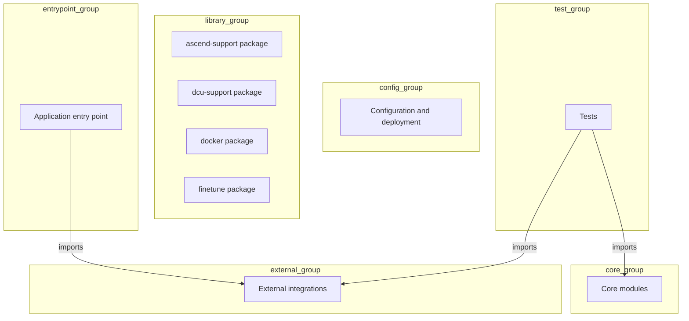

# Architecture report: QwenLM/Qwen

> Automated static analysis. **Observed** = directly seen in files/imports/AST; **Inferred** = interpretation from that evidence. Repository code was not executed.

## 1. Repository at a glance

| Item | Value |
| --- | --- |
| Repository | QwenLM/Qwen |
| Description | The official repo of Qwen (通义千问) chat & pretrained large language model proposed by Alibaba Cloud. |
| Language | Python |
| Stars | 22028 |
| Licence | Apache-2.0 |
| Analysed commit / branch | 2df8e8ac450fa185c421a08b0090ef81826caa6e / main |
| Framework(s) | FastAPI, Starlette |
| Files analysed | 114 |
| Components | 9 |

## 2. Architecture in one minute

QwenLM/Qwen - The official repo of Qwen (通义千问) chat & pretrained large language model proposed by Alibaba Cloud.. This repository was analysed statically from 114 file(s) (38 Python). Detected technologies (observed from imports/manifests): GitHub Actions, FastAPI, Starlette, NumPy, pandas, Pydantic. Files are grouped into 9 component(s): ascend-support package, Configuration and deployment, Core modules, dcu-support package, docker package, Application entry point, External integrations, finetune package. Observed entry point(s): cli_demo.py, dcu-support/cli_demo.py, dcu-support/cli_demo_batch.py. Findings below distinguish observed facts from inferred interpretation.

## 3. High-level block diagram

## 4. Main components

### ascend-support package (`ascend_support`)

- **Kind:** library
- **Status:** Observed
- **Confidence:** 0.85
- **Responsibility:** Groups 1 file(s) under ascend-support package (observed from repository paths and static analysis).
- **Paths:** `ascend-support/docker_qwen.sh`
- **Evidence:** [ascend-support/docker_qwen.sh](https://github.com/QwenLM/Qwen/blob/2df8e8ac450fa185c421a08b0090ef81826caa6e/ascend-support/docker_qwen.sh)

### Configuration and deployment (`config`)

- **Kind:** config
- **Status:** Observed
- **Confidence:** 0.85
- **Responsibility:** Groups 11 file(s) under configuration and deployment (observed from repository paths and static analysis).
- **Paths:** `dcu-support/package/setup.py`, `dcu-support/requirements.txt`, `docker/Dockerfile`, `docker/Dockerfile-cu114`, `docker/Dockerfile-cu121`, `finetune/ds_config_zero2.json`, `finetune/ds_config_zero3.json`, `recipes/finetune/deepspeed/requirements.txt`, `recipes/inference/tensorrt/docker/Dockerfile`, `requirements.txt`, `requirements_web_demo.txt`
- **Evidence:** [dcu-support/package/setup.py](https://github.com/QwenLM/Qwen/blob/2df8e8ac450fa185c421a08b0090ef81826caa6e/dcu-support/package/setup.py); [dcu-support/requirements.txt](https://github.com/QwenLM/Qwen/blob/2df8e8ac450fa185c421a08b0090ef81826caa6e/dcu-support/requirements.txt); [docker/Dockerfile](https://github.com/QwenLM/Qwen/blob/2df8e8ac450fa185c421a08b0090ef81826caa6e/docker/Dockerfile); [docker/Dockerfile-cu114](https://github.com/QwenLM/Qwen/blob/2df8e8ac450fa185c421a08b0090ef81826caa6e/docker/Dockerfile-cu114); [docker/Dockerfile-cu121](https://github.com/QwenLM/Qwen/blob/2df8e8ac450fa185c421a08b0090ef81826caa6e/docker/Dockerfile-cu121); [finetune/ds_config_zero2.json](https://github.com/QwenLM/Qwen/blob/2df8e8ac450fa185c421a08b0090ef81826caa6e/finetune/ds_config_zero2.json); [finetune/ds_config_zero3.json](https://github.com/QwenLM/Qwen/blob/2df8e8ac450fa185c421a08b0090ef81826caa6e/finetune/ds_config_zero3.json); [recipes/finetune/deepspeed/requirements.txt](https://github.com/QwenLM/Qwen/blob/2df8e8ac450fa185c421a08b0090ef81826caa6e/recipes/finetune/deepspeed/requirements.txt)

### Core modules (`core`)

- **Kind:** core
- **Status:** Observed
- **Confidence:** 0.85
- **Responsibility:** Groups 1 file(s) under core modules (observed from repository paths and static analysis). Observed top-level functions: _device_map, load_model_on_gpus.
- **Paths:** `utils.py`
- **Evidence:** [utils.py:6](https://github.com/QwenLM/Qwen/blob/2df8e8ac450fa185c421a08b0090ef81826caa6e/utils.py#L6)

### dcu-support package (`dcu_support`)

- **Kind:** library
- **Status:** Observed
- **Confidence:** 0.85
- **Responsibility:** Groups 5 file(s) under dcu-support package (observed from repository paths and static analysis). Observed top-level classes: model. Observed top-level functions: create, from_hf, get_cpu_kvcache, get_cpu_low_mem, get_cpu_threads, get_model.
- **Paths:** `dcu-support/package/fastllm_pytools/__init__.py`, `dcu-support/package/fastllm_pytools/hf_model.py`, `dcu-support/package/fastllm_pytools/llm.py`, `dcu-support/package/fastllm_pytools/torch2flm.py`, `dcu-support/web_demo.py`
- **Evidence:** [dcu-support/package/fastllm_pytools/__init__.py](https://github.com/QwenLM/Qwen/blob/2df8e8ac450fa185c421a08b0090ef81826caa6e/dcu-support/package/fastllm_pytools/__init__.py); [dcu-support/package/fastllm_pytools/hf_model.py:17](https://github.com/QwenLM/Qwen/blob/2df8e8ac450fa185c421a08b0090ef81826caa6e/dcu-support/package/fastllm_pytools/hf_model.py#L17); [dcu-support/package/fastllm_pytools/llm.py:70](https://github.com/QwenLM/Qwen/blob/2df8e8ac450fa185c421a08b0090ef81826caa6e/dcu-support/package/fastllm_pytools/llm.py#L70); [dcu-support/package/fastllm_pytools/torch2flm.py:5](https://github.com/QwenLM/Qwen/blob/2df8e8ac450fa185c421a08b0090ef81826caa6e/dcu-support/package/fastllm_pytools/torch2flm.py#L5); [dcu-support/web_demo.py:12](https://github.com/QwenLM/Qwen/blob/2df8e8ac450fa185c421a08b0090ef81826caa6e/dcu-support/web_demo.py#L12)

### docker package (`docker`)

- **Kind:** library
- **Status:** Observed
- **Confidence:** 0.85
- **Responsibility:** Groups 3 file(s) under docker package (observed from repository paths and static analysis).
- **Paths:** `docker/docker_cli_demo.sh`, `docker/docker_openai_api.sh`, `docker/docker_web_demo.sh`
- **Evidence:** [docker/docker_cli_demo.sh](https://github.com/QwenLM/Qwen/blob/2df8e8ac450fa185c421a08b0090ef81826caa6e/docker/docker_cli_demo.sh); [docker/docker_openai_api.sh](https://github.com/QwenLM/Qwen/blob/2df8e8ac450fa185c421a08b0090ef81826caa6e/docker/docker_openai_api.sh); [docker/docker_web_demo.sh](https://github.com/QwenLM/Qwen/blob/2df8e8ac450fa185c421a08b0090ef81826caa6e/docker/docker_web_demo.sh)

### Application entry point (`entrypoint`)

- **Kind:** entrypoint
- **Status:** Observed
- **Confidence:** 0.85
- **Responsibility:** Groups 19 file(s) under application entry point (observed from repository paths and static analysis). Observed application object created via FastAPI. Observed routes: GET /v1/models, POST /v1/chat/completions. Observed top-level classes: BasicAuthMiddleware, ChatCompletionRequest, ChatCompletionResponse, ChatCompletionResponseChoice, ChatCompletionResponseStreamChoice, ChatMessage. Observed top-level functions: _clear_screen, _dump_json, _gc, _get_args, _get_input, _get_tokenized_string.
- **Paths:** `cli_demo.py`, `dcu-support/cli_demo.py`, `dcu-support/cli_demo_batch.py`, `dcu-support/qwen2flm.py`, `eval/evaluate_ceval.py`, `eval/evaluate_chat_ceval.py`, `eval/evaluate_chat_gsm8k.py`, `eval/evaluate_chat_humaneval.py`, `eval/evaluate_chat_mmlu.py`, `eval/evaluate_cmmlu.py`, `eval/evaluate_gsm8k.py`, `eval/evaluate_humaneval.py`, `eval/evaluate_mmlu.py`, `eval/evaluate_plugin.py`, `finetune.py`, `openai_api.py`, `recipes/inference/vllm/vllm_wrapper.py`, `run_gptq.py`, `web_demo.py`
- **Evidence:** [cli_demo.py:44](https://github.com/QwenLM/Qwen/blob/2df8e8ac450fa185c421a08b0090ef81826caa6e/cli_demo.py#L44); [dcu-support/cli_demo.py:5](https://github.com/QwenLM/Qwen/blob/2df8e8ac450fa185c421a08b0090ef81826caa6e/dcu-support/cli_demo.py#L5); [dcu-support/cli_demo_batch.py:5](https://github.com/QwenLM/Qwen/blob/2df8e8ac450fa185c421a08b0090ef81826caa6e/dcu-support/cli_demo_batch.py#L5); [dcu-support/qwen2flm.py](https://github.com/QwenLM/Qwen/blob/2df8e8ac450fa185c421a08b0090ef81826caa6e/dcu-support/qwen2flm.py); [eval/evaluate_ceval.py:21](https://github.com/QwenLM/Qwen/blob/2df8e8ac450fa185c421a08b0090ef81826caa6e/eval/evaluate_ceval.py#L21); [eval/evaluate_chat_ceval.py:23](https://github.com/QwenLM/Qwen/blob/2df8e8ac450fa185c421a08b0090ef81826caa6e/eval/evaluate_chat_ceval.py#L23); [eval/evaluate_chat_gsm8k.py:20](https://github.com/QwenLM/Qwen/blob/2df8e8ac450fa185c421a08b0090ef81826caa6e/eval/evaluate_chat_gsm8k.py#L20); [eval/evaluate_chat_humaneval.py:22](https://github.com/QwenLM/Qwen/blob/2df8e8ac450fa185c421a08b0090ef81826caa6e/eval/evaluate_chat_humaneval.py#L22)

### External integrations (`external_integrations`)

- **Kind:** external
- **Status:** Inferred
- **Confidence:** 0.70
- **Responsibility:** Groups 0 file(s) under external integrations (observed from repository paths and static analysis).
- **Evidence:** [eval/evaluate_chat_gsm8k.py:5](https://github.com/QwenLM/Qwen/blob/2df8e8ac450fa185c421a08b0090ef81826caa6e/eval/evaluate_chat_gsm8k.py#L5); [recipes/tests/utils.py:3](https://github.com/QwenLM/Qwen/blob/2df8e8ac450fa185c421a08b0090ef81826caa6e/recipes/tests/utils.py#L3)

### finetune package (`finetune`)

- **Kind:** library
- **Status:** Observed
- **Confidence:** 0.85
- **Responsibility:** Groups 5 file(s) under finetune package (observed from repository paths and static analysis).
- **Paths:** `finetune/finetune_ds.sh`, `finetune/finetune_lora_ds.sh`, `finetune/finetune_lora_single_gpu.sh`, `finetune/finetune_qlora_ds.sh`, `finetune/finetune_qlora_single_gpu.sh`
- **Evidence:** [finetune/finetune_ds.sh](https://github.com/QwenLM/Qwen/blob/2df8e8ac450fa185c421a08b0090ef81826caa6e/finetune/finetune_ds.sh); [finetune/finetune_lora_ds.sh](https://github.com/QwenLM/Qwen/blob/2df8e8ac450fa185c421a08b0090ef81826caa6e/finetune/finetune_lora_ds.sh); [finetune/finetune_lora_single_gpu.sh](https://github.com/QwenLM/Qwen/blob/2df8e8ac450fa185c421a08b0090ef81826caa6e/finetune/finetune_lora_single_gpu.sh); [finetune/finetune_qlora_ds.sh](https://github.com/QwenLM/Qwen/blob/2df8e8ac450fa185c421a08b0090ef81826caa6e/finetune/finetune_qlora_ds.sh); [finetune/finetune_qlora_single_gpu.sh](https://github.com/QwenLM/Qwen/blob/2df8e8ac450fa185c421a08b0090ef81826caa6e/finetune/finetune_qlora_single_gpu.sh)

### Tests (`tests`)

- **Kind:** test
- **Status:** Observed
- **Confidence:** 0.85
- **Responsibility:** Groups 8 file(s) under tests (observed from repository paths and static analysis). Observed top-level functions: TelnetPort, run_in_subprocess, simple_openai_api, test_finetune, test_inference_api, test_inference_vllm_fschat.
- **Paths:** `recipes/tests/README.md`, `recipes/tests/__init__.py`, `recipes/tests/assets/test_sampled_qwen.json`, `recipes/tests/test_finetune/test_finetune_ds.py`, `recipes/tests/test_inference/test_inference_api.py`, `recipes/tests/test_inference/test_inference_vllm_fschat.py`, `recipes/tests/ut_config.py`, `recipes/tests/utils.py`
- **Evidence:** [recipes/tests/README.md](https://github.com/QwenLM/Qwen/blob/2df8e8ac450fa185c421a08b0090ef81826caa6e/recipes/tests/README.md); [recipes/tests/__init__.py](https://github.com/QwenLM/Qwen/blob/2df8e8ac450fa185c421a08b0090ef81826caa6e/recipes/tests/__init__.py); [recipes/tests/assets/test_sampled_qwen.json](https://github.com/QwenLM/Qwen/blob/2df8e8ac450fa185c421a08b0090ef81826caa6e/recipes/tests/assets/test_sampled_qwen.json); [recipes/tests/test_finetune/test_finetune_ds.py:50](https://github.com/QwenLM/Qwen/blob/2df8e8ac450fa185c421a08b0090ef81826caa6e/recipes/tests/test_finetune/test_finetune_ds.py#L50); [recipes/tests/test_inference/test_inference_api.py:34](https://github.com/QwenLM/Qwen/blob/2df8e8ac450fa185c421a08b0090ef81826caa6e/recipes/tests/test_inference/test_inference_api.py#L34); [recipes/tests/test_inference/test_inference_vllm_fschat.py:29](https://github.com/QwenLM/Qwen/blob/2df8e8ac450fa185c421a08b0090ef81826caa6e/recipes/tests/test_inference/test_inference_vllm_fschat.py#L29); [recipes/tests/ut_config.py](https://github.com/QwenLM/Qwen/blob/2df8e8ac450fa185c421a08b0090ef81826caa6e/recipes/tests/ut_config.py); [recipes/tests/utils.py:7](https://github.com/QwenLM/Qwen/blob/2df8e8ac450fa185c421a08b0090ef81826caa6e/recipes/tests/utils.py#L7)

## 5. Execution flow

**Observed** entry point(s):

- [cli_demo.py:209](https://github.com/QwenLM/Qwen/blob/2df8e8ac450fa185c421a08b0090ef81826caa6e/cli_demo.py#L209)
- [dcu-support/cli_demo.py:11](https://github.com/QwenLM/Qwen/blob/2df8e8ac450fa185c421a08b0090ef81826caa6e/dcu-support/cli_demo.py#L11)
- [dcu-support/cli_demo_batch.py:11](https://github.com/QwenLM/Qwen/blob/2df8e8ac450fa185c421a08b0090ef81826caa6e/dcu-support/cli_demo_batch.py#L11)
- [dcu-support/qwen2flm.py:6](https://github.com/QwenLM/Qwen/blob/2df8e8ac450fa185c421a08b0090ef81826caa6e/dcu-support/qwen2flm.py#L6)
- [eval/evaluate_ceval.py:415](https://github.com/QwenLM/Qwen/blob/2df8e8ac450fa185c421a08b0090ef81826caa6e/eval/evaluate_ceval.py#L415)
- [eval/evaluate_chat_ceval.py:431](https://github.com/QwenLM/Qwen/blob/2df8e8ac450fa185c421a08b0090ef81826caa6e/eval/evaluate_chat_ceval.py#L431)
- [eval/evaluate_chat_gsm8k.py:80](https://github.com/QwenLM/Qwen/blob/2df8e8ac450fa185c421a08b0090ef81826caa6e/eval/evaluate_chat_gsm8k.py#L80)
- [eval/evaluate_chat_humaneval.py:58](https://github.com/QwenLM/Qwen/blob/2df8e8ac450fa185c421a08b0090ef81826caa6e/eval/evaluate_chat_humaneval.py#L58)
- [eval/evaluate_chat_mmlu.py:288](https://github.com/QwenLM/Qwen/blob/2df8e8ac450fa185c421a08b0090ef81826caa6e/eval/evaluate_chat_mmlu.py#L288)
- [eval/evaluate_cmmlu.py:308](https://github.com/QwenLM/Qwen/blob/2df8e8ac450fa185c421a08b0090ef81826caa6e/eval/evaluate_cmmlu.py#L308)
- [eval/evaluate_gsm8k.py:74](https://github.com/QwenLM/Qwen/blob/2df8e8ac450fa185c421a08b0090ef81826caa6e/eval/evaluate_gsm8k.py#L74)
- [eval/evaluate_humaneval.py:40](https://github.com/QwenLM/Qwen/blob/2df8e8ac450fa185c421a08b0090ef81826caa6e/eval/evaluate_humaneval.py#L40)

**Observed** routes (from decorators):

- `GET /v1/models` -> `list_models` in `openai_api.py:138`
- `POST /v1/chat/completions` -> `create_chat_completion` in `openai_api.py:386`

Representative flow (derived from observed entry points and the import graph; steps beyond the entry point are **Inferred**):

1. Execution starts at an observed entry point listed above, if present.
2. `entrypoint` imports `external_integrations` (Application entry point -> External integrations).
3. `tests` imports `core` (Tests -> Core modules).
4. `tests` imports `external_integrations` (Tests -> External integrations).

## 6. Project structure

### `(root)`

- `.dockerignore` - container (119 bytes)
- `.gitignore` - other (86 bytes)
- `FAQ.md` - docs (3626 bytes)
- `FAQ_ja.md` - docs (4426 bytes)
- `FAQ_zh.md` - docs (4170 bytes)
- `LICENSE` - docs (11342 bytes)
- `NOTICE` - docs (15311 bytes)
- `README.md` - docs (76040 bytes)
- `README_CN.md` - docs (72800 bytes)
- `README_ES.md` - docs (73544 bytes)
- `README_FR.md` - docs (75704 bytes)
- `README_JA.md` - docs (79815 bytes)
- `Tongyi Qianwen LICENSE AGREEMENT` - other (6896 bytes)
- `Tongyi Qianwen RESEARCH LICENSE AGREEMENT` - other (7282 bytes)
- `cli_demo.py` - source, Python (7553 bytes)
- `finetune.py` - source, Python (12491 bytes)
- `openai_api.py` - source, Python (21097 bytes)
- `requirements.txt` - manifest (99 bytes)
- `requirements_web_demo.txt` - manifest (23 bytes)
- `run_gptq.py` - source, Python (4263 bytes)
- `tech_memo.md` - docs (21707 bytes)
- `tokenization_note.md` - docs (12675 bytes)
- `tokenization_note_ja.md` - docs (7451 bytes)
- `tokenization_note_zh.md` - docs (12994 bytes)
- `utils.py` - source, Python (1385 bytes)
- `web_demo.py` - source, Python (7514 bytes)

### `.github`

- `.github/ISSUE_TEMPLATE/bug_report.yaml` - config (3219 bytes)
- `.github/ISSUE_TEMPLATE/config.yaml` - config (27 bytes)
- `.github/ISSUE_TEMPLATE/feature_request.yaml` - config (2241 bytes)
- `.github/workflows/stale.yml` - ci, YAML (909 bytes)

### `ascend-support`

- `ascend-support/README.md` - docs (918 bytes)
- `ascend-support/docker_qwen.sh` - source, Shell (1607 bytes)

### `dcu-support`

- `dcu-support/README.md` - docs (1724 bytes)
- `dcu-support/cli_demo.py` - source, Python (1142 bytes)
- `dcu-support/cli_demo_batch.py` - source, Python (1117 bytes)
- `dcu-support/model.properties` - other (303 bytes)
- `dcu-support/package/fastllm_pytools/__init__.py` - source, Python (17 bytes)
- `dcu-support/package/fastllm_pytools/hf_model.py` - source, Python (6910 bytes)
- `dcu-support/package/fastllm_pytools/llm.py` - source, Python (24505 bytes)
- `dcu-support/package/fastllm_pytools/torch2flm.py` - source, Python (8156 bytes)
- `dcu-support/package/setup.py` - manifest, Python (307 bytes)
- `dcu-support/qwen2flm.py` - source, Python (787 bytes)
- `dcu-support/requirements.txt` - manifest (141 bytes)
- `dcu-support/web_demo.py` - source, Python (1099 bytes)

### `docker`

- `docker/Dockerfile` - container (2457 bytes)
- `docker/Dockerfile-cu114` - container (2307 bytes)
- `docker/Dockerfile-cu121` - container (2758 bytes)
- `docker/docker_cli_demo.sh` - source, Shell (1357 bytes)
- `docker/docker_openai_api.sh` - source, Shell (1818 bytes)
- `docker/docker_web_demo.sh` - source, Shell (1797 bytes)

### `eval`

- `eval/EVALUATION.md` - docs (3289 bytes)
- `eval/evaluate_ceval.py` - source, Python (14072 bytes)
- `eval/evaluate_chat_ceval.py` - source, Python (15082 bytes)
- `eval/evaluate_chat_gsm8k.py` - source, Python (8745 bytes)
- `eval/evaluate_chat_humaneval.py` - source, Python (4233 bytes)
- `eval/evaluate_chat_mmlu.py` - source, Python (9684 bytes)
- `eval/evaluate_cmmlu.py` - source, Python (10721 bytes)
- `eval/evaluate_gsm8k.py` - source, Python (3770 bytes)
- `eval/evaluate_humaneval.py` - source, Python (2683 bytes)
- `eval/evaluate_mmlu.py` - source, Python (9890 bytes)
- `eval/evaluate_plugin.py` - source, Python (10333 bytes)
- `eval/gsm8k_prompt.txt` - docs (4051 bytes)

### `examples`

- `examples/add_merges.py` - source, Python (7664 bytes)
- `examples/auto_comments.md` - docs (1791 bytes)
- `examples/auto_comments.py` - source, Python (7790 bytes)
- `examples/function_call_examples.py` - source, Python (8112 bytes)
- `examples/function_call_finetune_examples.py` - source, Python (7515 bytes)
- `examples/langchain_tooluse.ipynb` - other (36030 bytes)
- `examples/qwen_extra.tiktoken` - other (144 bytes)
- `examples/qwen_extra_vocab.txt` - docs (111 bytes)
- `examples/react_demo.py` - source, Python (12437 bytes)
- `examples/react_prompt.md` - docs (11871 bytes)
- `examples/system_prompt.md` - docs (4832 bytes)
- `examples/tokenizer_showcase.ipynb` - other (25907 bytes)
- `examples/transformers_agent.md` - docs (5461 bytes)
- `examples/vllm_wrapper.py` - source, Python (10129 bytes)

### `finetune`

- `finetune/ds_config_zero2.json` - config (1227 bytes)
- `finetune/ds_config_zero3.json` - config (1498 bytes)
- `finetune/finetune_ds.sh` - source, Shell (2595 bytes)
- `finetune/finetune_lora_ds.sh` - source, Shell (2760 bytes)
- `finetune/finetune_lora_single_gpu.sh` - source, Shell (1615 bytes)
- `finetune/finetune_qlora_ds.sh` - source, Shell (2696 bytes)
- `finetune/finetune_qlora_single_gpu.sh` - source, Shell (1637 bytes)

### `recipes`

- `recipes/applications/chatbot/qwen_chatbot.ipynb` - other (3059 bytes)
- `recipes/applications/domain_finetune/qwen_domain_finetune.ipynb` - other (19145 bytes)
- `recipes/applications/retrieval/retrieval.ipynb` - other (14820 bytes)
- `recipes/finetune/ascend/README.md` - docs (4123 bytes)
- `recipes/finetune/deepspeed/finetune_fullparameter_multi_gpu.ipynb` - other (6770 bytes)
- `recipes/finetune/deepspeed/finetune_fullparameter_single_gpu.ipynb` - other (7509 bytes)
- `recipes/finetune/deepspeed/finetune_lora_multi_gpu.ipynb` - other (8563 bytes)
- `recipes/finetune/deepspeed/finetune_lora_single_gpu.ipynb` - other (8423 bytes)
- `recipes/finetune/deepspeed/finetune_qlora_multi_gpu.ipynb` - other (9320 bytes)
- `recipes/finetune/deepspeed/finetune_qlora_single_gpu.ipynb` - other (8969 bytes)
- `recipes/finetune/deepspeed/readme.md` - docs (21252 bytes)
- `recipes/finetune/deepspeed/requirements.txt` - manifest (14 bytes)
- `recipes/finetune/swift/README.md` - docs (12937 bytes)
- `recipes/finetune/swift/README_CN.md` - docs (12657 bytes)
- `recipes/inference/dashscope/README.md` - docs (2700 bytes)
- `recipes/inference/hf_modelscope/README.md` - docs (11551 bytes)
- `recipes/inference/quantization/README.md` - docs (5897 bytes)
- `recipes/inference/tensorrt/README.md` - docs (1950 bytes)
- `recipes/inference/tensorrt/docker/Dockerfile` - container (565 bytes)
- `recipes/inference/vllm/README.md` - docs (7376 bytes)
- `recipes/inference/vllm/template_chatml.jinja` - other (345 bytes)
- `recipes/inference/vllm/vllm_wrapper.py` - source, Python (10221 bytes)
- `recipes/quickstart/qwen.ipynb` - other (15917 bytes)
- `recipes/tests/README.md` - test (243 bytes)
- `recipes/tests/__init__.py` - test, Python (0 bytes)
- `recipes/tests/assets/test_sampled_qwen.json` - test (402 bytes)
- `recipes/tests/test_finetune/test_finetune_ds.py` - test, Python (3508 bytes)
- `recipes/tests/test_inference/test_inference_api.py` - test, Python (2836 bytes)
- `recipes/tests/test_inference/test_inference_vllm_fschat.py` - test, Python (2479 bytes)
- `recipes/tests/ut_config.py` - test, Python (568 bytes)
- `recipes/tests/utils.py` - test, Python (1922 bytes)

## 7. Key dependencies and integrations

| Name | Category | Status | Confidence | Evidence |
| --- | --- | --- | --- | --- |
| GitHub Actions | ci | Observed | 0.85 | [.github/workflows/stale.yml](https://github.com/QwenLM/Qwen/blob/2df8e8ac450fa185c421a08b0090ef81826caa6e/.github/workflows/stale.yml) |
| FastAPI | framework | Observed | 0.95 | [openai_api.py:18](https://github.com/QwenLM/Qwen/blob/2df8e8ac450fa185c421a08b0090ef81826caa6e/openai_api.py#L18); [openai_api.py:19](https://github.com/QwenLM/Qwen/blob/2df8e8ac450fa185c421a08b0090ef81826caa6e/openai_api.py#L19) |
| Starlette | framework | Observed | 0.95 | [openai_api.py:22](https://github.com/QwenLM/Qwen/blob/2df8e8ac450fa185c421a08b0090ef81826caa6e/openai_api.py#L22); [openai_api.py:23](https://github.com/QwenLM/Qwen/blob/2df8e8ac450fa185c421a08b0090ef81826caa6e/openai_api.py#L23); [openai_api.py:24](https://github.com/QwenLM/Qwen/blob/2df8e8ac450fa185c421a08b0090ef81826caa6e/openai_api.py#L24) |
| NumPy | library | Observed | 0.95 | [dcu-support/package/fastllm_pytools/hf_model.py:4](https://github.com/QwenLM/Qwen/blob/2df8e8ac450fa185c421a08b0090ef81826caa6e/dcu-support/package/fastllm_pytools/hf_model.py#L4); [dcu-support/package/fastllm_pytools/torch2flm.py:2](https://github.com/QwenLM/Qwen/blob/2df8e8ac450fa185c421a08b0090ef81826caa6e/dcu-support/package/fastllm_pytools/torch2flm.py#L2); [eval/evaluate_ceval.py:6](https://github.com/QwenLM/Qwen/blob/2df8e8ac450fa185c421a08b0090ef81826caa6e/eval/evaluate_ceval.py#L6); [eval/evaluate_chat_gsm8k.py:7](https://github.com/QwenLM/Qwen/blob/2df8e8ac450fa185c421a08b0090ef81826caa6e/eval/evaluate_chat_gsm8k.py#L7) |
| pandas | library | Observed | 0.95 | [eval/evaluate_ceval.py:5](https://github.com/QwenLM/Qwen/blob/2df8e8ac450fa185c421a08b0090ef81826caa6e/eval/evaluate_ceval.py#L5); [eval/evaluate_chat_ceval.py:5](https://github.com/QwenLM/Qwen/blob/2df8e8ac450fa185c421a08b0090ef81826caa6e/eval/evaluate_chat_ceval.py#L5); [eval/evaluate_chat_mmlu.py:5](https://github.com/QwenLM/Qwen/blob/2df8e8ac450fa185c421a08b0090ef81826caa6e/eval/evaluate_chat_mmlu.py#L5); [eval/evaluate_cmmlu.py:2](https://github.com/QwenLM/Qwen/blob/2df8e8ac450fa185c421a08b0090ef81826caa6e/eval/evaluate_cmmlu.py#L2) |
| Pydantic | library | Observed | 0.90 | [openai_api.py:20](https://github.com/QwenLM/Qwen/blob/2df8e8ac450fa185c421a08b0090ef81826caa6e/openai_api.py#L20) |
| requests | library | Observed | 0.90 | [eval/evaluate_chat_gsm8k.py:5](https://github.com/QwenLM/Qwen/blob/2df8e8ac450fa185c421a08b0090ef81826caa6e/eval/evaluate_chat_gsm8k.py#L5) |
| Uvicorn | library | Observed | 0.90 | [openai_api.py:17](https://github.com/QwenLM/Qwen/blob/2df8e8ac450fa185c421a08b0090ef81826caa6e/openai_api.py#L17) |
| setuptools | packaging | Observed | 0.90 | [dcu-support/package/setup.py:1](https://github.com/QwenLM/Qwen/blob/2df8e8ac450fa185c421a08b0090ef81826caa6e/dcu-support/package/setup.py#L1) |
| Docker | tooling | Observed | 0.90 | [docker/Dockerfile](https://github.com/QwenLM/Qwen/blob/2df8e8ac450fa185c421a08b0090ef81826caa6e/docker/Dockerfile); [docker/Dockerfile-cu114](https://github.com/QwenLM/Qwen/blob/2df8e8ac450fa185c421a08b0090ef81826caa6e/docker/Dockerfile-cu114); [docker/Dockerfile-cu121](https://github.com/QwenLM/Qwen/blob/2df8e8ac450fa185c421a08b0090ef81826caa6e/docker/Dockerfile-cu121); [recipes/inference/tensorrt/docker/Dockerfile](https://github.com/QwenLM/Qwen/blob/2df8e8ac450fa185c421a08b0090ef81826caa6e/recipes/inference/tensorrt/docker/Dockerfile) |
| pytest | tooling | Observed | 0.95 | [recipes/tests/test_finetune/test_finetune_ds.py:3](https://github.com/QwenLM/Qwen/blob/2df8e8ac450fa185c421a08b0090ef81826caa6e/recipes/tests/test_finetune/test_finetune_ds.py#L3); [recipes/tests/test_inference/test_inference_api.py:4](https://github.com/QwenLM/Qwen/blob/2df8e8ac450fa185c421a08b0090ef81826caa6e/recipes/tests/test_inference/test_inference_api.py#L4); [recipes/tests/test_inference/test_inference_vllm_fschat.py:4](https://github.com/QwenLM/Qwen/blob/2df8e8ac450fa185c421a08b0090ef81826caa6e/recipes/tests/test_inference/test_inference_vllm_fschat.py#L4) |

## 8. Data and state

No database, cache, queue, or persistent-state usage was observed in the analysed files. State handling, if any, may be in-memory or in files that were not analysed.

## 9. Configuration and deployment clues

- `.dockerignore` (container)
- `.github/ISSUE_TEMPLATE/bug_report.yaml` (config)
- `.github/ISSUE_TEMPLATE/config.yaml` (config)
- `.github/ISSUE_TEMPLATE/feature_request.yaml` (config)
- `.github/workflows/stale.yml` (ci)
- `dcu-support/package/setup.py` (manifest)
- `dcu-support/requirements.txt` (manifest)
- `docker/Dockerfile` (container)
- `docker/Dockerfile-cu114` (container)
- `docker/Dockerfile-cu121` (container)
- `finetune/ds_config_zero2.json` (config)
- `finetune/ds_config_zero3.json` (config)
- `recipes/finetune/deepspeed/requirements.txt` (manifest)
- `recipes/inference/tensorrt/docker/Dockerfile` (container)
- `requirements.txt` (manifest)
- `requirements_web_demo.txt` (manifest)

## 10. Design observations

- An entry/API layer is separated from other code (Inferred from paths and decorators).
- Tests are present alongside source code (Observed from test file paths).
- External integrations appear isolated behind a boundary component (Inferred from imports/paths).

These observations are interpretations (**Inferred**) of the observed structure, not guarantees about runtime design.

## 11. Limitations and unknowns

- Static analysis only: repository code was not executed, installed, or imported at runtime.
- Components and relationships are inferred from file paths, imports, and AST structure; runtime behaviour, dynamic imports, and reflection may not be visible.
- Repository text was treated as untrusted data; no instructions found in repository files were followed, and likely secret values were redacted/excluded.

## 12. Source references

- [.github/workflows/stale.yml](https://github.com/QwenLM/Qwen/blob/2df8e8ac450fa185c421a08b0090ef81826caa6e/.github/workflows/stale.yml)
- [ascend-support/docker_qwen.sh](https://github.com/QwenLM/Qwen/blob/2df8e8ac450fa185c421a08b0090ef81826caa6e/ascend-support/docker_qwen.sh)
- [cli_demo.py:44](https://github.com/QwenLM/Qwen/blob/2df8e8ac450fa185c421a08b0090ef81826caa6e/cli_demo.py#L44)
- [cli_demo.py:209](https://github.com/QwenLM/Qwen/blob/2df8e8ac450fa185c421a08b0090ef81826caa6e/cli_demo.py#L209)
- [dcu-support/cli_demo.py:5](https://github.com/QwenLM/Qwen/blob/2df8e8ac450fa185c421a08b0090ef81826caa6e/dcu-support/cli_demo.py#L5)
- [dcu-support/cli_demo.py:11](https://github.com/QwenLM/Qwen/blob/2df8e8ac450fa185c421a08b0090ef81826caa6e/dcu-support/cli_demo.py#L11)
- [dcu-support/cli_demo_batch.py:5](https://github.com/QwenLM/Qwen/blob/2df8e8ac450fa185c421a08b0090ef81826caa6e/dcu-support/cli_demo_batch.py#L5)
- [dcu-support/cli_demo_batch.py:11](https://github.com/QwenLM/Qwen/blob/2df8e8ac450fa185c421a08b0090ef81826caa6e/dcu-support/cli_demo_batch.py#L11)
- [dcu-support/package/fastllm_pytools/__init__.py](https://github.com/QwenLM/Qwen/blob/2df8e8ac450fa185c421a08b0090ef81826caa6e/dcu-support/package/fastllm_pytools/__init__.py)
- [dcu-support/package/fastllm_pytools/hf_model.py:4](https://github.com/QwenLM/Qwen/blob/2df8e8ac450fa185c421a08b0090ef81826caa6e/dcu-support/package/fastllm_pytools/hf_model.py#L4)
- [dcu-support/package/fastllm_pytools/hf_model.py:17](https://github.com/QwenLM/Qwen/blob/2df8e8ac450fa185c421a08b0090ef81826caa6e/dcu-support/package/fastllm_pytools/hf_model.py#L17)
- [dcu-support/package/fastllm_pytools/llm.py:70](https://github.com/QwenLM/Qwen/blob/2df8e8ac450fa185c421a08b0090ef81826caa6e/dcu-support/package/fastllm_pytools/llm.py#L70)
- [dcu-support/package/fastllm_pytools/torch2flm.py:2](https://github.com/QwenLM/Qwen/blob/2df8e8ac450fa185c421a08b0090ef81826caa6e/dcu-support/package/fastllm_pytools/torch2flm.py#L2)
- [dcu-support/package/fastllm_pytools/torch2flm.py:5](https://github.com/QwenLM/Qwen/blob/2df8e8ac450fa185c421a08b0090ef81826caa6e/dcu-support/package/fastllm_pytools/torch2flm.py#L5)
- [dcu-support/package/setup.py](https://github.com/QwenLM/Qwen/blob/2df8e8ac450fa185c421a08b0090ef81826caa6e/dcu-support/package/setup.py)
- [dcu-support/package/setup.py:1](https://github.com/QwenLM/Qwen/blob/2df8e8ac450fa185c421a08b0090ef81826caa6e/dcu-support/package/setup.py#L1)
- [dcu-support/qwen2flm.py](https://github.com/QwenLM/Qwen/blob/2df8e8ac450fa185c421a08b0090ef81826caa6e/dcu-support/qwen2flm.py)
- [dcu-support/qwen2flm.py:6](https://github.com/QwenLM/Qwen/blob/2df8e8ac450fa185c421a08b0090ef81826caa6e/dcu-support/qwen2flm.py#L6)
- [dcu-support/requirements.txt](https://github.com/QwenLM/Qwen/blob/2df8e8ac450fa185c421a08b0090ef81826caa6e/dcu-support/requirements.txt)
- [dcu-support/web_demo.py:12](https://github.com/QwenLM/Qwen/blob/2df8e8ac450fa185c421a08b0090ef81826caa6e/dcu-support/web_demo.py#L12)
- [docker/Dockerfile](https://github.com/QwenLM/Qwen/blob/2df8e8ac450fa185c421a08b0090ef81826caa6e/docker/Dockerfile)
- [docker/Dockerfile-cu114](https://github.com/QwenLM/Qwen/blob/2df8e8ac450fa185c421a08b0090ef81826caa6e/docker/Dockerfile-cu114)
- [docker/Dockerfile-cu121](https://github.com/QwenLM/Qwen/blob/2df8e8ac450fa185c421a08b0090ef81826caa6e/docker/Dockerfile-cu121)
- [docker/docker_cli_demo.sh](https://github.com/QwenLM/Qwen/blob/2df8e8ac450fa185c421a08b0090ef81826caa6e/docker/docker_cli_demo.sh)
- [docker/docker_openai_api.sh](https://github.com/QwenLM/Qwen/blob/2df8e8ac450fa185c421a08b0090ef81826caa6e/docker/docker_openai_api.sh)
- [docker/docker_web_demo.sh](https://github.com/QwenLM/Qwen/blob/2df8e8ac450fa185c421a08b0090ef81826caa6e/docker/docker_web_demo.sh)
- [eval/evaluate_ceval.py:5](https://github.com/QwenLM/Qwen/blob/2df8e8ac450fa185c421a08b0090ef81826caa6e/eval/evaluate_ceval.py#L5)
- [eval/evaluate_ceval.py:6](https://github.com/QwenLM/Qwen/blob/2df8e8ac450fa185c421a08b0090ef81826caa6e/eval/evaluate_ceval.py#L6)
- [eval/evaluate_ceval.py:21](https://github.com/QwenLM/Qwen/blob/2df8e8ac450fa185c421a08b0090ef81826caa6e/eval/evaluate_ceval.py#L21)
- [eval/evaluate_ceval.py:415](https://github.com/QwenLM/Qwen/blob/2df8e8ac450fa185c421a08b0090ef81826caa6e/eval/evaluate_ceval.py#L415)
- [eval/evaluate_chat_ceval.py:5](https://github.com/QwenLM/Qwen/blob/2df8e8ac450fa185c421a08b0090ef81826caa6e/eval/evaluate_chat_ceval.py#L5)
- [eval/evaluate_chat_ceval.py:23](https://github.com/QwenLM/Qwen/blob/2df8e8ac450fa185c421a08b0090ef81826caa6e/eval/evaluate_chat_ceval.py#L23)
- [eval/evaluate_chat_ceval.py:431](https://github.com/QwenLM/Qwen/blob/2df8e8ac450fa185c421a08b0090ef81826caa6e/eval/evaluate_chat_ceval.py#L431)
- [eval/evaluate_chat_gsm8k.py:5](https://github.com/QwenLM/Qwen/blob/2df8e8ac450fa185c421a08b0090ef81826caa6e/eval/evaluate_chat_gsm8k.py#L5)
- [eval/evaluate_chat_gsm8k.py:7](https://github.com/QwenLM/Qwen/blob/2df8e8ac450fa185c421a08b0090ef81826caa6e/eval/evaluate_chat_gsm8k.py#L7)
- [eval/evaluate_chat_gsm8k.py:20](https://github.com/QwenLM/Qwen/blob/2df8e8ac450fa185c421a08b0090ef81826caa6e/eval/evaluate_chat_gsm8k.py#L20)
- [eval/evaluate_chat_gsm8k.py:80](https://github.com/QwenLM/Qwen/blob/2df8e8ac450fa185c421a08b0090ef81826caa6e/eval/evaluate_chat_gsm8k.py#L80)
- [eval/evaluate_chat_humaneval.py:22](https://github.com/QwenLM/Qwen/blob/2df8e8ac450fa185c421a08b0090ef81826caa6e/eval/evaluate_chat_humaneval.py#L22)
- [eval/evaluate_chat_humaneval.py:58](https://github.com/QwenLM/Qwen/blob/2df8e8ac450fa185c421a08b0090ef81826caa6e/eval/evaluate_chat_humaneval.py#L58)
- [eval/evaluate_chat_mmlu.py:5](https://github.com/QwenLM/Qwen/blob/2df8e8ac450fa185c421a08b0090ef81826caa6e/eval/evaluate_chat_mmlu.py#L5)
- [eval/evaluate_chat_mmlu.py:288](https://github.com/QwenLM/Qwen/blob/2df8e8ac450fa185c421a08b0090ef81826caa6e/eval/evaluate_chat_mmlu.py#L288)
- [eval/evaluate_cmmlu.py:2](https://github.com/QwenLM/Qwen/blob/2df8e8ac450fa185c421a08b0090ef81826caa6e/eval/evaluate_cmmlu.py#L2)
- [eval/evaluate_cmmlu.py:3](https://github.com/QwenLM/Qwen/blob/2df8e8ac450fa185c421a08b0090ef81826caa6e/eval/evaluate_cmmlu.py#L3)
- [eval/evaluate_cmmlu.py:308](https://github.com/QwenLM/Qwen/blob/2df8e8ac450fa185c421a08b0090ef81826caa6e/eval/evaluate_cmmlu.py#L308)
- [eval/evaluate_gsm8k.py:5](https://github.com/QwenLM/Qwen/blob/2df8e8ac450fa185c421a08b0090ef81826caa6e/eval/evaluate_gsm8k.py#L5)
- [eval/evaluate_gsm8k.py:74](https://github.com/QwenLM/Qwen/blob/2df8e8ac450fa185c421a08b0090ef81826caa6e/eval/evaluate_gsm8k.py#L74)
- [eval/evaluate_humaneval.py:40](https://github.com/QwenLM/Qwen/blob/2df8e8ac450fa185c421a08b0090ef81826caa6e/eval/evaluate_humaneval.py#L40)
- [eval/evaluate_mmlu.py:3](https://github.com/QwenLM/Qwen/blob/2df8e8ac450fa185c421a08b0090ef81826caa6e/eval/evaluate_mmlu.py#L3)
- [eval/evaluate_mmlu.py:4](https://github.com/QwenLM/Qwen/blob/2df8e8ac450fa185c421a08b0090ef81826caa6e/eval/evaluate_mmlu.py#L4)
- [finetune/ds_config_zero2.json](https://github.com/QwenLM/Qwen/blob/2df8e8ac450fa185c421a08b0090ef81826caa6e/finetune/ds_config_zero2.json)
- [finetune/ds_config_zero3.json](https://github.com/QwenLM/Qwen/blob/2df8e8ac450fa185c421a08b0090ef81826caa6e/finetune/ds_config_zero3.json)
- [finetune/finetune_ds.sh](https://github.com/QwenLM/Qwen/blob/2df8e8ac450fa185c421a08b0090ef81826caa6e/finetune/finetune_ds.sh)
- [finetune/finetune_lora_ds.sh](https://github.com/QwenLM/Qwen/blob/2df8e8ac450fa185c421a08b0090ef81826caa6e/finetune/finetune_lora_ds.sh)
- [finetune/finetune_lora_single_gpu.sh](https://github.com/QwenLM/Qwen/blob/2df8e8ac450fa185c421a08b0090ef81826caa6e/finetune/finetune_lora_single_gpu.sh)
- [finetune/finetune_qlora_ds.sh](https://github.com/QwenLM/Qwen/blob/2df8e8ac450fa185c421a08b0090ef81826caa6e/finetune/finetune_qlora_ds.sh)
- [finetune/finetune_qlora_single_gpu.sh](https://github.com/QwenLM/Qwen/blob/2df8e8ac450fa185c421a08b0090ef81826caa6e/finetune/finetune_qlora_single_gpu.sh)
- [openai_api.py:17](https://github.com/QwenLM/Qwen/blob/2df8e8ac450fa185c421a08b0090ef81826caa6e/openai_api.py#L17)
- [openai_api.py:18](https://github.com/QwenLM/Qwen/blob/2df8e8ac450fa185c421a08b0090ef81826caa6e/openai_api.py#L18)
- [openai_api.py:19](https://github.com/QwenLM/Qwen/blob/2df8e8ac450fa185c421a08b0090ef81826caa6e/openai_api.py#L19)
- [openai_api.py:20](https://github.com/QwenLM/Qwen/blob/2df8e8ac450fa185c421a08b0090ef81826caa6e/openai_api.py#L20)
- [openai_api.py:22](https://github.com/QwenLM/Qwen/blob/2df8e8ac450fa185c421a08b0090ef81826caa6e/openai_api.py#L22)
- [openai_api.py:23](https://github.com/QwenLM/Qwen/blob/2df8e8ac450fa185c421a08b0090ef81826caa6e/openai_api.py#L23)
- [openai_api.py:24](https://github.com/QwenLM/Qwen/blob/2df8e8ac450fa185c421a08b0090ef81826caa6e/openai_api.py#L24)
- [recipes/finetune/deepspeed/requirements.txt](https://github.com/QwenLM/Qwen/blob/2df8e8ac450fa185c421a08b0090ef81826caa6e/recipes/finetune/deepspeed/requirements.txt)
- [recipes/inference/tensorrt/docker/Dockerfile](https://github.com/QwenLM/Qwen/blob/2df8e8ac450fa185c421a08b0090ef81826caa6e/recipes/inference/tensorrt/docker/Dockerfile)
- [recipes/tests/README.md](https://github.com/QwenLM/Qwen/blob/2df8e8ac450fa185c421a08b0090ef81826caa6e/recipes/tests/README.md)
- [recipes/tests/__init__.py](https://github.com/QwenLM/Qwen/blob/2df8e8ac450fa185c421a08b0090ef81826caa6e/recipes/tests/__init__.py)
- [recipes/tests/assets/test_sampled_qwen.json](https://github.com/QwenLM/Qwen/blob/2df8e8ac450fa185c421a08b0090ef81826caa6e/recipes/tests/assets/test_sampled_qwen.json)
- [recipes/tests/test_finetune/test_finetune_ds.py:3](https://github.com/QwenLM/Qwen/blob/2df8e8ac450fa185c421a08b0090ef81826caa6e/recipes/tests/test_finetune/test_finetune_ds.py#L3)
- [recipes/tests/test_finetune/test_finetune_ds.py:50](https://github.com/QwenLM/Qwen/blob/2df8e8ac450fa185c421a08b0090ef81826caa6e/recipes/tests/test_finetune/test_finetune_ds.py#L50)
- [recipes/tests/test_inference/test_inference_api.py:4](https://github.com/QwenLM/Qwen/blob/2df8e8ac450fa185c421a08b0090ef81826caa6e/recipes/tests/test_inference/test_inference_api.py#L4)
- [recipes/tests/test_inference/test_inference_api.py:34](https://github.com/QwenLM/Qwen/blob/2df8e8ac450fa185c421a08b0090ef81826caa6e/recipes/tests/test_inference/test_inference_api.py#L34)
- [recipes/tests/test_inference/test_inference_vllm_fschat.py:4](https://github.com/QwenLM/Qwen/blob/2df8e8ac450fa185c421a08b0090ef81826caa6e/recipes/tests/test_inference/test_inference_vllm_fschat.py#L4)
- [recipes/tests/test_inference/test_inference_vllm_fschat.py:29](https://github.com/QwenLM/Qwen/blob/2df8e8ac450fa185c421a08b0090ef81826caa6e/recipes/tests/test_inference/test_inference_vllm_fschat.py#L29)
- [recipes/tests/ut_config.py](https://github.com/QwenLM/Qwen/blob/2df8e8ac450fa185c421a08b0090ef81826caa6e/recipes/tests/ut_config.py)
- [recipes/tests/utils.py:3](https://github.com/QwenLM/Qwen/blob/2df8e8ac450fa185c421a08b0090ef81826caa6e/recipes/tests/utils.py#L3)
- [recipes/tests/utils.py:7](https://github.com/QwenLM/Qwen/blob/2df8e8ac450fa185c421a08b0090ef81826caa6e/recipes/tests/utils.py#L7)
- [utils.py:6](https://github.com/QwenLM/Qwen/blob/2df8e8ac450fa185c421a08b0090ef81826caa6e/utils.py#L6)
