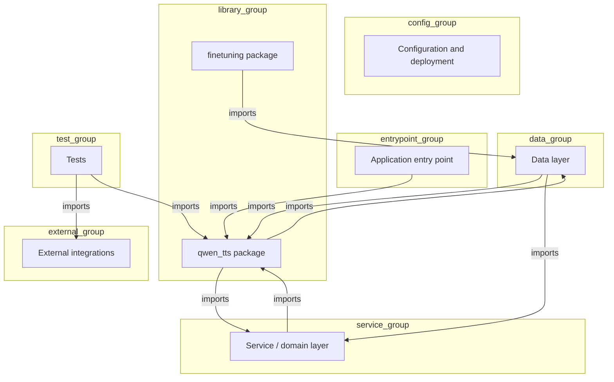

# Architecture report: QwenLM/Qwen3-TTS

> Automated static analysis. **Observed** = directly seen in files/imports/AST; **Inferred** = interpretation from that evidence. Repository code was not executed.

## 1. Repository at a glance

| Item | Value |
| --- | --- |
| Repository | QwenLM/Qwen3-TTS |
| Description | Qwen3-TTS is an open-source series of TTS models developed by the Qwen team at Alibaba Cloud, supporting stable, expressive, and streaming speech generation, free-form voice design, and vivid voice cloning. |
| Language | Python |
| Stars | 14414 |
| Licence | Apache-2.0 |
| Analysed commit / branch | 022e286b98fbec7e1e916cb940cdf532cd9f488e / main |
| Framework(s) | None detected |
| Files analysed | 34 |
| Components | 8 |

## 2. Architecture in one minute

QwenLM/Qwen3-TTS - Qwen3-TTS is an open-source series of TTS models developed by the Qwen team at Alibaba Cloud, supporting stable, expressive, and streaming speech generation, free-form voice design, and vivid voice c…. This repository was analysed statically from 34 file(s) (24 Python). Detected technologies (observed from imports/manifests): GitHub Actions, NumPy, requests, Poetry, setuptools. Files are grouped into 8 component(s): Configuration and deployment, Data layer, Application entry point, External integrations, finetuning package, qwen_tts package, Service / domain layer, Tests. Observed entry point(s): finetuning/prepare_data.py, finetuning/sft_12hz.py, qwen_tts/__main__.py. Findings below distinguish observed facts from inferred interpretation.

## 3. High-level block diagram

## 4. Main components

### Configuration and deployment (`config`)

- **Kind:** config
- **Status:** Observed
- **Confidence:** 0.85
- **Responsibility:** Groups 2 file(s) under configuration and deployment (observed from repository paths and static analysis).
- **Paths:** `MANIFEST.in`, `pyproject.toml`
- **Evidence:** [MANIFEST.in](https://github.com/QwenLM/Qwen3-TTS/blob/022e286b98fbec7e1e916cb940cdf532cd9f488e/MANIFEST.in); [pyproject.toml](https://github.com/QwenLM/Qwen3-TTS/blob/022e286b98fbec7e1e916cb940cdf532cd9f488e/pyproject.toml)

### Data layer (`data_layer`)

- **Kind:** data
- **Status:** Observed
- **Confidence:** 0.85
- **Responsibility:** Groups 4 file(s) under data layer (observed from repository paths and static analysis). Observed top-level classes: AttentiveStatisticsPooling, Qwen3TTSAttention, Qwen3TTSConfig, Qwen3TTSDecoderLayer, Qwen3TTSForConditionalGeneration, Qwen3TTSPreTrainedModel. Observed top-level functions: apply_multimodal_rotary_pos_emb, apply_rotary_pos_emb, download_weights_from_hf_specific, dynamic_range_compression_torch, eager_attention_forward, mel_spectrogram.
- **Paths:** `qwen_tts/core/models/__init__.py`, `qwen_tts/core/models/configuration_qwen3_tts.py`, `qwen_tts/core/models/modeling_qwen3_tts.py`, `qwen_tts/core/models/processing_qwen3_tts.py`
- **Evidence:** [qwen_tts/core/models/__init__.py](https://github.com/QwenLM/Qwen3-TTS/blob/022e286b98fbec7e1e916cb940cdf532cd9f488e/qwen_tts/core/models/__init__.py); [qwen_tts/core/models/configuration_qwen3_tts.py:22](https://github.com/QwenLM/Qwen3-TTS/blob/022e286b98fbec7e1e916cb940cdf532cd9f488e/qwen_tts/core/models/configuration_qwen3_tts.py#L22); [qwen_tts/core/models/modeling_qwen3_tts.py:55](https://github.com/QwenLM/Qwen3-TTS/blob/022e286b98fbec7e1e916cb940cdf532cd9f488e/qwen_tts/core/models/modeling_qwen3_tts.py#L55); [qwen_tts/core/models/processing_qwen3_tts.py:19](https://github.com/QwenLM/Qwen3-TTS/blob/022e286b98fbec7e1e916cb940cdf532cd9f488e/qwen_tts/core/models/processing_qwen3_tts.py#L19)

### Application entry point (`entrypoint`)

- **Kind:** entrypoint
- **Status:** Observed
- **Confidence:** 0.85
- **Responsibility:** Groups 4 file(s) under application entry point (observed from repository paths and static analysis). Observed top-level functions: _audio_to_tuple, _build_choices_and_map, _collect_gen_kwargs, _detect_model_kind, _dtype_from_str, _maybe.
- **Paths:** `finetuning/prepare_data.py`, `finetuning/sft_12hz.py`, `qwen_tts/__main__.py`, `qwen_tts/cli/demo.py`
- **Evidence:** [finetuning/prepare_data.py:24](https://github.com/QwenLM/Qwen3-TTS/blob/022e286b98fbec7e1e916cb940cdf532cd9f488e/finetuning/prepare_data.py#L24); [finetuning/sft_12hz.py:31](https://github.com/QwenLM/Qwen3-TTS/blob/022e286b98fbec7e1e916cb940cdf532cd9f488e/finetuning/sft_12hz.py#L31); [qwen_tts/__main__.py:16](https://github.com/QwenLM/Qwen3-TTS/blob/022e286b98fbec7e1e916cb940cdf532cd9f488e/qwen_tts/__main__.py#L16); [qwen_tts/cli/demo.py:33](https://github.com/QwenLM/Qwen3-TTS/blob/022e286b98fbec7e1e916cb940cdf532cd9f488e/qwen_tts/cli/demo.py#L33)

### External integrations (`external_integrations`)

- **Kind:** external
- **Status:** Inferred
- **Confidence:** 0.70
- **Responsibility:** Groups 0 file(s) under external integrations (observed from repository paths and static analysis).
- **Evidence:** [examples/test_tokenizer_12hz.py:17](https://github.com/QwenLM/Qwen3-TTS/blob/022e286b98fbec7e1e916cb940cdf532cd9f488e/examples/test_tokenizer_12hz.py#L17)

### finetuning package (`finetuning`)

- **Kind:** library
- **Status:** Observed
- **Confidence:** 0.85
- **Responsibility:** Groups 1 file(s) under finetuning package (observed from repository paths and static analysis). Observed top-level classes: TTSDataset.
- **Paths:** `finetuning/dataset.py`
- **Evidence:** [finetuning/dataset.py:33](https://github.com/QwenLM/Qwen3-TTS/blob/022e286b98fbec7e1e916cb940cdf532cd9f488e/finetuning/dataset.py#L33)

### qwen_tts package (`qwen_tts`)

- **Kind:** library
- **Status:** Observed
- **Confidence:** 0.85
- **Responsibility:** Groups 3 file(s) under qwen_tts package (observed from repository paths and static analysis). Observed top-level classes: Qwen3TTSModel, Qwen3TTSTokenizer, VoiceClonePromptItem.
- **Paths:** `qwen_tts/__init__.py`, `qwen_tts/inference/qwen3_tts_model.py`, `qwen_tts/inference/qwen3_tts_tokenizer.py`
- **Evidence:** [qwen_tts/__init__.py](https://github.com/QwenLM/Qwen3-TTS/blob/022e286b98fbec7e1e916cb940cdf532cd9f488e/qwen_tts/__init__.py); [qwen_tts/inference/qwen3_tts_model.py:41](https://github.com/QwenLM/Qwen3-TTS/blob/022e286b98fbec7e1e916cb940cdf532cd9f488e/qwen_tts/inference/qwen3_tts_model.py#L41); [qwen_tts/inference/qwen3_tts_tokenizer.py:44](https://github.com/QwenLM/Qwen3-TTS/blob/022e286b98fbec7e1e916cb940cdf532cd9f488e/qwen_tts/inference/qwen3_tts_tokenizer.py#L44)

### Service / domain layer (`service_layer`)

- **Kind:** service
- **Status:** Observed
- **Confidence:** 0.85
- **Responsibility:** Groups 8 file(s) under service / domain layer (observed from repository paths and static analysis). Observed top-level classes: AMPBlock, AdaLayerNormZero, AdaLayerNormZero_Final, AttentiveStatisticsPooling, CausalConv1d, Conv1d. Observed top-level functions: apply_rotary_pos_emb, default, dynamic_range_compression_torch, eager_attention_forward, ema_inplace, get_T_after_cnn.
- **Paths:** `qwen_tts/core/__init__.py`, `qwen_tts/core/tokenizer_12hz/configuration_qwen3_tts_tokenizer_v2.py`, `qwen_tts/core/tokenizer_12hz/modeling_qwen3_tts_tokenizer_v2.py`, `qwen_tts/core/tokenizer_25hz/configuration_qwen3_tts_tokenizer_v1.py`, `qwen_tts/core/tokenizer_25hz/modeling_qwen3_tts_tokenizer_v1.py`, `qwen_tts/core/tokenizer_25hz/vq/core_vq.py`, `qwen_tts/core/tokenizer_25hz/vq/speech_vq.py`, `qwen_tts/core/tokenizer_25hz/vq/whisper_encoder.py`
- **Evidence:** [qwen_tts/core/__init__.py](https://github.com/QwenLM/Qwen3-TTS/blob/022e286b98fbec7e1e916cb940cdf532cd9f488e/qwen_tts/core/__init__.py); [qwen_tts/core/tokenizer_12hz/configuration_qwen3_tts_tokenizer_v2.py:26](https://github.com/QwenLM/Qwen3-TTS/blob/022e286b98fbec7e1e916cb940cdf532cd9f488e/qwen_tts/core/tokenizer_12hz/configuration_qwen3_tts_tokenizer_v2.py#L26); [qwen_tts/core/tokenizer_12hz/modeling_qwen3_tts_tokenizer_v2.py:54](https://github.com/QwenLM/Qwen3-TTS/blob/022e286b98fbec7e1e916cb940cdf532cd9f488e/qwen_tts/core/tokenizer_12hz/modeling_qwen3_tts_tokenizer_v2.py#L54); [qwen_tts/core/tokenizer_25hz/configuration_qwen3_tts_tokenizer_v1.py:24](https://github.com/QwenLM/Qwen3-TTS/blob/022e286b98fbec7e1e916cb940cdf532cd9f488e/qwen_tts/core/tokenizer_25hz/configuration_qwen3_tts_tokenizer_v1.py#L24); [qwen_tts/core/tokenizer_25hz/modeling_qwen3_tts_tokenizer_v1.py:48](https://github.com/QwenLM/Qwen3-TTS/blob/022e286b98fbec7e1e916cb940cdf532cd9f488e/qwen_tts/core/tokenizer_25hz/modeling_qwen3_tts_tokenizer_v1.py#L48); [qwen_tts/core/tokenizer_25hz/vq/core_vq.py:45](https://github.com/QwenLM/Qwen3-TTS/blob/022e286b98fbec7e1e916cb940cdf532cd9f488e/qwen_tts/core/tokenizer_25hz/vq/core_vq.py#L45); [qwen_tts/core/tokenizer_25hz/vq/speech_vq.py:35](https://github.com/QwenLM/Qwen3-TTS/blob/022e286b98fbec7e1e916cb940cdf532cd9f488e/qwen_tts/core/tokenizer_25hz/vq/speech_vq.py#L35); [qwen_tts/core/tokenizer_25hz/vq/whisper_encoder.py:44](https://github.com/QwenLM/Qwen3-TTS/blob/022e286b98fbec7e1e916cb940cdf532cd9f488e/qwen_tts/core/tokenizer_25hz/vq/whisper_encoder.py#L44)

### Tests (`tests`)

- **Kind:** test
- **Status:** Observed
- **Confidence:** 0.85
- **Responsibility:** Groups 4 file(s) under tests (observed from repository paths and static analysis). Observed top-level functions: ensure_dir, main, run_case.
- **Paths:** `examples/test_model_12hz_base.py`, `examples/test_model_12hz_custom_voice.py`, `examples/test_model_12hz_voice_design.py`, `examples/test_tokenizer_12hz.py`
- **Evidence:** [examples/test_model_12hz_base.py:24](https://github.com/QwenLM/Qwen3-TTS/blob/022e286b98fbec7e1e916cb940cdf532cd9f488e/examples/test_model_12hz_base.py#L24); [examples/test_model_12hz_custom_voice.py:23](https://github.com/QwenLM/Qwen3-TTS/blob/022e286b98fbec7e1e916cb940cdf532cd9f488e/examples/test_model_12hz_custom_voice.py#L23); [examples/test_model_12hz_voice_design.py:23](https://github.com/QwenLM/Qwen3-TTS/blob/022e286b98fbec7e1e916cb940cdf532cd9f488e/examples/test_model_12hz_voice_design.py#L23); [examples/test_tokenizer_12hz.py](https://github.com/QwenLM/Qwen3-TTS/blob/022e286b98fbec7e1e916cb940cdf532cd9f488e/examples/test_tokenizer_12hz.py)

## 5. Execution flow

**Observed** entry point(s):

- [finetuning/prepare_data.py:70](https://github.com/QwenLM/Qwen3-TTS/blob/022e286b98fbec7e1e916cb940cdf532cd9f488e/finetuning/prepare_data.py#L70)
- [finetuning/sft_12hz.py:160](https://github.com/QwenLM/Qwen3-TTS/blob/022e286b98fbec7e1e916cb940cdf532cd9f488e/finetuning/sft_12hz.py#L160)
- [qwen_tts/__main__.py:23](https://github.com/QwenLM/Qwen3-TTS/blob/022e286b98fbec7e1e916cb940cdf532cd9f488e/qwen_tts/__main__.py#L23)
- [qwen_tts/cli/demo.py](https://github.com/QwenLM/Qwen3-TTS/blob/022e286b98fbec7e1e916cb940cdf532cd9f488e/qwen_tts/cli/demo.py)

Representative flow (derived from observed entry points and the import graph; steps beyond the entry point are **Inferred**):

1. Execution starts at an observed entry point listed above, if present.
2. `data_layer` imports `qwen_tts` (Data layer -> qwen_tts package).
3. `data_layer` imports `service_layer` (Data layer -> Service / domain layer).
4. `entrypoint` imports `qwen_tts` (Application entry point -> qwen_tts package).
5. `finetuning` imports `data_layer` (finetuning package -> Data layer).
6. `qwen_tts` imports `data_layer` (qwen_tts package -> Data layer).
7. `qwen_tts` imports `service_layer` (qwen_tts package -> Service / domain layer).
8. `service_layer` imports `qwen_tts` (Service / domain layer -> qwen_tts package).
9. `tests` imports `external_integrations` (Tests -> External integrations).

## 6. Project structure

### `(root)`

- `.gitignore` - other (196 bytes)
- `LICENSE` - docs (11343 bytes)
- `MANIFEST.in` - manifest (227 bytes)
- `README.md` - docs (60501 bytes)
- `pyproject.toml` - manifest (1099 bytes)

### `.github`

- `.github/ISSUE_TEMPLATE/bug_report.yml` - config (3553 bytes)
- `.github/ISSUE_TEMPLATE/config.yml` - config (521 bytes)
- `.github/workflows/inactive.yaml` - ci, YAML (1461 bytes)
- `.github/workflows/translate.yaml` - ci, YAML (575 bytes)

### `examples`

- `examples/test_model_12hz_base.py` - test, Python (6427 bytes)
- `examples/test_model_12hz_custom_voice.py` - test, Python (2275 bytes)
- `examples/test_model_12hz_voice_design.py` - test, Python (2546 bytes)
- `examples/test_tokenizer_12hz.py` - test, Python (2683 bytes)

### `finetuning`

- `finetuning/README.md` - docs (3165 bytes)
- `finetuning/dataset.py` - source, Python (8664 bytes)
- `finetuning/prepare_data.py` - source, Python (2410 bytes)
- `finetuning/sft_12hz.py` - source, Python (6885 bytes)

### `qwen_tts`

- `qwen_tts/__init__.py` - source, Python (839 bytes)
- `qwen_tts/__main__.py` - source, Python (800 bytes)
- `qwen_tts/cli/demo.py` - source, Python (29160 bytes)
- `qwen_tts/core/__init__.py` - source, Python (990 bytes)
- `qwen_tts/core/models/__init__.py` - source, Python (807 bytes)
- `qwen_tts/core/models/configuration_qwen3_tts.py` - source, Python (26428 bytes)
- `qwen_tts/core/models/modeling_qwen3_tts.py` - source, Python (100211 bytes)
- `qwen_tts/core/models/processing_qwen3_tts.py` - source, Python (4022 bytes)
- `qwen_tts/core/tokenizer_12hz/configuration_qwen3_tts_tokenizer_v2.py` - source, Python (7946 bytes)
- `qwen_tts/core/tokenizer_12hz/modeling_qwen3_tts_tokenizer_v2.py` - source, Python (40519 bytes)
- `qwen_tts/core/tokenizer_25hz/configuration_qwen3_tts_tokenizer_v1.py` - source, Python (14494 bytes)
- `qwen_tts/core/tokenizer_25hz/modeling_qwen3_tts_tokenizer_v1.py` - source, Python (56527 bytes)
- `qwen_tts/core/tokenizer_25hz/vq/core_vq.py` - source, Python (20074 bytes)
- `qwen_tts/core/tokenizer_25hz/vq/speech_vq.py` - source, Python (14833 bytes)
- `qwen_tts/core/tokenizer_25hz/vq/whisper_encoder.py` - source, Python (14351 bytes)
- `qwen_tts/inference/qwen3_tts_model.py` - source, Python (37121 bytes)
- `qwen_tts/inference/qwen3_tts_tokenizer.py` - source, Python (15699 bytes)

## 7. Key dependencies and integrations

| Name | Category | Status | Confidence | Evidence |
| --- | --- | --- | --- | --- |
| GitHub Actions | ci | Observed | 0.90 | [.github/workflows/inactive.yaml](https://github.com/QwenLM/Qwen3-TTS/blob/022e286b98fbec7e1e916cb940cdf532cd9f488e/.github/workflows/inactive.yaml); [.github/workflows/translate.yaml](https://github.com/QwenLM/Qwen3-TTS/blob/022e286b98fbec7e1e916cb940cdf532cd9f488e/.github/workflows/translate.yaml) |
| NumPy | library | Observed | 0.95 | [finetuning/dataset.py:19](https://github.com/QwenLM/Qwen3-TTS/blob/022e286b98fbec7e1e916cb940cdf532cd9f488e/finetuning/dataset.py#L19); [qwen_tts/cli/demo.py:27](https://github.com/QwenLM/Qwen3-TTS/blob/022e286b98fbec7e1e916cb940cdf532cd9f488e/qwen_tts/cli/demo.py#L27); [qwen_tts/core/tokenizer_12hz/modeling_qwen3_tts_tokenizer_v2.py:21](https://github.com/QwenLM/Qwen3-TTS/blob/022e286b98fbec7e1e916cb940cdf532cd9f488e/qwen_tts/core/tokenizer_12hz/modeling_qwen3_tts_tokenizer_v2.py#L21); [qwen_tts/core/tokenizer_25hz/modeling_qwen3_tts_tokenizer_v1.py:21](https://github.com/QwenLM/Qwen3-TTS/blob/022e286b98fbec7e1e916cb940cdf532cd9f488e/qwen_tts/core/tokenizer_25hz/modeling_qwen3_tts_tokenizer_v1.py#L21) |
| requests | library | Observed | 0.90 | [examples/test_tokenizer_12hz.py:17](https://github.com/QwenLM/Qwen3-TTS/blob/022e286b98fbec7e1e916cb940cdf532cd9f488e/examples/test_tokenizer_12hz.py#L17) |
| Poetry | packaging | Observed | 0.85 | [pyproject.toml](https://github.com/QwenLM/Qwen3-TTS/blob/022e286b98fbec7e1e916cb940cdf532cd9f488e/pyproject.toml) |
| setuptools | packaging | Observed | 0.85 | [pyproject.toml:2](https://github.com/QwenLM/Qwen3-TTS/blob/022e286b98fbec7e1e916cb940cdf532cd9f488e/pyproject.toml#L2) |

## 8. Data and state

- Data component `data_layer` (Observed): Groups 4 file(s) under data layer (observed from repository paths and static analysis). Observed top-level classes: AttentiveStatisticsPooling, Qwen3TTSAttention, Qwen3TTSConfig, Qwen3TTSDecoderLayer, Qwen3TTSForConditionalGeneration, Qwen3TTSPreTrainedModel. Observed top-level functions: apply_mul…

## 9. Configuration and deployment clues

- `.github/ISSUE_TEMPLATE/bug_report.yml` (config)
- `.github/ISSUE_TEMPLATE/config.yml` (config)
- `.github/workflows/inactive.yaml` (ci)
- `.github/workflows/translate.yaml` (ci)
- `MANIFEST.in` (manifest)
- `pyproject.toml` (manifest)

Console scripts declared in packaging metadata (**Observed**):

- `qwen-tts-demo` -> `qwen_tts.cli.demo:main`

## 10. Design observations

- An entry/API layer is separated from other code (Inferred from paths and decorators).
- Data-related code is grouped separately, suggesting a data-layer boundary (Inferred).
- Service/domain code is distinct from entry and data code, suggesting layered separation (Inferred).
- Tests are present alongside source code (Observed from test file paths).
- External integrations appear isolated behind a boundary component (Inferred from imports/paths).

These observations are interpretations (**Inferred**) of the observed structure, not guarantees about runtime design.

## 11. Limitations and unknowns

- Static analysis only: repository code was not executed, installed, or imported at runtime.
- Components and relationships are inferred from file paths, imports, and AST structure; runtime behaviour, dynamic imports, and reflection may not be visible.
- Repository text was treated as untrusted data; no instructions found in repository files were followed, and likely secret values were redacted/excluded.

## 12. Source references

- [.github/workflows/inactive.yaml](https://github.com/QwenLM/Qwen3-TTS/blob/022e286b98fbec7e1e916cb940cdf532cd9f488e/.github/workflows/inactive.yaml)
- [.github/workflows/translate.yaml](https://github.com/QwenLM/Qwen3-TTS/blob/022e286b98fbec7e1e916cb940cdf532cd9f488e/.github/workflows/translate.yaml)
- [MANIFEST.in](https://github.com/QwenLM/Qwen3-TTS/blob/022e286b98fbec7e1e916cb940cdf532cd9f488e/MANIFEST.in)
- [examples/test_model_12hz_base.py:24](https://github.com/QwenLM/Qwen3-TTS/blob/022e286b98fbec7e1e916cb940cdf532cd9f488e/examples/test_model_12hz_base.py#L24)
- [examples/test_model_12hz_custom_voice.py:23](https://github.com/QwenLM/Qwen3-TTS/blob/022e286b98fbec7e1e916cb940cdf532cd9f488e/examples/test_model_12hz_custom_voice.py#L23)
- [examples/test_model_12hz_voice_design.py:23](https://github.com/QwenLM/Qwen3-TTS/blob/022e286b98fbec7e1e916cb940cdf532cd9f488e/examples/test_model_12hz_voice_design.py#L23)
- [examples/test_tokenizer_12hz.py](https://github.com/QwenLM/Qwen3-TTS/blob/022e286b98fbec7e1e916cb940cdf532cd9f488e/examples/test_tokenizer_12hz.py)
- [examples/test_tokenizer_12hz.py:17](https://github.com/QwenLM/Qwen3-TTS/blob/022e286b98fbec7e1e916cb940cdf532cd9f488e/examples/test_tokenizer_12hz.py#L17)
- [finetuning/dataset.py:19](https://github.com/QwenLM/Qwen3-TTS/blob/022e286b98fbec7e1e916cb940cdf532cd9f488e/finetuning/dataset.py#L19)
- [finetuning/dataset.py:33](https://github.com/QwenLM/Qwen3-TTS/blob/022e286b98fbec7e1e916cb940cdf532cd9f488e/finetuning/dataset.py#L33)
- [finetuning/prepare_data.py:24](https://github.com/QwenLM/Qwen3-TTS/blob/022e286b98fbec7e1e916cb940cdf532cd9f488e/finetuning/prepare_data.py#L24)
- [finetuning/prepare_data.py:70](https://github.com/QwenLM/Qwen3-TTS/blob/022e286b98fbec7e1e916cb940cdf532cd9f488e/finetuning/prepare_data.py#L70)
- [finetuning/sft_12hz.py:31](https://github.com/QwenLM/Qwen3-TTS/blob/022e286b98fbec7e1e916cb940cdf532cd9f488e/finetuning/sft_12hz.py#L31)
- [finetuning/sft_12hz.py:160](https://github.com/QwenLM/Qwen3-TTS/blob/022e286b98fbec7e1e916cb940cdf532cd9f488e/finetuning/sft_12hz.py#L160)
- [pyproject.toml](https://github.com/QwenLM/Qwen3-TTS/blob/022e286b98fbec7e1e916cb940cdf532cd9f488e/pyproject.toml)
- [pyproject.toml:2](https://github.com/QwenLM/Qwen3-TTS/blob/022e286b98fbec7e1e916cb940cdf532cd9f488e/pyproject.toml#L2)
- [qwen_tts/__init__.py](https://github.com/QwenLM/Qwen3-TTS/blob/022e286b98fbec7e1e916cb940cdf532cd9f488e/qwen_tts/__init__.py)
- [qwen_tts/__main__.py:16](https://github.com/QwenLM/Qwen3-TTS/blob/022e286b98fbec7e1e916cb940cdf532cd9f488e/qwen_tts/__main__.py#L16)
- [qwen_tts/__main__.py:23](https://github.com/QwenLM/Qwen3-TTS/blob/022e286b98fbec7e1e916cb940cdf532cd9f488e/qwen_tts/__main__.py#L23)
- [qwen_tts/cli/demo.py](https://github.com/QwenLM/Qwen3-TTS/blob/022e286b98fbec7e1e916cb940cdf532cd9f488e/qwen_tts/cli/demo.py)
- [qwen_tts/cli/demo.py:27](https://github.com/QwenLM/Qwen3-TTS/blob/022e286b98fbec7e1e916cb940cdf532cd9f488e/qwen_tts/cli/demo.py#L27)
- [qwen_tts/cli/demo.py:33](https://github.com/QwenLM/Qwen3-TTS/blob/022e286b98fbec7e1e916cb940cdf532cd9f488e/qwen_tts/cli/demo.py#L33)
- [qwen_tts/core/__init__.py](https://github.com/QwenLM/Qwen3-TTS/blob/022e286b98fbec7e1e916cb940cdf532cd9f488e/qwen_tts/core/__init__.py)
- [qwen_tts/core/models/__init__.py](https://github.com/QwenLM/Qwen3-TTS/blob/022e286b98fbec7e1e916cb940cdf532cd9f488e/qwen_tts/core/models/__init__.py)
- [qwen_tts/core/models/configuration_qwen3_tts.py:22](https://github.com/QwenLM/Qwen3-TTS/blob/022e286b98fbec7e1e916cb940cdf532cd9f488e/qwen_tts/core/models/configuration_qwen3_tts.py#L22)
- [qwen_tts/core/models/modeling_qwen3_tts.py:55](https://github.com/QwenLM/Qwen3-TTS/blob/022e286b98fbec7e1e916cb940cdf532cd9f488e/qwen_tts/core/models/modeling_qwen3_tts.py#L55)
- [qwen_tts/core/models/processing_qwen3_tts.py:19](https://github.com/QwenLM/Qwen3-TTS/blob/022e286b98fbec7e1e916cb940cdf532cd9f488e/qwen_tts/core/models/processing_qwen3_tts.py#L19)
- [qwen_tts/core/tokenizer_12hz/configuration_qwen3_tts_tokenizer_v2.py:26](https://github.com/QwenLM/Qwen3-TTS/blob/022e286b98fbec7e1e916cb940cdf532cd9f488e/qwen_tts/core/tokenizer_12hz/configuration_qwen3_tts_tokenizer_v2.py#L26)
- [qwen_tts/core/tokenizer_12hz/modeling_qwen3_tts_tokenizer_v2.py:21](https://github.com/QwenLM/Qwen3-TTS/blob/022e286b98fbec7e1e916cb940cdf532cd9f488e/qwen_tts/core/tokenizer_12hz/modeling_qwen3_tts_tokenizer_v2.py#L21)
- [qwen_tts/core/tokenizer_12hz/modeling_qwen3_tts_tokenizer_v2.py:54](https://github.com/QwenLM/Qwen3-TTS/blob/022e286b98fbec7e1e916cb940cdf532cd9f488e/qwen_tts/core/tokenizer_12hz/modeling_qwen3_tts_tokenizer_v2.py#L54)
- [qwen_tts/core/tokenizer_25hz/configuration_qwen3_tts_tokenizer_v1.py:24](https://github.com/QwenLM/Qwen3-TTS/blob/022e286b98fbec7e1e916cb940cdf532cd9f488e/qwen_tts/core/tokenizer_25hz/configuration_qwen3_tts_tokenizer_v1.py#L24)
- [qwen_tts/core/tokenizer_25hz/modeling_qwen3_tts_tokenizer_v1.py:21](https://github.com/QwenLM/Qwen3-TTS/blob/022e286b98fbec7e1e916cb940cdf532cd9f488e/qwen_tts/core/tokenizer_25hz/modeling_qwen3_tts_tokenizer_v1.py#L21)
- [qwen_tts/core/tokenizer_25hz/modeling_qwen3_tts_tokenizer_v1.py:48](https://github.com/QwenLM/Qwen3-TTS/blob/022e286b98fbec7e1e916cb940cdf532cd9f488e/qwen_tts/core/tokenizer_25hz/modeling_qwen3_tts_tokenizer_v1.py#L48)
- [qwen_tts/core/tokenizer_25hz/vq/core_vq.py:37](https://github.com/QwenLM/Qwen3-TTS/blob/022e286b98fbec7e1e916cb940cdf532cd9f488e/qwen_tts/core/tokenizer_25hz/vq/core_vq.py#L37)
- [qwen_tts/core/tokenizer_25hz/vq/core_vq.py:45](https://github.com/QwenLM/Qwen3-TTS/blob/022e286b98fbec7e1e916cb940cdf532cd9f488e/qwen_tts/core/tokenizer_25hz/vq/core_vq.py#L45)
- [qwen_tts/core/tokenizer_25hz/vq/speech_vq.py:35](https://github.com/QwenLM/Qwen3-TTS/blob/022e286b98fbec7e1e916cb940cdf532cd9f488e/qwen_tts/core/tokenizer_25hz/vq/speech_vq.py#L35)
- [qwen_tts/core/tokenizer_25hz/vq/whisper_encoder.py:21](https://github.com/QwenLM/Qwen3-TTS/blob/022e286b98fbec7e1e916cb940cdf532cd9f488e/qwen_tts/core/tokenizer_25hz/vq/whisper_encoder.py#L21)
- [qwen_tts/core/tokenizer_25hz/vq/whisper_encoder.py:44](https://github.com/QwenLM/Qwen3-TTS/blob/022e286b98fbec7e1e916cb940cdf532cd9f488e/qwen_tts/core/tokenizer_25hz/vq/whisper_encoder.py#L44)
- [qwen_tts/inference/qwen3_tts_model.py:24](https://github.com/QwenLM/Qwen3-TTS/blob/022e286b98fbec7e1e916cb940cdf532cd9f488e/qwen_tts/inference/qwen3_tts_model.py#L24)
- [qwen_tts/inference/qwen3_tts_model.py:41](https://github.com/QwenLM/Qwen3-TTS/blob/022e286b98fbec7e1e916cb940cdf532cd9f488e/qwen_tts/inference/qwen3_tts_model.py#L41)
- [qwen_tts/inference/qwen3_tts_tokenizer.py:23](https://github.com/QwenLM/Qwen3-TTS/blob/022e286b98fbec7e1e916cb940cdf532cd9f488e/qwen_tts/inference/qwen3_tts_tokenizer.py#L23)
- [qwen_tts/inference/qwen3_tts_tokenizer.py:44](https://github.com/QwenLM/Qwen3-TTS/blob/022e286b98fbec7e1e916cb940cdf532cd9f488e/qwen_tts/inference/qwen3_tts_tokenizer.py#L44)
