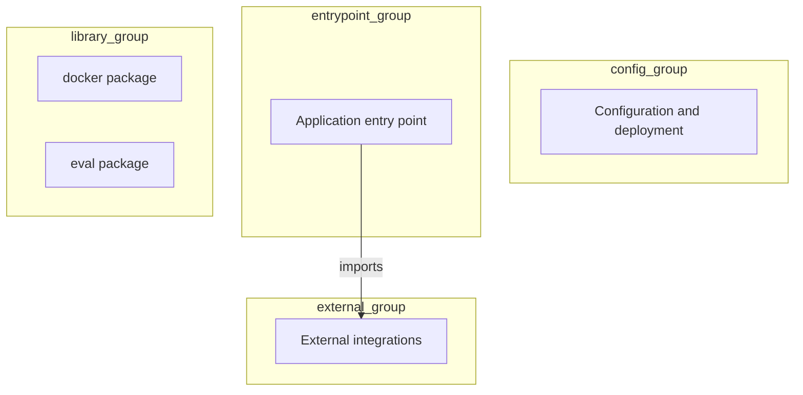

# Architecture report: QwenLM/Qwen3

> Automated static analysis. **Observed** = directly seen in files/imports/AST; **Inferred** = interpretation from that evidence. Repository code was not executed.

## 1. Repository at a glance

| Item | Value |
| --- | --- |
| Repository | QwenLM/Qwen3 |
| Description | Qwen3 is the large language model series developed by Qwen team, Alibaba Cloud. |
| Language | Python |
| Stars | 27731 |
| Licence | Not detected |
| Analysed commit / branch | 7a2f61ffc7a20d47efcd2bf97f6f2bf52729042e / main |
| Framework(s) | None detected |
| Files analysed | 98 |
| Components | 5 |

## 2. Architecture in one minute

QwenLM/Qwen3 - Qwen3 is the large language model series developed by Qwen team, Alibaba Cloud.. This repository was analysed statically from 98 file(s) (10 Python). Detected technologies (observed from imports/manifests): GitHub Actions, httpx, NumPy, Docker. Files are grouped into 5 component(s): Configuration and deployment, docker package, Application entry point, eval package, External integrations. Observed entry point(s): eval/eval/eval.py, eval/generate_api_answers/infer_multithread.py, eval/generate_api_answers/utils_vllm.py. Findings below distinguish observed facts from inferred interpretation.

## 3. High-level block diagram

## 4. Main components

### Configuration and deployment (`config`)

- **Kind:** config
- **Status:** Observed
- **Confidence:** 0.85
- **Responsibility:** Groups 3 file(s) under configuration and deployment (observed from repository paths and static analysis).
- **Paths:** `docker/Dockerfile-cu121`, `eval/configs/ARCAGI-Qwen3-235B-A22B-Instruct-2507.yaml`, `eval/requirements.txt`
- **Evidence:** [docker/Dockerfile-cu121](https://github.com/QwenLM/Qwen3/blob/7a2f61ffc7a20d47efcd2bf97f6f2bf52729042e/docker/Dockerfile-cu121); [eval/configs/ARCAGI-Qwen3-235B-A22B-Instruct-2507.yaml](https://github.com/QwenLM/Qwen3/blob/7a2f61ffc7a20d47efcd2bf97f6f2bf52729042e/eval/configs/ARCAGI-Qwen3-235B-A22B-Instruct-2507.yaml); [eval/requirements.txt](https://github.com/QwenLM/Qwen3/blob/7a2f61ffc7a20d47efcd2bf97f6f2bf52729042e/eval/requirements.txt)

### docker package (`docker`)

- **Kind:** library
- **Status:** Observed
- **Confidence:** 0.85
- **Responsibility:** Groups 2 file(s) under docker package (observed from repository paths and static analysis).
- **Paths:** `docker/docker_cli_demo.sh`, `docker/docker_web_demo.sh`
- **Evidence:** [docker/docker_cli_demo.sh](https://github.com/QwenLM/Qwen3/blob/7a2f61ffc7a20d47efcd2bf97f6f2bf52729042e/docker/docker_cli_demo.sh); [docker/docker_web_demo.sh](https://github.com/QwenLM/Qwen3/blob/7a2f61ffc7a20d47efcd2bf97f6f2bf52729042e/docker/docker_web_demo.sh)

### Application entry point (`entrypoint`)

- **Kind:** entrypoint
- **Status:** Observed
- **Confidence:** 0.85
- **Responsibility:** Groups 3 file(s) under application entry point (observed from repository paths and static analysis). Observed top-level classes: ClientError. Observed top-level functions: count_completed_samples, get_after_think, get_content, main, process_item.
- **Paths:** `eval/eval/eval.py`, `eval/generate_api_answers/infer_multithread.py`, `eval/generate_api_answers/utils_vllm.py`
- **Evidence:** [eval/eval/eval.py:12](https://github.com/QwenLM/Qwen3/blob/7a2f61ffc7a20d47efcd2bf97f6f2bf52729042e/eval/eval/eval.py#L12); [eval/generate_api_answers/infer_multithread.py:16](https://github.com/QwenLM/Qwen3/blob/7a2f61ffc7a20d47efcd2bf97f6f2bf52729042e/eval/generate_api_answers/infer_multithread.py#L16); [eval/generate_api_answers/utils_vllm.py:16](https://github.com/QwenLM/Qwen3/blob/7a2f61ffc7a20d47efcd2bf97f6f2bf52729042e/eval/generate_api_answers/utils_vllm.py#L16)

### eval package (`eval`)

- **Kind:** library
- **Status:** Observed
- **Confidence:** 0.85
- **Responsibility:** Groups 1 file(s) under eval package (observed from repository paths and static analysis). Observed top-level functions: compute_scores_arc_agi_1, parse_model_output, save_cache, solution_score.
- **Paths:** `eval/eval/arc_agi_1.py`
- **Evidence:** [eval/eval/arc_agi_1.py:6](https://github.com/QwenLM/Qwen3/blob/7a2f61ffc7a20d47efcd2bf97f6f2bf52729042e/eval/eval/arc_agi_1.py#L6)

### External integrations (`external_integrations`)

- **Kind:** external
- **Status:** Inferred
- **Confidence:** 0.70
- **Responsibility:** Groups 0 file(s) under external integrations (observed from repository paths and static analysis).
- **Evidence:** [eval/generate_api_answers/utils_vllm.py:26](https://github.com/QwenLM/Qwen3/blob/7a2f61ffc7a20d47efcd2bf97f6f2bf52729042e/eval/generate_api_answers/utils_vllm.py#L26)

## 5. Execution flow

**Observed** entry point(s):

- [eval/eval/eval.py:86](https://github.com/QwenLM/Qwen3/blob/7a2f61ffc7a20d47efcd2bf97f6f2bf52729042e/eval/eval/eval.py#L86)
- [eval/generate_api_answers/infer_multithread.py:184](https://github.com/QwenLM/Qwen3/blob/7a2f61ffc7a20d47efcd2bf97f6f2bf52729042e/eval/generate_api_answers/infer_multithread.py#L184)
- [eval/generate_api_answers/utils_vllm.py:92](https://github.com/QwenLM/Qwen3/blob/7a2f61ffc7a20d47efcd2bf97f6f2bf52729042e/eval/generate_api_answers/utils_vllm.py#L92)

Representative flow (derived from observed entry points and the import graph; steps beyond the entry point are **Inferred**):

1. Execution starts at an observed entry point listed above, if present.
2. `entrypoint` imports `external_integrations` (Application entry point -> External integrations).

## 6. Project structure

### `(root)`

- `.gitignore` - other (150 bytes)
- `.readthedocs.yaml` - config (465 bytes)
- `README.md` - docs (24732 bytes)

### `.github`

- `.github/ISSUE_TEMPLATE/bug_report.yml` - config (3744 bytes)
- `.github/ISSUE_TEMPLATE/config.yml` - config (509 bytes)
- `.github/workflows/inactive.yml` - ci, YAML (1484 bytes)

### `docker`

- `docker/Dockerfile-cu121` - container (1828 bytes)
- `docker/docker_cli_demo.sh` - source, Shell (1375 bytes)
- `docker/docker_web_demo.sh` - source, Shell (1812 bytes)

### `docs`

- `docs/Makefile` - docs (637 bytes)
- `docs/README.md` - docs (1672 bytes)
- `docs/locales/zh_CN/LC_MESSAGES/deployment/dstack.po` - docs (7067 bytes)
- `docs/locales/zh_CN/LC_MESSAGES/deployment/openllm.po` - docs (5834 bytes)
- `docs/locales/zh_CN/LC_MESSAGES/deployment/sglang.po` - docs (14962 bytes)
- `docs/locales/zh_CN/LC_MESSAGES/deployment/skypilot.po` - docs (11153 bytes)
- `docs/locales/zh_CN/LC_MESSAGES/deployment/tgi.po` - docs (11921 bytes)
- `docs/locales/zh_CN/LC_MESSAGES/deployment/vllm.po` - docs (20630 bytes)
- `docs/locales/zh_CN/LC_MESSAGES/framework/Langchain.po` - docs (3147 bytes)
- `docs/locales/zh_CN/LC_MESSAGES/framework/LlamaIndex.po` - docs (5222 bytes)
- `docs/locales/zh_CN/LC_MESSAGES/framework/function_call.po` - docs (31189 bytes)
- `docs/locales/zh_CN/LC_MESSAGES/framework/qwen_agent.po` - docs (4512 bytes)
- `docs/locales/zh_CN/LC_MESSAGES/getting_started/concepts.po` - docs (35311 bytes)
- `docs/locales/zh_CN/LC_MESSAGES/getting_started/quantization_benchmark.po` - docs (13063 bytes)
- `docs/locales/zh_CN/LC_MESSAGES/getting_started/quickstart.po` - docs (13764 bytes)
- `docs/locales/zh_CN/LC_MESSAGES/getting_started/speed_benchmark.po` - docs (25779 bytes)
- `docs/locales/zh_CN/LC_MESSAGES/getting_started/thinking_budget.po` - docs (2374 bytes)
- `docs/locales/zh_CN/LC_MESSAGES/index.po` - docs (8644 bytes)
- `docs/locales/zh_CN/LC_MESSAGES/inference/transformers.po` - docs (16766 bytes)
- `docs/locales/zh_CN/LC_MESSAGES/quantization/awq.po` - docs (7988 bytes)
- `docs/locales/zh_CN/LC_MESSAGES/quantization/gptq.po` - docs (15566 bytes)
- `docs/locales/zh_CN/LC_MESSAGES/quantization/llama.cpp.po` - docs (16857 bytes)
- `docs/locales/zh_CN/LC_MESSAGES/run_locally/llama.cpp.po` - docs (51165 bytes)
- `docs/locales/zh_CN/LC_MESSAGES/run_locally/mlx-lm.po` - docs (3833 bytes)
- `docs/locales/zh_CN/LC_MESSAGES/run_locally/ollama.po` - docs (5230 bytes)
- `docs/locales/zh_CN/LC_MESSAGES/training/axolotl.po` - docs (10836 bytes)
- `docs/locales/zh_CN/LC_MESSAGES/training/llama_factory.po` - docs (7084 bytes)
- `docs/locales/zh_CN/LC_MESSAGES/training/ms_swift.po` - docs (20656 bytes)
- `docs/locales/zh_CN/LC_MESSAGES/training/unsloth.po` - docs (11800 bytes)
- `docs/locales/zh_CN/LC_MESSAGES/training/verl.po` - docs (8038 bytes)
- `docs/make.bat` - docs (769 bytes)
- `docs/requirements-docs.txt` - manifest (79 bytes)
- `docs/source/_static/css/custom.css` - docs (1324 bytes)
- `docs/source/_static/design-tabs.js` - docs (3100 bytes)
- `docs/source/assets/qwen3_nonthinking.jinja` - docs (4148 bytes)
- `docs/source/conf.py` - docs (3798 bytes)
- `docs/source/deployment/dstack.rst` - docs (5305 bytes)
- `docs/source/deployment/openllm.rst` - docs (4241 bytes)
- `docs/source/deployment/sglang.md` - docs (8703 bytes)
- `docs/source/deployment/skypilot.rst` - docs (7154 bytes)
- `docs/source/deployment/tgi.rst` - docs (8277 bytes)
- `docs/source/deployment/vllm.md` - docs (13320 bytes)
- `docs/source/framework/Langchain.rst` - docs (10689 bytes)
- `docs/source/framework/LlamaIndex.rst` - docs (5388 bytes)
- `docs/source/framework/function_call.md` - docs (28979 bytes)
- `docs/source/framework/qwen_agent.rst` - docs (3936 bytes)
- `docs/source/getting_started/concepts.md` - docs (13117 bytes)
- `docs/source/getting_started/quantization_benchmark.rst` - docs (3009 bytes)
- `docs/source/getting_started/quickstart.md` - docs (21754 bytes)
- `docs/source/getting_started/speed_benchmark.md` - docs (31173 bytes)
- `docs/source/getting_started/thinking_budget.md` - docs (3812 bytes)
- `docs/source/index.rst` - docs (4926 bytes)
- `docs/source/inference/transformers.md` - docs (11793 bytes)
- `docs/source/quantization/awq.md` - docs (6102 bytes)
- `docs/source/quantization/gptq.md` - docs (11207 bytes)
- `docs/source/quantization/llama.cpp.md` - docs (7943 bytes)
- `docs/source/run_locally/llama.cpp.md` - docs (15415 bytes)
- `docs/source/run_locally/lmstudio.md` - docs (3354 bytes)
- `docs/source/run_locally/mlx-lm.md` - docs (1845 bytes)
- `docs/source/run_locally/ollama.md` - docs (3523 bytes)
- `docs/source/training/axolotl.md` - docs (4106 bytes)
- `docs/source/training/llama_factory.md` - docs (4990 bytes)
- `docs/source/training/ms_swift.md` - docs (15183 bytes)
- `docs/source/training/unsloth.md` - docs (4477 bytes)
- `docs/source/training/verl.md` - docs (4816 bytes)

### `eval`

- `eval/README.md` - docs (3050 bytes)
- `eval/configs/ARCAGI-Qwen3-235B-A22B-Instruct-2507.yaml` - config (830 bytes)
- `eval/eval/arc_agi_1.py` - source, Python (2162 bytes)
- `eval/eval/eval.py` - source, Python (2703 bytes)
- `eval/eval_res/ARCAGI-Qwen3-235B-A22B-Instruct-2507_eval_result.txt` - docs (298 bytes)
- `eval/generate_api_answers/infer_multithread.py` - source, Python (5670 bytes)
- `eval/generate_api_answers/utils_vllm.py` - source, Python (3067 bytes)
- `eval/requirements.txt` - manifest (78 bytes)

### `examples`

- `examples/README.md` - docs (150 bytes)
- `examples/demo/cli_demo.py` - source, Python (9498 bytes)
- `examples/demo/web_demo.py` - source, Python (6723 bytes)
- `examples/gcu-support/README.md` - docs (2227 bytes)
- `examples/gcu-support/gcu_demo.py` - source, Python (1101 bytes)
- `examples/llama-factory/finetune-zh.md` - docs (8888 bytes)
- `examples/llama-factory/qwen2-7b-full-sft.yaml` - config (676 bytes)
- `examples/llama-factory/qwen2-7b-lora-sft.yaml` - config (713 bytes)
- `examples/llama-factory/qwen2-7b-merge-lora.yaml` - config (327 bytes)
- `examples/llama-factory/qwen2-7b-qlora-sft.yaml` - config (830 bytes)
- `examples/speed-benchmark/README.md` - docs (7126 bytes)
- `examples/speed-benchmark/README_zh.md` - docs (7343 bytes)
- `examples/speed-benchmark/requirements-perf-transformers.txt` - manifest (303 bytes)
- `examples/speed-benchmark/requirements-perf-vllm.txt` - manifest (64 bytes)
- `examples/speed-benchmark/speed_benchmark_transformers.py` - source, Python (7189 bytes)
- `examples/speed-benchmark/speed_benchmark_vllm.py` - source, Python (10686 bytes)

## 7. Key dependencies and integrations

| Name | Category | Status | Confidence | Evidence |
| --- | --- | --- | --- | --- |
| GitHub Actions | ci | Observed | 0.85 | [.github/workflows/inactive.yml](https://github.com/QwenLM/Qwen3/blob/7a2f61ffc7a20d47efcd2bf97f6f2bf52729042e/.github/workflows/inactive.yml) |
| httpx | library | Observed | 0.90 | [eval/generate_api_answers/utils_vllm.py:26](https://github.com/QwenLM/Qwen3/blob/7a2f61ffc7a20d47efcd2bf97f6f2bf52729042e/eval/generate_api_answers/utils_vllm.py#L26) |
| NumPy | library | Observed | 0.90 | [eval/eval/arc_agi_1.py:4](https://github.com/QwenLM/Qwen3/blob/7a2f61ffc7a20d47efcd2bf97f6f2bf52729042e/eval/eval/arc_agi_1.py#L4); [eval/requirements.txt:4](https://github.com/QwenLM/Qwen3/blob/7a2f61ffc7a20d47efcd2bf97f6f2bf52729042e/eval/requirements.txt#L4) |
| Docker | tooling | Observed | 0.85 | [docker/Dockerfile-cu121](https://github.com/QwenLM/Qwen3/blob/7a2f61ffc7a20d47efcd2bf97f6f2bf52729042e/docker/Dockerfile-cu121) |

## 8. Data and state

No database, cache, queue, or persistent-state usage was observed in the analysed files. State handling, if any, may be in-memory or in files that were not analysed.

## 9. Configuration and deployment clues

- `.github/ISSUE_TEMPLATE/bug_report.yml` (config)
- `.github/ISSUE_TEMPLATE/config.yml` (config)
- `.github/workflows/inactive.yml` (ci)
- `.readthedocs.yaml` (config)
- `docker/Dockerfile-cu121` (container)
- `docs/requirements-docs.txt` (manifest)
- `eval/configs/ARCAGI-Qwen3-235B-A22B-Instruct-2507.yaml` (config)
- `eval/requirements.txt` (manifest)
- `examples/llama-factory/qwen2-7b-full-sft.yaml` (config)
- `examples/llama-factory/qwen2-7b-lora-sft.yaml` (config)
- `examples/llama-factory/qwen2-7b-merge-lora.yaml` (config)
- `examples/llama-factory/qwen2-7b-qlora-sft.yaml` (config)
- `examples/speed-benchmark/requirements-perf-transformers.txt` (manifest)
- `examples/speed-benchmark/requirements-perf-vllm.txt` (manifest)

## 10. Design observations

- An entry/API layer is separated from other code (Inferred from paths and decorators).
- External integrations appear isolated behind a boundary component (Inferred from imports/paths).

These observations are interpretations (**Inferred**) of the observed structure, not guarantees about runtime design.

## 11. Limitations and unknowns

- Static analysis only: repository code was not executed, installed, or imported at runtime.
- Components and relationships are inferred from file paths, imports, and AST structure; runtime behaviour, dynamic imports, and reflection may not be visible.
- Repository text was treated as untrusted data; no instructions found in repository files were followed, and likely secret values were redacted/excluded.

## 12. Source references

- [.github/workflows/inactive.yml](https://github.com/QwenLM/Qwen3/blob/7a2f61ffc7a20d47efcd2bf97f6f2bf52729042e/.github/workflows/inactive.yml)
- [docker/Dockerfile-cu121](https://github.com/QwenLM/Qwen3/blob/7a2f61ffc7a20d47efcd2bf97f6f2bf52729042e/docker/Dockerfile-cu121)
- [docker/docker_cli_demo.sh](https://github.com/QwenLM/Qwen3/blob/7a2f61ffc7a20d47efcd2bf97f6f2bf52729042e/docker/docker_cli_demo.sh)
- [docker/docker_web_demo.sh](https://github.com/QwenLM/Qwen3/blob/7a2f61ffc7a20d47efcd2bf97f6f2bf52729042e/docker/docker_web_demo.sh)
- [eval/configs/ARCAGI-Qwen3-235B-A22B-Instruct-2507.yaml](https://github.com/QwenLM/Qwen3/blob/7a2f61ffc7a20d47efcd2bf97f6f2bf52729042e/eval/configs/ARCAGI-Qwen3-235B-A22B-Instruct-2507.yaml)
- [eval/eval/arc_agi_1.py:4](https://github.com/QwenLM/Qwen3/blob/7a2f61ffc7a20d47efcd2bf97f6f2bf52729042e/eval/eval/arc_agi_1.py#L4)
- [eval/eval/arc_agi_1.py:6](https://github.com/QwenLM/Qwen3/blob/7a2f61ffc7a20d47efcd2bf97f6f2bf52729042e/eval/eval/arc_agi_1.py#L6)
- [eval/eval/eval.py:12](https://github.com/QwenLM/Qwen3/blob/7a2f61ffc7a20d47efcd2bf97f6f2bf52729042e/eval/eval/eval.py#L12)
- [eval/eval/eval.py:86](https://github.com/QwenLM/Qwen3/blob/7a2f61ffc7a20d47efcd2bf97f6f2bf52729042e/eval/eval/eval.py#L86)
- [eval/generate_api_answers/infer_multithread.py:16](https://github.com/QwenLM/Qwen3/blob/7a2f61ffc7a20d47efcd2bf97f6f2bf52729042e/eval/generate_api_answers/infer_multithread.py#L16)
- [eval/generate_api_answers/infer_multithread.py:184](https://github.com/QwenLM/Qwen3/blob/7a2f61ffc7a20d47efcd2bf97f6f2bf52729042e/eval/generate_api_answers/infer_multithread.py#L184)
- [eval/generate_api_answers/utils_vllm.py:16](https://github.com/QwenLM/Qwen3/blob/7a2f61ffc7a20d47efcd2bf97f6f2bf52729042e/eval/generate_api_answers/utils_vllm.py#L16)
- [eval/generate_api_answers/utils_vllm.py:26](https://github.com/QwenLM/Qwen3/blob/7a2f61ffc7a20d47efcd2bf97f6f2bf52729042e/eval/generate_api_answers/utils_vllm.py#L26)
- [eval/generate_api_answers/utils_vllm.py:92](https://github.com/QwenLM/Qwen3/blob/7a2f61ffc7a20d47efcd2bf97f6f2bf52729042e/eval/generate_api_answers/utils_vllm.py#L92)
- [eval/requirements.txt](https://github.com/QwenLM/Qwen3/blob/7a2f61ffc7a20d47efcd2bf97f6f2bf52729042e/eval/requirements.txt)
- [eval/requirements.txt:4](https://github.com/QwenLM/Qwen3/blob/7a2f61ffc7a20d47efcd2bf97f6f2bf52729042e/eval/requirements.txt#L4)
