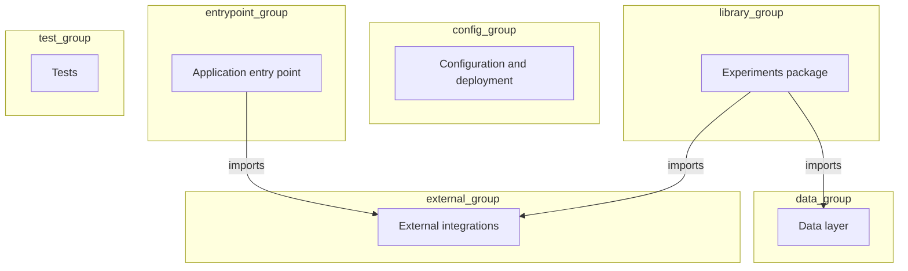

# Architecture report: RUCAIBox/LLMSurvey

> Automated static analysis. **Observed** = directly seen in files/imports/AST; **Inferred** = interpretation from that evidence. Repository code was not executed.

## 1. Repository at a glance

| Item | Value |
| --- | --- |
| Repository | RUCAIBox/LLMSurvey |
| Description | The official GitHub page for the survey paper "A Survey of Large Language Models". |
| Language | Python |
| Stars | 12229 |
| Licence | Not detected |
| Analysed commit / branch | 4a468e40e417fd3541d190c056e260da322ef4de / main |
| Framework(s) | Flask |
| Files analysed | 243 |
| Components | 6 |

## 2. Architecture in one minute

RUCAIBox/LLMSurvey - The official GitHub page for the survey paper "A Survey of Large Language Models".. This repository was analysed statically from 243 file(s) (141 Python). Detected technologies (observed from imports/manifests): GitHub Actions, Flask, aiohttp, Click, httpx, NumPy. Files are grouped into 6 component(s): Configuration and deployment, Data layer, Application entry point, Experiments package, External integrations, Tests. Observed entry point(s): Experiments/HumanAlignment/HaluEval/claude_halu.py, Experiments/HumanAlignment/HaluEval/open-source_model.py, Experiments/HumanAlignment/HaluEval/openai_gpt.py. Findings below distinguish observed facts from inferred interpretation.

## 3. High-level block diagram

## 4. Main components

### Configuration and deployment (`config`)

- **Kind:** config
- **Status:** Observed
- **Confidence:** 0.85
- **Responsibility:** Groups 29 file(s) under configuration and deployment (observed from repository paths and static analysis).
- **Paths:** `Experiments/HumanAlignment/HaluEval/requirements.txt`, `Experiments/HumanAlignment/requirements.txt`, `Experiments/InstructTuning/bbh/config/benchmark/bbh10k.yaml`, `Experiments/InstructTuning/bbh/config/model/chatgpt.yaml`, `Experiments/InstructTuning/bbh/config/model/dummy.yaml`, `Experiments/InstructTuning/bbh/config/model/llama.yaml`, `Experiments/InstructTuning/bbh/config/model/local.yaml`, `Experiments/InstructTuning/bbh/config/model/openai.yaml`, `Experiments/InstructTuning/bbh/output/bbh10kbenchmark/llama-model_english.json`, `Experiments/InstructTuning/requirements.txt`, `Experiments/KnowledgeUtilization/requirements.txt`, `Experiments/LanguageGeneration/requirements.txt`, `Experiments/MathematicalReasoning/demo/aqua.json`, `Experiments/MathematicalReasoning/demo/gsm8k.json`, `Experiments/MathematicalReasoning/demo/math.json`, `Experiments/SymbolicReasoning/dataset/penguins/test.json`, `Experiments/ToolManipulation/Gorilla/data/apizoo/shawnharmsen1.json`, `Experiments/ToolManipulation/Gorilla/eval/eval-scripts/codebleu/parser/tree-sitter-python/.github/workflows/ci.yml`, `Experiments/ToolManipulation/Gorilla/eval/eval-scripts/codebleu/parser/tree-sitter-python/Cargo.toml`, `Experiments/ToolManipulation/Gorilla/eval/eval-scripts/codebleu/parser/tree-sitter-python/package.json`, `Experiments/ToolManipulation/Gorilla/eval/eval-scripts/codebleu/parser/tree-sitter-python/src/grammar.json`, `Experiments/ToolManipulation/Gorilla/eval/eval-scripts/codebleu/parser/tree-sitter-python/src/node-types.json`, `Experiments/ToolManipulation/Gorilla/inference/requirements.txt`, `Experiments/ToolManipulation/Gorilla/requirements.txt`, `Experiments/ToolManipulation/HotPotQA/base_config.yaml`, `Experiments/ToolManipulation/HotPotQA/prompts/alfworld.json`, `Experiments/ToolManipulation/HotPotQA/prompts/alfworld_3prompts.json`, `Experiments/ToolManipulation/HotPotQA/prompts/fever.json`, `Experiments/ToolManipulation/HotPotQA/prompts/prompts_naive.json`
- **Evidence:** [Experiments/HumanAlignment/HaluEval/requirements.txt](https://github.com/RUCAIBox/LLMSurvey/blob/4a468e40e417fd3541d190c056e260da322ef4de/Experiments/HumanAlignment/HaluEval/requirements.txt); [Experiments/HumanAlignment/requirements.txt](https://github.com/RUCAIBox/LLMSurvey/blob/4a468e40e417fd3541d190c056e260da322ef4de/Experiments/HumanAlignment/requirements.txt); [Experiments/InstructTuning/bbh/config/benchmark/bbh10k.yaml](https://github.com/RUCAIBox/LLMSurvey/blob/4a468e40e417fd3541d190c056e260da322ef4de/Experiments/InstructTuning/bbh/config/benchmark/bbh10k.yaml); [Experiments/InstructTuning/bbh/config/model/chatgpt.yaml](https://github.com/RUCAIBox/LLMSurvey/blob/4a468e40e417fd3541d190c056e260da322ef4de/Experiments/InstructTuning/bbh/config/model/chatgpt.yaml); [Experiments/InstructTuning/bbh/config/model/dummy.yaml](https://github.com/RUCAIBox/LLMSurvey/blob/4a468e40e417fd3541d190c056e260da322ef4de/Experiments/InstructTuning/bbh/config/model/dummy.yaml); [Experiments/InstructTuning/bbh/config/model/llama.yaml](https://github.com/RUCAIBox/LLMSurvey/blob/4a468e40e417fd3541d190c056e260da322ef4de/Experiments/InstructTuning/bbh/config/model/llama.yaml); [Experiments/InstructTuning/bbh/config/model/local.yaml](https://github.com/RUCAIBox/LLMSurvey/blob/4a468e40e417fd3541d190c056e260da322ef4de/Experiments/InstructTuning/bbh/config/model/local.yaml); [Experiments/InstructTuning/bbh/config/model/openai.yaml](https://github.com/RUCAIBox/LLMSurvey/blob/4a468e40e417fd3541d190c056e260da322ef4de/Experiments/InstructTuning/bbh/config/model/openai.yaml)

### Data layer (`data_layer`)

- **Kind:** data
- **Status:** Observed
- **Confidence:** 0.85
- **Responsibility:** Groups 1 file(s) under data layer (observed from repository paths and static analysis). Observed top-level classes: Model.
- **Paths:** `Experiments/InstructTuning/bbh/src/model/Model.py`
- **Evidence:** [Experiments/InstructTuning/bbh/src/model/Model.py:5](https://github.com/RUCAIBox/LLMSurvey/blob/4a468e40e417fd3541d190c056e260da322ef4de/Experiments/InstructTuning/bbh/src/model/Model.py#L5)

### Application entry point (`entrypoint`)

- **Kind:** entrypoint
- **Status:** Observed
- **Confidence:** 0.85
- **Responsibility:** Groups 87 file(s) under application entry point (observed from repository paths and static analysis). Observed application object created via Flask. Observed top-level classes: CausalModel, ChatGLMModel, ChatGPTDecoder, ClaudeDecoder, DataArguments, DataCollatorForMWP. Observed top-level functions: _tokenize_fn, add_variable_to_config, analyze_text, annotate, apply_delta, apply_delta_low_cpu_mem.
- **Paths:** `Experiments/HumanAlignment/HaluEval/claude_halu.py`, `Experiments/HumanAlignment/HaluEval/open-source_model.py`, `Experiments/HumanAlignment/HaluEval/openai_gpt.py`, `Experiments/HumanAlignment/metric/Winogender.py`, `Experiments/HumanAlignment/metric/cal_crows_res.py`, `Experiments/HumanAlignment/metric/cal_toxicity_score.py`, `Experiments/HumanAlignment/metric/cal_truth_res.py`, `Experiments/HumanAlignment/metric/cal_wino_res.py`, `Experiments/HumanAlignment/metric/crows_pairs.py`, `Experiments/HumanAlignment/metric/eval_truthfulqa.py`, `Experiments/HumanAlignment/metric/real-toxicity-prompts.py`, `Experiments/HumanAlignment/model/Alpaca.py`, `Experiments/HumanAlignment/model/ChatGLM.py`, `Experiments/HumanAlignment/model/ChatGPT.py`, `Experiments/HumanAlignment/model/Claude.py`, `Experiments/HumanAlignment/model/Falcon.py`, `Experiments/HumanAlignment/model/LLaMA.py`, `Experiments/HumanAlignment/model/Pythia.py`, `Experiments/HumanAlignment/model/Vicuna.py`, `Experiments/HumanAlignment/model/davinci-002.py`, `Experiments/HumanAlignment/model/davinci-003.py`, `Experiments/InstructTuning/auto_eval/generate.py`, `Experiments/InstructTuning/bbh/src/main.py`, `Experiments/InstructTuning/mmlu/mmlu.py`, `Experiments/InstructTuning/mmlu/modeling.py`, `Experiments/InstructTuning/train.py`, `Experiments/KnowledgeReasoning/ChatGPT.py`, `Experiments/KnowledgeReasoning/Claude.py`, `Experiments/KnowledgeReasoning/davinci-002.py`, `Experiments/KnowledgeReasoning/davinci-003.py`, `Experiments/KnowledgeReasoning/get_response.py`, `Experiments/KnowledgeUtilization/WikiFact/em.py`, `Experiments/KnowledgeUtilization/WikiFact/open-source_model.py`, `Experiments/KnowledgeUtilization/WikiFact/wikifact_002.py`, `Experiments/KnowledgeUtilization/WikiFact/wikifact_003.py`, `Experiments/KnowledgeUtilization/WikiFact/wikifact_chatgpt.py`, `Experiments/KnowledgeUtilization/WikiFact/wikifact_claude.py`, `Experiments/LanguageGeneration/HumanEval/generate.py`, `Experiments/LanguageGeneration/HumanEval/model.py`, `Experiments/LanguageGeneration/LAMBADA/lambada_002.py`, `Experiments/LanguageGeneration/LAMBADA/lambada_003.py`, `Experiments/LanguageGeneration/LAMBADA/lambada_chatgpt.py`, `Experiments/LanguageGeneration/LAMBADA/lambada_claude.py`, `Experiments/LanguageGeneration/WMT22/open-source_model.py`, `Experiments/LanguageGeneration/WMT22/wmt-002.py`, `Experiments/LanguageGeneration/WMT22/wmt-003.py`, `Experiments/LanguageGeneration/WMT22/wmt_chatgpt.py`, `Experiments/LanguageGeneration/WMT22/wmt_claude.py`, `Experiments/LanguageGeneration/XSum/get_rougel.py`, `Experiments/LanguageGeneration/XSum/open-source_model.py`, `Experiments/LanguageGeneration/XSum/xsum_002.py`, `Experiments/LanguageGeneration/XSum/xsum_003.py`, `Experiments/LanguageGeneration/XSum/xsum_chatgpt.py`, `Experiments/LanguageGeneration/XSum/xsum_claude.py`, `Experiments/MathematicalReasoning/claude.py`, `Experiments/MathematicalReasoning/data_process.py`, `Experiments/MathematicalReasoning/do_gsm8k.py`, `Experiments/MathematicalReasoning/do_math.py`, `Experiments/MathematicalReasoning/evaluate.py`, `Experiments/MathematicalReasoning/evaluate_falcon.py`, `Experiments/MathematicalReasoning/solve_claude.py`, `Experiments/MathematicalReasoning/solve_text_002.py`, `Experiments/MathematicalReasoning/solve_text_003.py`, `Experiments/MathematicalReasoning/solve_turbo.py`, `Experiments/SymbolicReasoning/claude.py`, `Experiments/SymbolicReasoning/data_process.py`, `Experiments/SymbolicReasoning/do_color.py`, `Experiments/SymbolicReasoning/do_penguins.py`, `Experiments/SymbolicReasoning/evaluate_color.py`, `Experiments/SymbolicReasoning/evaluate_penguins.py`, `Experiments/SymbolicReasoning/solve_claude.py`, `Experiments/SymbolicReasoning/solve_text_002.py`, `Experiments/SymbolicReasoning/solve_text_003.py`, `Experiments/SymbolicReasoning/solve_turbo.py`, `Experiments/ToolManipulation/Gorilla/eval/eval-scripts/ast_eval_hf.py`, `Experiments/ToolManipulation/Gorilla/eval/eval-scripts/ast_eval_tf.py`, `Experiments/ToolManipulation/Gorilla/eval/eval-scripts/ast_eval_th.py`, `Experiments/ToolManipulation/Gorilla/eval/eval-scripts/codebleu/parser/tree-sitter-python/examples/python3-grammar-crlf.py`, `Experiments/ToolManipulation/Gorilla/eval/eval-scripts/codebleu/parser/tree-sitter-python/examples/python3-grammar.py`, `Experiments/ToolManipulation/Gorilla/eval/get_hf_responses.py`, `Experiments/ToolManipulation/Gorilla/eval/get_llm_responses.py`, `Experiments/ToolManipulation/Gorilla/inference/apply_delta.py`, `Experiments/ToolManipulation/Gorilla/inference/gorilla_eval.py`, `Experiments/ToolManipulation/HotPotQA/hotpotqa-chat.py`, `Experiments/ToolManipulation/HotPotQA/hotpotqa-claude.py`, `Experiments/ToolManipulation/HotPotQA/hotpotqa-hf.py`, `Experiments/ToolManipulation/HotPotQA/hotpotqa.py`
- **Evidence:** [Experiments/HumanAlignment/HaluEval/claude_halu.py:9](https://github.com/RUCAIBox/LLMSurvey/blob/4a468e40e417fd3541d190c056e260da322ef4de/Experiments/HumanAlignment/HaluEval/claude_halu.py#L9); [Experiments/HumanAlignment/HaluEval/open-source_model.py:13](https://github.com/RUCAIBox/LLMSurvey/blob/4a468e40e417fd3541d190c056e260da322ef4de/Experiments/HumanAlignment/HaluEval/open-source_model.py#L13); [Experiments/HumanAlignment/HaluEval/openai_gpt.py:11](https://github.com/RUCAIBox/LLMSurvey/blob/4a468e40e417fd3541d190c056e260da322ef4de/Experiments/HumanAlignment/HaluEval/openai_gpt.py#L11); [Experiments/HumanAlignment/metric/Winogender.py:8](https://github.com/RUCAIBox/LLMSurvey/blob/4a468e40e417fd3541d190c056e260da322ef4de/Experiments/HumanAlignment/metric/Winogender.py#L8); [Experiments/HumanAlignment/metric/cal_crows_res.py:8](https://github.com/RUCAIBox/LLMSurvey/blob/4a468e40e417fd3541d190c056e260da322ef4de/Experiments/HumanAlignment/metric/cal_crows_res.py#L8); [Experiments/HumanAlignment/metric/cal_toxicity_score.py:9](https://github.com/RUCAIBox/LLMSurvey/blob/4a468e40e417fd3541d190c056e260da322ef4de/Experiments/HumanAlignment/metric/cal_toxicity_score.py#L9); [Experiments/HumanAlignment/metric/cal_truth_res.py:10](https://github.com/RUCAIBox/LLMSurvey/blob/4a468e40e417fd3541d190c056e260da322ef4de/Experiments/HumanAlignment/metric/cal_truth_res.py#L10); [Experiments/HumanAlignment/metric/cal_wino_res.py:14](https://github.com/RUCAIBox/LLMSurvey/blob/4a468e40e417fd3541d190c056e260da322ef4de/Experiments/HumanAlignment/metric/cal_wino_res.py#L14)

### Experiments package (`experiments`)

- **Kind:** library
- **Status:** Observed
- **Confidence:** 0.85
- **Responsibility:** Groups 67 file(s) under experiments package (observed from repository paths and static analysis). Observed top-level classes: Autotuner, BBH3kBenchmark, ChatGPTModel, DataArguments, DummyModel, FeverWrapper. Observed top-level functions: DFG_csharp, DFG_go, DFG_java, DFG_javascript, DFG_php, DFG_python.
- **Paths:** `Experiments/HumanAlignment/eval_Crows_Pairs.sh`, `Experiments/HumanAlignment/eval_RealToxityPrompts.sh`, `Experiments/HumanAlignment/eval_TruthfulQA.sh`, `Experiments/HumanAlignment/eval_WinoGender.sh`, `Experiments/HumanAlignment/model/train.py`, `Experiments/InstructTuning/auto_eval/eval.py`, `Experiments/InstructTuning/bbh/scripts/test.sh`, `Experiments/InstructTuning/bbh/scripts/testChatGPTModel.sh`, `Experiments/InstructTuning/bbh/scripts/testDummyModel.sh`, `Experiments/InstructTuning/bbh/scripts/testLocalModel.sh`, `Experiments/InstructTuning/bbh/scripts/testOpenAIModel.sh`, `Experiments/InstructTuning/bbh/src/BBH10KBenchmark.py`, `Experiments/InstructTuning/bbh/src/model/ChatGPTModel.py`, `Experiments/InstructTuning/bbh/src/model/DummyModel.py`, `Experiments/InstructTuning/bbh/src/model/LLaMAModel.py`, `Experiments/InstructTuning/bbh/src/model/LocalModel.py`, `Experiments/InstructTuning/bbh/src/model/OpenAIModel.py`, `Experiments/InstructTuning/bbh/src/model/__init__.py`, `Experiments/InstructTuning/mmlu/quant/__init__.py`, `Experiments/InstructTuning/mmlu/quant/custom_autotune.py`, `Experiments/InstructTuning/mmlu/quant/fused_attn.py`, `Experiments/InstructTuning/mmlu/quant/fused_mlp.py`, `Experiments/InstructTuning/mmlu/quant/quant_linear.py`, `Experiments/InstructTuning/mmlu/quant/quantizer.py`, `Experiments/InstructTuning/mmlu/quant/triton_norm.py`, `Experiments/InstructTuning/test.sh`, `Experiments/InstructTuning/train.sh`, `Experiments/KnowledgeReasoning/run_all_models.sh`, `Experiments/LanguageGeneration/HumanEval/util.py`, `Experiments/MathematicalReasoning/prompt_pattern.py`, `Experiments/MathematicalReasoning/scripts/run_eval_gsm8k.sh`, `Experiments/MathematicalReasoning/scripts/run_eval_math.sh`, `Experiments/SymbolicReasoning/prompt_pattern.py`, `Experiments/SymbolicReasoning/scripts/run_eval_color.sh`, `Experiments/SymbolicReasoning/scripts/run_eval_penguins.sh`, `Experiments/ToolManipulation/Gorilla/eval/eval-scripts/codebleu/__init__.py`, `Experiments/ToolManipulation/Gorilla/eval/eval-scripts/codebleu/bleu.py`, `Experiments/ToolManipulation/Gorilla/eval/eval-scripts/codebleu/dataflow_match.py`, `Experiments/ToolManipulation/Gorilla/eval/eval-scripts/codebleu/parser/DFG.py`, `Experiments/ToolManipulation/Gorilla/eval/eval-scripts/codebleu/parser/__init__.py`, `Experiments/ToolManipulation/Gorilla/eval/eval-scripts/codebleu/parser/build.py`, `Experiments/ToolManipulation/Gorilla/eval/eval-scripts/codebleu/parser/build.sh`, `Experiments/ToolManipulation/Gorilla/eval/eval-scripts/codebleu/parser/tree-sitter-python/bindings/node/index.js`, `Experiments/ToolManipulation/Gorilla/eval/eval-scripts/codebleu/parser/tree-sitter-python/bindings/rust/build.rs`, `Experiments/ToolManipulation/Gorilla/eval/eval-scripts/codebleu/parser/tree-sitter-python/bindings/rust/lib.rs`, `Experiments/ToolManipulation/Gorilla/eval/eval-scripts/codebleu/parser/tree-sitter-python/examples/compound-statement-without-trailing-newline.py`, `Experiments/ToolManipulation/Gorilla/eval/eval-scripts/codebleu/parser/tree-sitter-python/examples/crlf-line-endings.py`, `Experiments/ToolManipulation/Gorilla/eval/eval-scripts/codebleu/parser/tree-sitter-python/examples/mixed-spaces-tabs.py`, `Experiments/ToolManipulation/Gorilla/eval/eval-scripts/codebleu/parser/tree-sitter-python/examples/multiple-newlines.py`, `Experiments/ToolManipulation/Gorilla/eval/eval-scripts/codebleu/parser/tree-sitter-python/examples/python2-grammar-crlf.py`, `Experiments/ToolManipulation/Gorilla/eval/eval-scripts/codebleu/parser/tree-sitter-python/examples/python2-grammar.py`, `Experiments/ToolManipulation/Gorilla/eval/eval-scripts/codebleu/parser/tree-sitter-python/examples/python3.8_grammar.py`, `Experiments/ToolManipulation/Gorilla/eval/eval-scripts/codebleu/parser/tree-sitter-python/examples/simple-statements-without-trailing-newline.py`, `Experiments/ToolManipulation/Gorilla/eval/eval-scripts/codebleu/parser/tree-sitter-python/examples/tabs.py`, `Experiments/ToolManipulation/Gorilla/eval/eval-scripts/codebleu/parser/tree-sitter-python/examples/trailing-whitespace.py`, `Experiments/ToolManipulation/Gorilla/eval/eval-scripts/codebleu/parser/tree-sitter-python/grammar.js`, `Experiments/ToolManipulation/Gorilla/eval/eval-scripts/codebleu/parser/tree-sitter-python/src/tree_sitter/parser.h`, `Experiments/ToolManipulation/Gorilla/eval/eval-scripts/codebleu/parser/utils.py`, `Experiments/ToolManipulation/Gorilla/eval/eval-scripts/codebleu/syntax_check.py`, `Experiments/ToolManipulation/Gorilla/eval/eval-scripts/codebleu/syntax_match.py`, `Experiments/ToolManipulation/Gorilla/eval/eval-scripts/codebleu/utils.py`, `Experiments/ToolManipulation/Gorilla/eval/eval-scripts/codebleu/weighted_ngram_match.py`, `Experiments/ToolManipulation/Gorilla/eval/utils.py`, `Experiments/ToolManipulation/Gorilla/inference/serve/conv_template.py`, `Experiments/ToolManipulation/Gorilla/inference/serve/gorilla_cli.py`, `Experiments/ToolManipulation/HotPotQA/wikienv.py`, `Experiments/ToolManipulation/HotPotQA/wrappers.py`
- **Evidence:** [Experiments/HumanAlignment/eval_Crows_Pairs.sh](https://github.com/RUCAIBox/LLMSurvey/blob/4a468e40e417fd3541d190c056e260da322ef4de/Experiments/HumanAlignment/eval_Crows_Pairs.sh); [Experiments/HumanAlignment/eval_RealToxityPrompts.sh](https://github.com/RUCAIBox/LLMSurvey/blob/4a468e40e417fd3541d190c056e260da322ef4de/Experiments/HumanAlignment/eval_RealToxityPrompts.sh); [Experiments/HumanAlignment/eval_TruthfulQA.sh](https://github.com/RUCAIBox/LLMSurvey/blob/4a468e40e417fd3541d190c056e260da322ef4de/Experiments/HumanAlignment/eval_TruthfulQA.sh); [Experiments/HumanAlignment/eval_WinoGender.sh](https://github.com/RUCAIBox/LLMSurvey/blob/4a468e40e417fd3541d190c056e260da322ef4de/Experiments/HumanAlignment/eval_WinoGender.sh); [Experiments/HumanAlignment/model/train.py:48](https://github.com/RUCAIBox/LLMSurvey/blob/4a468e40e417fd3541d190c056e260da322ef4de/Experiments/HumanAlignment/model/train.py#L48); [Experiments/InstructTuning/auto_eval/eval.py](https://github.com/RUCAIBox/LLMSurvey/blob/4a468e40e417fd3541d190c056e260da322ef4de/Experiments/InstructTuning/auto_eval/eval.py); [Experiments/InstructTuning/bbh/scripts/test.sh](https://github.com/RUCAIBox/LLMSurvey/blob/4a468e40e417fd3541d190c056e260da322ef4de/Experiments/InstructTuning/bbh/scripts/test.sh); [Experiments/InstructTuning/bbh/scripts/testChatGPTModel.sh](https://github.com/RUCAIBox/LLMSurvey/blob/4a468e40e417fd3541d190c056e260da322ef4de/Experiments/InstructTuning/bbh/scripts/testChatGPTModel.sh)

### External integrations (`external_integrations`)

- **Kind:** external
- **Status:** Inferred
- **Confidence:** 0.70
- **Responsibility:** Groups 0 file(s) under external integrations (observed from repository paths and static analysis).
- **Evidence:** [Experiments/HumanAlignment/metric/real-toxicity-prompts.py:5](https://github.com/RUCAIBox/LLMSurvey/blob/4a468e40e417fd3541d190c056e260da322ef4de/Experiments/HumanAlignment/metric/real-toxicity-prompts.py#L5); [Experiments/InstructTuning/bbh/src/model/LocalModel.py:4](https://github.com/RUCAIBox/LLMSurvey/blob/4a468e40e417fd3541d190c056e260da322ef4de/Experiments/InstructTuning/bbh/src/model/LocalModel.py#L4); [Experiments/ToolManipulation/Gorilla/eval/get_llm_responses.py:10](https://github.com/RUCAIBox/LLMSurvey/blob/4a468e40e417fd3541d190c056e260da322ef4de/Experiments/ToolManipulation/Gorilla/eval/get_llm_responses.py#L10); [Experiments/ToolManipulation/HotPotQA/hotpotqa-chat.py:7](https://github.com/RUCAIBox/LLMSurvey/blob/4a468e40e417fd3541d190c056e260da322ef4de/Experiments/ToolManipulation/HotPotQA/hotpotqa-chat.py#L7); [Experiments/ToolManipulation/HotPotQA/hotpotqa-claude.py:6](https://github.com/RUCAIBox/LLMSurvey/blob/4a468e40e417fd3541d190c056e260da322ef4de/Experiments/ToolManipulation/HotPotQA/hotpotqa-claude.py#L6); [Experiments/ToolManipulation/HotPotQA/hotpotqa-hf.py:4](https://github.com/RUCAIBox/LLMSurvey/blob/4a468e40e417fd3541d190c056e260da322ef4de/Experiments/ToolManipulation/HotPotQA/hotpotqa-hf.py#L4)

### Tests (`tests`)

- **Kind:** test
- **Status:** Observed
- **Confidence:** 0.85
- **Responsibility:** Groups 19 file(s) under tests (observed from repository paths and static analysis). Observed top-level functions: clean, g, get_answer_boxed, load_from_json, load_multi_line_json, make_query.
- **Paths:** `Experiments/HumanAlignment/HaluEval/test_halueval.sh`, `Experiments/KnowledgeUtilization/test_wikifact.sh`, `Experiments/LanguageGeneration/WMT22/test_bleu.py`, `Experiments/LanguageGeneration/test_humaneval.sh`, `Experiments/LanguageGeneration/test_lambada.sh`, `Experiments/LanguageGeneration/test_wmt.sh`, `Experiments/LanguageGeneration/test_xsum.sh`, `Experiments/MathematicalReasoning/test_falcon_gsm8k.py`, `Experiments/MathematicalReasoning/test_falcon_math.py`, `Experiments/SymbolicReasoning/test_falcon_color.py`, `Experiments/SymbolicReasoning/test_falcon_penguins.py`, `Experiments/ToolManipulation/Gorilla/eval/eval-scripts/codebleu/parser/tree-sitter-python/test/corpus/errors.txt`, `Experiments/ToolManipulation/Gorilla/eval/eval-scripts/codebleu/parser/tree-sitter-python/test/corpus/expressions.txt`, `Experiments/ToolManipulation/Gorilla/eval/eval-scripts/codebleu/parser/tree-sitter-python/test/corpus/literals.txt`, `Experiments/ToolManipulation/Gorilla/eval/eval-scripts/codebleu/parser/tree-sitter-python/test/corpus/pattern_matching.txt`, `Experiments/ToolManipulation/Gorilla/eval/eval-scripts/codebleu/parser/tree-sitter-python/test/corpus/statements.txt`, `Experiments/ToolManipulation/Gorilla/eval/eval-scripts/codebleu/parser/tree-sitter-python/test/highlight/keywords.py`, `Experiments/ToolManipulation/Gorilla/eval/eval-scripts/codebleu/parser/tree-sitter-python/test/highlight/parameters.py`, `Experiments/ToolManipulation/Gorilla/eval/eval-scripts/codebleu/parser/tree-sitter-python/test/highlight/pattern_matching.py`
- **Evidence:** [Experiments/HumanAlignment/HaluEval/test_halueval.sh](https://github.com/RUCAIBox/LLMSurvey/blob/4a468e40e417fd3541d190c056e260da322ef4de/Experiments/HumanAlignment/HaluEval/test_halueval.sh); [Experiments/KnowledgeUtilization/test_wikifact.sh](https://github.com/RUCAIBox/LLMSurvey/blob/4a468e40e417fd3541d190c056e260da322ef4de/Experiments/KnowledgeUtilization/test_wikifact.sh); [Experiments/LanguageGeneration/WMT22/test_bleu.py](https://github.com/RUCAIBox/LLMSurvey/blob/4a468e40e417fd3541d190c056e260da322ef4de/Experiments/LanguageGeneration/WMT22/test_bleu.py); [Experiments/LanguageGeneration/test_humaneval.sh](https://github.com/RUCAIBox/LLMSurvey/blob/4a468e40e417fd3541d190c056e260da322ef4de/Experiments/LanguageGeneration/test_humaneval.sh); [Experiments/LanguageGeneration/test_lambada.sh](https://github.com/RUCAIBox/LLMSurvey/blob/4a468e40e417fd3541d190c056e260da322ef4de/Experiments/LanguageGeneration/test_lambada.sh); [Experiments/LanguageGeneration/test_wmt.sh](https://github.com/RUCAIBox/LLMSurvey/blob/4a468e40e417fd3541d190c056e260da322ef4de/Experiments/LanguageGeneration/test_wmt.sh); [Experiments/LanguageGeneration/test_xsum.sh](https://github.com/RUCAIBox/LLMSurvey/blob/4a468e40e417fd3541d190c056e260da322ef4de/Experiments/LanguageGeneration/test_xsum.sh); [Experiments/MathematicalReasoning/test_falcon_gsm8k.py:12](https://github.com/RUCAIBox/LLMSurvey/blob/4a468e40e417fd3541d190c056e260da322ef4de/Experiments/MathematicalReasoning/test_falcon_gsm8k.py#L12)

## 5. Execution flow

**Observed** entry point(s):

- [Experiments/HumanAlignment/HaluEval/claude_halu.py:9](https://github.com/RUCAIBox/LLMSurvey/blob/4a468e40e417fd3541d190c056e260da322ef4de/Experiments/HumanAlignment/HaluEval/claude_halu.py#L9)
- [Experiments/HumanAlignment/HaluEval/open-source_model.py:106](https://github.com/RUCAIBox/LLMSurvey/blob/4a468e40e417fd3541d190c056e260da322ef4de/Experiments/HumanAlignment/HaluEval/open-source_model.py#L106)
- [Experiments/HumanAlignment/HaluEval/openai_gpt.py:123](https://github.com/RUCAIBox/LLMSurvey/blob/4a468e40e417fd3541d190c056e260da322ef4de/Experiments/HumanAlignment/HaluEval/openai_gpt.py#L123)
- [Experiments/HumanAlignment/metric/Winogender.py:89](https://github.com/RUCAIBox/LLMSurvey/blob/4a468e40e417fd3541d190c056e260da322ef4de/Experiments/HumanAlignment/metric/Winogender.py#L89)
- [Experiments/HumanAlignment/metric/cal_crows_res.py:43](https://github.com/RUCAIBox/LLMSurvey/blob/4a468e40e417fd3541d190c056e260da322ef4de/Experiments/HumanAlignment/metric/cal_crows_res.py#L43)
- [Experiments/HumanAlignment/metric/cal_toxicity_score.py:24](https://github.com/RUCAIBox/LLMSurvey/blob/4a468e40e417fd3541d190c056e260da322ef4de/Experiments/HumanAlignment/metric/cal_toxicity_score.py#L24)
- [Experiments/HumanAlignment/metric/cal_truth_res.py:35](https://github.com/RUCAIBox/LLMSurvey/blob/4a468e40e417fd3541d190c056e260da322ef4de/Experiments/HumanAlignment/metric/cal_truth_res.py#L35)
- [Experiments/HumanAlignment/metric/cal_wino_res.py:24](https://github.com/RUCAIBox/LLMSurvey/blob/4a468e40e417fd3541d190c056e260da322ef4de/Experiments/HumanAlignment/metric/cal_wino_res.py#L24)
- [Experiments/HumanAlignment/metric/crows_pairs.py:42](https://github.com/RUCAIBox/LLMSurvey/blob/4a468e40e417fd3541d190c056e260da322ef4de/Experiments/HumanAlignment/metric/crows_pairs.py#L42)
- [Experiments/HumanAlignment/metric/eval_truthfulqa.py:109](https://github.com/RUCAIBox/LLMSurvey/blob/4a468e40e417fd3541d190c056e260da322ef4de/Experiments/HumanAlignment/metric/eval_truthfulqa.py#L109)
- [Experiments/HumanAlignment/metric/real-toxicity-prompts.py:51](https://github.com/RUCAIBox/LLMSurvey/blob/4a468e40e417fd3541d190c056e260da322ef4de/Experiments/HumanAlignment/metric/real-toxicity-prompts.py#L51)
- [Experiments/InstructTuning/bbh/src/main.py:107](https://github.com/RUCAIBox/LLMSurvey/blob/4a468e40e417fd3541d190c056e260da322ef4de/Experiments/InstructTuning/bbh/src/main.py#L107)

Representative flow (derived from observed entry points and the import graph; steps beyond the entry point are **Inferred**):

1. Execution starts at an observed entry point listed above, if present.
2. `entrypoint` imports `external_integrations` (Application entry point -> External integrations).
3. `experiments` imports `data_layer` (Experiments package -> Data layer).
4. `experiments` imports `external_integrations` (Experiments package -> External integrations).

## 6. Project structure

### `(root)`

- `README.md` - docs (93585 bytes)

### `Experiments`

- `Experiments/HumanAlignment/HaluEval/README.md` - docs (733 bytes)
- `Experiments/HumanAlignment/HaluEval/claude_halu.py` - source, Python (3075 bytes)
- `Experiments/HumanAlignment/HaluEval/open-source_model.py` - source, Python (3608 bytes)
- `Experiments/HumanAlignment/HaluEval/openai_gpt.py` - source, Python (4453 bytes)
- `Experiments/HumanAlignment/HaluEval/requirements.txt` - manifest (44 bytes)
- `Experiments/HumanAlignment/HaluEval/test_halueval.sh` - test, Shell (1025 bytes)
- `Experiments/HumanAlignment/README.md` - docs (541 bytes)
- `Experiments/HumanAlignment/eval_Crows_Pairs.sh` - source, Shell (990 bytes)
- `Experiments/HumanAlignment/eval_RealToxityPrompts.sh` - source, Shell (1890 bytes)
- `Experiments/HumanAlignment/eval_TruthfulQA.sh` - source, Shell (1676 bytes)
- `Experiments/HumanAlignment/eval_WinoGender.sh` - source, Shell (990 bytes)
- `Experiments/HumanAlignment/metric/Winogender.py` - source, Python (3779 bytes)
- `Experiments/HumanAlignment/metric/cal_crows_res.py` - source, Python (1810 bytes)
- `Experiments/HumanAlignment/metric/cal_toxicity_score.py` - source, Python (871 bytes)
- `Experiments/HumanAlignment/metric/cal_truth_res.py` - source, Python (1124 bytes)
- `Experiments/HumanAlignment/metric/cal_wino_res.py` - source, Python (5161 bytes)
- `Experiments/HumanAlignment/metric/crows_pairs.py` - source, Python (4823 bytes)
- `Experiments/HumanAlignment/metric/eval_truthfulqa.py` - source, Python (7407 bytes)
- `Experiments/HumanAlignment/metric/real-toxicity-prompts.py` - source, Python (3150 bytes)
- `Experiments/HumanAlignment/model/Alpaca.py` - source, Python (4570 bytes)
- `Experiments/HumanAlignment/model/ChatGLM.py` - source, Python (3438 bytes)
- `Experiments/HumanAlignment/model/ChatGPT.py` - source, Python (8844 bytes)
- `Experiments/HumanAlignment/model/Claude.py` - source, Python (5365 bytes)
- `Experiments/HumanAlignment/model/Falcon.py` - source, Python (4236 bytes)
- `Experiments/HumanAlignment/model/LLaMA.py` - source, Python (4227 bytes)
- `Experiments/HumanAlignment/model/Pythia.py` - source, Python (4839 bytes)
- `Experiments/HumanAlignment/model/Vicuna.py` - source, Python (3820 bytes)
- `Experiments/HumanAlignment/model/davinci-002.py` - source, Python (7513 bytes)
- `Experiments/HumanAlignment/model/davinci-003.py` - source, Python (7569 bytes)
- `Experiments/HumanAlignment/model/train.py` - source, Python (3074 bytes)
- `Experiments/HumanAlignment/requirements.txt` - manifest (3643 bytes)
- `Experiments/InstructTuning/README.md` - docs (2751 bytes)
- `Experiments/InstructTuning/auto_eval/eval.py` - source, Python (1206 bytes)
- `Experiments/InstructTuning/auto_eval/generate.py` - source, Python (2757 bytes)
- `Experiments/InstructTuning/bbh/config/benchmark/bbh10k.yaml` - config (90 bytes)
- `Experiments/InstructTuning/bbh/config/model/chatgpt.yaml` - config (138 bytes)
- `Experiments/InstructTuning/bbh/config/model/dummy.yaml` - config (67 bytes)
- `Experiments/InstructTuning/bbh/config/model/llama.yaml` - config (94 bytes)
- `Experiments/InstructTuning/bbh/config/model/local.yaml` - config (67 bytes)
- `Experiments/InstructTuning/bbh/config/model/openai.yaml` - config (138 bytes)
- `Experiments/InstructTuning/bbh/output/bbh10kbenchmark/llama-model_english.json` - config (33610 bytes)
- `Experiments/InstructTuning/bbh/scripts/test.sh` - source, Shell (214 bytes)
- `Experiments/InstructTuning/bbh/scripts/testChatGPTModel.sh` - source, Shell (132 bytes)
- `Experiments/InstructTuning/bbh/scripts/testDummyModel.sh` - source, Shell (177 bytes)
- `Experiments/InstructTuning/bbh/scripts/testLocalModel.sh` - source, Shell (148 bytes)
- `Experiments/InstructTuning/bbh/scripts/testOpenAIModel.sh` - source, Shell (154 bytes)
- `Experiments/InstructTuning/bbh/src/BBH10KBenchmark.py` - source, Python (4860 bytes)
- `Experiments/InstructTuning/bbh/src/main.py` - source, Python (2774 bytes)
- `Experiments/InstructTuning/bbh/src/model/ChatGPTModel.py` - source, Python (1266 bytes)
- `Experiments/InstructTuning/bbh/src/model/DummyModel.py` - source, Python (768 bytes)
- `Experiments/InstructTuning/bbh/src/model/LLaMAModel.py` - source, Python (1966 bytes)
- `Experiments/InstructTuning/bbh/src/model/LocalModel.py` - source, Python (1273 bytes)
- `Experiments/InstructTuning/bbh/src/model/Model.py` - source, Python (245 bytes)
- `Experiments/InstructTuning/bbh/src/model/OpenAIModel.py` - source, Python (1274 bytes)
- `Experiments/InstructTuning/bbh/src/model/__init__.py` - source, Python (312 bytes)
- `Experiments/InstructTuning/mmlu/mmlu.py` - source, Python (7921 bytes)
- `Experiments/InstructTuning/mmlu/modeling.py` - source, Python (11783 bytes)
- `Experiments/InstructTuning/mmlu/quant/__init__.py` - source, Python (312 bytes)
- `Experiments/InstructTuning/mmlu/quant/custom_autotune.py` - source, Python (10077 bytes)
- `Experiments/InstructTuning/mmlu/quant/fused_attn.py` - source, Python (8943 bytes)
- `Experiments/InstructTuning/mmlu/quant/fused_mlp.py` - source, Python (13403 bytes)
- `Experiments/InstructTuning/mmlu/quant/quant_linear.py` - source, Python (21837 bytes)
- `Experiments/InstructTuning/mmlu/quant/quantizer.py` - source, Python (4380 bytes)
- `Experiments/InstructTuning/mmlu/quant/triton_norm.py` - source, Python (3151 bytes)
- `Experiments/InstructTuning/requirements.txt` - manifest (366 bytes)
- `Experiments/InstructTuning/test.sh` - source, Shell (1025 bytes)
- `Experiments/InstructTuning/train.py` - source, Python (10309 bytes)
- `Experiments/InstructTuning/train.sh` - source, Shell (762 bytes)
- `Experiments/KnowledgeReasoning/ChatGPT.py` - source, Python (5547 bytes)
- `Experiments/KnowledgeReasoning/Claude.py` - source, Python (3291 bytes)
- `Experiments/KnowledgeReasoning/data/openbook_valid.jsonl` - data (152928 bytes)
- `Experiments/KnowledgeReasoning/davinci-002.py` - source, Python (5074 bytes)
- `Experiments/KnowledgeReasoning/davinci-003.py` - source, Python (5074 bytes)
- `Experiments/KnowledgeReasoning/get_response.py` - source, Python (5038 bytes)
- `Experiments/KnowledgeReasoning/run_all_models.sh` - source, Shell (5710 bytes)
- `Experiments/KnowledgeUtilization/README.md` - docs (660 bytes)
- `Experiments/KnowledgeUtilization/WikiFact/em.py` - source, Python (3138 bytes)
- `Experiments/KnowledgeUtilization/WikiFact/open-source_model.py` - source, Python (3197 bytes)
- `Experiments/KnowledgeUtilization/WikiFact/wikifact_002.py` - source, Python (2225 bytes)
- `Experiments/KnowledgeUtilization/WikiFact/wikifact_003.py` - source, Python (2225 bytes)
- `Experiments/KnowledgeUtilization/WikiFact/wikifact_chatgpt.py` - source, Python (2292 bytes)
- `Experiments/KnowledgeUtilization/WikiFact/wikifact_claude.py` - source, Python (2439 bytes)
- `Experiments/KnowledgeUtilization/requirements.txt` - manifest (44 bytes)
- `Experiments/KnowledgeUtilization/test_wikifact.sh` - test, Shell (1546 bytes)
- `Experiments/LanguageGeneration/HumanEval/generate.py` - source, Python (6042 bytes)
- `Experiments/LanguageGeneration/HumanEval/model.py` - source, Python (15078 bytes)
- `Experiments/LanguageGeneration/HumanEval/util.py` - source, Python (2989 bytes)
- `Experiments/LanguageGeneration/LAMBADA/lambada_002.py` - source, Python (2725 bytes)
- `Experiments/LanguageGeneration/LAMBADA/lambada_003.py` - source, Python (2722 bytes)
- `Experiments/LanguageGeneration/LAMBADA/lambada_chatgpt.py` - source, Python (2766 bytes)
- `Experiments/LanguageGeneration/LAMBADA/lambada_claude.py` - source, Python (3118 bytes)
- `Experiments/LanguageGeneration/README.md` - docs (2567 bytes)
- `Experiments/LanguageGeneration/WMT22/open-source_model.py` - source, Python (3368 bytes)
- `Experiments/LanguageGeneration/WMT22/test_bleu.py` - test, Python (1430 bytes)
- `Experiments/LanguageGeneration/WMT22/wmt-002.py` - source, Python (2091 bytes)
- `Experiments/LanguageGeneration/WMT22/wmt-003.py` - source, Python (2100 bytes)
- `Experiments/LanguageGeneration/WMT22/wmt_chatgpt.py` - source, Python (2152 bytes)
- `Experiments/LanguageGeneration/WMT22/wmt_claude.py` - source, Python (2348 bytes)
- `Experiments/LanguageGeneration/XSum/get_rougel.py` - source, Python (663 bytes)
- `Experiments/LanguageGeneration/XSum/open-source_model.py` - source, Python (3330 bytes)
- `Experiments/LanguageGeneration/XSum/xsum_002.py` - source, Python (2710 bytes)
- `Experiments/LanguageGeneration/XSum/xsum_003.py` - source, Python (2710 bytes)
- `Experiments/LanguageGeneration/XSum/xsum_chatgpt.py` - source, Python (2850 bytes)
- `Experiments/LanguageGeneration/XSum/xsum_claude.py` - source, Python (2440 bytes)
- `Experiments/LanguageGeneration/requirements.txt` - manifest (72 bytes)
- `Experiments/LanguageGeneration/test_humaneval.sh` - test, Shell (1568 bytes)
- `Experiments/LanguageGeneration/test_lambada.sh` - test, Shell (962 bytes)
- `Experiments/LanguageGeneration/test_wmt.sh` - test, Shell (1565 bytes)
- `Experiments/LanguageGeneration/test_xsum.sh` - test, Shell (1586 bytes)
- `Experiments/MathematicalReasoning/claude.py` - source, Python (895 bytes)
- `Experiments/MathematicalReasoning/data_process.py` - source, Python (13747 bytes)
- `Experiments/MathematicalReasoning/demo/aqua.json` - config (6841 bytes)
- `Experiments/MathematicalReasoning/demo/gsm8k.json` - config (8953 bytes)
- `Experiments/MathematicalReasoning/demo/math.json` - config (48447 bytes)
- `Experiments/MathematicalReasoning/do_gsm8k.py` - source, Python (24983 bytes)
- `Experiments/MathematicalReasoning/do_math.py` - source, Python (26167 bytes)
- `Experiments/MathematicalReasoning/evaluate.py` - source, Python (8423 bytes)
- `Experiments/MathematicalReasoning/evaluate_falcon.py` - source, Python (8775 bytes)
- `Experiments/MathematicalReasoning/prompt_pattern.py` - source, Python (501 bytes)
- `Experiments/MathematicalReasoning/readme.md` - docs (1017 bytes)
- `Experiments/MathematicalReasoning/scripts/run_eval_gsm8k.sh` - source, Shell (4144 bytes)
- `Experiments/MathematicalReasoning/scripts/run_eval_math.sh` - source, Shell (4082 bytes)
- `Experiments/MathematicalReasoning/solve_claude.py` - source, Python (6239 bytes)
- `Experiments/MathematicalReasoning/solve_text_002.py` - source, Python (6064 bytes)
- `Experiments/MathematicalReasoning/solve_text_003.py` - source, Python (6064 bytes)
- `Experiments/MathematicalReasoning/solve_turbo.py` - source, Python (7703 bytes)
- `Experiments/MathematicalReasoning/test_falcon_gsm8k.py` - test, Python (3164 bytes)
- `Experiments/MathematicalReasoning/test_falcon_math.py` - test, Python (3713 bytes)
- `Experiments/README.md` - docs (1878 bytes)
- `Experiments/SymbolicReasoning/claude.py` - source, Python (895 bytes)
- `Experiments/SymbolicReasoning/data_process.py` - source, Python (13747 bytes)
- `Experiments/SymbolicReasoning/dataset/colored_objects/demo.txt` - docs (751 bytes)
- `Experiments/SymbolicReasoning/dataset/penguins/demo.txt` - docs (1143 bytes)
- `Experiments/SymbolicReasoning/dataset/penguins/demo_falcon.txt` - docs (1164 bytes)
- `Experiments/SymbolicReasoning/dataset/penguins/test.json` - config (57215 bytes)
- `Experiments/SymbolicReasoning/do_color.py` - source, Python (25186 bytes)
- `Experiments/SymbolicReasoning/do_penguins.py` - source, Python (25119 bytes)
- `Experiments/SymbolicReasoning/evaluate_color.py` - source, Python (1374 bytes)
- `Experiments/SymbolicReasoning/evaluate_penguins.py` - source, Python (1319 bytes)
- `Experiments/SymbolicReasoning/prompt_pattern.py` - source, Python (501 bytes)
- `Experiments/SymbolicReasoning/readme.md` - docs (984 bytes)
- `Experiments/SymbolicReasoning/scripts/run_eval_color.sh` - source, Shell (3305 bytes)
- `Experiments/SymbolicReasoning/scripts/run_eval_penguins.sh` - source, Shell (3352 bytes)
- `Experiments/SymbolicReasoning/solve_claude.py` - source, Python (6239 bytes)
- `Experiments/SymbolicReasoning/solve_text_002.py` - source, Python (6064 bytes)
- `Experiments/SymbolicReasoning/solve_text_003.py` - source, Python (6064 bytes)
- `Experiments/SymbolicReasoning/solve_turbo.py` - source, Python (7703 bytes)
- `Experiments/SymbolicReasoning/test_falcon_color.py` - test, Python (2930 bytes)
- `Experiments/SymbolicReasoning/test_falcon_penguins.py` - test, Python (2832 bytes)
- `Experiments/ToolManipulation/Gorilla/data/README.md` - docs (6052 bytes)
- `Experiments/ToolManipulation/Gorilla/data/api/torchhub_api.jsonl` - data (127463 bytes)
- `Experiments/ToolManipulation/Gorilla/data/apizoo/shawnharmsen1.json` - config (1239 bytes)
- `Experiments/ToolManipulation/Gorilla/eval/README.md` - docs (901 bytes)
- `Experiments/ToolManipulation/Gorilla/eval/eval-data/questions/huggingface/questions_huggingface_0_shot.jsonl` - data (186175 bytes)
- `Experiments/ToolManipulation/Gorilla/eval/eval-data/questions/tensorflowhub/questions_tensorflowhub_0_shot.jsonl` - data (121259 bytes)
- `Experiments/ToolManipulation/Gorilla/eval/eval-data/questions/torchhub/questions_torchhub_0_shot.jsonl` - data (34448 bytes)
- `Experiments/ToolManipulation/Gorilla/eval/eval-scripts/ast_eval_hf.py` - source, Python (6467 bytes)
- `Experiments/ToolManipulation/Gorilla/eval/eval-scripts/ast_eval_tf.py` - source, Python (6511 bytes)
- `Experiments/ToolManipulation/Gorilla/eval/eval-scripts/ast_eval_th.py` - source, Python (6831 bytes)
- `Experiments/ToolManipulation/Gorilla/eval/eval-scripts/codebleu/__init__.py` - source, Python (0 bytes)
- `Experiments/ToolManipulation/Gorilla/eval/eval-scripts/codebleu/bleu.py` - source, Python (28549 bytes)
- `Experiments/ToolManipulation/Gorilla/eval/eval-scripts/codebleu/dataflow_match.py` - source, Python (4483 bytes)
- `Experiments/ToolManipulation/Gorilla/eval/eval-scripts/codebleu/keywords/c_sharp.txt` - docs (686 bytes)
- `Experiments/ToolManipulation/Gorilla/eval/eval-scripts/codebleu/keywords/java.txt` - docs (389 bytes)
- `Experiments/ToolManipulation/Gorilla/eval/eval-scripts/codebleu/keywords/python.txt` - docs (189 bytes)
- `Experiments/ToolManipulation/Gorilla/eval/eval-scripts/codebleu/parser/DFG.py` - source, Python (52320 bytes)
- `Experiments/ToolManipulation/Gorilla/eval/eval-scripts/codebleu/parser/__init__.py` - source, Python (336 bytes)
- `Experiments/ToolManipulation/Gorilla/eval/eval-scripts/codebleu/parser/build.py` - source, Python (277 bytes)
- `Experiments/ToolManipulation/Gorilla/eval/eval-scripts/codebleu/parser/build.sh` - source, Shell (100 bytes)
- `Experiments/ToolManipulation/Gorilla/eval/eval-scripts/codebleu/parser/tree-sitter-python/.gitattributes` - other (56 bytes)
- `Experiments/ToolManipulation/Gorilla/eval/eval-scripts/codebleu/parser/tree-sitter-python/.github/workflows/ci.yml` - ci, YAML (640 bytes)
- `Experiments/ToolManipulation/Gorilla/eval/eval-scripts/codebleu/parser/tree-sitter-python/.gitignore` - other (76 bytes)
- `Experiments/ToolManipulation/Gorilla/eval/eval-scripts/codebleu/parser/tree-sitter-python/.npmignore` - other (50 bytes)
- `Experiments/ToolManipulation/Gorilla/eval/eval-scripts/codebleu/parser/tree-sitter-python/Cargo.toml` - manifest (682 bytes)
- `Experiments/ToolManipulation/Gorilla/eval/eval-scripts/codebleu/parser/tree-sitter-python/LICENSE` - docs (1080 bytes)
- `Experiments/ToolManipulation/Gorilla/eval/eval-scripts/codebleu/parser/tree-sitter-python/README.md` - docs (468 bytes)
- `Experiments/ToolManipulation/Gorilla/eval/eval-scripts/codebleu/parser/tree-sitter-python/binding.gyp` - other (336 bytes)
- `Experiments/ToolManipulation/Gorilla/eval/eval-scripts/codebleu/parser/tree-sitter-python/bindings/node/binding.cc` - other (869 bytes)
- `Experiments/ToolManipulation/Gorilla/eval/eval-scripts/codebleu/parser/tree-sitter-python/bindings/node/index.js` - source, JavaScript (463 bytes)
- `Experiments/ToolManipulation/Gorilla/eval/eval-scripts/codebleu/parser/tree-sitter-python/bindings/rust/README.md` - docs (1312 bytes)
- `Experiments/ToolManipulation/Gorilla/eval/eval-scripts/codebleu/parser/tree-sitter-python/bindings/rust/build.rs` - source, Rust (948 bytes)
- `Experiments/ToolManipulation/Gorilla/eval/eval-scripts/codebleu/parser/tree-sitter-python/bindings/rust/lib.rs` - source, Rust (2432 bytes)
- `Experiments/ToolManipulation/Gorilla/eval/eval-scripts/codebleu/parser/tree-sitter-python/examples/compound-statement-without-trailing-newline.py` - source, Python (39 bytes)
- `Experiments/ToolManipulation/Gorilla/eval/eval-scripts/codebleu/parser/tree-sitter-python/examples/crlf-line-endings.py` - source, Python (51 bytes)
- `Experiments/ToolManipulation/Gorilla/eval/eval-scripts/codebleu/parser/tree-sitter-python/examples/mixed-spaces-tabs.py` - source, Python (74 bytes)
- `Experiments/ToolManipulation/Gorilla/eval/eval-scripts/codebleu/parser/tree-sitter-python/examples/multiple-newlines.py` - source, Python (73 bytes)
- `Experiments/ToolManipulation/Gorilla/eval/eval-scripts/codebleu/parser/tree-sitter-python/examples/python2-grammar-crlf.py` - source, Python (31929 bytes)
- `Experiments/ToolManipulation/Gorilla/eval/eval-scripts/codebleu/parser/tree-sitter-python/examples/python2-grammar.py` - source, Python (30981 bytes)
- `Experiments/ToolManipulation/Gorilla/eval/eval-scripts/codebleu/parser/tree-sitter-python/examples/python3-grammar-crlf.py` - source, Python (31722 bytes)
- `Experiments/ToolManipulation/Gorilla/eval/eval-scripts/codebleu/parser/tree-sitter-python/examples/python3-grammar.py` - source, Python (30784 bytes)
- `Experiments/ToolManipulation/Gorilla/eval/eval-scripts/codebleu/parser/tree-sitter-python/examples/python3.8_grammar.py` - source, Python (50403 bytes)
- `Experiments/ToolManipulation/Gorilla/eval/eval-scripts/codebleu/parser/tree-sitter-python/examples/simple-statements-without-trailing-newline.py` - source, Python (16 bytes)
- `Experiments/ToolManipulation/Gorilla/eval/eval-scripts/codebleu/parser/tree-sitter-python/examples/tabs.py` - source, Python (1236 bytes)
- `Experiments/ToolManipulation/Gorilla/eval/eval-scripts/codebleu/parser/tree-sitter-python/examples/trailing-whitespace.py` - source, Python (58 bytes)
- `Experiments/ToolManipulation/Gorilla/eval/eval-scripts/codebleu/parser/tree-sitter-python/grammar.js` - source, JavaScript (22532 bytes)
- `Experiments/ToolManipulation/Gorilla/eval/eval-scripts/codebleu/parser/tree-sitter-python/package.json` - manifest (724 bytes)
- `Experiments/ToolManipulation/Gorilla/eval/eval-scripts/codebleu/parser/tree-sitter-python/queries/highlights.scm` - other (1853 bytes)
- `Experiments/ToolManipulation/Gorilla/eval/eval-scripts/codebleu/parser/tree-sitter-python/queries/tags.scm` - other (258 bytes)
- `Experiments/ToolManipulation/Gorilla/eval/eval-scripts/codebleu/parser/tree-sitter-python/script/known_failures.txt` - docs (0 bytes)
- `Experiments/ToolManipulation/Gorilla/eval/eval-scripts/codebleu/parser/tree-sitter-python/script/parse-examples` - other (974 bytes)
- `Experiments/ToolManipulation/Gorilla/eval/eval-scripts/codebleu/parser/tree-sitter-python/src/grammar.json` - config (122915 bytes)
- `Experiments/ToolManipulation/Gorilla/eval/eval-scripts/codebleu/parser/tree-sitter-python/src/node-types.json` - config (54032 bytes)
- `Experiments/ToolManipulation/Gorilla/eval/eval-scripts/codebleu/parser/tree-sitter-python/src/scanner.cc` - other (11375 bytes)
- `Experiments/ToolManipulation/Gorilla/eval/eval-scripts/codebleu/parser/tree-sitter-python/src/tree_sitter/parser.h` - source, C/C++ (5378 bytes)
- `Experiments/ToolManipulation/Gorilla/eval/eval-scripts/codebleu/parser/tree-sitter-python/test/corpus/errors.txt` - test (403 bytes)
- `Experiments/ToolManipulation/Gorilla/eval/eval-scripts/codebleu/parser/tree-sitter-python/test/corpus/expressions.txt` - test (23357 bytes)
- `Experiments/ToolManipulation/Gorilla/eval/eval-scripts/codebleu/parser/tree-sitter-python/test/corpus/literals.txt` - test (18460 bytes)
- `Experiments/ToolManipulation/Gorilla/eval/eval-scripts/codebleu/parser/tree-sitter-python/test/corpus/pattern_matching.txt` - test (15074 bytes)
- `Experiments/ToolManipulation/Gorilla/eval/eval-scripts/codebleu/parser/tree-sitter-python/test/corpus/statements.txt` - test (29974 bytes)
- `Experiments/ToolManipulation/Gorilla/eval/eval-scripts/codebleu/parser/tree-sitter-python/test/highlight/keywords.py` - test, Python (352 bytes)
- `Experiments/ToolManipulation/Gorilla/eval/eval-scripts/codebleu/parser/tree-sitter-python/test/highlight/parameters.py` - test, Python (99 bytes)
- `Experiments/ToolManipulation/Gorilla/eval/eval-scripts/codebleu/parser/tree-sitter-python/test/highlight/pattern_matching.py` - test, Python (1297 bytes)
- `Experiments/ToolManipulation/Gorilla/eval/eval-scripts/codebleu/parser/utils.py` - source, Python (3574 bytes)
- `Experiments/ToolManipulation/Gorilla/eval/eval-scripts/codebleu/readme.txt` - docs (136 bytes)
- `Experiments/ToolManipulation/Gorilla/eval/eval-scripts/codebleu/syntax_check.py` - source, Python (2773 bytes)
- `Experiments/ToolManipulation/Gorilla/eval/eval-scripts/codebleu/syntax_match.py` - source, Python (3427 bytes)
- `Experiments/ToolManipulation/Gorilla/eval/eval-scripts/codebleu/utils.py` - source, Python (4013 bytes)
- `Experiments/ToolManipulation/Gorilla/eval/eval-scripts/codebleu/weighted_ngram_match.py` - source, Python (25818 bytes)
- `Experiments/ToolManipulation/Gorilla/eval/get_hf_responses.py` - source, Python (3916 bytes)
- `Experiments/ToolManipulation/Gorilla/eval/get_llm_responses.py` - source, Python (5563 bytes)
- `Experiments/ToolManipulation/Gorilla/eval/utils.py` - source, Python (4239 bytes)
- `Experiments/ToolManipulation/Gorilla/inference/README.md` - docs (3234 bytes)
- `Experiments/ToolManipulation/Gorilla/inference/apply_delta.py` - source, Python (6076 bytes)
- `Experiments/ToolManipulation/Gorilla/inference/example_questions/example_questions.jsonl` - data (0 bytes)
- `Experiments/ToolManipulation/Gorilla/inference/gorilla_eval.py` - source, Python (5161 bytes)
- `Experiments/ToolManipulation/Gorilla/inference/requirements.txt` - manifest (0 bytes)
- `Experiments/ToolManipulation/Gorilla/inference/serve/conv_template.py` - source, Python (0 bytes)
- `Experiments/ToolManipulation/Gorilla/inference/serve/gorilla_cli.py` - source, Python (0 bytes)
- `Experiments/ToolManipulation/Gorilla/requirements.txt` - manifest (29 bytes)
- `Experiments/ToolManipulation/HotPotQA/base_config.yaml` - config (7741 bytes)
- `Experiments/ToolManipulation/HotPotQA/hotpotqa-chat.py` - source, Python (7195 bytes)
- `Experiments/ToolManipulation/HotPotQA/hotpotqa-claude.py` - source, Python (6182 bytes)
- `Experiments/ToolManipulation/HotPotQA/hotpotqa-hf.py` - source, Python (5755 bytes)
- `Experiments/ToolManipulation/HotPotQA/hotpotqa.py` - source, Python (5839 bytes)
- `Experiments/ToolManipulation/HotPotQA/prompts/alfworld.json` - config (40622 bytes)
- `Experiments/ToolManipulation/HotPotQA/prompts/alfworld_3prompts.json` - config (62340 bytes)
- `Experiments/ToolManipulation/HotPotQA/prompts/fever.json` - config (6853 bytes)
- `Experiments/ToolManipulation/HotPotQA/prompts/prompts_naive.json` - config (38129 bytes)
- `Experiments/ToolManipulation/HotPotQA/wikienv.py` - source, Python (6157 bytes)
- `Experiments/ToolManipulation/HotPotQA/wrappers.py` - source, Python (7625 bytes)
- `Experiments/ToolManipulation/README.md` - docs (1574 bytes)

### `Prompts`

- `Prompts/README.md` - docs (10571 bytes)

## 7. Key dependencies and integrations

| Name | Category | Status | Confidence | Evidence |
| --- | --- | --- | --- | --- |
| GitHub Actions | ci | Observed | 0.85 | [Experiments/ToolManipulation/Gorilla/eval/eval-scripts/codebleu/parser/tree-sitter-python/.github/workflows/ci.yml](https://github.com/RUCAIBox/LLMSurvey/blob/4a468e40e417fd3541d190c056e260da322ef4de/Experiments/ToolManipulation/Gorilla/eval/eval-scripts/codebleu/parser/tree-sitter-python/.github/workflows/ci.yml) |
| Flask | framework | Observed | 0.95 | [Experiments/HumanAlignment/HaluEval/claude_halu.py:6](https://github.com/RUCAIBox/LLMSurvey/blob/4a468e40e417fd3541d190c056e260da322ef4de/Experiments/HumanAlignment/HaluEval/claude_halu.py#L6); [Experiments/HumanAlignment/HaluEval/requirements.txt:4](https://github.com/RUCAIBox/LLMSurvey/blob/4a468e40e417fd3541d190c056e260da322ef4de/Experiments/HumanAlignment/HaluEval/requirements.txt#L4); [Experiments/HumanAlignment/model/Claude.py:10](https://github.com/RUCAIBox/LLMSurvey/blob/4a468e40e417fd3541d190c056e260da322ef4de/Experiments/HumanAlignment/model/Claude.py#L10); [Experiments/HumanAlignment/requirements.txt:24](https://github.com/RUCAIBox/LLMSurvey/blob/4a468e40e417fd3541d190c056e260da322ef4de/Experiments/HumanAlignment/requirements.txt#L24) |
| aiohttp | library | Observed | 0.85 | [Experiments/HumanAlignment/requirements.txt:2](https://github.com/RUCAIBox/LLMSurvey/blob/4a468e40e417fd3541d190c056e260da322ef4de/Experiments/HumanAlignment/requirements.txt#L2) |
| Click | library | Observed | 0.85 | [Experiments/HumanAlignment/requirements.txt:16](https://github.com/RUCAIBox/LLMSurvey/blob/4a468e40e417fd3541d190c056e260da322ef4de/Experiments/HumanAlignment/requirements.txt#L16) |
| httpx | library | Observed | 0.85 | [Experiments/HumanAlignment/requirements.txt:38](https://github.com/RUCAIBox/LLMSurvey/blob/4a468e40e417fd3541d190c056e260da322ef4de/Experiments/HumanAlignment/requirements.txt#L38) |
| NumPy | library | Observed | 0.95 | [Experiments/HumanAlignment/metric/eval_truthfulqa.py:9](https://github.com/RUCAIBox/LLMSurvey/blob/4a468e40e417fd3541d190c056e260da322ef4de/Experiments/HumanAlignment/metric/eval_truthfulqa.py#L9); [Experiments/HumanAlignment/requirements.txt:58](https://github.com/RUCAIBox/LLMSurvey/blob/4a468e40e417fd3541d190c056e260da322ef4de/Experiments/HumanAlignment/requirements.txt#L58); [Experiments/InstructTuning/mmlu/mmlu.py:8](https://github.com/RUCAIBox/LLMSurvey/blob/4a468e40e417fd3541d190c056e260da322ef4de/Experiments/InstructTuning/mmlu/mmlu.py#L8); [Experiments/InstructTuning/mmlu/quant/fused_mlp.py:1](https://github.com/RUCAIBox/LLMSurvey/blob/4a468e40e417fd3541d190c056e260da322ef4de/Experiments/InstructTuning/mmlu/quant/fused_mlp.py#L1) |
| pandas | library | Observed | 0.95 | [Experiments/HumanAlignment/metric/cal_wino_res.py:4](https://github.com/RUCAIBox/LLMSurvey/blob/4a468e40e417fd3541d190c056e260da322ef4de/Experiments/HumanAlignment/metric/cal_wino_res.py#L4); [Experiments/HumanAlignment/metric/crows_pairs.py:6](https://github.com/RUCAIBox/LLMSurvey/blob/4a468e40e417fd3541d190c056e260da322ef4de/Experiments/HumanAlignment/metric/crows_pairs.py#L6); [Experiments/HumanAlignment/metric/eval_truthfulqa.py:10](https://github.com/RUCAIBox/LLMSurvey/blob/4a468e40e417fd3541d190c056e260da322ef4de/Experiments/HumanAlignment/metric/eval_truthfulqa.py#L10); [Experiments/HumanAlignment/model/Alpaca.py:10](https://github.com/RUCAIBox/LLMSurvey/blob/4a468e40e417fd3541d190c056e260da322ef4de/Experiments/HumanAlignment/model/Alpaca.py#L10) |
| Pydantic | library | Observed | 0.90 | [Experiments/InstructTuning/mmlu/modeling.py:12](https://github.com/RUCAIBox/LLMSurvey/blob/4a468e40e417fd3541d190c056e260da322ef4de/Experiments/InstructTuning/mmlu/modeling.py#L12); [Experiments/InstructTuning/requirements.txt:10](https://github.com/RUCAIBox/LLMSurvey/blob/4a468e40e417fd3541d190c056e260da322ef4de/Experiments/InstructTuning/requirements.txt#L10) |
| requests | library | Observed | 0.95 | [Experiments/HumanAlignment/metric/real-toxicity-prompts.py:5](https://github.com/RUCAIBox/LLMSurvey/blob/4a468e40e417fd3541d190c056e260da322ef4de/Experiments/HumanAlignment/metric/real-toxicity-prompts.py#L5); [Experiments/HumanAlignment/requirements.txt:93](https://github.com/RUCAIBox/LLMSurvey/blob/4a468e40e417fd3541d190c056e260da322ef4de/Experiments/HumanAlignment/requirements.txt#L93); [Experiments/InstructTuning/bbh/src/model/LocalModel.py:4](https://github.com/RUCAIBox/LLMSurvey/blob/4a468e40e417fd3541d190c056e260da322ef4de/Experiments/InstructTuning/bbh/src/model/LocalModel.py#L4); [Experiments/ToolManipulation/Gorilla/eval/get_llm_responses.py:10](https://github.com/RUCAIBox/LLMSurvey/blob/4a468e40e417fd3541d190c056e260da322ef4de/Experiments/ToolManipulation/Gorilla/eval/get_llm_responses.py#L10) |
| unittest | tooling | Observed | 0.95 | [Experiments/ToolManipulation/Gorilla/eval/eval-scripts/codebleu/parser/tree-sitter-python/examples/python3-grammar-crlf.py:12](https://github.com/RUCAIBox/LLMSurvey/blob/4a468e40e417fd3541d190c056e260da322ef4de/Experiments/ToolManipulation/Gorilla/eval/eval-scripts/codebleu/parser/tree-sitter-python/examples/python3-grammar-crlf.py#L12); [Experiments/ToolManipulation/Gorilla/eval/eval-scripts/codebleu/parser/tree-sitter-python/examples/python3-grammar.py:12](https://github.com/RUCAIBox/LLMSurvey/blob/4a468e40e417fd3541d190c056e260da322ef4de/Experiments/ToolManipulation/Gorilla/eval/eval-scripts/codebleu/parser/tree-sitter-python/examples/python3-grammar.py#L12) |

## 8. Data and state

- Data component `data_layer` (Observed): Groups 1 file(s) under data layer (observed from repository paths and static analysis). Observed top-level classes: Model.

## 9. Configuration and deployment clues

- `Experiments/HumanAlignment/HaluEval/requirements.txt` (manifest)
- `Experiments/HumanAlignment/requirements.txt` (manifest)
- `Experiments/InstructTuning/bbh/config/benchmark/bbh10k.yaml` (config)
- `Experiments/InstructTuning/bbh/config/model/chatgpt.yaml` (config)
- `Experiments/InstructTuning/bbh/config/model/dummy.yaml` (config)
- `Experiments/InstructTuning/bbh/config/model/llama.yaml` (config)
- `Experiments/InstructTuning/bbh/config/model/local.yaml` (config)
- `Experiments/InstructTuning/bbh/config/model/openai.yaml` (config)
- `Experiments/InstructTuning/bbh/output/bbh10kbenchmark/llama-model_english.json` (config)
- `Experiments/InstructTuning/requirements.txt` (manifest)
- `Experiments/KnowledgeUtilization/requirements.txt` (manifest)
- `Experiments/LanguageGeneration/requirements.txt` (manifest)
- `Experiments/MathematicalReasoning/demo/aqua.json` (config)
- `Experiments/MathematicalReasoning/demo/gsm8k.json` (config)
- `Experiments/MathematicalReasoning/demo/math.json` (config)
- `Experiments/SymbolicReasoning/dataset/penguins/test.json` (config)
- `Experiments/ToolManipulation/Gorilla/data/apizoo/shawnharmsen1.json` (config)
- `Experiments/ToolManipulation/Gorilla/eval/eval-scripts/codebleu/parser/tree-sitter-python/.github/workflows/ci.yml` (ci)
- `Experiments/ToolManipulation/Gorilla/eval/eval-scripts/codebleu/parser/tree-sitter-python/Cargo.toml` (manifest)
- `Experiments/ToolManipulation/Gorilla/eval/eval-scripts/codebleu/parser/tree-sitter-python/package.json` (manifest)
- `Experiments/ToolManipulation/Gorilla/eval/eval-scripts/codebleu/parser/tree-sitter-python/src/grammar.json` (config)
- `Experiments/ToolManipulation/Gorilla/eval/eval-scripts/codebleu/parser/tree-sitter-python/src/node-types.json` (config)
- `Experiments/ToolManipulation/Gorilla/inference/requirements.txt` (manifest)
- `Experiments/ToolManipulation/Gorilla/requirements.txt` (manifest)
- `Experiments/ToolManipulation/HotPotQA/base_config.yaml` (config)
- `Experiments/ToolManipulation/HotPotQA/prompts/alfworld.json` (config)
- `Experiments/ToolManipulation/HotPotQA/prompts/alfworld_3prompts.json` (config)
- `Experiments/ToolManipulation/HotPotQA/prompts/fever.json` (config)
- `Experiments/ToolManipulation/HotPotQA/prompts/prompts_naive.json` (config)

## 10. Design observations

- An entry/API layer is separated from other code (Inferred from paths and decorators).
- Data-related code is grouped separately, suggesting a data-layer boundary (Inferred).
- Tests are present alongside source code (Observed from test file paths).
- External integrations appear isolated behind a boundary component (Inferred from imports/paths).

These observations are interpretations (**Inferred**) of the observed structure, not guarantees about runtime design.

## 11. Limitations and unknowns

- Static analysis only: repository code was not executed, installed, or imported at runtime.
- Components and relationships are inferred from file paths, imports, and AST structure; runtime behaviour, dynamic imports, and reflection may not be visible.
- 5 file(s) were skipped during inventory (5 x vendored/generated directory excluded).
- File Experiments/ToolManipulation/Gorilla/eval/eval-scripts/codebleu/parser/tree-sitter-python/examples/compound-statement-without-trailing-newline.py could not be parsed as Python (possible SyntaxError) and was skipped for AST analysis.
- File Experiments/ToolManipulation/Gorilla/eval/eval-scripts/codebleu/parser/tree-sitter-python/examples/crlf-line-endings.py could not be parsed as Python (possible SyntaxError) and was skipped for AST analysis.
- File Experiments/ToolManipulation/Gorilla/eval/eval-scripts/codebleu/parser/tree-sitter-python/examples/mixed-spaces-tabs.py could not be parsed as Python (possible SyntaxError) and was skipped for AST analysis.
- File Experiments/ToolManipulation/Gorilla/eval/eval-scripts/codebleu/parser/tree-sitter-python/examples/multiple-newlines.py could not be parsed as Python (possible SyntaxError) and was skipped for AST analysis.
- File Experiments/ToolManipulation/Gorilla/eval/eval-scripts/codebleu/parser/tree-sitter-python/examples/python2-grammar-crlf.py could not be parsed as Python (possible SyntaxError) and was skipped for AST analysis.
- File Experiments/ToolManipulation/Gorilla/eval/eval-scripts/codebleu/parser/tree-sitter-python/examples/python2-grammar.py could not be parsed as Python (possible SyntaxError) and was skipped for AST analysis.
- File Experiments/ToolManipulation/Gorilla/eval/eval-scripts/codebleu/parser/tree-sitter-python/examples/python3.8_grammar.py could not be parsed as Python (possible SyntaxError) and was skipped for AST analysis.
- File Experiments/ToolManipulation/Gorilla/eval/eval-scripts/codebleu/parser/tree-sitter-python/examples/simple-statements-without-trailing-newline.py could not be parsed as Python (possible SyntaxError) and was skipped for AST analysis.
- File Experiments/ToolManipulation/Gorilla/eval/eval-scripts/codebleu/parser/tree-sitter-python/examples/trailing-whitespace.py could not be parsed as Python (possible SyntaxError) and was skipped for AST analysis.
- File Experiments/ToolManipulation/Gorilla/eval/eval-scripts/codebleu/parser/tree-sitter-python/test/highlight/pattern_matching.py could not be parsed as Python (possible SyntaxError) and was skipped for AST analysis.
- Repository text was treated as untrusted data; no instructions found in repository files were followed, and likely secret values were redacted/excluded.

## 12. Source references

- [Experiments/HumanAlignment/HaluEval/claude_halu.py:6](https://github.com/RUCAIBox/LLMSurvey/blob/4a468e40e417fd3541d190c056e260da322ef4de/Experiments/HumanAlignment/HaluEval/claude_halu.py#L6)
- [Experiments/HumanAlignment/HaluEval/claude_halu.py:9](https://github.com/RUCAIBox/LLMSurvey/blob/4a468e40e417fd3541d190c056e260da322ef4de/Experiments/HumanAlignment/HaluEval/claude_halu.py#L9)
- [Experiments/HumanAlignment/HaluEval/open-source_model.py:13](https://github.com/RUCAIBox/LLMSurvey/blob/4a468e40e417fd3541d190c056e260da322ef4de/Experiments/HumanAlignment/HaluEval/open-source_model.py#L13)
- [Experiments/HumanAlignment/HaluEval/open-source_model.py:106](https://github.com/RUCAIBox/LLMSurvey/blob/4a468e40e417fd3541d190c056e260da322ef4de/Experiments/HumanAlignment/HaluEval/open-source_model.py#L106)
- [Experiments/HumanAlignment/HaluEval/openai_gpt.py:11](https://github.com/RUCAIBox/LLMSurvey/blob/4a468e40e417fd3541d190c056e260da322ef4de/Experiments/HumanAlignment/HaluEval/openai_gpt.py#L11)
- [Experiments/HumanAlignment/HaluEval/openai_gpt.py:123](https://github.com/RUCAIBox/LLMSurvey/blob/4a468e40e417fd3541d190c056e260da322ef4de/Experiments/HumanAlignment/HaluEval/openai_gpt.py#L123)
- [Experiments/HumanAlignment/HaluEval/requirements.txt](https://github.com/RUCAIBox/LLMSurvey/blob/4a468e40e417fd3541d190c056e260da322ef4de/Experiments/HumanAlignment/HaluEval/requirements.txt)
- [Experiments/HumanAlignment/HaluEval/requirements.txt:4](https://github.com/RUCAIBox/LLMSurvey/blob/4a468e40e417fd3541d190c056e260da322ef4de/Experiments/HumanAlignment/HaluEval/requirements.txt#L4)
- [Experiments/HumanAlignment/HaluEval/test_halueval.sh](https://github.com/RUCAIBox/LLMSurvey/blob/4a468e40e417fd3541d190c056e260da322ef4de/Experiments/HumanAlignment/HaluEval/test_halueval.sh)
- [Experiments/HumanAlignment/eval_Crows_Pairs.sh](https://github.com/RUCAIBox/LLMSurvey/blob/4a468e40e417fd3541d190c056e260da322ef4de/Experiments/HumanAlignment/eval_Crows_Pairs.sh)
- [Experiments/HumanAlignment/eval_RealToxityPrompts.sh](https://github.com/RUCAIBox/LLMSurvey/blob/4a468e40e417fd3541d190c056e260da322ef4de/Experiments/HumanAlignment/eval_RealToxityPrompts.sh)
- [Experiments/HumanAlignment/eval_TruthfulQA.sh](https://github.com/RUCAIBox/LLMSurvey/blob/4a468e40e417fd3541d190c056e260da322ef4de/Experiments/HumanAlignment/eval_TruthfulQA.sh)
- [Experiments/HumanAlignment/eval_WinoGender.sh](https://github.com/RUCAIBox/LLMSurvey/blob/4a468e40e417fd3541d190c056e260da322ef4de/Experiments/HumanAlignment/eval_WinoGender.sh)
- [Experiments/HumanAlignment/metric/Winogender.py:8](https://github.com/RUCAIBox/LLMSurvey/blob/4a468e40e417fd3541d190c056e260da322ef4de/Experiments/HumanAlignment/metric/Winogender.py#L8)
- [Experiments/HumanAlignment/metric/Winogender.py:89](https://github.com/RUCAIBox/LLMSurvey/blob/4a468e40e417fd3541d190c056e260da322ef4de/Experiments/HumanAlignment/metric/Winogender.py#L89)
- [Experiments/HumanAlignment/metric/cal_crows_res.py:8](https://github.com/RUCAIBox/LLMSurvey/blob/4a468e40e417fd3541d190c056e260da322ef4de/Experiments/HumanAlignment/metric/cal_crows_res.py#L8)
- [Experiments/HumanAlignment/metric/cal_crows_res.py:43](https://github.com/RUCAIBox/LLMSurvey/blob/4a468e40e417fd3541d190c056e260da322ef4de/Experiments/HumanAlignment/metric/cal_crows_res.py#L43)
- [Experiments/HumanAlignment/metric/cal_toxicity_score.py:9](https://github.com/RUCAIBox/LLMSurvey/blob/4a468e40e417fd3541d190c056e260da322ef4de/Experiments/HumanAlignment/metric/cal_toxicity_score.py#L9)
- [Experiments/HumanAlignment/metric/cal_toxicity_score.py:24](https://github.com/RUCAIBox/LLMSurvey/blob/4a468e40e417fd3541d190c056e260da322ef4de/Experiments/HumanAlignment/metric/cal_toxicity_score.py#L24)
- [Experiments/HumanAlignment/metric/cal_truth_res.py:10](https://github.com/RUCAIBox/LLMSurvey/blob/4a468e40e417fd3541d190c056e260da322ef4de/Experiments/HumanAlignment/metric/cal_truth_res.py#L10)
- [Experiments/HumanAlignment/metric/cal_truth_res.py:35](https://github.com/RUCAIBox/LLMSurvey/blob/4a468e40e417fd3541d190c056e260da322ef4de/Experiments/HumanAlignment/metric/cal_truth_res.py#L35)
- [Experiments/HumanAlignment/metric/cal_wino_res.py:4](https://github.com/RUCAIBox/LLMSurvey/blob/4a468e40e417fd3541d190c056e260da322ef4de/Experiments/HumanAlignment/metric/cal_wino_res.py#L4)
- [Experiments/HumanAlignment/metric/cal_wino_res.py:14](https://github.com/RUCAIBox/LLMSurvey/blob/4a468e40e417fd3541d190c056e260da322ef4de/Experiments/HumanAlignment/metric/cal_wino_res.py#L14)
- [Experiments/HumanAlignment/metric/cal_wino_res.py:24](https://github.com/RUCAIBox/LLMSurvey/blob/4a468e40e417fd3541d190c056e260da322ef4de/Experiments/HumanAlignment/metric/cal_wino_res.py#L24)
- [Experiments/HumanAlignment/metric/crows_pairs.py:6](https://github.com/RUCAIBox/LLMSurvey/blob/4a468e40e417fd3541d190c056e260da322ef4de/Experiments/HumanAlignment/metric/crows_pairs.py#L6)
- [Experiments/HumanAlignment/metric/crows_pairs.py:42](https://github.com/RUCAIBox/LLMSurvey/blob/4a468e40e417fd3541d190c056e260da322ef4de/Experiments/HumanAlignment/metric/crows_pairs.py#L42)
- [Experiments/HumanAlignment/metric/eval_truthfulqa.py:9](https://github.com/RUCAIBox/LLMSurvey/blob/4a468e40e417fd3541d190c056e260da322ef4de/Experiments/HumanAlignment/metric/eval_truthfulqa.py#L9)
- [Experiments/HumanAlignment/metric/eval_truthfulqa.py:10](https://github.com/RUCAIBox/LLMSurvey/blob/4a468e40e417fd3541d190c056e260da322ef4de/Experiments/HumanAlignment/metric/eval_truthfulqa.py#L10)
- [Experiments/HumanAlignment/metric/eval_truthfulqa.py:109](https://github.com/RUCAIBox/LLMSurvey/blob/4a468e40e417fd3541d190c056e260da322ef4de/Experiments/HumanAlignment/metric/eval_truthfulqa.py#L109)
- [Experiments/HumanAlignment/metric/real-toxicity-prompts.py:5](https://github.com/RUCAIBox/LLMSurvey/blob/4a468e40e417fd3541d190c056e260da322ef4de/Experiments/HumanAlignment/metric/real-toxicity-prompts.py#L5)
- [Experiments/HumanAlignment/metric/real-toxicity-prompts.py:51](https://github.com/RUCAIBox/LLMSurvey/blob/4a468e40e417fd3541d190c056e260da322ef4de/Experiments/HumanAlignment/metric/real-toxicity-prompts.py#L51)
- [Experiments/HumanAlignment/model/Alpaca.py:10](https://github.com/RUCAIBox/LLMSurvey/blob/4a468e40e417fd3541d190c056e260da322ef4de/Experiments/HumanAlignment/model/Alpaca.py#L10)
- [Experiments/HumanAlignment/model/ChatGLM.py:5](https://github.com/RUCAIBox/LLMSurvey/blob/4a468e40e417fd3541d190c056e260da322ef4de/Experiments/HumanAlignment/model/ChatGLM.py#L5)
- [Experiments/HumanAlignment/model/ChatGPT.py:10](https://github.com/RUCAIBox/LLMSurvey/blob/4a468e40e417fd3541d190c056e260da322ef4de/Experiments/HumanAlignment/model/ChatGPT.py#L10)
- [Experiments/HumanAlignment/model/Claude.py:9](https://github.com/RUCAIBox/LLMSurvey/blob/4a468e40e417fd3541d190c056e260da322ef4de/Experiments/HumanAlignment/model/Claude.py#L9)
- [Experiments/HumanAlignment/model/Claude.py:10](https://github.com/RUCAIBox/LLMSurvey/blob/4a468e40e417fd3541d190c056e260da322ef4de/Experiments/HumanAlignment/model/Claude.py#L10)
- [Experiments/HumanAlignment/model/Falcon.py:7](https://github.com/RUCAIBox/LLMSurvey/blob/4a468e40e417fd3541d190c056e260da322ef4de/Experiments/HumanAlignment/model/Falcon.py#L7)
- [Experiments/HumanAlignment/model/train.py:48](https://github.com/RUCAIBox/LLMSurvey/blob/4a468e40e417fd3541d190c056e260da322ef4de/Experiments/HumanAlignment/model/train.py#L48)
- [Experiments/HumanAlignment/requirements.txt](https://github.com/RUCAIBox/LLMSurvey/blob/4a468e40e417fd3541d190c056e260da322ef4de/Experiments/HumanAlignment/requirements.txt)
- [Experiments/HumanAlignment/requirements.txt:2](https://github.com/RUCAIBox/LLMSurvey/blob/4a468e40e417fd3541d190c056e260da322ef4de/Experiments/HumanAlignment/requirements.txt#L2)
- [Experiments/HumanAlignment/requirements.txt:16](https://github.com/RUCAIBox/LLMSurvey/blob/4a468e40e417fd3541d190c056e260da322ef4de/Experiments/HumanAlignment/requirements.txt#L16)
- [Experiments/HumanAlignment/requirements.txt:24](https://github.com/RUCAIBox/LLMSurvey/blob/4a468e40e417fd3541d190c056e260da322ef4de/Experiments/HumanAlignment/requirements.txt#L24)
- [Experiments/HumanAlignment/requirements.txt:38](https://github.com/RUCAIBox/LLMSurvey/blob/4a468e40e417fd3541d190c056e260da322ef4de/Experiments/HumanAlignment/requirements.txt#L38)
- [Experiments/HumanAlignment/requirements.txt:58](https://github.com/RUCAIBox/LLMSurvey/blob/4a468e40e417fd3541d190c056e260da322ef4de/Experiments/HumanAlignment/requirements.txt#L58)
- [Experiments/HumanAlignment/requirements.txt:93](https://github.com/RUCAIBox/LLMSurvey/blob/4a468e40e417fd3541d190c056e260da322ef4de/Experiments/HumanAlignment/requirements.txt#L93)
- [Experiments/InstructTuning/auto_eval/eval.py](https://github.com/RUCAIBox/LLMSurvey/blob/4a468e40e417fd3541d190c056e260da322ef4de/Experiments/InstructTuning/auto_eval/eval.py)
- [Experiments/InstructTuning/bbh/config/benchmark/bbh10k.yaml](https://github.com/RUCAIBox/LLMSurvey/blob/4a468e40e417fd3541d190c056e260da322ef4de/Experiments/InstructTuning/bbh/config/benchmark/bbh10k.yaml)
- [Experiments/InstructTuning/bbh/config/model/chatgpt.yaml](https://github.com/RUCAIBox/LLMSurvey/blob/4a468e40e417fd3541d190c056e260da322ef4de/Experiments/InstructTuning/bbh/config/model/chatgpt.yaml)
- [Experiments/InstructTuning/bbh/config/model/dummy.yaml](https://github.com/RUCAIBox/LLMSurvey/blob/4a468e40e417fd3541d190c056e260da322ef4de/Experiments/InstructTuning/bbh/config/model/dummy.yaml)
- [Experiments/InstructTuning/bbh/config/model/llama.yaml](https://github.com/RUCAIBox/LLMSurvey/blob/4a468e40e417fd3541d190c056e260da322ef4de/Experiments/InstructTuning/bbh/config/model/llama.yaml)
- [Experiments/InstructTuning/bbh/config/model/local.yaml](https://github.com/RUCAIBox/LLMSurvey/blob/4a468e40e417fd3541d190c056e260da322ef4de/Experiments/InstructTuning/bbh/config/model/local.yaml)
- [Experiments/InstructTuning/bbh/config/model/openai.yaml](https://github.com/RUCAIBox/LLMSurvey/blob/4a468e40e417fd3541d190c056e260da322ef4de/Experiments/InstructTuning/bbh/config/model/openai.yaml)
- [Experiments/InstructTuning/bbh/scripts/test.sh](https://github.com/RUCAIBox/LLMSurvey/blob/4a468e40e417fd3541d190c056e260da322ef4de/Experiments/InstructTuning/bbh/scripts/test.sh)
- [Experiments/InstructTuning/bbh/scripts/testChatGPTModel.sh](https://github.com/RUCAIBox/LLMSurvey/blob/4a468e40e417fd3541d190c056e260da322ef4de/Experiments/InstructTuning/bbh/scripts/testChatGPTModel.sh)
- [Experiments/InstructTuning/bbh/src/main.py:107](https://github.com/RUCAIBox/LLMSurvey/blob/4a468e40e417fd3541d190c056e260da322ef4de/Experiments/InstructTuning/bbh/src/main.py#L107)
- [Experiments/InstructTuning/bbh/src/model/LocalModel.py:4](https://github.com/RUCAIBox/LLMSurvey/blob/4a468e40e417fd3541d190c056e260da322ef4de/Experiments/InstructTuning/bbh/src/model/LocalModel.py#L4)
- [Experiments/InstructTuning/bbh/src/model/Model.py:5](https://github.com/RUCAIBox/LLMSurvey/blob/4a468e40e417fd3541d190c056e260da322ef4de/Experiments/InstructTuning/bbh/src/model/Model.py#L5)
- [Experiments/InstructTuning/mmlu/mmlu.py:8](https://github.com/RUCAIBox/LLMSurvey/blob/4a468e40e417fd3541d190c056e260da322ef4de/Experiments/InstructTuning/mmlu/mmlu.py#L8)
- [Experiments/InstructTuning/mmlu/modeling.py:12](https://github.com/RUCAIBox/LLMSurvey/blob/4a468e40e417fd3541d190c056e260da322ef4de/Experiments/InstructTuning/mmlu/modeling.py#L12)
- [Experiments/InstructTuning/mmlu/quant/fused_mlp.py:1](https://github.com/RUCAIBox/LLMSurvey/blob/4a468e40e417fd3541d190c056e260da322ef4de/Experiments/InstructTuning/mmlu/quant/fused_mlp.py#L1)
- [Experiments/InstructTuning/mmlu/quant/quant_linear.py:2](https://github.com/RUCAIBox/LLMSurvey/blob/4a468e40e417fd3541d190c056e260da322ef4de/Experiments/InstructTuning/mmlu/quant/quant_linear.py#L2)
- [Experiments/InstructTuning/mmlu/quant/quantizer.py:1](https://github.com/RUCAIBox/LLMSurvey/blob/4a468e40e417fd3541d190c056e260da322ef4de/Experiments/InstructTuning/mmlu/quant/quantizer.py#L1)
- [Experiments/InstructTuning/requirements.txt:1](https://github.com/RUCAIBox/LLMSurvey/blob/4a468e40e417fd3541d190c056e260da322ef4de/Experiments/InstructTuning/requirements.txt#L1)
- [Experiments/InstructTuning/requirements.txt:10](https://github.com/RUCAIBox/LLMSurvey/blob/4a468e40e417fd3541d190c056e260da322ef4de/Experiments/InstructTuning/requirements.txt#L10)
- [Experiments/KnowledgeReasoning/Claude.py:8](https://github.com/RUCAIBox/LLMSurvey/blob/4a468e40e417fd3541d190c056e260da322ef4de/Experiments/KnowledgeReasoning/Claude.py#L8)
- [Experiments/KnowledgeUtilization/WikiFact/wikifact_claude.py:6](https://github.com/RUCAIBox/LLMSurvey/blob/4a468e40e417fd3541d190c056e260da322ef4de/Experiments/KnowledgeUtilization/WikiFact/wikifact_claude.py#L6)
- [Experiments/KnowledgeUtilization/requirements.txt:4](https://github.com/RUCAIBox/LLMSurvey/blob/4a468e40e417fd3541d190c056e260da322ef4de/Experiments/KnowledgeUtilization/requirements.txt#L4)
- [Experiments/KnowledgeUtilization/test_wikifact.sh](https://github.com/RUCAIBox/LLMSurvey/blob/4a468e40e417fd3541d190c056e260da322ef4de/Experiments/KnowledgeUtilization/test_wikifact.sh)
- [Experiments/LanguageGeneration/HumanEval/model.py:7](https://github.com/RUCAIBox/LLMSurvey/blob/4a468e40e417fd3541d190c056e260da322ef4de/Experiments/LanguageGeneration/HumanEval/model.py#L7)
- [Experiments/LanguageGeneration/WMT22/test_bleu.py](https://github.com/RUCAIBox/LLMSurvey/blob/4a468e40e417fd3541d190c056e260da322ef4de/Experiments/LanguageGeneration/WMT22/test_bleu.py)
- [Experiments/LanguageGeneration/XSum/get_rougel.py:3](https://github.com/RUCAIBox/LLMSurvey/blob/4a468e40e417fd3541d190c056e260da322ef4de/Experiments/LanguageGeneration/XSum/get_rougel.py#L3)
- [Experiments/LanguageGeneration/test_humaneval.sh](https://github.com/RUCAIBox/LLMSurvey/blob/4a468e40e417fd3541d190c056e260da322ef4de/Experiments/LanguageGeneration/test_humaneval.sh)
- [Experiments/LanguageGeneration/test_lambada.sh](https://github.com/RUCAIBox/LLMSurvey/blob/4a468e40e417fd3541d190c056e260da322ef4de/Experiments/LanguageGeneration/test_lambada.sh)
- [Experiments/LanguageGeneration/test_wmt.sh](https://github.com/RUCAIBox/LLMSurvey/blob/4a468e40e417fd3541d190c056e260da322ef4de/Experiments/LanguageGeneration/test_wmt.sh)
- [Experiments/LanguageGeneration/test_xsum.sh](https://github.com/RUCAIBox/LLMSurvey/blob/4a468e40e417fd3541d190c056e260da322ef4de/Experiments/LanguageGeneration/test_xsum.sh)
- [Experiments/MathematicalReasoning/test_falcon_gsm8k.py:12](https://github.com/RUCAIBox/LLMSurvey/blob/4a468e40e417fd3541d190c056e260da322ef4de/Experiments/MathematicalReasoning/test_falcon_gsm8k.py#L12)
- [Experiments/ToolManipulation/Gorilla/eval/eval-scripts/codebleu/parser/tree-sitter-python/.github/workflows/ci.yml](https://github.com/RUCAIBox/LLMSurvey/blob/4a468e40e417fd3541d190c056e260da322ef4de/Experiments/ToolManipulation/Gorilla/eval/eval-scripts/codebleu/parser/tree-sitter-python/.github/workflows/ci.yml)
- [Experiments/ToolManipulation/Gorilla/eval/eval-scripts/codebleu/parser/tree-sitter-python/examples/python3-grammar-crlf.py:12](https://github.com/RUCAIBox/LLMSurvey/blob/4a468e40e417fd3541d190c056e260da322ef4de/Experiments/ToolManipulation/Gorilla/eval/eval-scripts/codebleu/parser/tree-sitter-python/examples/python3-grammar-crlf.py#L12)
- [Experiments/ToolManipulation/Gorilla/eval/eval-scripts/codebleu/parser/tree-sitter-python/examples/python3-grammar.py:12](https://github.com/RUCAIBox/LLMSurvey/blob/4a468e40e417fd3541d190c056e260da322ef4de/Experiments/ToolManipulation/Gorilla/eval/eval-scripts/codebleu/parser/tree-sitter-python/examples/python3-grammar.py#L12)
- [Experiments/ToolManipulation/Gorilla/eval/get_llm_responses.py:10](https://github.com/RUCAIBox/LLMSurvey/blob/4a468e40e417fd3541d190c056e260da322ef4de/Experiments/ToolManipulation/Gorilla/eval/get_llm_responses.py#L10)
- [Experiments/ToolManipulation/HotPotQA/hotpotqa-chat.py:7](https://github.com/RUCAIBox/LLMSurvey/blob/4a468e40e417fd3541d190c056e260da322ef4de/Experiments/ToolManipulation/HotPotQA/hotpotqa-chat.py#L7)
- [Experiments/ToolManipulation/HotPotQA/hotpotqa-claude.py:6](https://github.com/RUCAIBox/LLMSurvey/blob/4a468e40e417fd3541d190c056e260da322ef4de/Experiments/ToolManipulation/HotPotQA/hotpotqa-claude.py#L6)
- [Experiments/ToolManipulation/HotPotQA/hotpotqa-hf.py:4](https://github.com/RUCAIBox/LLMSurvey/blob/4a468e40e417fd3541d190c056e260da322ef4de/Experiments/ToolManipulation/HotPotQA/hotpotqa-hf.py#L4)
- [Experiments/ToolManipulation/HotPotQA/hotpotqa.py:5](https://github.com/RUCAIBox/LLMSurvey/blob/4a468e40e417fd3541d190c056e260da322ef4de/Experiments/ToolManipulation/HotPotQA/hotpotqa.py#L5)
