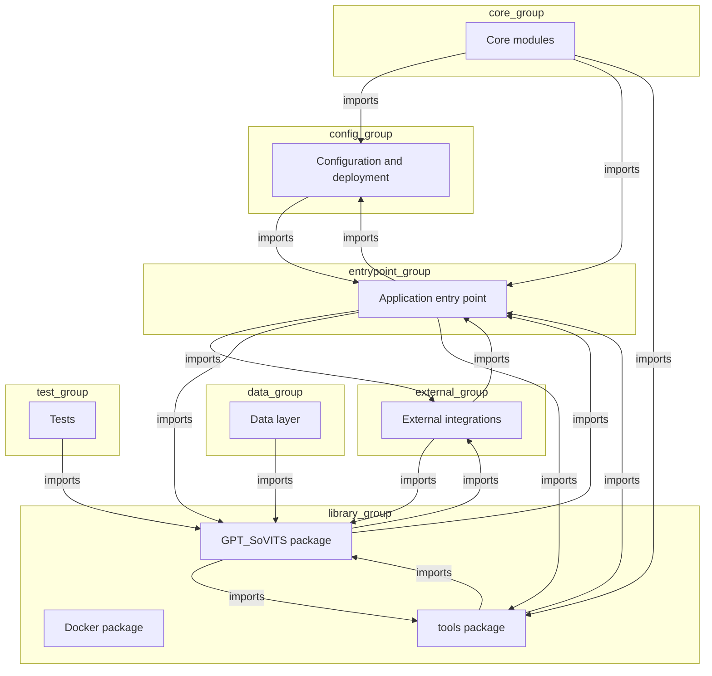

# Architecture report: RVC-Boss/GPT-SoVITS

> Automated static analysis. **Observed** = directly seen in files/imports/AST; **Inferred** = interpretation from that evidence. Repository code was not executed.

## 1. Repository at a glance

| Item | Value |
| --- | --- |
| Repository | RVC-Boss/GPT-SoVITS |
| Description | 1 min voice data can also be used to train a good TTS model! (few shot voice cloning) |
| Language | Python |
| Stars | 65051 |
| Licence | MIT |
| Analysed commit / branch | 6d51ffceafbf240145619af4c92408a6e54b7924 / main |
| Framework(s) | FastAPI, Starlette, Typer |
| Files analysed | 274 |
| Components | 9 |

## 2. Architecture in one minute

RVC-Boss/GPT-SoVITS - 1 min voice data can also be used to train a good TTS model! (few shot voice cloning). This repository was analysed statically from 274 file(s) (186 Python). Detected technologies (observed from imports/manifests): GitHub Actions, FastAPI, Starlette, Typer, NumPy, pandas. Files are grouped into 9 component(s): Configuration and deployment, Core modules, Data layer, Docker package, Application entry point, External integrations, GPT_SoVITS package, Tests. Observed entry point(s): GPT_SoVITS/AR/data/dataset.py, GPT_SoVITS/AR/modules/lr_schedulers.py, GPT_SoVITS/AR/modules/scaling.py. Findings below distinguish observed facts from inferred interpretation.

## 3. High-level block diagram

## 4. Main components

### Configuration and deployment (`config`)

- **Kind:** config
- **Status:** Observed
- **Confidence:** 0.85
- **Responsibility:** Groups 36 file(s) under configuration and deployment (observed from repository paths and static analysis). Observed top-level classes: Config. Observed top-level functions: change_choices, custom_sort_key, get_device_dtype_sm, get_models, get_weights_names.
- **Paths:** `Dockerfile`, `GPT_SoVITS/configs/s1.yaml`, `GPT_SoVITS/configs/s1big.yaml`, `GPT_SoVITS/configs/s1big2.yaml`, `GPT_SoVITS/configs/s1longer-v2.yaml`, `GPT_SoVITS/configs/s1longer.yaml`, `GPT_SoVITS/configs/s1mq.yaml`, `GPT_SoVITS/configs/s2.json`, `GPT_SoVITS/configs/s2v2Pro.json`, `GPT_SoVITS/configs/s2v2ProPlus.json`, `GPT_SoVITS/configs/train.yaml`, `GPT_SoVITS/configs/tts_infer.yaml`, `config.py`, `docker-compose.yaml`, `requirements-py312-win-flash_attention/requirements_py312_win_cu118_china.txt`, `requirements-py312-win-flash_attention/requirements_py312_win_cu118_overseas.txt`, `requirements-py312-win-flash_attention/requirements_py312_win_cu128_china.txt`, `requirements-py312-win-flash_attention/requirements_py312_win_cu128_overseas.txt`, `requirements.txt`, `tools/AP_BWE_main/24kto48k/config.json`, `tools/asr/config.py`, `tools/i18n/locale/en_US.json`, `tools/i18n/locale/es_ES.json`, `tools/i18n/locale/fr_FR.json`, `tools/i18n/locale/it_IT.json`, `tools/i18n/locale/ja_JP.json`, `tools/i18n/locale/ko_KR.json`, `tools/i18n/locale/pt_BR.json`, `tools/i18n/locale/ru_RU.json`, `tools/i18n/locale/tr_TR.json`, `tools/i18n/locale/zh_CN.json`, `tools/i18n/locale/zh_HK.json`, `tools/i18n/locale/zh_SG.json`, `tools/i18n/locale/zh_TW.json`, `tools/uvr5/lib/lib_v5/modelparams/4band_v2.json`, `tools/uvr5/lib/lib_v5/modelparams/4band_v3.json`
- **Evidence:** [Dockerfile](https://github.com/RVC-Boss/GPT-SoVITS/blob/6d51ffceafbf240145619af4c92408a6e54b7924/Dockerfile); [GPT_SoVITS/configs/s1.yaml](https://github.com/RVC-Boss/GPT-SoVITS/blob/6d51ffceafbf240145619af4c92408a6e54b7924/GPT_SoVITS/configs/s1.yaml); [GPT_SoVITS/configs/s1big.yaml](https://github.com/RVC-Boss/GPT-SoVITS/blob/6d51ffceafbf240145619af4c92408a6e54b7924/GPT_SoVITS/configs/s1big.yaml); [GPT_SoVITS/configs/s1big2.yaml](https://github.com/RVC-Boss/GPT-SoVITS/blob/6d51ffceafbf240145619af4c92408a6e54b7924/GPT_SoVITS/configs/s1big2.yaml); [GPT_SoVITS/configs/s1longer-v2.yaml](https://github.com/RVC-Boss/GPT-SoVITS/blob/6d51ffceafbf240145619af4c92408a6e54b7924/GPT_SoVITS/configs/s1longer-v2.yaml); [GPT_SoVITS/configs/s1longer.yaml](https://github.com/RVC-Boss/GPT-SoVITS/blob/6d51ffceafbf240145619af4c92408a6e54b7924/GPT_SoVITS/configs/s1longer.yaml); [GPT_SoVITS/configs/s1mq.yaml](https://github.com/RVC-Boss/GPT-SoVITS/blob/6d51ffceafbf240145619af4c92408a6e54b7924/GPT_SoVITS/configs/s1mq.yaml); [GPT_SoVITS/configs/s2.json](https://github.com/RVC-Boss/GPT-SoVITS/blob/6d51ffceafbf240145619af4c92408a6e54b7924/GPT_SoVITS/configs/s2.json)

### Core modules (`core`)

- **Kind:** core
- **Status:** Observed
- **Confidence:** 0.85
- **Responsibility:** Groups 3 file(s) under core modules (observed from repository paths and static analysis). Observed top-level functions: change_label, change_tts_inference, change_uvr5, check_pretrained_is_exist, close1Ba, close1Bb.
- **Paths:** `docker_build.sh`, `install.sh`, `webui.py`
- **Evidence:** [docker_build.sh](https://github.com/RVC-Boss/GPT-SoVITS/blob/6d51ffceafbf240145619af4c92408a6e54b7924/docker_build.sh); [install.sh](https://github.com/RVC-Boss/GPT-SoVITS/blob/6d51ffceafbf240145619af4c92408a6e54b7924/install.sh); [webui.py:104](https://github.com/RVC-Boss/GPT-SoVITS/blob/6d51ffceafbf240145619af4c92408a6e54b7924/webui.py#L104)

### Data layer (`data_layer`)

- **Kind:** data
- **Status:** Observed
- **Confidence:** 0.85
- **Responsibility:** Groups 17 file(s) under data layer (observed from repository paths and static analysis). Observed top-level classes: APNet_BWE_Model, Bert, BertEmbeddings, CFM, CodePredictor, ConvNeXtBlock. Observed top-level functions: anti_wrapping_function, cal_lsd, cal_snr, discriminator_loss, dpo_loss, feature_loss.
- **Paths:** `GPT_SoVITS/AR/data/__init__.py`, `GPT_SoVITS/AR/data/bucket_sampler.py`, `GPT_SoVITS/AR/data/data_module.py`, `GPT_SoVITS/AR/models/__init__.py`, `GPT_SoVITS/AR/models/embedding_cudagraph.py`, `GPT_SoVITS/AR/models/structs_cudagraph.py`, `GPT_SoVITS/AR/models/t2s_lightning_module.py`, `GPT_SoVITS/AR/models/t2s_lightning_module_onnx.py`, `GPT_SoVITS/AR/models/t2s_model.py`, `GPT_SoVITS/AR/models/t2s_model_cudagraph.py`, `GPT_SoVITS/AR/models/t2s_model_onnx.py`, `GPT_SoVITS/AR/models/utils.py`, `GPT_SoVITS/Accel/MLX/G2PW/model.py`, `GPT_SoVITS/Accel/PyTorch/G2PW/model.py`, `GPT_SoVITS/module/models.py`, `tools/AP_BWE_main/models/__init__.py`, `tools/AP_BWE_main/models/model.py`
- **Evidence:** [GPT_SoVITS/AR/data/__init__.py](https://github.com/RVC-Boss/GPT-SoVITS/blob/6d51ffceafbf240145619af4c92408a6e54b7924/GPT_SoVITS/AR/data/__init__.py); [GPT_SoVITS/AR/data/bucket_sampler.py:20](https://github.com/RVC-Boss/GPT-SoVITS/blob/6d51ffceafbf240145619af4c92408a6e54b7924/GPT_SoVITS/AR/data/bucket_sampler.py#L20); [GPT_SoVITS/AR/data/data_module.py:10](https://github.com/RVC-Boss/GPT-SoVITS/blob/6d51ffceafbf240145619af4c92408a6e54b7924/GPT_SoVITS/AR/data/data_module.py#L10); [GPT_SoVITS/AR/models/__init__.py](https://github.com/RVC-Boss/GPT-SoVITS/blob/6d51ffceafbf240145619af4c92408a6e54b7924/GPT_SoVITS/AR/models/__init__.py); [GPT_SoVITS/AR/models/embedding_cudagraph.py](https://github.com/RVC-Boss/GPT-SoVITS/blob/6d51ffceafbf240145619af4c92408a6e54b7924/GPT_SoVITS/AR/models/embedding_cudagraph.py); [GPT_SoVITS/AR/models/structs_cudagraph.py](https://github.com/RVC-Boss/GPT-SoVITS/blob/6d51ffceafbf240145619af4c92408a6e54b7924/GPT_SoVITS/AR/models/structs_cudagraph.py); [GPT_SoVITS/AR/models/t2s_lightning_module.py:18](https://github.com/RVC-Boss/GPT-SoVITS/blob/6d51ffceafbf240145619af4c92408a6e54b7924/GPT_SoVITS/AR/models/t2s_lightning_module.py#L18); [GPT_SoVITS/AR/models/t2s_lightning_module_onnx.py:18](https://github.com/RVC-Boss/GPT-SoVITS/blob/6d51ffceafbf240145619af4c92408a6e54b7924/GPT_SoVITS/AR/models/t2s_lightning_module_onnx.py#L18)

### Docker package (`docker`)

- **Kind:** library
- **Status:** Observed
- **Confidence:** 0.85
- **Responsibility:** Groups 2 file(s) under docker package (observed from repository paths and static analysis).
- **Paths:** `Docker/install_wrapper.sh`, `Docker/miniforge_install.sh`
- **Evidence:** [Docker/install_wrapper.sh](https://github.com/RVC-Boss/GPT-SoVITS/blob/6d51ffceafbf240145619af4c92408a6e54b7924/Docker/install_wrapper.sh); [Docker/miniforge_install.sh](https://github.com/RVC-Boss/GPT-SoVITS/blob/6d51ffceafbf240145619af4c92408a6e54b7924/Docker/miniforge_install.sh)

### Application entry point (`entrypoint`)

- **Kind:** entrypoint
- **Status:** Observed
- **Confidence:** 0.85
- **Responsibility:** Groups 42 file(s) under application entry point (observed from repository paths and static analysis). Observed application object created via FastAPI, Typer. Observed routes: POST /set_model, GET /set_model, POST /control, GET /control, POST /change_refer. Observed top-level classes: ActivationBalancer, ActivationBalancerFunction, AttentionONNX, CNHubert, DefaultRefer, DictToAttrRecursive. Observed top-level functions: BalancedDoubleSwish, _await_shielded, _compute_scale_factor, _compute_sign_factor, _convert_ordinal, _expand_decimal_number.
- **Paths:** `GPT_SoVITS/AR/data/dataset.py`, `GPT_SoVITS/AR/modules/lr_schedulers.py`, `GPT_SoVITS/AR/modules/scaling.py`, `GPT_SoVITS/AR/text_processing/phonemizer.py`, `GPT_SoVITS/Accel/PyTorch/AR/export.py`, `GPT_SoVITS/Accel/logger.py`, `GPT_SoVITS/TTS_infer_pack/text_segmentation_method.py`, `GPT_SoVITS/export_torch_script.py`, `GPT_SoVITS/feature_extractor/cnhubert.py`, `GPT_SoVITS/inference_cli.py`, `GPT_SoVITS/inference_gui.py`, `GPT_SoVITS/inference_webui.py`, `GPT_SoVITS/inference_webui_fast.py`, `GPT_SoVITS/module/mrte_model.py`, `GPT_SoVITS/onnx_export.py`, `GPT_SoVITS/s1_train.py`, `GPT_SoVITS/s2_train.py`, `GPT_SoVITS/s2_train_v3.py`, `GPT_SoVITS/s2_train_v3_lora.py`, `GPT_SoVITS/stream_v2pro.py`, `GPT_SoVITS/text/LangSegmenter/langsegmenter.py`, `GPT_SoVITS/text/cantonese.py`, `GPT_SoVITS/text/chinese.py`, `GPT_SoVITS/text/chinese2.py`, `GPT_SoVITS/text/cleaner.py`, `GPT_SoVITS/text/en_normalization/expend.py`, `GPT_SoVITS/text/english.py`, `GPT_SoVITS/text/japanese.py`, `GPT_SoVITS/text/korean.py`, `GPT_SoVITS/text/symbols.py`, `GPT_SoVITS/text/symbols2.py`, `GPT_SoVITS/text/zh_normalization/char_convert.py`, `GPT_SoVITS/utils.py`, `api.py`, `api_v2.py`, `tools/asr/fasterwhisper_asr.py`, `tools/asr/funasr_asr.py`, `tools/cmd-denoise.py`, `tools/i18n/i18n.py`, `tools/i18n/scan_i18n.py`, `tools/slicer2.py`, `tools/subfix_webui.py`
- **Evidence:** [GPT_SoVITS/AR/data/dataset.py:21](https://github.com/RVC-Boss/GPT-SoVITS/blob/6d51ffceafbf240145619af4c92408a6e54b7924/GPT_SoVITS/AR/data/dataset.py#L21); [GPT_SoVITS/AR/modules/lr_schedulers.py:11](https://github.com/RVC-Boss/GPT-SoVITS/blob/6d51ffceafbf240145619af4c92408a6e54b7924/GPT_SoVITS/AR/modules/lr_schedulers.py#L11); [GPT_SoVITS/AR/modules/scaling.py:25](https://github.com/RVC-Boss/GPT-SoVITS/blob/6d51ffceafbf240145619af4c92408a6e54b7924/GPT_SoVITS/AR/modules/scaling.py#L25); [GPT_SoVITS/AR/text_processing/phonemizer.py:15](https://github.com/RVC-Boss/GPT-SoVITS/blob/6d51ffceafbf240145619af4c92408a6e54b7924/GPT_SoVITS/AR/text_processing/phonemizer.py#L15); [GPT_SoVITS/Accel/PyTorch/AR/export.py:23](https://github.com/RVC-Boss/GPT-SoVITS/blob/6d51ffceafbf240145619af4c92408a6e54b7924/GPT_SoVITS/Accel/PyTorch/AR/export.py#L23); [GPT_SoVITS/Accel/logger.py:22](https://github.com/RVC-Boss/GPT-SoVITS/blob/6d51ffceafbf240145619af4c92408a6e54b7924/GPT_SoVITS/Accel/logger.py#L22); [GPT_SoVITS/TTS_infer_pack/text_segmentation_method.py:8](https://github.com/RVC-Boss/GPT-SoVITS/blob/6d51ffceafbf240145619af4c92408a6e54b7924/GPT_SoVITS/TTS_infer_pack/text_segmentation_method.py#L8); [GPT_SoVITS/export_torch_script.py:42](https://github.com/RVC-Boss/GPT-SoVITS/blob/6d51ffceafbf240145619af4c92408a6e54b7924/GPT_SoVITS/export_torch_script.py#L42)

### External integrations (`external_integrations`)

- **Kind:** external
- **Status:** Observed
- **Confidence:** 0.85
- **Responsibility:** Groups 1 file(s) under external integrations (observed from repository paths and static analysis). Observed top-level classes: G2PWOnnxConverter, _G2PWBaseOnnxConverter. Observed top-level functions: _find_first_existing_file, _load_json_from_candidates, download_and_decompress, predict.
- **Paths:** `GPT_SoVITS/text/g2pw/onnx_api.py`
- **Evidence:** [GPT_SoVITS/text/g2pw/onnx_api.py:31](https://github.com/RVC-Boss/GPT-SoVITS/blob/6d51ffceafbf240145619af4c92408a6e54b7924/GPT_SoVITS/text/g2pw/onnx_api.py#L31)

### GPT_SoVITS package (`gpt_sovits`)

- **Kind:** library
- **Status:** Observed
- **Confidence:** 0.85
- **Responsibility:** Groups 97 file(s) under gpt_sovits package (observed from repository paths and static analysis). Observed top-level classes: AFF, AMPBlock1, AMPBlock2, ASTP, AccelInference, ActNorm. Observed top-level functions: _check_number_of_params, _feature_window_function, _get, _get_clones, _get_epsilon, _get_log_energy.
- **Paths:** `GPT_SoVITS/AR/__init__.py`, `GPT_SoVITS/AR/modules/__init__.py`, `GPT_SoVITS/AR/modules/activation.py`, `GPT_SoVITS/AR/modules/activation_onnx.py`, `GPT_SoVITS/AR/modules/embedding.py`, `GPT_SoVITS/AR/modules/embedding_onnx.py`, `GPT_SoVITS/AR/modules/optim.py`, `GPT_SoVITS/AR/modules/patched_mha_with_cache.py`, `GPT_SoVITS/AR/modules/patched_mha_with_cache_onnx.py`, `GPT_SoVITS/AR/modules/transformer.py`, `GPT_SoVITS/AR/modules/transformer_onnx.py`, `GPT_SoVITS/AR/text_processing/__init__.py`, `GPT_SoVITS/AR/text_processing/symbols.py`, `GPT_SoVITS/AR/utils/__init__.py`, `GPT_SoVITS/AR/utils/initialize.py`, `GPT_SoVITS/AR/utils/io.py`, `GPT_SoVITS/Accel/MLX/AR/backends/mlx_static.py`, `GPT_SoVITS/Accel/MLX/AR/backends/mlx_varlen.py`, `GPT_SoVITS/Accel/MLX/AR/runner_mlx.py`, `GPT_SoVITS/Accel/MLX/AR/sample_funcs_mlx.py`, `GPT_SoVITS/Accel/MLX/AR/structs_mlx.py`, `GPT_SoVITS/Accel/MLX/AR/t2s_engine_mlx.py`, `GPT_SoVITS/Accel/MLX/AR/t2s_model_abc_mlx.py`, `GPT_SoVITS/Accel/MLX/__init__.py`, `GPT_SoVITS/Accel/PyTorch/AR/backends/flash_attn_varlen_cuda_graph.py`, `GPT_SoVITS/Accel/PyTorch/AR/backends/torch_static_cuda_graph.py`, `GPT_SoVITS/Accel/PyTorch/AR/backends/torch_varlen.py`, `GPT_SoVITS/Accel/PyTorch/AR/quantization.py`, `GPT_SoVITS/Accel/PyTorch/AR/runner.py`, `GPT_SoVITS/Accel/PyTorch/AR/sample_funcs.py`, `GPT_SoVITS/Accel/PyTorch/AR/structs.py`, `GPT_SoVITS/Accel/PyTorch/AR/t2s_engine.py`, `GPT_SoVITS/Accel/PyTorch/AR/t2s_model_abc.py`, `GPT_SoVITS/Accel/PyTorch/__init__.py`, `GPT_SoVITS/Accel/PyTorch/nn.py`, `GPT_SoVITS/Accel/__init__.py`, `GPT_SoVITS/Accel/adapter.py`, `GPT_SoVITS/Accel/runtime.py`, `GPT_SoVITS/BigVGAN/activations.py`, `GPT_SoVITS/BigVGAN/alias_free_activation/torch/__init__.py`, `GPT_SoVITS/BigVGAN/alias_free_activation/torch/act.py`, `GPT_SoVITS/BigVGAN/alias_free_activation/torch/filter.py`, `GPT_SoVITS/BigVGAN/alias_free_activation/torch/resample.py`, `GPT_SoVITS/BigVGAN/bigvgan.py`, `GPT_SoVITS/BigVGAN/env.py`, `GPT_SoVITS/BigVGAN/utils0.py`, `GPT_SoVITS/TTS_infer_pack/TTS.py`, `GPT_SoVITS/TTS_infer_pack/TextPreprocessor.py`, `GPT_SoVITS/TTS_infer_pack/__init__.py`, `GPT_SoVITS/TTS_infer_pack/streaming.py`, `GPT_SoVITS/download.py`, `GPT_SoVITS/eres2net/ERes2NetV2.py`, `GPT_SoVITS/eres2net/fusion.py`, `GPT_SoVITS/eres2net/kaldi.py`, `GPT_SoVITS/eres2net/pooling_layers.py`, `GPT_SoVITS/export_torch_script_v3v4.py`, `GPT_SoVITS/f5_tts/model/__init__.py`, `GPT_SoVITS/f5_tts/model/backbones/dit.py`, `GPT_SoVITS/f5_tts/model/modules.py`, `GPT_SoVITS/feature_extractor/__init__.py`, `GPT_SoVITS/feature_extractor/whisper_enc.py`, `GPT_SoVITS/module/__init__.py`, `GPT_SoVITS/module/attentions.py`, `GPT_SoVITS/module/attentions_onnx.py`, `GPT_SoVITS/module/cache_dit.py`, `GPT_SoVITS/module/commons.py`, `GPT_SoVITS/module/core_vq.py`, `GPT_SoVITS/module/data_utils.py`, `GPT_SoVITS/module/ddp_utils.py`, `GPT_SoVITS/module/distrib.py`, `GPT_SoVITS/module/losses.py`, `GPT_SoVITS/module/mel_processing.py`, `GPT_SoVITS/module/models_onnx.py`, `GPT_SoVITS/module/models_v5.py`, `GPT_SoVITS/module/modules.py`, `GPT_SoVITS/module/quantize.py`, `GPT_SoVITS/module/transforms.py`, `GPT_SoVITS/prepare_datasets/1-get-text.py`, `GPT_SoVITS/prepare_datasets/2-get-hubert-wav32k.py`, `GPT_SoVITS/prepare_datasets/2-get-sv.py`, `GPT_SoVITS/prepare_datasets/3-get-semantic.py`, `GPT_SoVITS/process_ckpt.py`, `GPT_SoVITS/sv.py`, `GPT_SoVITS/text/LangSegmenter/__init__.py`, `GPT_SoVITS/text/__init__.py`, `GPT_SoVITS/text/g2pw/__init__.py`, `GPT_SoVITS/text/g2pw/dataset.py`, `GPT_SoVITS/text/g2pw/g2pw.py`, `GPT_SoVITS/text/g2pw/utils.py`, `GPT_SoVITS/text/tone_sandhi.py`, `GPT_SoVITS/text/zh_normalization/__init__.py`, `GPT_SoVITS/text/zh_normalization/chronology.py`, `GPT_SoVITS/text/zh_normalization/constants.py`, `GPT_SoVITS/text/zh_normalization/num.py`, `GPT_SoVITS/text/zh_normalization/phonecode.py`, `GPT_SoVITS/text/zh_normalization/quantifier.py`, `GPT_SoVITS/text/zh_normalization/text_normlization.py`
- **Evidence:** [GPT_SoVITS/AR/__init__.py](https://github.com/RVC-Boss/GPT-SoVITS/blob/6d51ffceafbf240145619af4c92408a6e54b7924/GPT_SoVITS/AR/__init__.py); [GPT_SoVITS/AR/modules/__init__.py](https://github.com/RVC-Boss/GPT-SoVITS/blob/6d51ffceafbf240145619af4c92408a6e54b7924/GPT_SoVITS/AR/modules/__init__.py); [GPT_SoVITS/AR/modules/activation.py:17](https://github.com/RVC-Boss/GPT-SoVITS/blob/6d51ffceafbf240145619af4c92408a6e54b7924/GPT_SoVITS/AR/modules/activation.py#L17); [GPT_SoVITS/AR/modules/activation_onnx.py:14](https://github.com/RVC-Boss/GPT-SoVITS/blob/6d51ffceafbf240145619af4c92408a6e54b7924/GPT_SoVITS/AR/modules/activation_onnx.py#L14); [GPT_SoVITS/AR/modules/embedding.py:8](https://github.com/RVC-Boss/GPT-SoVITS/blob/6d51ffceafbf240145619af4c92408a6e54b7924/GPT_SoVITS/AR/modules/embedding.py#L8); [GPT_SoVITS/AR/modules/embedding_onnx.py:8](https://github.com/RVC-Boss/GPT-SoVITS/blob/6d51ffceafbf240145619af4c92408a6e54b7924/GPT_SoVITS/AR/modules/embedding_onnx.py#L8); [GPT_SoVITS/AR/modules/optim.py:26](https://github.com/RVC-Boss/GPT-SoVITS/blob/6d51ffceafbf240145619af4c92408a6e54b7924/GPT_SoVITS/AR/modules/optim.py#L26); [GPT_SoVITS/AR/modules/patched_mha_with_cache.py:13](https://github.com/RVC-Boss/GPT-SoVITS/blob/6d51ffceafbf240145619af4c92408a6e54b7924/GPT_SoVITS/AR/modules/patched_mha_with_cache.py#L13)

### Tests (`tests`)

- **Kind:** test
- **Status:** Observed
- **Confidence:** 0.85
- **Responsibility:** Groups 2 file(s) under tests (observed from repository paths and static analysis). Observed top-level classes: APIV2StreamingTests, AcousticRNGTests, AcousticTests, AdapterTests, CancelTests, CancellationTests. Observed top-level functions: _load_api_module, _module.
- **Paths:** `test_api_v2_streaming.py`, `test_official_streaming.py`
- **Evidence:** [test_api_v2_streaming.py:16](https://github.com/RVC-Boss/GPT-SoVITS/blob/6d51ffceafbf240145619af4c92408a6e54b7924/test_api_v2_streaming.py#L16); [test_official_streaming.py:33](https://github.com/RVC-Boss/GPT-SoVITS/blob/6d51ffceafbf240145619af4c92408a6e54b7924/test_official_streaming.py#L33)

### tools package (`tools`)

- **Kind:** library
- **Status:** Observed
- **Confidence:** 0.85
- **Responsibility:** Groups 24 file(s) under tools package (observed from repository paths and static analysis). Observed top-level classes: AP_BWE, ASPPModule, Attend, Attention, AudioPre, AudioPreDeEcho. Observed top-level functions: MLP, _cuda_available, _flash_attention_module, _lazy_apply_rotary_emb, _prepare_dlls, activate.
- **Paths:** `tools/AP_BWE_main/datasets1/__init__.py`, `tools/AP_BWE_main/datasets1/dataset.py`, `tools/__init__.py`, `tools/acceleration.py`, `tools/assets.py`, `tools/audio_sr.py`, `tools/my_utils.py`, `tools/portable_runtime.py`, `tools/slice_audio.py`, `tools/uvr5/bs_roformer/__init__.py`, `tools/uvr5/bs_roformer/attend.py`, `tools/uvr5/bs_roformer/bs_roformer.py`, `tools/uvr5/bs_roformer/mel_band_roformer.py`, `tools/uvr5/bsroformer.py`, `tools/uvr5/lib/lib_v5/layers_123821KB.py`, `tools/uvr5/lib/lib_v5/layers_new.py`, `tools/uvr5/lib/lib_v5/model_param_init.py`, `tools/uvr5/lib/lib_v5/nets_61968KB.py`, `tools/uvr5/lib/lib_v5/nets_new.py`, `tools/uvr5/lib/lib_v5/spec_utils.py`, `tools/uvr5/lib/utils.py`, `tools/uvr5/mdxnet.py`, `tools/uvr5/vr.py`, `tools/uvr5/webui.py`
- **Evidence:** [tools/AP_BWE_main/datasets1/__init__.py](https://github.com/RVC-Boss/GPT-SoVITS/blob/6d51ffceafbf240145619af4c92408a6e54b7924/tools/AP_BWE_main/datasets1/__init__.py); [tools/AP_BWE_main/datasets1/dataset.py:9](https://github.com/RVC-Boss/GPT-SoVITS/blob/6d51ffceafbf240145619af4c92408a6e54b7924/tools/AP_BWE_main/datasets1/dataset.py#L9); [tools/__init__.py](https://github.com/RVC-Boss/GPT-SoVITS/blob/6d51ffceafbf240145619af4c92408a6e54b7924/tools/__init__.py); [tools/acceleration.py:17](https://github.com/RVC-Boss/GPT-SoVITS/blob/6d51ffceafbf240145619af4c92408a6e54b7924/tools/acceleration.py#L17); [tools/assets.py](https://github.com/RVC-Boss/GPT-SoVITS/blob/6d51ffceafbf240145619af4c92408a6e54b7924/tools/assets.py); [tools/audio_sr.py:16](https://github.com/RVC-Boss/GPT-SoVITS/blob/6d51ffceafbf240145619af4c92408a6e54b7924/tools/audio_sr.py#L16); [tools/my_utils.py:16](https://github.com/RVC-Boss/GPT-SoVITS/blob/6d51ffceafbf240145619af4c92408a6e54b7924/tools/my_utils.py#L16); [tools/portable_runtime.py:26](https://github.com/RVC-Boss/GPT-SoVITS/blob/6d51ffceafbf240145619af4c92408a6e54b7924/tools/portable_runtime.py#L26)

## 5. Execution flow

**Observed** entry point(s):

- [GPT_SoVITS/AR/data/dataset.py:300](https://github.com/RVC-Boss/GPT-SoVITS/blob/6d51ffceafbf240145619af4c92408a6e54b7924/GPT_SoVITS/AR/data/dataset.py#L300)
- [GPT_SoVITS/AR/modules/lr_schedulers.py:65](https://github.com/RVC-Boss/GPT-SoVITS/blob/6d51ffceafbf240145619af4c92408a6e54b7924/GPT_SoVITS/AR/modules/lr_schedulers.py#L65)
- [GPT_SoVITS/AR/modules/scaling.py:62](https://github.com/RVC-Boss/GPT-SoVITS/blob/6d51ffceafbf240145619af4c92408a6e54b7924/GPT_SoVITS/AR/modules/scaling.py#L62)
- [GPT_SoVITS/AR/text_processing/phonemizer.py:64](https://github.com/RVC-Boss/GPT-SoVITS/blob/6d51ffceafbf240145619af4c92408a6e54b7924/GPT_SoVITS/AR/text_processing/phonemizer.py#L64)
- [GPT_SoVITS/Accel/PyTorch/AR/export.py:23](https://github.com/RVC-Boss/GPT-SoVITS/blob/6d51ffceafbf240145619af4c92408a6e54b7924/GPT_SoVITS/Accel/PyTorch/AR/export.py#L23)
- [GPT_SoVITS/Accel/logger.py:269](https://github.com/RVC-Boss/GPT-SoVITS/blob/6d51ffceafbf240145619af4c92408a6e54b7924/GPT_SoVITS/Accel/logger.py#L269)
- [GPT_SoVITS/TTS_infer_pack/text_segmentation_method.py:187](https://github.com/RVC-Boss/GPT-SoVITS/blob/6d51ffceafbf240145619af4c92408a6e54b7924/GPT_SoVITS/TTS_infer_pack/text_segmentation_method.py#L187)
- [GPT_SoVITS/export_torch_script.py:1078](https://github.com/RVC-Boss/GPT-SoVITS/blob/6d51ffceafbf240145619af4c92408a6e54b7924/GPT_SoVITS/export_torch_script.py#L1078)
- [GPT_SoVITS/feature_extractor/cnhubert.py:103](https://github.com/RVC-Boss/GPT-SoVITS/blob/6d51ffceafbf240145619af4c92408a6e54b7924/GPT_SoVITS/feature_extractor/cnhubert.py#L103)
- [GPT_SoVITS/inference_cli.py:102](https://github.com/RVC-Boss/GPT-SoVITS/blob/6d51ffceafbf240145619af4c92408a6e54b7924/GPT_SoVITS/inference_cli.py#L102)
- [GPT_SoVITS/inference_gui.py:312](https://github.com/RVC-Boss/GPT-SoVITS/blob/6d51ffceafbf240145619af4c92408a6e54b7924/GPT_SoVITS/inference_gui.py#L312)
- [GPT_SoVITS/inference_webui.py:1558](https://github.com/RVC-Boss/GPT-SoVITS/blob/6d51ffceafbf240145619af4c92408a6e54b7924/GPT_SoVITS/inference_webui.py#L1558)

**Observed** routes (from decorators):

- `POST /set_model` -> `set_model` in `api.py:1361`
- `GET /set_model` -> `set_model` in `api.py:1369`
- `POST /control` -> `control` in `api.py:1377`
- `GET /control` -> `control` in `api.py:1383`
- `POST /change_refer` -> `change_refer` in `api.py:1388`
- `GET /change_refer` -> `change_refer` in `api.py:1396`
- `POST /` -> `tts_endpoint` in `api.py:1401`
- `GET /` -> `tts_endpoint` in `api.py:1427`
- `GET /control` -> `control` in `api_v2.py:597`
- `GET /tts` -> `tts_get_endpoint` in `api_v2.py:604`
- `POST /tts` -> `tts_post_endpoint` in `api_v2.py:692`
- `GET /set_refer_audio` -> `set_refer_aduio` in `api_v2.py:700`
- `GET /set_gpt_weights` -> `set_gpt_weights` in `api_v2.py:729`
- `GET /set_sovits_weights` -> `set_sovits_weights` in `api_v2.py:742`

Representative flow (derived from observed entry points and the import graph; steps beyond the entry point are **Inferred**):

1. Execution starts at an observed entry point listed above, if present.
2. `config` imports `entrypoint` (Configuration and deployment -> Application entry point).
3. `core` imports `config` (Core modules -> Configuration and deployment).
4. `core` imports `entrypoint` (Core modules -> Application entry point).
5. `core` imports `tools` (Core modules -> tools package).
6. `data_layer` imports `gpt_sovits` (Data layer -> GPT_SoVITS package).
7. `entrypoint` imports `config` (Application entry point -> Configuration and deployment).
8. `entrypoint` imports `external_integrations` (Application entry point -> External integrations).
9. `entrypoint` imports `gpt_sovits` (Application entry point -> GPT_SoVITS package).

## 6. Project structure

### `(root)`

- `.dockerignore` - container (3689 bytes)
- `.gitignore` - other (3677 bytes)
- `.pre-commit-config.yaml` - config (370 bytes)
- `Colab-Inference.ipynb` - other (5060 bytes)
- `Colab-WebUI.ipynb` - other (2764 bytes)
- `Dockerfile` - container (1550 bytes)
- `LICENSE` - docs (1065 bytes)
- `README.md` - docs (22027 bytes)
- `api.py` - source, Python (49407 bytes)
- `api_v2.py` - source, Python (30834 bytes)
- `config.py` - source, Python (8477 bytes)
- `docker-compose.yaml` - container (1885 bytes)
- `docker_build.sh` - source, Shell (1826 bytes)
- `extra-req.txt` - docs (15 bytes)
- `go-webui.bat` - other (168 bytes)
- `go-webui.ps1` - other (236 bytes)
- `install.ps1` - other (8338 bytes)
- `install.sh` - source, Shell (12488 bytes)
- `requirements.txt` - manifest (687 bytes)
- `test_api_v2_streaming.py` - test, Python (20181 bytes)
- `test_official_streaming.py` - test, Python (27313 bytes)
- `webui.py` - source, Python (83021 bytes)

### `.github`

- `.github/build_windows_packages.ps1` - other (7563 bytes)
- `.github/workflows/build_windows_packages.yaml` - ci, YAML (1064 bytes)
- `.github/workflows/docker-publish.yaml` - ci, YAML (8799 bytes)

### `Docker`

- `Docker/install_wrapper.sh` - source, Shell (627 bytes)
- `Docker/miniforge_install.sh` - source, Shell (2333 bytes)

### `GPT_SoVITS`

- `GPT_SoVITS/AR/__init__.py` - source, Python (0 bytes)
- `GPT_SoVITS/AR/data/__init__.py` - source, Python (0 bytes)
- `GPT_SoVITS/AR/data/bucket_sampler.py` - source, Python (5665 bytes)
- `GPT_SoVITS/AR/data/data_module.py` - source, Python (2924 bytes)
- `GPT_SoVITS/AR/data/dataset.py` - source, Python (12547 bytes)
- `GPT_SoVITS/AR/models/__init__.py` - source, Python (0 bytes)
- `GPT_SoVITS/AR/models/embedding_cudagraph.py` - source, Python (164 bytes)
- `GPT_SoVITS/AR/models/structs_cudagraph.py` - source, Python (82 bytes)
- `GPT_SoVITS/AR/models/t2s_lightning_module.py` - source, Python (4874 bytes)
- `GPT_SoVITS/AR/models/t2s_lightning_module_onnx.py` - source, Python (3590 bytes)
- `GPT_SoVITS/AR/models/t2s_model.py` - source, Python (35138 bytes)
- `GPT_SoVITS/AR/models/t2s_model_cudagraph.py` - source, Python (290 bytes)
- `GPT_SoVITS/AR/models/t2s_model_onnx.py` - source, Python (13978 bytes)
- `GPT_SoVITS/AR/models/utils.py` - source, Python (10566 bytes)
- `GPT_SoVITS/AR/modules/__init__.py` - source, Python (0 bytes)
- `GPT_SoVITS/AR/modules/activation.py` - source, Python (19742 bytes)
- `GPT_SoVITS/AR/modules/activation_onnx.py` - source, Python (6535 bytes)
- `GPT_SoVITS/AR/modules/embedding.py` - source, Python (2640 bytes)
- `GPT_SoVITS/AR/modules/embedding_onnx.py` - source, Python (2030 bytes)
- `GPT_SoVITS/AR/modules/lr_schedulers.py` - source, Python (2618 bytes)
- `GPT_SoVITS/AR/modules/optim.py` - source, Python (25611 bytes)
- `GPT_SoVITS/AR/modules/patched_mha_with_cache.py` - source, Python (19167 bytes)
- `GPT_SoVITS/AR/modules/patched_mha_with_cache_onnx.py` - source, Python (2651 bytes)
- `GPT_SoVITS/AR/modules/scaling.py` - source, Python (12566 bytes)
- `GPT_SoVITS/AR/modules/transformer.py` - source, Python (12395 bytes)
- `GPT_SoVITS/AR/modules/transformer_onnx.py` - source, Python (9441 bytes)
- `GPT_SoVITS/AR/text_processing/__init__.py` - source, Python (0 bytes)
- `GPT_SoVITS/AR/text_processing/phonemizer.py` - source, Python (2581 bytes)
- `GPT_SoVITS/AR/text_processing/symbols.py` - source, Python (740 bytes)
- `GPT_SoVITS/AR/utils/__init__.py` - source, Python (1133 bytes)
- `GPT_SoVITS/AR/utils/initialize.py` - source, Python (1321 bytes)
- `GPT_SoVITS/AR/utils/io.py` - source, Python (893 bytes)
- `GPT_SoVITS/Accel/MLX/AR/backends/mlx_static.py` - source, Python (4038 bytes)
- `GPT_SoVITS/Accel/MLX/AR/backends/mlx_varlen.py` - source, Python (2722 bytes)
- `GPT_SoVITS/Accel/MLX/AR/runner_mlx.py` - source, Python (13138 bytes)
- `GPT_SoVITS/Accel/MLX/AR/sample_funcs_mlx.py` - source, Python (4146 bytes)
- `GPT_SoVITS/Accel/MLX/AR/structs_mlx.py` - source, Python (5623 bytes)
- `GPT_SoVITS/Accel/MLX/AR/t2s_engine_mlx.py` - source, Python (13887 bytes)
- `GPT_SoVITS/Accel/MLX/AR/t2s_model_abc_mlx.py` - source, Python (14374 bytes)
- `GPT_SoVITS/Accel/MLX/G2PW/model.py` - source, Python (8651 bytes)
- `GPT_SoVITS/Accel/MLX/__init__.py` - source, Python (539 bytes)
- `GPT_SoVITS/Accel/PyTorch/AR/backends/flash_attn_varlen_cuda_graph.py` - source, Python (3560 bytes)
- `GPT_SoVITS/Accel/PyTorch/AR/backends/torch_static_cuda_graph.py` - source, Python (3810 bytes)
- `GPT_SoVITS/Accel/PyTorch/AR/backends/torch_varlen.py` - source, Python (4874 bytes)
- `GPT_SoVITS/Accel/PyTorch/AR/export.py` - source, Python (15903 bytes)
- `GPT_SoVITS/Accel/PyTorch/AR/quantization.py` - source, Python (5148 bytes)
- `GPT_SoVITS/Accel/PyTorch/AR/runner.py` - source, Python (17734 bytes)
- `GPT_SoVITS/Accel/PyTorch/AR/sample_funcs.py` - source, Python (4263 bytes)
- `GPT_SoVITS/Accel/PyTorch/AR/structs.py` - source, Python (6690 bytes)
- `GPT_SoVITS/Accel/PyTorch/AR/t2s_engine.py` - source, Python (14344 bytes)
- `GPT_SoVITS/Accel/PyTorch/AR/t2s_model_abc.py` - source, Python (20814 bytes)
- `GPT_SoVITS/Accel/PyTorch/G2PW/model.py` - source, Python (8172 bytes)
- `GPT_SoVITS/Accel/PyTorch/__init__.py` - source, Python (2417 bytes)
- `GPT_SoVITS/Accel/PyTorch/nn.py` - source, Python (1857 bytes)
- `GPT_SoVITS/Accel/README.md` - docs (6146 bytes)
- `GPT_SoVITS/Accel/__init__.py` - source, Python (920 bytes)
- `GPT_SoVITS/Accel/adapter.py` - source, Python (9958 bytes)
- `GPT_SoVITS/Accel/logger.py` - source, Python (9464 bytes)
- `GPT_SoVITS/Accel/runtime.py` - source, Python (548 bytes)
- `GPT_SoVITS/BigVGAN/LICENSE` - docs (1076 bytes)
- `GPT_SoVITS/BigVGAN/README.md` - docs (17400 bytes)
- `GPT_SoVITS/BigVGAN/activations.py` - source, Python (4513 bytes)
- `GPT_SoVITS/BigVGAN/alias_free_activation/torch/__init__.py` - source, Python (200 bytes)
- `GPT_SoVITS/BigVGAN/alias_free_activation/torch/act.py` - source, Python (825 bytes)
- `GPT_SoVITS/BigVGAN/alias_free_activation/torch/filter.py` - source, Python (3395 bytes)
- `GPT_SoVITS/BigVGAN/alias_free_activation/torch/resample.py` - source, Python (1715 bytes)
- `GPT_SoVITS/BigVGAN/bigvgan.py` - source, Python (14539 bytes)
- `GPT_SoVITS/BigVGAN/env.py` - source, Python (268 bytes)
- `GPT_SoVITS/BigVGAN/incl_licenses/LICENSE_1` - other (1067 bytes)
- `GPT_SoVITS/BigVGAN/incl_licenses/LICENSE_2` - other (1068 bytes)
- `GPT_SoVITS/BigVGAN/incl_licenses/LICENSE_3` - other (11355 bytes)
- `GPT_SoVITS/BigVGAN/incl_licenses/LICENSE_4` - other (1530 bytes)
- `GPT_SoVITS/BigVGAN/incl_licenses/LICENSE_5` - other (1058 bytes)
- `GPT_SoVITS/BigVGAN/incl_licenses/LICENSE_6` - other (1073 bytes)
- `GPT_SoVITS/BigVGAN/incl_licenses/LICENSE_7` - other (1069 bytes)
- `GPT_SoVITS/BigVGAN/incl_licenses/LICENSE_8` - other (1063 bytes)
- `GPT_SoVITS/BigVGAN/utils0.py` - source, Python (376 bytes)
- `GPT_SoVITS/TTS_infer_pack/TTS.py` - source, Python (92976 bytes)
- `GPT_SoVITS/TTS_infer_pack/TextPreprocessor.py` - source, Python (9235 bytes)
- `GPT_SoVITS/TTS_infer_pack/__init__.py` - source, Python (44 bytes)
- `GPT_SoVITS/TTS_infer_pack/streaming.py` - source, Python (15990 bytes)
- `GPT_SoVITS/TTS_infer_pack/text_segmentation_method.py` - source, Python (4899 bytes)
- `GPT_SoVITS/configs/.gitignore` - other (6 bytes)
- `GPT_SoVITS/configs/s1.yaml` - config (521 bytes)
- `GPT_SoVITS/configs/s1big.yaml` - config (529 bytes)
- `GPT_SoVITS/configs/s1big2.yaml` - config (529 bytes)
- `GPT_SoVITS/configs/s1longer-v2.yaml` - config (517 bytes)
- `GPT_SoVITS/configs/s1longer.yaml` - config (516 bytes)
- `GPT_SoVITS/configs/s1mq.yaml` - config (1716 bytes)
- `GPT_SoVITS/configs/s2.json` - config (1581 bytes)
- `GPT_SoVITS/configs/s2v2Pro.json` - config (1582 bytes)
- `GPT_SoVITS/configs/s2v2ProPlus.json` - config (1582 bytes)
- `GPT_SoVITS/configs/train.yaml` - config (558 bytes)
- `GPT_SoVITS/configs/tts_infer.yaml` - config (2497 bytes)
- `GPT_SoVITS/download.py` - source, Python (300 bytes)
- `GPT_SoVITS/eres2net/ERes2NetV2.py` - source, Python (9345 bytes)
- `GPT_SoVITS/eres2net/fusion.py` - source, Python (948 bytes)
- `GPT_SoVITS/eres2net/kaldi.py` - source, Python (24287 bytes)
- `GPT_SoVITS/eres2net/pooling_layers.py` - source, Python (3646 bytes)
- `GPT_SoVITS/export_torch_script.py` - source, Python (39272 bytes)
- `GPT_SoVITS/export_torch_script_v3v4.py` - source, Python (42839 bytes)
- `GPT_SoVITS/f5_tts/model/__init__.py` - source, Python (54 bytes)
- `GPT_SoVITS/f5_tts/model/backbones/README.md` - docs (701 bytes)
- `GPT_SoVITS/f5_tts/model/backbones/dit.py` - source, Python (10848 bytes)
- `GPT_SoVITS/f5_tts/model/modules.py` - source, Python (12007 bytes)
- `GPT_SoVITS/feature_extractor/__init__.py` - source, Python (105 bytes)
- `GPT_SoVITS/feature_extractor/cnhubert.py` - source, Python (3602 bytes)
- `GPT_SoVITS/feature_extractor/whisper_enc.py` - source, Python (688 bytes)
- `GPT_SoVITS/inference_cli.py` - source, Python (3557 bytes)
- `GPT_SoVITS/inference_gui.py` - source, Python (12212 bytes)
- `GPT_SoVITS/inference_webui.py` - source, Python (62015 bytes)
- `GPT_SoVITS/inference_webui_fast.py` - source, Python (25392 bytes)
- `GPT_SoVITS/module/__init__.py` - source, Python (0 bytes)
- `GPT_SoVITS/module/attentions.py` - source, Python (23085 bytes)
- `GPT_SoVITS/module/attentions_onnx.py` - source, Python (14169 bytes)
- `GPT_SoVITS/module/cache_dit.py` - source, Python (17585 bytes)
- `GPT_SoVITS/module/commons.py` - source, Python (5824 bytes)
- `GPT_SoVITS/module/core_vq.py` - source, Python (15116 bytes)
- `GPT_SoVITS/module/data_utils.py` - source, Python (41206 bytes)
- `GPT_SoVITS/module/ddp_utils.py` - source, Python (9033 bytes)
- `GPT_SoVITS/module/distrib.py` - source, Python (4046 bytes)
- `GPT_SoVITS/module/losses.py` - source, Python (1827 bytes)
- `GPT_SoVITS/module/mel_processing.py` - source, Python (4642 bytes)
- `GPT_SoVITS/module/models.py` - source, Python (58260 bytes)
- `GPT_SoVITS/module/models_onnx.py` - source, Python (37794 bytes)
- `GPT_SoVITS/module/models_v5.py` - source, Python (3785 bytes)
- `GPT_SoVITS/module/modules.py` - source, Python (28816 bytes)
- `GPT_SoVITS/module/mrte_model.py` - source, Python (5825 bytes)
- `GPT_SoVITS/module/quantize.py` - source, Python (4456 bytes)
- `GPT_SoVITS/module/transforms.py` - source, Python (7208 bytes)
- `GPT_SoVITS/onnx_export.py` - source, Python (14407 bytes)
- `GPT_SoVITS/prepare_datasets/1-get-text.py` - source, Python (5251 bytes)
- `GPT_SoVITS/prepare_datasets/2-get-hubert-wav32k.py` - source, Python (4270 bytes)
- `GPT_SoVITS/prepare_datasets/2-get-sv.py` - source, Python (3653 bytes)
- `GPT_SoVITS/prepare_datasets/3-get-semantic.py` - source, Python (3893 bytes)
- `GPT_SoVITS/pretrained_models/.gitignore` - other (13 bytes)
- `GPT_SoVITS/process_ckpt.py` - source, Python (4525 bytes)
- `GPT_SoVITS/s1_train.py` - source, Python (7297 bytes)
- `GPT_SoVITS/s2_train.py` - source, Python (24290 bytes)
- `GPT_SoVITS/s2_train_v3.py` - source, Python (16423 bytes)
- `GPT_SoVITS/s2_train_v3_lora.py` - source, Python (13000 bytes)
- `GPT_SoVITS/stream_v2pro.py` - source, Python (21083 bytes)
- `GPT_SoVITS/sv.py` - source, Python (1201 bytes)
- `GPT_SoVITS/text/.gitignore` - other (27 bytes)
- `GPT_SoVITS/text/LangSegmenter/__init__.py` - source, Python (41 bytes)
- `GPT_SoVITS/text/LangSegmenter/langsegmenter.py` - source, Python (8809 bytes)
- `GPT_SoVITS/text/__init__.py` - source, Python (917 bytes)
- `GPT_SoVITS/text/cantonese.py` - source, Python (5870 bytes)
- `GPT_SoVITS/text/chinese.py` - source, Python (6014 bytes)
- `GPT_SoVITS/text/chinese2.py` - source, Python (10492 bytes)
- `GPT_SoVITS/text/cleaner.py` - source, Python (3348 bytes)
- `GPT_SoVITS/text/en_normalization/expend.py` - source, Python (10879 bytes)
- `GPT_SoVITS/text/engdict-hot.rep` - other (75 bytes)
- `GPT_SoVITS/text/english.py` - source, Python (9803 bytes)
- `GPT_SoVITS/text/g2pw/__init__.py` - source, Python (29 bytes)
- `GPT_SoVITS/text/g2pw/dataset.py` - source, Python (8399 bytes)
- `GPT_SoVITS/text/g2pw/g2pw.py` - source, Python (5781 bytes)
- `GPT_SoVITS/text/g2pw/onnx_api.py` - source, Python (13788 bytes)
- `GPT_SoVITS/text/g2pw/polyphonic.md5` - other (64 bytes)
- `GPT_SoVITS/text/g2pw/polyphonic.rep` - other (1391 bytes)
- `GPT_SoVITS/text/g2pw/utils.py` - source, Python (4828 bytes)
- `GPT_SoVITS/text/japanese.py` - source, Python (9787 bytes)
- `GPT_SoVITS/text/korean.py` - source, Python (10845 bytes)
- `GPT_SoVITS/text/opencpop-strict.txt` - docs (4084 bytes)
- `GPT_SoVITS/text/symbols.py` - source, Python (4508 bytes)
- `GPT_SoVITS/text/symbols2.py` - source, Python (9796 bytes)
- `GPT_SoVITS/text/tone_sandhi.py` - source, Python (23791 bytes)
- `GPT_SoVITS/text/zh_normalization/README.md` - docs (1387 bytes)
- `GPT_SoVITS/text/zh_normalization/__init__.py` - source, Python (664 bytes)
- `GPT_SoVITS/text/zh_normalization/char_convert.py` - source, Python (66099 bytes)
- `GPT_SoVITS/text/zh_normalization/chronology.py` - source, Python (3428 bytes)
- `GPT_SoVITS/text/zh_normalization/constants.py` - source, Python (2329 bytes)
- `GPT_SoVITS/text/zh_normalization/num.py` - source, Python (9814 bytes)
- `GPT_SoVITS/text/zh_normalization/phonecode.py` - source, Python (1953 bytes)
- `GPT_SoVITS/text/zh_normalization/quantifier.py` - source, Python (1805 bytes)
- `GPT_SoVITS/text/zh_normalization/text_normlization.py` - source, Python (7663 bytes)
- `GPT_SoVITS/utils.py` - source, Python (10973 bytes)

### `docs`

- `docs/cn/Changelog_CN.md` - docs (39620 bytes)
- `docs/cn/README.md` - docs (21042 bytes)
- `docs/en/Changelog_EN.md` - docs (43195 bytes)
- `docs/en/semantic_streaming.md` - docs (6198 bytes)
- `docs/ja/Changelog_JA.md` - docs (45981 bytes)
- `docs/ja/README.md` - docs (24587 bytes)
- `docs/ko/Changelog_KO.md` - docs (43289 bytes)
- `docs/ko/README.md` - docs (23168 bytes)
- `docs/tr/Changelog_TR.md` - docs (46572 bytes)
- `docs/tr/README.md` - docs (22830 bytes)

### `requirements-py312-win-flash_attention`

- `requirements-py312-win-flash_attention/requirements_py312_win_cu118_china.txt` - manifest (3957 bytes)
- `requirements-py312-win-flash_attention/requirements_py312_win_cu118_overseas.txt` - manifest (3899 bytes)
- `requirements-py312-win-flash_attention/requirements_py312_win_cu128_china.txt` - manifest (3374 bytes)
- `requirements-py312-win-flash_attention/requirements_py312_win_cu128_overseas.txt` - manifest (3330 bytes)

### `tools`

- `tools/AP_BWE_main/24kto48k/config.json` - config (542 bytes)
- `tools/AP_BWE_main/24kto48k/readme.txt` - docs (566 bytes)
- `tools/AP_BWE_main/LICENSE` - docs (1066 bytes)
- `tools/AP_BWE_main/README.md` - docs (5007 bytes)
- `tools/AP_BWE_main/datasets1/__init__.py` - source, Python (1 bytes)
- `tools/AP_BWE_main/datasets1/dataset.py` - source, Python (3870 bytes)
- `tools/AP_BWE_main/models/__init__.py` - source, Python (1 bytes)
- `tools/AP_BWE_main/models/model.py` - source, Python (16467 bytes)
- `tools/__init__.py` - source, Python (0 bytes)
- `tools/acceleration.py` - source, Python (3108 bytes)
- `tools/asr/config.py` - source, Python (836 bytes)
- `tools/asr/fasterwhisper_asr.py` - source, Python (6349 bytes)
- `tools/asr/funasr_asr.py` - source, Python (6992 bytes)
- `tools/asr/models/.gitignore` - other (13 bytes)
- `tools/assets.py` - source, Python (2511 bytes)
- `tools/audio_sr.py` - source, Python (2284 bytes)
- `tools/cmd-denoise.py` - source, Python (1419 bytes)
- `tools/denoise-model/.gitignore` - other (14 bytes)
- `tools/i18n/i18n.py` - source, Python (1188 bytes)
- `tools/i18n/locale/en_US.json` - config (20453 bytes)
- `tools/i18n/locale/es_ES.json` - config (22939 bytes)
- `tools/i18n/locale/fr_FR.json` - config (23506 bytes)
- `tools/i18n/locale/it_IT.json` - config (23037 bytes)
- `tools/i18n/locale/ja_JP.json` - config (24528 bytes)
- `tools/i18n/locale/ko_KR.json` - config (22234 bytes)
- `tools/i18n/locale/pt_BR.json` - config (22881 bytes)
- `tools/i18n/locale/ru_RU.json` - config (31190 bytes)
- `tools/i18n/locale/tr_TR.json` - config (21874 bytes)
- `tools/i18n/locale/zh_CN.json` - config (18459 bytes)
- `tools/i18n/locale/zh_HK.json` - config (18598 bytes)
- `tools/i18n/locale/zh_SG.json` - config (18665 bytes)
- `tools/i18n/locale/zh_TW.json` - config (18596 bytes)
- `tools/i18n/scan_i18n.py` - source, Python (5224 bytes)
- `tools/my_utils.py` - source, Python (9051 bytes)
- `tools/portable_runtime.py` - source, Python (3552 bytes)
- `tools/slice_audio.py` - source, Python (2225 bytes)
- `tools/slicer2.py` - source, Python (8970 bytes)
- `tools/subfix_webui.py` - source, Python (14512 bytes)
- `tools/uvr5/bs_roformer/__init__.py` - source, Python (0 bytes)
- `tools/uvr5/bs_roformer/attend.py` - source, Python (1906 bytes)
- `tools/uvr5/bs_roformer/bs_roformer.py` - source, Python (18120 bytes)
- `tools/uvr5/bs_roformer/mel_band_roformer.py` - source, Python (19386 bytes)
- `tools/uvr5/bsroformer.py` - source, Python (14143 bytes)
- `tools/uvr5/lib/lib_v5/layers_123821KB.py` - source, Python (3566 bytes)
- `tools/uvr5/lib/lib_v5/layers_new.py` - source, Python (3840 bytes)
- `tools/uvr5/lib/lib_v5/model_param_init.py` - source, Python (1626 bytes)
- `tools/uvr5/lib/lib_v5/modelparams/4band_v2.json` - config (894 bytes)
- `tools/uvr5/lib/lib_v5/modelparams/4band_v3.json` - config (944 bytes)
- `tools/uvr5/lib/lib_v5/nets_61968KB.py` - source, Python (3830 bytes)
- `tools/uvr5/lib/lib_v5/nets_new.py` - source, Python (4145 bytes)
- `tools/uvr5/lib/lib_v5/spec_utils.py` - source, Python (9166 bytes)
- `tools/uvr5/lib/utils.py` - source, Python (2498 bytes)
- `tools/uvr5/mdxnet.py` - source, Python (8222 bytes)
- `tools/uvr5/uvr5_weights/.gitignore` - other (14 bytes)
- `tools/uvr5/vr.py` - source, Python (14732 bytes)
- `tools/uvr5/webui.py` - source, Python (9946 bytes)

## 7. Key dependencies and integrations

| Name | Category | Status | Confidence | Evidence |
| --- | --- | --- | --- | --- |
| GitHub Actions | ci | Observed | 0.90 | [.github/workflows/build_windows_packages.yaml](https://github.com/RVC-Boss/GPT-SoVITS/blob/6d51ffceafbf240145619af4c92408a6e54b7924/.github/workflows/build_windows_packages.yaml); [.github/workflows/docker-publish.yaml](https://github.com/RVC-Boss/GPT-SoVITS/blob/6d51ffceafbf240145619af4c92408a6e54b7924/.github/workflows/docker-publish.yaml) |
| FastAPI | framework | Observed | 0.95 | [api.py:159](https://github.com/RVC-Boss/GPT-SoVITS/blob/6d51ffceafbf240145619af4c92408a6e54b7924/api.py#L159); [api.py:160](https://github.com/RVC-Boss/GPT-SoVITS/blob/6d51ffceafbf240145619af4c92408a6e54b7924/api.py#L160); [api_v2.py:147](https://github.com/RVC-Boss/GPT-SoVITS/blob/6d51ffceafbf240145619af4c92408a6e54b7924/api_v2.py#L147); [api_v2.py:148](https://github.com/RVC-Boss/GPT-SoVITS/blob/6d51ffceafbf240145619af4c92408a6e54b7924/api_v2.py#L148) |
| Starlette | framework | Observed | 0.95 | [api_v2.py:149](https://github.com/RVC-Boss/GPT-SoVITS/blob/6d51ffceafbf240145619af4c92408a6e54b7924/api_v2.py#L149); [api_v2.py:150](https://github.com/RVC-Boss/GPT-SoVITS/blob/6d51ffceafbf240145619af4c92408a6e54b7924/api_v2.py#L150); [requirements-py312-win-flash_attention/requirements_py312_win_cu118_china.txt:98](https://github.com/RVC-Boss/GPT-SoVITS/blob/6d51ffceafbf240145619af4c92408a6e54b7924/requirements-py312-win-flash_attention/requirements_py312_win_cu118_china.txt#L98); [requirements-py312-win-flash_attention/requirements_py312_win_cu118_overseas.txt:98](https://github.com/RVC-Boss/GPT-SoVITS/blob/6d51ffceafbf240145619af4c92408a6e54b7924/requirements-py312-win-flash_attention/requirements_py312_win_cu118_overseas.txt#L98) |
| Typer | framework | Observed | 0.90 | [GPT_SoVITS/Accel/PyTorch/AR/export.py:9](https://github.com/RVC-Boss/GPT-SoVITS/blob/6d51ffceafbf240145619af4c92408a6e54b7924/GPT_SoVITS/Accel/PyTorch/AR/export.py#L9) |
| NumPy | library | Observed | 0.95 | [GPT_SoVITS/AR/data/dataset.py:9](https://github.com/RVC-Boss/GPT-SoVITS/blob/6d51ffceafbf240145619af4c92408a6e54b7924/GPT_SoVITS/AR/data/dataset.py#L9); [GPT_SoVITS/TTS_infer_pack/TTS.py:25](https://github.com/RVC-Boss/GPT-SoVITS/blob/6d51ffceafbf240145619af4c92408a6e54b7924/GPT_SoVITS/TTS_infer_pack/TTS.py#L25); [GPT_SoVITS/export_torch_script_v3v4.py:14](https://github.com/RVC-Boss/GPT-SoVITS/blob/6d51ffceafbf240145619af4c92408a6e54b7924/GPT_SoVITS/export_torch_script_v3v4.py#L14); [GPT_SoVITS/inference_webui.py:94](https://github.com/RVC-Boss/GPT-SoVITS/blob/6d51ffceafbf240145619af4c92408a6e54b7924/GPT_SoVITS/inference_webui.py#L94) |
| pandas | library | Observed | 0.95 | [GPT_SoVITS/AR/data/dataset.py:10](https://github.com/RVC-Boss/GPT-SoVITS/blob/6d51ffceafbf240145619af4c92408a6e54b7924/GPT_SoVITS/AR/data/dataset.py#L10); [requirements-py312-win-flash_attention/requirements_py312_win_cu118_china.txt:29](https://github.com/RVC-Boss/GPT-SoVITS/blob/6d51ffceafbf240145619af4c92408a6e54b7924/requirements-py312-win-flash_attention/requirements_py312_win_cu118_china.txt#L29); [requirements-py312-win-flash_attention/requirements_py312_win_cu118_overseas.txt:29](https://github.com/RVC-Boss/GPT-SoVITS/blob/6d51ffceafbf240145619af4c92408a6e54b7924/requirements-py312-win-flash_attention/requirements_py312_win_cu118_overseas.txt#L29); [requirements-py312-win-flash_attention/requirements_py312_win_cu128_china.txt:29](https://github.com/RVC-Boss/GPT-SoVITS/blob/6d51ffceafbf240145619af4c92408a6e54b7924/requirements-py312-win-flash_attention/requirements_py312_win_cu128_china.txt#L29) |
| Pydantic | library | Observed | 0.90 | [api_v2.py:157](https://github.com/RVC-Boss/GPT-SoVITS/blob/6d51ffceafbf240145619af4c92408a6e54b7924/api_v2.py#L157); [requirements-py312-win-flash_attention/requirements_py312_win_cu118_china.txt:101](https://github.com/RVC-Boss/GPT-SoVITS/blob/6d51ffceafbf240145619af4c92408a6e54b7924/requirements-py312-win-flash_attention/requirements_py312_win_cu118_china.txt#L101); [requirements-py312-win-flash_attention/requirements_py312_win_cu118_overseas.txt:101](https://github.com/RVC-Boss/GPT-SoVITS/blob/6d51ffceafbf240145619af4c92408a6e54b7924/requirements-py312-win-flash_attention/requirements_py312_win_cu118_overseas.txt#L101); [requirements-py312-win-flash_attention/requirements_py312_win_cu128_china.txt:94](https://github.com/RVC-Boss/GPT-SoVITS/blob/6d51ffceafbf240145619af4c92408a6e54b7924/requirements-py312-win-flash_attention/requirements_py312_win_cu128_china.txt#L94) |
| requests | library | Observed | 0.95 | [GPT_SoVITS/text/g2pw/onnx_api.py:12](https://github.com/RVC-Boss/GPT-SoVITS/blob/6d51ffceafbf240145619af4c92408a6e54b7924/GPT_SoVITS/text/g2pw/onnx_api.py#L12); [requirements-py312-win-flash_attention/requirements_py312_win_cu118_china.txt:33](https://github.com/RVC-Boss/GPT-SoVITS/blob/6d51ffceafbf240145619af4c92408a6e54b7924/requirements-py312-win-flash_attention/requirements_py312_win_cu118_china.txt#L33); [requirements-py312-win-flash_attention/requirements_py312_win_cu118_overseas.txt:33](https://github.com/RVC-Boss/GPT-SoVITS/blob/6d51ffceafbf240145619af4c92408a6e54b7924/requirements-py312-win-flash_attention/requirements_py312_win_cu118_overseas.txt#L33); [requirements-py312-win-flash_attention/requirements_py312_win_cu128_china.txt:33](https://github.com/RVC-Boss/GPT-SoVITS/blob/6d51ffceafbf240145619af4c92408a6e54b7924/requirements-py312-win-flash_attention/requirements_py312_win_cu128_china.txt#L33) |
| Uvicorn | library | Observed | 0.95 | [GPT_SoVITS/export_torch_script_v3v4.py:18](https://github.com/RVC-Boss/GPT-SoVITS/blob/6d51ffceafbf240145619af4c92408a6e54b7924/GPT_SoVITS/export_torch_script_v3v4.py#L18); [api.py:161](https://github.com/RVC-Boss/GPT-SoVITS/blob/6d51ffceafbf240145619af4c92408a6e54b7924/api.py#L161); [api_v2.py:151](https://github.com/RVC-Boss/GPT-SoVITS/blob/6d51ffceafbf240145619af4c92408a6e54b7924/api_v2.py#L151) |
| setuptools | packaging | Observed | 0.95 | [requirements-py312-win-flash_attention/requirements_py312_win_cu118_china.txt:23](https://github.com/RVC-Boss/GPT-SoVITS/blob/6d51ffceafbf240145619af4c92408a6e54b7924/requirements-py312-win-flash_attention/requirements_py312_win_cu118_china.txt#L23); [requirements-py312-win-flash_attention/requirements_py312_win_cu118_overseas.txt:23](https://github.com/RVC-Boss/GPT-SoVITS/blob/6d51ffceafbf240145619af4c92408a6e54b7924/requirements-py312-win-flash_attention/requirements_py312_win_cu118_overseas.txt#L23); [requirements-py312-win-flash_attention/requirements_py312_win_cu128_china.txt:23](https://github.com/RVC-Boss/GPT-SoVITS/blob/6d51ffceafbf240145619af4c92408a6e54b7924/requirements-py312-win-flash_attention/requirements_py312_win_cu128_china.txt#L23); [requirements-py312-win-flash_attention/requirements_py312_win_cu128_overseas.txt:23](https://github.com/RVC-Boss/GPT-SoVITS/blob/6d51ffceafbf240145619af4c92408a6e54b7924/requirements-py312-win-flash_attention/requirements_py312_win_cu128_overseas.txt#L23) |
| Docker | tooling | Observed | 0.90 | [.github/workflows/docker-publish.yaml:1](https://github.com/RVC-Boss/GPT-SoVITS/blob/6d51ffceafbf240145619af4c92408a6e54b7924/.github/workflows/docker-publish.yaml#L1); [Dockerfile](https://github.com/RVC-Boss/GPT-SoVITS/blob/6d51ffceafbf240145619af4c92408a6e54b7924/Dockerfile) |
| Docker Compose | tooling | Observed | 0.85 | [docker-compose.yaml](https://github.com/RVC-Boss/GPT-SoVITS/blob/6d51ffceafbf240145619af4c92408a6e54b7924/docker-compose.yaml) |
| unittest | tooling | Observed | 0.95 | [test_api_v2_streaming.py:8](https://github.com/RVC-Boss/GPT-SoVITS/blob/6d51ffceafbf240145619af4c92408a6e54b7924/test_api_v2_streaming.py#L8); [test_api_v2_streaming.py:10](https://github.com/RVC-Boss/GPT-SoVITS/blob/6d51ffceafbf240145619af4c92408a6e54b7924/test_api_v2_streaming.py#L10); [test_official_streaming.py:8](https://github.com/RVC-Boss/GPT-SoVITS/blob/6d51ffceafbf240145619af4c92408a6e54b7924/test_official_streaming.py#L8); [test_official_streaming.py:9](https://github.com/RVC-Boss/GPT-SoVITS/blob/6d51ffceafbf240145619af4c92408a6e54b7924/test_official_streaming.py#L9) |

## 8. Data and state

- Data component `data_layer` (Observed): Groups 17 file(s) under data layer (observed from repository paths and static analysis). Observed top-level classes: APNet_BWE_Model, Bert, BertEmbeddings, CFM, CodePredictor, ConvNeXtBlock. Observed top-level functions: anti_wrapping_function, cal_lsd, cal_snr, discriminator_loss, dpo_loss, featur…

## 9. Configuration and deployment clues

- `.dockerignore` (container)
- `.github/workflows/build_windows_packages.yaml` (ci)
- `.github/workflows/docker-publish.yaml` (ci)
- `.pre-commit-config.yaml` (config)
- `Dockerfile` (container)
- `GPT_SoVITS/configs/s1.yaml` (config)
- `GPT_SoVITS/configs/s1big.yaml` (config)
- `GPT_SoVITS/configs/s1big2.yaml` (config)
- `GPT_SoVITS/configs/s1longer-v2.yaml` (config)
- `GPT_SoVITS/configs/s1longer.yaml` (config)
- `GPT_SoVITS/configs/s1mq.yaml` (config)
- `GPT_SoVITS/configs/s2.json` (config)
- `GPT_SoVITS/configs/s2v2Pro.json` (config)
- `GPT_SoVITS/configs/s2v2ProPlus.json` (config)
- `GPT_SoVITS/configs/train.yaml` (config)
- `GPT_SoVITS/configs/tts_infer.yaml` (config)
- `docker-compose.yaml` (container)
- `requirements-py312-win-flash_attention/requirements_py312_win_cu118_china.txt` (manifest)
- `requirements-py312-win-flash_attention/requirements_py312_win_cu118_overseas.txt` (manifest)
- `requirements-py312-win-flash_attention/requirements_py312_win_cu128_china.txt` (manifest)
- `requirements-py312-win-flash_attention/requirements_py312_win_cu128_overseas.txt` (manifest)
- `requirements.txt` (manifest)
- `tools/AP_BWE_main/24kto48k/config.json` (config)
- `tools/i18n/locale/en_US.json` (config)
- `tools/i18n/locale/es_ES.json` (config)
- `tools/i18n/locale/fr_FR.json` (config)
- `tools/i18n/locale/it_IT.json` (config)
- `tools/i18n/locale/ja_JP.json` (config)
- `tools/i18n/locale/ko_KR.json` (config)
- `tools/i18n/locale/pt_BR.json` (config)
- `tools/i18n/locale/ru_RU.json` (config)
- `tools/i18n/locale/tr_TR.json` (config)
- `tools/i18n/locale/zh_CN.json` (config)
- `tools/i18n/locale/zh_HK.json` (config)
- `tools/i18n/locale/zh_SG.json` (config)
- `tools/i18n/locale/zh_TW.json` (config)
- `tools/uvr5/lib/lib_v5/modelparams/4band_v2.json` (config)
- `tools/uvr5/lib/lib_v5/modelparams/4band_v3.json` (config)

## 10. Design observations

- An entry/API layer is separated from other code (Inferred from paths and decorators).
- Data-related code is grouped separately, suggesting a data-layer boundary (Inferred).
- Tests are present alongside source code (Observed from test file paths).
- External integrations appear isolated behind a boundary component (Inferred from imports/paths).

These observations are interpretations (**Inferred**) of the observed structure, not guarantees about runtime design.

## 11. Limitations and unknowns

- Static analysis only: repository code was not executed, installed, or imported at runtime.
- Components and relationships are inferred from file paths, imports, and AST structure; runtime behaviour, dynamic imports, and reflection may not be visible.
- Repository text was treated as untrusted data; no instructions found in repository files were followed, and likely secret values were redacted/excluded.

## 12. Source references

- [.github/workflows/build_windows_packages.yaml](https://github.com/RVC-Boss/GPT-SoVITS/blob/6d51ffceafbf240145619af4c92408a6e54b7924/.github/workflows/build_windows_packages.yaml)
- [.github/workflows/docker-publish.yaml](https://github.com/RVC-Boss/GPT-SoVITS/blob/6d51ffceafbf240145619af4c92408a6e54b7924/.github/workflows/docker-publish.yaml)
- [.github/workflows/docker-publish.yaml:1](https://github.com/RVC-Boss/GPT-SoVITS/blob/6d51ffceafbf240145619af4c92408a6e54b7924/.github/workflows/docker-publish.yaml#L1)
- [Docker/install_wrapper.sh](https://github.com/RVC-Boss/GPT-SoVITS/blob/6d51ffceafbf240145619af4c92408a6e54b7924/Docker/install_wrapper.sh)
- [Docker/miniforge_install.sh](https://github.com/RVC-Boss/GPT-SoVITS/blob/6d51ffceafbf240145619af4c92408a6e54b7924/Docker/miniforge_install.sh)
- [Dockerfile](https://github.com/RVC-Boss/GPT-SoVITS/blob/6d51ffceafbf240145619af4c92408a6e54b7924/Dockerfile)
- [GPT_SoVITS/AR/__init__.py](https://github.com/RVC-Boss/GPT-SoVITS/blob/6d51ffceafbf240145619af4c92408a6e54b7924/GPT_SoVITS/AR/__init__.py)
- [GPT_SoVITS/AR/data/__init__.py](https://github.com/RVC-Boss/GPT-SoVITS/blob/6d51ffceafbf240145619af4c92408a6e54b7924/GPT_SoVITS/AR/data/__init__.py)
- [GPT_SoVITS/AR/data/bucket_sampler.py:20](https://github.com/RVC-Boss/GPT-SoVITS/blob/6d51ffceafbf240145619af4c92408a6e54b7924/GPT_SoVITS/AR/data/bucket_sampler.py#L20)
- [GPT_SoVITS/AR/data/data_module.py:10](https://github.com/RVC-Boss/GPT-SoVITS/blob/6d51ffceafbf240145619af4c92408a6e54b7924/GPT_SoVITS/AR/data/data_module.py#L10)
- [GPT_SoVITS/AR/data/dataset.py:9](https://github.com/RVC-Boss/GPT-SoVITS/blob/6d51ffceafbf240145619af4c92408a6e54b7924/GPT_SoVITS/AR/data/dataset.py#L9)
- [GPT_SoVITS/AR/data/dataset.py:10](https://github.com/RVC-Boss/GPT-SoVITS/blob/6d51ffceafbf240145619af4c92408a6e54b7924/GPT_SoVITS/AR/data/dataset.py#L10)
- [GPT_SoVITS/AR/data/dataset.py:21](https://github.com/RVC-Boss/GPT-SoVITS/blob/6d51ffceafbf240145619af4c92408a6e54b7924/GPT_SoVITS/AR/data/dataset.py#L21)
- [GPT_SoVITS/AR/data/dataset.py:300](https://github.com/RVC-Boss/GPT-SoVITS/blob/6d51ffceafbf240145619af4c92408a6e54b7924/GPT_SoVITS/AR/data/dataset.py#L300)
- [GPT_SoVITS/AR/models/__init__.py](https://github.com/RVC-Boss/GPT-SoVITS/blob/6d51ffceafbf240145619af4c92408a6e54b7924/GPT_SoVITS/AR/models/__init__.py)
- [GPT_SoVITS/AR/models/embedding_cudagraph.py](https://github.com/RVC-Boss/GPT-SoVITS/blob/6d51ffceafbf240145619af4c92408a6e54b7924/GPT_SoVITS/AR/models/embedding_cudagraph.py)
- [GPT_SoVITS/AR/models/structs_cudagraph.py](https://github.com/RVC-Boss/GPT-SoVITS/blob/6d51ffceafbf240145619af4c92408a6e54b7924/GPT_SoVITS/AR/models/structs_cudagraph.py)
- [GPT_SoVITS/AR/models/t2s_lightning_module.py:18](https://github.com/RVC-Boss/GPT-SoVITS/blob/6d51ffceafbf240145619af4c92408a6e54b7924/GPT_SoVITS/AR/models/t2s_lightning_module.py#L18)
- [GPT_SoVITS/AR/models/t2s_lightning_module_onnx.py:18](https://github.com/RVC-Boss/GPT-SoVITS/blob/6d51ffceafbf240145619af4c92408a6e54b7924/GPT_SoVITS/AR/models/t2s_lightning_module_onnx.py#L18)
- [GPT_SoVITS/AR/modules/__init__.py](https://github.com/RVC-Boss/GPT-SoVITS/blob/6d51ffceafbf240145619af4c92408a6e54b7924/GPT_SoVITS/AR/modules/__init__.py)
- [GPT_SoVITS/AR/modules/activation.py:17](https://github.com/RVC-Boss/GPT-SoVITS/blob/6d51ffceafbf240145619af4c92408a6e54b7924/GPT_SoVITS/AR/modules/activation.py#L17)
- [GPT_SoVITS/AR/modules/activation_onnx.py:14](https://github.com/RVC-Boss/GPT-SoVITS/blob/6d51ffceafbf240145619af4c92408a6e54b7924/GPT_SoVITS/AR/modules/activation_onnx.py#L14)
- [GPT_SoVITS/AR/modules/embedding.py:8](https://github.com/RVC-Boss/GPT-SoVITS/blob/6d51ffceafbf240145619af4c92408a6e54b7924/GPT_SoVITS/AR/modules/embedding.py#L8)
- [GPT_SoVITS/AR/modules/embedding_onnx.py:8](https://github.com/RVC-Boss/GPT-SoVITS/blob/6d51ffceafbf240145619af4c92408a6e54b7924/GPT_SoVITS/AR/modules/embedding_onnx.py#L8)
- [GPT_SoVITS/AR/modules/lr_schedulers.py:11](https://github.com/RVC-Boss/GPT-SoVITS/blob/6d51ffceafbf240145619af4c92408a6e54b7924/GPT_SoVITS/AR/modules/lr_schedulers.py#L11)
- [GPT_SoVITS/AR/modules/lr_schedulers.py:65](https://github.com/RVC-Boss/GPT-SoVITS/blob/6d51ffceafbf240145619af4c92408a6e54b7924/GPT_SoVITS/AR/modules/lr_schedulers.py#L65)
- [GPT_SoVITS/AR/modules/optim.py:26](https://github.com/RVC-Boss/GPT-SoVITS/blob/6d51ffceafbf240145619af4c92408a6e54b7924/GPT_SoVITS/AR/modules/optim.py#L26)
- [GPT_SoVITS/AR/modules/patched_mha_with_cache.py:13](https://github.com/RVC-Boss/GPT-SoVITS/blob/6d51ffceafbf240145619af4c92408a6e54b7924/GPT_SoVITS/AR/modules/patched_mha_with_cache.py#L13)
- [GPT_SoVITS/AR/modules/scaling.py:25](https://github.com/RVC-Boss/GPT-SoVITS/blob/6d51ffceafbf240145619af4c92408a6e54b7924/GPT_SoVITS/AR/modules/scaling.py#L25)
- [GPT_SoVITS/AR/modules/scaling.py:62](https://github.com/RVC-Boss/GPT-SoVITS/blob/6d51ffceafbf240145619af4c92408a6e54b7924/GPT_SoVITS/AR/modules/scaling.py#L62)
- [GPT_SoVITS/AR/text_processing/phonemizer.py:15](https://github.com/RVC-Boss/GPT-SoVITS/blob/6d51ffceafbf240145619af4c92408a6e54b7924/GPT_SoVITS/AR/text_processing/phonemizer.py#L15)
- [GPT_SoVITS/AR/text_processing/phonemizer.py:64](https://github.com/RVC-Boss/GPT-SoVITS/blob/6d51ffceafbf240145619af4c92408a6e54b7924/GPT_SoVITS/AR/text_processing/phonemizer.py#L64)
- [GPT_SoVITS/Accel/PyTorch/AR/export.py:9](https://github.com/RVC-Boss/GPT-SoVITS/blob/6d51ffceafbf240145619af4c92408a6e54b7924/GPT_SoVITS/Accel/PyTorch/AR/export.py#L9)
- [GPT_SoVITS/Accel/PyTorch/AR/export.py:23](https://github.com/RVC-Boss/GPT-SoVITS/blob/6d51ffceafbf240145619af4c92408a6e54b7924/GPT_SoVITS/Accel/PyTorch/AR/export.py#L23)
- [GPT_SoVITS/Accel/logger.py:22](https://github.com/RVC-Boss/GPT-SoVITS/blob/6d51ffceafbf240145619af4c92408a6e54b7924/GPT_SoVITS/Accel/logger.py#L22)
- [GPT_SoVITS/Accel/logger.py:269](https://github.com/RVC-Boss/GPT-SoVITS/blob/6d51ffceafbf240145619af4c92408a6e54b7924/GPT_SoVITS/Accel/logger.py#L269)
- [GPT_SoVITS/TTS_infer_pack/TTS.py:25](https://github.com/RVC-Boss/GPT-SoVITS/blob/6d51ffceafbf240145619af4c92408a6e54b7924/GPT_SoVITS/TTS_infer_pack/TTS.py#L25)
- [GPT_SoVITS/TTS_infer_pack/text_segmentation_method.py:8](https://github.com/RVC-Boss/GPT-SoVITS/blob/6d51ffceafbf240145619af4c92408a6e54b7924/GPT_SoVITS/TTS_infer_pack/text_segmentation_method.py#L8)
- [GPT_SoVITS/TTS_infer_pack/text_segmentation_method.py:187](https://github.com/RVC-Boss/GPT-SoVITS/blob/6d51ffceafbf240145619af4c92408a6e54b7924/GPT_SoVITS/TTS_infer_pack/text_segmentation_method.py#L187)
- [GPT_SoVITS/configs/s1.yaml](https://github.com/RVC-Boss/GPT-SoVITS/blob/6d51ffceafbf240145619af4c92408a6e54b7924/GPT_SoVITS/configs/s1.yaml)
- [GPT_SoVITS/configs/s1big.yaml](https://github.com/RVC-Boss/GPT-SoVITS/blob/6d51ffceafbf240145619af4c92408a6e54b7924/GPT_SoVITS/configs/s1big.yaml)
- [GPT_SoVITS/configs/s1big2.yaml](https://github.com/RVC-Boss/GPT-SoVITS/blob/6d51ffceafbf240145619af4c92408a6e54b7924/GPT_SoVITS/configs/s1big2.yaml)
- [GPT_SoVITS/configs/s1longer-v2.yaml](https://github.com/RVC-Boss/GPT-SoVITS/blob/6d51ffceafbf240145619af4c92408a6e54b7924/GPT_SoVITS/configs/s1longer-v2.yaml)
- [GPT_SoVITS/configs/s1longer.yaml](https://github.com/RVC-Boss/GPT-SoVITS/blob/6d51ffceafbf240145619af4c92408a6e54b7924/GPT_SoVITS/configs/s1longer.yaml)
- [GPT_SoVITS/configs/s1mq.yaml](https://github.com/RVC-Boss/GPT-SoVITS/blob/6d51ffceafbf240145619af4c92408a6e54b7924/GPT_SoVITS/configs/s1mq.yaml)
- [GPT_SoVITS/configs/s2.json](https://github.com/RVC-Boss/GPT-SoVITS/blob/6d51ffceafbf240145619af4c92408a6e54b7924/GPT_SoVITS/configs/s2.json)
- [GPT_SoVITS/export_torch_script.py:42](https://github.com/RVC-Boss/GPT-SoVITS/blob/6d51ffceafbf240145619af4c92408a6e54b7924/GPT_SoVITS/export_torch_script.py#L42)
- [GPT_SoVITS/export_torch_script.py:1078](https://github.com/RVC-Boss/GPT-SoVITS/blob/6d51ffceafbf240145619af4c92408a6e54b7924/GPT_SoVITS/export_torch_script.py#L1078)
- [GPT_SoVITS/export_torch_script_v3v4.py:14](https://github.com/RVC-Boss/GPT-SoVITS/blob/6d51ffceafbf240145619af4c92408a6e54b7924/GPT_SoVITS/export_torch_script_v3v4.py#L14)
- [GPT_SoVITS/export_torch_script_v3v4.py:18](https://github.com/RVC-Boss/GPT-SoVITS/blob/6d51ffceafbf240145619af4c92408a6e54b7924/GPT_SoVITS/export_torch_script_v3v4.py#L18)
- [GPT_SoVITS/feature_extractor/cnhubert.py:103](https://github.com/RVC-Boss/GPT-SoVITS/blob/6d51ffceafbf240145619af4c92408a6e54b7924/GPT_SoVITS/feature_extractor/cnhubert.py#L103)
- [GPT_SoVITS/inference_cli.py:102](https://github.com/RVC-Boss/GPT-SoVITS/blob/6d51ffceafbf240145619af4c92408a6e54b7924/GPT_SoVITS/inference_cli.py#L102)
- [GPT_SoVITS/inference_gui.py:312](https://github.com/RVC-Boss/GPT-SoVITS/blob/6d51ffceafbf240145619af4c92408a6e54b7924/GPT_SoVITS/inference_gui.py#L312)
- [GPT_SoVITS/inference_webui.py:94](https://github.com/RVC-Boss/GPT-SoVITS/blob/6d51ffceafbf240145619af4c92408a6e54b7924/GPT_SoVITS/inference_webui.py#L94)
- [GPT_SoVITS/inference_webui.py:1558](https://github.com/RVC-Boss/GPT-SoVITS/blob/6d51ffceafbf240145619af4c92408a6e54b7924/GPT_SoVITS/inference_webui.py#L1558)
- [GPT_SoVITS/module/modules.py:3](https://github.com/RVC-Boss/GPT-SoVITS/blob/6d51ffceafbf240145619af4c92408a6e54b7924/GPT_SoVITS/module/modules.py#L3)
- [GPT_SoVITS/module/transforms.py:4](https://github.com/RVC-Boss/GPT-SoVITS/blob/6d51ffceafbf240145619af4c92408a6e54b7924/GPT_SoVITS/module/transforms.py#L4)
- [GPT_SoVITS/prepare_datasets/2-get-hubert-wav32k.py:22](https://github.com/RVC-Boss/GPT-SoVITS/blob/6d51ffceafbf240145619af4c92408a6e54b7924/GPT_SoVITS/prepare_datasets/2-get-hubert-wav32k.py#L22)
- [GPT_SoVITS/text/g2pw/dataset.py:24](https://github.com/RVC-Boss/GPT-SoVITS/blob/6d51ffceafbf240145619af4c92408a6e54b7924/GPT_SoVITS/text/g2pw/dataset.py#L24)
- [GPT_SoVITS/text/g2pw/onnx_api.py:12](https://github.com/RVC-Boss/GPT-SoVITS/blob/6d51ffceafbf240145619af4c92408a6e54b7924/GPT_SoVITS/text/g2pw/onnx_api.py#L12)
- [GPT_SoVITS/text/g2pw/onnx_api.py:31](https://github.com/RVC-Boss/GPT-SoVITS/blob/6d51ffceafbf240145619af4c92408a6e54b7924/GPT_SoVITS/text/g2pw/onnx_api.py#L31)
- [api.py:159](https://github.com/RVC-Boss/GPT-SoVITS/blob/6d51ffceafbf240145619af4c92408a6e54b7924/api.py#L159)
- [api.py:160](https://github.com/RVC-Boss/GPT-SoVITS/blob/6d51ffceafbf240145619af4c92408a6e54b7924/api.py#L160)
- [api.py:161](https://github.com/RVC-Boss/GPT-SoVITS/blob/6d51ffceafbf240145619af4c92408a6e54b7924/api.py#L161)
- [api_v2.py:147](https://github.com/RVC-Boss/GPT-SoVITS/blob/6d51ffceafbf240145619af4c92408a6e54b7924/api_v2.py#L147)
- [api_v2.py:148](https://github.com/RVC-Boss/GPT-SoVITS/blob/6d51ffceafbf240145619af4c92408a6e54b7924/api_v2.py#L148)
- [api_v2.py:149](https://github.com/RVC-Boss/GPT-SoVITS/blob/6d51ffceafbf240145619af4c92408a6e54b7924/api_v2.py#L149)
- [api_v2.py:150](https://github.com/RVC-Boss/GPT-SoVITS/blob/6d51ffceafbf240145619af4c92408a6e54b7924/api_v2.py#L150)
- [api_v2.py:151](https://github.com/RVC-Boss/GPT-SoVITS/blob/6d51ffceafbf240145619af4c92408a6e54b7924/api_v2.py#L151)
- [api_v2.py:157](https://github.com/RVC-Boss/GPT-SoVITS/blob/6d51ffceafbf240145619af4c92408a6e54b7924/api_v2.py#L157)
- [docker-compose.yaml](https://github.com/RVC-Boss/GPT-SoVITS/blob/6d51ffceafbf240145619af4c92408a6e54b7924/docker-compose.yaml)
- [docker_build.sh](https://github.com/RVC-Boss/GPT-SoVITS/blob/6d51ffceafbf240145619af4c92408a6e54b7924/docker_build.sh)
- [install.sh](https://github.com/RVC-Boss/GPT-SoVITS/blob/6d51ffceafbf240145619af4c92408a6e54b7924/install.sh)
- [requirements-py312-win-flash_attention/requirements_py312_win_cu118_china.txt:23](https://github.com/RVC-Boss/GPT-SoVITS/blob/6d51ffceafbf240145619af4c92408a6e54b7924/requirements-py312-win-flash_attention/requirements_py312_win_cu118_china.txt#L23)
- [requirements-py312-win-flash_attention/requirements_py312_win_cu118_china.txt:29](https://github.com/RVC-Boss/GPT-SoVITS/blob/6d51ffceafbf240145619af4c92408a6e54b7924/requirements-py312-win-flash_attention/requirements_py312_win_cu118_china.txt#L29)
- [requirements-py312-win-flash_attention/requirements_py312_win_cu118_china.txt:33](https://github.com/RVC-Boss/GPT-SoVITS/blob/6d51ffceafbf240145619af4c92408a6e54b7924/requirements-py312-win-flash_attention/requirements_py312_win_cu118_china.txt#L33)
- [requirements-py312-win-flash_attention/requirements_py312_win_cu118_china.txt:97](https://github.com/RVC-Boss/GPT-SoVITS/blob/6d51ffceafbf240145619af4c92408a6e54b7924/requirements-py312-win-flash_attention/requirements_py312_win_cu118_china.txt#L97)
- [requirements-py312-win-flash_attention/requirements_py312_win_cu118_china.txt:98](https://github.com/RVC-Boss/GPT-SoVITS/blob/6d51ffceafbf240145619af4c92408a6e54b7924/requirements-py312-win-flash_attention/requirements_py312_win_cu118_china.txt#L98)
- [requirements-py312-win-flash_attention/requirements_py312_win_cu118_china.txt:101](https://github.com/RVC-Boss/GPT-SoVITS/blob/6d51ffceafbf240145619af4c92408a6e54b7924/requirements-py312-win-flash_attention/requirements_py312_win_cu118_china.txt#L101)
- [requirements-py312-win-flash_attention/requirements_py312_win_cu118_overseas.txt:23](https://github.com/RVC-Boss/GPT-SoVITS/blob/6d51ffceafbf240145619af4c92408a6e54b7924/requirements-py312-win-flash_attention/requirements_py312_win_cu118_overseas.txt#L23)
- [requirements-py312-win-flash_attention/requirements_py312_win_cu118_overseas.txt:29](https://github.com/RVC-Boss/GPT-SoVITS/blob/6d51ffceafbf240145619af4c92408a6e54b7924/requirements-py312-win-flash_attention/requirements_py312_win_cu118_overseas.txt#L29)
- [requirements-py312-win-flash_attention/requirements_py312_win_cu118_overseas.txt:33](https://github.com/RVC-Boss/GPT-SoVITS/blob/6d51ffceafbf240145619af4c92408a6e54b7924/requirements-py312-win-flash_attention/requirements_py312_win_cu118_overseas.txt#L33)
- [requirements-py312-win-flash_attention/requirements_py312_win_cu118_overseas.txt:97](https://github.com/RVC-Boss/GPT-SoVITS/blob/6d51ffceafbf240145619af4c92408a6e54b7924/requirements-py312-win-flash_attention/requirements_py312_win_cu118_overseas.txt#L97)
- [requirements-py312-win-flash_attention/requirements_py312_win_cu118_overseas.txt:98](https://github.com/RVC-Boss/GPT-SoVITS/blob/6d51ffceafbf240145619af4c92408a6e54b7924/requirements-py312-win-flash_attention/requirements_py312_win_cu118_overseas.txt#L98)
- [requirements-py312-win-flash_attention/requirements_py312_win_cu118_overseas.txt:101](https://github.com/RVC-Boss/GPT-SoVITS/blob/6d51ffceafbf240145619af4c92408a6e54b7924/requirements-py312-win-flash_attention/requirements_py312_win_cu118_overseas.txt#L101)
- [requirements-py312-win-flash_attention/requirements_py312_win_cu128_china.txt:23](https://github.com/RVC-Boss/GPT-SoVITS/blob/6d51ffceafbf240145619af4c92408a6e54b7924/requirements-py312-win-flash_attention/requirements_py312_win_cu128_china.txt#L23)
- [requirements-py312-win-flash_attention/requirements_py312_win_cu128_china.txt:29](https://github.com/RVC-Boss/GPT-SoVITS/blob/6d51ffceafbf240145619af4c92408a6e54b7924/requirements-py312-win-flash_attention/requirements_py312_win_cu128_china.txt#L29)
- [requirements-py312-win-flash_attention/requirements_py312_win_cu128_china.txt:33](https://github.com/RVC-Boss/GPT-SoVITS/blob/6d51ffceafbf240145619af4c92408a6e54b7924/requirements-py312-win-flash_attention/requirements_py312_win_cu128_china.txt#L33)
- [requirements-py312-win-flash_attention/requirements_py312_win_cu128_china.txt:90](https://github.com/RVC-Boss/GPT-SoVITS/blob/6d51ffceafbf240145619af4c92408a6e54b7924/requirements-py312-win-flash_attention/requirements_py312_win_cu128_china.txt#L90)
- [requirements-py312-win-flash_attention/requirements_py312_win_cu128_china.txt:91](https://github.com/RVC-Boss/GPT-SoVITS/blob/6d51ffceafbf240145619af4c92408a6e54b7924/requirements-py312-win-flash_attention/requirements_py312_win_cu128_china.txt#L91)
- [requirements-py312-win-flash_attention/requirements_py312_win_cu128_china.txt:94](https://github.com/RVC-Boss/GPT-SoVITS/blob/6d51ffceafbf240145619af4c92408a6e54b7924/requirements-py312-win-flash_attention/requirements_py312_win_cu128_china.txt#L94)
- [requirements-py312-win-flash_attention/requirements_py312_win_cu128_overseas.txt:23](https://github.com/RVC-Boss/GPT-SoVITS/blob/6d51ffceafbf240145619af4c92408a6e54b7924/requirements-py312-win-flash_attention/requirements_py312_win_cu128_overseas.txt#L23)
- [requirements-py312-win-flash_attention/requirements_py312_win_cu128_overseas.txt:29](https://github.com/RVC-Boss/GPT-SoVITS/blob/6d51ffceafbf240145619af4c92408a6e54b7924/requirements-py312-win-flash_attention/requirements_py312_win_cu128_overseas.txt#L29)
- [requirements-py312-win-flash_attention/requirements_py312_win_cu128_overseas.txt:33](https://github.com/RVC-Boss/GPT-SoVITS/blob/6d51ffceafbf240145619af4c92408a6e54b7924/requirements-py312-win-flash_attention/requirements_py312_win_cu128_overseas.txt#L33)
- [requirements-py312-win-flash_attention/requirements_py312_win_cu128_overseas.txt:90](https://github.com/RVC-Boss/GPT-SoVITS/blob/6d51ffceafbf240145619af4c92408a6e54b7924/requirements-py312-win-flash_attention/requirements_py312_win_cu128_overseas.txt#L90)
- [requirements-py312-win-flash_attention/requirements_py312_win_cu128_overseas.txt:91](https://github.com/RVC-Boss/GPT-SoVITS/blob/6d51ffceafbf240145619af4c92408a6e54b7924/requirements-py312-win-flash_attention/requirements_py312_win_cu128_overseas.txt#L91)
- [requirements-py312-win-flash_attention/requirements_py312_win_cu128_overseas.txt:94](https://github.com/RVC-Boss/GPT-SoVITS/blob/6d51ffceafbf240145619af4c92408a6e54b7924/requirements-py312-win-flash_attention/requirements_py312_win_cu128_overseas.txt#L94)
- [requirements.txt:40](https://github.com/RVC-Boss/GPT-SoVITS/blob/6d51ffceafbf240145619af4c92408a6e54b7924/requirements.txt#L40)
- [test_api_v2_streaming.py:8](https://github.com/RVC-Boss/GPT-SoVITS/blob/6d51ffceafbf240145619af4c92408a6e54b7924/test_api_v2_streaming.py#L8)
- [test_api_v2_streaming.py:10](https://github.com/RVC-Boss/GPT-SoVITS/blob/6d51ffceafbf240145619af4c92408a6e54b7924/test_api_v2_streaming.py#L10)
- [test_api_v2_streaming.py:16](https://github.com/RVC-Boss/GPT-SoVITS/blob/6d51ffceafbf240145619af4c92408a6e54b7924/test_api_v2_streaming.py#L16)
- [test_official_streaming.py:8](https://github.com/RVC-Boss/GPT-SoVITS/blob/6d51ffceafbf240145619af4c92408a6e54b7924/test_official_streaming.py#L8)
- [test_official_streaming.py:9](https://github.com/RVC-Boss/GPT-SoVITS/blob/6d51ffceafbf240145619af4c92408a6e54b7924/test_official_streaming.py#L9)
- [test_official_streaming.py:33](https://github.com/RVC-Boss/GPT-SoVITS/blob/6d51ffceafbf240145619af4c92408a6e54b7924/test_official_streaming.py#L33)
- [tools/AP_BWE_main/datasets1/__init__.py](https://github.com/RVC-Boss/GPT-SoVITS/blob/6d51ffceafbf240145619af4c92408a6e54b7924/tools/AP_BWE_main/datasets1/__init__.py)
- [tools/AP_BWE_main/datasets1/dataset.py:9](https://github.com/RVC-Boss/GPT-SoVITS/blob/6d51ffceafbf240145619af4c92408a6e54b7924/tools/AP_BWE_main/datasets1/dataset.py#L9)
- [tools/__init__.py](https://github.com/RVC-Boss/GPT-SoVITS/blob/6d51ffceafbf240145619af4c92408a6e54b7924/tools/__init__.py)
- [tools/acceleration.py:17](https://github.com/RVC-Boss/GPT-SoVITS/blob/6d51ffceafbf240145619af4c92408a6e54b7924/tools/acceleration.py#L17)
- [tools/asr/fasterwhisper_asr.py:5](https://github.com/RVC-Boss/GPT-SoVITS/blob/6d51ffceafbf240145619af4c92408a6e54b7924/tools/asr/fasterwhisper_asr.py#L5)
- [tools/asr/funasr_asr.py:8](https://github.com/RVC-Boss/GPT-SoVITS/blob/6d51ffceafbf240145619af4c92408a6e54b7924/tools/asr/funasr_asr.py#L8)
- [tools/asr/funasr_asr.py:9](https://github.com/RVC-Boss/GPT-SoVITS/blob/6d51ffceafbf240145619af4c92408a6e54b7924/tools/asr/funasr_asr.py#L9)
- [tools/asr/funasr_asr.py:10](https://github.com/RVC-Boss/GPT-SoVITS/blob/6d51ffceafbf240145619af4c92408a6e54b7924/tools/asr/funasr_asr.py#L10)
- [tools/assets.py](https://github.com/RVC-Boss/GPT-SoVITS/blob/6d51ffceafbf240145619af4c92408a6e54b7924/tools/assets.py)
- [tools/audio_sr.py:16](https://github.com/RVC-Boss/GPT-SoVITS/blob/6d51ffceafbf240145619af4c92408a6e54b7924/tools/audio_sr.py#L16)
- [tools/my_utils.py:9](https://github.com/RVC-Boss/GPT-SoVITS/blob/6d51ffceafbf240145619af4c92408a6e54b7924/tools/my_utils.py#L9)
- [tools/my_utils.py:16](https://github.com/RVC-Boss/GPT-SoVITS/blob/6d51ffceafbf240145619af4c92408a6e54b7924/tools/my_utils.py#L16)
- [tools/portable_runtime.py:26](https://github.com/RVC-Boss/GPT-SoVITS/blob/6d51ffceafbf240145619af4c92408a6e54b7924/tools/portable_runtime.py#L26)
- [webui.py:104](https://github.com/RVC-Boss/GPT-SoVITS/blob/6d51ffceafbf240145619af4c92408a6e54b7924/webui.py#L104)
