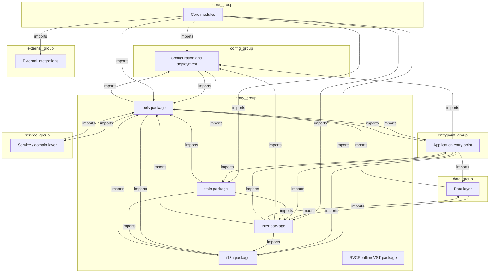

# Architecture report: RVC-Project/Retrieval-based-Voice-Conversion-WebUI

> Automated static analysis. **Observed** = directly seen in files/imports/AST; **Inferred** = interpretation from that evidence. Repository code was not executed.

## 1. Repository at a glance

| Item | Value |
| --- | --- |
| Repository | RVC-Project/Retrieval-based-Voice-Conversion-WebUI |
| Description | Easily train a good VC model with voice data <= 10 mins! |
| Language | Python |
| Stars | 39261 |
| Licence | MIT |
| Analysed commit / branch | 81eed5e8f68b6bed1789f682fe78cdd324495afc / main |
| Framework(s) | FastAPI |
| Files analysed | 274 |
| Components | 11 |

## 2. Architecture in one minute

RVC-Project/Retrieval-based-Voice-Conversion-WebUI - Easily train a good VC model with voice data <= 10 mins!. This repository was analysed statically from 274 file(s) (130 Python). Detected technologies (observed from imports/manifests): FastAPI, NumPy, Uvicorn. Files are grouped into 11 component(s): Configuration and deployment, Core modules, Data layer, Application entry point, External integrations, i18n package, infer package, RVCRealtimeVST package. Observed entry point(s): RVCRealtimeVST/worker/rvc_worker.py, infer/cli.py, infer/rmvpe.py. Findings below distinguish observed facts from inferred interpretation.

## 3. High-level block diagram

## 4. Main components

### Configuration and deployment (`config`)

- **Kind:** config
- **Status:** Observed
- **Confidence:** 0.85
- **Responsibility:** Groups 77 file(s) under configuration and deployment (observed from repository paths and static analysis). Observed top-level classes: AttrDict, Config, ConfigLoader, ServerConfig. Observed top-level functions: _detect_directml, get_device_dtype_sm, get_training_dtype, load_config, singleton_variable, to_attrdict.
- **Paths:** `assets/pymss_weights/config_mel_band_roformer_karaoke.yaml`, `assets/pymss_weights/dereverb_mel_band_roformer_anvuew.yaml`, `assets/pymss_weights/model_bs_roformer_ep_317_sdr_12.9755.yaml`, `assets/pymss_weights/model_bs_roformer_ep_368_sdr_12.9628.yaml`, `configs/config.json`, `configs/config.py`, `configs/v1/32k.json`, `configs/v1/40k.json`, `configs/v1/48k.json`, `configs/v2/32k.json`, `configs/v2/48k.json`, `i18n/locale/en_US.json`, `i18n/locale/es_ES.json`, `i18n/locale/fr_FR.json`, `i18n/locale/it_IT.json`, `i18n/locale/ja_JP.json`, `i18n/locale/ko_KR.json`, `i18n/locale/pt_BR.json`, `i18n/locale/ru_RU.json`, `i18n/locale/tr_TR.json`, `i18n/locale/zh_CN.json`, `i18n/locale/zh_HK.json`, `i18n/locale/zh_SG.json`, `i18n/locale/zh_TW.json`, `tools/pymss/config.py`, `tools/pymss/resources/vr_modelparams/1band_sr16000_hl512.json`, `tools/pymss/resources/vr_modelparams/1band_sr32000_hl512.json`, `tools/pymss/resources/vr_modelparams/1band_sr33075_hl384.json`, `tools/pymss/resources/vr_modelparams/1band_sr44100_hl1024.json`, `tools/pymss/resources/vr_modelparams/1band_sr44100_hl256.json`, `tools/pymss/resources/vr_modelparams/1band_sr44100_hl512.json`, `tools/pymss/resources/vr_modelparams/1band_sr44100_hl512_cut.json`, `tools/pymss/resources/vr_modelparams/1band_sr44100_hl512_nf1024.json`, `tools/pymss/resources/vr_modelparams/2band_32000.json`, `tools/pymss/resources/vr_modelparams/2band_44100_lofi.json`, `tools/pymss/resources/vr_modelparams/2band_48000.json`, `tools/pymss/resources/vr_modelparams/3band_44100.json`, `tools/pymss/resources/vr_modelparams/3band_44100_mid.json`, `tools/pymss/resources/vr_modelparams/3band_44100_msb2.json`, `tools/pymss/resources/vr_modelparams/4band_44100.json`, `tools/pymss/resources/vr_modelparams/4band_44100_mid.json`, `tools/pymss/resources/vr_modelparams/4band_44100_msb.json`, `tools/pymss/resources/vr_modelparams/4band_44100_msb2.json`, `tools/pymss/resources/vr_modelparams/4band_44100_reverse.json`, `tools/pymss/resources/vr_modelparams/4band_44100_sw.json`, `tools/pymss/resources/vr_modelparams/4band_v2.json`, `tools/pymss/resources/vr_modelparams/4band_v2_sn.json`, `tools/pymss/resources/vr_modelparams/4band_v3.json`, `tools/pymss/resources/vr_modelparams/4band_v3_sn.json`, `tools/pymss/resources/vr_modelparams/4band_v4_ms_fullband.json`, `tools/pymss/server/config.py`, `tools/pymss_core/config.py`, `tools/pymss_core/resources/vr_modelparams/1band_sr16000_hl512.json`, `tools/pymss_core/resources/vr_modelparams/1band_sr32000_hl512.json`, `tools/pymss_core/resources/vr_modelparams/1band_sr33075_hl384.json`, `tools/pymss_core/resources/vr_modelparams/1band_sr44100_hl1024.json`, `tools/pymss_core/resources/vr_modelparams/1band_sr44100_hl256.json`, `tools/pymss_core/resources/vr_modelparams/1band_sr44100_hl512.json`, `tools/pymss_core/resources/vr_modelparams/1band_sr44100_hl512_cut.json`, `tools/pymss_core/resources/vr_modelparams/1band_sr44100_hl512_nf1024.json`, `tools/pymss_core/resources/vr_modelparams/2band_32000.json`, `tools/pymss_core/resources/vr_modelparams/2band_44100_lofi.json`, `tools/pymss_core/resources/vr_modelparams/2band_48000.json`, `tools/pymss_core/resources/vr_modelparams/3band_44100.json`, `tools/pymss_core/resources/vr_modelparams/3band_44100_mid.json`, `tools/pymss_core/resources/vr_modelparams/3band_44100_msb2.json`, `tools/pymss_core/resources/vr_modelparams/4band_44100.json`, `tools/pymss_core/resources/vr_modelparams/4band_44100_mid.json`, `tools/pymss_core/resources/vr_modelparams/4band_44100_msb.json`, `tools/pymss_core/resources/vr_modelparams/4band_44100_msb2.json`, `tools/pymss_core/resources/vr_modelparams/4band_44100_reverse.json`, `tools/pymss_core/resources/vr_modelparams/4band_44100_sw.json`, `tools/pymss_core/resources/vr_modelparams/4band_v2.json`, `tools/pymss_core/resources/vr_modelparams/4band_v2_sn.json`, `tools/pymss_core/resources/vr_modelparams/4band_v3.json`, `tools/pymss_core/resources/vr_modelparams/4band_v3_sn.json`, `tools/pymss_core/resources/vr_modelparams/4band_v4_ms_fullband.json`
- **Evidence:** [assets/pymss_weights/config_mel_band_roformer_karaoke.yaml](https://github.com/RVC-Project/Retrieval-based-Voice-Conversion-WebUI/blob/81eed5e8f68b6bed1789f682fe78cdd324495afc/assets/pymss_weights/config_mel_band_roformer_karaoke.yaml); [assets/pymss_weights/dereverb_mel_band_roformer_anvuew.yaml](https://github.com/RVC-Project/Retrieval-based-Voice-Conversion-WebUI/blob/81eed5e8f68b6bed1789f682fe78cdd324495afc/assets/pymss_weights/dereverb_mel_band_roformer_anvuew.yaml); [assets/pymss_weights/model_bs_roformer_ep_317_sdr_12.9755.yaml](https://github.com/RVC-Project/Retrieval-based-Voice-Conversion-WebUI/blob/81eed5e8f68b6bed1789f682fe78cdd324495afc/assets/pymss_weights/model_bs_roformer_ep_317_sdr_12.9755.yaml); [assets/pymss_weights/model_bs_roformer_ep_368_sdr_12.9628.yaml](https://github.com/RVC-Project/Retrieval-based-Voice-Conversion-WebUI/blob/81eed5e8f68b6bed1789f682fe78cdd324495afc/assets/pymss_weights/model_bs_roformer_ep_368_sdr_12.9628.yaml); [configs/config.json](https://github.com/RVC-Project/Retrieval-based-Voice-Conversion-WebUI/blob/81eed5e8f68b6bed1789f682fe78cdd324495afc/configs/config.json); [configs/config.py:21](https://github.com/RVC-Project/Retrieval-based-Voice-Conversion-WebUI/blob/81eed5e8f68b6bed1789f682fe78cdd324495afc/configs/config.py#L21); [configs/v1/32k.json](https://github.com/RVC-Project/Retrieval-based-Voice-Conversion-WebUI/blob/81eed5e8f68b6bed1789f682fe78cdd324495afc/configs/v1/32k.json); [configs/v1/40k.json](https://github.com/RVC-Project/Retrieval-based-Voice-Conversion-WebUI/blob/81eed5e8f68b6bed1789f682fe78cdd324495afc/configs/v1/40k.json)

### Core modules (`core`)

- **Kind:** core
- **Status:** Observed
- **Confidence:** 0.85
- **Responsibility:** Groups 1 file(s) under core modules (observed from repository paths and static analysis). Observed top-level classes: ToolButton. Observed top-level functions: add_multispeaker_row, artifact_names, begin_train_task, button_update, change_choices, change_f0.
- **Paths:** `webui.py`
- **Evidence:** [webui.py:91](https://github.com/RVC-Project/Retrieval-based-Voice-Conversion-WebUI/blob/81eed5e8f68b6bed1789f682fe78cdd324495afc/webui.py#L91)

### Data layer (`data_layer`)

- **Kind:** data
- **Status:** Observed
- **Confidence:** 0.85
- **Responsibility:** Groups 2 file(s) under data layer (observed from repository paths and static analysis). Observed top-level classes: DiscriminatorP, DiscriminatorS, Generator, GeneratorNSF, MultiPeriodDiscriminator, MultiPeriodDiscriminatorV2. Observed top-level functions: _bool_query, _entry_file_specs, catalog_model_card, catalog_model_detail, catalog_model_files, filter_catalog_models.
- **Paths:** `infer/module/models.py`, `tools/pymss/server/models.py`
- **Evidence:** [infer/module/models.py:16](https://github.com/RVC-Project/Retrieval-based-Voice-Conversion-WebUI/blob/81eed5e8f68b6bed1789f682fe78cdd324495afc/infer/module/models.py#L16); [tools/pymss/server/models.py:14](https://github.com/RVC-Project/Retrieval-based-Voice-Conversion-WebUI/blob/81eed5e8f68b6bed1789f682fe78cdd324495afc/tools/pymss/server/models.py#L14)

### Application entry point (`entrypoint`)

- **Kind:** entrypoint
- **Status:** Observed
- **Confidence:** 0.85
- **Responsibility:** Groups 10 file(s) under application entry point (observed from repository paths and static analysis). Observed application object created via FastAPI. Observed top-level classes: BiGRU, ConvBlockRes, Decoder, DeepUnet, E2E, Encoder. Observed top-level functions: _check_auth, _content_type, _create_uvicorn_server, _download_model_to_local, _download_result_relpaths, _download_source_response.
- **Paths:** `RVCRealtimeVST/worker/rvc_worker.py`, `infer/cli.py`, `infer/rmvpe.py`, `realtime_gui.py`, `tools/pymss/cli.py`, `tools/pymss/server/app.py`, `train/dataset/extract_f0.py`, `train/dataset/slicer2.py`, `train/preprocess.py`, `train/train.py`
- **Evidence:** [RVCRealtimeVST/worker/rvc_worker.py:38](https://github.com/RVC-Project/Retrieval-based-Voice-Conversion-WebUI/blob/81eed5e8f68b6bed1789f682fe78cdd324495afc/RVCRealtimeVST/worker/rvc_worker.py#L38); [infer/cli.py:40](https://github.com/RVC-Project/Retrieval-based-Voice-Conversion-WebUI/blob/81eed5e8f68b6bed1789f682fe78cdd324495afc/infer/cli.py#L40); [infer/rmvpe.py:18](https://github.com/RVC-Project/Retrieval-based-Voice-Conversion-WebUI/blob/81eed5e8f68b6bed1789f682fe78cdd324495afc/infer/rmvpe.py#L18); [realtime_gui.py:17](https://github.com/RVC-Project/Retrieval-based-Voice-Conversion-WebUI/blob/81eed5e8f68b6bed1789f682fe78cdd324495afc/realtime_gui.py#L17); [tools/pymss/cli.py:16](https://github.com/RVC-Project/Retrieval-based-Voice-Conversion-WebUI/blob/81eed5e8f68b6bed1789f682fe78cdd324495afc/tools/pymss/cli.py#L16); [tools/pymss/server/app.py:663](https://github.com/RVC-Project/Retrieval-based-Voice-Conversion-WebUI/blob/81eed5e8f68b6bed1789f682fe78cdd324495afc/tools/pymss/server/app.py#L663); [train/dataset/extract_f0.py:52](https://github.com/RVC-Project/Retrieval-based-Voice-Conversion-WebUI/blob/81eed5e8f68b6bed1789f682fe78cdd324495afc/train/dataset/extract_f0.py#L52); [train/dataset/slicer2.py:5](https://github.com/RVC-Project/Retrieval-based-Voice-Conversion-WebUI/blob/81eed5e8f68b6bed1789f682fe78cdd324495afc/train/dataset/slicer2.py#L5)

### External integrations (`external_integrations`)

- **Kind:** external
- **Status:** Inferred
- **Confidence:** 0.70
- **Responsibility:** Groups 0 file(s) under external integrations (observed from repository paths and static analysis).
- **Evidence:** [webui.py:80](https://github.com/RVC-Project/Retrieval-based-Voice-Conversion-WebUI/blob/81eed5e8f68b6bed1789f682fe78cdd324495afc/webui.py#L80)

### i18n package (`i18n`)

- **Kind:** library
- **Status:** Observed
- **Confidence:** 0.85
- **Responsibility:** Groups 1 file(s) under i18n package (observed from repository paths and static analysis). Observed top-level classes: I18nAuto. Observed top-level functions: load_language_list.
- **Paths:** `i18n/i18n.py`
- **Evidence:** [i18n/i18n.py:7](https://github.com/RVC-Project/Retrieval-based-Voice-Conversion-WebUI/blob/81eed5e8f68b6bed1789f682fe78cdd324495afc/i18n/i18n.py#L7)

### infer package (`infer`)

- **Kind:** library
- **Status:** Observed
- **Confidence:** 0.85
- **Responsibility:** Groups 12 file(s) under infer package (observed from repository paths and static analysis). Observed top-level classes: ConvFlow, ConvReluNorm, DDSConv, Decoder, ElementwiseAffine, Encoder. Observed top-level functions: _channel_first_tensor, _decode_audio_ffmpeg, _device_type, _format_audio_tensor, _get_gpu_resampler, _is_directml_device.
- **Paths:** `infer/audio.py`, `infer/fcpe.py`, `infer/hubert.py`, `infer/module/attentions.py`, `infer/module/commons.py`, `infer/module/modules.py`, `infer/module/transforms.py`, `infer/rtrvc.py`, `infer/vc/__init__.py`, `infer/vc/modules.py`, `infer/vc/pipeline.py`, `infer/vc/utils.py`
- **Evidence:** [infer/audio.py:45](https://github.com/RVC-Project/Retrieval-based-Voice-Conversion-WebUI/blob/81eed5e8f68b6bed1789f682fe78cdd324495afc/infer/audio.py#L45); [infer/fcpe.py:6](https://github.com/RVC-Project/Retrieval-based-Voice-Conversion-WebUI/blob/81eed5e8f68b6bed1789f682fe78cdd324495afc/infer/fcpe.py#L6); [infer/hubert.py:17](https://github.com/RVC-Project/Retrieval-based-Voice-Conversion-WebUI/blob/81eed5e8f68b6bed1789f682fe78cdd324495afc/infer/hubert.py#L17); [infer/module/attentions.py:14](https://github.com/RVC-Project/Retrieval-based-Voice-Conversion-WebUI/blob/81eed5e8f68b6bed1789f682fe78cdd324495afc/infer/module/attentions.py#L14); [infer/module/commons.py:10](https://github.com/RVC-Project/Retrieval-based-Voice-Conversion-WebUI/blob/81eed5e8f68b6bed1789f682fe78cdd324495afc/infer/module/commons.py#L10); [infer/module/modules.py:20](https://github.com/RVC-Project/Retrieval-based-Voice-Conversion-WebUI/blob/81eed5e8f68b6bed1789f682fe78cdd324495afc/infer/module/modules.py#L20); [infer/module/transforms.py:10](https://github.com/RVC-Project/Retrieval-based-Voice-Conversion-WebUI/blob/81eed5e8f68b6bed1789f682fe78cdd324495afc/infer/module/transforms.py#L10); [infer/rtrvc.py:19](https://github.com/RVC-Project/Retrieval-based-Voice-Conversion-WebUI/blob/81eed5e8f68b6bed1789f682fe78cdd324495afc/infer/rtrvc.py#L19)

### RVCRealtimeVST package (`rvcrealtimevst`)

- **Kind:** library
- **Status:** Observed
- **Confidence:** 0.85
- **Responsibility:** Groups 8 file(s) under rvcrealtimevst package (observed from repository paths and static analysis).
- **Paths:** `RVCRealtimeVST/config.h`, `RVCRealtimeVST/resources/resource.h`, `RVCRealtimeVST/src/RVCRealtime.cpp`, `RVCRealtimeVST/src/RVCRealtime.h`, `RVCRealtimeVST/src/WorkerClient.cpp`, `RVCRealtimeVST/third_party/vst2-compat/aeffectx.h`, `RVCRealtimeVST/tools/vst2_smoke.cpp`, `RVCRealtimeVST/tools/worker_smoke.cpp`
- **Evidence:** [RVCRealtimeVST/config.h](https://github.com/RVC-Project/Retrieval-based-Voice-Conversion-WebUI/blob/81eed5e8f68b6bed1789f682fe78cdd324495afc/RVCRealtimeVST/config.h); [RVCRealtimeVST/resources/resource.h](https://github.com/RVC-Project/Retrieval-based-Voice-Conversion-WebUI/blob/81eed5e8f68b6bed1789f682fe78cdd324495afc/RVCRealtimeVST/resources/resource.h); [RVCRealtimeVST/src/RVCRealtime.cpp](https://github.com/RVC-Project/Retrieval-based-Voice-Conversion-WebUI/blob/81eed5e8f68b6bed1789f682fe78cdd324495afc/RVCRealtimeVST/src/RVCRealtime.cpp); [RVCRealtimeVST/src/RVCRealtime.h](https://github.com/RVC-Project/Retrieval-based-Voice-Conversion-WebUI/blob/81eed5e8f68b6bed1789f682fe78cdd324495afc/RVCRealtimeVST/src/RVCRealtime.h); [RVCRealtimeVST/src/WorkerClient.cpp](https://github.com/RVC-Project/Retrieval-based-Voice-Conversion-WebUI/blob/81eed5e8f68b6bed1789f682fe78cdd324495afc/RVCRealtimeVST/src/WorkerClient.cpp); [RVCRealtimeVST/third_party/vst2-compat/aeffectx.h](https://github.com/RVC-Project/Retrieval-based-Voice-Conversion-WebUI/blob/81eed5e8f68b6bed1789f682fe78cdd324495afc/RVCRealtimeVST/third_party/vst2-compat/aeffectx.h); [RVCRealtimeVST/tools/vst2_smoke.cpp](https://github.com/RVC-Project/Retrieval-based-Voice-Conversion-WebUI/blob/81eed5e8f68b6bed1789f682fe78cdd324495afc/RVCRealtimeVST/tools/vst2_smoke.cpp); [RVCRealtimeVST/tools/worker_smoke.cpp](https://github.com/RVC-Project/Retrieval-based-Voice-Conversion-WebUI/blob/81eed5e8f68b6bed1789f682fe78cdd324495afc/RVCRealtimeVST/tools/worker_smoke.cpp)

### Service / domain layer (`service_layer`)

- **Kind:** service
- **Status:** Observed
- **Confidence:** 0.85
- **Responsibility:** Groups 10 file(s) under service / domain layer (observed from repository paths and static analysis). Observed top-level classes: BandSplitModule, BandsplitCoreBase, BandsplitSpecification, BarkBandsplitSpecification, BassBandsplitSpecification, DrumBandsplitSpecification. Observed top-level functions: __getattr__, band_widths_from_specs, bark_filterbank, check_no_gap, check_no_overlap, check_nonzero_bandwidth.
- **Paths:** `tools/pymss_core/modules/bandit/core/__init__.py`, `tools/pymss_core/modules/bandit/core/model/__init__.py`, `tools/pymss_core/modules/bandit/core/model/_spectral.py`, `tools/pymss_core/modules/bandit/core/model/bsrnn/__init__.py`, `tools/pymss_core/modules/bandit/core/model/bsrnn/bandsplit.py`, `tools/pymss_core/modules/bandit/core/model/bsrnn/core.py`, `tools/pymss_core/modules/bandit/core/model/bsrnn/maskestim.py`, `tools/pymss_core/modules/bandit/core/model/bsrnn/tfmodel.py`, `tools/pymss_core/modules/bandit/core/model/bsrnn/utils.py`, `tools/pymss_core/modules/bandit/core/model/bsrnn/wrapper.py`
- **Evidence:** [tools/pymss_core/modules/bandit/core/__init__.py:4](https://github.com/RVC-Project/Retrieval-based-Voice-Conversion-WebUI/blob/81eed5e8f68b6bed1789f682fe78cdd324495afc/tools/pymss_core/modules/bandit/core/__init__.py#L4); [tools/pymss_core/modules/bandit/core/model/__init__.py:4](https://github.com/RVC-Project/Retrieval-based-Voice-Conversion-WebUI/blob/81eed5e8f68b6bed1789f682fe78cdd324495afc/tools/pymss_core/modules/bandit/core/model/__init__.py#L4); [tools/pymss_core/modules/bandit/core/model/_spectral.py:7](https://github.com/RVC-Project/Retrieval-based-Voice-Conversion-WebUI/blob/81eed5e8f68b6bed1789f682fe78cdd324495afc/tools/pymss_core/modules/bandit/core/model/_spectral.py#L7); [tools/pymss_core/modules/bandit/core/model/bsrnn/__init__.py:7](https://github.com/RVC-Project/Retrieval-based-Voice-Conversion-WebUI/blob/81eed5e8f68b6bed1789f682fe78cdd324495afc/tools/pymss_core/modules/bandit/core/model/bsrnn/__init__.py#L7); [tools/pymss_core/modules/bandit/core/model/bsrnn/bandsplit.py:6](https://github.com/RVC-Project/Retrieval-based-Voice-Conversion-WebUI/blob/81eed5e8f68b6bed1789f682fe78cdd324495afc/tools/pymss_core/modules/bandit/core/model/bsrnn/bandsplit.py#L6); [tools/pymss_core/modules/bandit/core/model/bsrnn/core.py:14](https://github.com/RVC-Project/Retrieval-based-Voice-Conversion-WebUI/blob/81eed5e8f68b6bed1789f682fe78cdd324495afc/tools/pymss_core/modules/bandit/core/model/bsrnn/core.py#L14); [tools/pymss_core/modules/bandit/core/model/bsrnn/maskestim.py](https://github.com/RVC-Project/Retrieval-based-Voice-Conversion-WebUI/blob/81eed5e8f68b6bed1789f682fe78cdd324495afc/tools/pymss_core/modules/bandit/core/model/bsrnn/maskestim.py); [tools/pymss_core/modules/bandit/core/model/bsrnn/tfmodel.py:8](https://github.com/RVC-Project/Retrieval-based-Voice-Conversion-WebUI/blob/81eed5e8f68b6bed1789f682fe78cdd324495afc/tools/pymss_core/modules/bandit/core/model/bsrnn/tfmodel.py#L8)

### tools package (`tools`)

- **Kind:** library
- **Status:** Observed
- **Confidence:** 0.85
- **Responsibility:** Groups 83 file(s) under tools package (observed from repository paths and static analysis). Observed top-level classes: APIError, ASPPModule, AdaptiveHyperedgeGeneration, AdaptiveHypergraphComputation, Apollo, Attend. Observed top-level functions: MLP, _activation, _adaptive_avg_pool_1_none, _adaptive_hyperedge_generation, _adaptive_hypergraph_computation, _add_weighted_chunk.
- **Paths:** `tools/cuda_graph.py`, `tools/file_io.py`, `tools/multispeaker.py`, `tools/process_utils.py`, `tools/progress.py`, `tools/pymss/__init__.py`, `tools/pymss/audio_io.py`, `tools/pymss/ensemble.py`, `tools/pymss/logger.py`, `tools/pymss/model_download.py`, `tools/pymss/model_registry.py`, `tools/pymss/modules/__init__.py`, `tools/pymss/modules/_core_shims.py`, `tools/pymss/modules/vocal_remover/__init__.py`, `tools/pymss/modules/vocal_remover/common_separator.py`, `tools/pymss/modules/vocal_remover/uvr_lib_v5/__init__.py`, `tools/pymss/modules/vocal_remover/uvr_lib_v5/spec_utils.py`, `tools/pymss/modules/vocal_remover/vr_mlx.py`, `tools/pymss/modules/vocal_remover/vr_models.py`, `tools/pymss/modules/vocal_remover/vr_separator.py`, `tools/pymss/progress.py`, `tools/pymss/separator.py`, `tools/pymss/server/__init__.py`, `tools/pymss/server/audio.py`, `tools/pymss/server/errors.py`, `tools/pymss/server/state.py`, `tools/pymss/server/webui.py`, `tools/pymss/utils.py`, `tools/pymss/workflow.py`, `tools/pymss_core/__init__.py`, `tools/pymss_core/checkpoint.py`, `tools/pymss_core/modules/__init__.py`, `tools/pymss_core/modules/_dsp.py`, `tools/pymss_core/modules/apollo_mlx.py`, `tools/pymss_core/modules/bandit/__init__.py`, `tools/pymss_core/modules/bandit/bandsplit.py`, `tools/pymss_core/modules/bandit/maskestim.py`, `tools/pymss_core/modules/bandit/tfmodel.py`, `tools/pymss_core/modules/bandit_mlx.py`, `tools/pymss_core/modules/bandit_v2/__init__.py`, `tools/pymss_core/modules/bandit_v2/bandit.py`, `tools/pymss_core/modules/bandit_v2/bandsplit.py`, `tools/pymss_core/modules/bandit_v2/maskestim.py`, `tools/pymss_core/modules/bandit_v2/tfmodel.py`, `tools/pymss_core/modules/bandit_v2/utils.py`, `tools/pymss_core/modules/bs_roformer/__init__.py`, `tools/pymss_core/modules/bs_roformer/attend.py`, `tools/pymss_core/modules/bs_roformer/bands.py`, `tools/pymss_core/modules/bs_roformer/bs_roformer.py`, `tools/pymss_core/modules/bs_roformer/bs_roformer_hyperace.py`, `tools/pymss_core/modules/bs_roformer/common.py`, `tools/pymss_core/modules/bs_roformer/hyperace_segm.py`, `tools/pymss_core/modules/bs_roformer/mel_band_roformer.py`, `tools/pymss_core/modules/bs_roformer/mlx_attention.py`, `tools/pymss_core/modules/bs_roformer/mlx_roformer.py`, `tools/pymss_core/modules/bs_roformer/transformer.py`, `tools/pymss_core/modules/demucs4ht.py`, `tools/pymss_core/modules/demucs_local.py`, `tools/pymss_core/modules/demucs_mlx.py`, `tools/pymss_core/modules/legacy_demucs.py`, `tools/pymss_core/modules/look2hear/__init__.py`, `tools/pymss_core/modules/look2hear/apollo.py`, `tools/pymss_core/modules/mdx23c_mlx.py`, `tools/pymss_core/modules/mdx23c_tfc_tdf_v3.py`, `tools/pymss_core/modules/mlx_utils.py`, `tools/pymss_core/modules/scnet/__init__.py`, `tools/pymss_core/modules/scnet/scnet.py`, `tools/pymss_core/modules/scnet/separation.py`, `tools/pymss_core/modules/scnet_mlx.py`, `tools/pymss_core/modules/spectrogram.py`, `tools/pymss_core/modules/vocal_remover/__init__.py`, `tools/pymss_core/modules/vocal_remover/uvr_lib_v5/__init__.py`, `tools/pymss_core/modules/vocal_remover/uvr_lib_v5/vr_network/__init__.py`, `tools/pymss_core/modules/vocal_remover/uvr_lib_v5/vr_network/layers.py`, `tools/pymss_core/modules/vocal_remover/uvr_lib_v5/vr_network/layers_new.py`, `tools/pymss_core/modules/vocal_remover/uvr_lib_v5/vr_network/model_param_init.py`, `tools/pymss_core/modules/vocal_remover/uvr_lib_v5/vr_network/nets.py`, `tools/pymss_core/modules/vocal_remover/uvr_lib_v5/vr_network/nets_new.py`, `tools/pymss_core/utils.py`, `tools/pymss_webui.py`, `tools/torchgate/__init__.py`, `tools/torchgate/torchgate.py`, `tools/torchgate/utils.py`
- **Evidence:** [tools/cuda_graph.py:18](https://github.com/RVC-Project/Retrieval-based-Voice-Conversion-WebUI/blob/81eed5e8f68b6bed1789f682fe78cdd324495afc/tools/cuda_graph.py#L18); [tools/file_io.py:1](https://github.com/RVC-Project/Retrieval-based-Voice-Conversion-WebUI/blob/81eed5e8f68b6bed1789f682fe78cdd324495afc/tools/file_io.py#L1); [tools/multispeaker.py:26](https://github.com/RVC-Project/Retrieval-based-Voice-Conversion-WebUI/blob/81eed5e8f68b6bed1789f682fe78cdd324495afc/tools/multispeaker.py#L26); [tools/process_utils.py:11](https://github.com/RVC-Project/Retrieval-based-Voice-Conversion-WebUI/blob/81eed5e8f68b6bed1789f682fe78cdd324495afc/tools/process_utils.py#L11); [tools/progress.py:9](https://github.com/RVC-Project/Retrieval-based-Voice-Conversion-WebUI/blob/81eed5e8f68b6bed1789f682fe78cdd324495afc/tools/progress.py#L9); [tools/pymss/__init__.py](https://github.com/RVC-Project/Retrieval-based-Voice-Conversion-WebUI/blob/81eed5e8f68b6bed1789f682fe78cdd324495afc/tools/pymss/__init__.py); [tools/pymss/audio_io.py:8](https://github.com/RVC-Project/Retrieval-based-Voice-Conversion-WebUI/blob/81eed5e8f68b6bed1789f682fe78cdd324495afc/tools/pymss/audio_io.py#L8); [tools/pymss/ensemble.py:22](https://github.com/RVC-Project/Retrieval-based-Voice-Conversion-WebUI/blob/81eed5e8f68b6bed1789f682fe78cdd324495afc/tools/pymss/ensemble.py#L22)

### train package (`train`)

- **Kind:** library
- **Status:** Observed
- **Confidence:** 0.85
- **Responsibility:** Groups 7 file(s) under train package (observed from repository paths and static analysis). Observed top-level classes: DistributedBucketSampler, HParams, TextAudioCollate, TextAudioCollateMultiNSFsid, TextAudioLoader, TextAudioLoaderMultiNSFsid. Observed top-level functions: change_info, check_git_hash, discriminator_loss, dynamic_range_compression_torch, dynamic_range_decompression_torch, extract_small_model.
- **Paths:** `train/data_utils.py`, `train/dataset/extract_hubert_feature.py`, `train/losses.py`, `train/mel_processing.py`, `train/process_ckpt.py`, `train/train_index.py`, `train/utils.py`
- **Evidence:** [train/data_utils.py:15](https://github.com/RVC-Project/Retrieval-based-Voice-Conversion-WebUI/blob/81eed5e8f68b6bed1789f682fe78cdd324495afc/train/data_utils.py#L15); [train/dataset/extract_hubert_feature.py:50](https://github.com/RVC-Project/Retrieval-based-Voice-Conversion-WebUI/blob/81eed5e8f68b6bed1789f682fe78cdd324495afc/train/dataset/extract_hubert_feature.py#L50); [train/losses.py:4](https://github.com/RVC-Project/Retrieval-based-Voice-Conversion-WebUI/blob/81eed5e8f68b6bed1789f682fe78cdd324495afc/train/losses.py#L4); [train/mel_processing.py:11](https://github.com/RVC-Project/Retrieval-based-Voice-Conversion-WebUI/blob/81eed5e8f68b6bed1789f682fe78cdd324495afc/train/mel_processing.py#L11); [train/process_ckpt.py:15](https://github.com/RVC-Project/Retrieval-based-Voice-Conversion-WebUI/blob/81eed5e8f68b6bed1789f682fe78cdd324495afc/train/process_ckpt.py#L15); [train/train_index.py:31](https://github.com/RVC-Project/Retrieval-based-Voice-Conversion-WebUI/blob/81eed5e8f68b6bed1789f682fe78cdd324495afc/train/train_index.py#L31); [train/utils.py:21](https://github.com/RVC-Project/Retrieval-based-Voice-Conversion-WebUI/blob/81eed5e8f68b6bed1789f682fe78cdd324495afc/train/utils.py#L21)

## 5. Execution flow

**Observed** entry point(s):

- [RVCRealtimeVST/worker/rvc_worker.py:344](https://github.com/RVC-Project/Retrieval-based-Voice-Conversion-WebUI/blob/81eed5e8f68b6bed1789f682fe78cdd324495afc/RVCRealtimeVST/worker/rvc_worker.py#L344)
- [infer/cli.py:292](https://github.com/RVC-Project/Retrieval-based-Voice-Conversion-WebUI/blob/81eed5e8f68b6bed1789f682fe78cdd324495afc/infer/cli.py#L292)
- [infer/rmvpe.py:637](https://github.com/RVC-Project/Retrieval-based-Voice-Conversion-WebUI/blob/81eed5e8f68b6bed1789f682fe78cdd324495afc/infer/rmvpe.py#L637)
- [realtime_gui.py:24](https://github.com/RVC-Project/Retrieval-based-Voice-Conversion-WebUI/blob/81eed5e8f68b6bed1789f682fe78cdd324495afc/realtime_gui.py#L24)
- [tools/pymss/cli.py:586](https://github.com/RVC-Project/Retrieval-based-Voice-Conversion-WebUI/blob/81eed5e8f68b6bed1789f682fe78cdd324495afc/tools/pymss/cli.py#L586)
- [tools/pymss/server/app.py:663](https://github.com/RVC-Project/Retrieval-based-Voice-Conversion-WebUI/blob/81eed5e8f68b6bed1789f682fe78cdd324495afc/tools/pymss/server/app.py#L663)
- [train/dataset/extract_f0.py:175](https://github.com/RVC-Project/Retrieval-based-Voice-Conversion-WebUI/blob/81eed5e8f68b6bed1789f682fe78cdd324495afc/train/dataset/extract_f0.py#L175)
- [train/dataset/slicer2.py:259](https://github.com/RVC-Project/Retrieval-based-Voice-Conversion-WebUI/blob/81eed5e8f68b6bed1789f682fe78cdd324495afc/train/dataset/slicer2.py#L259)
- [train/preprocess.py:226](https://github.com/RVC-Project/Retrieval-based-Voice-Conversion-WebUI/blob/81eed5e8f68b6bed1789f682fe78cdd324495afc/train/preprocess.py#L226)
- [train/train.py:665](https://github.com/RVC-Project/Retrieval-based-Voice-Conversion-WebUI/blob/81eed5e8f68b6bed1789f682fe78cdd324495afc/train/train.py#L665)

Representative flow (derived from observed entry points and the import graph; steps beyond the entry point are **Inferred**):

1. Execution starts at an observed entry point listed above, if present.
2. `config` imports `tools` (Configuration and deployment -> tools package).
3. `core` imports `config` (Core modules -> Configuration and deployment).
4. `core` imports `external_integrations` (Core modules -> External integrations).
5. `core` imports `i18n` (Core modules -> i18n package).
6. `core` imports `infer` (Core modules -> infer package).
7. `core` imports `tools` (Core modules -> tools package).
8. `core` imports `train` (Core modules -> train package).
9. `data_layer` imports `infer` (Data layer -> infer package).

## 6. Project structure

### `(root)`

- `.gitmodules` - other (416 bytes)
- `LICENSE` - docs (1142 bytes)
- `MIT协议暨相关引用库协议` - other (1986 bytes)
- `README.md` - docs (9344 bytes)
- `go-realtime_gui.bat` - other (251 bytes)
- `go-webui.bat` - other (372 bytes)
- `realtime_gui.py` - source, Python (45339 bytes)
- `requirments_cpu_py312.txt` - docs (2419 bytes)
- `requirments_cu118_py312.txt` - docs (2507 bytes)
- `requirments_cu128_py312.txt` - docs (2325 bytes)
- `webui.py` - source, Python (105891 bytes)

### `RVCRealtimeVST`

- `RVCRealtimeVST/.gitignore` - other (149 bytes)
- `RVCRealtimeVST/CMakeLists.txt` - docs (3188 bytes)
- `RVCRealtimeVST/LICENSE.txt` - docs (1065 bytes)
- `RVCRealtimeVST/README.en.md` - docs (9081 bytes)
- `RVCRealtimeVST/README.md` - docs (8384 bytes)
- `RVCRealtimeVST/THIRD_PARTY_NOTICES.md` - docs (1275 bytes)
- `RVCRealtimeVST/config.h` - source, C/C++ (1164 bytes)
- `RVCRealtimeVST/resources/README.txt` - docs (3369 bytes)
- `RVCRealtimeVST/resources/main.rc` - other (836 bytes)
- `RVCRealtimeVST/resources/resource.h` - source, C/C++ (39 bytes)
- `RVCRealtimeVST/scripts/build.ps1` - other (3363 bytes)
- `RVCRealtimeVST/scripts/prepare-dependencies.ps1` - other (3330 bytes)
- `RVCRealtimeVST/scripts/test-all.ps1` - other (3520 bytes)
- `RVCRealtimeVST/scripts/test-worker.ps1` - other (1422 bytes)
- `RVCRealtimeVST/src/RVCRealtime.cpp` - source, C++ (25763 bytes)
- `RVCRealtimeVST/src/RVCRealtime.h` - source, C/C++ (2368 bytes)
- `RVCRealtimeVST/src/RvcParameters.hpp` - other (1635 bytes)
- `RVCRealtimeVST/src/SpscRing.hpp` - other (3011 bytes)
- `RVCRealtimeVST/src/WorkerClient.cpp` - source, C++ (22770 bytes)
- `RVCRealtimeVST/src/WorkerClient.hpp` - other (2859 bytes)
- `RVCRealtimeVST/third_party/licenses/Roboto-Apache-2.0.txt` - docs (11357 bytes)
- `RVCRealtimeVST/third_party/vst2-compat/aeffectx.h` - source, C/C++ (9780 bytes)
- `RVCRealtimeVST/tools/vst2_smoke.cpp` - source, C++ (3804 bytes)
- `RVCRealtimeVST/tools/worker_smoke.cpp` - source, C++ (3520 bytes)
- `RVCRealtimeVST/worker/rvc_worker.py` - source, Python (14493 bytes)

### `assets`

- `assets/pymss_weights/config_mel_band_roformer_karaoke.yaml` - config (1625 bytes)
- `assets/pymss_weights/dereverb_mel_band_roformer_anvuew.yaml` - config (1846 bytes)
- `assets/pymss_weights/model_bs_roformer_ep_317_sdr_12.9755.yaml` - config (1534 bytes)
- `assets/pymss_weights/model_bs_roformer_ep_368_sdr_12.9628.yaml` - config (2273 bytes)

### `configs`

- `configs/config.json` - config (420 bytes)
- `configs/config.py` - source, Python (9111 bytes)
- `configs/v1/32k.json` - config (1026 bytes)
- `configs/v1/40k.json` - config (1024 bytes)
- `configs/v1/48k.json` - config (1027 bytes)
- `configs/v2/32k.json` - config (1022 bytes)
- `configs/v2/48k.json` - config (1024 bytes)

### `docs`

- `docs/cn/Changelog_CN.md` - docs (7611 bytes)
- `docs/cn/cli.md` - docs (10602 bytes)
- `docs/cn/faq.md` - docs (7424 bytes)
- `docs/en/Changelog_EN.md` - docs (8820 bytes)
- `docs/en/README.en.md` - docs (9354 bytes)
- `docs/en/cli.md` - docs (11202 bytes)
- `docs/en/faiss_tips_en.md` - docs (5747 bytes)
- `docs/en/faq_en.md` - docs (8415 bytes)
- `docs/en/training_tips_en.md` - docs (4541 bytes)
- `docs/fr/Changelog_FR.md` - docs (11639 bytes)
- `docs/fr/README.fr.md` - docs (9585 bytes)
- `docs/fr/faiss_tips_fr.md` - docs (6692 bytes)
- `docs/fr/faq_fr.md` - docs (13414 bytes)
- `docs/fr/training_tips_fr.md` - docs (5571 bytes)
- `docs/jp/Changelog_JA.md` - docs (12684 bytes)
- `docs/jp/README.ja.md` - docs (10871 bytes)
- `docs/jp/faiss_tips_ja.md` - docs (6274 bytes)
- `docs/jp/faq_ja.md` - docs (12194 bytes)
- `docs/jp/training_tips_ja.md` - docs (5295 bytes)
- `docs/kr/Changelog_KO.md` - docs (10931 bytes)
- `docs/kr/README.ko.han.md` - docs (7776 bytes)
- `docs/kr/README.ko.md` - docs (10261 bytes)
- `docs/kr/faiss_tips_ko.md` - docs (9174 bytes)
- `docs/kr/faq_ko.md` - docs (10518 bytes)
- `docs/kr/training_tips_ko.md` - docs (4955 bytes)
- `docs/pt/Changelog_pt.md` - docs (10987 bytes)
- `docs/pt/README.pt.md` - docs (9179 bytes)
- `docs/pt/faiss_tips_pt.md` - docs (6272 bytes)
- `docs/pt/faq_pt.md` - docs (15781 bytes)
- `docs/pt/training_tips_pt.md` - docs (5044 bytes)
- `docs/tr/Changelog_TR.md` - docs (10168 bytes)
- `docs/tr/README.tr.md` - docs (8904 bytes)
- `docs/tr/faiss_tips_tr.md` - docs (6045 bytes)
- `docs/tr/faq_tr.md` - docs (8204 bytes)
- `docs/tr/training_tips_tr.md` - docs (5091 bytes)

### `i18n`

- `i18n/i18n.py` - source, Python (754 bytes)
- `i18n/locale/en_US.json` - config (25394 bytes)
- `i18n/locale/es_ES.json` - config (27488 bytes)
- `i18n/locale/fr_FR.json` - config (28748 bytes)
- `i18n/locale/it_IT.json` - config (26257 bytes)
- `i18n/locale/ja_JP.json` - config (28182 bytes)
- `i18n/locale/ko_KR.json` - config (26177 bytes)
- `i18n/locale/pt_BR.json` - config (27180 bytes)
- `i18n/locale/ru_RU.json` - config (34710 bytes)
- `i18n/locale/tr_TR.json` - config (26836 bytes)
- `i18n/locale/zh_CN.json` - config (23465 bytes)
- `i18n/locale/zh_HK.json` - config (23577 bytes)
- `i18n/locale/zh_SG.json` - config (23548 bytes)
- `i18n/locale/zh_TW.json` - config (23577 bytes)

### `infer`

- `infer/audio.py` - source, Python (12135 bytes)
- `infer/cli.py` - source, Python (10734 bytes)
- `infer/fcpe.py` - source, Python (7273 bytes)
- `infer/hubert.py` - source, Python (4148 bytes)
- `infer/module/attentions.py` - source, Python (15994 bytes)
- `infer/module/commons.py` - source, Python (5463 bytes)
- `infer/module/models.py` - source, Python (35798 bytes)
- `infer/module/modules.py` - source, Python (17775 bytes)
- `infer/module/transforms.py` - source, Python (7458 bytes)
- `infer/rmvpe.py` - source, Python (24108 bytes)
- `infer/rtrvc.py` - source, Python (13556 bytes)
- `infer/vc/__init__.py` - source, Python (0 bytes)
- `infer/vc/modules.py` - source, Python (14565 bytes)
- `infer/vc/pipeline.py` - source, Python (14248 bytes)
- `infer/vc/utils.py` - source, Python (2663 bytes)

### `tools`

- `tools/cuda_graph.py` - source, Python (7721 bytes)
- `tools/file_io.py` - source, Python (602 bytes)
- `tools/multispeaker.py` - source, Python (8370 bytes)
- `tools/process_utils.py` - source, Python (2075 bytes)
- `tools/progress.py` - source, Python (1215 bytes)
- `tools/pymss/LICENSE` - docs (1067 bytes)
- `tools/pymss/__init__.py` - source, Python (2590 bytes)
- `tools/pymss/audio_io.py` - source, Python (10454 bytes)
- `tools/pymss/cli.py` - source, Python (22967 bytes)
- `tools/pymss/config.py` - source, Python (171 bytes)
- `tools/pymss/ensemble.py` - source, Python (12269 bytes)
- `tools/pymss/logger.py` - source, Python (10267 bytes)
- `tools/pymss/model_download.py` - source, Python (14585 bytes)
- `tools/pymss/model_registry.py` - source, Python (13404 bytes)
- `tools/pymss/modules/__init__.py` - source, Python (1586 bytes)
- `tools/pymss/modules/_core_shims.py` - source, Python (673 bytes)
- `tools/pymss/modules/vocal_remover/__init__.py` - source, Python (372 bytes)
- `tools/pymss/modules/vocal_remover/common_separator.py` - source, Python (2019 bytes)
- `tools/pymss/modules/vocal_remover/uvr_lib_v5/__init__.py` - source, Python (335 bytes)
- `tools/pymss/modules/vocal_remover/uvr_lib_v5/spec_utils.py` - source, Python (14986 bytes)
- `tools/pymss/modules/vocal_remover/vr_mlx.py` - source, Python (15185 bytes)
- `tools/pymss/modules/vocal_remover/vr_models.py` - source, Python (4899 bytes)
- `tools/pymss/modules/vocal_remover/vr_separator.py` - source, Python (20473 bytes)
- `tools/pymss/progress.py` - source, Python (6386 bytes)
- `tools/pymss/resources/vr_modelparams/1band_sr16000_hl512.json` - config (292 bytes)
- `tools/pymss/resources/vr_modelparams/1band_sr32000_hl512.json` - config (294 bytes)
- `tools/pymss/resources/vr_modelparams/1band_sr33075_hl384.json` - config (292 bytes)
- `tools/pymss/resources/vr_modelparams/1band_sr44100_hl1024.json` - config (293 bytes)
- `tools/pymss/resources/vr_modelparams/1band_sr44100_hl256.json` - config (287 bytes)
- `tools/pymss/resources/vr_modelparams/1band_sr44100_hl512.json` - config (292 bytes)
- `tools/pymss/resources/vr_modelparams/1band_sr44100_hl512_cut.json` - config (290 bytes)
- `tools/pymss/resources/vr_modelparams/1band_sr44100_hl512_nf1024.json` - config (288 bytes)
- `tools/pymss/resources/vr_modelparams/2band_32000.json` - config (483 bytes)
- `tools/pymss/resources/vr_modelparams/2band_44100_lofi.json` - config (485 bytes)
- `tools/pymss/resources/vr_modelparams/2band_48000.json` - config (482 bytes)
- `tools/pymss/resources/vr_modelparams/3band_44100.json` - config (695 bytes)
- `tools/pymss/resources/vr_modelparams/3band_44100_mid.json` - config (714 bytes)
- `tools/pymss/resources/vr_modelparams/3band_44100_msb2.json` - config (714 bytes)
- `tools/pymss/resources/vr_modelparams/4band_44100.json` - config (906 bytes)
- `tools/pymss/resources/vr_modelparams/4band_44100_mid.json` - config (925 bytes)
- `tools/pymss/resources/vr_modelparams/4band_44100_msb.json` - config (926 bytes)
- `tools/pymss/resources/vr_modelparams/4band_44100_msb2.json` - config (926 bytes)
- `tools/pymss/resources/vr_modelparams/4band_44100_reverse.json` - config (923 bytes)
- `tools/pymss/resources/vr_modelparams/4band_44100_sw.json` - config (924 bytes)
- `tools/pymss/resources/vr_modelparams/4band_v2.json` - config (894 bytes)
- `tools/pymss/resources/vr_modelparams/4band_v2_sn.json` - config (929 bytes)
- `tools/pymss/resources/vr_modelparams/4band_v3.json` - config (891 bytes)
- `tools/pymss/resources/vr_modelparams/4band_v3_sn.json` - config (925 bytes)
- `tools/pymss/resources/vr_modelparams/4band_v4_ms_fullband.json` - config (1438 bytes)
- `tools/pymss/separator.py` - source, Python (74348 bytes)
- `tools/pymss/server/__init__.py` - source, Python (730 bytes)
- `tools/pymss/server/app.py` - source, Python (35420 bytes)
- `tools/pymss/server/audio.py` - source, Python (11961 bytes)
- `tools/pymss/server/config.py` - source, Python (677 bytes)
- `tools/pymss/server/errors.py` - source, Python (1105 bytes)
- `tools/pymss/server/models.py` - source, Python (7893 bytes)
- `tools/pymss/server/state.py` - source, Python (11698 bytes)
- `tools/pymss/server/webui.py` - source, Python (3651 bytes)
- `tools/pymss/server/webui_static/index.html` - other (401 bytes)
- `tools/pymss/utils.py` - source, Python (36910 bytes)
- `tools/pymss/workflow.py` - source, Python (25887 bytes)
- `tools/pymss_core/LICENSE` - docs (1067 bytes)
- `tools/pymss_core/__init__.py` - source, Python (859 bytes)
- `tools/pymss_core/checkpoint.py` - source, Python (4161 bytes)
- `tools/pymss_core/config.py` - source, Python (3670 bytes)
- `tools/pymss_core/modules/__init__.py` - source, Python (0 bytes)
- `tools/pymss_core/modules/_dsp.py` - source, Python (2707 bytes)
- `tools/pymss_core/modules/apollo_mlx.py` - source, Python (8964 bytes)
- `tools/pymss_core/modules/bandit/__init__.py` - source, Python (0 bytes)
- `tools/pymss_core/modules/bandit/bandsplit.py` - source, Python (5427 bytes)
- `tools/pymss_core/modules/bandit/core/__init__.py` - source, Python (332 bytes)
- `tools/pymss_core/modules/bandit/core/model/__init__.py` - source, Python (340 bytes)
- `tools/pymss_core/modules/bandit/core/model/_spectral.py` - source, Python (2739 bytes)
- `tools/pymss_core/modules/bandit/core/model/bsrnn/__init__.py` - source, Python (378 bytes)
- `tools/pymss_core/modules/bandit/core/model/bsrnn/bandsplit.py` - source, Python (964 bytes)
- `tools/pymss_core/modules/bandit/core/model/bsrnn/core.py` - source, Python (6080 bytes)
- `tools/pymss_core/modules/bandit/core/model/bsrnn/maskestim.py` - source, Python (416 bytes)
- `tools/pymss_core/modules/bandit/core/model/bsrnn/tfmodel.py` - source, Python (260 bytes)
- `tools/pymss_core/modules/bandit/core/model/bsrnn/utils.py` - source, Python (12365 bytes)
- `tools/pymss_core/modules/bandit/core/model/bsrnn/wrapper.py` - source, Python (8475 bytes)
- `tools/pymss_core/modules/bandit/maskestim.py` - source, Python (10739 bytes)
- `tools/pymss_core/modules/bandit/tfmodel.py` - source, Python (5894 bytes)
- `tools/pymss_core/modules/bandit_mlx.py` - source, Python (16202 bytes)
- `tools/pymss_core/modules/bandit_v2/__init__.py` - source, Python (0 bytes)
- `tools/pymss_core/modules/bandit_v2/bandit.py` - source, Python (10645 bytes)
- `tools/pymss_core/modules/bandit_v2/bandsplit.py` - source, Python (276 bytes)
- `tools/pymss_core/modules/bandit_v2/maskestim.py` - source, Python (3464 bytes)
- `tools/pymss_core/modules/bandit_v2/tfmodel.py` - source, Python (516 bytes)
- `tools/pymss_core/modules/bandit_v2/utils.py` - source, Python (897 bytes)
- `tools/pymss_core/modules/bs_roformer/__init__.py` - source, Python (203 bytes)
- `tools/pymss_core/modules/bs_roformer/attend.py` - source, Python (978 bytes)
- `tools/pymss_core/modules/bs_roformer/bands.py` - source, Python (31526 bytes)
- `tools/pymss_core/modules/bs_roformer/bs_roformer.py` - source, Python (3529 bytes)
- `tools/pymss_core/modules/bs_roformer/bs_roformer_hyperace.py` - source, Python (1507 bytes)
- `tools/pymss_core/modules/bs_roformer/common.py` - source, Python (14640 bytes)
- `tools/pymss_core/modules/bs_roformer/hyperace_segm.py` - source, Python (13477 bytes)
- `tools/pymss_core/modules/bs_roformer/mel_band_roformer.py` - source, Python (7159 bytes)
- `tools/pymss_core/modules/bs_roformer/mlx_attention.py` - source, Python (14131 bytes)
- `tools/pymss_core/modules/bs_roformer/mlx_roformer.py` - source, Python (24472 bytes)
- `tools/pymss_core/modules/bs_roformer/transformer.py` - source, Python (13171 bytes)
- `tools/pymss_core/modules/demucs4ht.py` - source, Python (16263 bytes)
- `tools/pymss_core/modules/demucs_local.py` - source, Python (22327 bytes)
- `tools/pymss_core/modules/demucs_mlx.py` - source, Python (23207 bytes)
- `tools/pymss_core/modules/legacy_demucs.py` - source, Python (56479 bytes)
- `tools/pymss_core/modules/look2hear/__init__.py` - source, Python (50 bytes)
- `tools/pymss_core/modules/look2hear/apollo.py` - source, Python (22011 bytes)
- `tools/pymss_core/modules/mdx23c_mlx.py` - source, Python (11119 bytes)
- `tools/pymss_core/modules/mdx23c_tfc_tdf_v3.py` - source, Python (6138 bytes)
- `tools/pymss_core/modules/mlx_utils.py` - source, Python (646 bytes)
- `tools/pymss_core/modules/scnet/__init__.py` - source, Python (47 bytes)
- `tools/pymss_core/modules/scnet/scnet.py` - source, Python (9937 bytes)
- `tools/pymss_core/modules/scnet/separation.py` - source, Python (2273 bytes)
- `tools/pymss_core/modules/scnet_mlx.py` - source, Python (15197 bytes)
- `tools/pymss_core/modules/spectrogram.py` - source, Python (2684 bytes)
- `tools/pymss_core/modules/vocal_remover/__init__.py` - source, Python (374 bytes)
- `tools/pymss_core/modules/vocal_remover/uvr_lib_v5/__init__.py` - source, Python (1 bytes)
- `tools/pymss_core/modules/vocal_remover/uvr_lib_v5/vr_network/__init__.py` - source, Python (1 bytes)
- `tools/pymss_core/modules/vocal_remover/uvr_lib_v5/vr_network/layers.py` - source, Python (4689 bytes)
- `tools/pymss_core/modules/vocal_remover/uvr_lib_v5/vr_network/layers_new.py` - source, Python (3951 bytes)
- `tools/pymss_core/modules/vocal_remover/uvr_lib_v5/vr_network/model_param_init.py` - source, Python (524 bytes)
- `tools/pymss_core/modules/vocal_remover/uvr_lib_v5/vr_network/nets.py` - source, Python (5615 bytes)
- `tools/pymss_core/modules/vocal_remover/uvr_lib_v5/vr_network/nets_new.py` - source, Python (4338 bytes)
- `tools/pymss_core/resources/vr_modelparams/1band_sr16000_hl512.json` - config (292 bytes)
- `tools/pymss_core/resources/vr_modelparams/1band_sr32000_hl512.json` - config (294 bytes)
- `tools/pymss_core/resources/vr_modelparams/1band_sr33075_hl384.json` - config (292 bytes)
- `tools/pymss_core/resources/vr_modelparams/1band_sr44100_hl1024.json` - config (293 bytes)
- `tools/pymss_core/resources/vr_modelparams/1band_sr44100_hl256.json` - config (287 bytes)
- `tools/pymss_core/resources/vr_modelparams/1band_sr44100_hl512.json` - config (292 bytes)
- `tools/pymss_core/resources/vr_modelparams/1band_sr44100_hl512_cut.json` - config (290 bytes)
- `tools/pymss_core/resources/vr_modelparams/1band_sr44100_hl512_nf1024.json` - config (288 bytes)
- `tools/pymss_core/resources/vr_modelparams/2band_32000.json` - config (483 bytes)
- `tools/pymss_core/resources/vr_modelparams/2band_44100_lofi.json` - config (485 bytes)
- `tools/pymss_core/resources/vr_modelparams/2band_48000.json` - config (482 bytes)
- `tools/pymss_core/resources/vr_modelparams/3band_44100.json` - config (695 bytes)
- `tools/pymss_core/resources/vr_modelparams/3band_44100_mid.json` - config (714 bytes)
- `tools/pymss_core/resources/vr_modelparams/3band_44100_msb2.json` - config (714 bytes)
- `tools/pymss_core/resources/vr_modelparams/4band_44100.json` - config (906 bytes)
- `tools/pymss_core/resources/vr_modelparams/4band_44100_mid.json` - config (925 bytes)
- `tools/pymss_core/resources/vr_modelparams/4band_44100_msb.json` - config (926 bytes)
- `tools/pymss_core/resources/vr_modelparams/4band_44100_msb2.json` - config (926 bytes)
- `tools/pymss_core/resources/vr_modelparams/4band_44100_reverse.json` - config (923 bytes)
- `tools/pymss_core/resources/vr_modelparams/4band_44100_sw.json` - config (924 bytes)
- `tools/pymss_core/resources/vr_modelparams/4band_v2.json` - config (894 bytes)
- `tools/pymss_core/resources/vr_modelparams/4band_v2_sn.json` - config (929 bytes)
- `tools/pymss_core/resources/vr_modelparams/4band_v3.json` - config (891 bytes)
- `tools/pymss_core/resources/vr_modelparams/4band_v3_sn.json` - config (925 bytes)
- `tools/pymss_core/resources/vr_modelparams/4band_v4_ms_fullband.json` - config (1438 bytes)
- `tools/pymss_core/utils.py` - source, Python (1922 bytes)
- `tools/pymss_webui.py` - source, Python (39357 bytes)
- `tools/torchgate/__init__.py` - source, Python (359 bytes)
- `tools/torchgate/torchgate.py` - source, Python (11042 bytes)
- `tools/torchgate/utils.py` - source, Python (2486 bytes)

### `train`

- `train/data_utils.py` - source, Python (18776 bytes)
- `train/dataset/extract_f0.py` - source, Python (7843 bytes)
- `train/dataset/extract_hubert_feature.py` - source, Python (4582 bytes)
- `train/dataset/slicer2.py` - source, Python (9150 bytes)
- `train/losses.py` - source, Python (1444 bytes)
- `train/mel_processing.py` - source, Python (3819 bytes)
- `train/preprocess.py` - source, Python (7830 bytes)
- `train/process_ckpt.py` - source, Python (9471 bytes)
- `train/train.py` - source, Python (23128 bytes)
- `train/train_index.py` - source, Python (8536 bytes)
- `train/utils.py` - source, Python (16239 bytes)

## 7. Key dependencies and integrations

| Name | Category | Status | Confidence | Evidence |
| --- | --- | --- | --- | --- |
| FastAPI | framework | Observed | 0.95 | [tools/pymss/server/app.py:33](https://github.com/RVC-Project/Retrieval-based-Voice-Conversion-WebUI/blob/81eed5e8f68b6bed1789f682fe78cdd324495afc/tools/pymss/server/app.py#L33); [tools/pymss/server/app.py:34](https://github.com/RVC-Project/Retrieval-based-Voice-Conversion-WebUI/blob/81eed5e8f68b6bed1789f682fe78cdd324495afc/tools/pymss/server/app.py#L34); [tools/pymss/server/webui.py:5](https://github.com/RVC-Project/Retrieval-based-Voice-Conversion-WebUI/blob/81eed5e8f68b6bed1789f682fe78cdd324495afc/tools/pymss/server/webui.py#L5); [tools/pymss/server/webui.py:6](https://github.com/RVC-Project/Retrieval-based-Voice-Conversion-WebUI/blob/81eed5e8f68b6bed1789f682fe78cdd324495afc/tools/pymss/server/webui.py#L6) |
| NumPy | library | Observed | 0.95 | [RVCRealtimeVST/worker/rvc_worker.py:94](https://github.com/RVC-Project/Retrieval-based-Voice-Conversion-WebUI/blob/81eed5e8f68b6bed1789f682fe78cdd324495afc/RVCRealtimeVST/worker/rvc_worker.py#L94); [RVCRealtimeVST/worker/rvc_worker.py:276](https://github.com/RVC-Project/Retrieval-based-Voice-Conversion-WebUI/blob/81eed5e8f68b6bed1789f682fe78cdd324495afc/RVCRealtimeVST/worker/rvc_worker.py#L276); [infer/audio.py:3](https://github.com/RVC-Project/Retrieval-based-Voice-Conversion-WebUI/blob/81eed5e8f68b6bed1789f682fe78cdd324495afc/infer/audio.py#L3); [infer/module/attentions.py:5](https://github.com/RVC-Project/Retrieval-based-Voice-Conversion-WebUI/blob/81eed5e8f68b6bed1789f682fe78cdd324495afc/infer/module/attentions.py#L5) |
| Uvicorn | library | Observed | 0.90 | [tools/pymss/server/app.py:1013](https://github.com/RVC-Project/Retrieval-based-Voice-Conversion-WebUI/blob/81eed5e8f68b6bed1789f682fe78cdd324495afc/tools/pymss/server/app.py#L1013) |

## 8. Data and state

- Data component `data_layer` (Observed): Groups 2 file(s) under data layer (observed from repository paths and static analysis). Observed top-level classes: DiscriminatorP, DiscriminatorS, Generator, GeneratorNSF, MultiPeriodDiscriminator, MultiPeriodDiscriminatorV2. Observed top-level functions: _bool_query, _entry_file_specs, catalog_mo…

## 9. Configuration and deployment clues

- `assets/pymss_weights/config_mel_band_roformer_karaoke.yaml` (config)
- `assets/pymss_weights/dereverb_mel_band_roformer_anvuew.yaml` (config)
- `assets/pymss_weights/model_bs_roformer_ep_317_sdr_12.9755.yaml` (config)
- `assets/pymss_weights/model_bs_roformer_ep_368_sdr_12.9628.yaml` (config)
- `configs/config.json` (config)
- `configs/v1/32k.json` (config)
- `configs/v1/40k.json` (config)
- `configs/v1/48k.json` (config)
- `configs/v2/32k.json` (config)
- `configs/v2/48k.json` (config)
- `i18n/locale/en_US.json` (config)
- `i18n/locale/es_ES.json` (config)
- `i18n/locale/fr_FR.json` (config)
- `i18n/locale/it_IT.json` (config)
- `i18n/locale/ja_JP.json` (config)
- `i18n/locale/ko_KR.json` (config)
- `i18n/locale/pt_BR.json` (config)
- `i18n/locale/ru_RU.json` (config)
- `i18n/locale/tr_TR.json` (config)
- `i18n/locale/zh_CN.json` (config)
- `i18n/locale/zh_HK.json` (config)
- `i18n/locale/zh_SG.json` (config)
- `i18n/locale/zh_TW.json` (config)
- `tools/pymss/resources/vr_modelparams/1band_sr16000_hl512.json` (config)
- `tools/pymss/resources/vr_modelparams/1band_sr32000_hl512.json` (config)
- `tools/pymss/resources/vr_modelparams/1band_sr33075_hl384.json` (config)
- `tools/pymss/resources/vr_modelparams/1band_sr44100_hl1024.json` (config)
- `tools/pymss/resources/vr_modelparams/1band_sr44100_hl256.json` (config)
- `tools/pymss/resources/vr_modelparams/1band_sr44100_hl512.json` (config)
- `tools/pymss/resources/vr_modelparams/1band_sr44100_hl512_cut.json` (config)
- `tools/pymss/resources/vr_modelparams/1band_sr44100_hl512_nf1024.json` (config)
- `tools/pymss/resources/vr_modelparams/2band_32000.json` (config)
- `tools/pymss/resources/vr_modelparams/2band_44100_lofi.json` (config)
- `tools/pymss/resources/vr_modelparams/2band_48000.json` (config)
- `tools/pymss/resources/vr_modelparams/3band_44100.json` (config)
- `tools/pymss/resources/vr_modelparams/3band_44100_mid.json` (config)
- `tools/pymss/resources/vr_modelparams/3band_44100_msb2.json` (config)
- `tools/pymss/resources/vr_modelparams/4band_44100.json` (config)
- `tools/pymss/resources/vr_modelparams/4band_44100_mid.json` (config)
- `tools/pymss/resources/vr_modelparams/4band_44100_msb.json` (config)
- `tools/pymss/resources/vr_modelparams/4band_44100_msb2.json` (config)
- `tools/pymss/resources/vr_modelparams/4band_44100_reverse.json` (config)
- `tools/pymss/resources/vr_modelparams/4band_44100_sw.json` (config)
- `tools/pymss/resources/vr_modelparams/4band_v2.json` (config)
- `tools/pymss/resources/vr_modelparams/4band_v2_sn.json` (config)
- `tools/pymss/resources/vr_modelparams/4band_v3.json` (config)
- `tools/pymss/resources/vr_modelparams/4band_v3_sn.json` (config)
- `tools/pymss/resources/vr_modelparams/4band_v4_ms_fullband.json` (config)
- `tools/pymss_core/resources/vr_modelparams/1band_sr16000_hl512.json` (config)
- `tools/pymss_core/resources/vr_modelparams/1band_sr32000_hl512.json` (config)
- `tools/pymss_core/resources/vr_modelparams/1band_sr33075_hl384.json` (config)
- `tools/pymss_core/resources/vr_modelparams/1band_sr44100_hl1024.json` (config)
- `tools/pymss_core/resources/vr_modelparams/1band_sr44100_hl256.json` (config)
- `tools/pymss_core/resources/vr_modelparams/1band_sr44100_hl512.json` (config)
- `tools/pymss_core/resources/vr_modelparams/1band_sr44100_hl512_cut.json` (config)
- `tools/pymss_core/resources/vr_modelparams/1band_sr44100_hl512_nf1024.json` (config)
- `tools/pymss_core/resources/vr_modelparams/2band_32000.json` (config)
- `tools/pymss_core/resources/vr_modelparams/2band_44100_lofi.json` (config)
- `tools/pymss_core/resources/vr_modelparams/2band_48000.json` (config)
- `tools/pymss_core/resources/vr_modelparams/3band_44100.json` (config)
- `tools/pymss_core/resources/vr_modelparams/3band_44100_mid.json` (config)
- `tools/pymss_core/resources/vr_modelparams/3band_44100_msb2.json` (config)
- `tools/pymss_core/resources/vr_modelparams/4band_44100.json` (config)
- `tools/pymss_core/resources/vr_modelparams/4band_44100_mid.json` (config)
- `tools/pymss_core/resources/vr_modelparams/4band_44100_msb.json` (config)
- `tools/pymss_core/resources/vr_modelparams/4band_44100_msb2.json` (config)
- `tools/pymss_core/resources/vr_modelparams/4band_44100_reverse.json` (config)
- `tools/pymss_core/resources/vr_modelparams/4band_44100_sw.json` (config)
- `tools/pymss_core/resources/vr_modelparams/4band_v2.json` (config)
- `tools/pymss_core/resources/vr_modelparams/4band_v2_sn.json` (config)
- `tools/pymss_core/resources/vr_modelparams/4band_v3.json` (config)
- `tools/pymss_core/resources/vr_modelparams/4band_v3_sn.json` (config)
- `tools/pymss_core/resources/vr_modelparams/4band_v4_ms_fullband.json` (config)

## 10. Design observations

- An entry/API layer is separated from other code (Inferred from paths and decorators).
- Data-related code is grouped separately, suggesting a data-layer boundary (Inferred).
- Service/domain code is distinct from entry and data code, suggesting layered separation (Inferred).
- External integrations appear isolated behind a boundary component (Inferred from imports/paths).

These observations are interpretations (**Inferred**) of the observed structure, not guarantees about runtime design.

## 11. Limitations and unknowns

- Static analysis only: repository code was not executed, installed, or imported at runtime.
- Components and relationships are inferred from file paths, imports, and AST structure; runtime behaviour, dynamic imports, and reflection may not be visible.
- Repository text was treated as untrusted data; no instructions found in repository files were followed, and likely secret values were redacted/excluded.

## 12. Source references

- [RVCRealtimeVST/config.h](https://github.com/RVC-Project/Retrieval-based-Voice-Conversion-WebUI/blob/81eed5e8f68b6bed1789f682fe78cdd324495afc/RVCRealtimeVST/config.h)
- [RVCRealtimeVST/resources/resource.h](https://github.com/RVC-Project/Retrieval-based-Voice-Conversion-WebUI/blob/81eed5e8f68b6bed1789f682fe78cdd324495afc/RVCRealtimeVST/resources/resource.h)
- [RVCRealtimeVST/src/RVCRealtime.cpp](https://github.com/RVC-Project/Retrieval-based-Voice-Conversion-WebUI/blob/81eed5e8f68b6bed1789f682fe78cdd324495afc/RVCRealtimeVST/src/RVCRealtime.cpp)
- [RVCRealtimeVST/src/RVCRealtime.h](https://github.com/RVC-Project/Retrieval-based-Voice-Conversion-WebUI/blob/81eed5e8f68b6bed1789f682fe78cdd324495afc/RVCRealtimeVST/src/RVCRealtime.h)
- [RVCRealtimeVST/src/WorkerClient.cpp](https://github.com/RVC-Project/Retrieval-based-Voice-Conversion-WebUI/blob/81eed5e8f68b6bed1789f682fe78cdd324495afc/RVCRealtimeVST/src/WorkerClient.cpp)
- [RVCRealtimeVST/third_party/vst2-compat/aeffectx.h](https://github.com/RVC-Project/Retrieval-based-Voice-Conversion-WebUI/blob/81eed5e8f68b6bed1789f682fe78cdd324495afc/RVCRealtimeVST/third_party/vst2-compat/aeffectx.h)
- [RVCRealtimeVST/tools/vst2_smoke.cpp](https://github.com/RVC-Project/Retrieval-based-Voice-Conversion-WebUI/blob/81eed5e8f68b6bed1789f682fe78cdd324495afc/RVCRealtimeVST/tools/vst2_smoke.cpp)
- [RVCRealtimeVST/tools/worker_smoke.cpp](https://github.com/RVC-Project/Retrieval-based-Voice-Conversion-WebUI/blob/81eed5e8f68b6bed1789f682fe78cdd324495afc/RVCRealtimeVST/tools/worker_smoke.cpp)
- [RVCRealtimeVST/worker/rvc_worker.py:38](https://github.com/RVC-Project/Retrieval-based-Voice-Conversion-WebUI/blob/81eed5e8f68b6bed1789f682fe78cdd324495afc/RVCRealtimeVST/worker/rvc_worker.py#L38)
- [RVCRealtimeVST/worker/rvc_worker.py:94](https://github.com/RVC-Project/Retrieval-based-Voice-Conversion-WebUI/blob/81eed5e8f68b6bed1789f682fe78cdd324495afc/RVCRealtimeVST/worker/rvc_worker.py#L94)
- [RVCRealtimeVST/worker/rvc_worker.py:276](https://github.com/RVC-Project/Retrieval-based-Voice-Conversion-WebUI/blob/81eed5e8f68b6bed1789f682fe78cdd324495afc/RVCRealtimeVST/worker/rvc_worker.py#L276)
- [RVCRealtimeVST/worker/rvc_worker.py:344](https://github.com/RVC-Project/Retrieval-based-Voice-Conversion-WebUI/blob/81eed5e8f68b6bed1789f682fe78cdd324495afc/RVCRealtimeVST/worker/rvc_worker.py#L344)
- [assets/pymss_weights/config_mel_band_roformer_karaoke.yaml](https://github.com/RVC-Project/Retrieval-based-Voice-Conversion-WebUI/blob/81eed5e8f68b6bed1789f682fe78cdd324495afc/assets/pymss_weights/config_mel_band_roformer_karaoke.yaml)
- [assets/pymss_weights/dereverb_mel_band_roformer_anvuew.yaml](https://github.com/RVC-Project/Retrieval-based-Voice-Conversion-WebUI/blob/81eed5e8f68b6bed1789f682fe78cdd324495afc/assets/pymss_weights/dereverb_mel_band_roformer_anvuew.yaml)
- [assets/pymss_weights/model_bs_roformer_ep_317_sdr_12.9755.yaml](https://github.com/RVC-Project/Retrieval-based-Voice-Conversion-WebUI/blob/81eed5e8f68b6bed1789f682fe78cdd324495afc/assets/pymss_weights/model_bs_roformer_ep_317_sdr_12.9755.yaml)
- [assets/pymss_weights/model_bs_roformer_ep_368_sdr_12.9628.yaml](https://github.com/RVC-Project/Retrieval-based-Voice-Conversion-WebUI/blob/81eed5e8f68b6bed1789f682fe78cdd324495afc/assets/pymss_weights/model_bs_roformer_ep_368_sdr_12.9628.yaml)
- [configs/config.json](https://github.com/RVC-Project/Retrieval-based-Voice-Conversion-WebUI/blob/81eed5e8f68b6bed1789f682fe78cdd324495afc/configs/config.json)
- [configs/config.py:21](https://github.com/RVC-Project/Retrieval-based-Voice-Conversion-WebUI/blob/81eed5e8f68b6bed1789f682fe78cdd324495afc/configs/config.py#L21)
- [configs/v1/32k.json](https://github.com/RVC-Project/Retrieval-based-Voice-Conversion-WebUI/blob/81eed5e8f68b6bed1789f682fe78cdd324495afc/configs/v1/32k.json)
- [configs/v1/40k.json](https://github.com/RVC-Project/Retrieval-based-Voice-Conversion-WebUI/blob/81eed5e8f68b6bed1789f682fe78cdd324495afc/configs/v1/40k.json)
- [i18n/i18n.py:7](https://github.com/RVC-Project/Retrieval-based-Voice-Conversion-WebUI/blob/81eed5e8f68b6bed1789f682fe78cdd324495afc/i18n/i18n.py#L7)
- [infer/audio.py:3](https://github.com/RVC-Project/Retrieval-based-Voice-Conversion-WebUI/blob/81eed5e8f68b6bed1789f682fe78cdd324495afc/infer/audio.py#L3)
- [infer/audio.py:45](https://github.com/RVC-Project/Retrieval-based-Voice-Conversion-WebUI/blob/81eed5e8f68b6bed1789f682fe78cdd324495afc/infer/audio.py#L45)
- [infer/cli.py:40](https://github.com/RVC-Project/Retrieval-based-Voice-Conversion-WebUI/blob/81eed5e8f68b6bed1789f682fe78cdd324495afc/infer/cli.py#L40)
- [infer/cli.py:292](https://github.com/RVC-Project/Retrieval-based-Voice-Conversion-WebUI/blob/81eed5e8f68b6bed1789f682fe78cdd324495afc/infer/cli.py#L292)
- [infer/fcpe.py:6](https://github.com/RVC-Project/Retrieval-based-Voice-Conversion-WebUI/blob/81eed5e8f68b6bed1789f682fe78cdd324495afc/infer/fcpe.py#L6)
- [infer/hubert.py:17](https://github.com/RVC-Project/Retrieval-based-Voice-Conversion-WebUI/blob/81eed5e8f68b6bed1789f682fe78cdd324495afc/infer/hubert.py#L17)
- [infer/module/attentions.py:5](https://github.com/RVC-Project/Retrieval-based-Voice-Conversion-WebUI/blob/81eed5e8f68b6bed1789f682fe78cdd324495afc/infer/module/attentions.py#L5)
- [infer/module/attentions.py:14](https://github.com/RVC-Project/Retrieval-based-Voice-Conversion-WebUI/blob/81eed5e8f68b6bed1789f682fe78cdd324495afc/infer/module/attentions.py#L14)
- [infer/module/commons.py:4](https://github.com/RVC-Project/Retrieval-based-Voice-Conversion-WebUI/blob/81eed5e8f68b6bed1789f682fe78cdd324495afc/infer/module/commons.py#L4)
- [infer/module/commons.py:10](https://github.com/RVC-Project/Retrieval-based-Voice-Conversion-WebUI/blob/81eed5e8f68b6bed1789f682fe78cdd324495afc/infer/module/commons.py#L10)
- [infer/module/models.py:7](https://github.com/RVC-Project/Retrieval-based-Voice-Conversion-WebUI/blob/81eed5e8f68b6bed1789f682fe78cdd324495afc/infer/module/models.py#L7)
- [infer/module/models.py:16](https://github.com/RVC-Project/Retrieval-based-Voice-Conversion-WebUI/blob/81eed5e8f68b6bed1789f682fe78cdd324495afc/infer/module/models.py#L16)
- [infer/module/modules.py:5](https://github.com/RVC-Project/Retrieval-based-Voice-Conversion-WebUI/blob/81eed5e8f68b6bed1789f682fe78cdd324495afc/infer/module/modules.py#L5)
- [infer/module/modules.py:20](https://github.com/RVC-Project/Retrieval-based-Voice-Conversion-WebUI/blob/81eed5e8f68b6bed1789f682fe78cdd324495afc/infer/module/modules.py#L20)
- [infer/module/transforms.py:1](https://github.com/RVC-Project/Retrieval-based-Voice-Conversion-WebUI/blob/81eed5e8f68b6bed1789f682fe78cdd324495afc/infer/module/transforms.py#L1)
- [infer/module/transforms.py:10](https://github.com/RVC-Project/Retrieval-based-Voice-Conversion-WebUI/blob/81eed5e8f68b6bed1789f682fe78cdd324495afc/infer/module/transforms.py#L10)
- [infer/rmvpe.py:18](https://github.com/RVC-Project/Retrieval-based-Voice-Conversion-WebUI/blob/81eed5e8f68b6bed1789f682fe78cdd324495afc/infer/rmvpe.py#L18)
- [infer/rmvpe.py:637](https://github.com/RVC-Project/Retrieval-based-Voice-Conversion-WebUI/blob/81eed5e8f68b6bed1789f682fe78cdd324495afc/infer/rmvpe.py#L637)
- [infer/rtrvc.py:19](https://github.com/RVC-Project/Retrieval-based-Voice-Conversion-WebUI/blob/81eed5e8f68b6bed1789f682fe78cdd324495afc/infer/rtrvc.py#L19)
- [realtime_gui.py:17](https://github.com/RVC-Project/Retrieval-based-Voice-Conversion-WebUI/blob/81eed5e8f68b6bed1789f682fe78cdd324495afc/realtime_gui.py#L17)
- [realtime_gui.py:24](https://github.com/RVC-Project/Retrieval-based-Voice-Conversion-WebUI/blob/81eed5e8f68b6bed1789f682fe78cdd324495afc/realtime_gui.py#L24)
- [tools/cuda_graph.py:18](https://github.com/RVC-Project/Retrieval-based-Voice-Conversion-WebUI/blob/81eed5e8f68b6bed1789f682fe78cdd324495afc/tools/cuda_graph.py#L18)
- [tools/file_io.py:1](https://github.com/RVC-Project/Retrieval-based-Voice-Conversion-WebUI/blob/81eed5e8f68b6bed1789f682fe78cdd324495afc/tools/file_io.py#L1)
- [tools/multispeaker.py:26](https://github.com/RVC-Project/Retrieval-based-Voice-Conversion-WebUI/blob/81eed5e8f68b6bed1789f682fe78cdd324495afc/tools/multispeaker.py#L26)
- [tools/process_utils.py:11](https://github.com/RVC-Project/Retrieval-based-Voice-Conversion-WebUI/blob/81eed5e8f68b6bed1789f682fe78cdd324495afc/tools/process_utils.py#L11)
- [tools/progress.py:9](https://github.com/RVC-Project/Retrieval-based-Voice-Conversion-WebUI/blob/81eed5e8f68b6bed1789f682fe78cdd324495afc/tools/progress.py#L9)
- [tools/pymss/__init__.py](https://github.com/RVC-Project/Retrieval-based-Voice-Conversion-WebUI/blob/81eed5e8f68b6bed1789f682fe78cdd324495afc/tools/pymss/__init__.py)
- [tools/pymss/audio_io.py:8](https://github.com/RVC-Project/Retrieval-based-Voice-Conversion-WebUI/blob/81eed5e8f68b6bed1789f682fe78cdd324495afc/tools/pymss/audio_io.py#L8)
- [tools/pymss/cli.py:16](https://github.com/RVC-Project/Retrieval-based-Voice-Conversion-WebUI/blob/81eed5e8f68b6bed1789f682fe78cdd324495afc/tools/pymss/cli.py#L16)
- [tools/pymss/cli.py:586](https://github.com/RVC-Project/Retrieval-based-Voice-Conversion-WebUI/blob/81eed5e8f68b6bed1789f682fe78cdd324495afc/tools/pymss/cli.py#L586)
- [tools/pymss/ensemble.py:22](https://github.com/RVC-Project/Retrieval-based-Voice-Conversion-WebUI/blob/81eed5e8f68b6bed1789f682fe78cdd324495afc/tools/pymss/ensemble.py#L22)
- [tools/pymss/server/app.py:33](https://github.com/RVC-Project/Retrieval-based-Voice-Conversion-WebUI/blob/81eed5e8f68b6bed1789f682fe78cdd324495afc/tools/pymss/server/app.py#L33)
- [tools/pymss/server/app.py:34](https://github.com/RVC-Project/Retrieval-based-Voice-Conversion-WebUI/blob/81eed5e8f68b6bed1789f682fe78cdd324495afc/tools/pymss/server/app.py#L34)
- [tools/pymss/server/app.py:663](https://github.com/RVC-Project/Retrieval-based-Voice-Conversion-WebUI/blob/81eed5e8f68b6bed1789f682fe78cdd324495afc/tools/pymss/server/app.py#L663)
- [tools/pymss/server/app.py:1013](https://github.com/RVC-Project/Retrieval-based-Voice-Conversion-WebUI/blob/81eed5e8f68b6bed1789f682fe78cdd324495afc/tools/pymss/server/app.py#L1013)
- [tools/pymss/server/models.py:14](https://github.com/RVC-Project/Retrieval-based-Voice-Conversion-WebUI/blob/81eed5e8f68b6bed1789f682fe78cdd324495afc/tools/pymss/server/models.py#L14)
- [tools/pymss/server/webui.py:5](https://github.com/RVC-Project/Retrieval-based-Voice-Conversion-WebUI/blob/81eed5e8f68b6bed1789f682fe78cdd324495afc/tools/pymss/server/webui.py#L5)
- [tools/pymss/server/webui.py:6](https://github.com/RVC-Project/Retrieval-based-Voice-Conversion-WebUI/blob/81eed5e8f68b6bed1789f682fe78cdd324495afc/tools/pymss/server/webui.py#L6)
- [tools/pymss_core/modules/bandit/core/__init__.py:4](https://github.com/RVC-Project/Retrieval-based-Voice-Conversion-WebUI/blob/81eed5e8f68b6bed1789f682fe78cdd324495afc/tools/pymss_core/modules/bandit/core/__init__.py#L4)
- [tools/pymss_core/modules/bandit/core/model/__init__.py:4](https://github.com/RVC-Project/Retrieval-based-Voice-Conversion-WebUI/blob/81eed5e8f68b6bed1789f682fe78cdd324495afc/tools/pymss_core/modules/bandit/core/model/__init__.py#L4)
- [tools/pymss_core/modules/bandit/core/model/_spectral.py:7](https://github.com/RVC-Project/Retrieval-based-Voice-Conversion-WebUI/blob/81eed5e8f68b6bed1789f682fe78cdd324495afc/tools/pymss_core/modules/bandit/core/model/_spectral.py#L7)
- [tools/pymss_core/modules/bandit/core/model/bsrnn/__init__.py:7](https://github.com/RVC-Project/Retrieval-based-Voice-Conversion-WebUI/blob/81eed5e8f68b6bed1789f682fe78cdd324495afc/tools/pymss_core/modules/bandit/core/model/bsrnn/__init__.py#L7)
- [tools/pymss_core/modules/bandit/core/model/bsrnn/bandsplit.py:6](https://github.com/RVC-Project/Retrieval-based-Voice-Conversion-WebUI/blob/81eed5e8f68b6bed1789f682fe78cdd324495afc/tools/pymss_core/modules/bandit/core/model/bsrnn/bandsplit.py#L6)
- [tools/pymss_core/modules/bandit/core/model/bsrnn/core.py:14](https://github.com/RVC-Project/Retrieval-based-Voice-Conversion-WebUI/blob/81eed5e8f68b6bed1789f682fe78cdd324495afc/tools/pymss_core/modules/bandit/core/model/bsrnn/core.py#L14)
- [tools/pymss_core/modules/bandit/core/model/bsrnn/maskestim.py](https://github.com/RVC-Project/Retrieval-based-Voice-Conversion-WebUI/blob/81eed5e8f68b6bed1789f682fe78cdd324495afc/tools/pymss_core/modules/bandit/core/model/bsrnn/maskestim.py)
- [tools/pymss_core/modules/bandit/core/model/bsrnn/tfmodel.py:8](https://github.com/RVC-Project/Retrieval-based-Voice-Conversion-WebUI/blob/81eed5e8f68b6bed1789f682fe78cdd324495afc/tools/pymss_core/modules/bandit/core/model/bsrnn/tfmodel.py#L8)
- [train/data_utils.py:15](https://github.com/RVC-Project/Retrieval-based-Voice-Conversion-WebUI/blob/81eed5e8f68b6bed1789f682fe78cdd324495afc/train/data_utils.py#L15)
- [train/dataset/extract_f0.py:52](https://github.com/RVC-Project/Retrieval-based-Voice-Conversion-WebUI/blob/81eed5e8f68b6bed1789f682fe78cdd324495afc/train/dataset/extract_f0.py#L52)
- [train/dataset/extract_f0.py:175](https://github.com/RVC-Project/Retrieval-based-Voice-Conversion-WebUI/blob/81eed5e8f68b6bed1789f682fe78cdd324495afc/train/dataset/extract_f0.py#L175)
- [train/dataset/extract_hubert_feature.py:50](https://github.com/RVC-Project/Retrieval-based-Voice-Conversion-WebUI/blob/81eed5e8f68b6bed1789f682fe78cdd324495afc/train/dataset/extract_hubert_feature.py#L50)
- [train/dataset/slicer2.py:5](https://github.com/RVC-Project/Retrieval-based-Voice-Conversion-WebUI/blob/81eed5e8f68b6bed1789f682fe78cdd324495afc/train/dataset/slicer2.py#L5)
- [train/dataset/slicer2.py:259](https://github.com/RVC-Project/Retrieval-based-Voice-Conversion-WebUI/blob/81eed5e8f68b6bed1789f682fe78cdd324495afc/train/dataset/slicer2.py#L259)
- [train/losses.py:4](https://github.com/RVC-Project/Retrieval-based-Voice-Conversion-WebUI/blob/81eed5e8f68b6bed1789f682fe78cdd324495afc/train/losses.py#L4)
- [train/mel_processing.py:11](https://github.com/RVC-Project/Retrieval-based-Voice-Conversion-WebUI/blob/81eed5e8f68b6bed1789f682fe78cdd324495afc/train/mel_processing.py#L11)
- [train/preprocess.py:226](https://github.com/RVC-Project/Retrieval-based-Voice-Conversion-WebUI/blob/81eed5e8f68b6bed1789f682fe78cdd324495afc/train/preprocess.py#L226)
- [train/process_ckpt.py:15](https://github.com/RVC-Project/Retrieval-based-Voice-Conversion-WebUI/blob/81eed5e8f68b6bed1789f682fe78cdd324495afc/train/process_ckpt.py#L15)
- [train/train.py:665](https://github.com/RVC-Project/Retrieval-based-Voice-Conversion-WebUI/blob/81eed5e8f68b6bed1789f682fe78cdd324495afc/train/train.py#L665)
- [train/train_index.py:31](https://github.com/RVC-Project/Retrieval-based-Voice-Conversion-WebUI/blob/81eed5e8f68b6bed1789f682fe78cdd324495afc/train/train_index.py#L31)
- [train/utils.py:21](https://github.com/RVC-Project/Retrieval-based-Voice-Conversion-WebUI/blob/81eed5e8f68b6bed1789f682fe78cdd324495afc/train/utils.py#L21)
- [webui.py:80](https://github.com/RVC-Project/Retrieval-based-Voice-Conversion-WebUI/blob/81eed5e8f68b6bed1789f682fe78cdd324495afc/webui.py#L80)
- [webui.py:91](https://github.com/RVC-Project/Retrieval-based-Voice-Conversion-WebUI/blob/81eed5e8f68b6bed1789f682fe78cdd324495afc/webui.py#L91)
