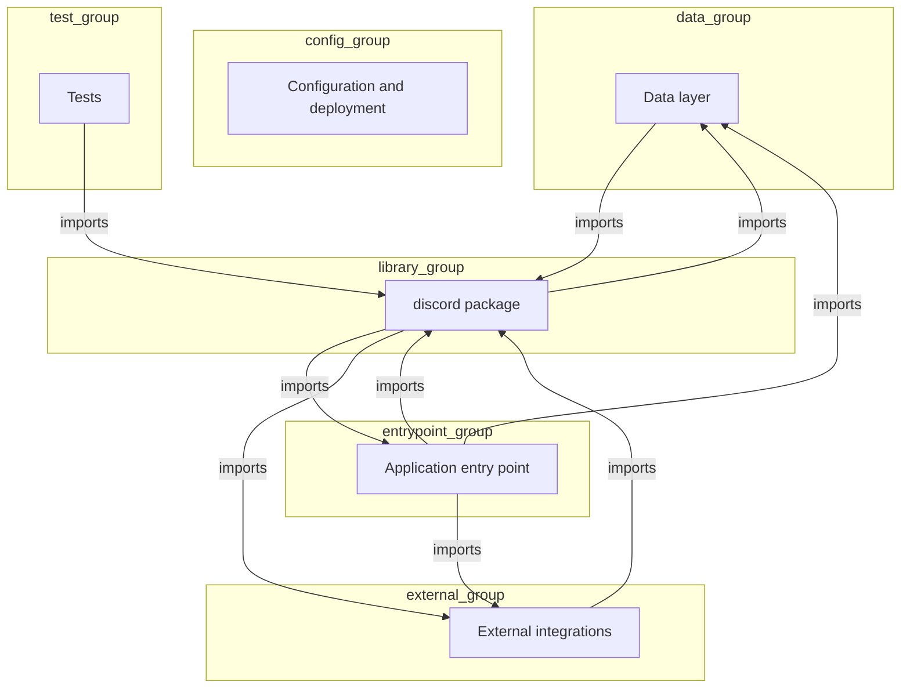

# Architecture report: Rapptz/discord.py

> Automated static analysis. **Observed** = directly seen in files/imports/AST; **Inferred** = interpretation from that evidence. Repository code was not executed.

## 1. Repository at a glance

| Item | Value |
| --- | --- |
| Repository | Rapptz/discord.py |
| Description | An API wrapper for Discord written in Python. |
| Language | Python |
| Stars | 16210 |
| Licence | MIT |
| Analysed commit / branch | 65232c38702be5844cf2ce865a4777eb1928b5d0 / master |
| Framework(s) | None detected |
| Files analysed | 279 |
| Components | 6 |

## 2. Architecture in one minute

Rapptz/discord.py - An API wrapper for Discord written in Python.. This repository was analysed statically from 279 file(s) (201 Python). Detected technologies (observed from imports/manifests): GitHub Actions, PostgreSQL, aiohttp, requests, Poetry, setuptools. Files are grouped into 6 component(s): Configuration and deployment, Data layer, discord package, Application entry point, External integrations, Tests. Observed entry point(s): discord/__main__.py, discord/app_commands/commands.py, discord/app_commands/tree.py. Findings below distinguish observed facts from inferred interpretation.

## 3. High-level block diagram

## 4. Main components

### Configuration and deployment (`config`)

- **Kind:** config
- **Status:** Observed
- **Confidence:** 0.85
- **Responsibility:** Groups 4 file(s) under configuration and deployment (observed from repository paths and static analysis). Observed top-level functions: derive_version.
- **Paths:** `MANIFEST.in`, `pyproject.toml`, `requirements.txt`, `setup.py`
- **Evidence:** [MANIFEST.in](https://github.com/Rapptz/discord.py/blob/65232c38702be5844cf2ce865a4777eb1928b5d0/MANIFEST.in); [pyproject.toml](https://github.com/Rapptz/discord.py/blob/65232c38702be5844cf2ce865a4777eb1928b5d0/pyproject.toml); [requirements.txt](https://github.com/Rapptz/discord.py/blob/65232c38702be5844cf2ce865a4777eb1928b5d0/requirements.txt); [setup.py:5](https://github.com/Rapptz/discord.py/blob/65232c38702be5844cf2ce865a4777eb1928b5d0/setup.py#L5)

### Data layer (`data_layer`)

- **Kind:** data
- **Status:** Observed
- **Confidence:** 0.85
- **Responsibility:** Groups 1 file(s) under data layer (observed from repository paths and static analysis). Observed top-level classes: AllChannels, AppCommand, AppCommandChannel, AppCommandGroup, AppCommandPermissions, AppCommandThread. Observed top-level functions: _to_locale_dict, app_command_option_factory, is_app_command_argument_type.
- **Paths:** `discord/app_commands/models.py`
- **Evidence:** [discord/app_commands/models.py:64](https://github.com/Rapptz/discord.py/blob/65232c38702be5844cf2ce865a4777eb1928b5d0/discord/app_commands/models.py#L64)

### discord package (`discord`)

- **Kind:** library
- **Status:** Observed
- **Confidence:** 0.85
- **Responsibility:** Groups 137 file(s) under discord package (observed from repository paths and static analysis). Observed top-level classes: ActionRow, Activity, ActivityAssets, ActivityEmoji, ActivityParty, ActivitySecrets. Observed top-level functions: _achunk, _actual_conversion, _afind, _aget, _augment_from_permissions, _base64_to_bytes.
- **Paths:** `discord/__init__.py`, `discord/_types.py`, `discord/abc.py`, `discord/activity.py`, `discord/app_commands/__init__.py`, `discord/app_commands/checks.py`, `discord/app_commands/errors.py`, `discord/app_commands/installs.py`, `discord/app_commands/namespace.py`, `discord/app_commands/transformers.py`, `discord/app_commands/translator.py`, `discord/appinfo.py`, `discord/asset.py`, `discord/audit_logs.py`, `discord/automod.py`, `discord/backoff.py`, `discord/channel.py`, `discord/collectible.py`, `discord/colour.py`, `discord/components.py`, `discord/context_managers.py`, `discord/embeds.py`, `discord/emoji.py`, `discord/enums.py`, `discord/errors.py`, `discord/ext/commands/__init__.py`, `discord/ext/commands/_types.py`, `discord/ext/commands/bot.py`, `discord/ext/commands/context.py`, `discord/ext/commands/converter.py`, `discord/ext/commands/cooldowns.py`, `discord/ext/commands/core.py`, `discord/ext/commands/errors.py`, `discord/ext/commands/flags.py`, `discord/ext/commands/help.py`, `discord/ext/commands/hybrid.py`, `discord/ext/commands/parameters.py`, `discord/ext/commands/view.py`, `discord/ext/tasks/__init__.py`, `discord/file.py`, `discord/flags.py`, `discord/gateway.py`, `discord/guild.py`, `discord/http.py`, `discord/integrations.py`, `discord/interactions.py`, `discord/invite.py`, `discord/member.py`, `discord/mentions.py`, `discord/message.py`, `discord/mixins.py`, `discord/object.py`, `discord/oggparse.py`, `discord/onboarding.py`, `discord/opus.py`, `discord/partial_emoji.py`, `discord/permissions.py`, `discord/player.py`, `discord/poll.py`, `discord/presences.py`, `discord/primary_guild.py`, `discord/raw_models.py`, `discord/reaction.py`, `discord/role.py`, `discord/scheduled_event.py`, `discord/shard.py`, `discord/sku.py`, `discord/soundboard.py`, `discord/stage_instance.py`, `discord/state.py`, `discord/sticker.py`, `discord/subscription.py`, `discord/team.py`, `discord/template.py`, `discord/threads.py`, `discord/types/__init__.py`, `discord/types/activity.py`, `discord/types/appinfo.py`, `discord/types/audit_log.py`, `discord/types/automod.py`, `discord/types/channel.py`, `discord/types/command.py`, `discord/types/components.py`, `discord/types/embed.py`, `discord/types/emoji.py`, `discord/types/gateway.py`, `discord/types/guild.py`, `discord/types/integration.py`, `discord/types/interactions.py`, `discord/types/invite.py`, `discord/types/member.py`, `discord/types/message.py`, `discord/types/onboarding.py`, `discord/types/poll.py`, `discord/types/role.py`, `discord/types/scheduled_event.py`, `discord/types/sku.py`, `discord/types/snowflake.py`, `discord/types/soundboard.py`, `discord/types/sticker.py`, `discord/types/subscription.py`, `discord/types/team.py`, `discord/types/template.py`, `discord/types/threads.py`, `discord/types/user.py`, `discord/types/voice.py`, `discord/types/webhook.py`, `discord/types/welcome_screen.py`, `discord/types/widget.py`, `discord/ui/__init__.py`, `discord/ui/action_row.py`, `discord/ui/button.py`, `discord/ui/checkbox.py`, `discord/ui/container.py`, `discord/ui/dynamic.py`, `discord/ui/file.py`, `discord/ui/file_upload.py`, `discord/ui/item.py`, `discord/ui/label.py`, `discord/ui/media_gallery.py`, `discord/ui/modal.py`, `discord/ui/radio.py`, `discord/ui/section.py`, `discord/ui/select.py`, `discord/ui/separator.py`, `discord/ui/text_display.py`, `discord/ui/text_input.py`, `discord/ui/thumbnail.py`, `discord/ui/view.py`, `discord/user.py`, `discord/utils.py`, `discord/voice_state.py`, `discord/webhook/__init__.py`, `discord/webhook/async_.py`, `discord/webhook/sync.py`, `discord/welcome_screen.py`, `discord/widget.py`
- **Evidence:** [discord/__init__.py:81](https://github.com/Rapptz/discord.py/blob/65232c38702be5844cf2ce865a4777eb1928b5d0/discord/__init__.py#L81); [discord/_types.py](https://github.com/Rapptz/discord.py/blob/65232c38702be5844cf2ce865a4777eb1928b5d0/discord/_types.py); [discord/abc.py:129](https://github.com/Rapptz/discord.py/blob/65232c38702be5844cf2ce865a4777eb1928b5d0/discord/abc.py#L129); [discord/activity.py:102](https://github.com/Rapptz/discord.py/blob/65232c38702be5844cf2ce865a4777eb1928b5d0/discord/activity.py#L102); [discord/app_commands/__init__.py](https://github.com/Rapptz/discord.py/blob/65232c38702be5844cf2ce865a4777eb1928b5d0/discord/app_commands/__init__.py); [discord/app_commands/checks.py:77](https://github.com/Rapptz/discord.py/blob/65232c38702be5844cf2ce865a4777eb1928b5d0/discord/app_commands/checks.py#L77); [discord/app_commands/errors.py:63](https://github.com/Rapptz/discord.py/blob/65232c38702be5844cf2ce865a4777eb1928b5d0/discord/app_commands/errors.py#L63); [discord/app_commands/installs.py:38](https://github.com/Rapptz/discord.py/blob/65232c38702be5844cf2ce865a4777eb1928b5d0/discord/app_commands/installs.py#L38)

### Application entry point (`entrypoint`)

- **Kind:** entrypoint
- **Status:** Observed
- **Confidence:** 0.85
- **Responsibility:** Groups 4 file(s) under application entry point (observed from repository paths and static analysis). Observed application object created via Command, Group. Observed top-level classes: Cog, CogMeta, Command, CommandTree, ContextMenu, Group. Observed top-level functions: _cog_special_method, _context_menu_annotation, _extract_parameters_from_callback, _get_context_menu_parameter, _parse_args_from_docstring, _populate_autocomplete.
- **Paths:** `discord/__main__.py`, `discord/app_commands/commands.py`, `discord/app_commands/tree.py`, `discord/ext/commands/cog.py`
- **Evidence:** [discord/__main__.py:39](https://github.com/Rapptz/discord.py/blob/65232c38702be5844cf2ce865a4777eb1928b5d0/discord/__main__.py#L39); [discord/app_commands/commands.py:2013](https://github.com/Rapptz/discord.py/blob/65232c38702be5844cf2ce865a4777eb1928b5d0/discord/app_commands/commands.py#L2013); [discord/app_commands/tree.py:922](https://github.com/Rapptz/discord.py/blob/65232c38702be5844cf2ce865a4777eb1928b5d0/discord/app_commands/tree.py#L922); [discord/ext/commands/cog.py:315](https://github.com/Rapptz/discord.py/blob/65232c38702be5844cf2ce865a4777eb1928b5d0/discord/ext/commands/cog.py#L315)

### External integrations (`external_integrations`)

- **Kind:** external
- **Status:** Observed
- **Confidence:** 0.85
- **Responsibility:** Groups 2 file(s) under external integrations (observed from repository paths and static analysis). Observed top-level classes: Client, VoiceClient, VoiceProtocol, _LoopSentinel.
- **Paths:** `discord/client.py`, `discord/voice_client.py`
- **Evidence:** [discord/client.py:161](https://github.com/Rapptz/discord.py/blob/65232c38702be5844cf2ce865a4777eb1928b5d0/discord/client.py#L161); [discord/voice_client.py:77](https://github.com/Rapptz/discord.py/blob/65232c38702be5844cf2ce865a4777eb1928b5d0/discord/voice_client.py#L77)

### Tests (`tests`)

- **Kind:** test
- **Status:** Observed
- **Confidence:** 0.85
- **Responsibility:** Groups 18 file(s) under tests (observed from repository paths and static analysis). Observed application object created via Group. Observed top-level classes: ClassBased, DynamicButton, MockCommandInteraction, MockTree, TestCog, TestGroupCog. Observed top-level functions: async_iterate, free_function_autocomplete, group_class, group_with_handler_and_sub_group_handler_class, group_with_handler_class, invalid_free_function.
- **Paths:** `tests/test_annotated_annotation.py`, `tests/test_app_commands_autocomplete.py`, `tests/test_app_commands_description.py`, `tests/test_app_commands_group.py`, `tests/test_app_commands_invoke.py`, `tests/test_colour.py`, `tests/test_embed.py`, `tests/test_ext_commands_cog.py`, `tests/test_ext_commands_description.py`, `tests/test_ext_tasks.py`, `tests/test_files.py`, `tests/test_http.py`, `tests/test_permissions_all.py`, `tests/test_ui_buttons.py`, `tests/test_ui_modals.py`, `tests/test_ui_selects.py`, `tests/test_ui_view.py`, `tests/test_utils.py`
- **Evidence:** [tests/test_annotated_annotation.py:35](https://github.com/Rapptz/discord.py/blob/65232c38702be5844cf2ce865a4777eb1928b5d0/tests/test_annotated_annotation.py#L35); [tests/test_app_commands_autocomplete.py:34](https://github.com/Rapptz/discord.py/blob/65232c38702be5844cf2ce865a4777eb1928b5d0/tests/test_app_commands_autocomplete.py#L34); [tests/test_app_commands_description.py:205](https://github.com/Rapptz/discord.py/blob/65232c38702be5844cf2ce865a4777eb1928b5d0/tests/test_app_commands_description.py#L205); [tests/test_app_commands_group.py:33](https://github.com/Rapptz/discord.py/blob/65232c38702be5844cf2ce865a4777eb1928b5d0/tests/test_app_commands_group.py#L33); [tests/test_app_commands_invoke.py:146](https://github.com/Rapptz/discord.py/blob/65232c38702be5844cf2ce865a4777eb1928b5d0/tests/test_app_commands_invoke.py#L146); [tests/test_colour.py:50](https://github.com/Rapptz/discord.py/blob/65232c38702be5844cf2ce865a4777eb1928b5d0/tests/test_colour.py#L50); [tests/test_embed.py:42](https://github.com/Rapptz/discord.py/blob/65232c38702be5844cf2ce865a4777eb1928b5d0/tests/test_embed.py#L42); [tests/test_ext_commands_cog.py:38](https://github.com/Rapptz/discord.py/blob/65232c38702be5844cf2ce865a4777eb1928b5d0/tests/test_ext_commands_cog.py#L38)

## 5. Execution flow

**Observed** entry point(s):

- [discord/__main__.py:364](https://github.com/Rapptz/discord.py/blob/65232c38702be5844cf2ce865a4777eb1928b5d0/discord/__main__.py#L364)
- [discord/app_commands/commands.py:2013](https://github.com/Rapptz/discord.py/blob/65232c38702be5844cf2ce865a4777eb1928b5d0/discord/app_commands/commands.py#L2013)
- [discord/app_commands/tree.py:922](https://github.com/Rapptz/discord.py/blob/65232c38702be5844cf2ce865a4777eb1928b5d0/discord/app_commands/tree.py#L922)
- [discord/ext/commands/cog.py:315](https://github.com/Rapptz/discord.py/blob/65232c38702be5844cf2ce865a4777eb1928b5d0/discord/ext/commands/cog.py#L315)

Representative flow (derived from observed entry points and the import graph; steps beyond the entry point are **Inferred**):

1. Execution starts at an observed entry point listed above, if present.
2. `data_layer` imports `discord` (Data layer -> discord package).
3. `discord` imports `data_layer` (discord package -> Data layer).
4. `discord` imports `entrypoint` (discord package -> Application entry point).
5. `discord` imports `external_integrations` (discord package -> External integrations).
6. `entrypoint` imports `data_layer` (Application entry point -> Data layer).
7. `entrypoint` imports `discord` (Application entry point -> discord package).
8. `entrypoint` imports `external_integrations` (Application entry point -> External integrations).
9. `external_integrations` imports `discord` (External integrations -> discord package).

## 6. Project structure

### `(root)`

- `.git-blame-ignore-revs` - other (95 bytes)
- `.gitignore` - other (167 bytes)
- `.readthedocs.yml` - config (252 bytes)
- `LICENSE` - docs (1081 bytes)
- `MANIFEST.in` - manifest (107 bytes)
- `README.ja.rst` - docs (3270 bytes)
- `README.rst` - docs (3199 bytes)
- `pyproject.toml` - manifest (3319 bytes)
- `requirements.txt` - manifest (54 bytes)
- `setup.py` - manifest, Python (1025 bytes)

### `.github`

- `.github/CONTRIBUTING.md` - docs (3884 bytes)
- `.github/FUNDING.yml` - config (27 bytes)
- `.github/ISSUE_TEMPLATE/bug_report.yml` - config (2372 bytes)
- `.github/ISSUE_TEMPLATE/config.yml` - config (339 bytes)
- `.github/ISSUE_TEMPLATE/feature_request.yml` - config (1341 bytes)
- `.github/PULL_REQUEST_TEMPLATE.md` - docs (523 bytes)
- `.github/workflows/build.yml` - ci, YAML (1528 bytes)
- `.github/workflows/crowdin_download.yml` - ci, YAML (2442 bytes)
- `.github/workflows/crowdin_upload.yml` - ci, YAML (1105 bytes)
- `.github/workflows/lint.yml` - ci, YAML (1196 bytes)
- `.github/workflows/scripts/close_and_reopen_pr.js` - ci, YAML (677 bytes)
- `.github/workflows/test.yml` - ci, YAML (766 bytes)

### `discord`

- `discord/__init__.py` - source, Python (2417 bytes)
- `discord/__main__.py` - source, Python (11529 bytes)
- `discord/_types.py` - source, Python (1410 bytes)
- `discord/abc.py` - source, Python (74433 bytes)
- `discord/activity.py` - source, Python (29774 bytes)
- `discord/app_commands/__init__.py` - source, Python (448 bytes)
- `discord/app_commands/checks.py` - source, Python (18183 bytes)
- `discord/app_commands/commands.py` - source, Python (111435 bytes)
- `discord/app_commands/errors.py` - source, Python (18787 bytes)
- `discord/app_commands/installs.py` - source, Python (7410 bytes)
- `discord/app_commands/models.py` - source, Python (45921 bytes)
- `discord/app_commands/namespace.py` - source, Python (13043 bytes)
- `discord/app_commands/transformers.py` - source, Python (33841 bytes)
- `discord/app_commands/translator.py` - source, Python (10691 bytes)
- `discord/app_commands/tree.py` - source, Python (50791 bytes)
- `discord/appinfo.py` - source, Python (25473 bytes)
- `discord/asset.py` - source, Python (17218 bytes)
- `discord/audit_logs.py` - source, Python (42119 bytes)
- `discord/automod.py` - source, Python (26916 bytes)
- `discord/backoff.py` - source, Python (3727 bytes)
- `discord/bin/COPYING` - other (1487 bytes)
- `discord/channel.py` - source, Python (129113 bytes)
- `discord/client.py` - source, Python (106314 bytes)
- `discord/collectible.py` - source, Python (3562 bytes)
- `discord/colour.py` - source, Python (16246 bytes)
- `discord/components.py` - source, Python (55432 bytes)
- `discord/context_managers.py` - source, Python (3032 bytes)
- `discord/embeds.py` - source, Python (24111 bytes)
- `discord/emoji.py` - source, Python (10426 bytes)
- `discord/enums.py` - source, Python (30103 bytes)
- `discord/errors.py` - source, Python (10027 bytes)
- `discord/ext/commands/__init__.py` - source, Python (437 bytes)
- `discord/ext/commands/_types.py` - source, Python (2628 bytes)
- `discord/ext/commands/bot.py` - source, Python (54415 bytes)
- `discord/ext/commands/cog.py` - source, Python (31841 bytes)
- `discord/ext/commands/context.py` - source, Python (42933 bytes)
- `discord/ext/commands/converter.py` - source, Python (50172 bytes)
- `discord/ext/commands/cooldowns.py` - source, Python (9719 bytes)
- `discord/ext/commands/core.py` - source, Python (92118 bytes)
- `discord/ext/commands/errors.py` - source, Python (36844 bytes)
- `discord/ext/commands/flags.py` - source, Python (25272 bytes)
- `discord/ext/commands/help.py` - source, Python (59009 bytes)
- `discord/ext/commands/hybrid.py` - source, Python (41671 bytes)
- `discord/ext/commands/parameters.py` - source, Python (9625 bytes)
- `discord/ext/commands/view.py` - source, Python (6247 bytes)
- `discord/ext/tasks/__init__.py` - source, Python (30872 bytes)
- `discord/file.py` - source, Python (5931 bytes)
- `discord/flags.py` - source, Python (72778 bytes)
- `discord/gateway.py` - source, Python (43038 bytes)
- `discord/guild.py` - source, Python (175343 bytes)
- `discord/http.py` - source, Python (105151 bytes)
- `discord/integrations.py` - source, Python (13801 bytes)
- `discord/interactions.py` - source, Python (60728 bytes)
- `discord/invite.py` - source, Python (21227 bytes)
- `discord/member.py` - source, Python (46273 bytes)
- `discord/mentions.py` - source, Python (5592 bytes)
- `discord/message.py` - source, Python (113055 bytes)
- `discord/mixins.py` - source, Python (1485 bytes)
- `discord/object.py` - source, Python (3720 bytes)
- `discord/oggparse.py` - source, Python (3654 bytes)
- `discord/onboarding.py` - source, Python (13203 bytes)
- `discord/opus.py` - source, Python (16360 bytes)
- `discord/partial_emoji.py` - source, Python (8754 bytes)
- `discord/permissions.py` - source, Python (37467 bytes)
- `discord/player.py` - source, Python (32018 bytes)
- `discord/poll.py` - source, Python (20769 bytes)
- `discord/presences.py` - source, Python (5858 bytes)
- `discord/primary_guild.py` - source, Python (3537 bytes)
- `discord/py.typed` - other (0 bytes)
- `discord/raw_models.py` - source, Python (20082 bytes)
- `discord/reaction.py` - source, Python (9622 bytes)
- `discord/role.py` - source, Python (25149 bytes)
- `discord/scheduled_event.py` - source, Python (23589 bytes)
- `discord/shard.py` - source, Python (23060 bytes)
- `discord/sku.py` - source, Python (12120 bytes)
- `discord/soundboard.py` - source, Python (10330 bytes)
- `discord/stage_instance.py` - source, Python (6498 bytes)
- `discord/state.py` - source, Python (83388 bytes)
- `discord/sticker.py` - source, Python (16022 bytes)
- `discord/subscription.py` - source, Python (4109 bytes)
- `discord/team.py` - source, Python (5012 bytes)
- `discord/template.py` - source, Python (9563 bytes)
- `discord/threads.py` - source, Python (33180 bytes)
- `discord/types/__init__.py` - source, Python (149 bytes)
- `discord/types/activity.py` - source, Python (2903 bytes)
- `discord/types/appinfo.py` - source, Python (2812 bytes)
- `discord/types/audit_log.py` - source, Python (9500 bytes)
- `discord/types/automod.py` - source, Python (4047 bytes)
- `discord/types/channel.py` - source, Python (5386 bytes)
- `discord/types/command.py` - source, Python (6457 bytes)
- `discord/types/components.py` - source, Python (6678 bytes)
- `discord/types/embed.py` - source, Python (2142 bytes)
- `discord/types/emoji.py` - source, Python (1602 bytes)
- `discord/types/gateway.py` - source, Python (9562 bytes)
- `discord/types/guild.py` - source, Python (5814 bytes)
- `discord/types/integration.py` - source, Python (2288 bytes)
- `discord/types/interactions.py` - source, Python (11615 bytes)
- `discord/types/invite.py` - source, Python (2837 bytes)
- `discord/types/member.py` - source, Python (2152 bytes)
- `discord/types/message.py` - source, Python (6002 bytes)
- `discord/types/onboarding.py` - source, Python (2150 bytes)
- `discord/types/poll.py` - source, Python (2374 bytes)
- `discord/types/role.py` - source, Python (1909 bytes)
- `discord/types/scheduled_event.py` - source, Python (3282 bytes)
- `discord/types/sku.py` - source, Python (1640 bytes)
- `discord/types/snowflake.py` - source, Python (1182 bytes)
- `discord/types/soundboard.py` - source, Python (1710 bytes)
- `discord/types/sticker.py` - source, Python (2260 bytes)
- `discord/types/subscription.py` - source, Python (1560 bytes)
- `discord/types/team.py` - source, Python (1561 bytes)
- `discord/types/template.py` - source, Python (1609 bytes)
- `discord/types/threads.py` - source, Python (2482 bytes)
- `discord/types/user.py` - source, Python (2352 bytes)
- `discord/types/voice.py` - source, Python (2322 bytes)
- `discord/types/webhook.py` - source, Python (1974 bytes)
- `discord/types/welcome_screen.py` - source, Python (1460 bytes)
- `discord/types/widget.py` - source, Python (1883 bytes)
- `discord/ui/__init__.py` - source, Python (602 bytes)
- `discord/ui/action_row.py` - source, Python (23215 bytes)
- `discord/ui/button.py` - source, Python (13659 bytes)
- `discord/ui/checkbox.py` - source, Python (12778 bytes)
- `discord/ui/container.py` - source, Python (12407 bytes)
- `discord/ui/dynamic.py` - source, Python (8285 bytes)
- `discord/ui/file.py` - source, Python (5295 bytes)
- `discord/ui/file_upload.py` - source, Python (6675 bytes)
- `discord/ui/item.py` - source, Python (8561 bytes)
- `discord/ui/label.py` - source, Python (4404 bytes)
- `discord/ui/media_gallery.py` - source, Python (8096 bytes)
- `discord/ui/modal.py` - source, Python (9091 bytes)
- `discord/ui/radio.py` - source, Python (7940 bytes)
- `discord/ui/section.py` - source, Python (8524 bytes)
- `discord/ui/select.py` - source, Python (48801 bytes)
- `discord/ui/separator.py` - source, Python (3930 bytes)
- `discord/ui/text_display.py` - source, Python (2771 bytes)
- `discord/ui/text_input.py` - source, Python (9241 bytes)
- `discord/ui/thumbnail.py` - source, Python (4767 bytes)
- `discord/ui/view.py` - source, Python (38272 bytes)
- `discord/user.py` - source, Python (19524 bytes)
- `discord/utils.py` - source, Python (48067 bytes)
- `discord/voice_client.py` - source, Python (21541 bytes)
- `discord/voice_state.py` - source, Python (32066 bytes)
- `discord/webhook/__init__.py` - source, Python (182 bytes)
- `discord/webhook/async_.py` - source, Python (75428 bytes)
- `discord/webhook/sync.py` - source, Python (48401 bytes)
- `discord/welcome_screen.py` - source, Python (7540 bytes)
- `discord/widget.py` - source, Python (10475 bytes)

### `docs`

- `docs/Makefile` - docs (7064 bytes)
- `docs/_static/codeblocks.css` - docs (10603 bytes)
- `docs/_static/copy.js` - docs (1161 bytes)
- `docs/_static/custom.js` - docs (2768 bytes)
- `docs/_static/drop_down_icon.svg` - docs (177 bytes)
- `docs/_static/icons.css` - docs (201 bytes)
- `docs/_static/scorer.js` - docs (2506 bytes)
- `docs/_static/settings.js` - docs (2551 bytes)
- `docs/_static/sidebar.js` - docs (3848 bytes)
- `docs/_static/style.css` - docs (27418 bytes)
- `docs/_templates/genindex.html` - docs (755 bytes)
- `docs/_templates/gettext/message.pot_t` - docs (879 bytes)
- `docs/_templates/layout.html` - docs (9214 bytes)
- `docs/_templates/relations.html` - docs (28 bytes)
- `docs/api.rst` - docs (161699 bytes)
- `docs/conf.py` - docs (11926 bytes)
- `docs/crowdin.yml` - config (941 bytes)
- `docs/discord.rst` - docs (3665 bytes)
- `docs/ext/commands/api.rst` - docs (22106 bytes)
- `docs/ext/commands/cogs.rst` - docs (5776 bytes)
- `docs/ext/commands/commands.rst` - docs (47126 bytes)
- `docs/ext/commands/extensions.rst` - docs (2676 bytes)
- `docs/ext/commands/index.rst` - docs (629 bytes)
- `docs/ext/tasks/index.rst` - docs (5377 bytes)
- `docs/extensions/attributetable.py` - docs (9721 bytes)
- `docs/extensions/builder.py` - docs (5289 bytes)
- `docs/extensions/colour_preview.py` - docs (1233 bytes)
- `docs/extensions/details.py` - docs (1740 bytes)
- `docs/extensions/exception_hierarchy.py` - docs (1006 bytes)
- `docs/extensions/nitpick_file_ignorer.py` - docs (724 bytes)
- `docs/extensions/resourcelinks.py` - docs (1411 bytes)
- `docs/faq.rst` - docs (21034 bytes)
- `docs/images/snake.svg` - docs (6823 bytes)
- `docs/images/snake_dark.svg` - docs (6777 bytes)
- `docs/index.rst` - docs (2074 bytes)
- `docs/intents.rst` - docs (10380 bytes)
- `docs/interactions/api.rst` - docs (26158 bytes)
- `docs/intro.rst` - docs (3197 bytes)
- `docs/locale/ja/LC_MESSAGES/discord.po` - docs (8912 bytes)
- `docs/locale/ja/LC_MESSAGES/ext/commands/cogs.po` - docs (10312 bytes)
- `docs/locale/ja/LC_MESSAGES/ext/commands/commands.po` - docs (76977 bytes)
- `docs/locale/ja/LC_MESSAGES/ext/commands/extensions.po` - docs (6209 bytes)
- `docs/locale/ja/LC_MESSAGES/ext/commands/index.po` - docs (1740 bytes)
- `docs/locale/ja/LC_MESSAGES/ext/tasks/index.po` - docs (4879 bytes)
- `docs/locale/ja/LC_MESSAGES/faq.po` - docs (31548 bytes)
- `docs/locale/ja/LC_MESSAGES/index.po` - docs (4879 bytes)
- `docs/locale/ja/LC_MESSAGES/intents.po` - docs (23545 bytes)
- `docs/locale/ja/LC_MESSAGES/intro.po` - docs (6462 bytes)
- `docs/locale/ja/LC_MESSAGES/logging.po` - docs (4598 bytes)
- `docs/locale/ja/LC_MESSAGES/migrating.po` - docs (137424 bytes)
- `docs/locale/ja/LC_MESSAGES/migrating_to_async.po` - docs (18885 bytes)
- `docs/locale/ja/LC_MESSAGES/migrating_to_v1.po` - docs (98140 bytes)
- `docs/locale/ja/LC_MESSAGES/quickstart.po` - docs (6350 bytes)
- `docs/locale/ja/LC_MESSAGES/sphinx.po` - docs (3564 bytes)
- `docs/locale/ja/LC_MESSAGES/version_guarantees.po` - docs (4654 bytes)
- `docs/logging.rst` - docs (3452 bytes)
- `docs/make.bat` - docs (6989 bytes)
- `docs/migrating.rst` - docs (59273 bytes)
- `docs/migrating_to_async.rst` - docs (10741 bytes)
- `docs/migrating_to_v1.rst` - docs (53693 bytes)
- `docs/quickstart.rst` - docs (2875 bytes)
- `docs/version_guarantees.rst` - docs (1598 bytes)
- `docs/whats_new.rst` - docs (110247 bytes)

### `examples`

- `examples/advanced_startup.py` - source, Python (3991 bytes)
- `examples/app_commands/basic.py` - source, Python (6161 bytes)
- `examples/app_commands/transformers.py` - source, Python (6015 bytes)
- `examples/background_task.py` - source, Python (1181 bytes)
- `examples/background_task_asyncio.py` - source, Python (1096 bytes)
- `examples/basic_bot.py` - source, Python (2294 bytes)
- `examples/basic_voice.py` - source, Python (4525 bytes)
- `examples/converters.py` - source, Python (5662 bytes)
- `examples/custom_context.py` - source, Python (1951 bytes)
- `examples/deleted.py` - source, Python (960 bytes)
- `examples/edits.py` - source, Python (902 bytes)
- `examples/guessing_game.py` - source, Python (1385 bytes)
- `examples/modals/basic.py` - source, Python (3082 bytes)
- `examples/modals/label.py` - source, Python (3825 bytes)
- `examples/modals/report.py` - source, Python (5977 bytes)
- `examples/new_member.py` - source, Python (701 bytes)
- `examples/reaction_roles.py` - source, Python (3383 bytes)
- `examples/reply.py` - source, Python (750 bytes)
- `examples/secret.py` - source, Python (3425 bytes)
- `examples/views/confirm.py` - source, Python (2077 bytes)
- `examples/views/counter.py` - source, Python (1597 bytes)
- `examples/views/dropdown.py` - source, Python (2514 bytes)
- `examples/views/dynamic_counter.py` - source, Python (3995 bytes)
- `examples/views/embed_like.py` - source, Python (5566 bytes)
- `examples/views/ephemeral.py` - source, Python (2237 bytes)
- `examples/views/layout.py` - source, Python (1517 bytes)
- `examples/views/link.py` - source, Python (1537 bytes)
- `examples/views/persistent.py` - source, Python (4980 bytes)
- `examples/views/settings.py` - source, Python (9711 bytes)
- `examples/views/tic_tac_toe.py` - source, Python (4734 bytes)

### `tests`

- `tests/test_annotated_annotation.py` - test, Python (2127 bytes)
- `tests/test_app_commands_autocomplete.py` - test, Python (5210 bytes)
- `tests/test_app_commands_description.py` - test, Python (10485 bytes)
- `tests/test_app_commands_group.py` - test, Python (19681 bytes)
- `tests/test_app_commands_invoke.py` - test, Python (6624 bytes)
- `tests/test_colour.py` - test, Python (4707 bytes)
- `tests/test_embed.py` - test, Python (8708 bytes)
- `tests/test_ext_commands_cog.py` - test, Python (15846 bytes)
- `tests/test_ext_commands_description.py` - test, Python (4763 bytes)
- `tests/test_ext_tasks.py` - test, Python (5152 bytes)
- `tests/test_files.py` - test, Python (5259 bytes)
- `tests/test_http.py` - test, Python (1971 bytes)
- `tests/test_permissions_all.py` - test, Python (199 bytes)
- `tests/test_ui_buttons.py` - test, Python (4585 bytes)
- `tests/test_ui_modals.py` - test, Python (2801 bytes)
- `tests/test_ui_selects.py` - test, Python (1413 bytes)
- `tests/test_ui_view.py` - test, Python (5352 bytes)
- `tests/test_utils.py` - test, Python (10230 bytes)

## 7. Key dependencies and integrations

| Name | Category | Status | Confidence | Evidence |
| --- | --- | --- | --- | --- |
| GitHub Actions | ci | Observed | 0.90 | [.github/workflows/build.yml](https://github.com/Rapptz/discord.py/blob/65232c38702be5844cf2ce865a4777eb1928b5d0/.github/workflows/build.yml); [.github/workflows/crowdin_download.yml](https://github.com/Rapptz/discord.py/blob/65232c38702be5844cf2ce865a4777eb1928b5d0/.github/workflows/crowdin_download.yml); [.github/workflows/crowdin_upload.yml](https://github.com/Rapptz/discord.py/blob/65232c38702be5844cf2ce865a4777eb1928b5d0/.github/workflows/crowdin_upload.yml); [.github/workflows/lint.yml](https://github.com/Rapptz/discord.py/blob/65232c38702be5844cf2ce865a4777eb1928b5d0/.github/workflows/lint.yml) |
| PostgreSQL | database | Observed | 0.90 | [examples/advanced_startup.py:11](https://github.com/Rapptz/discord.py/blob/65232c38702be5844cf2ce865a4777eb1928b5d0/examples/advanced_startup.py#L11) |
| aiohttp | library | Observed | 0.95 | [discord/__main__.py:35](https://github.com/Rapptz/discord.py/blob/65232c38702be5844cf2ce865a4777eb1928b5d0/discord/__main__.py#L35); [discord/client.py:50](https://github.com/Rapptz/discord.py/blob/65232c38702be5844cf2ce865a4777eb1928b5d0/discord/client.py#L50); [discord/errors.py:29](https://github.com/Rapptz/discord.py/blob/65232c38702be5844cf2ce865a4777eb1928b5d0/discord/errors.py#L29); [discord/ext/tasks/__init__.py:43](https://github.com/Rapptz/discord.py/blob/65232c38702be5844cf2ce865a4777eb1928b5d0/discord/ext/tasks/__init__.py#L43) |
| requests | library | Observed | 0.95 | [discord/errors.py:30](https://github.com/Rapptz/discord.py/blob/65232c38702be5844cf2ce865a4777eb1928b5d0/discord/errors.py#L30); [discord/webhook/sync.py:81](https://github.com/Rapptz/discord.py/blob/65232c38702be5844cf2ce865a4777eb1928b5d0/discord/webhook/sync.py#L81); [discord/webhook/sync.py:670](https://github.com/Rapptz/discord.py/blob/65232c38702be5844cf2ce865a4777eb1928b5d0/discord/webhook/sync.py#L670); [discord/webhook/sync.py:713](https://github.com/Rapptz/discord.py/blob/65232c38702be5844cf2ce865a4777eb1928b5d0/discord/webhook/sync.py#L713) |
| Poetry | packaging | Observed | 0.85 | [pyproject.toml](https://github.com/Rapptz/discord.py/blob/65232c38702be5844cf2ce865a4777eb1928b5d0/pyproject.toml) |
| setuptools | packaging | Observed | 0.90 | [pyproject.toml:2](https://github.com/Rapptz/discord.py/blob/65232c38702be5844cf2ce865a4777eb1928b5d0/pyproject.toml#L2); [setup.py:1](https://github.com/Rapptz/discord.py/blob/65232c38702be5844cf2ce865a4777eb1928b5d0/setup.py#L1) |
| pytest | tooling | Observed | 0.95 | [.github/workflows/test.yml:9](https://github.com/Rapptz/discord.py/blob/65232c38702be5844cf2ce865a4777eb1928b5d0/.github/workflows/test.yml#L9); [pyproject.toml:68](https://github.com/Rapptz/discord.py/blob/65232c38702be5844cf2ce865a4777eb1928b5d0/pyproject.toml#L68); [tests/test_annotated_annotation.py:33](https://github.com/Rapptz/discord.py/blob/65232c38702be5844cf2ce865a4777eb1928b5d0/tests/test_annotated_annotation.py#L33); [tests/test_app_commands_autocomplete.py:29](https://github.com/Rapptz/discord.py/blob/65232c38702be5844cf2ce865a4777eb1928b5d0/tests/test_app_commands_autocomplete.py#L29) |
| unittest | tooling | Observed | 0.90 | [tests/test_ext_commands_cog.py:29](https://github.com/Rapptz/discord.py/blob/65232c38702be5844cf2ce865a4777eb1928b5d0/tests/test_ext_commands_cog.py#L29) |

## 8. Data and state

- **PostgreSQL** (Observed, confidence 0.90) - evidence: [examples/advanced_startup.py:11](https://github.com/Rapptz/discord.py/blob/65232c38702be5844cf2ce865a4777eb1928b5d0/examples/advanced_startup.py#L11)
- Data component `data_layer` (Observed): Groups 1 file(s) under data layer (observed from repository paths and static analysis). Observed top-level classes: AllChannels, AppCommand, AppCommandChannel, AppCommandGroup, AppCommandPermissions, AppCommandThread. Observed top-level functions: _to_locale_dict, app_command_option_factory, is_app…

## 9. Configuration and deployment clues

- `.github/FUNDING.yml` (config)
- `.github/ISSUE_TEMPLATE/bug_report.yml` (config)
- `.github/ISSUE_TEMPLATE/config.yml` (config)
- `.github/ISSUE_TEMPLATE/feature_request.yml` (config)
- `.github/workflows/build.yml` (ci)
- `.github/workflows/crowdin_download.yml` (ci)
- `.github/workflows/crowdin_upload.yml` (ci)
- `.github/workflows/lint.yml` (ci)
- `.github/workflows/scripts/close_and_reopen_pr.js` (ci)
- `.github/workflows/test.yml` (ci)
- `.readthedocs.yml` (config)
- `MANIFEST.in` (manifest)
- `docs/crowdin.yml` (config)
- `pyproject.toml` (manifest)
- `requirements.txt` (manifest)
- `setup.py` (manifest)

## 10. Design observations

- An entry/API layer is separated from other code (Inferred from paths and decorators).
- Data-related code is grouped separately, suggesting a data-layer boundary (Inferred).
- Tests are present alongside source code (Observed from test file paths).
- External integrations appear isolated behind a boundary component (Inferred from imports/paths).

These observations are interpretations (**Inferred**) of the observed structure, not guarantees about runtime design.

## 11. Limitations and unknowns

- Static analysis only: repository code was not executed, installed, or imported at runtime.
- Components and relationships are inferred from file paths, imports, and AST structure; runtime behaviour, dynamic imports, and reflection may not be visible.
- Repository text was treated as untrusted data; no instructions found in repository files were followed, and likely secret values were redacted/excluded.

## 12. Source references

- [.github/workflows/build.yml](https://github.com/Rapptz/discord.py/blob/65232c38702be5844cf2ce865a4777eb1928b5d0/.github/workflows/build.yml)
- [.github/workflows/crowdin_download.yml](https://github.com/Rapptz/discord.py/blob/65232c38702be5844cf2ce865a4777eb1928b5d0/.github/workflows/crowdin_download.yml)
- [.github/workflows/crowdin_upload.yml](https://github.com/Rapptz/discord.py/blob/65232c38702be5844cf2ce865a4777eb1928b5d0/.github/workflows/crowdin_upload.yml)
- [.github/workflows/lint.yml](https://github.com/Rapptz/discord.py/blob/65232c38702be5844cf2ce865a4777eb1928b5d0/.github/workflows/lint.yml)
- [.github/workflows/scripts/close_and_reopen_pr.js](https://github.com/Rapptz/discord.py/blob/65232c38702be5844cf2ce865a4777eb1928b5d0/.github/workflows/scripts/close_and_reopen_pr.js)
- [.github/workflows/test.yml](https://github.com/Rapptz/discord.py/blob/65232c38702be5844cf2ce865a4777eb1928b5d0/.github/workflows/test.yml)
- [.github/workflows/test.yml:9](https://github.com/Rapptz/discord.py/blob/65232c38702be5844cf2ce865a4777eb1928b5d0/.github/workflows/test.yml#L9)
- [MANIFEST.in](https://github.com/Rapptz/discord.py/blob/65232c38702be5844cf2ce865a4777eb1928b5d0/MANIFEST.in)
- [discord/__init__.py:81](https://github.com/Rapptz/discord.py/blob/65232c38702be5844cf2ce865a4777eb1928b5d0/discord/__init__.py#L81)
- [discord/__main__.py:35](https://github.com/Rapptz/discord.py/blob/65232c38702be5844cf2ce865a4777eb1928b5d0/discord/__main__.py#L35)
- [discord/__main__.py:39](https://github.com/Rapptz/discord.py/blob/65232c38702be5844cf2ce865a4777eb1928b5d0/discord/__main__.py#L39)
- [discord/__main__.py:364](https://github.com/Rapptz/discord.py/blob/65232c38702be5844cf2ce865a4777eb1928b5d0/discord/__main__.py#L364)
- [discord/_types.py](https://github.com/Rapptz/discord.py/blob/65232c38702be5844cf2ce865a4777eb1928b5d0/discord/_types.py)
- [discord/abc.py:129](https://github.com/Rapptz/discord.py/blob/65232c38702be5844cf2ce865a4777eb1928b5d0/discord/abc.py#L129)
- [discord/activity.py:102](https://github.com/Rapptz/discord.py/blob/65232c38702be5844cf2ce865a4777eb1928b5d0/discord/activity.py#L102)
- [discord/app_commands/__init__.py](https://github.com/Rapptz/discord.py/blob/65232c38702be5844cf2ce865a4777eb1928b5d0/discord/app_commands/__init__.py)
- [discord/app_commands/checks.py:77](https://github.com/Rapptz/discord.py/blob/65232c38702be5844cf2ce865a4777eb1928b5d0/discord/app_commands/checks.py#L77)
- [discord/app_commands/commands.py:2013](https://github.com/Rapptz/discord.py/blob/65232c38702be5844cf2ce865a4777eb1928b5d0/discord/app_commands/commands.py#L2013)
- [discord/app_commands/errors.py:63](https://github.com/Rapptz/discord.py/blob/65232c38702be5844cf2ce865a4777eb1928b5d0/discord/app_commands/errors.py#L63)
- [discord/app_commands/installs.py:38](https://github.com/Rapptz/discord.py/blob/65232c38702be5844cf2ce865a4777eb1928b5d0/discord/app_commands/installs.py#L38)
- [discord/app_commands/models.py:64](https://github.com/Rapptz/discord.py/blob/65232c38702be5844cf2ce865a4777eb1928b5d0/discord/app_commands/models.py#L64)
- [discord/app_commands/tree.py:922](https://github.com/Rapptz/discord.py/blob/65232c38702be5844cf2ce865a4777eb1928b5d0/discord/app_commands/tree.py#L922)
- [discord/client.py:50](https://github.com/Rapptz/discord.py/blob/65232c38702be5844cf2ce865a4777eb1928b5d0/discord/client.py#L50)
- [discord/client.py:161](https://github.com/Rapptz/discord.py/blob/65232c38702be5844cf2ce865a4777eb1928b5d0/discord/client.py#L161)
- [discord/errors.py:29](https://github.com/Rapptz/discord.py/blob/65232c38702be5844cf2ce865a4777eb1928b5d0/discord/errors.py#L29)
- [discord/errors.py:30](https://github.com/Rapptz/discord.py/blob/65232c38702be5844cf2ce865a4777eb1928b5d0/discord/errors.py#L30)
- [discord/ext/commands/cog.py:315](https://github.com/Rapptz/discord.py/blob/65232c38702be5844cf2ce865a4777eb1928b5d0/discord/ext/commands/cog.py#L315)
- [discord/ext/tasks/__init__.py:43](https://github.com/Rapptz/discord.py/blob/65232c38702be5844cf2ce865a4777eb1928b5d0/discord/ext/tasks/__init__.py#L43)
- [discord/gateway.py:39](https://github.com/Rapptz/discord.py/blob/65232c38702be5844cf2ce865a4777eb1928b5d0/discord/gateway.py#L39)
- [discord/http.py:52](https://github.com/Rapptz/discord.py/blob/65232c38702be5844cf2ce865a4777eb1928b5d0/discord/http.py#L52)
- [discord/interactions.py:79](https://github.com/Rapptz/discord.py/blob/65232c38702be5844cf2ce865a4777eb1928b5d0/discord/interactions.py#L79)
- [discord/shard.py:30](https://github.com/Rapptz/discord.py/blob/65232c38702be5844cf2ce865a4777eb1928b5d0/discord/shard.py#L30)
- [discord/voice_client.py:77](https://github.com/Rapptz/discord.py/blob/65232c38702be5844cf2ce865a4777eb1928b5d0/discord/voice_client.py#L77)
- [discord/webhook/sync.py:81](https://github.com/Rapptz/discord.py/blob/65232c38702be5844cf2ce865a4777eb1928b5d0/discord/webhook/sync.py#L81)
- [discord/webhook/sync.py:670](https://github.com/Rapptz/discord.py/blob/65232c38702be5844cf2ce865a4777eb1928b5d0/discord/webhook/sync.py#L670)
- [discord/webhook/sync.py:713](https://github.com/Rapptz/discord.py/blob/65232c38702be5844cf2ce865a4777eb1928b5d0/discord/webhook/sync.py#L713)
- [examples/advanced_startup.py:11](https://github.com/Rapptz/discord.py/blob/65232c38702be5844cf2ce865a4777eb1928b5d0/examples/advanced_startup.py#L11)
- [pyproject.toml](https://github.com/Rapptz/discord.py/blob/65232c38702be5844cf2ce865a4777eb1928b5d0/pyproject.toml)
- [pyproject.toml:2](https://github.com/Rapptz/discord.py/blob/65232c38702be5844cf2ce865a4777eb1928b5d0/pyproject.toml#L2)
- [pyproject.toml:68](https://github.com/Rapptz/discord.py/blob/65232c38702be5844cf2ce865a4777eb1928b5d0/pyproject.toml#L68)
- [requirements.txt](https://github.com/Rapptz/discord.py/blob/65232c38702be5844cf2ce865a4777eb1928b5d0/requirements.txt)
- [setup.py:1](https://github.com/Rapptz/discord.py/blob/65232c38702be5844cf2ce865a4777eb1928b5d0/setup.py#L1)
- [setup.py:5](https://github.com/Rapptz/discord.py/blob/65232c38702be5844cf2ce865a4777eb1928b5d0/setup.py#L5)
- [tests/test_annotated_annotation.py:33](https://github.com/Rapptz/discord.py/blob/65232c38702be5844cf2ce865a4777eb1928b5d0/tests/test_annotated_annotation.py#L33)
- [tests/test_annotated_annotation.py:35](https://github.com/Rapptz/discord.py/blob/65232c38702be5844cf2ce865a4777eb1928b5d0/tests/test_annotated_annotation.py#L35)
- [tests/test_app_commands_autocomplete.py:29](https://github.com/Rapptz/discord.py/blob/65232c38702be5844cf2ce865a4777eb1928b5d0/tests/test_app_commands_autocomplete.py#L29)
- [tests/test_app_commands_autocomplete.py:34](https://github.com/Rapptz/discord.py/blob/65232c38702be5844cf2ce865a4777eb1928b5d0/tests/test_app_commands_autocomplete.py#L34)
- [tests/test_app_commands_description.py:205](https://github.com/Rapptz/discord.py/blob/65232c38702be5844cf2ce865a4777eb1928b5d0/tests/test_app_commands_description.py#L205)
- [tests/test_app_commands_group.py:33](https://github.com/Rapptz/discord.py/blob/65232c38702be5844cf2ce865a4777eb1928b5d0/tests/test_app_commands_group.py#L33)
- [tests/test_app_commands_invoke.py:29](https://github.com/Rapptz/discord.py/blob/65232c38702be5844cf2ce865a4777eb1928b5d0/tests/test_app_commands_invoke.py#L29)
- [tests/test_app_commands_invoke.py:146](https://github.com/Rapptz/discord.py/blob/65232c38702be5844cf2ce865a4777eb1928b5d0/tests/test_app_commands_invoke.py#L146)
- [tests/test_colour.py:28](https://github.com/Rapptz/discord.py/blob/65232c38702be5844cf2ce865a4777eb1928b5d0/tests/test_colour.py#L28)
- [tests/test_colour.py:50](https://github.com/Rapptz/discord.py/blob/65232c38702be5844cf2ce865a4777eb1928b5d0/tests/test_colour.py#L50)
- [tests/test_embed.py:30](https://github.com/Rapptz/discord.py/blob/65232c38702be5844cf2ce865a4777eb1928b5d0/tests/test_embed.py#L30)
- [tests/test_embed.py:42](https://github.com/Rapptz/discord.py/blob/65232c38702be5844cf2ce865a4777eb1928b5d0/tests/test_embed.py#L42)
- [tests/test_ext_commands_cog.py:29](https://github.com/Rapptz/discord.py/blob/65232c38702be5844cf2ce865a4777eb1928b5d0/tests/test_ext_commands_cog.py#L29)
- [tests/test_ext_commands_cog.py:34](https://github.com/Rapptz/discord.py/blob/65232c38702be5844cf2ce865a4777eb1928b5d0/tests/test_ext_commands_cog.py#L34)
- [tests/test_ext_commands_cog.py:38](https://github.com/Rapptz/discord.py/blob/65232c38702be5844cf2ce865a4777eb1928b5d0/tests/test_ext_commands_cog.py#L38)
