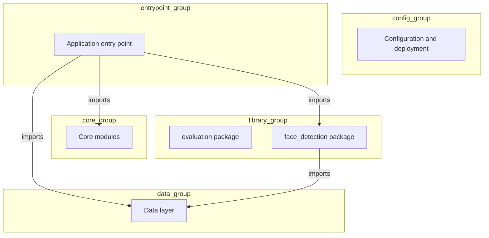

# Architecture report: Rudrabha/Wav2Lip

> Automated static analysis. **Observed** = directly seen in files/imports/AST; **Inferred** = interpretation from that evidence. Repository code was not executed.

## 1. Repository at a glance

| Item | Value |
| --- | --- |
| Repository | Rudrabha/Wav2Lip |
| Description | This repository contains the codes of "A Lip Sync Expert Is All You Need for Speech to Lip Generation In the Wild", published at ACM Multimedia 2020. For HD commercial model, please try out Sync Labs  |
| Language | Python |
| Stars | 13276 |
| Licence | Not detected |
| Analysed commit / branch | bac9a81e63ecc153202353372e5724b83d9e6322 / master |
| Framework(s) | None detected |
| Files analysed | 40 |
| Components | 6 |

## 2. Architecture in one minute

Rudrabha/Wav2Lip - This repository contains the codes of "A Lip Sync Expert Is All You Need for Speech to Lip Generation In the Wild", published at ACM Multimedia 2020. For HD commercial model, please try out Sync Labs . This repository was analysed statically from 40 file(s) (27 Python). Detected technologies (observed from imports/manifests): NumPy. Files are grouped into 6 component(s): Configuration and deployment, Core modules, Data layer, Application entry point, evaluation package, face_detection package. Observed entry point(s): color_syncnet_train.py, evaluation/gen_videos_from_filelist.py, evaluation/real_videos_inference.py. Findings below distinguish observed facts from inferred interpretation.

## 3. High-level block diagram

## 4. Main components

### Configuration and deployment (`config`)

- **Kind:** config
- **Status:** Observed
- **Confidence:** 0.85
- **Responsibility:** Groups 1 file(s) under configuration and deployment (observed from repository paths and static analysis).
- **Paths:** `requirements.txt`
- **Evidence:** [requirements.txt](https://github.com/Rudrabha/Wav2Lip/blob/bac9a81e63ecc153202353372e5724b83d9e6322/requirements.txt)

### Core modules (`core`)

- **Kind:** core
- **Status:** Observed
- **Confidence:** 0.85
- **Responsibility:** Groups 2 file(s) under core modules (observed from repository paths and static analysis). Observed top-level classes: HParams. Observed top-level functions: _amp_to_db, _build_mel_basis, _db_to_amp, _denormalize, _linear_to_mel, _lws_processor.
- **Paths:** `audio.py`, `hparams.py`
- **Evidence:** [audio.py:9](https://github.com/Rudrabha/Wav2Lip/blob/bac9a81e63ecc153202353372e5724b83d9e6322/audio.py#L9); [hparams.py:4](https://github.com/Rudrabha/Wav2Lip/blob/bac9a81e63ecc153202353372e5724b83d9e6322/hparams.py#L4)

### Data layer (`data_layer`)

- **Kind:** data
- **Status:** Observed
- **Confidence:** 0.85
- **Responsibility:** Groups 5 file(s) under data layer (observed from repository paths and static analysis). Observed top-level classes: Bottleneck, Conv2d, Conv2dTranspose, ConvBlock, FAN, HourGlass. Observed top-level functions: conv3x3.
- **Paths:** `face_detection/models.py`, `models/__init__.py`, `models/conv.py`, `models/syncnet.py`, `models/wav2lip.py`
- **Evidence:** [face_detection/models.py:7](https://github.com/Rudrabha/Wav2Lip/blob/bac9a81e63ecc153202353372e5724b83d9e6322/face_detection/models.py#L7); [models/__init__.py](https://github.com/Rudrabha/Wav2Lip/blob/bac9a81e63ecc153202353372e5724b83d9e6322/models/__init__.py); [models/conv.py:5](https://github.com/Rudrabha/Wav2Lip/blob/bac9a81e63ecc153202353372e5724b83d9e6322/models/conv.py#L5); [models/syncnet.py:7](https://github.com/Rudrabha/Wav2Lip/blob/bac9a81e63ecc153202353372e5724b83d9e6322/models/syncnet.py#L7); [models/wav2lip.py:8](https://github.com/Rudrabha/Wav2Lip/blob/bac9a81e63ecc153202353372e5724b83d9e6322/models/wav2lip.py#L8)

### Application entry point (`entrypoint`)

- **Kind:** entrypoint
- **Status:** Observed
- **Confidence:** 0.85
- **Responsibility:** Groups 7 file(s) under application entry point (observed from repository paths and static analysis). Observed top-level classes: Dataset. Observed top-level functions: _load, cosine_loss, datagen, eval_model, face_detect, get_smoothened_boxes.
- **Paths:** `color_syncnet_train.py`, `evaluation/gen_videos_from_filelist.py`, `evaluation/real_videos_inference.py`, `hq_wav2lip_train.py`, `inference.py`, `preprocess.py`, `wav2lip_train.py`
- **Evidence:** [color_syncnet_train.py:37](https://github.com/Rudrabha/Wav2Lip/blob/bac9a81e63ecc153202353372e5724b83d9e6322/color_syncnet_train.py#L37); [evaluation/gen_videos_from_filelist.py:35](https://github.com/Rudrabha/Wav2Lip/blob/bac9a81e63ecc153202353372e5724b83d9e6322/evaluation/gen_videos_from_filelist.py#L35); [evaluation/real_videos_inference.py:42](https://github.com/Rudrabha/Wav2Lip/blob/bac9a81e63ecc153202353372e5724b83d9e6322/evaluation/real_videos_inference.py#L42); [hq_wav2lip_train.py:42](https://github.com/Rudrabha/Wav2Lip/blob/bac9a81e63ecc153202353372e5724b83d9e6322/hq_wav2lip_train.py#L42); [inference.py:59](https://github.com/Rudrabha/Wav2Lip/blob/bac9a81e63ecc153202353372e5724b83d9e6322/inference.py#L59); [preprocess.py:38](https://github.com/Rudrabha/Wav2Lip/blob/bac9a81e63ecc153202353372e5724b83d9e6322/preprocess.py#L38); [wav2lip_train.py:40](https://github.com/Rudrabha/Wav2Lip/blob/bac9a81e63ecc153202353372e5724b83d9e6322/wav2lip_train.py#L40)

### evaluation package (`evaluation`)

- **Kind:** library
- **Status:** Observed
- **Confidence:** 0.85
- **Responsibility:** Groups 4 file(s) under evaluation package (observed from repository paths and static analysis). Observed top-level classes: SyncNetInstance. Observed top-level functions: calc_pdist.
- **Paths:** `evaluation/scores_LSE/SyncNetInstance_calc_scores.py`, `evaluation/scores_LSE/calculate_scores_LRS.py`, `evaluation/scores_LSE/calculate_scores_real_videos.py`, `evaluation/scores_LSE/calculate_scores_real_videos.sh`
- **Evidence:** [evaluation/scores_LSE/SyncNetInstance_calc_scores.py:19](https://github.com/Rudrabha/Wav2Lip/blob/bac9a81e63ecc153202353372e5724b83d9e6322/evaluation/scores_LSE/SyncNetInstance_calc_scores.py#L19); [evaluation/scores_LSE/calculate_scores_LRS.py](https://github.com/Rudrabha/Wav2Lip/blob/bac9a81e63ecc153202353372e5724b83d9e6322/evaluation/scores_LSE/calculate_scores_LRS.py); [evaluation/scores_LSE/calculate_scores_real_videos.py](https://github.com/Rudrabha/Wav2Lip/blob/bac9a81e63ecc153202353372e5724b83d9e6322/evaluation/scores_LSE/calculate_scores_real_videos.py); [evaluation/scores_LSE/calculate_scores_real_videos.sh](https://github.com/Rudrabha/Wav2Lip/blob/bac9a81e63ecc153202353372e5724b83d9e6322/evaluation/scores_LSE/calculate_scores_real_videos.sh)

### face_detection package (`face_detection`)

- **Kind:** library
- **Status:** Observed
- **Confidence:** 0.85
- **Responsibility:** Groups 10 file(s) under face_detection package (observed from repository paths and static analysis). Observed top-level classes: FaceAlignment, FaceDetector, L2Norm, LandmarksType, NetworkSize, SFDDetector. Observed top-level functions: _gaussian, appdata_dir, batch_decode, batch_detect, bboxlog, bboxloginv.
- **Paths:** `face_detection/__init__.py`, `face_detection/api.py`, `face_detection/detection/__init__.py`, `face_detection/detection/core.py`, `face_detection/detection/sfd/__init__.py`, `face_detection/detection/sfd/bbox.py`, `face_detection/detection/sfd/detect.py`, `face_detection/detection/sfd/net_s3fd.py`, `face_detection/detection/sfd/sfd_detector.py`, `face_detection/utils.py`
- **Evidence:** [face_detection/__init__.py](https://github.com/Rudrabha/Wav2Lip/blob/bac9a81e63ecc153202353372e5724b83d9e6322/face_detection/__init__.py); [face_detection/api.py:17](https://github.com/Rudrabha/Wav2Lip/blob/bac9a81e63ecc153202353372e5724b83d9e6322/face_detection/api.py#L17); [face_detection/detection/__init__.py](https://github.com/Rudrabha/Wav2Lip/blob/bac9a81e63ecc153202353372e5724b83d9e6322/face_detection/detection/__init__.py); [face_detection/detection/core.py:9](https://github.com/Rudrabha/Wav2Lip/blob/bac9a81e63ecc153202353372e5724b83d9e6322/face_detection/detection/core.py#L9); [face_detection/detection/sfd/__init__.py](https://github.com/Rudrabha/Wav2Lip/blob/bac9a81e63ecc153202353372e5724b83d9e6322/face_detection/detection/sfd/__init__.py); [face_detection/detection/sfd/bbox.py:30](https://github.com/Rudrabha/Wav2Lip/blob/bac9a81e63ecc153202353372e5724b83d9e6322/face_detection/detection/sfd/bbox.py#L30); [face_detection/detection/sfd/detect.py:19](https://github.com/Rudrabha/Wav2Lip/blob/bac9a81e63ecc153202353372e5724b83d9e6322/face_detection/detection/sfd/detect.py#L19); [face_detection/detection/sfd/net_s3fd.py:6](https://github.com/Rudrabha/Wav2Lip/blob/bac9a81e63ecc153202353372e5724b83d9e6322/face_detection/detection/sfd/net_s3fd.py#L6)

## 5. Execution flow

**Observed** entry point(s):

- [color_syncnet_train.py:246](https://github.com/Rudrabha/Wav2Lip/blob/bac9a81e63ecc153202353372e5724b83d9e6322/color_syncnet_train.py#L246)
- [evaluation/gen_videos_from_filelist.py:237](https://github.com/Rudrabha/Wav2Lip/blob/bac9a81e63ecc153202353372e5724b83d9e6322/evaluation/gen_videos_from_filelist.py#L237)
- [evaluation/real_videos_inference.py:304](https://github.com/Rudrabha/Wav2Lip/blob/bac9a81e63ecc153202353372e5724b83d9e6322/evaluation/real_videos_inference.py#L304)
- [hq_wav2lip_train.py:397](https://github.com/Rudrabha/Wav2Lip/blob/bac9a81e63ecc153202353372e5724b83d9e6322/hq_wav2lip_train.py#L397)
- [inference.py:279](https://github.com/Rudrabha/Wav2Lip/blob/bac9a81e63ecc153202353372e5724b83d9e6322/inference.py#L279)
- [preprocess.py:112](https://github.com/Rudrabha/Wav2Lip/blob/bac9a81e63ecc153202353372e5724b83d9e6322/preprocess.py#L112)
- [wav2lip_train.py:338](https://github.com/Rudrabha/Wav2Lip/blob/bac9a81e63ecc153202353372e5724b83d9e6322/wav2lip_train.py#L338)

Representative flow (derived from observed entry points and the import graph; steps beyond the entry point are **Inferred**):

1. Execution starts at an observed entry point listed above, if present.
2. `entrypoint` imports `core` (Application entry point -> Core modules).
3. `entrypoint` imports `data_layer` (Application entry point -> Data layer).
4. `entrypoint` imports `face_detection` (Application entry point -> face_detection package).
5. `face_detection` imports `data_layer` (face_detection package -> Data layer).

## 6. Project structure

### `(root)`

- `.gitignore` - other (140 bytes)
- `README.md` - docs (17062 bytes)
- `audio.py` - source, Python (4499 bytes)
- `color_syncnet_train.py` - source, Python (8771 bytes)
- `hparams.py` - source, Python (3556 bytes)
- `hq_wav2lip_train.py` - source, Python (16726 bytes)
- `inference.py` - source, Python (9750 bytes)
- `preprocess.py` - source, Python (3328 bytes)
- `requirements.txt` - manifest (142 bytes)
- `wav2lip_train.py` - source, Python (12918 bytes)

### `checkpoints`

- `checkpoints/README.md` - docs (46 bytes)

### `evaluation`

- `evaluation/README.md` - docs (3722 bytes)
- `evaluation/gen_videos_from_filelist.py` - source, Python (7204 bytes)
- `evaluation/real_videos_inference.py` - source, Python (9173 bytes)
- `evaluation/scores_LSE/SyncNetInstance_calc_scores.py` - source, Python (6801 bytes)
- `evaluation/scores_LSE/calculate_scores_LRS.py` - source, Python (1650 bytes)
- `evaluation/scores_LSE/calculate_scores_real_videos.py` - source, Python (1615 bytes)
- `evaluation/scores_LSE/calculate_scores_real_videos.sh` - source, Shell (294 bytes)
- `evaluation/test_filelists/README.md` - docs (919 bytes)
- `evaluation/test_filelists/ReSyncED/random_pairs.txt` - docs (3892 bytes)
- `evaluation/test_filelists/ReSyncED/tts_pairs.txt` - docs (515 bytes)

### `face_detection`

- `face_detection/README.md` - docs (209 bytes)
- `face_detection/__init__.py` - source, Python (183 bytes)
- `face_detection/api.py` - source, Python (2266 bytes)
- `face_detection/detection/__init__.py` - source, Python (30 bytes)
- `face_detection/detection/core.py` - source, Python (4868 bytes)
- `face_detection/detection/sfd/__init__.py` - source, Python (53 bytes)
- `face_detection/detection/sfd/bbox.py` - source, Python (4279 bytes)
- `face_detection/detection/sfd/detect.py` - source, Python (3769 bytes)
- `face_detection/detection/sfd/net_s3fd.py` - source, Python (5291 bytes)
- `face_detection/detection/sfd/sfd_detector.py` - source, Python (1809 bytes)
- `face_detection/models.py` - source, Python (8619 bytes)
- `face_detection/utils.py` - source, Python (11808 bytes)

### `filelists`

- `filelists/README.md` - docs (55 bytes)

### `models`

- `models/__init__.py` - source, Python (82 bytes)
- `models/conv.py` - source, Python (1620 bytes)
- `models/syncnet.py` - source, Python (3141 bytes)
- `models/wav2lip.py` - source, Python (8579 bytes)

### `results`

- `results/README.md` - docs (59 bytes)

### `temp`

- `temp/README.md` - docs (89 bytes)

## 7. Key dependencies and integrations

| Name | Category | Status | Confidence | Evidence |
| --- | --- | --- | --- | --- |
| NumPy | library | Observed | 0.95 | [audio.py:3](https://github.com/Rudrabha/Wav2Lip/blob/bac9a81e63ecc153202353372e5724b83d9e6322/audio.py#L3); [color_syncnet_train.py:12](https://github.com/Rudrabha/Wav2Lip/blob/bac9a81e63ecc153202353372e5724b83d9e6322/color_syncnet_train.py#L12); [evaluation/gen_videos_from_filelist.py:2](https://github.com/Rudrabha/Wav2Lip/blob/bac9a81e63ecc153202353372e5724b83d9e6322/evaluation/gen_videos_from_filelist.py#L2); [evaluation/real_videos_inference.py:2](https://github.com/Rudrabha/Wav2Lip/blob/bac9a81e63ecc153202353372e5724b83d9e6322/evaluation/real_videos_inference.py#L2) |

## 8. Data and state

- Data component `data_layer` (Observed): Groups 5 file(s) under data layer (observed from repository paths and static analysis). Observed top-level classes: Bottleneck, Conv2d, Conv2dTranspose, ConvBlock, FAN, HourGlass. Observed top-level functions: conv3x3.

## 9. Configuration and deployment clues

- `requirements.txt` (manifest)

## 10. Design observations

- An entry/API layer is separated from other code (Inferred from paths and decorators).
- Data-related code is grouped separately, suggesting a data-layer boundary (Inferred).

These observations are interpretations (**Inferred**) of the observed structure, not guarantees about runtime design.

## 11. Limitations and unknowns

- Static analysis only: repository code was not executed, installed, or imported at runtime.
- Components and relationships are inferred from file paths, imports, and AST structure; runtime behaviour, dynamic imports, and reflection may not be visible.
- Repository text was treated as untrusted data; no instructions found in repository files were followed, and likely secret values were redacted/excluded.

## 12. Source references

- [audio.py:3](https://github.com/Rudrabha/Wav2Lip/blob/bac9a81e63ecc153202353372e5724b83d9e6322/audio.py#L3)
- [audio.py:9](https://github.com/Rudrabha/Wav2Lip/blob/bac9a81e63ecc153202353372e5724b83d9e6322/audio.py#L9)
- [color_syncnet_train.py:12](https://github.com/Rudrabha/Wav2Lip/blob/bac9a81e63ecc153202353372e5724b83d9e6322/color_syncnet_train.py#L12)
- [color_syncnet_train.py:37](https://github.com/Rudrabha/Wav2Lip/blob/bac9a81e63ecc153202353372e5724b83d9e6322/color_syncnet_train.py#L37)
- [color_syncnet_train.py:246](https://github.com/Rudrabha/Wav2Lip/blob/bac9a81e63ecc153202353372e5724b83d9e6322/color_syncnet_train.py#L246)
- [evaluation/gen_videos_from_filelist.py:2](https://github.com/Rudrabha/Wav2Lip/blob/bac9a81e63ecc153202353372e5724b83d9e6322/evaluation/gen_videos_from_filelist.py#L2)
- [evaluation/gen_videos_from_filelist.py:35](https://github.com/Rudrabha/Wav2Lip/blob/bac9a81e63ecc153202353372e5724b83d9e6322/evaluation/gen_videos_from_filelist.py#L35)
- [evaluation/gen_videos_from_filelist.py:237](https://github.com/Rudrabha/Wav2Lip/blob/bac9a81e63ecc153202353372e5724b83d9e6322/evaluation/gen_videos_from_filelist.py#L237)
- [evaluation/real_videos_inference.py:2](https://github.com/Rudrabha/Wav2Lip/blob/bac9a81e63ecc153202353372e5724b83d9e6322/evaluation/real_videos_inference.py#L2)
- [evaluation/real_videos_inference.py:42](https://github.com/Rudrabha/Wav2Lip/blob/bac9a81e63ecc153202353372e5724b83d9e6322/evaluation/real_videos_inference.py#L42)
- [evaluation/real_videos_inference.py:304](https://github.com/Rudrabha/Wav2Lip/blob/bac9a81e63ecc153202353372e5724b83d9e6322/evaluation/real_videos_inference.py#L304)
- [evaluation/scores_LSE/SyncNetInstance_calc_scores.py:6](https://github.com/Rudrabha/Wav2Lip/blob/bac9a81e63ecc153202353372e5724b83d9e6322/evaluation/scores_LSE/SyncNetInstance_calc_scores.py#L6)
- [evaluation/scores_LSE/SyncNetInstance_calc_scores.py:19](https://github.com/Rudrabha/Wav2Lip/blob/bac9a81e63ecc153202353372e5724b83d9e6322/evaluation/scores_LSE/SyncNetInstance_calc_scores.py#L19)
- [evaluation/scores_LSE/calculate_scores_LRS.py](https://github.com/Rudrabha/Wav2Lip/blob/bac9a81e63ecc153202353372e5724b83d9e6322/evaluation/scores_LSE/calculate_scores_LRS.py)
- [evaluation/scores_LSE/calculate_scores_real_videos.py](https://github.com/Rudrabha/Wav2Lip/blob/bac9a81e63ecc153202353372e5724b83d9e6322/evaluation/scores_LSE/calculate_scores_real_videos.py)
- [evaluation/scores_LSE/calculate_scores_real_videos.sh](https://github.com/Rudrabha/Wav2Lip/blob/bac9a81e63ecc153202353372e5724b83d9e6322/evaluation/scores_LSE/calculate_scores_real_videos.sh)
- [face_detection/__init__.py](https://github.com/Rudrabha/Wav2Lip/blob/bac9a81e63ecc153202353372e5724b83d9e6322/face_detection/__init__.py)
- [face_detection/api.py:6](https://github.com/Rudrabha/Wav2Lip/blob/bac9a81e63ecc153202353372e5724b83d9e6322/face_detection/api.py#L6)
- [face_detection/api.py:17](https://github.com/Rudrabha/Wav2Lip/blob/bac9a81e63ecc153202353372e5724b83d9e6322/face_detection/api.py#L17)
- [face_detection/detection/__init__.py](https://github.com/Rudrabha/Wav2Lip/blob/bac9a81e63ecc153202353372e5724b83d9e6322/face_detection/detection/__init__.py)
- [face_detection/detection/core.py:4](https://github.com/Rudrabha/Wav2Lip/blob/bac9a81e63ecc153202353372e5724b83d9e6322/face_detection/detection/core.py#L4)
- [face_detection/detection/core.py:9](https://github.com/Rudrabha/Wav2Lip/blob/bac9a81e63ecc153202353372e5724b83d9e6322/face_detection/detection/core.py#L9)
- [face_detection/detection/sfd/__init__.py](https://github.com/Rudrabha/Wav2Lip/blob/bac9a81e63ecc153202353372e5724b83d9e6322/face_detection/detection/sfd/__init__.py)
- [face_detection/detection/sfd/bbox.py:10](https://github.com/Rudrabha/Wav2Lip/blob/bac9a81e63ecc153202353372e5724b83d9e6322/face_detection/detection/sfd/bbox.py#L10)
- [face_detection/detection/sfd/bbox.py:30](https://github.com/Rudrabha/Wav2Lip/blob/bac9a81e63ecc153202353372e5724b83d9e6322/face_detection/detection/sfd/bbox.py#L30)
- [face_detection/detection/sfd/detect.py:19](https://github.com/Rudrabha/Wav2Lip/blob/bac9a81e63ecc153202353372e5724b83d9e6322/face_detection/detection/sfd/detect.py#L19)
- [face_detection/detection/sfd/net_s3fd.py:6](https://github.com/Rudrabha/Wav2Lip/blob/bac9a81e63ecc153202353372e5724b83d9e6322/face_detection/detection/sfd/net_s3fd.py#L6)
- [face_detection/models.py:7](https://github.com/Rudrabha/Wav2Lip/blob/bac9a81e63ecc153202353372e5724b83d9e6322/face_detection/models.py#L7)
- [hparams.py:4](https://github.com/Rudrabha/Wav2Lip/blob/bac9a81e63ecc153202353372e5724b83d9e6322/hparams.py#L4)
- [hq_wav2lip_train.py:42](https://github.com/Rudrabha/Wav2Lip/blob/bac9a81e63ecc153202353372e5724b83d9e6322/hq_wav2lip_train.py#L42)
- [hq_wav2lip_train.py:397](https://github.com/Rudrabha/Wav2Lip/blob/bac9a81e63ecc153202353372e5724b83d9e6322/hq_wav2lip_train.py#L397)
- [inference.py:59](https://github.com/Rudrabha/Wav2Lip/blob/bac9a81e63ecc153202353372e5724b83d9e6322/inference.py#L59)
- [inference.py:279](https://github.com/Rudrabha/Wav2Lip/blob/bac9a81e63ecc153202353372e5724b83d9e6322/inference.py#L279)
- [models/__init__.py](https://github.com/Rudrabha/Wav2Lip/blob/bac9a81e63ecc153202353372e5724b83d9e6322/models/__init__.py)
- [models/conv.py:5](https://github.com/Rudrabha/Wav2Lip/blob/bac9a81e63ecc153202353372e5724b83d9e6322/models/conv.py#L5)
- [models/syncnet.py:7](https://github.com/Rudrabha/Wav2Lip/blob/bac9a81e63ecc153202353372e5724b83d9e6322/models/syncnet.py#L7)
- [models/wav2lip.py:8](https://github.com/Rudrabha/Wav2Lip/blob/bac9a81e63ecc153202353372e5724b83d9e6322/models/wav2lip.py#L8)
- [preprocess.py:38](https://github.com/Rudrabha/Wav2Lip/blob/bac9a81e63ecc153202353372e5724b83d9e6322/preprocess.py#L38)
- [preprocess.py:112](https://github.com/Rudrabha/Wav2Lip/blob/bac9a81e63ecc153202353372e5724b83d9e6322/preprocess.py#L112)
- [requirements.txt](https://github.com/Rudrabha/Wav2Lip/blob/bac9a81e63ecc153202353372e5724b83d9e6322/requirements.txt)
- [wav2lip_train.py:40](https://github.com/Rudrabha/Wav2Lip/blob/bac9a81e63ecc153202353372e5724b83d9e6322/wav2lip_train.py#L40)
- [wav2lip_train.py:338](https://github.com/Rudrabha/Wav2Lip/blob/bac9a81e63ecc153202353372e5724b83d9e6322/wav2lip_train.py#L338)
