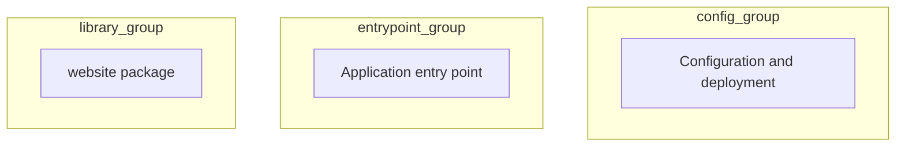

# Architecture report: RunaCapital/awesome-oss-alternatives

> Automated static analysis. **Observed** = directly seen in files/imports/AST; **Inferred** = interpretation from that evidence. Repository code was not executed.

## 1. Repository at a glance

| Item | Value |
| --- | --- |
| Repository | RunaCapital/awesome-oss-alternatives |
| Description | Awesome list of open-source startup alternatives to well-known SaaS products 🚀 |
| Language | Python |
| Stars | 19872 |
| Licence | MIT |
| Analysed commit / branch | e5a1bd6153c602404c6f25a97b178228b755aebb / main |
| Framework(s) | React |
| Files analysed | 435 |
| Components | 3 |

## 2. Architecture in one minute

RunaCapital/awesome-oss-alternatives - Awesome list of open-source startup alternatives to well-known SaaS products 🚀. This repository was analysed statically from 435 file(s) (6 Python). Detected technologies (observed from imports/manifests): GitHub Actions, React. Files are grouped into 3 component(s): Configuration and deployment, Application entry point, website package. Observed entry point(s): add_company.py, build_readme.py, build_website.py. Findings below distinguish observed facts from inferred interpretation.

## 3. High-level block diagram

## 4. Main components

### Configuration and deployment (`config`)

- **Kind:** config
- **Status:** Observed
- **Confidence:** 0.85
- **Responsibility:** Groups 217 file(s) under configuration and deployment (observed from repository paths and static analysis).
- **Paths:** `submissions/21st.dev.yaml`, `submissions/AceBase.yaml`, `submissions/Airbyte.yaml`, `submissions/Amplication.yaml`, `submissions/Apache_APISIX.yaml`, `submissions/AppBase.yaml`, `submissions/AppFlowy.yaml`, `submissions/AppSmith.yaml`, `submissions/Appwrite.yaml`, `submissions/ArangoDB.yaml`, `submissions/Athens_Research.yaml`, `submissions/Bagisto.yaml`, `submissions/Bangle.io.yaml`, `submissions/Baserow.yaml`, `submissions/Benthos.yaml`, `submissions/BitWarden.yaml`, `submissions/Boost_Note.yaml`, `submissions/BoxyHQ.yaml`, `submissions/Budibase.yaml`, `submissions/Builder.yaml`, `submissions/CASE.yaml`, `submissions/Cal.com.yaml`, `submissions/Castled.yaml`, `submissions/Cerbos.yaml`, `submissions/Chaos_Genius.yaml`, `submissions/Chaskiq.yaml`, `submissions/Chatwoot.yaml`, `submissions/CloudQuery.yaml`, `submissions/Concrete.yaml`, `submissions/Coolify.yaml`, `submissions/Cortex.yaml`, `submissions/CrateDB.yaml`, `submissions/CrowdSec.yaml`, `submissions/Cube.js.yaml`, `submissions/Dagster.yaml`, `submissions/Databend.yaml`, `submissions/Decap_CMS.yaml`, `submissions/Deepfence_ThreatMapper.yaml`, `submissions/Dendron.yaml`, `submissions/Directus.yaml`, `submissions/Discourse.yaml`, `submissions/DocuSeal.yaml`, `submissions/Documenso.yaml`, `submissions/Dokku.yaml`, `submissions/DoliCloud.yaml`, `submissions/Dub.yaml`, `submissions/ERPNext.yaml`, `submissions/Element.yaml`, `submissions/Encore.yaml`, `submissions/Evidence.yaml`, `submissions/Faraday.yaml`, `submissions/Filestash.yaml`, `submissions/Firecamp.yaml`, `submissions/Firezone.yaml`, `submissions/FlagSmith.yaml`, `submissions/Focalboard.yaml`, `submissions/Fonoster.yaml`, `submissions/FormKit.yaml`, `submissions/Formbricks.yaml`, `submissions/Formio.yaml`, `submissions/Fusio.yaml`, `submissions/FusionAuth.yaml`, `submissions/Ghost.yaml`, `submissions/Gitpod.yaml`, `submissions/Glimesh.yaml`, `submissions/GoatCounter.yaml`, `submissions/Grafana.yaml`, `submissions/Gravitl.yaml`, `submissions/Graylog.yaml`, `submissions/Grouparoo.yaml`, `submissions/GrowthBook.yaml`, `submissions/Hanko.yaml`, `submissions/Hoppscotch.yaml`, `submissions/ILLA_Cloud.yaml`, `submissions/InfluxDB.yaml`, `submissions/Jina.ai.yaml`, `submissions/Jitsi.yaml`, `submissions/Jitsu.yaml`, `submissions/Joplin.yaml`, `submissions/Keila.yaml`, `submissions/Keploy.yaml`, `submissions/Kestra.yaml`, `submissions/Keycloak.yaml`, `submissions/Kuzzle.yaml`, `submissions/Lago.yaml`, `submissions/LibreSign.yaml`, `submissions/LightDash.yaml`, `submissions/LimeSurvey.yaml`, `submissions/LiveKit.yaml`, `submissions/Logseq.yaml`, `submissions/Lowdefy.yaml`, `submissions/LunaTrace.yaml`, `submissions/MLCraft.yaml`, `submissions/Manticore_Search.yaml`, `submissions/Matano.yaml`, `submissions/Matomo.yaml`, `submissions/Mattermost.yaml`, `submissions/Medusa.yaml`, `submissions/Meilisearch.yaml`, `submissions/Memgraph.yaml`, `submissions/Metabase.yaml`, `submissions/Metarank.yaml`, `submissions/MetriQL.yaml`, `submissions/MindsDB.yaml`, `submissions/Minio.yaml`, `submissions/Modulz.yaml`, `submissions/N8N.yaml`, `submissions/Neo4j.yaml`, `submissions/NetBird.yaml`, `submissions/Netdata.yaml`, `submissions/Netlify_CMS.yaml`, `submissions/Nextcloud.yaml`, `submissions/Nhost.yaml`, `submissions/NocoDB.yaml`, `submissions/Notabase.yaml`, `submissions/Notesnook.yaml`, `submissions/Novu.yaml`, `submissions/Nuclei.yaml`, `submissions/OPAL_(Permit.io).yaml`, `submissions/Objectiv.yaml`, `submissions/OmniEdge.yaml`, `submissions/OpenBB_Terminal.yaml`, `submissions/OpenProject.yaml`, `submissions/OpenReplay.yaml`, `submissions/OpenStatus.yaml`, `submissions/OpenVidu.yaml`, `submissions/Orchest.yaml`, `submissions/Ory.yaml`, `submissions/Oso.yaml`, `submissions/Otomi.yaml`, `submissions/Outline.yaml`, `submissions/Owncloud.yaml`, `submissions/Padloc.yaml`, `submissions/Papercups.yaml`, `submissions/Passbolt.yaml`, `submissions/Penpot.yaml`, `submissions/Peppermint.yaml`, `submissions/PingCAP.yaml`, `submissions/Pipedream.yaml`, `submissions/Plane.yaml`, `submissions/Plasmic.yaml`, `submissions/Plausible.yaml`, `submissions/Ploomber.yaml`, `submissions/PocketBase.yaml`, `submissions/Porter.yaml`, `submissions/PostHog.yaml`, `submissions/Postiz.yaml`, `submissions/Prefect.yaml`, `submissions/Preset.yaml`, `submissions/Pulumi.yaml`, `submissions/Qdrant.yaml`, `submissions/Qovery.yaml`, `submissions/QuestDB.yaml`, `submissions/Quickwit.yaml`, `submissions/RoboCorp.yaml`, `submissions/Rocket.chat.yaml`, `submissions/Rowy.yaml`, `submissions/Rudderstack.yaml`, `submissions/RustDesk.yaml`, `submissions/Saleor.yaml`, `submissions/SeMI.yaml`, `submissions/Seldon.yaml`, `submissions/Selefra.yaml`, `submissions/Sentry.yaml`, `submissions/Shuup.yaml`, `submissions/Signoz.yaml`, `submissions/Space_Cloud.yaml`, `submissions/Spacedrive.yaml`, `submissions/Step_CI.yaml`, `submissions/Storj.yaml`, `submissions/Strapi.yaml`, `submissions/Sulu.yaml`, `submissions/Supabase.yaml`, `submissions/Supertokens.yaml`, `submissions/Svix.yaml`, `submissions/Swetrix.yaml`, `submissions/Sylius.yaml`, `submissions/TDengine.yaml`, `submissions/Taiga.yaml`, `submissions/Temporal.yaml`, `submissions/TerminusDB.yaml`, `submissions/TimescaleDB.yaml`, `submissions/Tina.yaml`, `submissions/Tinode.yaml`, `submissions/Tolgee.yaml`, `submissions/Tooljet.yaml`, `submissions/Totum.yaml`, `submissions/Tracardi.yaml`, `submissions/Trench.yaml`, `submissions/Trilium.cc.yaml`, `submissions/Tunnelmole.yaml`, `submissions/TypeSense.yaml`, `submissions/UVDesk.yaml`, `submissions/Umami.yaml`, `submissions/Unleash.yaml`, `submissions/Uptrace.yaml`, `submissions/Vanilla.yaml`, `submissions/Vendure.yaml`, `submissions/VictoriaMetrics.yaml`, `submissions/Vikunja.yaml`, `submissions/Vue_Storefront.yaml`, `submissions/Warrant.yaml`, `submissions/Webiny.yaml`, `submissions/Windmill.yaml`, `submissions/Yugabyte.yaml`, `submissions/Zilliz.yaml`, `submissions/Zinc_Labs.yaml`, `submissions/Zitadel.yaml`, `submissions/Zulip.yaml`, `submissions/[Activepieces.yaml`, `submissions/crowd.dev.yaml`, `submissions/deepset.yaml`, `submissions/dyrector.io.yaml`, `submissions/inlang.yaml`, `submissions/snoopForms.yaml`, `website/blog/authors.yml`, `website/package.json`
- **Evidence:** [submissions/21st.dev.yaml](https://github.com/RunaCapital/awesome-oss-alternatives/blob/e5a1bd6153c602404c6f25a97b178228b755aebb/submissions/21st.dev.yaml); [submissions/AceBase.yaml](https://github.com/RunaCapital/awesome-oss-alternatives/blob/e5a1bd6153c602404c6f25a97b178228b755aebb/submissions/AceBase.yaml); [submissions/Airbyte.yaml](https://github.com/RunaCapital/awesome-oss-alternatives/blob/e5a1bd6153c602404c6f25a97b178228b755aebb/submissions/Airbyte.yaml); [submissions/Amplication.yaml](https://github.com/RunaCapital/awesome-oss-alternatives/blob/e5a1bd6153c602404c6f25a97b178228b755aebb/submissions/Amplication.yaml); [submissions/Apache_APISIX.yaml](https://github.com/RunaCapital/awesome-oss-alternatives/blob/e5a1bd6153c602404c6f25a97b178228b755aebb/submissions/Apache_APISIX.yaml); [submissions/AppBase.yaml](https://github.com/RunaCapital/awesome-oss-alternatives/blob/e5a1bd6153c602404c6f25a97b178228b755aebb/submissions/AppBase.yaml); [submissions/AppFlowy.yaml](https://github.com/RunaCapital/awesome-oss-alternatives/blob/e5a1bd6153c602404c6f25a97b178228b755aebb/submissions/AppFlowy.yaml); [submissions/AppSmith.yaml](https://github.com/RunaCapital/awesome-oss-alternatives/blob/e5a1bd6153c602404c6f25a97b178228b755aebb/submissions/AppSmith.yaml)

### Application entry point (`entrypoint`)

- **Kind:** entrypoint
- **Status:** Observed
- **Confidence:** 0.85
- **Responsibility:** Groups 6 file(s) under application entry point (observed from repository paths and static analysis). Observed top-level functions: add_company_from_command_line, add_new_company, build_list, count_companies_in_readme, create_alternatives_md, create_markdown_for_companies.
- **Paths:** `add_company.py`, `build_readme.py`, `build_website.py`, `count.py`, `create_yamls.py`, `sort.py`
- **Evidence:** [add_company.py:7](https://github.com/RunaCapital/awesome-oss-alternatives/blob/e5a1bd6153c602404c6f25a97b178228b755aebb/add_company.py#L7); [build_readme.py:9](https://github.com/RunaCapital/awesome-oss-alternatives/blob/e5a1bd6153c602404c6f25a97b178228b755aebb/build_readme.py#L9); [build_website.py:5](https://github.com/RunaCapital/awesome-oss-alternatives/blob/e5a1bd6153c602404c6f25a97b178228b755aebb/build_website.py#L5); [count.py:1](https://github.com/RunaCapital/awesome-oss-alternatives/blob/e5a1bd6153c602404c6f25a97b178228b755aebb/count.py#L1); [create_yamls.py:8](https://github.com/RunaCapital/awesome-oss-alternatives/blob/e5a1bd6153c602404c6f25a97b178228b755aebb/create_yamls.py#L8); [sort.py:1](https://github.com/RunaCapital/awesome-oss-alternatives/blob/e5a1bd6153c602404c6f25a97b178228b755aebb/sort.py#L1)

### website package (`website`)

- **Kind:** library
- **Status:** Observed
- **Confidence:** 0.85
- **Responsibility:** Groups 5 file(s) under website package (observed from repository paths and static analysis).
- **Paths:** `website/babel.config.js`, `website/docusaurus.config.js`, `website/sidebars.js`, `website/src/components/HomepageFeatures/index.js`, `website/src/pages/index.js`
- **Evidence:** [website/babel.config.js](https://github.com/RunaCapital/awesome-oss-alternatives/blob/e5a1bd6153c602404c6f25a97b178228b755aebb/website/babel.config.js); [website/docusaurus.config.js](https://github.com/RunaCapital/awesome-oss-alternatives/blob/e5a1bd6153c602404c6f25a97b178228b755aebb/website/docusaurus.config.js); [website/sidebars.js](https://github.com/RunaCapital/awesome-oss-alternatives/blob/e5a1bd6153c602404c6f25a97b178228b755aebb/website/sidebars.js); [website/src/components/HomepageFeatures/index.js](https://github.com/RunaCapital/awesome-oss-alternatives/blob/e5a1bd6153c602404c6f25a97b178228b755aebb/website/src/components/HomepageFeatures/index.js); [website/src/pages/index.js](https://github.com/RunaCapital/awesome-oss-alternatives/blob/e5a1bd6153c602404c6f25a97b178228b755aebb/website/src/pages/index.js)

## 5. Execution flow

**Observed** entry point(s):

- [add_company.py:162](https://github.com/RunaCapital/awesome-oss-alternatives/blob/e5a1bd6153c602404c6f25a97b178228b755aebb/add_company.py#L162)
- [build_readme.py:25](https://github.com/RunaCapital/awesome-oss-alternatives/blob/e5a1bd6153c602404c6f25a97b178228b755aebb/build_readme.py#L25)
- [build_website.py:100](https://github.com/RunaCapital/awesome-oss-alternatives/blob/e5a1bd6153c602404c6f25a97b178228b755aebb/build_website.py#L100)
- [count.py:13](https://github.com/RunaCapital/awesome-oss-alternatives/blob/e5a1bd6153c602404c6f25a97b178228b755aebb/count.py#L13)
- [create_yamls.py:40](https://github.com/RunaCapital/awesome-oss-alternatives/blob/e5a1bd6153c602404c6f25a97b178228b755aebb/create_yamls.py#L40)
- [sort.py:27](https://github.com/RunaCapital/awesome-oss-alternatives/blob/e5a1bd6153c602404c6f25a97b178228b755aebb/sort.py#L27)
- [website/src/pages/index.js](https://github.com/RunaCapital/awesome-oss-alternatives/blob/e5a1bd6153c602404c6f25a97b178228b755aebb/website/src/pages/index.js)

Representative flow (derived from observed entry points and the import graph; steps beyond the entry point are **Inferred**):

1. Execution starts at an observed entry point listed above, if present.
2. No internal import relationships between components were observed.

## 6. Project structure

### `(root)`

- `.gitignore` - other (2062 bytes)
- `LICENSE` - docs (1067 bytes)
- `README.md` - docs (66609 bytes)
- `add_company.py` - source, Python (4956 bytes)
- `build_readme.py` - source, Python (530 bytes)
- `build_website.py` - source, Python (3652 bytes)
- `count.py` - source, Python (381 bytes)
- `create_yamls.py` - source, Python (1313 bytes)
- `sort.py` - source, Python (794 bytes)

### `.github`

- `.github/CONTRIBUTING.md` - docs (1912 bytes)
- `.github/workflows/deploy.yml` - ci, YAML (1567 bytes)
- `.github/workflows/direct_merge_to_readme.yaml` - ci, YAML (1189 bytes)
- `.github/workflows/merge_created_new_yaml.yaml` - ci, YAML (1113 bytes)
- `.github/workflows/push_to_readme.yaml` - ci, YAML (1121 bytes)
- `.github/workflows/push_to_yaml.yaml` - ci, YAML (1030 bytes)

### `.history`

- `.history/README_20220510185516.md` - docs (47934 bytes)
- `.history/README_20220510185835.md` - docs (48215 bytes)
- `.history/README_20220510185946.md` - docs (48211 bytes)
- `.history/README_20220510190636.md` - docs (48216 bytes)
- `.history/README_20220510190641.md` - docs (48232 bytes)
- `.history/README_20220510190651.md` - docs (48215 bytes)
- `.history/README_20220510190654.md` - docs (48190 bytes)
- `.history/README_20220510190656.md` - docs (48191 bytes)

### `submissions`

- `submissions/21st.dev.yaml` - config (217 bytes)
- `submissions/AceBase.yaml` - config (262 bytes)
- `submissions/Airbyte.yaml` - config (212 bytes)
- `submissions/Amplication.yaml` - config (290 bytes)
- `submissions/Apache_APISIX.yaml` - config (273 bytes)
- `submissions/AppBase.yaml` - config (246 bytes)
- `submissions/AppFlowy.yaml` - config (229 bytes)
- `submissions/AppSmith.yaml` - config (234 bytes)
- `submissions/Appwrite.yaml` - config (265 bytes)
- `submissions/ArangoDB.yaml` - config (291 bytes)
- `submissions/Athens_Research.yaml` - config (264 bytes)
- `submissions/Bagisto.yaml` - config (253 bytes)
- `submissions/Bangle.io.yaml` - config (278 bytes)
- `submissions/Baserow.yaml` - config (235 bytes)
- `submissions/Benthos.yaml` - config (253 bytes)
- `submissions/BitWarden.yaml` - config (242 bytes)
- `submissions/Boost_Note.yaml` - config (239 bytes)
- `submissions/BoxyHQ.yaml` - config (209 bytes)
- `submissions/Budibase.yaml` - config (227 bytes)
- `submissions/Builder.yaml` - config (223 bytes)
- `submissions/CASE.yaml` - config (249 bytes)
- `submissions/Cal.com.yaml` - config (235 bytes)
- `submissions/Castled.yaml` - config (284 bytes)
- `submissions/Cerbos.yaml` - config (227 bytes)
- `submissions/Chaos_Genius.yaml` - config (438 bytes)
- `submissions/Chaskiq.yaml` - config (252 bytes)
- `submissions/Chatwoot.yaml` - config (261 bytes)
- `submissions/CloudQuery.yaml` - config (403 bytes)
- `submissions/Concrete.yaml` - config (214 bytes)
- `submissions/Coolify.yaml` - config (232 bytes)
- `submissions/Cortex.yaml` - config (250 bytes)
- `submissions/CrateDB.yaml` - config (262 bytes)
- `submissions/CrowdSec.yaml` - config (315 bytes)
- `submissions/Cube.js.yaml` - config (219 bytes)
- `submissions/Dagster.yaml` - config (226 bytes)
- `submissions/Databend.yaml` - config (262 bytes)
- `submissions/Decap_CMS.yaml` - config (238 bytes)
- `submissions/Deepfence_ThreatMapper.yaml` - config (418 bytes)
- `submissions/Dendron.yaml` - config (234 bytes)
- `submissions/Directus.yaml` - config (251 bytes)
- `submissions/Discourse.yaml` - config (261 bytes)
- `submissions/DocuSeal.yaml` - config (232 bytes)
- `submissions/Documenso.yaml` - config (235 bytes)
- `submissions/Dokku.yaml` - config (231 bytes)
- `submissions/DoliCloud.yaml` - config (330 bytes)
- `submissions/Dub.yaml` - config (228 bytes)
- `submissions/ERPNext.yaml` - config (295 bytes)
- `submissions/Element.yaml` - config (218 bytes)
- `submissions/Encore.yaml` - config (283 bytes)
- `submissions/Evidence.yaml` - config (231 bytes)
- `submissions/Faraday.yaml` - config (287 bytes)
- `submissions/Filestash.yaml` - config (319 bytes)
- `submissions/Firecamp.yaml` - config (231 bytes)
- `submissions/Firezone.yaml` - config (252 bytes)
- `submissions/FlagSmith.yaml` - config (263 bytes)
- `submissions/Focalboard.yaml` - config (310 bytes)
- `submissions/Fonoster.yaml` - config (223 bytes)
- `submissions/FormKit.yaml` - config (271 bytes)
- `submissions/Formbricks.yaml` - config (365 bytes)
- `submissions/Formio.yaml` - config (291 bytes)
- `submissions/Fusio.yaml` - config (218 bytes)
- `submissions/FusionAuth.yaml` - config (286 bytes)
- `submissions/Ghost.yaml` - config (246 bytes)
- `submissions/Gitpod.yaml` - config (315 bytes)
- `submissions/Glimesh.yaml` - config (210 bytes)
- `submissions/GoatCounter.yaml` - config (253 bytes)
- `submissions/Grafana.yaml` - config (289 bytes)
- `submissions/Gravitl.yaml` - config (268 bytes)
- `submissions/Graylog.yaml` - config (227 bytes)
- `submissions/Grouparoo.yaml` - config (235 bytes)
- `submissions/GrowthBook.yaml` - config (263 bytes)
- `submissions/Hanko.yaml` - config (244 bytes)
- `submissions/Hoppscotch.yaml` - config (227 bytes)
- `submissions/ILLA_Cloud.yaml` - config (271 bytes)
- `submissions/InfluxDB.yaml` - config (254 bytes)
- `submissions/Jina.ai.yaml` - config (286 bytes)
- `submissions/Jitsi.yaml` - config (221 bytes)
- `submissions/Jitsu.yaml` - config (252 bytes)
- `submissions/Joplin.yaml` - config (333 bytes)
- `submissions/Keila.yaml` - config (255 bytes)
- `submissions/Keploy.yaml` - config (334 bytes)
- `submissions/Kestra.yaml` - config (221 bytes)
- `submissions/Keycloak.yaml` - config (269 bytes)
- `submissions/Kuzzle.yaml` - config (274 bytes)
- `submissions/Lago.yaml` - config (267 bytes)
- `submissions/LibreSign.yaml` - config (230 bytes)
- `submissions/LightDash.yaml` - config (243 bytes)
- `submissions/LimeSurvey.yaml` - config (275 bytes)
- `submissions/LiveKit.yaml` - config (279 bytes)
- `submissions/Logseq.yaml` - config (214 bytes)
- `submissions/Lowdefy.yaml` - config (234 bytes)
- `submissions/LunaTrace.yaml` - config (422 bytes)
- `submissions/MLCraft.yaml` - config (232 bytes)
- `submissions/Manticore_Search.yaml` - config (299 bytes)
- `submissions/Matano.yaml` - config (414 bytes)
- `submissions/Matomo.yaml` - config (238 bytes)
- `submissions/Mattermost.yaml` - config (247 bytes)
- `submissions/Medusa.yaml` - config (254 bytes)
- `submissions/Meilisearch.yaml` - config (243 bytes)
- `submissions/Memgraph.yaml` - config (278 bytes)
- `submissions/Metabase.yaml` - config (328 bytes)
- `submissions/Metarank.yaml` - config (273 bytes)
- `submissions/MetriQL.yaml` - config (222 bytes)
- `submissions/MindsDB.yaml` - config (243 bytes)
- `submissions/Minio.yaml` - config (213 bytes)
- `submissions/Modulz.yaml` - config (232 bytes)
- `submissions/N8N.yaml` - config (228 bytes)
- `submissions/Neo4j.yaml` - config (264 bytes)
- `submissions/NetBird.yaml` - config (265 bytes)
- `submissions/Netdata.yaml` - config (298 bytes)
- `submissions/Netlify_CMS.yaml` - config (243 bytes)
- `submissions/Nextcloud.yaml` - config (285 bytes)
- `submissions/Nhost.yaml` - config (222 bytes)
- `submissions/NocoDB.yaml` - config (238 bytes)
- `submissions/Notabase.yaml` - config (297 bytes)
- `submissions/Notesnook.yaml` - config (318 bytes)
- `submissions/Novu.yaml` - config (302 bytes)
- `submissions/Nuclei.yaml` - config (288 bytes)
- `submissions/OPAL_(Permit.io).yaml` - config (267 bytes)
- `submissions/Objectiv.yaml` - config (341 bytes)
- `submissions/OmniEdge.yaml` - config (356 bytes)
- `submissions/OpenBB_Terminal.yaml` - config (288 bytes)
- `submissions/OpenProject.yaml` - config (259 bytes)
- `submissions/OpenReplay.yaml` - config (290 bytes)
- `submissions/OpenStatus.yaml` - config (287 bytes)
- `submissions/OpenVidu.yaml` - config (261 bytes)
- `submissions/Orchest.yaml` - config (219 bytes)
- `submissions/Ory.yaml` - config (215 bytes)
- `submissions/Oso.yaml` - config (232 bytes)
- `submissions/Otomi.yaml` - config (227 bytes)
- `submissions/Outline.yaml` - config (211 bytes)
- `submissions/Owncloud.yaml` - config (280 bytes)
- `submissions/Padloc.yaml` - config (233 bytes)
- `submissions/Papercups.yaml` - config (263 bytes)
- `submissions/Passbolt.yaml` - config (249 bytes)
- `submissions/Penpot.yaml` - config (206 bytes)
- `submissions/Peppermint.yaml` - config (247 bytes)
- `submissions/PingCAP.yaml` - config (317 bytes)
- `submissions/Pipedream.yaml` - config (293 bytes)
- `submissions/Plane.yaml` - config (343 bytes)
- `submissions/Plasmic.yaml` - config (242 bytes)
- `submissions/Plausible.yaml` - config (245 bytes)
- `submissions/Ploomber.yaml` - config (244 bytes)
- `submissions/PocketBase.yaml` - config (273 bytes)
- `submissions/Porter.yaml` - config (249 bytes)
- `submissions/PostHog.yaml` - config (257 bytes)
- `submissions/Postiz.yaml` - config (264 bytes)
- `submissions/Prefect.yaml` - config (242 bytes)
- `submissions/Preset.yaml` - config (325 bytes)
- `submissions/Pulumi.yaml` - config (230 bytes)
- `submissions/Qdrant.yaml` - config (312 bytes)
- `submissions/Qovery.yaml` - config (249 bytes)
- `submissions/QuestDB.yaml` - config (241 bytes)
- `submissions/Quickwit.yaml` - config (258 bytes)
- `submissions/RoboCorp.yaml` - config (264 bytes)
- `submissions/Rocket.chat.yaml` - config (224 bytes)
- `submissions/Rowy.yaml` - config (243 bytes)
- `submissions/Rudderstack.yaml` - config (251 bytes)
- `submissions/RustDesk.yaml` - config (274 bytes)
- `submissions/Saleor.yaml` - config (245 bytes)
- `submissions/SeMI.yaml` - config (310 bytes)
- `submissions/Seldon.yaml` - config (311 bytes)
- `submissions/Selefra.yaml` - config (279 bytes)
- `submissions/Sentry.yaml` - config (296 bytes)
- `submissions/Shuup.yaml` - config (241 bytes)
- `submissions/Signoz.yaml` - config (288 bytes)
- `submissions/Space_Cloud.yaml` - config (251 bytes)
- `submissions/Spacedrive.yaml` - config (346 bytes)
- `submissions/Step_CI.yaml` - config (252 bytes)
- `submissions/Storj.yaml` - config (218 bytes)
- `submissions/Strapi.yaml` - config (230 bytes)
- `submissions/Sulu.yaml` - config (199 bytes)
- `submissions/Supabase.yaml` - config (265 bytes)
- `submissions/Supertokens.yaml` - config (280 bytes)
- `submissions/Svix.yaml` - config (203 bytes)
- `submissions/Swetrix.yaml` - config (240 bytes)
- `submissions/Sylius.yaml` - config (246 bytes)
- `submissions/TDengine.yaml` - config (249 bytes)
- `submissions/Taiga.yaml` - config (310 bytes)
- `submissions/Temporal.yaml` - config (223 bytes)
- `submissions/TerminusDB.yaml` - config (296 bytes)
- `submissions/TimescaleDB.yaml` - config (258 bytes)
- `submissions/Tina.yaml` - config (213 bytes)
- `submissions/Tinode.yaml` - config (247 bytes)
- `submissions/Tolgee.yaml` - config (375 bytes)
- `submissions/Tooljet.yaml` - config (223 bytes)
- `submissions/Totum.yaml` - config (239 bytes)
- `submissions/Tracardi.yaml` - config (297 bytes)
- `submissions/Trench.yaml` - config (310 bytes)
- `submissions/Trilium.cc.yaml` - config (247 bytes)
- `submissions/Tunnelmole.yaml` - config (264 bytes)
- `submissions/TypeSense.yaml` - config (237 bytes)
- `submissions/UVDesk.yaml` - config (248 bytes)
- `submissions/Umami.yaml` - config (230 bytes)
- `submissions/Unleash.yaml` - config (247 bytes)
- `submissions/Uptrace.yaml` - config (293 bytes)
- `submissions/Vanilla.yaml` - config (255 bytes)
- `submissions/Vendure.yaml` - config (263 bytes)
- `submissions/VictoriaMetrics.yaml` - config (325 bytes)
- `submissions/Vikunja.yaml` - config (292 bytes)
- `submissions/Vue_Storefront.yaml` - config (247 bytes)
- `submissions/Warrant.yaml` - config (257 bytes)
- `submissions/Webiny.yaml` - config (216 bytes)
- `submissions/Windmill.yaml` - config (271 bytes)
- `submissions/Yugabyte.yaml` - config (325 bytes)
- `submissions/Zilliz.yaml` - config (248 bytes)
- `submissions/Zinc_Labs.yaml` - config (260 bytes)
- `submissions/Zitadel.yaml` - config (260 bytes)
- `submissions/Zulip.yaml` - config (181 bytes)
- `submissions/[Activepieces.yaml` - config (285 bytes)
- `submissions/crowd.dev.yaml` - config (370 bytes)
- `submissions/deepset.yaml` - config (305 bytes)
- `submissions/dyrector.io.yaml` - config (255 bytes)
- `submissions/inlang.yaml` - config (365 bytes)
- `submissions/snoopForms.yaml` - config (363 bytes)

### `website`

- `website/.gitignore` - other (233 bytes)
- `website/README.md` - docs (770 bytes)
- `website/babel.config.js` - source, JavaScript (89 bytes)
- `website/blog/2019-05-28-first-blog-post.md` - docs (389 bytes)
- `website/blog/2019-05-29-long-blog-post.md` - docs (3116 bytes)
- `website/blog/2021-08-01-mdx-blog-post.mdx` - other (439 bytes)
- `website/blog/2021-08-26-welcome/index.md` - docs (783 bytes)
- `website/blog/authors.yml` - config (447 bytes)
- `website/docs/API Gateway/Apache-APISIX.md` - docs (1193 bytes)
- `website/docs/API Platform/Fusio.md` - docs (1110 bytes)
- `website/docs/API Platform/Hoppscotch.md` - docs (1203 bytes)
- `website/docs/Auth & SSO/BoxyHQ.md` - docs (1098 bytes)
- `website/docs/Auth & SSO/Cerbos.md` - docs (1106 bytes)
- `website/docs/Auth & SSO/FusionAuth.md` - docs (1383 bytes)
- `website/docs/Auth & SSO/Hanko.md` - docs (1150 bytes)
- `website/docs/Auth & SSO/Keycloak.md` - docs (1213 bytes)
- `website/docs/Auth & SSO/OPAL.md` - docs (1137 bytes)
- `website/docs/Auth & SSO/Ory.md` - docs (1061 bytes)
- `website/docs/Auth & SSO/Oso.md` - docs (1076 bytes)
- `website/docs/Auth & SSO/Supertokens.md` - docs (1336 bytes)
- `website/docs/Auth & SSO/Zitadel.md` - docs (1164 bytes)
- `website/docs/Backend as a service/Amplication.md` - docs (1294 bytes)
- `website/docs/Backend as a service/Appwrite.md` - docs (1191 bytes)
- `website/docs/Backend as a service/Encore.md` - docs (1193 bytes)
- `website/docs/Backend as a service/Kuzzle.md` - docs (1217 bytes)
- `website/docs/Backend as a service/Nhost.md` - docs (1073 bytes)
- `website/docs/Backend as a service/Supabase.md` - docs (1191 bytes)
- `website/docs/Business Intelligence/Metabase.md` - docs (1269 bytes)
- `website/docs/Business Intelligence/Preset.md` - docs (1234 bytes)
- `website/docs/CMS/Builder.md` - docs (1146 bytes)
- `website/docs/CMS/Concrete.md` - docs (1186 bytes)
- `website/docs/CMS/Directus.md` - docs (1177 bytes)
- `website/docs/CMS/Netlify-CMS.md` - docs (1212 bytes)
- `website/docs/CMS/Plasmic.md` - docs (1179 bytes)
- `website/docs/CMS/Strapi.md` - docs (1106 bytes)
- `website/docs/CMS/Sulu.md` - docs (1025 bytes)
- `website/docs/CMS/Tina.md` - docs (1105 bytes)
- `website/docs/CMS/Webiny.md` - docs (1140 bytes)
- `website/docs/Cloud Data Warehouse/Databend.md` - docs (1231 bytes)
- `website/docs/Cloud Development Environment/Gitpod.md` - docs (1221 bytes)
- `website/docs/Cloud Storage/Minio.md` - docs (1058 bytes)
- `website/docs/Cloud Storage/Storj.md` - docs (1081 bytes)
- `website/docs/Communication/Fonoster.md` - docs (1152 bytes)
- `website/docs/Communication/Novu.md` - docs (1150 bytes)
- `website/docs/Customer Data Platform/Jitsu.md` - docs (1139 bytes)
- `website/docs/Customer Data Platform/Rudderstack.md` - docs (1266 bytes)
- `website/docs/Customer Data Platform/Tracardi.md` - docs (1237 bytes)
- `website/docs/Customer Engagement/Chaskiq.md` - docs (1153 bytes)
- `website/docs/Customer Engagement/Chatwoot.md` - docs (1202 bytes)
- `website/docs/Customer Engagement/Papercups.md` - docs (1247 bytes)
- `website/docs/Cybersecurity/CloudQuery.md` - docs (1379 bytes)
- `website/docs/Cybersecurity/CrowdSec.md` - docs (1296 bytes)
- `website/docs/Cybersecurity/Firezone.md` - docs (1184 bytes)
- `website/docs/Cybersecurity/Gravitl.md` - docs (1182 bytes)
- `website/docs/Cybersecurity/LunaTrace.md` - docs (1368 bytes)
- `website/docs/Cybersecurity/NetBird.md` - docs (1187 bytes)
- `website/docs/Cybersecurity/Nuclei.md` - docs (1325 bytes)
- `website/docs/Design/Modulz.md` - docs (1189 bytes)
- `website/docs/Design/Penpot.md` - docs (1085 bytes)
- `website/docs/E-commerce/Bagisto.md` - docs (1166 bytes)
- `website/docs/E-commerce/Medusa.md` - docs (1173 bytes)
- `website/docs/E-commerce/Saleor.md` - docs (1121 bytes)
- `website/docs/E-commerce/Shuup.md` - docs (1094 bytes)
- `website/docs/E-commerce/Sylius.md` - docs (1125 bytes)
- `website/docs/E-commerce/Vendure.md` - docs (1286 bytes)
- `website/docs/E-commerce/Vue-Storefront.md` - docs (1321 bytes)
- `website/docs/ERP/DoliCloud.md` - docs (1262 bytes)
- `website/docs/ERP/ERPNext.md` - docs (1188 bytes)
- `website/docs/ETL/Airbyte.md` - docs (1129 bytes)
- `website/docs/ETL/Dagster.md` - docs (1154 bytes)
- `website/docs/ETL/Kestra.md` - docs (1124 bytes)
- `website/docs/ETL/Orchest.md` - docs (1126 bytes)
- `website/docs/ETL/Prefect.md` - docs (1171 bytes)
- `website/docs/Email marketing/Keila.md` - docs (1162 bytes)
- `website/docs/Enterprise Search/AppBase.md` - docs (1258 bytes)
- `website/docs/Enterprise Search/Jina.ai.md` - docs (1120 bytes)
- `website/docs/Enterprise Search/Meilisearch.md` - docs (1259 bytes)
- `website/docs/Enterprise Search/Qdrant.md` - docs (1194 bytes)
- `website/docs/Enterprise Search/SeMI.md` - docs (1397 bytes)
- `website/docs/Enterprise Search/TypeSense.md` - docs (1191 bytes)
- `website/docs/Enterprise Search/Zinc-Labs.md` - docs (1232 bytes)
- `website/docs/Enterprise Search/deepset.md` - docs (1262 bytes)
- `website/docs/Feature flag and toggle management/FlagSmith.md` - docs (1217 bytes)
- `website/docs/Feature flag and toggle management/GrowthBook.md` - docs (1251 bytes)
- `website/docs/Feature flag and toggle management/Unleash.md` - docs (1169 bytes)
- `website/docs/File Hosting/Filestash.md` - docs (1351 bytes)
- `website/docs/File Hosting/Nextcloud.md` - docs (1206 bytes)
- `website/docs/File Hosting/Owncloud.md` - docs (1165 bytes)
- `website/docs/File Hosting/Spacedrive.md` - docs (1356 bytes)
- `website/docs/Financial Service/Lago.md` - docs (1150 bytes)
- `website/docs/Financial Service/OpenBB-Terminal.md` - docs (1498 bytes)
- `website/docs/Form Building/FormKit.md` - docs (1173 bytes)
- `website/docs/Forum Software/Discourse.md` - docs (1227 bytes)
- `website/docs/Forum Software/Vanilla.md` - docs (1177 bytes)
- `website/docs/Graph database/ArangoDB.md` - docs (1232 bytes)
- `website/docs/Graph database/Memgraph.md` - docs (1207 bytes)
- `website/docs/Graph database/Neo4j.md` - docs (1117 bytes)
- `website/docs/Graph database/TerminusDB.md` - docs (1275 bytes)
- `website/docs/Helpdesk Solution/Peppermint.md` - docs (1266 bytes)
- `website/docs/Helpdesk Solution/UVDesk.md` - docs (1280 bytes)
- `website/docs/Internal Tools/AppSmith.md` - docs (1208 bytes)
- `website/docs/Internal Tools/Budibase.md` - docs (1156 bytes)
- `website/docs/Internal Tools/Lowdefy.md` - docs (1138 bytes)
- `website/docs/Internal Tools/Tooljet.md` - docs (1124 bytes)
- `website/docs/Internal Tools/Windmill.md` - docs (1255 bytes)
- `website/docs/Log Management/Graylog.md` - docs (1242 bytes)
- `website/docs/Log Management/Quickwit.md` - docs (1228 bytes)
- `website/docs/ML Ops/Cortex.md` - docs (1185 bytes)
- `website/docs/ML Ops/MindsDB.md` - docs (1147 bytes)
- `website/docs/ML Ops/Ploomber.md` - docs (1170 bytes)
- `website/docs/ML Ops/Seldon.md` - docs (1264 bytes)
- `website/docs/ML Ops/Zilliz.md` - docs (1189 bytes)
- `website/docs/Messaging/Element.md` - docs (1185 bytes)
- `website/docs/Messaging/Mattermost.md` - docs (1303 bytes)
- `website/docs/Messaging/Rocket.chat.md` - docs (1205 bytes)
- `website/docs/Messaging/Tinode.md` - docs (1089 bytes)
- `website/docs/Messaging/Zulip.md` - docs (1035 bytes)
- `website/docs/Metrics store/Cube.js.md` - docs (1114 bytes)
- `website/docs/Metrics store/LightDash.md` - docs (1209 bytes)
- `website/docs/Metrics store/MLCraft.md` - docs (1165 bytes)
- `website/docs/Metrics store/MetriQL.md` - docs (1126 bytes)
- `website/docs/No-code database/Baserow.md` - docs (1323 bytes)
- `website/docs/No-code database/NocoDB.md` - docs (1129 bytes)
- `website/docs/No-code database/Rowy.md` - docs (1103 bytes)
- `website/docs/No-code database/Totum.md` - docs (1212 bytes)
- `website/docs/Notetaking/AppFlowy.md` - docs (1200 bytes)
- `website/docs/Notetaking/Athens-Research.md` - docs (1267 bytes)
- `website/docs/Notetaking/Bangle.io.md` - docs (1218 bytes)
- `website/docs/Notetaking/Boost-Note.md` - docs (1212 bytes)
- `website/docs/Notetaking/Dendron.md` - docs (1169 bytes)
- `website/docs/Notetaking/Joplin.md` - docs (1254 bytes)
- `website/docs/Notetaking/Logseq.md` - docs (1093 bytes)
- `website/docs/Notetaking/Notabase.md` - docs (1244 bytes)
- `website/docs/Notetaking/Outline.md` - docs (1136 bytes)
- `website/docs/Notetaking/Trilium.cc.md` - docs (1126 bytes)
- `website/docs/Observability and monitoring/Chaos-Genius.md` - docs (1471 bytes)
- `website/docs/Observability and monitoring/Grafana.md` - docs (1193 bytes)
- `website/docs/Observability and monitoring/Netdata.md` - docs (1219 bytes)
- `website/docs/Observability and monitoring/Sentry.md` - docs (1205 bytes)
- `website/docs/Observability and monitoring/Signoz.md` - docs (1164 bytes)
- `website/docs/Observability and monitoring/Uptrace.md` - docs (1197 bytes)
- `website/docs/Observability and monitoring/VictoriaMetrics.md` - docs (1429 bytes)
- `website/docs/Password manager/BitWarden.md` - docs (1163 bytes)
- `website/docs/Password manager/Padloc.md` - docs (1112 bytes)
- `website/docs/Password manager/Passbolt.md` - docs (1234 bytes)
- `website/docs/Platform as a service/Coolify.md` - docs (1166 bytes)
- `website/docs/Platform as a service/Otomi.md` - docs (1165 bytes)
- `website/docs/Platform as a service/Porter.md` - docs (1172 bytes)
- `website/docs/Platform as a service/Pulumi.md` - docs (1121 bytes)
- `website/docs/Platform as a service/Qovery.md` - docs (1140 bytes)
- `website/docs/Platform as a service/Space-Cloud.md` - docs (1274 bytes)
- `website/docs/Product Analytics/Objectiv.md` - docs (1377 bytes)
- `website/docs/Product Analytics/PostHog.md` - docs (1161 bytes)
- `website/docs/Project Management/Focalboard.md` - docs (1301 bytes)
- `website/docs/Project Management/OpenProject.md` - docs (1187 bytes)
- `website/docs/Project Management/Taiga.md` - docs (1382 bytes)
- `website/docs/Project Management/Vikunja.md` - docs (1182 bytes)
- `website/docs/Relational database/PingCAP.md` - docs (1197 bytes)
- `website/docs/Relational database/Yugabyte.md` - docs (1299 bytes)
- `website/docs/Remote Desktop Application/RustDesk.md` - docs (1203 bytes)
- `website/docs/Reverse ETL/Castled.md` - docs (1207 bytes)
- `website/docs/Reverse ETL/Grouparoo.md` - docs (1201 bytes)
- `website/docs/Robotic Process Automation/RoboCorp.md` - docs (1132 bytes)
- `website/docs/Scheduling/Cal.com.md` - docs (1149 bytes)
- `website/docs/Session replay software/OpenReplay.md` - docs (1269 bytes)
- `website/docs/Streaming/Glimesh.md` - docs (1144 bytes)
- `website/docs/Timeseries database/InfluxDB.md` - docs (1223 bytes)
- `website/docs/Timeseries database/QuestDB.md` - docs (1142 bytes)
- `website/docs/Timeseries database/TDengine.md` - docs (1189 bytes)
- `website/docs/Timeseries database/TimescaleDB.md` - docs (1246 bytes)
- `website/docs/VPN as a Service/OmniEdge.md` - docs (1302 bytes)
- `website/docs/Video Conferencing/Jitsi.md` - docs (1144 bytes)
- `website/docs/Video Conferencing/LiveKit.md` - docs (1257 bytes)
- `website/docs/Video Conferencing/OpenVidu.md` - docs (1187 bytes)
- `website/docs/Website analytics/GoatCounter.md` - docs (1214 bytes)
- `website/docs/Website analytics/Matomo.md` - docs (1161 bytes)
- `website/docs/Website analytics/Plausible.md` - docs (1196 bytes)
- `website/docs/Website analytics/Swetrix.md` - docs (1176 bytes)
- `website/docs/Website analytics/Umami.md` - docs (1102 bytes)
- `website/docs/Workflow automation/N8N.md` - docs (1062 bytes)
- `website/docs/Workflow automation/Pipedream.md` - docs (1269 bytes)
- `website/docs/Workflow automation/Temporal.md` - docs (1171 bytes)
- `website/docs/intro.md` - docs (82 bytes)
- `website/docusaurus.config.js` - source, JavaScript (3961 bytes)
- `website/package.json` - manifest (1093 bytes)
- `website/sidebars.js` - source, JavaScript (727 bytes)
- `website/src/components/HomepageFeatures/index.js` - source, JavaScript (453 bytes)
- `website/src/components/HomepageFeatures/styles.module.css` - other (138 bytes)
- `website/src/css/custom.css` - other (1042 bytes)
- `website/src/pages/about.md` - docs (183 bytes)
- `website/src/pages/index.js` - source, JavaScript (1176 bytes)
- `website/src/pages/index.module.css` - other (365 bytes)
- `website/src/pages/markdown-page.md` - docs (118 bytes)
- `website/static/.nojekyll` - other (0 bytes)
- `website/static/img/undraw_docusaurus_mountain.svg` - other (31486 bytes)
- `website/static/img/undraw_docusaurus_react.svg` - other (36002 bytes)
- `website/static/img/undraw_docusaurus_tree.svg` - other (11887 bytes)

## 7. Key dependencies and integrations

| Name | Category | Status | Confidence | Evidence |
| --- | --- | --- | --- | --- |
| GitHub Actions | ci | Observed | 0.90 | [.github/workflows/deploy.yml](https://github.com/RunaCapital/awesome-oss-alternatives/blob/e5a1bd6153c602404c6f25a97b178228b755aebb/.github/workflows/deploy.yml); [.github/workflows/direct_merge_to_readme.yaml](https://github.com/RunaCapital/awesome-oss-alternatives/blob/e5a1bd6153c602404c6f25a97b178228b755aebb/.github/workflows/direct_merge_to_readme.yaml); [.github/workflows/merge_created_new_yaml.yaml](https://github.com/RunaCapital/awesome-oss-alternatives/blob/e5a1bd6153c602404c6f25a97b178228b755aebb/.github/workflows/merge_created_new_yaml.yaml); [.github/workflows/push_to_readme.yaml](https://github.com/RunaCapital/awesome-oss-alternatives/blob/e5a1bd6153c602404c6f25a97b178228b755aebb/.github/workflows/push_to_readme.yaml) |
| React | framework | Observed | 0.90 | [website/package.json:20](https://github.com/RunaCapital/awesome-oss-alternatives/blob/e5a1bd6153c602404c6f25a97b178228b755aebb/website/package.json#L20); [website/package.json:24](https://github.com/RunaCapital/awesome-oss-alternatives/blob/e5a1bd6153c602404c6f25a97b178228b755aebb/website/package.json#L24) |

## 8. Data and state

No database, cache, queue, or persistent-state usage was observed in the analysed files. State handling, if any, may be in-memory or in files that were not analysed.

## 9. Configuration and deployment clues

- `.github/workflows/deploy.yml` (ci)
- `.github/workflows/direct_merge_to_readme.yaml` (ci)
- `.github/workflows/merge_created_new_yaml.yaml` (ci)
- `.github/workflows/push_to_readme.yaml` (ci)
- `.github/workflows/push_to_yaml.yaml` (ci)
- `submissions/21st.dev.yaml` (config)
- `submissions/AceBase.yaml` (config)
- `submissions/Airbyte.yaml` (config)
- `submissions/Amplication.yaml` (config)
- `submissions/Apache_APISIX.yaml` (config)
- `submissions/AppBase.yaml` (config)
- `submissions/AppFlowy.yaml` (config)
- `submissions/AppSmith.yaml` (config)
- `submissions/Appwrite.yaml` (config)
- `submissions/ArangoDB.yaml` (config)
- `submissions/Athens_Research.yaml` (config)
- `submissions/Bagisto.yaml` (config)
- `submissions/Bangle.io.yaml` (config)
- `submissions/Baserow.yaml` (config)
- `submissions/Benthos.yaml` (config)
- `submissions/BitWarden.yaml` (config)
- `submissions/Boost_Note.yaml` (config)
- `submissions/BoxyHQ.yaml` (config)
- `submissions/Budibase.yaml` (config)
- `submissions/Builder.yaml` (config)
- `submissions/CASE.yaml` (config)
- `submissions/Cal.com.yaml` (config)
- `submissions/Castled.yaml` (config)
- `submissions/Cerbos.yaml` (config)
- `submissions/Chaos_Genius.yaml` (config)
- `submissions/Chaskiq.yaml` (config)
- `submissions/Chatwoot.yaml` (config)
- `submissions/CloudQuery.yaml` (config)
- `submissions/Concrete.yaml` (config)
- `submissions/Coolify.yaml` (config)
- `submissions/Cortex.yaml` (config)
- `submissions/CrateDB.yaml` (config)
- `submissions/CrowdSec.yaml` (config)
- `submissions/Cube.js.yaml` (config)
- `submissions/Dagster.yaml` (config)
- `submissions/Databend.yaml` (config)
- `submissions/Decap_CMS.yaml` (config)
- `submissions/Deepfence_ThreatMapper.yaml` (config)
- `submissions/Dendron.yaml` (config)
- `submissions/Directus.yaml` (config)
- `submissions/Discourse.yaml` (config)
- `submissions/DocuSeal.yaml` (config)
- `submissions/Documenso.yaml` (config)
- `submissions/Dokku.yaml` (config)
- `submissions/DoliCloud.yaml` (config)
- `submissions/Dub.yaml` (config)
- `submissions/ERPNext.yaml` (config)
- `submissions/Element.yaml` (config)
- `submissions/Encore.yaml` (config)
- `submissions/Evidence.yaml` (config)
- `submissions/Faraday.yaml` (config)
- `submissions/Filestash.yaml` (config)
- `submissions/Firecamp.yaml` (config)
- `submissions/Firezone.yaml` (config)
- `submissions/FlagSmith.yaml` (config)
- `submissions/Focalboard.yaml` (config)
- `submissions/Fonoster.yaml` (config)
- `submissions/FormKit.yaml` (config)
- `submissions/Formbricks.yaml` (config)
- `submissions/Formio.yaml` (config)
- `submissions/Fusio.yaml` (config)
- `submissions/FusionAuth.yaml` (config)
- `submissions/Ghost.yaml` (config)
- `submissions/Gitpod.yaml` (config)
- `submissions/Glimesh.yaml` (config)
- `submissions/GoatCounter.yaml` (config)
- `submissions/Grafana.yaml` (config)
- `submissions/Gravitl.yaml` (config)
- `submissions/Graylog.yaml` (config)
- `submissions/Grouparoo.yaml` (config)
- `submissions/GrowthBook.yaml` (config)
- `submissions/Hanko.yaml` (config)
- `submissions/Hoppscotch.yaml` (config)
- `submissions/ILLA_Cloud.yaml` (config)
- `submissions/InfluxDB.yaml` (config)
- `submissions/Jina.ai.yaml` (config)
- `submissions/Jitsi.yaml` (config)
- `submissions/Jitsu.yaml` (config)
- `submissions/Joplin.yaml` (config)
- `submissions/Keila.yaml` (config)
- `submissions/Keploy.yaml` (config)
- `submissions/Kestra.yaml` (config)
- `submissions/Keycloak.yaml` (config)
- `submissions/Kuzzle.yaml` (config)
- `submissions/Lago.yaml` (config)
- `submissions/LibreSign.yaml` (config)
- `submissions/LightDash.yaml` (config)
- `submissions/LimeSurvey.yaml` (config)
- `submissions/LiveKit.yaml` (config)
- `submissions/Logseq.yaml` (config)
- `submissions/Lowdefy.yaml` (config)
- `submissions/LunaTrace.yaml` (config)
- `submissions/MLCraft.yaml` (config)
- `submissions/Manticore_Search.yaml` (config)
- `submissions/Matano.yaml` (config)
- `submissions/Matomo.yaml` (config)
- `submissions/Mattermost.yaml` (config)
- `submissions/Medusa.yaml` (config)
- `submissions/Meilisearch.yaml` (config)
- `submissions/Memgraph.yaml` (config)
- `submissions/Metabase.yaml` (config)
- `submissions/Metarank.yaml` (config)
- `submissions/MetriQL.yaml` (config)
- `submissions/MindsDB.yaml` (config)
- `submissions/Minio.yaml` (config)
- `submissions/Modulz.yaml` (config)
- `submissions/N8N.yaml` (config)
- `submissions/Neo4j.yaml` (config)
- `submissions/NetBird.yaml` (config)
- `submissions/Netdata.yaml` (config)
- `submissions/Netlify_CMS.yaml` (config)
- `submissions/Nextcloud.yaml` (config)
- `submissions/Nhost.yaml` (config)
- `submissions/NocoDB.yaml` (config)
- `submissions/Notabase.yaml` (config)
- `submissions/Notesnook.yaml` (config)
- `submissions/Novu.yaml` (config)
- `submissions/Nuclei.yaml` (config)
- `submissions/OPAL_(Permit.io).yaml` (config)
- `submissions/Objectiv.yaml` (config)
- `submissions/OmniEdge.yaml` (config)
- `submissions/OpenBB_Terminal.yaml` (config)
- `submissions/OpenProject.yaml` (config)
- `submissions/OpenReplay.yaml` (config)
- `submissions/OpenStatus.yaml` (config)
- `submissions/OpenVidu.yaml` (config)
- `submissions/Orchest.yaml` (config)
- `submissions/Ory.yaml` (config)
- `submissions/Oso.yaml` (config)
- `submissions/Otomi.yaml` (config)
- `submissions/Outline.yaml` (config)
- `submissions/Owncloud.yaml` (config)
- `submissions/Padloc.yaml` (config)
- `submissions/Papercups.yaml` (config)
- `submissions/Passbolt.yaml` (config)
- `submissions/Penpot.yaml` (config)
- `submissions/Peppermint.yaml` (config)
- `submissions/PingCAP.yaml` (config)
- `submissions/Pipedream.yaml` (config)
- `submissions/Plane.yaml` (config)
- `submissions/Plasmic.yaml` (config)
- `submissions/Plausible.yaml` (config)
- `submissions/Ploomber.yaml` (config)
- `submissions/PocketBase.yaml` (config)
- `submissions/Porter.yaml` (config)
- `submissions/PostHog.yaml` (config)
- `submissions/Postiz.yaml` (config)
- `submissions/Prefect.yaml` (config)
- `submissions/Preset.yaml` (config)
- `submissions/Pulumi.yaml` (config)
- `submissions/Qdrant.yaml` (config)
- `submissions/Qovery.yaml` (config)
- `submissions/QuestDB.yaml` (config)
- `submissions/Quickwit.yaml` (config)
- `submissions/RoboCorp.yaml` (config)
- `submissions/Rocket.chat.yaml` (config)
- `submissions/Rowy.yaml` (config)
- `submissions/Rudderstack.yaml` (config)
- `submissions/RustDesk.yaml` (config)
- `submissions/Saleor.yaml` (config)
- `submissions/SeMI.yaml` (config)
- `submissions/Seldon.yaml` (config)
- `submissions/Selefra.yaml` (config)
- `submissions/Sentry.yaml` (config)
- `submissions/Shuup.yaml` (config)
- `submissions/Signoz.yaml` (config)
- `submissions/Space_Cloud.yaml` (config)
- `submissions/Spacedrive.yaml` (config)
- `submissions/Step_CI.yaml` (config)
- `submissions/Storj.yaml` (config)
- `submissions/Strapi.yaml` (config)
- `submissions/Sulu.yaml` (config)
- `submissions/Supabase.yaml` (config)
- `submissions/Supertokens.yaml` (config)
- `submissions/Svix.yaml` (config)
- `submissions/Swetrix.yaml` (config)
- `submissions/Sylius.yaml` (config)
- `submissions/TDengine.yaml` (config)
- `submissions/Taiga.yaml` (config)
- `submissions/Temporal.yaml` (config)
- `submissions/TerminusDB.yaml` (config)
- `submissions/TimescaleDB.yaml` (config)
- `submissions/Tina.yaml` (config)
- `submissions/Tinode.yaml` (config)
- `submissions/Tolgee.yaml` (config)
- `submissions/Tooljet.yaml` (config)
- `submissions/Totum.yaml` (config)
- `submissions/Tracardi.yaml` (config)
- `submissions/Trench.yaml` (config)
- `submissions/Trilium.cc.yaml` (config)
- `submissions/Tunnelmole.yaml` (config)
- `submissions/TypeSense.yaml` (config)
- `submissions/UVDesk.yaml` (config)
- `submissions/Umami.yaml` (config)
- `submissions/Unleash.yaml` (config)
- `submissions/Uptrace.yaml` (config)
- `submissions/Vanilla.yaml` (config)
- `submissions/Vendure.yaml` (config)
- `submissions/VictoriaMetrics.yaml` (config)
- `submissions/Vikunja.yaml` (config)
- `submissions/Vue_Storefront.yaml` (config)
- `submissions/Warrant.yaml` (config)
- `submissions/Webiny.yaml` (config)
- `submissions/Windmill.yaml` (config)
- `submissions/Yugabyte.yaml` (config)
- `submissions/Zilliz.yaml` (config)
- `submissions/Zinc_Labs.yaml` (config)
- `submissions/Zitadel.yaml` (config)
- `submissions/Zulip.yaml` (config)
- `submissions/[Activepieces.yaml` (config)
- `submissions/crowd.dev.yaml` (config)
- `submissions/deepset.yaml` (config)
- `submissions/dyrector.io.yaml` (config)
- `submissions/inlang.yaml` (config)
- `submissions/snoopForms.yaml` (config)
- `website/blog/authors.yml` (config)
- `website/package.json` (manifest)

## 10. Design observations

- An entry/API layer is separated from other code (Inferred from paths and decorators).

These observations are interpretations (**Inferred**) of the observed structure, not guarantees about runtime design.

## 11. Limitations and unknowns

- Static analysis only: repository code was not executed, installed, or imported at runtime.
- Components and relationships are inferred from file paths, imports, and AST structure; runtime behaviour, dynamic imports, and reflection may not be visible.
- Repository text was treated as untrusted data; no instructions found in repository files were followed, and likely secret values were redacted/excluded.

## 12. Source references

- [.github/workflows/deploy.yml](https://github.com/RunaCapital/awesome-oss-alternatives/blob/e5a1bd6153c602404c6f25a97b178228b755aebb/.github/workflows/deploy.yml)
- [.github/workflows/direct_merge_to_readme.yaml](https://github.com/RunaCapital/awesome-oss-alternatives/blob/e5a1bd6153c602404c6f25a97b178228b755aebb/.github/workflows/direct_merge_to_readme.yaml)
- [.github/workflows/merge_created_new_yaml.yaml](https://github.com/RunaCapital/awesome-oss-alternatives/blob/e5a1bd6153c602404c6f25a97b178228b755aebb/.github/workflows/merge_created_new_yaml.yaml)
- [.github/workflows/push_to_readme.yaml](https://github.com/RunaCapital/awesome-oss-alternatives/blob/e5a1bd6153c602404c6f25a97b178228b755aebb/.github/workflows/push_to_readme.yaml)
- [.github/workflows/push_to_yaml.yaml](https://github.com/RunaCapital/awesome-oss-alternatives/blob/e5a1bd6153c602404c6f25a97b178228b755aebb/.github/workflows/push_to_yaml.yaml)
- [add_company.py:7](https://github.com/RunaCapital/awesome-oss-alternatives/blob/e5a1bd6153c602404c6f25a97b178228b755aebb/add_company.py#L7)
- [add_company.py:162](https://github.com/RunaCapital/awesome-oss-alternatives/blob/e5a1bd6153c602404c6f25a97b178228b755aebb/add_company.py#L162)
- [build_readme.py:9](https://github.com/RunaCapital/awesome-oss-alternatives/blob/e5a1bd6153c602404c6f25a97b178228b755aebb/build_readme.py#L9)
- [build_readme.py:25](https://github.com/RunaCapital/awesome-oss-alternatives/blob/e5a1bd6153c602404c6f25a97b178228b755aebb/build_readme.py#L25)
- [build_website.py:5](https://github.com/RunaCapital/awesome-oss-alternatives/blob/e5a1bd6153c602404c6f25a97b178228b755aebb/build_website.py#L5)
- [build_website.py:100](https://github.com/RunaCapital/awesome-oss-alternatives/blob/e5a1bd6153c602404c6f25a97b178228b755aebb/build_website.py#L100)
- [count.py:1](https://github.com/RunaCapital/awesome-oss-alternatives/blob/e5a1bd6153c602404c6f25a97b178228b755aebb/count.py#L1)
- [count.py:13](https://github.com/RunaCapital/awesome-oss-alternatives/blob/e5a1bd6153c602404c6f25a97b178228b755aebb/count.py#L13)
- [create_yamls.py:8](https://github.com/RunaCapital/awesome-oss-alternatives/blob/e5a1bd6153c602404c6f25a97b178228b755aebb/create_yamls.py#L8)
- [create_yamls.py:40](https://github.com/RunaCapital/awesome-oss-alternatives/blob/e5a1bd6153c602404c6f25a97b178228b755aebb/create_yamls.py#L40)
- [sort.py:1](https://github.com/RunaCapital/awesome-oss-alternatives/blob/e5a1bd6153c602404c6f25a97b178228b755aebb/sort.py#L1)
- [sort.py:27](https://github.com/RunaCapital/awesome-oss-alternatives/blob/e5a1bd6153c602404c6f25a97b178228b755aebb/sort.py#L27)
- [submissions/21st.dev.yaml](https://github.com/RunaCapital/awesome-oss-alternatives/blob/e5a1bd6153c602404c6f25a97b178228b755aebb/submissions/21st.dev.yaml)
- [submissions/AceBase.yaml](https://github.com/RunaCapital/awesome-oss-alternatives/blob/e5a1bd6153c602404c6f25a97b178228b755aebb/submissions/AceBase.yaml)
- [submissions/Airbyte.yaml](https://github.com/RunaCapital/awesome-oss-alternatives/blob/e5a1bd6153c602404c6f25a97b178228b755aebb/submissions/Airbyte.yaml)
- [submissions/Amplication.yaml](https://github.com/RunaCapital/awesome-oss-alternatives/blob/e5a1bd6153c602404c6f25a97b178228b755aebb/submissions/Amplication.yaml)
- [submissions/Apache_APISIX.yaml](https://github.com/RunaCapital/awesome-oss-alternatives/blob/e5a1bd6153c602404c6f25a97b178228b755aebb/submissions/Apache_APISIX.yaml)
- [submissions/AppBase.yaml](https://github.com/RunaCapital/awesome-oss-alternatives/blob/e5a1bd6153c602404c6f25a97b178228b755aebb/submissions/AppBase.yaml)
- [submissions/AppFlowy.yaml](https://github.com/RunaCapital/awesome-oss-alternatives/blob/e5a1bd6153c602404c6f25a97b178228b755aebb/submissions/AppFlowy.yaml)
- [submissions/AppSmith.yaml](https://github.com/RunaCapital/awesome-oss-alternatives/blob/e5a1bd6153c602404c6f25a97b178228b755aebb/submissions/AppSmith.yaml)
- [website/babel.config.js](https://github.com/RunaCapital/awesome-oss-alternatives/blob/e5a1bd6153c602404c6f25a97b178228b755aebb/website/babel.config.js)
- [website/docusaurus.config.js](https://github.com/RunaCapital/awesome-oss-alternatives/blob/e5a1bd6153c602404c6f25a97b178228b755aebb/website/docusaurus.config.js)
- [website/package.json:20](https://github.com/RunaCapital/awesome-oss-alternatives/blob/e5a1bd6153c602404c6f25a97b178228b755aebb/website/package.json#L20)
- [website/package.json:24](https://github.com/RunaCapital/awesome-oss-alternatives/blob/e5a1bd6153c602404c6f25a97b178228b755aebb/website/package.json#L24)
- [website/sidebars.js](https://github.com/RunaCapital/awesome-oss-alternatives/blob/e5a1bd6153c602404c6f25a97b178228b755aebb/website/sidebars.js)
- [website/src/components/HomepageFeatures/index.js](https://github.com/RunaCapital/awesome-oss-alternatives/blob/e5a1bd6153c602404c6f25a97b178228b755aebb/website/src/components/HomepageFeatures/index.js)
- [website/src/pages/index.js](https://github.com/RunaCapital/awesome-oss-alternatives/blob/e5a1bd6153c602404c6f25a97b178228b755aebb/website/src/pages/index.js)
