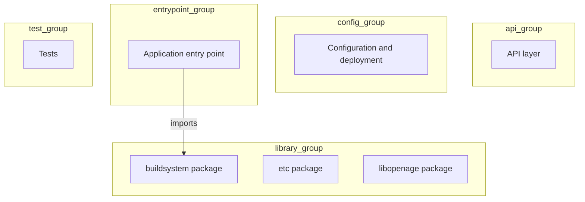

# Architecture report: SFTtech/openage

> Automated static analysis. **Observed** = directly seen in files/imports/AST; **Inferred** = interpretation from that evidence. Repository code was not executed.

## 1. Repository at a glance

| Item | Value |
| --- | --- |
| Repository | SFTtech/openage |
| Description | Clone of the Age of Empires II engine 🚀  |
| Language | Python |
| Stars | 14604 |
| Licence | Other |
| Analysed commit / branch | 5f042b9ce84ed13f78473faebf4a8ed90a1da8cd / master |
| Framework(s) | None detected |
| Files analysed | 797 |
| Components | 7 |

## 2. Architecture in one minute

SFTtech/openage - Clone of the Age of Empires II engine 🚀 . This repository was analysed statically from 797 file(s) (22 Python). Detected technologies (observed from imports/manifests): GitHub Actions, Docker. Files are grouped into 7 component(s): API layer, buildsystem package, Configuration and deployment, Application entry point, etc package, libopenage package, Tests. Observed entry point(s): buildsystem/check_py_file_list.py, buildsystem/codecompliance/__main__.py, buildsystem/compilepy.py. Findings below distinguish observed facts from inferred interpretation.

## 3. High-level block diagram

## 4. Main components

### API layer (`api_layer`)

- **Kind:** api
- **Status:** Observed
- **Confidence:** 0.85
- **Responsibility:** Groups 32 file(s) under api layer (observed from repository paths and static analysis).
- **Paths:** `libopenage/gamestate/api/ability.cpp`, `libopenage/gamestate/api/ability.h`, `libopenage/gamestate/api/activity.cpp`, `libopenage/gamestate/api/activity.h`, `libopenage/gamestate/api/animation.cpp`, `libopenage/gamestate/api/animation.h`, `libopenage/gamestate/api/definitions.cpp`, `libopenage/gamestate/api/definitions.h`, `libopenage/gamestate/api/patch.cpp`, `libopenage/gamestate/api/patch.h`, `libopenage/gamestate/api/player_setup.cpp`, `libopenage/gamestate/api/player_setup.h`, `libopenage/gamestate/api/property.cpp`, `libopenage/gamestate/api/property.h`, `libopenage/gamestate/api/sound.cpp`, `libopenage/gamestate/api/sound.h`, `libopenage/gamestate/api/terrain.cpp`, `libopenage/gamestate/api/terrain.h`, `libopenage/gamestate/api/types.cpp`, `libopenage/gamestate/api/types.h`, `libopenage/gamestate/api/util.cpp`, `libopenage/gamestate/api/util.h`, `libopenage/gamestate/component/api/idle.cpp`, `libopenage/gamestate/component/api/idle.h`, `libopenage/gamestate/component/api/live.cpp`, `libopenage/gamestate/component/api/live.h`, `libopenage/gamestate/component/api/move.cpp`, `libopenage/gamestate/component/api/move.h`, `libopenage/gamestate/component/api/selectable.cpp`, `libopenage/gamestate/component/api/selectable.h`, `libopenage/gamestate/component/api/turn.cpp`, `libopenage/gamestate/component/api/turn.h`
- **Evidence:** [libopenage/gamestate/api/ability.cpp](https://github.com/SFTtech/openage/blob/5f042b9ce84ed13f78473faebf4a8ed90a1da8cd/libopenage/gamestate/api/ability.cpp); [libopenage/gamestate/api/ability.h](https://github.com/SFTtech/openage/blob/5f042b9ce84ed13f78473faebf4a8ed90a1da8cd/libopenage/gamestate/api/ability.h); [libopenage/gamestate/api/activity.cpp](https://github.com/SFTtech/openage/blob/5f042b9ce84ed13f78473faebf4a8ed90a1da8cd/libopenage/gamestate/api/activity.cpp); [libopenage/gamestate/api/activity.h](https://github.com/SFTtech/openage/blob/5f042b9ce84ed13f78473faebf4a8ed90a1da8cd/libopenage/gamestate/api/activity.h); [libopenage/gamestate/api/animation.cpp](https://github.com/SFTtech/openage/blob/5f042b9ce84ed13f78473faebf4a8ed90a1da8cd/libopenage/gamestate/api/animation.cpp); [libopenage/gamestate/api/animation.h](https://github.com/SFTtech/openage/blob/5f042b9ce84ed13f78473faebf4a8ed90a1da8cd/libopenage/gamestate/api/animation.h); [libopenage/gamestate/api/definitions.cpp](https://github.com/SFTtech/openage/blob/5f042b9ce84ed13f78473faebf4a8ed90a1da8cd/libopenage/gamestate/api/definitions.cpp); [libopenage/gamestate/api/definitions.h](https://github.com/SFTtech/openage/blob/5f042b9ce84ed13f78473faebf4a8ed90a1da8cd/libopenage/gamestate/api/definitions.h)

### buildsystem package (`buildsystem`)

- **Kind:** library
- **Status:** Observed
- **Confidence:** 0.85
- **Responsibility:** Groups 14 file(s) under buildsystem package (observed from repository paths and static analysis). Observed top-level classes: HeaderError, Strlazy. Observed top-level functions: _create_fix, _run_tool, check_mode, clamp, deobfuscate_email, filter_file_list.
- **Paths:** `buildsystem/__init__.py`, `buildsystem/codecompliance/__init__.py`, `buildsystem/codecompliance/authors.py`, `buildsystem/codecompliance/clangtidy.py`, `buildsystem/codecompliance/cppstyle.py`, `buildsystem/codecompliance/cython.py`, `buildsystem/codecompliance/headerguards.py`, `buildsystem/codecompliance/legal.py`, `buildsystem/codecompliance/modes.py`, `buildsystem/codecompliance/ruff.py`, `buildsystem/codecompliance/textfiles.py`, `buildsystem/codecompliance/ty.py`, `buildsystem/codecompliance/util.py`, `buildsystem/modules/FindPython_test.cpp`
- **Evidence:** [buildsystem/__init__.py](https://github.com/SFTtech/openage/blob/5f042b9ce84ed13f78473faebf4a8ed90a1da8cd/buildsystem/__init__.py); [buildsystem/codecompliance/__init__.py](https://github.com/SFTtech/openage/blob/5f042b9ce84ed13f78473faebf4a8ed90a1da8cd/buildsystem/codecompliance/__init__.py); [buildsystem/codecompliance/authors.py:13](https://github.com/SFTtech/openage/blob/5f042b9ce84ed13f78473faebf4a8ed90a1da8cd/buildsystem/codecompliance/authors.py#L13); [buildsystem/codecompliance/clangtidy.py:12](https://github.com/SFTtech/openage/blob/5f042b9ce84ed13f78473faebf4a8ed90a1da8cd/buildsystem/codecompliance/clangtidy.py#L12); [buildsystem/codecompliance/cppstyle.py:57](https://github.com/SFTtech/openage/blob/5f042b9ce84ed13f78473faebf4a8ed90a1da8cd/buildsystem/codecompliance/cppstyle.py#L57); [buildsystem/codecompliance/cython.py:28](https://github.com/SFTtech/openage/blob/5f042b9ce84ed13f78473faebf4a8ed90a1da8cd/buildsystem/codecompliance/cython.py#L28); [buildsystem/codecompliance/headerguards.py:13](https://github.com/SFTtech/openage/blob/5f042b9ce84ed13f78473faebf4a8ed90a1da8cd/buildsystem/codecompliance/headerguards.py#L13); [buildsystem/codecompliance/legal.py:62](https://github.com/SFTtech/openage/blob/5f042b9ce84ed13f78473faebf4a8ed90a1da8cd/buildsystem/codecompliance/legal.py#L62)

### Configuration and deployment (`config`)

- **Kind:** config
- **Status:** Observed
- **Confidence:** 0.85
- **Responsibility:** Groups 14 file(s) under configuration and deployment (observed from repository paths and static analysis).
- **Paths:** `cfg/converter/games/aoc/version_hashes.toml`, `cfg/converter/games/aoc_demo/version_hashes.toml`, `cfg/converter/games/aok/version_hashes.toml`, `cfg/converter/games/de1/version_hashes.toml`, `cfg/converter/games/de2/version_hashes.toml`, `cfg/converter/games/game_editions.toml`, `cfg/converter/games/game_expansions.toml`, `cfg/converter/games/hd/version_hashes.toml`, `cfg/converter/games/hd_ak/version_hashes.toml`, `cfg/converter/games/hd_fgt/version_hashes.toml`, `cfg/converter/games/hd_raj/version_hashes.toml`, `cfg/converter/games/ror/version_hashes.toml`, `cfg/converter/games/swgb/version_hashes.toml`, `cfg/converter/games/swgb_cc/version_hashes.toml`
- **Evidence:** [cfg/converter/games/aoc/version_hashes.toml](https://github.com/SFTtech/openage/blob/5f042b9ce84ed13f78473faebf4a8ed90a1da8cd/cfg/converter/games/aoc/version_hashes.toml); [cfg/converter/games/aoc_demo/version_hashes.toml](https://github.com/SFTtech/openage/blob/5f042b9ce84ed13f78473faebf4a8ed90a1da8cd/cfg/converter/games/aoc_demo/version_hashes.toml); [cfg/converter/games/aok/version_hashes.toml](https://github.com/SFTtech/openage/blob/5f042b9ce84ed13f78473faebf4a8ed90a1da8cd/cfg/converter/games/aok/version_hashes.toml); [cfg/converter/games/de1/version_hashes.toml](https://github.com/SFTtech/openage/blob/5f042b9ce84ed13f78473faebf4a8ed90a1da8cd/cfg/converter/games/de1/version_hashes.toml); [cfg/converter/games/de2/version_hashes.toml](https://github.com/SFTtech/openage/blob/5f042b9ce84ed13f78473faebf4a8ed90a1da8cd/cfg/converter/games/de2/version_hashes.toml); [cfg/converter/games/game_editions.toml](https://github.com/SFTtech/openage/blob/5f042b9ce84ed13f78473faebf4a8ed90a1da8cd/cfg/converter/games/game_editions.toml); [cfg/converter/games/game_expansions.toml](https://github.com/SFTtech/openage/blob/5f042b9ce84ed13f78473faebf4a8ed90a1da8cd/cfg/converter/games/game_expansions.toml); [cfg/converter/games/hd/version_hashes.toml](https://github.com/SFTtech/openage/blob/5f042b9ce84ed13f78473faebf4a8ed90a1da8cd/cfg/converter/games/hd/version_hashes.toml)

### Application entry point (`entrypoint`)

- **Kind:** entrypoint
- **Status:** Observed
- **Confidence:** 0.85
- **Responsibility:** Groups 7 file(s) under application entry point (observed from repository paths and static analysis). Observed top-level classes: CythonFilter, LineFilter, PXDGenerator, ParserError. Observed top-level functions: clone_file_to_dir, copy_module, cythonize_wrapper, find_all_issues, get_changed_files, get_project_root.
- **Paths:** `buildsystem/check_py_file_list.py`, `buildsystem/codecompliance/__main__.py`, `buildsystem/compilepy.py`, `buildsystem/cythonize.py`, `buildsystem/inplacemodules.py`, `buildsystem/pxdgen.py`, `buildsystem/scripts/copy_modules.py`
- **Evidence:** [buildsystem/check_py_file_list.py:13](https://github.com/SFTtech/openage/blob/5f042b9ce84ed13f78473faebf4a8ed90a1da8cd/buildsystem/check_py_file_list.py#L13); [buildsystem/codecompliance/__main__.py:17](https://github.com/SFTtech/openage/blob/5f042b9ce84ed13f78473faebf4a8ed90a1da8cd/buildsystem/codecompliance/__main__.py#L17); [buildsystem/compilepy.py:15](https://github.com/SFTtech/openage/blob/5f042b9ce84ed13f78473faebf4a8ed90a1da8cd/buildsystem/compilepy.py#L15); [buildsystem/cythonize.py:19](https://github.com/SFTtech/openage/blob/5f042b9ce84ed13f78473faebf4a8ed90a1da8cd/buildsystem/cythonize.py#L19); [buildsystem/inplacemodules.py:17](https://github.com/SFTtech/openage/blob/5f042b9ce84ed13f78473faebf4a8ed90a1da8cd/buildsystem/inplacemodules.py#L17); [buildsystem/pxdgen.py:21](https://github.com/SFTtech/openage/blob/5f042b9ce84ed13f78473faebf4a8ed90a1da8cd/buildsystem/pxdgen.py#L21); [buildsystem/scripts/copy_modules.py:17](https://github.com/SFTtech/openage/blob/5f042b9ce84ed13f78473faebf4a8ed90a1da8cd/buildsystem/scripts/copy_modules.py#L17)

### etc package (`etc`)

- **Kind:** library
- **Status:** Observed
- **Confidence:** 0.85
- **Responsibility:** Groups 2 file(s) under etc package (observed from repository paths and static analysis). Observed top-level classes: CoordPrinter, FixedPointPrinter, KeyframePrinter, PathFlowTypePrinter, PathIntegratedFlagsTypePrinter, PathIntegratedTypePrinter. Observed top-level functions: format_fixed_point, get_integrated_flags_list, printer_regex, printer_typedef.
- **Paths:** `etc/gdb_pretty/__init__.py`, `etc/gdb_pretty/printers.py`
- **Evidence:** [etc/gdb_pretty/__init__.py](https://github.com/SFTtech/openage/blob/5f042b9ce84ed13f78473faebf4a8ed90a1da8cd/etc/gdb_pretty/__init__.py); [etc/gdb_pretty/printers.py:16](https://github.com/SFTtech/openage/blob/5f042b9ce84ed13f78473faebf4a8ed90a1da8cd/etc/gdb_pretty/printers.py#L16)

### libopenage package (`libopenage`)

- **Kind:** library
- **Status:** Observed
- **Confidence:** 0.85
- **Responsibility:** Groups 281 file(s) under libopenage package (observed from repository paths and static analysis).
- **Paths:** `libopenage/assets/mod_manager.cpp`, `libopenage/assets/mod_manager.h`, `libopenage/assets/modpack.cpp`, `libopenage/assets/modpack.h`, `libopenage/audio/audio_manager.cpp`, `libopenage/audio/audio_manager.h`, `libopenage/audio/category.cpp`, `libopenage/audio/category.h`, `libopenage/audio/dynamic_loader.cpp`, `libopenage/audio/dynamic_loader.h`, `libopenage/audio/dynamic_resource.cpp`, `libopenage/audio/dynamic_resource.h`, `libopenage/audio/error.cpp`, `libopenage/audio/error.h`, `libopenage/audio/format.cpp`, `libopenage/audio/format.h`, `libopenage/audio/hash_functions.h`, `libopenage/audio/in_memory_loader.cpp`, `libopenage/audio/in_memory_loader.h`, `libopenage/audio/in_memory_resource.cpp`, `libopenage/audio/in_memory_resource.h`, `libopenage/audio/loader_policy.cpp`, `libopenage/audio/loader_policy.h`, `libopenage/audio/opus_dynamic_loader.cpp`, `libopenage/audio/opus_dynamic_loader.h`, `libopenage/audio/opus_in_memory_loader.cpp`, `libopenage/audio/opus_in_memory_loader.h`, `libopenage/audio/opus_loading.cpp`, `libopenage/audio/opus_loading.h`, `libopenage/audio/resource.cpp`, `libopenage/audio/resource.h`, `libopenage/audio/resource_def.cpp`, `libopenage/audio/resource_def.h`, `libopenage/audio/sound.cpp`, `libopenage/audio/sound.h`, `libopenage/audio/types.h`, `libopenage/console/buf.cpp`, `libopenage/console/buf.h`, `libopenage/console/console.cpp`, `libopenage/console/console.h`, `libopenage/console/draw.cpp`, `libopenage/console/draw.h`, `libopenage/console/tests.cpp`, `libopenage/coord/chunk.cpp`, `libopenage/coord/chunk.h`, `libopenage/coord/coord_test.cpp`, `libopenage/coord/declarations.cpp`, `libopenage/coord/declarations.h`, `libopenage/coord/phys.cpp`, `libopenage/coord/phys.h`, `libopenage/coord/pixel.cpp`, `libopenage/coord/pixel.h`, `libopenage/coord/scene.cpp`, `libopenage/coord/scene.h`, `libopenage/coord/term.cpp`, `libopenage/coord/term.h`, `libopenage/coord/tile.cpp`, `libopenage/coord/tile.h`, `libopenage/curve/base_curve.cpp`, `libopenage/curve/base_curve.h`, `libopenage/curve/container/array.cpp`, `libopenage/curve/container/array.h`, `libopenage/curve/container/element_wrapper.cpp`, `libopenage/curve/container/element_wrapper.h`, `libopenage/curve/container/iterator.cpp`, `libopenage/curve/container/iterator.h`, `libopenage/curve/container/map.cpp`, `libopenage/curve/container/map.h`, `libopenage/curve/container/map_filter_iterator.cpp`, `libopenage/curve/container/map_filter_iterator.h`, `libopenage/curve/container/queue.cpp`, `libopenage/curve/container/queue.h`, `libopenage/curve/container/queue_filter_iterator.cpp`, `libopenage/curve/container/queue_filter_iterator.h`, `libopenage/curve/continuous.cpp`, `libopenage/curve/continuous.h`, `libopenage/curve/discrete.cpp`, `libopenage/curve/discrete.h`, `libopenage/curve/discrete_mod.cpp`, `libopenage/curve/discrete_mod.h`, `libopenage/curve/interpolated.cpp`, `libopenage/curve/interpolated.h`, `libopenage/curve/keyframe.cpp`, `libopenage/curve/keyframe.h`, `libopenage/curve/keyframe_container.cpp`, `libopenage/curve/keyframe_container.h`, `libopenage/curve/segmented.cpp`, `libopenage/curve/segmented.h`, `libopenage/cvar/cvar.cpp`, `libopenage/cvar/cvar.h`, `libopenage/datastructure/concurrent_queue.h`, `libopenage/datastructure/constexpr_map.h`, `libopenage/datastructure/pairing_heap.h`, `libopenage/datastructure/tests.cpp`, `libopenage/datastructure/tests.h`, `libopenage/engine/engine.cpp`, `libopenage/engine/engine.h`, `libopenage/error/backtrace.cpp`, `libopenage/error/backtrace.h`, `libopenage/error/demo.cpp`, `libopenage/error/error.cpp`, `libopenage/error/error.h`, `libopenage/error/handlers.cpp`, `libopenage/error/handlers.h`, `libopenage/error/stackanalyzer.cpp`, `libopenage/error/stackanalyzer.h`, `libopenage/event/demo/aicontroller.cpp`, `libopenage/event/demo/aicontroller.h`, `libopenage/event/demo/gamestate.cpp`, `libopenage/event/demo/gamestate.h`, `libopenage/event/demo/gui.cpp`, `libopenage/event/demo/gui.h`, `libopenage/event/demo/main.cpp`, `libopenage/event/demo/main.h`, `libopenage/event/demo/physics.cpp`, `libopenage/event/demo/physics.h`, `libopenage/event/event.cpp`, `libopenage/event/event.h`, `libopenage/event/event_loop.cpp`, `libopenage/event/event_loop.h`, `libopenage/event/evententity.cpp`, `libopenage/event/evententity.h`, `libopenage/event/eventhandler.cpp`, `libopenage/event/eventhandler.h`, `libopenage/event/eventqueue.cpp`, `libopenage/event/eventqueue.h`, `libopenage/event/eventstore.cpp`, `libopenage/event/eventstore.h`, `libopenage/event/state.cpp`, `libopenage/event/state.h`, `libopenage/event/tests.cpp`, `libopenage/gamestate/activity/activity.cpp`, `libopenage/gamestate/activity/activity.h`, `libopenage/gamestate/activity/condition/command_in_queue.cpp`, `libopenage/gamestate/activity/condition/command_in_queue.h`, `libopenage/gamestate/activity/condition/next_command.cpp`, `libopenage/gamestate/activity/condition/next_command.h`, `libopenage/gamestate/activity/end_node.cpp`, `libopenage/gamestate/activity/end_node.h`, `libopenage/gamestate/activity/event/command_in_queue.cpp`, `libopenage/gamestate/activity/event/command_in_queue.h`, `libopenage/gamestate/activity/event/wait.cpp`, `libopenage/gamestate/activity/event/wait.h`, `libopenage/gamestate/activity/node.cpp`, `libopenage/gamestate/activity/node.h`, `libopenage/gamestate/activity/start_node.cpp`, `libopenage/gamestate/activity/start_node.h`, `libopenage/gamestate/activity/task_node.cpp`, `libopenage/gamestate/activity/task_node.h`, `libopenage/gamestate/activity/task_system_node.cpp`, `libopenage/gamestate/activity/task_system_node.h`, `libopenage/gamestate/activity/tests.cpp`, `libopenage/gamestate/activity/types.cpp`, `libopenage/gamestate/activity/types.h`, `libopenage/gamestate/activity/xor_event_gate.cpp`, `libopenage/gamestate/activity/xor_event_gate.h`, `libopenage/gamestate/activity/xor_gate.cpp`, `libopenage/gamestate/activity/xor_gate.h`, `libopenage/gamestate/component/api_component.cpp`, `libopenage/gamestate/component/api_component.h`, `libopenage/gamestate/component/base_component.cpp`, `libopenage/gamestate/component/base_component.h`, `libopenage/gamestate/component/internal/activity.cpp`, `libopenage/gamestate/component/internal/activity.h`, `libopenage/gamestate/component/internal/command_queue.cpp`, `libopenage/gamestate/component/internal/command_queue.h`, `libopenage/gamestate/component/internal/commands/base_command.cpp`, `libopenage/gamestate/component/internal/commands/base_command.h`, `libopenage/gamestate/component/internal/commands/custom.cpp`, `libopenage/gamestate/component/internal/commands/custom.h`, `libopenage/gamestate/component/internal/commands/idle.cpp`, `libopenage/gamestate/component/internal/commands/idle.h`, `libopenage/gamestate/component/internal/commands/move.cpp`, `libopenage/gamestate/component/internal/commands/move.h`, `libopenage/gamestate/component/internal/commands/types.cpp`, `libopenage/gamestate/component/internal/commands/types.h`, `libopenage/gamestate/component/internal/ownership.cpp`, `libopenage/gamestate/component/internal/ownership.h`, `libopenage/gamestate/component/internal/position.cpp`, `libopenage/gamestate/component/internal/position.h`, `libopenage/gamestate/component/internal_component.cpp`, `libopenage/gamestate/component/internal_component.h`, `libopenage/gamestate/component/types.cpp`, `libopenage/gamestate/component/types.h`, `libopenage/gamestate/definitions.cpp`, `libopenage/gamestate/definitions.h`, `libopenage/gamestate/demo/demo_0.cpp`, `libopenage/gamestate/demo/demo_0.h`, `libopenage/gamestate/demo/tests.cpp`, `libopenage/gamestate/demo/tests.h`, `libopenage/gamestate/entity_factory.cpp`, `libopenage/gamestate/entity_factory.h`, `libopenage/gamestate/event/drag_select.cpp`, `libopenage/gamestate/event/drag_select.h`, `libopenage/gamestate/event/process_command.cpp`, `libopenage/gamestate/event/process_command.h`, `libopenage/gamestate/event/send_command.cpp`, `libopenage/gamestate/event/send_command.h`, `libopenage/gamestate/event/spawn_entity.cpp`, `libopenage/gamestate/event/spawn_entity.h`, `libopenage/gamestate/event/wait.cpp`, `libopenage/gamestate/event/wait.h`, `libopenage/gamestate/game.cpp`, `libopenage/gamestate/game.h`, `libopenage/gamestate/game_entity.cpp`, `libopenage/gamestate/game_entity.h`, `libopenage/gamestate/game_state.cpp`, `libopenage/gamestate/game_state.h`, `libopenage/gamestate/manager.cpp`, `libopenage/gamestate/manager.h`, `libopenage/gamestate/map.cpp`, `libopenage/gamestate/map.h`, `libopenage/gamestate/player.cpp`, `libopenage/gamestate/player.h`, `libopenage/gamestate/simulation.cpp`, `libopenage/gamestate/simulation.h`, `libopenage/gamestate/system/activity.cpp`, `libopenage/gamestate/system/activity.h`, `libopenage/gamestate/system/idle.cpp`, `libopenage/gamestate/system/idle.h`, `libopenage/gamestate/system/move.cpp`, `libopenage/gamestate/system/move.h`, `libopenage/gamestate/system/types.cpp`, `libopenage/gamestate/system/types.h`, `libopenage/gamestate/terrain.cpp`, `libopenage/gamestate/terrain.h`, `libopenage/gamestate/terrain_chunk.cpp`, `libopenage/gamestate/terrain_chunk.h`, `libopenage/gamestate/terrain_factory.cpp`, `libopenage/gamestate/terrain_factory.h`, `libopenage/gamestate/terrain_tile.cpp`, `libopenage/gamestate/terrain_tile.h`, `libopenage/gamestate/types.cpp`, `libopenage/gamestate/types.h`, `libopenage/gamestate/universe.cpp`, `libopenage/gamestate/universe.h`, `libopenage/gamestate/world.cpp`, `libopenage/gamestate/world.h`, `libopenage/input/action.cpp`, `libopenage/input/action.h`, `libopenage/input/controller/camera/binding.cpp`, `libopenage/input/controller/camera/binding.h`, `libopenage/input/controller/camera/binding_context.cpp`, `libopenage/input/controller/camera/binding_context.h`, `libopenage/input/controller/camera/controller.cpp`, `libopenage/input/controller/camera/controller.h`, `libopenage/input/controller/game/binding.cpp`, `libopenage/input/controller/game/binding.h`, `libopenage/input/controller/game/binding_context.cpp`, `libopenage/input/controller/game/binding_context.h`, `libopenage/input/controller/game/controller.cpp`, `libopenage/input/controller/game/controller.h`, `libopenage/input/controller/hud/binding.cpp`, `libopenage/input/controller/hud/binding.h`, `libopenage/input/controller/hud/binding_context.cpp`, `libopenage/input/controller/hud/binding_context.h`, `libopenage/input/controller/hud/controller.cpp`, `libopenage/input/controller/hud/controller.h`, `libopenage/input/event.cpp`, `libopenage/input/event.h`, `libopenage/input/input_context.cpp`, `libopenage/input/input_context.h`, `libopenage/input/input_manager.cpp`, `libopenage/input/input_manager.h`, `libopenage/input/tests.cpp`, `libopenage/input/text_to_event.cpp`, `libopenage/input/text_to_event.h`, `libopenage/job/abortable_job_state.h`, `libopenage/job/job.h`, `libopenage/job/job_aborted_exception.h`, `libopenage/job/job_group.cpp`, `libopenage/job/job_group.h`, `libopenage/job/job_manager.cpp`, `libopenage/job/job_manager.h`, `libopenage/job/job_state.h`, `libopenage/job/job_state_base.h`, `libopenage/job/tests.cpp`, `libopenage/job/typed_job_state_base.h`, `libopenage/job/types.h`, `libopenage/job/worker.cpp`, `libopenage/job/worker.h`
- **Evidence:** [libopenage/assets/mod_manager.cpp](https://github.com/SFTtech/openage/blob/5f042b9ce84ed13f78473faebf4a8ed90a1da8cd/libopenage/assets/mod_manager.cpp); [libopenage/assets/mod_manager.h](https://github.com/SFTtech/openage/blob/5f042b9ce84ed13f78473faebf4a8ed90a1da8cd/libopenage/assets/mod_manager.h); [libopenage/assets/modpack.cpp](https://github.com/SFTtech/openage/blob/5f042b9ce84ed13f78473faebf4a8ed90a1da8cd/libopenage/assets/modpack.cpp); [libopenage/assets/modpack.h](https://github.com/SFTtech/openage/blob/5f042b9ce84ed13f78473faebf4a8ed90a1da8cd/libopenage/assets/modpack.h); [libopenage/audio/audio_manager.cpp](https://github.com/SFTtech/openage/blob/5f042b9ce84ed13f78473faebf4a8ed90a1da8cd/libopenage/audio/audio_manager.cpp); [libopenage/audio/audio_manager.h](https://github.com/SFTtech/openage/blob/5f042b9ce84ed13f78473faebf4a8ed90a1da8cd/libopenage/audio/audio_manager.h); [libopenage/audio/category.cpp](https://github.com/SFTtech/openage/blob/5f042b9ce84ed13f78473faebf4a8ed90a1da8cd/libopenage/audio/category.cpp); [libopenage/audio/category.h](https://github.com/SFTtech/openage/blob/5f042b9ce84ed13f78473faebf4a8ed90a1da8cd/libopenage/audio/category.h)

### Tests (`tests`)

- **Kind:** test
- **Status:** Observed
- **Confidence:** 0.85
- **Responsibility:** Groups 73 file(s) under tests (observed from repository paths and static analysis).
- **Paths:** `assets/test/CMakeLists.txt`, `assets/test/nyan/CMakeLists.txt`, `assets/test/nyan/pong.nyan`, `assets/test/qml/CMakeLists.txt`, `assets/test/qml/main.qml`, `assets/test/shaders/CMakeLists.txt`, `assets/test/shaders/demo_0_display.frag.glsl`, `assets/test/shaders/demo_0_display.vert.glsl`, `assets/test/shaders/demo_1_display.frag.glsl`, `assets/test/shaders/demo_1_display.vert.glsl`, `assets/test/shaders/demo_1_obj.frag.glsl`, `assets/test/shaders/demo_1_obj.vert.glsl`, `assets/test/shaders/demo_2_display.frag.glsl`, `assets/test/shaders/demo_2_display.vert.glsl`, `assets/test/shaders/demo_2_obj.frag.glsl`, `assets/test/shaders/demo_2_obj.vert.glsl`, `assets/test/shaders/demo_4_display.frag.glsl`, `assets/test/shaders/demo_4_display.vert.glsl`, `assets/test/shaders/demo_4_obj.frag.glsl`, `assets/test/shaders/demo_4_obj.vert.glsl`, `assets/test/shaders/demo_5_obj.frag.glsl`, `assets/test/shaders/demo_5_obj.vert.glsl`, `assets/test/shaders/demo_6_2d.frag.glsl`, `assets/test/shaders/demo_6_2d.vert.glsl`, `assets/test/shaders/demo_6_2d_frame.frag.glsl`, `assets/test/shaders/demo_6_2d_frame.vert.glsl`, `assets/test/shaders/demo_6_2d_frustum_frame.vert.glsl`, `assets/test/shaders/demo_6_3d.frag.glsl`, `assets/test/shaders/demo_6_3d.vert.glsl`, `assets/test/shaders/demo_6_display.frag.glsl`, `assets/test/shaders/demo_6_display.vert.glsl`, `assets/test/shaders/demo_7_shader_command.frag.glsl`, `assets/test/shaders/demo_7_shader_command.vert.glsl`, `assets/test/shaders/demo_7_snippets/alpha.snippet`, `assets/test/shaders/demo_7_snippets/color.snippet`, `assets/test/shaders/pathfinding/CMakeLists.txt`, `assets/test/shaders/pathfinding/demo_0_cost_field.frag.glsl`, `assets/test/shaders/pathfinding/demo_0_cost_field.vert.glsl`, `assets/test/shaders/pathfinding/demo_0_display.frag.glsl`, `assets/test/shaders/pathfinding/demo_0_display.vert.glsl`, `assets/test/shaders/pathfinding/demo_0_flow_field.frag.glsl`, `assets/test/shaders/pathfinding/demo_0_flow_field.vert.glsl`, `assets/test/shaders/pathfinding/demo_0_grid.frag.glsl`, `assets/test/shaders/pathfinding/demo_0_grid.vert.glsl`, `assets/test/shaders/pathfinding/demo_0_integration_field.frag.glsl`, `assets/test/shaders/pathfinding/demo_0_integration_field.vert.glsl`, `assets/test/shaders/pathfinding/demo_0_obj.frag.glsl`, `assets/test/shaders/pathfinding/demo_0_obj.vert.glsl`, `assets/test/shaders/pathfinding/demo_0_vector.frag.glsl`, `assets/test/shaders/pathfinding/demo_0_vector.vert.glsl`, `assets/test/shaders/pathfinding/demo_1_display.frag.glsl`, `assets/test/shaders/pathfinding/demo_1_display.vert.glsl`, `assets/test/shaders/pathfinding/demo_1_grid.frag.glsl`, `assets/test/shaders/pathfinding/demo_1_grid.vert.glsl`, `assets/test/shaders/pathfinding/demo_1_obj.frag.glsl`, `assets/test/shaders/pathfinding/demo_1_obj.vert.glsl`, `assets/test/textures/CMakeLists.txt`, `assets/test/textures/test_animation.sprite`, `assets/test/textures/test_gaben.sprite`, `assets/test/textures/test_gaben.texture`, `assets/test/textures/test_missing.sprite`, `assets/test/textures/test_missing.texture`, `assets/test/textures/test_tank.sprite`, `assets/test/textures/test_tank.texture`, `assets/test/textures/test_tank_mirrored.sprite`, `assets/test/textures/test_terrain.terrain`, `assets/test/textures/test_terrain.texture`, `assets/test/textures/test_terrain2.terrain`, `assets/test/textures/test_terrain2.texture`, `assets/test/textures/test_texture.texture`, `libopenage/curve/tests/CMakeLists.txt`, `libopenage/curve/tests/container.cpp`, `libopenage/curve/tests/curve_types.cpp`
- **Evidence:** [assets/test/CMakeLists.txt](https://github.com/SFTtech/openage/blob/5f042b9ce84ed13f78473faebf4a8ed90a1da8cd/assets/test/CMakeLists.txt); [assets/test/nyan/CMakeLists.txt](https://github.com/SFTtech/openage/blob/5f042b9ce84ed13f78473faebf4a8ed90a1da8cd/assets/test/nyan/CMakeLists.txt); [assets/test/nyan/pong.nyan](https://github.com/SFTtech/openage/blob/5f042b9ce84ed13f78473faebf4a8ed90a1da8cd/assets/test/nyan/pong.nyan); [assets/test/qml/CMakeLists.txt](https://github.com/SFTtech/openage/blob/5f042b9ce84ed13f78473faebf4a8ed90a1da8cd/assets/test/qml/CMakeLists.txt); [assets/test/qml/main.qml](https://github.com/SFTtech/openage/blob/5f042b9ce84ed13f78473faebf4a8ed90a1da8cd/assets/test/qml/main.qml); [assets/test/shaders/CMakeLists.txt](https://github.com/SFTtech/openage/blob/5f042b9ce84ed13f78473faebf4a8ed90a1da8cd/assets/test/shaders/CMakeLists.txt); [assets/test/shaders/demo_0_display.frag.glsl](https://github.com/SFTtech/openage/blob/5f042b9ce84ed13f78473faebf4a8ed90a1da8cd/assets/test/shaders/demo_0_display.frag.glsl); [assets/test/shaders/demo_0_display.vert.glsl](https://github.com/SFTtech/openage/blob/5f042b9ce84ed13f78473faebf4a8ed90a1da8cd/assets/test/shaders/demo_0_display.vert.glsl)

## 5. Execution flow

**Observed** entry point(s):

- [buildsystem/check_py_file_list.py:62](https://github.com/SFTtech/openage/blob/5f042b9ce84ed13f78473faebf4a8ed90a1da8cd/buildsystem/check_py_file_list.py#L62)
- [buildsystem/codecompliance/__main__.py:313](https://github.com/SFTtech/openage/blob/5f042b9ce84ed13f78473faebf4a8ed90a1da8cd/buildsystem/codecompliance/__main__.py#L313)
- [buildsystem/compilepy.py:106](https://github.com/SFTtech/openage/blob/5f042b9ce84ed13f78473faebf4a8ed90a1da8cd/buildsystem/compilepy.py#L106)
- [buildsystem/cythonize.py:253](https://github.com/SFTtech/openage/blob/5f042b9ce84ed13f78473faebf4a8ed90a1da8cd/buildsystem/cythonize.py#L253)
- [buildsystem/inplacemodules.py:71](https://github.com/SFTtech/openage/blob/5f042b9ce84ed13f78473faebf4a8ed90a1da8cd/buildsystem/inplacemodules.py#L71)
- [buildsystem/pxdgen.py:472](https://github.com/SFTtech/openage/blob/5f042b9ce84ed13f78473faebf4a8ed90a1da8cd/buildsystem/pxdgen.py#L472)
- [buildsystem/scripts/copy_modules.py:46](https://github.com/SFTtech/openage/blob/5f042b9ce84ed13f78473faebf4a8ed90a1da8cd/buildsystem/scripts/copy_modules.py#L46)

Representative flow (derived from observed entry points and the import graph; steps beyond the entry point are **Inferred**):

1. Execution starts at an observed entry point listed above, if present.
2. `entrypoint` imports `buildsystem` (Application entry point -> buildsystem package).

## 6. Project structure

### `(root)`

- `.clang-format` - other (3850 bytes)
- `.clangd` - other (56 bytes)
- `.gitignore` - other (833 bytes)
- `.mailmap` - other (1625 bytes)
- `AGENTS.md` - docs (11473 bytes)
- `CMakeLists.txt` - docs (7980 bytes)
- `README.md` - docs (11897 bytes)
- `changelog.md` - docs (317 bytes)
- `configure` - other (14365 bytes)
- `copying.md` - docs (23977 bytes)
- `flake.lock` - other (1494 bytes)
- `flake.nix` - other (1526 bytes)
- `justfile` - other (3852 bytes)
- `kevinfile` - other (781 bytes)

### `.github`

- `.github/PULL_REQUEST_TEMPLATES/pull_request_template.md` - docs (495 bytes)
- `.github/PULL_REQUEST_TEMPLATES/release_template.md` - docs (154 bytes)
- `.github/workflows/macos.yml` - ci, YAML (2798 bytes)
- `.github/workflows/ubuntu-26.04.yml` - ci, YAML (3258 bytes)

### `assets`

- `assets/.gitignore` - other (36 bytes)
- `assets/CMakeLists.txt` - docs (360 bytes)
- `assets/doc/liberapay.svg` - other (1457 bytes)
- `assets/doc/license.svg` - other (2174 bytes)
- `assets/doc/matrix.svg` - other (4999 bytes)
- `assets/doc/matrixroom.svg` - other (1223 bytes)
- `assets/doc/reddit.svg` - other (10631 bytes)
- `assets/logo/CMakeLists.txt` - docs (142 bytes)
- `assets/logo/banner-xlink.svg` - other (409 bytes)
- `assets/logo/banner.svg` - other (5212 bytes)
- `assets/logo/crown.svg` - other (810 bytes)
- `assets/logo/crown_print.svg` - other (1161 bytes)
- `assets/qml/.gitignore` - other (7 bytes)
- `assets/qml/Actions.qml` - other (1103 bytes)
- `assets/qml/ActionsGrid.qml` - other (1183 bytes)
- `assets/qml/BindsHelp.qml` - other (810 bytes)
- `assets/qml/ButtonExtruded.qml` - other (201 bytes)
- `assets/qml/ButtonExtrudedStyle.qml` - other (965 bytes)
- `assets/qml/ButtonFlat.qml` - other (197 bytes)
- `assets/qml/ButtonFlatStyle.qml` - other (1160 bytes)
- `assets/qml/CheckBoxFlat.qml` - other (201 bytes)
- `assets/qml/CheckBoxFlatStyle.qml` - other (774 bytes)
- `assets/qml/CreateGameWhenReady.qml` - other (748 bytes)
- `assets/qml/GeneratorControl.qml` - other (1865 bytes)
- `assets/qml/GeneratorParametersConfiguration.qml` - other (1051 bytes)
- `assets/qml/IngameHud.qml` - other (8055 bytes)
- `assets/qml/Paper.qml` - other (4685 bytes)
- `assets/qml/TextFieldFlat.qml` - other (203 bytes)
- `assets/qml/TextFieldFlatStyle.qml` - other (305 bytes)
- `assets/qml/TypePicker.qml` - other (3742 bytes)
- `assets/qml/main.qml` - other (4627 bytes)
- `assets/shaders/CMakeLists.txt` - docs (93 bytes)
- `assets/shaders/alphamask.frag.glsl` - other (848 bytes)
- `assets/shaders/alphamask.vert.glsl` - other (705 bytes)
- `assets/shaders/equalsEpsilon.glsl` - other (478 bytes)
- `assets/shaders/final.frag.glsl` - other (125 bytes)
- `assets/shaders/final.vert.glsl` - other (174 bytes)
- `assets/shaders/hud_drag_select.frag.glsl` - other (140 bytes)
- `assets/shaders/hud_drag_select.vert.glsl` - other (109 bytes)
- `assets/shaders/identity.vert.glsl` - other (401 bytes)
- `assets/shaders/maptexture.frag.glsl` - other (342 bytes)
- `assets/shaders/maptexture.vert.glsl` - other (562 bytes)
- `assets/shaders/skybox.frag.glsl` - other (109 bytes)
- `assets/shaders/skybox.vert.glsl` - other (109 bytes)
- `assets/shaders/teamcolors.frag.glsl` - other (1714 bytes)
- `assets/shaders/terrain.frag.glsl` - other (172 bytes)
- `assets/shaders/terrain.vert.glsl` - other (641 bytes)
- `assets/shaders/texturefont.frag.glsl` - other (294 bytes)
- `assets/shaders/texturefont.vert.glsl` - other (204 bytes)
- `assets/shaders/world2d.frag.glsl` - other (761 bytes)
- `assets/shaders/world2d.vert.glsl` - other (3871 bytes)
- `assets/shaders/world3d.vert.glsl` - other (278 bytes)
- `assets/test/CMakeLists.txt` - test (177 bytes)
- `assets/test/nyan/CMakeLists.txt` - test (95 bytes)
- `assets/test/nyan/pong.nyan` - test (442 bytes)
- `assets/test/qml/CMakeLists.txt` - test (93 bytes)
- `assets/test/qml/main.qml` - test (485 bytes)
- `assets/test/shaders/CMakeLists.txt` - test (98 bytes)
- `assets/test/shaders/demo_0_display.frag.glsl` - test (81 bytes)
- `assets/test/shaders/demo_0_display.vert.glsl` - test (109 bytes)
- `assets/test/shaders/demo_1_display.frag.glsl` - test (130 bytes)
- `assets/test/shaders/demo_1_display.vert.glsl` - test (168 bytes)
- `assets/test/shaders/demo_1_obj.frag.glsl` - test (254 bytes)
- `assets/test/shaders/demo_1_obj.vert.glsl` - test (235 bytes)
- `assets/test/shaders/demo_2_display.frag.glsl` - test (130 bytes)
- `assets/test/shaders/demo_2_display.vert.glsl` - test (167 bytes)
- `assets/test/shaders/demo_2_obj.frag.glsl` - test (511 bytes)
- `assets/test/shaders/demo_2_obj.vert.glsl` - test (415 bytes)
- `assets/test/shaders/demo_4_display.frag.glsl` - test (130 bytes)
- `assets/test/shaders/demo_4_display.vert.glsl` - test (167 bytes)
- `assets/test/shaders/demo_4_obj.frag.glsl` - test (511 bytes)
- `assets/test/shaders/demo_4_obj.vert.glsl` - test (415 bytes)
- `assets/test/shaders/demo_5_obj.frag.glsl` - test (172 bytes)
- `assets/test/shaders/demo_5_obj.vert.glsl` - test (305 bytes)
- `assets/test/shaders/demo_6_2d.frag.glsl` - test (661 bytes)
- `assets/test/shaders/demo_6_2d.vert.glsl` - test (2961 bytes)
- `assets/test/shaders/demo_6_2d_frame.frag.glsl` - test (89 bytes)
- `assets/test/shaders/demo_6_2d_frame.vert.glsl` - test (2082 bytes)
- `assets/test/shaders/demo_6_2d_frustum_frame.vert.glsl` - test (171 bytes)
- `assets/test/shaders/demo_6_3d.frag.glsl` - test (172 bytes)
- `assets/test/shaders/demo_6_3d.vert.glsl` - test (612 bytes)
- `assets/test/shaders/demo_6_display.frag.glsl` - test (130 bytes)
- `assets/test/shaders/demo_6_display.vert.glsl` - test (167 bytes)
- `assets/test/shaders/demo_7_shader_command.frag.glsl` - test (174 bytes)
- `assets/test/shaders/demo_7_shader_command.vert.glsl` - test (151 bytes)
- `assets/test/shaders/demo_7_snippets/alpha.snippet` - test (39 bytes)
- `assets/test/shaders/demo_7_snippets/color.snippet` - test (111 bytes)
- `assets/test/shaders/pathfinding/CMakeLists.txt` - test (110 bytes)
- `assets/test/shaders/pathfinding/demo_0_cost_field.frag.glsl` - test (324 bytes)
- `assets/test/shaders/pathfinding/demo_0_cost_field.vert.glsl` - test (263 bytes)
- `assets/test/shaders/pathfinding/demo_0_display.frag.glsl` - test (130 bytes)
- `assets/test/shaders/pathfinding/demo_0_display.vert.glsl` - test (168 bytes)
- `assets/test/shaders/pathfinding/demo_0_flow_field.frag.glsl` - test (751 bytes)
- `assets/test/shaders/pathfinding/demo_0_flow_field.vert.glsl` - test (352 bytes)
- `assets/test/shaders/pathfinding/demo_0_grid.frag.glsl` - test (86 bytes)
- `assets/test/shaders/pathfinding/demo_0_grid.vert.glsl` - test (188 bytes)
- `assets/test/shaders/pathfinding/demo_0_integration_field.frag.glsl` - test (278 bytes)
- `assets/test/shaders/pathfinding/demo_0_integration_field.vert.glsl` - test (263 bytes)
- `assets/test/shaders/pathfinding/demo_0_obj.frag.glsl` - test (89 bytes)
- `assets/test/shaders/pathfinding/demo_0_obj.vert.glsl` - test (109 bytes)
- `assets/test/shaders/pathfinding/demo_0_vector.frag.glsl` - test (89 bytes)
- `assets/test/shaders/pathfinding/demo_0_vector.vert.glsl` - test (185 bytes)
- `assets/test/shaders/pathfinding/demo_1_display.frag.glsl` - test (130 bytes)
- `assets/test/shaders/pathfinding/demo_1_display.vert.glsl` - test (168 bytes)
- `assets/test/shaders/pathfinding/demo_1_grid.frag.glsl` - test (86 bytes)
- `assets/test/shaders/pathfinding/demo_1_grid.vert.glsl` - test (193 bytes)
- `assets/test/shaders/pathfinding/demo_1_obj.frag.glsl` - test (89 bytes)
- `assets/test/shaders/pathfinding/demo_1_obj.vert.glsl` - test (190 bytes)
- `assets/test/textures/CMakeLists.txt` - test (100 bytes)
- `assets/test/textures/test_animation.sprite` - test (535 bytes)
- `assets/test/textures/test_gaben.sprite` - test (212 bytes)
- `assets/test/textures/test_gaben.texture` - test (183 bytes)
- `assets/test/textures/test_missing.sprite` - test (214 bytes)
- `assets/test/textures/test_missing.texture` - test (176 bytes)
- `assets/test/textures/test_tank.sprite` - test (402 bytes)
- `assets/test/textures/test_tank.texture` - test (823 bytes)
- `assets/test/textures/test_tank_mirrored.sprite` - test (394 bytes)
- `assets/test/textures/test_terrain.terrain` - test (194 bytes)
- `assets/test/textures/test_terrain.texture` - test (183 bytes)
- `assets/test/textures/test_terrain2.terrain` - test (195 bytes)
- `assets/test/textures/test_terrain2.texture` - test (184 bytes)
- `assets/test/textures/test_texture.texture` - test (1246 bytes)
- `assets/textures/CMakeLists.txt` - docs (95 bytes)
- `assets/textures/torn_paper_edge.docx` - other (31 bytes)

### `buildsystem`

- `buildsystem/CheckCompilerFeatures.cmake` - other (2347 bytes)
- `buildsystem/CheckInSourceBuild.cmake` - other (1251 bytes)
- `buildsystem/CheckRuntimeDependencies.cmake` - other (2019 bytes)
- `buildsystem/DependencyFetch.cmake` - other (2688 bytes)
- `buildsystem/DetectProjectVersion.cmake` - other (1295 bytes)
- `buildsystem/HandleCXXOptions.cmake` - other (6788 bytes)
- `buildsystem/HandlePythonOptions.cmake` - other (2353 bytes)
- `buildsystem/StdHeaderUnit.cmake` - other (2508 bytes)
- `buildsystem/__init__.py` - source, Python (321 bytes)
- `buildsystem/check_py_file_list.py` - source, Python (2022 bytes)
- `buildsystem/codecompliance/__init__.py` - source, Python (150 bytes)
- `buildsystem/codecompliance/__main__.py` - source, Python (9312 bytes)
- `buildsystem/codecompliance/authors.py` - source, Python (3077 bytes)
- `buildsystem/codecompliance/clangtidy.py` - source, Python (2071 bytes)
- `buildsystem/codecompliance/cppstyle.py` - source, Python (4341 bytes)
- `buildsystem/codecompliance/cython.py` - source, Python (1499 bytes)
- `buildsystem/codecompliance/headerguards.py` - source, Python (1349 bytes)
- `buildsystem/codecompliance/legal.py` - source, Python (3778 bytes)
- `buildsystem/codecompliance/modes.py` - source, Python (1664 bytes)
- `buildsystem/codecompliance/ruff.py` - source, Python (3460 bytes)
- `buildsystem/codecompliance/textfiles.py` - source, Python (2599 bytes)
- `buildsystem/codecompliance/ty.py` - source, Python (902 bytes)
- `buildsystem/codecompliance/util.py` - source, Python (5564 bytes)
- `buildsystem/codegen.cmake` - other (2862 bytes)
- `buildsystem/compilepy.py` - source, Python (3289 bytes)
- `buildsystem/cpp.cmake` - other (3776 bytes)
- `buildsystem/cythonize.py` - source, Python (9042 bytes)
- `buildsystem/doxygen.cmake` - other (1630 bytes)
- `buildsystem/doxygen_custom.css` - other (4197 bytes)
- `buildsystem/inplacemodules.py` - source, Python (2093 bytes)
- `buildsystem/modules/DownloadCache.cmake` - other (824 bytes)
- `buildsystem/modules/FindCython.cmake` - other (478 bytes)
- `buildsystem/modules/FindEpoxy.cmake` - other (596 bytes)
- `buildsystem/modules/FindGCCBacktrace.cmake` - other (1616 bytes)
- `buildsystem/modules/FindGPerfTools.cmake` - other (1777 bytes)
- `buildsystem/modules/FindHarfBuzz.cmake` - other (1855 bytes)
- `buildsystem/modules/FindInotify.cmake` - other (386 bytes)
- `buildsystem/modules/FindOgg.cmake` - other (835 bytes)
- `buildsystem/modules/FindOpusfile.cmake` - other (1604 bytes)
- `buildsystem/modules/FindPython.cmake` - other (5978 bytes)
- `buildsystem/modules/FindPython_test.cpp` - source, C++ (289 bytes)
- `buildsystem/options.cmake` - other (1844 bytes)
- `buildsystem/pxdgen.py` - source, Python (15412 bytes)
- `buildsystem/python.cmake` - other (19230 bytes)
- `buildsystem/scripts/EmbedFont.cmake` - other (1057 bytes)
- `buildsystem/scripts/EmbedPython.cmake` - other (993 bytes)
- `buildsystem/scripts/EmbedWinDependencies.cmake` - other (3408 bytes)
- `buildsystem/scripts/copy_modules.py` - source, Python (1398 bytes)
- `buildsystem/templates/Doxyfile.in` - other (105939 bytes)
- `buildsystem/templates/ExternalFetch.cmake.in` - other (938 bytes)
- `buildsystem/templates/ForwardVariables.cmake.in` - other (1056 bytes)
- `buildsystem/templates/openage.bat.in` - other (275 bytes)
- `buildsystem/templates/qt.conf` - other (62 bytes)
- `buildsystem/util.cmake` - other (1351 bytes)

### `cfg`

- `cfg/.gitignore` - other (15 bytes)
- `cfg/CMakeLists.txt` - docs (270 bytes)
- `cfg/converter/games/aoc/version_hashes.toml` - config (447 bytes)
- `cfg/converter/games/aoc_demo/version_hashes.toml` - config (438 bytes)
- `cfg/converter/games/aok/version_hashes.toml` - config (353 bytes)
- `cfg/converter/games/de1/version_hashes.toml` - config (376 bytes)
- `cfg/converter/games/de2/version_hashes.toml` - config (477 bytes)
- `cfg/converter/games/game_editions.toml` - config (10943 bytes)
- `cfg/converter/games/game_expansions.toml` - config (1045 bytes)
- `cfg/converter/games/hd/version_hashes.toml` - config (382 bytes)
- `cfg/converter/games/hd_ak/version_hashes.toml` - config (255 bytes)
- `cfg/converter/games/hd_fgt/version_hashes.toml` - config (256 bytes)
- `cfg/converter/games/hd_raj/version_hashes.toml` - config (256 bytes)
- `cfg/converter/games/ror/version_hashes.toml` - config (351 bytes)
- `cfg/converter/games/swgb/version_hashes.toml` - config (364 bytes)
- `cfg/converter/games/swgb_cc/version_hashes.toml` - config (369 bytes)
- `cfg/keybinds.oac` - other (1637 bytes)

### `doc`

- `doc/README.md` - docs (1772 bytes)
- `doc/assets.md` - docs (1374 bytes)
- `doc/build_instructions/arch_linux.md` - docs (1006 bytes)
- `doc/build_instructions/debian.md` - docs (601 bytes)
- `doc/build_instructions/docker.md` - docs (2674 bytes)
- `doc/build_instructions/fedora.md` - docs (557 bytes)
- `doc/build_instructions/freebsd.md` - docs (574 bytes)
- `doc/build_instructions/gentoo.md` - docs (735 bytes)
- `doc/build_instructions/macos.md` - docs (1673 bytes)
- `doc/build_instructions/nix.md` - docs (1857 bytes)
- `doc/build_instructions/opensuse.md` - docs (549 bytes)
- `doc/build_instructions/ubuntu.md` - docs (1026 bytes)
- `doc/build_instructions/windows_msvc.md` - docs (7192 bytes)
- `doc/building.md` - docs (8293 bytes)
- `doc/buildsystem.md` - docs (10632 bytes)
- `doc/changelogs/engine/v0.0.0.md` - docs (910 bytes)
- `doc/changelogs/engine/v0.1.0.md` - docs (1111 bytes)
- `doc/changelogs/engine/v0.2.0.md` - docs (934 bytes)
- `doc/changelogs/engine/v0.2.1.md` - docs (1847 bytes)
- `doc/changelogs/engine/v0.2.2.md` - docs (720 bytes)
- `doc/changelogs/engine/v0.2.3.md` - docs (3404 bytes)
- `doc/changelogs/engine/v0.3.0-alpha.md` - docs (12861 bytes)
- `doc/changelogs/engine/v0.3.0.md` - docs (4517 bytes)
- `doc/changelogs/engine/v0.4.0.md` - docs (835 bytes)
- `doc/changelogs/engine/v0.4.1.md` - docs (2676 bytes)
- `doc/changelogs/engine/v0.5.0.md` - docs (4403 bytes)
- `doc/changelogs/engine/v0.5.1.md` - docs (566 bytes)
- `doc/changelogs/engine/v0.5.2.md` - docs (730 bytes)
- `doc/changelogs/engine/v0.5.3.md` - docs (1664 bytes)
- `doc/changelogs/engine/v0.6.0.md` - docs (2695 bytes)
- `doc/changelogs/nyan_api/v0.1.0.md` - docs (495 bytes)
- `doc/changelogs/nyan_api/v0.2.0.md` - docs (21347 bytes)
- `doc/changelogs/nyan_api/v0.3.0.md` - docs (24600 bytes)
- `doc/changelogs/nyan_api/v0.4.0.md` - docs (2654 bytes)
- `doc/changelogs/nyan_api/v0.4.1.md` - docs (1135 bytes)
- `doc/changelogs/nyan_api/v0.5.0.md` - docs (978 bytes)
- `doc/changelogs/nyan_api/v0.6.0.md` - docs (2632 bytes)
- `doc/code/README.md` - docs (253 bytes)
- `doc/code/architecture.md` - docs (3337 bytes)
- `doc/code/converter/README.md` - docs (520 bytes)
- `doc/code/converter/architecture_overview.md` - docs (3588 bytes)
- `doc/code/converter/images/workflow.svg` - other (54747 bytes)
- `doc/code/converter/workflow.md` - docs (9464 bytes)
- `doc/code/coordinate-systems.md` - docs (6685 bytes)
- `doc/code/curves.md` - docs (15180 bytes)
- `doc/code/event_system.md` - docs (5600 bytes)
- `doc/code/exceptions.md` - docs (1232 bytes)
- `doc/code/game_simulation/README.md` - docs (2594 bytes)
- `doc/code/game_simulation/activity.md` - docs (2764 bytes)
- `doc/code/game_simulation/components.md` - docs (3964 bytes)
- `doc/code/game_simulation/game_entity.md` - docs (7080 bytes)
- `doc/code/game_simulation/images/activity_graph.svg` - other (35468 bytes)
- `doc/code/game_simulation/images/component_activity_uml.svg` - other (5946 bytes)
- `doc/code/game_simulation/images/component_command_queue_uml.svg` - other (3530 bytes)
- `doc/code/game_simulation/images/component_idle_uml.svg` - other (1657 bytes)
- `doc/code/game_simulation/images/component_live_uml.svg` - other (2403 bytes)
- `doc/code/game_simulation/images/component_move_uml.svg` - other (1660 bytes)
- `doc/code/game_simulation/images/component_ownership_uml.svg` - other (2371 bytes)
- `doc/code/game_simulation/images/component_position_uml.svg` - other (2923 bytes)
- `doc/code/game_simulation/images/component_turn_uml.svg` - other (1660 bytes)
- `doc/code/game_simulation/images/component_uml.svg` - other (10691 bytes)
- `doc/code/game_simulation/images/game_entity_overview.svg` - other (4858 bytes)
- `doc/code/game_simulation/images/game_entity_uml.svg` - other (6834 bytes)
- `doc/code/game_simulation/images/simulation_uml.svg` - other (9337 bytes)
- `doc/code/game_simulation/images/system_idle.svg` - other (1926 bytes)
- `doc/code/game_simulation/images/system_move.svg` - other (2131 bytes)
- `doc/code/game_simulation/systems.md` - docs (1225 bytes)
- `doc/code/gui.md` - docs (6499 bytes)
- `doc/code/images/component_classes.uxf` - other (5839 bytes)
- `doc/code/images/curve_classes_uml.svg` - other (9713 bytes)
- `doc/code/images/curves_classes.uxf` - other (9452 bytes)
- `doc/code/images/engine_architecture.svg` - other (14960 bytes)
- `doc/code/images/engine_architecture.uxf` - other (24941 bytes)
- `doc/code/images/engine_target_architecture.svg` - other (19129 bytes)
- `doc/code/images/event_classes.uxf` - other (4512 bytes)
- `doc/code/images/event_classes_uml.svg` - other (8395 bytes)
- `doc/code/images/game_entity_classes.uxf` - other (9955 bytes)
- `doc/code/images/pathfinder_architecture.svg` - other (11671 bytes)
- `doc/code/images/pathfinder_architecture.uxf` - other (5991 bytes)
- `doc/code/images/primitive_curves_uml.svg` - other (11827 bytes)
- `doc/code/images/simulation.uxf` - other (3566 bytes)
- `doc/code/images/system_classes.uxf` - other (727 bytes)
- `doc/code/images/time_classes.uxf` - other (2109 bytes)
- `doc/code/images/time_classes_uml.svg` - other (5156 bytes)
- `doc/code/input/README.md` - docs (8993 bytes)
- `doc/code/input/images/class_relationships_input_controller.svg` - other (8768 bytes)
- `doc/code/input/images/workflow_input_controller.svg` - other (7307 bytes)
- `doc/code/logger.md` - docs (2214 bytes)
- `doc/code/optimization.md` - docs (2762 bytes)
- `doc/code/pathfinding/README.md` - docs (7627 bytes)
- `doc/code/pathfinding/field_types.md` - docs (3923 bytes)
- `doc/code/pyinterface.md` - docs (10360 bytes)
- `doc/code/renderer/README.md` - docs (2845 bytes)
- `doc/code/renderer/demos.md` - docs (4715 bytes)
- `doc/code/renderer/images/renderer_hierarchy.svg` - other (5194 bytes)
- `doc/code/renderer/images/terrain_renderer.svg` - other (15898 bytes)
- `doc/code/renderer/images/world_renderer.svg` - other (12795 bytes)
- `doc/code/renderer/level1.md` - docs (23493 bytes)
- `doc/code/renderer/level2.md` - docs (8609 bytes)
- `doc/code/testing.md` - docs (4612 bytes)
- `doc/code/time.md` - docs (2534 bytes)
- `doc/code_style/.gitignore` - other (4 bytes)
- `doc/code_style/cat.cpp` - source, C++ (9131 bytes)
- `doc/code_style/cat.cppm` - other (4266 bytes)
- `doc/code_style/cat.h` - source, C/C++ (746 bytes)
- `doc/code_style/inttypes.md` - docs (254 bytes)
- `doc/code_style/tabs_n_spaces.md` - docs (3959 bytes)
- `doc/contributing.md` - docs (8339 bytes)
- `doc/convert/README.md` - docs (1244 bytes)
- `doc/convert/convert_single_file.md` - docs (1600 bytes)
- `doc/convert/debugger.md` - docs (1464 bytes)
- `doc/convert/interactive.md` - docs (605 bytes)
- `doc/convert/nyan.md` - docs (276 bytes)
- `doc/debug.md` - docs (2025 bytes)
- `doc/development.md` - docs (3171 bytes)
- `doc/ide/README.md` - docs (220 bytes)
- `doc/ide/configs/vscode/tasks.json` - config (2512 bytes)
- `doc/ide/emacs.md` - docs (7750 bytes)
- `doc/ide/qt_creator.md` - docs (1249 bytes)
- `doc/ide/vscode.md` - docs (4813 bytes)
- `doc/ideas/ai.md` - docs (3495 bytes)
- `doc/ideas/editor/README.md` - docs (1795 bytes)
- `doc/ideas/editor/campaigns.md` - docs (0 bytes)
- `doc/ideas/editor/economy.md` - docs (0 bytes)
- `doc/ideas/editor/multiplayer.md` - docs (1353 bytes)
- `doc/ideas/editor/scripting.md` - docs (0 bytes)
- `doc/ideas/editor/tech.md` - docs (0 bytes)
- `doc/ideas/editor/terrain-ui.txt` - docs (9050 bytes)
- `doc/ideas/editor/terrain.md` - docs (1674 bytes)
- `doc/ideas/editor/units.md` - docs (0 bytes)
- `doc/ideas/fr_technical_overview.md` - docs (19571 bytes)
- `doc/ideas/gameplay.md` - docs (23285 bytes)
- `doc/ideas/interface.md` - docs (1807 bytes)
- `doc/ideas/technical.md` - docs (931 bytes)
- `doc/media/aoc-slp-list.md` - docs (86397 bytes)
- `doc/media/blendomatic.md` - docs (13416 bytes)
- `doc/media/drs-files.md` - docs (4428 bytes)
- `doc/media/evolution-openage-gource.md` - docs (1129 bytes)
- `doc/media/filtermaps-dat.md` - docs (976 bytes)
- `doc/media/images/damage_window_visualization.svg` - other (31574 bytes)
- `doc/media/lzx_compression_info.md` - docs (2833 bytes)
- `doc/media/openage/blendmask_format_spec.md` - docs (9316 bytes)
- `doc/media/openage/blendtable_format_spec.md` - docs (3585 bytes)
- `doc/media/openage/file_referencing.md` - docs (1105 bytes)
- `doc/media/openage/modpack_definition_file.md` - docs (7210 bytes)
- `doc/media/openage/modpacks.md` - docs (6389 bytes)
- `doc/media/openage/palette_format_spec.md` - docs (2137 bytes)
- `doc/media/openage/sprite_format_spec.md` - docs (7755 bytes)
- `doc/media/openage/terrain_format_spec.md` - docs (8926 bytes)
- `doc/media/openage/texture_format_spec.md` - docs (5038 bytes)
- `doc/media/original-metadata.md` - docs (966 bytes)
- `doc/media/patterns/sld.hexpat` - other (3560 bytes)
- `doc/media/patterns/slp.hexpat` - other (3662 bytes)
- `doc/media/patterns/slp_v4.hexpat` - other (5964 bytes)
- `doc/media/sld-files.md` - docs (34752 bytes)
- `doc/media/slp-files.md` - docs (32766 bytes)
- `doc/media/smp-files.md` - docs (19277 bytes)
- `doc/media/smx-files.md` - docs (12204 bytes)
- `doc/media/sound.md` - docs (445 bytes)
- `doc/media/stemplet-dat.md` - docs (1877 bytes)
- `doc/media/terrain.md` - docs (8466 bytes)
- `doc/media_convert.md` - docs (2408 bytes)
- `doc/nyan/README.md` - docs (1722 bytes)
- `doc/nyan/api_reference/reference_ability.md` - docs (37752 bytes)
- `doc/nyan/api_reference/reference_effect.md` - docs (16667 bytes)
- `doc/nyan/api_reference/reference_modifier.md` - docs (16401 bytes)
- `doc/nyan/api_reference/reference_resistance.md` - docs (12382 bytes)
- `doc/nyan/api_reference/reference_root.md` - docs (238 bytes)
- `doc/nyan/api_reference/reference_util.md` - docs (74385 bytes)
- `doc/nyan/openage-lib.md` - docs (7691 bytes)
- `doc/project_structure.md` - docs (3099 bytes)
- `doc/releasing.md` - docs (1627 bytes)
- `doc/reverse_engineering/aoc_structures_00_09_26_0809` - other (23543 bytes)
- `doc/reverse_engineering/civilizations.md` - docs (9143 bytes)
- `doc/reverse_engineering/game_mechanics/accuracy.md` - docs (5068 bytes)
- `doc/reverse_engineering/game_mechanics/attacking_alarm.md` - docs (1987 bytes)
- `doc/reverse_engineering/game_mechanics/build_speed.md` - docs (621 bytes)
- `doc/reverse_engineering/game_mechanics/building_placement.md` - docs (1999 bytes)
- `doc/reverse_engineering/game_mechanics/damage.md` - docs (5675 bytes)
- `doc/reverse_engineering/game_mechanics/formations.md` - docs (14913 bytes)
- `doc/reverse_engineering/game_mechanics/garrison.md` - docs (4088 bytes)
- `doc/reverse_engineering/game_mechanics/market.md` - docs (4287 bytes)
- `doc/reverse_engineering/game_mechanics/monk_conversion.md` - docs (2586 bytes)
- `doc/reverse_engineering/game_mechanics/pathfinding.md` - docs (2584 bytes)
- `doc/reverse_engineering/game_mechanics/ram_speed.md` - docs (1295 bytes)
- `doc/reverse_engineering/game_mechanics/rates.md` - docs (364 bytes)
- `doc/reverse_engineering/game_mechanics/repair.md` - docs (916 bytes)
- `doc/reverse_engineering/game_mechanics/research.md` - docs (455 bytes)
- `doc/reverse_engineering/game_mechanics/selection.md` - docs (3904 bytes)
- `doc/reverse_engineering/game_mechanics/swgb/power.md` - docs (1020 bytes)
- `doc/reverse_engineering/game_mechanics/swgb/shields.md` - docs (1885 bytes)
- `doc/reverse_engineering/game_mechanics/swgb/stealth.md` - docs (1664 bytes)
- `doc/reverse_engineering/game_mechanics/swgb/user-interface.md` - docs (1296 bytes)
- `doc/reverse_engineering/game_mechanics/switching_villager_tasks.md` - docs (2471 bytes)
- `doc/reverse_engineering/game_mechanics/town_bell.md` - docs (4090 bytes)
- `doc/reverse_engineering/game_mechanics/waypoints.md` - docs (1596 bytes)
- `doc/reverse_engineering/game_mechanics/wolves.md` - docs (933 bytes)
- `doc/reverse_engineering/networking/01-general.md` - docs (9325 bytes)
- `doc/reverse_engineering/networking/02-header.md` - docs (2105 bytes)
- `doc/reverse_engineering/networking/03-sync.md` - docs (10342 bytes)
- `doc/reverse_engineering/networking/04-lobby.md` - docs (4427 bytes)
- `doc/reverse_engineering/networking/05-chat_protocol.md` - docs (3212 bytes)
- `doc/reverse_engineering/networking/06-chat_message_spoofing.md` - docs (5239 bytes)
- `doc/reverse_engineering/networking/07-primary_action.md` - docs (3046 bytes)
- `doc/reverse_engineering/networking/08-movement.md` - docs (12776 bytes)
- `doc/reverse_engineering/networking/09-formation.md` - docs (6439 bytes)
- `doc/reverse_engineering/networking/10-unit_creation.md` - docs (2559 bytes)
- `doc/reverse_engineering/networking/11-buildings.md` - docs (7100 bytes)
- `doc/reverse_engineering/networking/12-market.md` - docs (1683 bytes)
- `doc/reverse_engineering/networking/13-other.md` - docs (9027 bytes)
- `doc/reverse_engineering/networking/14-ai.md` - docs (6398 bytes)
- `doc/reverse_engineering/networking/15-c-structs.md` - docs (7057 bytes)
- `doc/reverse_engineering/networking/technology_ids.md` - docs (4328 bytes)
- `doc/reverse_engineering/scoring.md` - docs (2543 bytes)
- `doc/reverse_engineering/unit_stats/unit_stats.md` - docs (66016 bytes)
- `doc/reverse_engineering/unit_stats/unit_stats_afr.csv` - data (14324 bytes)
- `doc/reverse_engineering/unit_stats/unit_stats_aoc.csv` - data (10094 bytes)
- `doc/reverse_engineering/unit_stats/unit_stats_aoe.csv` - data (5614 bytes)
- `doc/reverse_engineering/unit_stats/unit_stats_aoe.txt` - docs (184 bytes)
- `doc/reverse_engineering/unit_stats/unit_stats_aok.csv` - data (8438 bytes)
- `doc/reverse_engineering/unit_stats/unit_stats_fe.csv` - data (11996 bytes)
- `doc/running.md` - docs (2621 bytes)
- `doc/troubleshooting.md` - docs (1374 bytes)

### `etc`

- `etc/gdb_pretty/__init__.py` - source, Python (116 bytes)
- `etc/gdb_pretty/printers.py` - source, Python (11074 bytes)
- `etc/lsan.supp` - other (416 bytes)
- `etc/openage.gdbinit` - other (216 bytes)
- `etc/valgrind-python.supp` - other (8969 bytes)

### `legal`

- `legal/BSD-3-clause` - other (1428 bytes)
- `legal/GPLv3` - other (35147 bytes)
- `legal/LGPLv2.0` - other (25383 bytes)

### `libopenage`

- `libopenage/.gitignore` - other (114 bytes)
- `libopenage/CMakeLists.txt` - docs (9944 bytes)
- `libopenage/assets/CMakeLists.txt` - docs (61 bytes)
- `libopenage/assets/mod_manager.cpp` - source, C++ (2276 bytes)
- `libopenage/assets/mod_manager.h` - source, C/C++ (3723 bytes)
- `libopenage/assets/modpack.cpp` - source, C++ (6560 bytes)
- `libopenage/assets/modpack.h` - source, C/C++ (2612 bytes)
- `libopenage/audio/CMakeLists.txt` - docs (301 bytes)
- `libopenage/audio/audio_manager.cpp` - source, C++ (5983 bytes)
- `libopenage/audio/audio_manager.h` - source, C/C++ (3354 bytes)
- `libopenage/audio/category.cpp` - source, C++ (658 bytes)
- `libopenage/audio/category.h` - source, C/C++ (341 bytes)
- `libopenage/audio/dynamic_loader.cpp` - source, C++ (716 bytes)
- `libopenage/audio/dynamic_loader.h` - source, C/C++ (1680 bytes)
- `libopenage/audio/dynamic_resource.cpp` - source, C++ (6108 bytes)
- `libopenage/audio/dynamic_resource.h` - source, C/C++ (3878 bytes)
- `libopenage/audio/error.cpp` - source, C++ (221 bytes)
- `libopenage/audio/error.h` - source, C/C++ (283 bytes)
- `libopenage/audio/format.cpp` - source, C++ (549 bytes)
- `libopenage/audio/format.h` - source, C/C++ (348 bytes)
- `libopenage/audio/hash_functions.h` - source, C/C++ (580 bytes)
- `libopenage/audio/in_memory_loader.cpp` - source, C++ (754 bytes)
- `libopenage/audio/in_memory_loader.h` - source, C/C++ (1131 bytes)
- `libopenage/audio/in_memory_resource.cpp` - source, C++ (1096 bytes)
- `libopenage/audio/in_memory_resource.h` - source, C/C++ (859 bytes)
- `libopenage/audio/loader_policy.cpp` - source, C++ (557 bytes)
- `libopenage/audio/loader_policy.h` - source, C/C++ (374 bytes)
- `libopenage/audio/opus_dynamic_loader.cpp` - source, C++ (2520 bytes)
- `libopenage/audio/opus_dynamic_loader.h` - source, C/C++ (918 bytes)
- `libopenage/audio/opus_in_memory_loader.cpp` - source, C++ (1592 bytes)
- `libopenage/audio/opus_in_memory_loader.h` - source, C/C++ (725 bytes)
- `libopenage/audio/opus_loading.cpp` - source, C++ (3096 bytes)
- `libopenage/audio/opus_loading.h` - source, C/C++ (796 bytes)
- `libopenage/audio/resource.cpp` - source, C++ (1189 bytes)
- `libopenage/audio/resource.h` - source, C/C++ (2180 bytes)
- `libopenage/audio/resource_def.cpp` - source, C++ (163 bytes)
- `libopenage/audio/resource_def.h` - source, C/C++ (501 bytes)
- `libopenage/audio/sound.cpp` - source, C++ (2853 bytes)
- `libopenage/audio/sound.h` - source, C/C++ (3528 bytes)
- `libopenage/audio/types.h` - source, C/C++ (815 bytes)
- `libopenage/config.cpp.in` - other (251 bytes)
- `libopenage/config.h.in` - other (672 bytes)
- `libopenage/console/CMakeLists.txt` - docs (68 bytes)
- `libopenage/console/buf.cpp` - source, C++ (30414 bytes)
- `libopenage/console/buf.h` - source, C/C++ (13437 bytes)
- `libopenage/console/console.cpp` - source, C++ (5741 bytes)
- `libopenage/console/console.h` - source, C/C++ (1516 bytes)
- `libopenage/console/draw.cpp` - source, C++ (5118 bytes)
- `libopenage/console/draw.h` - source, C/C++ (581 bytes)
- `libopenage/console/tests.cpp` - source, C++ (3959 bytes)
- `libopenage/coord/CMakeLists.txt` - docs (280 bytes)
- `libopenage/coord/chunk.cpp` - source, C++ (473 bytes)
- `libopenage/coord/chunk.h` - source, C/C++ (960 bytes)
- `libopenage/coord/coord.cpp.template` - other (308 bytes)
- `libopenage/coord/coord.h.template` - other (5892 bytes)
- `libopenage/coord/coord_test.cpp` - source, C++ (2797 bytes)
- `libopenage/coord/declarations.cpp` - source, C++ (172 bytes)
- `libopenage/coord/declarations.h` - source, C/C++ (1509 bytes)
- `libopenage/coord/phys.cpp` - source, C++ (2799 bytes)
- `libopenage/coord/phys.h` - source, C/C++ (2654 bytes)
- `libopenage/coord/pixel.cpp` - source, C++ (2122 bytes)
- `libopenage/coord/pixel.h` - source, C/C++ (2091 bytes)
- `libopenage/coord/scene.cpp` - source, C++ (2956 bytes)
- `libopenage/coord/scene.h` - source, C/C++ (2676 bytes)
- `libopenage/coord/term.cpp` - source, C++ (165 bytes)
- `libopenage/coord/term.h` - source, C/C++ (601 bytes)
- `libopenage/coord/tile.cpp` - source, C++ (2519 bytes)
- `libopenage/coord/tile.h` - source, C/C++ (2295 bytes)
- `libopenage/curve/CMakeLists.txt` - docs (217 bytes)
- `libopenage/curve/base_curve.cpp` - source, C++ (149 bytes)
- `libopenage/curve/base_curve.h` - source, C/C++ (8685 bytes)
- `libopenage/curve/container/CMakeLists.txt` - docs (146 bytes)
- `libopenage/curve/container/array.cpp` - source, C++ (183 bytes)
- `libopenage/curve/container/array.h` - source, C/C++ (11632 bytes)
- `libopenage/curve/container/element_wrapper.cpp` - source, C++ (202 bytes)
- `libopenage/curve/container/element_wrapper.h` - source, C/C++ (2032 bytes)
- `libopenage/curve/container/iterator.cpp` - source, C++ (195 bytes)
- `libopenage/curve/container/iterator.h` - source, C/C++ (2993 bytes)
- `libopenage/curve/container/map.cpp` - source, C++ (190 bytes)
- `libopenage/curve/container/map.h` - source, C/C++ (6002 bytes)
- `libopenage/curve/container/map_filter_iterator.cpp` - source, C++ (206 bytes)
- `libopenage/curve/container/map_filter_iterator.h` - source, C/C++ (1624 bytes)
- `libopenage/curve/container/queue.cpp` - source, C++ (154 bytes)
- `libopenage/curve/container/queue.h` - source, C/C++ (10760 bytes)
- `libopenage/curve/container/queue_filter_iterator.cpp` - source, C++ (208 bytes)
- `libopenage/curve/container/queue_filter_iterator.h` - source, C/C++ (1464 bytes)
- `libopenage/curve/continuous.cpp` - source, C++ (187 bytes)
- `libopenage/curve/continuous.h` - source, C/C++ (1865 bytes)
- `libopenage/curve/discrete.cpp` - source, C++ (185 bytes)
- `libopenage/curve/discrete.h` - source, C/C++ (2376 bytes)
- `libopenage/curve/discrete_mod.cpp` - source, C++ (199 bytes)
- `libopenage/curve/discrete_mod.h` - source, C/C++ (4206 bytes)
- `libopenage/curve/interpolated.cpp` - source, C++ (102 bytes)
- `libopenage/curve/interpolated.h` - source, C/C++ (2452 bytes)
- `libopenage/curve/keyframe.cpp` - source, C++ (98 bytes)
- `libopenage/curve/keyframe.h` - source, C/C++ (1467 bytes)
- `libopenage/curve/keyframe_container.cpp` - source, C++ (211 bytes)
- `libopenage/curve/keyframe_container.h` - source, C/C++ (18386 bytes)
- `libopenage/curve/segmented.cpp` - source, C++ (196 bytes)
- `libopenage/curve/segmented.h` - source, C/C++ (2523 bytes)
- `libopenage/curve/tests/CMakeLists.txt` - test (57 bytes)
- `libopenage/curve/tests/container.cpp` - test, C++ (9071 bytes)
- `libopenage/curve/tests/curve_types.cpp` - test, C++ (9693 bytes)
- `libopenage/cvar/CMakeLists.txt` - docs (54 bytes)
- `libopenage/cvar/cvar.cpp` - source, C++ (1179 bytes)
- `libopenage/cvar/cvar.h` - source, C/C++ (2676 bytes)
- `libopenage/datastructure/CMakeLists.txt` - docs (36 bytes)
- `libopenage/datastructure/concurrent_queue.h` - source, C/C++ (3813 bytes)
- `libopenage/datastructure/constexpr_map.h` - source, C/C++ (3398 bytes)
- `libopenage/datastructure/pairing_heap.h` - source, C/C++ (20140 bytes)
- `libopenage/datastructure/tests.cpp` - source, C++ (8515 bytes)
- `libopenage/datastructure/tests.h` - source, C/C++ (760 bytes)
- `libopenage/engine/CMakeLists.txt` - docs (40 bytes)
- `libopenage/engine/engine.cpp` - source, C++ (2405 bytes)
- `libopenage/engine/engine.h` - source, C/C++ (2654 bytes)
- `libopenage/error/CMakeLists.txt` - docs (139 bytes)
- `libopenage/error/backtrace.cpp` - source, C++ (1073 bytes)
- `libopenage/error/backtrace.h` - source, C/C++ (2331 bytes)
- `libopenage/error/demo.cpp` - source, C++ (1189 bytes)
- `libopenage/error/error.cpp` - source, C++ (2670 bytes)
- `libopenage/error/error.h` - source, C/C++ (5136 bytes)
- `libopenage/error/handlers.cpp` - source, C++ (3627 bytes)
- `libopenage/error/handlers.h` - source, C/C++ (583 bytes)
- `libopenage/error/stackanalyzer.cpp` - source, C++ (7312 bytes)
- `libopenage/error/stackanalyzer.h` - source, C/C++ (1340 bytes)
- `libopenage/event/CMakeLists.txt` - docs (167 bytes)
- `libopenage/event/demo/CMakeLists.txt` - docs (110 bytes)
- `libopenage/event/demo/aicontroller.cpp` - source, C++ (995 bytes)
- `libopenage/event/demo/aicontroller.h` - source, C/C++ (423 bytes)
- `libopenage/event/demo/gamestate.cpp` - source, C++ (202 bytes)
- `libopenage/event/demo/gamestate.h` - source, C/C++ (3989 bytes)
- `libopenage/event/demo/gui.cpp` - source, C++ (6288 bytes)
- `libopenage/event/demo/gui.h` - source, C/C++ (906 bytes)
- `libopenage/event/demo/main.cpp` - source, C++ (5016 bytes)
- `libopenage/event/demo/main.h` - source, C/C++ (350 bytes)
- `libopenage/event/demo/physics.cpp` - source, C++ (14701 bytes)
- `libopenage/event/demo/physics.h` - source, C/C++ (917 bytes)
- `libopenage/event/event.cpp` - source, C++ (1655 bytes)
- `libopenage/event/event.h` - source, C/C++ (2981 bytes)
- `libopenage/event/event_loop.cpp` - source, C++ (7844 bytes)
- `libopenage/event/event_loop.h` - source, C/C++ (5063 bytes)
- `libopenage/event/evententity.cpp` - source, C++ (3431 bytes)
- `libopenage/event/evententity.h` - source, C/C++ (2082 bytes)
- `libopenage/event/eventhandler.cpp` - source, C++ (1032 bytes)
- `libopenage/event/eventhandler.h` - source, C/C++ (5674 bytes)
- `libopenage/event/eventqueue.cpp` - source, C++ (6428 bytes)
- `libopenage/event/eventqueue.h` - source, C/C++ (3999 bytes)
- `libopenage/event/eventstore.cpp` - source, C++ (2583 bytes)
- `libopenage/event/eventstore.h` - source, C/C++ (1421 bytes)
- `libopenage/event/state.cpp` - source, C++ (144 bytes)
- `libopenage/event/state.h` - source, C/C++ (296 bytes)
- `libopenage/event/tests.cpp` - source, C++ (18581 bytes)
- `libopenage/gamestate/CMakeLists.txt` - docs (442 bytes)
- `libopenage/gamestate/activity/CMakeLists.txt` - docs (259 bytes)
- `libopenage/gamestate/activity/activity.cpp` - source, C++ (580 bytes)
- `libopenage/gamestate/activity/activity.h` - source, C/C++ (1234 bytes)
- `libopenage/gamestate/activity/condition/CMakeLists.txt` - docs (71 bytes)
- `libopenage/gamestate/activity/condition/command_in_queue.cpp` - source, C++ (602 bytes)
- `libopenage/gamestate/activity/condition/command_in_queue.h` - source, C/C++ (665 bytes)
- `libopenage/gamestate/activity/condition/next_command.cpp` - source, C++ (1204 bytes)
- `libopenage/gamestate/activity/condition/next_command.h` - source, C/C++ (1019 bytes)
- `libopenage/gamestate/activity/end_node.cpp` - source, C++ (333 bytes)
- `libopenage/gamestate/activity/end_node.h` - source, C/C++ (826 bytes)
- `libopenage/gamestate/activity/event/CMakeLists.txt` - docs (63 bytes)
- `libopenage/gamestate/activity/event/command_in_queue.cpp` - source, C++ (1558 bytes)
- `libopenage/gamestate/activity/event/command_in_queue.h` - source, C/C++ (1234 bytes)
- `libopenage/gamestate/activity/event/wait.cpp` - source, C++ (1094 bytes)
- `libopenage/gamestate/activity/event/wait.h` - source, C/C++ (1217 bytes)
- `libopenage/gamestate/activity/node.cpp` - source, C++ (1117 bytes)
- `libopenage/gamestate/activity/node.h` - source, C/C++ (1723 bytes)
- `libopenage/gamestate/activity/start_node.cpp` - source, C++ (663 bytes)
- `libopenage/gamestate/activity/start_node.h` - source, C/C++ (1182 bytes)
- `libopenage/gamestate/activity/task_node.cpp` - source, C++ (892 bytes)
- `libopenage/gamestate/activity/task_node.h` - source, C/C++ (2066 bytes)
- `libopenage/gamestate/activity/task_system_node.cpp` - source, C++ (983 bytes)
- `libopenage/gamestate/activity/task_system_node.h` - source, C/C++ (1721 bytes)
- `libopenage/gamestate/activity/tests.cpp` - source, C++ (9319 bytes)
- `libopenage/gamestate/activity/types.cpp` - source, C++ (183 bytes)
- `libopenage/gamestate/activity/types.h` - source, C/C++ (312 bytes)
- `libopenage/gamestate/activity/xor_event_gate.cpp` - source, C++ (1260 bytes)
- `libopenage/gamestate/activity/xor_event_gate.h` - source, C/C++ (3173 bytes)
- `libopenage/gamestate/activity/xor_gate.cpp` - source, C++ (1723 bytes)
- `libopenage/gamestate/activity/xor_gate.h` - source, C/C++ (2903 bytes)
- `libopenage/gamestate/api/CMakeLists.txt` - docs (205 bytes)
- `libopenage/gamestate/api/ability.cpp` - source, C++ (1398 bytes)
- `libopenage/gamestate/api/ability.h` - source, C/C++ (1381 bytes)
- `libopenage/gamestate/api/activity.cpp` - source, C++ (4038 bytes)
- `libopenage/gamestate/api/activity.h` - source, C/C++ (3154 bytes)
- `libopenage/gamestate/api/animation.cpp` - source, C++ (841 bytes)
- `libopenage/gamestate/api/animation.h` - source, C/C++ (1343 bytes)
- `libopenage/gamestate/api/definitions.cpp` - source, C++ (216 bytes)
- `libopenage/gamestate/api/definitions.h` - source, C/C++ (4952 bytes)
- `libopenage/gamestate/api/patch.cpp` - source, C++ (1438 bytes)
- `libopenage/gamestate/api/patch.h` - source, C/C++ (1321 bytes)
- `libopenage/gamestate/api/player_setup.cpp` - source, C++ (1978 bytes)
- `libopenage/gamestate/api/player_setup.h` - source, C/C++ (1545 bytes)
- `libopenage/gamestate/api/property.cpp` - source, C++ (2455 bytes)
- `libopenage/gamestate/api/property.h` - source, C/C++ (2120 bytes)
- `libopenage/gamestate/api/sound.cpp` - source, C++ (773 bytes)
- `libopenage/gamestate/api/sound.h` - source, C/C++ (1237 bytes)
- `libopenage/gamestate/api/terrain.cpp` - source, C++ (1215 bytes)
- `libopenage/gamestate/api/terrain.h` - source, C/C++ (1195 bytes)
- `libopenage/gamestate/api/types.cpp` - source, C++ (210 bytes)
- `libopenage/gamestate/api/types.h` - source, C/C++ (546 bytes)
- `libopenage/gamestate/api/util.cpp` - source, C++ (1028 bytes)
- `libopenage/gamestate/api/util.h` - source, C/C++ (831 bytes)
- `libopenage/gamestate/component/CMakeLists.txt` - docs (163 bytes)
- `libopenage/gamestate/component/api/CMakeLists.txt` - docs (96 bytes)
- `libopenage/gamestate/component/api/idle.cpp` - source, C++ (290 bytes)
- `libopenage/gamestate/component/api/idle.h` - source, C/C++ (394 bytes)
- `libopenage/gamestate/component/api/live.cpp` - source, C++ (1028 bytes)
- `libopenage/gamestate/component/api/live.h` - source, C/C++ (1580 bytes)
- `libopenage/gamestate/component/api/move.cpp` - source, C++ (291 bytes)
- `libopenage/gamestate/component/api/move.h` - source, C/C++ (395 bytes)
- `libopenage/gamestate/component/api/selectable.cpp` - source, C++ (269 bytes)
- `libopenage/gamestate/component/api/selectable.h` - source, C/C++ (401 bytes)
- `libopenage/gamestate/component/api/turn.cpp` - source, C++ (291 bytes)
- `libopenage/gamestate/component/api/turn.h` - source, C/C++ (395 bytes)
- `libopenage/gamestate/component/api_component.cpp` - source, C++ (848 bytes)
- `libopenage/gamestate/component/api_component.h` - source, C/C++ (1829 bytes)
- `libopenage/gamestate/component/base_component.cpp` - source, C++ (194 bytes)
- `libopenage/gamestate/component/base_component.h` - source, C/C++ (466 bytes)
- `libopenage/gamestate/component/internal/CMakeLists.txt` - docs (128 bytes)
- `libopenage/gamestate/component/internal/activity.cpp` - source, C++ (1376 bytes)
- `libopenage/gamestate/component/internal/activity.h` - source, C/C++ (2783 bytes)
- `libopenage/gamestate/component/internal/command_queue.cpp` - source, C++ (894 bytes)
- `libopenage/gamestate/component/internal/command_queue.h` - source, C/C++ (1566 bytes)
- `libopenage/gamestate/component/internal/commands/CMakeLists.txt` - docs (101 bytes)
- `libopenage/gamestate/component/internal/commands/base_command.cpp` - source, C++ (102 bytes)
- `libopenage/gamestate/component/internal/commands/base_command.h` - source, C/C++ (469 bytes)
- `libopenage/gamestate/component/internal/commands/custom.cpp` - source, C++ (271 bytes)
- `libopenage/gamestate/component/internal/commands/custom.h` - source, C/C++ (909 bytes)
- `libopenage/gamestate/component/internal/commands/idle.cpp` - source, C++ (240 bytes)
- `libopenage/gamestate/component/internal/commands/idle.h` - source, C/C++ (560 bytes)
- `libopenage/gamestate/component/internal/commands/move.cpp` - source, C++ (356 bytes)
- `libopenage/gamestate/component/internal/commands/move.h` - source, C/C++ (885 bytes)
- `libopenage/gamestate/component/internal/commands/types.cpp` - source, C++ (241 bytes)
- `libopenage/gamestate/component/internal/commands/types.h` - source, C/C++ (281 bytes)
- `libopenage/gamestate/component/internal/ownership.cpp` - source, C++ (882 bytes)
- `libopenage/gamestate/component/internal/ownership.h` - source, C/C++ (1590 bytes)
- `libopenage/gamestate/component/internal/position.cpp` - source, C++ (3086 bytes)
- `libopenage/gamestate/component/internal/position.h` - source, C/C++ (2432 bytes)
- `libopenage/gamestate/component/internal_component.cpp` - source, C++ (198 bytes)
- `libopenage/gamestate/component/internal_component.h` - source, C/C++ (410 bytes)
- `libopenage/gamestate/component/types.cpp` - source, C++ (185 bytes)
- `libopenage/gamestate/component/types.h` - source, C/C++ (351 bytes)
- `libopenage/gamestate/definitions.cpp` - source, C++ (168 bytes)
- `libopenage/gamestate/definitions.h` - source, C/C++ (414 bytes)
- `libopenage/gamestate/demo/CMakeLists.txt` - docs (71 bytes)
- `libopenage/gamestate/demo/demo_0.cpp` - source, C++ (565 bytes)
- `libopenage/gamestate/demo/demo_0.h` - source, C/C++ (299 bytes)
- `libopenage/gamestate/demo/tests.cpp` - source, C++ (490 bytes)
- `libopenage/gamestate/demo/tests.h` - source, C/C++ (455 bytes)
- `libopenage/gamestate/entity_factory.cpp` - source, C++ (14539 bytes)
- `libopenage/gamestate/entity_factory.h` - source, C/C++ (4137 bytes)
- `libopenage/gamestate/event/CMakeLists.txt` - docs (124 bytes)
- `libopenage/gamestate/event/drag_select.cpp` - source, C++ (3834 bytes)
- `libopenage/gamestate/event/drag_select.h` - source, C/C++ (1249 bytes)
- `libopenage/gamestate/event/process_command.cpp` - source, C++ (1382 bytes)
- `libopenage/gamestate/event/process_command.h` - source, C/C++ (1322 bytes)
- `libopenage/gamestate/event/send_command.cpp` - source, C++ (2907 bytes)
- `libopenage/gamestate/event/send_command.h` - source, C/C++ (1518 bytes)
- `libopenage/gamestate/event/spawn_entity.cpp` - source, C++ (8500 bytes)
- `libopenage/gamestate/event/spawn_entity.h` - source, C/C++ (3164 bytes)
- `libopenage/gamestate/event/wait.cpp` - source, C++ (1241 bytes)
- `libopenage/gamestate/event/wait.h` - source, C/C++ (1307 bytes)
- `libopenage/gamestate/game.cpp` - source, C++ (4939 bytes)
- `libopenage/gamestate/game.h` - source, C/C++ (2909 bytes)
- `libopenage/gamestate/game_entity.cpp` - source, C++ (2283 bytes)
- `libopenage/gamestate/game_entity.h` - source, C/C++ (3173 bytes)
- `libopenage/gamestate/game_state.cpp` - source, C++ (2178 bytes)
- `libopenage/gamestate/game_state.h` - source, C/C++ (3045 bytes)
- `libopenage/gamestate/manager.cpp` - source, C++ (1241 bytes)
- `libopenage/gamestate/manager.h` - source, C/C++ (1162 bytes)
- `libopenage/gamestate/map.cpp` - source, C++ (2633 bytes)
- `libopenage/gamestate/map.h` - source, C/C++ (1608 bytes)
- `libopenage/gamestate/player.cpp` - source, C++ (657 bytes)
- `libopenage/gamestate/player.h` - source, C/C++ (1615 bytes)
- `libopenage/gamestate/simulation.cpp` - source, C++ (5089 bytes)
- `libopenage/gamestate/simulation.h` - source, C/C++ (4804 bytes)
- `libopenage/gamestate/system/CMakeLists.txt` - docs (82 bytes)
- `libopenage/gamestate/system/activity.cpp` - source, C++ (5233 bytes)
- `libopenage/gamestate/system/activity.h` - source, C/C++ (1622 bytes)
- `libopenage/gamestate/system/idle.cpp` - source, C++ (1507 bytes)
- `libopenage/gamestate/system/idle.h` - source, C/C++ (707 bytes)
- `libopenage/gamestate/system/move.cpp` - source, C++ (6421 bytes)
- `libopenage/gamestate/system/move.h` - source, C/C++ (1438 bytes)
- `libopenage/gamestate/system/types.cpp` - source, C++ (217 bytes)
- `libopenage/gamestate/system/types.h` - source, C/C++ (328 bytes)
- `libopenage/gamestate/terrain.cpp` - source, C++ (3666 bytes)
- `libopenage/gamestate/terrain.h` - source, C/C++ (3041 bytes)
- `libopenage/gamestate/terrain_chunk.cpp` - source, C++ (1821 bytes)
- `libopenage/gamestate/terrain_chunk.h` - source, C/C++ (2296 bytes)
- `libopenage/gamestate/terrain_factory.cpp` - source, C++ (8613 bytes)
- `libopenage/gamestate/terrain_factory.h` - source, C/C++ (2080 bytes)
- `libopenage/gamestate/terrain_tile.cpp` - source, C++ (208 bytes)
- `libopenage/gamestate/terrain_tile.h` - source, C/C++ (719 bytes)
- `libopenage/gamestate/types.cpp` - source, C++ (162 bytes)
- `libopenage/gamestate/types.h` - source, C/C++ (289 bytes)
- `libopenage/gamestate/universe.cpp` - source, C++ (705 bytes)
- `libopenage/gamestate/universe.h` - source, C/C++ (1688 bytes)
- `libopenage/gamestate/world.cpp` - source, C++ (734 bytes)
- `libopenage/gamestate/world.h` - source, C/C++ (1093 bytes)
- `libopenage/input/CMakeLists.txt` - docs (154 bytes)
- `libopenage/input/action.cpp` - source, C++ (161 bytes)
- `libopenage/input/action.h` - source, C/C++ (1069 bytes)
- `libopenage/input/controller/CMakeLists.txt` - docs (76 bytes)
- `libopenage/input/controller/camera/CMakeLists.txt` - docs (84 bytes)
- `libopenage/input/controller/camera/binding.cpp` - source, C++ (172 bytes)
- `libopenage/input/controller/camera/binding.h` - source, C/C++ (687 bytes)
- `libopenage/input/controller/camera/binding_context.cpp` - source, C++ (1088 bytes)
- `libopenage/input/controller/camera/binding_context.h` - source, C/C++ (1552 bytes)
- `libopenage/input/controller/camera/controller.cpp` - source, C++ (3856 bytes)
- `libopenage/input/controller/camera/controller.h` - source, C/C++ (1409 bytes)
- `libopenage/input/controller/game/CMakeLists.txt` - docs (84 bytes)
- `libopenage/input/controller/game/binding.cpp` - source, C++ (168 bytes)
- `libopenage/input/controller/game/binding.h` - source, C/C++ (1252 bytes)
- `libopenage/input/controller/game/binding_context.cpp` - source, C++ (1084 bytes)
- `libopenage/input/controller/game/binding_context.h` - source, C/C++ (1549 bytes)
- `libopenage/input/controller/game/controller.cpp` - source, C++ (6916 bytes)
- `libopenage/input/controller/game/controller.h` - source, C/C++ (3678 bytes)
- `libopenage/input/controller/hud/CMakeLists.txt` - docs (84 bytes)
- `libopenage/input/controller/hud/binding.cpp` - source, C++ (166 bytes)
- `libopenage/input/controller/hud/binding.h` - source, C/C++ (776 bytes)
- `libopenage/input/controller/hud/binding_context.cpp` - source, C++ (1082 bytes)
- `libopenage/input/controller/hud/binding_context.h` - source, C/C++ (1540 bytes)
- `libopenage/input/controller/hud/controller.cpp` - source, C++ (2767 bytes)
- `libopenage/input/controller/hud/controller.h` - source, C/C++ (1804 bytes)
- `libopenage/input/event.cpp` - source, C++ (3644 bytes)
- `libopenage/input/event.h` - source, C/C++ (4874 bytes)
- `libopenage/input/input_context.cpp` - source, C++ (2667 bytes)
- `libopenage/input/input_context.h` - source, C/C++ (4623 bytes)
- `libopenage/input/input_manager.cpp` - source, C++ (7364 bytes)
- `libopenage/input/input_manager.h` - source, C/C++ (4991 bytes)
- `libopenage/input/tests.cpp` - source, C++ (5563 bytes)
- `libopenage/input/text_to_event.cpp` - source, C++ (754 bytes)
- `libopenage/input/text_to_event.h` - source, C/C++ (371 bytes)
- `libopenage/job/CMakeLists.txt` - docs (80 bytes)
- `libopenage/job/abortable_job_state.h` - source, C/C++ (1382 bytes)
- `libopenage/job/job.h` - source, C/C++ (2179 bytes)
- `libopenage/job/job_aborted_exception.h` - source, C/C++ (397 bytes)
- `libopenage/job/job_group.cpp` - source, C++ (282 bytes)
- `libopenage/job/job_group.h` - source, C/C++ (2611 bytes)
- `libopenage/job/job_manager.cpp` - source, C++ (3166 bytes)
- `libopenage/job/job_manager.h` - source, C/C++ (4491 bytes)
- `libopenage/job/job_state.h` - source, C/C++ (942 bytes)
- `libopenage/job/job_state_base.h` - source, C/C++ (1144 bytes)
- `libopenage/job/tests.cpp` - source, C++ (1761 bytes)
- `libopenage/job/typed_job_state_base.h` - source, C/C++ (2768 bytes)
- `libopenage/job/types.h` - source, C/C++ (1398 bytes)
- `libopenage/job/worker.cpp` - source, C++ (2618 bytes)
- `libopenage/job/worker.h` - source, C/C++ (1938 bytes)
- `libopenage/log/CMakeLists.txt` - docs (225 bytes)

## 7. Key dependencies and integrations

| Name | Category | Status | Confidence | Evidence |
| --- | --- | --- | --- | --- |
| GitHub Actions | ci | Observed | 0.90 | [.github/workflows/macos.yml](https://github.com/SFTtech/openage/blob/5f042b9ce84ed13f78473faebf4a8ed90a1da8cd/.github/workflows/macos.yml); [.github/workflows/ubuntu-26.04.yml](https://github.com/SFTtech/openage/blob/5f042b9ce84ed13f78473faebf4a8ed90a1da8cd/.github/workflows/ubuntu-26.04.yml) |
| Docker | tooling | Observed | 0.70 | [.github/workflows/ubuntu-26.04.yml:23](https://github.com/SFTtech/openage/blob/5f042b9ce84ed13f78473faebf4a8ed90a1da8cd/.github/workflows/ubuntu-26.04.yml#L23) |

## 8. Data and state

No database, cache, queue, or persistent-state usage was observed in the analysed files. State handling, if any, may be in-memory or in files that were not analysed.

## 9. Configuration and deployment clues

- `.github/workflows/macos.yml` (ci)
- `.github/workflows/ubuntu-26.04.yml` (ci)
- `cfg/converter/games/aoc/version_hashes.toml` (config)
- `cfg/converter/games/aoc_demo/version_hashes.toml` (config)
- `cfg/converter/games/aok/version_hashes.toml` (config)
- `cfg/converter/games/de1/version_hashes.toml` (config)
- `cfg/converter/games/de2/version_hashes.toml` (config)
- `cfg/converter/games/game_editions.toml` (config)
- `cfg/converter/games/game_expansions.toml` (config)
- `cfg/converter/games/hd/version_hashes.toml` (config)
- `cfg/converter/games/hd_ak/version_hashes.toml` (config)
- `cfg/converter/games/hd_fgt/version_hashes.toml` (config)
- `cfg/converter/games/hd_raj/version_hashes.toml` (config)
- `cfg/converter/games/ror/version_hashes.toml` (config)
- `cfg/converter/games/swgb/version_hashes.toml` (config)
- `cfg/converter/games/swgb_cc/version_hashes.toml` (config)
- `doc/ide/configs/vscode/tasks.json` (config)

## 10. Design observations

- An entry/API layer is separated from other code (Inferred from paths and decorators).
- Tests are present alongside source code (Observed from test file paths).

These observations are interpretations (**Inferred**) of the observed structure, not guarantees about runtime design.

## 11. Limitations and unknowns

- Static analysis only: repository code was not executed, installed, or imported at runtime.
- Components and relationships are inferred from file paths, imports, and AST structure; runtime behaviour, dynamic imports, and reflection may not be visible.
- 3 file(s) were skipped during inventory (3 x vendored/generated directory excluded).
- Repository text was treated as untrusted data; no instructions found in repository files were followed, and likely secret values were redacted/excluded.

## 12. Source references

- [.github/workflows/macos.yml](https://github.com/SFTtech/openage/blob/5f042b9ce84ed13f78473faebf4a8ed90a1da8cd/.github/workflows/macos.yml)
- [.github/workflows/ubuntu-26.04.yml](https://github.com/SFTtech/openage/blob/5f042b9ce84ed13f78473faebf4a8ed90a1da8cd/.github/workflows/ubuntu-26.04.yml)
- [.github/workflows/ubuntu-26.04.yml:23](https://github.com/SFTtech/openage/blob/5f042b9ce84ed13f78473faebf4a8ed90a1da8cd/.github/workflows/ubuntu-26.04.yml#L23)
- [assets/test/CMakeLists.txt](https://github.com/SFTtech/openage/blob/5f042b9ce84ed13f78473faebf4a8ed90a1da8cd/assets/test/CMakeLists.txt)
- [assets/test/nyan/CMakeLists.txt](https://github.com/SFTtech/openage/blob/5f042b9ce84ed13f78473faebf4a8ed90a1da8cd/assets/test/nyan/CMakeLists.txt)
- [assets/test/nyan/pong.nyan](https://github.com/SFTtech/openage/blob/5f042b9ce84ed13f78473faebf4a8ed90a1da8cd/assets/test/nyan/pong.nyan)
- [assets/test/qml/CMakeLists.txt](https://github.com/SFTtech/openage/blob/5f042b9ce84ed13f78473faebf4a8ed90a1da8cd/assets/test/qml/CMakeLists.txt)
- [assets/test/qml/main.qml](https://github.com/SFTtech/openage/blob/5f042b9ce84ed13f78473faebf4a8ed90a1da8cd/assets/test/qml/main.qml)
- [assets/test/shaders/CMakeLists.txt](https://github.com/SFTtech/openage/blob/5f042b9ce84ed13f78473faebf4a8ed90a1da8cd/assets/test/shaders/CMakeLists.txt)
- [assets/test/shaders/demo_0_display.frag.glsl](https://github.com/SFTtech/openage/blob/5f042b9ce84ed13f78473faebf4a8ed90a1da8cd/assets/test/shaders/demo_0_display.frag.glsl)
- [assets/test/shaders/demo_0_display.vert.glsl](https://github.com/SFTtech/openage/blob/5f042b9ce84ed13f78473faebf4a8ed90a1da8cd/assets/test/shaders/demo_0_display.vert.glsl)
- [buildsystem/__init__.py](https://github.com/SFTtech/openage/blob/5f042b9ce84ed13f78473faebf4a8ed90a1da8cd/buildsystem/__init__.py)
- [buildsystem/check_py_file_list.py:13](https://github.com/SFTtech/openage/blob/5f042b9ce84ed13f78473faebf4a8ed90a1da8cd/buildsystem/check_py_file_list.py#L13)
- [buildsystem/check_py_file_list.py:62](https://github.com/SFTtech/openage/blob/5f042b9ce84ed13f78473faebf4a8ed90a1da8cd/buildsystem/check_py_file_list.py#L62)
- [buildsystem/codecompliance/__init__.py](https://github.com/SFTtech/openage/blob/5f042b9ce84ed13f78473faebf4a8ed90a1da8cd/buildsystem/codecompliance/__init__.py)
- [buildsystem/codecompliance/__main__.py:17](https://github.com/SFTtech/openage/blob/5f042b9ce84ed13f78473faebf4a8ed90a1da8cd/buildsystem/codecompliance/__main__.py#L17)
- [buildsystem/codecompliance/__main__.py:313](https://github.com/SFTtech/openage/blob/5f042b9ce84ed13f78473faebf4a8ed90a1da8cd/buildsystem/codecompliance/__main__.py#L313)
- [buildsystem/codecompliance/authors.py:13](https://github.com/SFTtech/openage/blob/5f042b9ce84ed13f78473faebf4a8ed90a1da8cd/buildsystem/codecompliance/authors.py#L13)
- [buildsystem/codecompliance/clangtidy.py:12](https://github.com/SFTtech/openage/blob/5f042b9ce84ed13f78473faebf4a8ed90a1da8cd/buildsystem/codecompliance/clangtidy.py#L12)
- [buildsystem/codecompliance/cppstyle.py:57](https://github.com/SFTtech/openage/blob/5f042b9ce84ed13f78473faebf4a8ed90a1da8cd/buildsystem/codecompliance/cppstyle.py#L57)
- [buildsystem/codecompliance/cython.py:28](https://github.com/SFTtech/openage/blob/5f042b9ce84ed13f78473faebf4a8ed90a1da8cd/buildsystem/codecompliance/cython.py#L28)
- [buildsystem/codecompliance/headerguards.py:13](https://github.com/SFTtech/openage/blob/5f042b9ce84ed13f78473faebf4a8ed90a1da8cd/buildsystem/codecompliance/headerguards.py#L13)
- [buildsystem/codecompliance/legal.py:62](https://github.com/SFTtech/openage/blob/5f042b9ce84ed13f78473faebf4a8ed90a1da8cd/buildsystem/codecompliance/legal.py#L62)
- [buildsystem/compilepy.py:15](https://github.com/SFTtech/openage/blob/5f042b9ce84ed13f78473faebf4a8ed90a1da8cd/buildsystem/compilepy.py#L15)
- [buildsystem/compilepy.py:106](https://github.com/SFTtech/openage/blob/5f042b9ce84ed13f78473faebf4a8ed90a1da8cd/buildsystem/compilepy.py#L106)
- [buildsystem/cythonize.py:19](https://github.com/SFTtech/openage/blob/5f042b9ce84ed13f78473faebf4a8ed90a1da8cd/buildsystem/cythonize.py#L19)
- [buildsystem/cythonize.py:253](https://github.com/SFTtech/openage/blob/5f042b9ce84ed13f78473faebf4a8ed90a1da8cd/buildsystem/cythonize.py#L253)
- [buildsystem/inplacemodules.py:17](https://github.com/SFTtech/openage/blob/5f042b9ce84ed13f78473faebf4a8ed90a1da8cd/buildsystem/inplacemodules.py#L17)
- [buildsystem/inplacemodules.py:71](https://github.com/SFTtech/openage/blob/5f042b9ce84ed13f78473faebf4a8ed90a1da8cd/buildsystem/inplacemodules.py#L71)
- [buildsystem/pxdgen.py:21](https://github.com/SFTtech/openage/blob/5f042b9ce84ed13f78473faebf4a8ed90a1da8cd/buildsystem/pxdgen.py#L21)
- [buildsystem/pxdgen.py:472](https://github.com/SFTtech/openage/blob/5f042b9ce84ed13f78473faebf4a8ed90a1da8cd/buildsystem/pxdgen.py#L472)
- [buildsystem/scripts/copy_modules.py:17](https://github.com/SFTtech/openage/blob/5f042b9ce84ed13f78473faebf4a8ed90a1da8cd/buildsystem/scripts/copy_modules.py#L17)
- [buildsystem/scripts/copy_modules.py:46](https://github.com/SFTtech/openage/blob/5f042b9ce84ed13f78473faebf4a8ed90a1da8cd/buildsystem/scripts/copy_modules.py#L46)
- [cfg/converter/games/aoc/version_hashes.toml](https://github.com/SFTtech/openage/blob/5f042b9ce84ed13f78473faebf4a8ed90a1da8cd/cfg/converter/games/aoc/version_hashes.toml)
- [cfg/converter/games/aoc_demo/version_hashes.toml](https://github.com/SFTtech/openage/blob/5f042b9ce84ed13f78473faebf4a8ed90a1da8cd/cfg/converter/games/aoc_demo/version_hashes.toml)
- [cfg/converter/games/aok/version_hashes.toml](https://github.com/SFTtech/openage/blob/5f042b9ce84ed13f78473faebf4a8ed90a1da8cd/cfg/converter/games/aok/version_hashes.toml)
- [cfg/converter/games/de1/version_hashes.toml](https://github.com/SFTtech/openage/blob/5f042b9ce84ed13f78473faebf4a8ed90a1da8cd/cfg/converter/games/de1/version_hashes.toml)
- [cfg/converter/games/de2/version_hashes.toml](https://github.com/SFTtech/openage/blob/5f042b9ce84ed13f78473faebf4a8ed90a1da8cd/cfg/converter/games/de2/version_hashes.toml)
- [cfg/converter/games/game_editions.toml](https://github.com/SFTtech/openage/blob/5f042b9ce84ed13f78473faebf4a8ed90a1da8cd/cfg/converter/games/game_editions.toml)
- [cfg/converter/games/game_expansions.toml](https://github.com/SFTtech/openage/blob/5f042b9ce84ed13f78473faebf4a8ed90a1da8cd/cfg/converter/games/game_expansions.toml)
- [cfg/converter/games/hd/version_hashes.toml](https://github.com/SFTtech/openage/blob/5f042b9ce84ed13f78473faebf4a8ed90a1da8cd/cfg/converter/games/hd/version_hashes.toml)
- [etc/gdb_pretty/__init__.py](https://github.com/SFTtech/openage/blob/5f042b9ce84ed13f78473faebf4a8ed90a1da8cd/etc/gdb_pretty/__init__.py)
- [etc/gdb_pretty/printers.py:16](https://github.com/SFTtech/openage/blob/5f042b9ce84ed13f78473faebf4a8ed90a1da8cd/etc/gdb_pretty/printers.py#L16)
- [libopenage/assets/mod_manager.cpp](https://github.com/SFTtech/openage/blob/5f042b9ce84ed13f78473faebf4a8ed90a1da8cd/libopenage/assets/mod_manager.cpp)
- [libopenage/assets/mod_manager.h](https://github.com/SFTtech/openage/blob/5f042b9ce84ed13f78473faebf4a8ed90a1da8cd/libopenage/assets/mod_manager.h)
- [libopenage/assets/modpack.cpp](https://github.com/SFTtech/openage/blob/5f042b9ce84ed13f78473faebf4a8ed90a1da8cd/libopenage/assets/modpack.cpp)
- [libopenage/assets/modpack.h](https://github.com/SFTtech/openage/blob/5f042b9ce84ed13f78473faebf4a8ed90a1da8cd/libopenage/assets/modpack.h)
- [libopenage/audio/audio_manager.cpp](https://github.com/SFTtech/openage/blob/5f042b9ce84ed13f78473faebf4a8ed90a1da8cd/libopenage/audio/audio_manager.cpp)
- [libopenage/audio/audio_manager.h](https://github.com/SFTtech/openage/blob/5f042b9ce84ed13f78473faebf4a8ed90a1da8cd/libopenage/audio/audio_manager.h)
- [libopenage/audio/category.cpp](https://github.com/SFTtech/openage/blob/5f042b9ce84ed13f78473faebf4a8ed90a1da8cd/libopenage/audio/category.cpp)
- [libopenage/audio/category.h](https://github.com/SFTtech/openage/blob/5f042b9ce84ed13f78473faebf4a8ed90a1da8cd/libopenage/audio/category.h)
- [libopenage/gamestate/api/ability.cpp](https://github.com/SFTtech/openage/blob/5f042b9ce84ed13f78473faebf4a8ed90a1da8cd/libopenage/gamestate/api/ability.cpp)
- [libopenage/gamestate/api/ability.h](https://github.com/SFTtech/openage/blob/5f042b9ce84ed13f78473faebf4a8ed90a1da8cd/libopenage/gamestate/api/ability.h)
- [libopenage/gamestate/api/activity.cpp](https://github.com/SFTtech/openage/blob/5f042b9ce84ed13f78473faebf4a8ed90a1da8cd/libopenage/gamestate/api/activity.cpp)
- [libopenage/gamestate/api/activity.h](https://github.com/SFTtech/openage/blob/5f042b9ce84ed13f78473faebf4a8ed90a1da8cd/libopenage/gamestate/api/activity.h)
- [libopenage/gamestate/api/animation.cpp](https://github.com/SFTtech/openage/blob/5f042b9ce84ed13f78473faebf4a8ed90a1da8cd/libopenage/gamestate/api/animation.cpp)
- [libopenage/gamestate/api/animation.h](https://github.com/SFTtech/openage/blob/5f042b9ce84ed13f78473faebf4a8ed90a1da8cd/libopenage/gamestate/api/animation.h)
- [libopenage/gamestate/api/definitions.cpp](https://github.com/SFTtech/openage/blob/5f042b9ce84ed13f78473faebf4a8ed90a1da8cd/libopenage/gamestate/api/definitions.cpp)
- [libopenage/gamestate/api/definitions.h](https://github.com/SFTtech/openage/blob/5f042b9ce84ed13f78473faebf4a8ed90a1da8cd/libopenage/gamestate/api/definitions.h)
