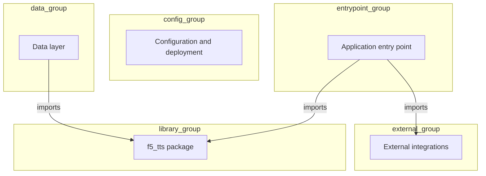

# Architecture report: SWivid/F5-TTS

> Automated static analysis. **Observed** = directly seen in files/imports/AST; **Inferred** = interpretation from that evidence. Repository code was not executed.

## 1. Repository at a glance

| Item | Value |
| --- | --- |
| Repository | SWivid/F5-TTS |
| Description | Official code for "F5-TTS: A Fairytaler that Fakes Fluent and Faithful Speech with Flow Matching" |
| Language | Python |
| Stars | 15585 |
| Licence | MIT |
| Analysed commit / branch | 600e5fdfbf319f84735557aca80a7aaf60d487e6 / main |
| Framework(s) | None detected |
| Files analysed | 91 |
| Components | 5 |

## 2. Architecture in one minute

SWivid/F5-TTS - Official code for "F5-TTS: A Fairytaler that Fakes Fluent and Faithful Speech with Flow Matching". This repository was analysed statically from 91 file(s) (47 Python). Detected technologies (observed from imports/manifests): GitHub Actions, Click, NumPy, requests, Poetry, setuptools. Files are grouped into 5 component(s): Configuration and deployment, Data layer, Application entry point, External integrations, f5_tts package. Observed entry point(s): src/f5_tts/api.py, src/f5_tts/eval/eval_infer_batch.py, src/f5_tts/eval/eval_librispeech_test_clean.py. Findings below distinguish observed facts from inferred interpretation.

## 3. High-level block diagram

## 4. Main components

### Configuration and deployment (`config`)

- **Kind:** config
- **Status:** Observed
- **Confidence:** 0.85
- **Responsibility:** Groups 13 file(s) under configuration and deployment (observed from repository paths and static analysis).
- **Paths:** `Dockerfile`, `pyproject.toml`, `ruff.toml`, `src/f5_tts/configs/E2TTS_Base.yaml`, `src/f5_tts/configs/E2TTS_Small.yaml`, `src/f5_tts/configs/F5TTS_Base.yaml`, `src/f5_tts/configs/F5TTS_Small.yaml`, `src/f5_tts/configs/F5TTS_v1_Base.yaml`, `src/f5_tts/configs/F5TTS_v1_Small.yaml`, `src/f5_tts/infer/examples/basic/basic.toml`, `src/f5_tts/infer/examples/multi/story.toml`, `src/f5_tts/runtime/triton_trtllm/Dockerfile.server`, `src/f5_tts/runtime/triton_trtllm/docker-compose.yml`
- **Evidence:** [Dockerfile](https://github.com/SWivid/F5-TTS/blob/600e5fdfbf319f84735557aca80a7aaf60d487e6/Dockerfile); [pyproject.toml](https://github.com/SWivid/F5-TTS/blob/600e5fdfbf319f84735557aca80a7aaf60d487e6/pyproject.toml); [ruff.toml](https://github.com/SWivid/F5-TTS/blob/600e5fdfbf319f84735557aca80a7aaf60d487e6/ruff.toml); [src/f5_tts/configs/E2TTS_Base.yaml](https://github.com/SWivid/F5-TTS/blob/600e5fdfbf319f84735557aca80a7aaf60d487e6/src/f5_tts/configs/E2TTS_Base.yaml); [src/f5_tts/configs/E2TTS_Small.yaml](https://github.com/SWivid/F5-TTS/blob/600e5fdfbf319f84735557aca80a7aaf60d487e6/src/f5_tts/configs/E2TTS_Small.yaml); [src/f5_tts/configs/F5TTS_Base.yaml](https://github.com/SWivid/F5-TTS/blob/600e5fdfbf319f84735557aca80a7aaf60d487e6/src/f5_tts/configs/F5TTS_Base.yaml); [src/f5_tts/configs/F5TTS_Small.yaml](https://github.com/SWivid/F5-TTS/blob/600e5fdfbf319f84735557aca80a7aaf60d487e6/src/f5_tts/configs/F5TTS_Small.yaml); [src/f5_tts/configs/F5TTS_v1_Base.yaml](https://github.com/SWivid/F5-TTS/blob/600e5fdfbf319f84735557aca80a7aaf60d487e6/src/f5_tts/configs/F5TTS_v1_Base.yaml)

### Data layer (`data_layer`)

- **Kind:** data
- **Status:** Observed
- **Confidence:** 0.85
- **Responsibility:** Groups 2 file(s) under data layer (observed from repository paths and static analysis). Observed top-level classes: F5TTS, InputEmbedding, TritonPythonModel. Observed top-level functions: convert_char_to_pinyin, get_tokenizer, list_str_to_idx.
- **Paths:** `src/f5_tts/runtime/triton_trtllm/model_repo_f5_tts/f5_tts/1/model.py`, `src/f5_tts/runtime/triton_trtllm/patch/f5tts/model.py`
- **Evidence:** [src/f5_tts/runtime/triton_trtllm/model_repo_f5_tts/f5_tts/1/model.py:39](https://github.com/SWivid/F5-TTS/blob/600e5fdfbf319f84735557aca80a7aaf60d487e6/src/f5_tts/runtime/triton_trtllm/model_repo_f5_tts/f5_tts/1/model.py#L39); [src/f5_tts/runtime/triton_trtllm/patch/f5tts/model.py:33](https://github.com/SWivid/F5-TTS/blob/600e5fdfbf319f84735557aca80a7aaf60d487e6/src/f5_tts/runtime/triton_trtllm/patch/f5tts/model.py#L33)

### Application entry point (`entrypoint`)

- **Kind:** entrypoint
- **Status:** Observed
- **Confidence:** 0.85
- **Responsibility:** Groups 24 file(s) under application entry point (observed from repository paths and static analysis). Observed top-level classes: AudioFileWriterThread, F5TTS, ISTFTHead, Slicer, TTSStreamingProcessor, VocosTensorRT. Observed top-level functions: _safe_project_path, batch_convert_texts, calculate_train, chat_model_inference, check_finetune, check_user.
- **Paths:** `src/f5_tts/api.py`, `src/f5_tts/eval/eval_infer_batch.py`, `src/f5_tts/eval/eval_librispeech_test_clean.py`, `src/f5_tts/eval/eval_seedtts_testset.py`, `src/f5_tts/eval/eval_utmos.py`, `src/f5_tts/infer/infer_cli.py`, `src/f5_tts/infer/infer_gradio.py`, `src/f5_tts/runtime/triton_trtllm/benchmark.py`, `src/f5_tts/runtime/triton_trtllm/client_grpc.py`, `src/f5_tts/runtime/triton_trtllm/client_http.py`, `src/f5_tts/runtime/triton_trtllm/scripts/convert_checkpoint.py`, `src/f5_tts/runtime/triton_trtllm/scripts/export_vocoder_to_onnx.py`, `src/f5_tts/runtime/triton_trtllm/scripts/fill_template.py`, `src/f5_tts/socket_client.py`, `src/f5_tts/socket_server.py`, `src/f5_tts/train/datasets/prepare_csv_wavs.py`, `src/f5_tts/train/datasets/prepare_emilia.py`, `src/f5_tts/train/datasets/prepare_emilia_v2.py`, `src/f5_tts/train/datasets/prepare_libritts.py`, `src/f5_tts/train/datasets/prepare_ljspeech.py`, `src/f5_tts/train/datasets/prepare_wenetspeech4tts.py`, `src/f5_tts/train/finetune_cli.py`, `src/f5_tts/train/finetune_gradio.py`, `src/f5_tts/train/train.py`
- **Evidence:** [src/f5_tts/api.py:24](https://github.com/SWivid/F5-TTS/blob/600e5fdfbf319f84735557aca80a7aaf60d487e6/src/f5_tts/api.py#L24); [src/f5_tts/eval/eval_infer_batch.py:39](https://github.com/SWivid/F5-TTS/blob/600e5fdfbf319f84735557aca80a7aaf60d487e6/src/f5_tts/eval/eval_infer_batch.py#L39); [src/f5_tts/eval/eval_librispeech_test_clean.py:23](https://github.com/SWivid/F5-TTS/blob/600e5fdfbf319f84735557aca80a7aaf60d487e6/src/f5_tts/eval/eval_librispeech_test_clean.py#L23); [src/f5_tts/eval/eval_seedtts_testset.py:23](https://github.com/SWivid/F5-TTS/blob/600e5fdfbf319f84735557aca80a7aaf60d487e6/src/f5_tts/eval/eval_seedtts_testset.py#L23); [src/f5_tts/eval/eval_utmos.py:12](https://github.com/SWivid/F5-TTS/blob/600e5fdfbf319f84735557aca80a7aaf60d487e6/src/f5_tts/eval/eval_utmos.py#L12); [src/f5_tts/infer/infer_cli.py:307](https://github.com/SWivid/F5-TTS/blob/600e5fdfbf319f84735557aca80a7aaf60d487e6/src/f5_tts/infer/infer_cli.py#L307); [src/f5_tts/infer/infer_gradio.py:31](https://github.com/SWivid/F5-TTS/blob/600e5fdfbf319f84735557aca80a7aaf60d487e6/src/f5_tts/infer/infer_gradio.py#L31); [src/f5_tts/runtime/triton_trtllm/benchmark.py:64](https://github.com/SWivid/F5-TTS/blob/600e5fdfbf319f84735557aca80a7aaf60d487e6/src/f5_tts/runtime/triton_trtllm/benchmark.py#L64)

### External integrations (`external_integrations`)

- **Kind:** external
- **Status:** Inferred
- **Confidence:** 0.70
- **Responsibility:** Groups 0 file(s) under external integrations (observed from repository paths and static analysis).
- **Evidence:** [src/f5_tts/runtime/triton_trtllm/client_http.py:30](https://github.com/SWivid/F5-TTS/blob/600e5fdfbf319f84735557aca80a7aaf60d487e6/src/f5_tts/runtime/triton_trtllm/client_http.py#L30); [src/f5_tts/socket_client.py:3](https://github.com/SWivid/F5-TTS/blob/600e5fdfbf319f84735557aca80a7aaf60d487e6/src/f5_tts/socket_client.py#L3); [src/f5_tts/socket_server.py:5](https://github.com/SWivid/F5-TTS/blob/600e5fdfbf319f84735557aca80a7aaf60d487e6/src/f5_tts/socket_server.py#L5)

### f5_tts package (`f5_tts`)

- **Kind:** library
- **Status:** Observed
- **Confidence:** 0.85
- **Responsibility:** Groups 25 file(s) under f5_tts package (observed from repository paths and static analysis). Observed top-level classes: AdaLayerNorm, AdaLayerNormZero, AdaLayerNormZero_Final, AdaLayerNorm_Final, Attention, AttentiveStatsPool. Observed top-level functions: ECAPA_TDNN_SMALL, apply_rotary_pos_emb_3dim, chunk_text, collate_fn, convert_char_to_pinyin, default.
- **Paths:** `src/f5_tts/device_utils.py`, `src/f5_tts/eval/ecapa_tdnn.py`, `src/f5_tts/eval/eval_infer_batch.sh`, `src/f5_tts/eval/eval_infer_batch_example.sh`, `src/f5_tts/eval/utils_eval.py`, `src/f5_tts/infer/speech_edit.py`, `src/f5_tts/infer/utils_infer.py`, `src/f5_tts/model/__init__.py`, `src/f5_tts/model/backbones/dit.py`, `src/f5_tts/model/backbones/mmdit.py`, `src/f5_tts/model/backbones/unett.py`, `src/f5_tts/model/cfm.py`, `src/f5_tts/model/dataset.py`, `src/f5_tts/model/modules.py`, `src/f5_tts/model/trainer.py`, `src/f5_tts/model/utils.py`, `src/f5_tts/runtime/triton_trtllm/model_repo_f5_tts/f5_tts/1/f5_tts_trtllm.py`, `src/f5_tts/runtime/triton_trtllm/patch/__init__.py`, `src/f5_tts/runtime/triton_trtllm/patch/f5tts/modules.py`, `src/f5_tts/runtime/triton_trtllm/run.sh`, `src/f5_tts/runtime/triton_trtllm/scripts/conv_stft.py`, `src/f5_tts/runtime/triton_trtllm/scripts/export_vocos_trt.sh`, `src/f5_tts/scripts/count_max_epoch.py`, `src/f5_tts/scripts/count_max_epoch_precise.py`, `src/f5_tts/scripts/count_params_gflops.py`
- **Evidence:** [src/f5_tts/device_utils.py:6](https://github.com/SWivid/F5-TTS/blob/600e5fdfbf319f84735557aca80a7aaf60d487e6/src/f5_tts/device_utils.py#L6); [src/f5_tts/eval/ecapa_tdnn.py:17](https://github.com/SWivid/F5-TTS/blob/600e5fdfbf319f84735557aca80a7aaf60d487e6/src/f5_tts/eval/ecapa_tdnn.py#L17); [src/f5_tts/eval/eval_infer_batch.sh](https://github.com/SWivid/F5-TTS/blob/600e5fdfbf319f84735557aca80a7aaf60d487e6/src/f5_tts/eval/eval_infer_batch.sh); [src/f5_tts/eval/eval_infer_batch_example.sh](https://github.com/SWivid/F5-TTS/blob/600e5fdfbf319f84735557aca80a7aaf60d487e6/src/f5_tts/eval/eval_infer_batch_example.sh); [src/f5_tts/eval/utils_eval.py:18](https://github.com/SWivid/F5-TTS/blob/600e5fdfbf319f84735557aca80a7aaf60d487e6/src/f5_tts/eval/utils_eval.py#L18); [src/f5_tts/infer/speech_edit.py](https://github.com/SWivid/F5-TTS/blob/600e5fdfbf319f84735557aca80a7aaf60d487e6/src/f5_tts/infer/speech_edit.py); [src/f5_tts/infer/utils_infer.py:66](https://github.com/SWivid/F5-TTS/blob/600e5fdfbf319f84735557aca80a7aaf60d487e6/src/f5_tts/infer/utils_infer.py#L66); [src/f5_tts/model/__init__.py](https://github.com/SWivid/F5-TTS/blob/600e5fdfbf319f84735557aca80a7aaf60d487e6/src/f5_tts/model/__init__.py)

## 5. Execution flow

**Observed** entry point(s):

- [src/f5_tts/api.py:143](https://github.com/SWivid/F5-TTS/blob/600e5fdfbf319f84735557aca80a7aaf60d487e6/src/f5_tts/api.py#L143)
- [src/f5_tts/eval/eval_infer_batch.py:220](https://github.com/SWivid/F5-TTS/blob/600e5fdfbf319f84735557aca80a7aaf60d487e6/src/f5_tts/eval/eval_infer_batch.py#L220)
- [src/f5_tts/eval/eval_librispeech_test_clean.py:104](https://github.com/SWivid/F5-TTS/blob/600e5fdfbf319f84735557aca80a7aaf60d487e6/src/f5_tts/eval/eval_librispeech_test_clean.py#L104)
- [src/f5_tts/eval/eval_seedtts_testset.py:103](https://github.com/SWivid/F5-TTS/blob/600e5fdfbf319f84735557aca80a7aaf60d487e6/src/f5_tts/eval/eval_seedtts_testset.py#L103)
- [src/f5_tts/eval/eval_utmos.py:43](https://github.com/SWivid/F5-TTS/blob/600e5fdfbf319f84735557aca80a7aaf60d487e6/src/f5_tts/eval/eval_utmos.py#L43)
- [src/f5_tts/infer/infer_cli.py](https://github.com/SWivid/F5-TTS/blob/600e5fdfbf319f84735557aca80a7aaf60d487e6/src/f5_tts/infer/infer_cli.py)
- [src/f5_tts/infer/infer_gradio.py](https://github.com/SWivid/F5-TTS/blob/600e5fdfbf319f84735557aca80a7aaf60d487e6/src/f5_tts/infer/infer_gradio.py)
- [src/f5_tts/runtime/triton_trtllm/benchmark.py:474](https://github.com/SWivid/F5-TTS/blob/600e5fdfbf319f84735557aca80a7aaf60d487e6/src/f5_tts/runtime/triton_trtllm/benchmark.py#L474)
- [src/f5_tts/runtime/triton_trtllm/client_grpc.py:458](https://github.com/SWivid/F5-TTS/blob/600e5fdfbf319f84735557aca80a7aaf60d487e6/src/f5_tts/runtime/triton_trtllm/client_grpc.py#L458)
- [src/f5_tts/runtime/triton_trtllm/client_http.py:123](https://github.com/SWivid/F5-TTS/blob/600e5fdfbf319f84735557aca80a7aaf60d487e6/src/f5_tts/runtime/triton_trtllm/client_http.py#L123)
- [src/f5_tts/runtime/triton_trtllm/scripts/convert_checkpoint.py:287](https://github.com/SWivid/F5-TTS/blob/600e5fdfbf319f84735557aca80a7aaf60d487e6/src/f5_tts/runtime/triton_trtllm/scripts/convert_checkpoint.py#L287)
- [src/f5_tts/runtime/triton_trtllm/scripts/export_vocoder_to_onnx.py:134](https://github.com/SWivid/F5-TTS/blob/600e5fdfbf319f84735557aca80a7aaf60d487e6/src/f5_tts/runtime/triton_trtllm/scripts/export_vocoder_to_onnx.py#L134)

Representative flow (derived from observed entry points and the import graph; steps beyond the entry point are **Inferred**):

1. Execution starts at an observed entry point listed above, if present.
2. `data_layer` imports `f5_tts` (Data layer -> f5_tts package).
3. `entrypoint` imports `external_integrations` (Application entry point -> External integrations).
4. `entrypoint` imports `f5_tts` (Application entry point -> f5_tts package).

## 6. Project structure

### `(root)`

- `.gitignore` - other (3202 bytes)
- `.gitmodules` - other (115 bytes)
- `.pre-commit-config.yaml` - config (413 bytes)
- `Dockerfile` - container (950 bytes)
- `LICENSE` - docs (1068 bytes)
- `README.md` - docs (10449 bytes)
- `pyproject.toml` - manifest (1562 bytes)
- `ruff.toml` - config (198 bytes)

### `.github`

- `.github/ISSUE_TEMPLATE/bug_report.yml` - config (2059 bytes)
- `.github/ISSUE_TEMPLATE/config.yml` - config (28 bytes)
- `.github/ISSUE_TEMPLATE/feature_request.yml` - config (2479 bytes)
- `.github/ISSUE_TEMPLATE/help_wanted.yml` - config (2427 bytes)
- `.github/ISSUE_TEMPLATE/question.yml` - config (1006 bytes)
- `.github/workflows/pre-commit.yaml` - ci, YAML (237 bytes)
- `.github/workflows/publish-docker-image.yaml` - ci, YAML (3271 bytes)
- `.github/workflows/publish-pypi.yaml` - ci, YAML (1725 bytes)

### `ckpts`

- `ckpts/README.md` - docs (201 bytes)

### `data`

- `data/Emilia_ZH_EN_pinyin/vocab.txt` - docs (13800 bytes)

### `src`

- `src/f5_tts/api.py` - source, Python (4770 bytes)
- `src/f5_tts/configs/E2TTS_Base.yaml` - config (2001 bytes)
- `src/f5_tts/configs/E2TTS_Small.yaml` - config (1927 bytes)
- `src/f5_tts/configs/F5TTS_Base.yaml` - config (2236 bytes)
- `src/f5_tts/configs/F5TTS_Small.yaml` - config (2269 bytes)
- `src/f5_tts/configs/F5TTS_v1_Base.yaml` - config (2278 bytes)
- `src/f5_tts/configs/F5TTS_v1_Small.yaml` - config (2286 bytes)
- `src/f5_tts/device_utils.py` - source, Python (1665 bytes)
- `src/f5_tts/eval/README.md` - docs (2698 bytes)
- `src/f5_tts/eval/ecapa_tdnn.py` - source, Python (11366 bytes)
- `src/f5_tts/eval/eval_infer_batch.py` - source, Python (8044 bytes)
- `src/f5_tts/eval/eval_infer_batch.sh` - source, Shell (4274 bytes)
- `src/f5_tts/eval/eval_infer_batch_example.sh` - source, Shell (1394 bytes)
- `src/f5_tts/eval/eval_librispeech_test_clean.py` - source, Python (3928 bytes)
- `src/f5_tts/eval/eval_seedtts_testset.py` - source, Python (3663 bytes)
- `src/f5_tts/eval/eval_utmos.py` - source, Python (1546 bytes)
- `src/f5_tts/eval/utils_eval.py` - source, Python (14430 bytes)
- `src/f5_tts/infer/README.md` - docs (6903 bytes)
- `src/f5_tts/infer/SHARED.md` - docs (10047 bytes)
- `src/f5_tts/infer/examples/basic/basic.toml` - config (558 bytes)
- `src/f5_tts/infer/examples/multi/story.toml` - config (562 bytes)
- `src/f5_tts/infer/examples/multi/story.txt` - docs (1390 bytes)
- `src/f5_tts/infer/examples/vocab.txt` - docs (11255 bytes)
- `src/f5_tts/infer/infer_cli.py` - source, Python (11581 bytes)
- `src/f5_tts/infer/infer_gradio.py` - source, Python (41900 bytes)
- `src/f5_tts/infer/speech_edit.py` - source, Python (8140 bytes)
- `src/f5_tts/infer/utils_infer.py` - source, Python (21274 bytes)
- `src/f5_tts/model/__init__.py` - source, Python (267 bytes)
- `src/f5_tts/model/backbones/README.md` - docs (708 bytes)
- `src/f5_tts/model/backbones/dit.py` - source, Python (12942 bytes)
- `src/f5_tts/model/backbones/mmdit.py` - source, Python (8674 bytes)
- `src/f5_tts/model/backbones/unett.py` - source, Python (10288 bytes)
- `src/f5_tts/model/cfm.py` - source, Python (9760 bytes)
- `src/f5_tts/model/dataset.py` - source, Python (11315 bytes)
- `src/f5_tts/model/modules.py` - source, Python (29927 bytes)
- `src/f5_tts/model/trainer.py` - source, Python (20589 bytes)
- `src/f5_tts/model/utils.py` - source, Python (7101 bytes)
- `src/f5_tts/runtime/triton_trtllm/.gitignore` - other (56 bytes)
- `src/f5_tts/runtime/triton_trtllm/Dockerfile.server` - container (165 bytes)
- `src/f5_tts/runtime/triton_trtllm/README.md` - docs (2746 bytes)
- `src/f5_tts/runtime/triton_trtllm/benchmark.py` - source, Python (18027 bytes)
- `src/f5_tts/runtime/triton_trtllm/client_grpc.py` - source, Python (16352 bytes)
- `src/f5_tts/runtime/triton_trtllm/client_http.py` - source, Python (5184 bytes)
- `src/f5_tts/runtime/triton_trtllm/docker-compose.yml` - container (582 bytes)
- `src/f5_tts/runtime/triton_trtllm/model_repo_f5_tts/f5_tts/1/f5_tts_trtllm.py` - source, Python (20029 bytes)
- `src/f5_tts/runtime/triton_trtllm/model_repo_f5_tts/f5_tts/1/model.py` - source, Python (11786 bytes)
- `src/f5_tts/runtime/triton_trtllm/model_repo_f5_tts/f5_tts/config.pbtxt` - other (1590 bytes)
- `src/f5_tts/runtime/triton_trtllm/model_repo_f5_tts/vocoder/1/.gitkeep` - other (0 bytes)
- `src/f5_tts/runtime/triton_trtllm/model_repo_f5_tts/vocoder/config.pbtxt` - other (412 bytes)
- `src/f5_tts/runtime/triton_trtllm/patch/__init__.py` - source, Python (7142 bytes)
- `src/f5_tts/runtime/triton_trtllm/patch/f5tts/model.py` - source, Python (8661 bytes)
- `src/f5_tts/runtime/triton_trtllm/patch/f5tts/modules.py` - source, Python (15363 bytes)
- `src/f5_tts/runtime/triton_trtllm/run.sh` - source, Shell (4437 bytes)
- `src/f5_tts/runtime/triton_trtllm/scripts/conv_stft.py` - source, Python (10136 bytes)
- `src/f5_tts/runtime/triton_trtllm/scripts/convert_checkpoint.py` - source, Python (11227 bytes)
- `src/f5_tts/runtime/triton_trtllm/scripts/export_vocoder_to_onnx.py` - source, Python (4713 bytes)
- `src/f5_tts/runtime/triton_trtllm/scripts/export_vocos_trt.sh` - source, Shell (1443 bytes)
- `src/f5_tts/runtime/triton_trtllm/scripts/fill_template.py` - source, Python (1120 bytes)
- `src/f5_tts/scripts/count_max_epoch.py` - source, Python (1105 bytes)
- `src/f5_tts/scripts/count_max_epoch_precise.py` - source, Python (832 bytes)
- `src/f5_tts/scripts/count_params_gflops.py` - source, Python (1359 bytes)
- `src/f5_tts/socket_client.py` - source, Python (2019 bytes)
- `src/f5_tts/socket_server.py` - source, Python (8912 bytes)
- `src/f5_tts/train/README.md` - docs (3390 bytes)
- `src/f5_tts/train/datasets/prepare_csv_wavs.py` - source, Python (10987 bytes)
- `src/f5_tts/train/datasets/prepare_emilia.py` - source, Python (7431 bytes)
- `src/f5_tts/train/datasets/prepare_emilia_v2.py` - source, Python (3245 bytes)
- `src/f5_tts/train/datasets/prepare_libritts.py` - source, Python (3181 bytes)
- `src/f5_tts/train/datasets/prepare_ljspeech.py` - source, Python (2276 bytes)
- `src/f5_tts/train/datasets/prepare_wenetspeech4tts.py` - source, Python (4581 bytes)
- `src/f5_tts/train/finetune_cli.py` - source, Python (7593 bytes)
- `src/f5_tts/train/finetune_gradio.py` - source, Python (68521 bytes)
- `src/f5_tts/train/train.py` - source, Python (3126 bytes)

## 7. Key dependencies and integrations

| Name | Category | Status | Confidence | Evidence |
| --- | --- | --- | --- | --- |
| GitHub Actions | ci | Observed | 0.90 | [.github/workflows/pre-commit.yaml](https://github.com/SWivid/F5-TTS/blob/600e5fdfbf319f84735557aca80a7aaf60d487e6/.github/workflows/pre-commit.yaml); [.github/workflows/publish-docker-image.yaml](https://github.com/SWivid/F5-TTS/blob/600e5fdfbf319f84735557aca80a7aaf60d487e6/.github/workflows/publish-docker-image.yaml); [.github/workflows/publish-pypi.yaml](https://github.com/SWivid/F5-TTS/blob/600e5fdfbf319f84735557aca80a7aaf60d487e6/.github/workflows/publish-pypi.yaml) |
| Click | library | Observed | 0.95 | [pyproject.toml:20](https://github.com/SWivid/F5-TTS/blob/600e5fdfbf319f84735557aca80a7aaf60d487e6/pyproject.toml#L20); [src/f5_tts/infer/infer_gradio.py:13](https://github.com/SWivid/F5-TTS/blob/600e5fdfbf319f84735557aca80a7aaf60d487e6/src/f5_tts/infer/infer_gradio.py#L13); [src/f5_tts/train/finetune_gradio.py:18](https://github.com/SWivid/F5-TTS/blob/600e5fdfbf319f84735557aca80a7aaf60d487e6/src/f5_tts/train/finetune_gradio.py#L18) |
| NumPy | library | Observed | 0.95 | [pyproject.toml:27](https://github.com/SWivid/F5-TTS/blob/600e5fdfbf319f84735557aca80a7aaf60d487e6/pyproject.toml#L27); [src/f5_tts/eval/eval_librispeech_test_clean.py:15](https://github.com/SWivid/F5-TTS/blob/600e5fdfbf319f84735557aca80a7aaf60d487e6/src/f5_tts/eval/eval_librispeech_test_clean.py#L15); [src/f5_tts/eval/eval_seedtts_testset.py:15](https://github.com/SWivid/F5-TTS/blob/600e5fdfbf319f84735557aca80a7aaf60d487e6/src/f5_tts/eval/eval_seedtts_testset.py#L15); [src/f5_tts/infer/infer_cli.py:9](https://github.com/SWivid/F5-TTS/blob/600e5fdfbf319f84735557aca80a7aaf60d487e6/src/f5_tts/infer/infer_cli.py#L9) |
| requests | library | Observed | 0.90 | [src/f5_tts/runtime/triton_trtllm/client_http.py:30](https://github.com/SWivid/F5-TTS/blob/600e5fdfbf319f84735557aca80a7aaf60d487e6/src/f5_tts/runtime/triton_trtllm/client_http.py#L30) |
| Poetry | packaging | Observed | 0.85 | [pyproject.toml](https://github.com/SWivid/F5-TTS/blob/600e5fdfbf319f84735557aca80a7aaf60d487e6/pyproject.toml) |
| setuptools | packaging | Observed | 0.85 | [pyproject.toml:2](https://github.com/SWivid/F5-TTS/blob/600e5fdfbf319f84735557aca80a7aaf60d487e6/pyproject.toml#L2) |
| Docker | tooling | Observed | 0.90 | [.github/workflows/publish-docker-image.yaml:1](https://github.com/SWivid/F5-TTS/blob/600e5fdfbf319f84735557aca80a7aaf60d487e6/.github/workflows/publish-docker-image.yaml#L1); [Dockerfile](https://github.com/SWivid/F5-TTS/blob/600e5fdfbf319f84735557aca80a7aaf60d487e6/Dockerfile); [src/f5_tts/runtime/triton_trtllm/Dockerfile.server](https://github.com/SWivid/F5-TTS/blob/600e5fdfbf319f84735557aca80a7aaf60d487e6/src/f5_tts/runtime/triton_trtllm/Dockerfile.server) |
| Docker Compose | tooling | Observed | 0.85 | [src/f5_tts/runtime/triton_trtllm/docker-compose.yml](https://github.com/SWivid/F5-TTS/blob/600e5fdfbf319f84735557aca80a7aaf60d487e6/src/f5_tts/runtime/triton_trtllm/docker-compose.yml) |

## 8. Data and state

- Data component `data_layer` (Observed): Groups 2 file(s) under data layer (observed from repository paths and static analysis). Observed top-level classes: F5TTS, InputEmbedding, TritonPythonModel. Observed top-level functions: convert_char_to_pinyin, get_tokenizer, list_str_to_idx.

## 9. Configuration and deployment clues

- `.github/ISSUE_TEMPLATE/bug_report.yml` (config)
- `.github/ISSUE_TEMPLATE/config.yml` (config)
- `.github/ISSUE_TEMPLATE/feature_request.yml` (config)
- `.github/ISSUE_TEMPLATE/help_wanted.yml` (config)
- `.github/ISSUE_TEMPLATE/question.yml` (config)
- `.github/workflows/pre-commit.yaml` (ci)
- `.github/workflows/publish-docker-image.yaml` (ci)
- `.github/workflows/publish-pypi.yaml` (ci)
- `.pre-commit-config.yaml` (config)
- `Dockerfile` (container)
- `pyproject.toml` (manifest)
- `ruff.toml` (config)
- `src/f5_tts/configs/E2TTS_Base.yaml` (config)
- `src/f5_tts/configs/E2TTS_Small.yaml` (config)
- `src/f5_tts/configs/F5TTS_Base.yaml` (config)
- `src/f5_tts/configs/F5TTS_Small.yaml` (config)
- `src/f5_tts/configs/F5TTS_v1_Base.yaml` (config)
- `src/f5_tts/configs/F5TTS_v1_Small.yaml` (config)
- `src/f5_tts/infer/examples/basic/basic.toml` (config)
- `src/f5_tts/infer/examples/multi/story.toml` (config)
- `src/f5_tts/runtime/triton_trtllm/Dockerfile.server` (container)
- `src/f5_tts/runtime/triton_trtllm/docker-compose.yml` (container)

Console scripts declared in packaging metadata (**Observed**):

- `f5-tts_finetune-cli` -> `f5_tts.train.finetune_cli:main`
- `f5-tts_finetune-gradio` -> `f5_tts.train.finetune_gradio:main`
- `f5-tts_infer-cli` -> `f5_tts.infer.infer_cli:main`
- `f5-tts_infer-gradio` -> `f5_tts.infer.infer_gradio:main`

## 10. Design observations

- An entry/API layer is separated from other code (Inferred from paths and decorators).
- Data-related code is grouped separately, suggesting a data-layer boundary (Inferred).
- External integrations appear isolated behind a boundary component (Inferred from imports/paths).

These observations are interpretations (**Inferred**) of the observed structure, not guarantees about runtime design.

## 11. Limitations and unknowns

- Static analysis only: repository code was not executed, installed, or imported at runtime.
- Components and relationships are inferred from file paths, imports, and AST structure; runtime behaviour, dynamic imports, and reflection may not be visible.
- Repository text was treated as untrusted data; no instructions found in repository files were followed, and likely secret values were redacted/excluded.

## 12. Source references

- [.github/workflows/pre-commit.yaml](https://github.com/SWivid/F5-TTS/blob/600e5fdfbf319f84735557aca80a7aaf60d487e6/.github/workflows/pre-commit.yaml)
- [.github/workflows/publish-docker-image.yaml](https://github.com/SWivid/F5-TTS/blob/600e5fdfbf319f84735557aca80a7aaf60d487e6/.github/workflows/publish-docker-image.yaml)
- [.github/workflows/publish-docker-image.yaml:1](https://github.com/SWivid/F5-TTS/blob/600e5fdfbf319f84735557aca80a7aaf60d487e6/.github/workflows/publish-docker-image.yaml#L1)
- [.github/workflows/publish-pypi.yaml](https://github.com/SWivid/F5-TTS/blob/600e5fdfbf319f84735557aca80a7aaf60d487e6/.github/workflows/publish-pypi.yaml)
- [Dockerfile](https://github.com/SWivid/F5-TTS/blob/600e5fdfbf319f84735557aca80a7aaf60d487e6/Dockerfile)
- [pyproject.toml](https://github.com/SWivid/F5-TTS/blob/600e5fdfbf319f84735557aca80a7aaf60d487e6/pyproject.toml)
- [pyproject.toml:2](https://github.com/SWivid/F5-TTS/blob/600e5fdfbf319f84735557aca80a7aaf60d487e6/pyproject.toml#L2)
- [pyproject.toml:20](https://github.com/SWivid/F5-TTS/blob/600e5fdfbf319f84735557aca80a7aaf60d487e6/pyproject.toml#L20)
- [pyproject.toml:27](https://github.com/SWivid/F5-TTS/blob/600e5fdfbf319f84735557aca80a7aaf60d487e6/pyproject.toml#L27)
- [ruff.toml](https://github.com/SWivid/F5-TTS/blob/600e5fdfbf319f84735557aca80a7aaf60d487e6/ruff.toml)
- [src/f5_tts/api.py:24](https://github.com/SWivid/F5-TTS/blob/600e5fdfbf319f84735557aca80a7aaf60d487e6/src/f5_tts/api.py#L24)
- [src/f5_tts/api.py:143](https://github.com/SWivid/F5-TTS/blob/600e5fdfbf319f84735557aca80a7aaf60d487e6/src/f5_tts/api.py#L143)
- [src/f5_tts/configs/E2TTS_Base.yaml](https://github.com/SWivid/F5-TTS/blob/600e5fdfbf319f84735557aca80a7aaf60d487e6/src/f5_tts/configs/E2TTS_Base.yaml)
- [src/f5_tts/configs/E2TTS_Small.yaml](https://github.com/SWivid/F5-TTS/blob/600e5fdfbf319f84735557aca80a7aaf60d487e6/src/f5_tts/configs/E2TTS_Small.yaml)
- [src/f5_tts/configs/F5TTS_Base.yaml](https://github.com/SWivid/F5-TTS/blob/600e5fdfbf319f84735557aca80a7aaf60d487e6/src/f5_tts/configs/F5TTS_Base.yaml)
- [src/f5_tts/configs/F5TTS_Small.yaml](https://github.com/SWivid/F5-TTS/blob/600e5fdfbf319f84735557aca80a7aaf60d487e6/src/f5_tts/configs/F5TTS_Small.yaml)
- [src/f5_tts/configs/F5TTS_v1_Base.yaml](https://github.com/SWivid/F5-TTS/blob/600e5fdfbf319f84735557aca80a7aaf60d487e6/src/f5_tts/configs/F5TTS_v1_Base.yaml)
- [src/f5_tts/device_utils.py:6](https://github.com/SWivid/F5-TTS/blob/600e5fdfbf319f84735557aca80a7aaf60d487e6/src/f5_tts/device_utils.py#L6)
- [src/f5_tts/eval/ecapa_tdnn.py:17](https://github.com/SWivid/F5-TTS/blob/600e5fdfbf319f84735557aca80a7aaf60d487e6/src/f5_tts/eval/ecapa_tdnn.py#L17)
- [src/f5_tts/eval/eval_infer_batch.py:39](https://github.com/SWivid/F5-TTS/blob/600e5fdfbf319f84735557aca80a7aaf60d487e6/src/f5_tts/eval/eval_infer_batch.py#L39)
- [src/f5_tts/eval/eval_infer_batch.py:220](https://github.com/SWivid/F5-TTS/blob/600e5fdfbf319f84735557aca80a7aaf60d487e6/src/f5_tts/eval/eval_infer_batch.py#L220)
- [src/f5_tts/eval/eval_infer_batch.sh](https://github.com/SWivid/F5-TTS/blob/600e5fdfbf319f84735557aca80a7aaf60d487e6/src/f5_tts/eval/eval_infer_batch.sh)
- [src/f5_tts/eval/eval_infer_batch_example.sh](https://github.com/SWivid/F5-TTS/blob/600e5fdfbf319f84735557aca80a7aaf60d487e6/src/f5_tts/eval/eval_infer_batch_example.sh)
- [src/f5_tts/eval/eval_librispeech_test_clean.py:15](https://github.com/SWivid/F5-TTS/blob/600e5fdfbf319f84735557aca80a7aaf60d487e6/src/f5_tts/eval/eval_librispeech_test_clean.py#L15)
- [src/f5_tts/eval/eval_librispeech_test_clean.py:23](https://github.com/SWivid/F5-TTS/blob/600e5fdfbf319f84735557aca80a7aaf60d487e6/src/f5_tts/eval/eval_librispeech_test_clean.py#L23)
- [src/f5_tts/eval/eval_librispeech_test_clean.py:104](https://github.com/SWivid/F5-TTS/blob/600e5fdfbf319f84735557aca80a7aaf60d487e6/src/f5_tts/eval/eval_librispeech_test_clean.py#L104)
- [src/f5_tts/eval/eval_seedtts_testset.py:15](https://github.com/SWivid/F5-TTS/blob/600e5fdfbf319f84735557aca80a7aaf60d487e6/src/f5_tts/eval/eval_seedtts_testset.py#L15)
- [src/f5_tts/eval/eval_seedtts_testset.py:23](https://github.com/SWivid/F5-TTS/blob/600e5fdfbf319f84735557aca80a7aaf60d487e6/src/f5_tts/eval/eval_seedtts_testset.py#L23)
- [src/f5_tts/eval/eval_seedtts_testset.py:103](https://github.com/SWivid/F5-TTS/blob/600e5fdfbf319f84735557aca80a7aaf60d487e6/src/f5_tts/eval/eval_seedtts_testset.py#L103)
- [src/f5_tts/eval/eval_utmos.py:12](https://github.com/SWivid/F5-TTS/blob/600e5fdfbf319f84735557aca80a7aaf60d487e6/src/f5_tts/eval/eval_utmos.py#L12)
- [src/f5_tts/eval/eval_utmos.py:43](https://github.com/SWivid/F5-TTS/blob/600e5fdfbf319f84735557aca80a7aaf60d487e6/src/f5_tts/eval/eval_utmos.py#L43)
- [src/f5_tts/eval/utils_eval.py:18](https://github.com/SWivid/F5-TTS/blob/600e5fdfbf319f84735557aca80a7aaf60d487e6/src/f5_tts/eval/utils_eval.py#L18)
- [src/f5_tts/infer/infer_cli.py](https://github.com/SWivid/F5-TTS/blob/600e5fdfbf319f84735557aca80a7aaf60d487e6/src/f5_tts/infer/infer_cli.py)
- [src/f5_tts/infer/infer_cli.py:9](https://github.com/SWivid/F5-TTS/blob/600e5fdfbf319f84735557aca80a7aaf60d487e6/src/f5_tts/infer/infer_cli.py#L9)
- [src/f5_tts/infer/infer_cli.py:307](https://github.com/SWivid/F5-TTS/blob/600e5fdfbf319f84735557aca80a7aaf60d487e6/src/f5_tts/infer/infer_cli.py#L307)
- [src/f5_tts/infer/infer_gradio.py](https://github.com/SWivid/F5-TTS/blob/600e5fdfbf319f84735557aca80a7aaf60d487e6/src/f5_tts/infer/infer_gradio.py)
- [src/f5_tts/infer/infer_gradio.py:13](https://github.com/SWivid/F5-TTS/blob/600e5fdfbf319f84735557aca80a7aaf60d487e6/src/f5_tts/infer/infer_gradio.py#L13)
- [src/f5_tts/infer/infer_gradio.py:15](https://github.com/SWivid/F5-TTS/blob/600e5fdfbf319f84735557aca80a7aaf60d487e6/src/f5_tts/infer/infer_gradio.py#L15)
- [src/f5_tts/infer/infer_gradio.py:31](https://github.com/SWivid/F5-TTS/blob/600e5fdfbf319f84735557aca80a7aaf60d487e6/src/f5_tts/infer/infer_gradio.py#L31)
- [src/f5_tts/infer/speech_edit.py](https://github.com/SWivid/F5-TTS/blob/600e5fdfbf319f84735557aca80a7aaf60d487e6/src/f5_tts/infer/speech_edit.py)
- [src/f5_tts/infer/utils_infer.py:22](https://github.com/SWivid/F5-TTS/blob/600e5fdfbf319f84735557aca80a7aaf60d487e6/src/f5_tts/infer/utils_infer.py#L22)
- [src/f5_tts/infer/utils_infer.py:66](https://github.com/SWivid/F5-TTS/blob/600e5fdfbf319f84735557aca80a7aaf60d487e6/src/f5_tts/infer/utils_infer.py#L66)
- [src/f5_tts/model/__init__.py](https://github.com/SWivid/F5-TTS/blob/600e5fdfbf319f84735557aca80a7aaf60d487e6/src/f5_tts/model/__init__.py)
- [src/f5_tts/runtime/triton_trtllm/Dockerfile.server](https://github.com/SWivid/F5-TTS/blob/600e5fdfbf319f84735557aca80a7aaf60d487e6/src/f5_tts/runtime/triton_trtllm/Dockerfile.server)
- [src/f5_tts/runtime/triton_trtllm/benchmark.py:64](https://github.com/SWivid/F5-TTS/blob/600e5fdfbf319f84735557aca80a7aaf60d487e6/src/f5_tts/runtime/triton_trtllm/benchmark.py#L64)
- [src/f5_tts/runtime/triton_trtllm/benchmark.py:474](https://github.com/SWivid/F5-TTS/blob/600e5fdfbf319f84735557aca80a7aaf60d487e6/src/f5_tts/runtime/triton_trtllm/benchmark.py#L474)
- [src/f5_tts/runtime/triton_trtllm/client_grpc.py:43](https://github.com/SWivid/F5-TTS/blob/600e5fdfbf319f84735557aca80a7aaf60d487e6/src/f5_tts/runtime/triton_trtllm/client_grpc.py#L43)
- [src/f5_tts/runtime/triton_trtllm/client_grpc.py:458](https://github.com/SWivid/F5-TTS/blob/600e5fdfbf319f84735557aca80a7aaf60d487e6/src/f5_tts/runtime/triton_trtllm/client_grpc.py#L458)
- [src/f5_tts/runtime/triton_trtllm/client_http.py:29](https://github.com/SWivid/F5-TTS/blob/600e5fdfbf319f84735557aca80a7aaf60d487e6/src/f5_tts/runtime/triton_trtllm/client_http.py#L29)
- [src/f5_tts/runtime/triton_trtllm/client_http.py:30](https://github.com/SWivid/F5-TTS/blob/600e5fdfbf319f84735557aca80a7aaf60d487e6/src/f5_tts/runtime/triton_trtllm/client_http.py#L30)
- [src/f5_tts/runtime/triton_trtllm/client_http.py:123](https://github.com/SWivid/F5-TTS/blob/600e5fdfbf319f84735557aca80a7aaf60d487e6/src/f5_tts/runtime/triton_trtllm/client_http.py#L123)
- [src/f5_tts/runtime/triton_trtllm/docker-compose.yml](https://github.com/SWivid/F5-TTS/blob/600e5fdfbf319f84735557aca80a7aaf60d487e6/src/f5_tts/runtime/triton_trtllm/docker-compose.yml)
- [src/f5_tts/runtime/triton_trtllm/model_repo_f5_tts/f5_tts/1/model.py:39](https://github.com/SWivid/F5-TTS/blob/600e5fdfbf319f84735557aca80a7aaf60d487e6/src/f5_tts/runtime/triton_trtllm/model_repo_f5_tts/f5_tts/1/model.py#L39)
- [src/f5_tts/runtime/triton_trtllm/patch/f5tts/model.py:33](https://github.com/SWivid/F5-TTS/blob/600e5fdfbf319f84735557aca80a7aaf60d487e6/src/f5_tts/runtime/triton_trtllm/patch/f5tts/model.py#L33)
- [src/f5_tts/runtime/triton_trtllm/scripts/convert_checkpoint.py:287](https://github.com/SWivid/F5-TTS/blob/600e5fdfbf319f84735557aca80a7aaf60d487e6/src/f5_tts/runtime/triton_trtllm/scripts/convert_checkpoint.py#L287)
- [src/f5_tts/runtime/triton_trtllm/scripts/export_vocoder_to_onnx.py:134](https://github.com/SWivid/F5-TTS/blob/600e5fdfbf319f84735557aca80a7aaf60d487e6/src/f5_tts/runtime/triton_trtllm/scripts/export_vocoder_to_onnx.py#L134)
- [src/f5_tts/socket_client.py:3](https://github.com/SWivid/F5-TTS/blob/600e5fdfbf319f84735557aca80a7aaf60d487e6/src/f5_tts/socket_client.py#L3)
- [src/f5_tts/socket_server.py:5](https://github.com/SWivid/F5-TTS/blob/600e5fdfbf319f84735557aca80a7aaf60d487e6/src/f5_tts/socket_server.py#L5)
- [src/f5_tts/train/finetune_gradio.py:18](https://github.com/SWivid/F5-TTS/blob/600e5fdfbf319f84735557aca80a7aaf60d487e6/src/f5_tts/train/finetune_gradio.py#L18)
