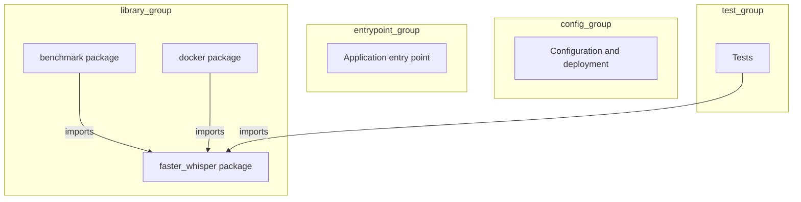

# Architecture report: SYSTRAN/faster-whisper

> Automated static analysis. **Observed** = directly seen in files/imports/AST; **Inferred** = interpretation from that evidence. Repository code was not executed.

## 1. Repository at a glance

| Item | Value |
| --- | --- |
| Repository | SYSTRAN/faster-whisper |
| Description | Faster Whisper transcription with CTranslate2 |
| Language | Python |
| Stars | 26751 |
| Licence | MIT |
| Analysed commit / branch | 6cb639e70786aea42b9233006ae60eaf07190bdb / master |
| Framework(s) | None detected |
| Files analysed | 32 |
| Components | 6 |

## 2. Architecture in one minute

SYSTRAN/faster-whisper - Faster Whisper transcription with CTranslate2. This repository was analysed statically from 32 file(s) (20 Python). Detected technologies (observed from imports/manifests): GitHub Actions, NumPy, setuptools, Docker, pytest. Files are grouped into 6 component(s): benchmark package, Configuration and deployment, docker package, Application entry point, faster_whisper package, Tests. Observed entry point(s): benchmark/memory_benchmark.py, benchmark/speed_benchmark.py. Findings below distinguish observed facts from inferred interpretation.

## 3. High-level block diagram

## 4. Main components

### benchmark package (`benchmark`)

- **Kind:** library
- **Status:** Observed
- **Confidence:** 0.85
- **Responsibility:** Groups 3 file(s) under benchmark package (observed from repository paths and static analysis). Observed top-level classes: MyThread. Observed top-level functions: get_logger, inference, url_to_audio.
- **Paths:** `benchmark/evaluate_yt_commons.py`, `benchmark/utils.py`, `benchmark/wer_benchmark.py`
- **Evidence:** [benchmark/evaluate_yt_commons.py:17](https://github.com/SYSTRAN/faster-whisper/blob/6cb639e70786aea42b9233006ae60eaf07190bdb/benchmark/evaluate_yt_commons.py#L17); [benchmark/utils.py:12](https://github.com/SYSTRAN/faster-whisper/blob/6cb639e70786aea42b9233006ae60eaf07190bdb/benchmark/utils.py#L12); [benchmark/wer_benchmark.py:32](https://github.com/SYSTRAN/faster-whisper/blob/6cb639e70786aea42b9233006ae60eaf07190bdb/benchmark/wer_benchmark.py#L32)

### Configuration and deployment (`config`)

- **Kind:** config
- **Status:** Observed
- **Confidence:** 0.85
- **Responsibility:** Groups 8 file(s) under configuration and deployment (observed from repository paths and static analysis). Observed top-level functions: get_long_description, get_project_version, get_requirements.
- **Paths:** `MANIFEST.in`, `benchmark/normalizer.json`, `benchmark/requirements.benchmark.txt`, `docker/Dockerfile`, `requirements.conversion.txt`, `requirements.txt`, `setup.cfg`, `setup.py`
- **Evidence:** [MANIFEST.in](https://github.com/SYSTRAN/faster-whisper/blob/6cb639e70786aea42b9233006ae60eaf07190bdb/MANIFEST.in); [benchmark/normalizer.json](https://github.com/SYSTRAN/faster-whisper/blob/6cb639e70786aea42b9233006ae60eaf07190bdb/benchmark/normalizer.json); [benchmark/requirements.benchmark.txt](https://github.com/SYSTRAN/faster-whisper/blob/6cb639e70786aea42b9233006ae60eaf07190bdb/benchmark/requirements.benchmark.txt); [docker/Dockerfile](https://github.com/SYSTRAN/faster-whisper/blob/6cb639e70786aea42b9233006ae60eaf07190bdb/docker/Dockerfile); [requirements.conversion.txt](https://github.com/SYSTRAN/faster-whisper/blob/6cb639e70786aea42b9233006ae60eaf07190bdb/requirements.conversion.txt); [requirements.txt](https://github.com/SYSTRAN/faster-whisper/blob/6cb639e70786aea42b9233006ae60eaf07190bdb/requirements.txt); [setup.cfg](https://github.com/SYSTRAN/faster-whisper/blob/6cb639e70786aea42b9233006ae60eaf07190bdb/setup.cfg); [setup.py:8](https://github.com/SYSTRAN/faster-whisper/blob/6cb639e70786aea42b9233006ae60eaf07190bdb/setup.py#L8)

### docker package (`docker`)

- **Kind:** library
- **Status:** Observed
- **Confidence:** 0.85
- **Responsibility:** Groups 1 file(s) under docker package (observed from repository paths and static analysis).
- **Paths:** `docker/infer.py`
- **Evidence:** [docker/infer.py](https://github.com/SYSTRAN/faster-whisper/blob/6cb639e70786aea42b9233006ae60eaf07190bdb/docker/infer.py)

### Application entry point (`entrypoint`)

- **Kind:** entrypoint
- **Status:** Observed
- **Confidence:** 0.85
- **Responsibility:** Groups 2 file(s) under application entry point (observed from repository paths and static analysis). Observed top-level functions: measure_memory, measure_speed.
- **Paths:** `benchmark/memory_benchmark.py`, `benchmark/speed_benchmark.py`
- **Evidence:** [benchmark/memory_benchmark.py:28](https://github.com/SYSTRAN/faster-whisper/blob/6cb639e70786aea42b9233006ae60eaf07190bdb/benchmark/memory_benchmark.py#L28); [benchmark/speed_benchmark.py:18](https://github.com/SYSTRAN/faster-whisper/blob/6cb639e70786aea42b9233006ae60eaf07190bdb/benchmark/speed_benchmark.py#L18)

### faster_whisper package (`faster_whisper`)

- **Kind:** library
- **Status:** Observed
- **Confidence:** 0.85
- **Responsibility:** Groups 9 file(s) under faster_whisper package (observed from repository paths and static analysis). Observed top-level classes: BatchedInferencePipeline, FeatureExtractor, Segment, SileroVADModel, SpeechTimestampsMap, Tokenizer. Observed top-level functions: _group_frames, _ignore_invalid_frames, _resample_frames, available_models, collect_chunks, decode_audio.
- **Paths:** `faster_whisper/__init__.py`, `faster_whisper/assets/__init__.py`, `faster_whisper/audio.py`, `faster_whisper/feature_extractor.py`, `faster_whisper/tokenizer.py`, `faster_whisper/transcribe.py`, `faster_whisper/utils.py`, `faster_whisper/vad.py`, `faster_whisper/version.py`
- **Evidence:** [faster_whisper/__init__.py](https://github.com/SYSTRAN/faster-whisper/blob/6cb639e70786aea42b9233006ae60eaf07190bdb/faster_whisper/__init__.py); [faster_whisper/assets/__init__.py](https://github.com/SYSTRAN/faster-whisper/blob/6cb639e70786aea42b9233006ae60eaf07190bdb/faster_whisper/assets/__init__.py); [faster_whisper/audio.py:25](https://github.com/SYSTRAN/faster-whisper/blob/6cb639e70786aea42b9233006ae60eaf07190bdb/faster_whisper/audio.py#L25); [faster_whisper/feature_extractor.py:4](https://github.com/SYSTRAN/faster-whisper/blob/6cb639e70786aea42b9233006ae60eaf07190bdb/faster_whisper/feature_extractor.py#L4); [faster_whisper/tokenizer.py:9](https://github.com/SYSTRAN/faster-whisper/blob/6cb639e70786aea42b9233006ae60eaf07190bdb/faster_whisper/tokenizer.py#L9); [faster_whisper/transcribe.py:32](https://github.com/SYSTRAN/faster-whisper/blob/6cb639e70786aea42b9233006ae60eaf07190bdb/faster_whisper/transcribe.py#L32); [faster_whisper/utils.py:34](https://github.com/SYSTRAN/faster-whisper/blob/6cb639e70786aea42b9233006ae60eaf07190bdb/faster_whisper/utils.py#L34); [faster_whisper/vad.py:15](https://github.com/SYSTRAN/faster-whisper/blob/6cb639e70786aea42b9233006ae60eaf07190bdb/faster_whisper/vad.py#L15)

### Tests (`tests`)

- **Kind:** test
- **Status:** Observed
- **Confidence:** 0.85
- **Responsibility:** Groups 4 file(s) under tests (observed from repository paths and static analysis). Observed top-level functions: data_dir, jfk_path, physcisworks_path, test_available_models, test_batched_transcribe, test_cliptimestamps_segments.
- **Paths:** `tests/conftest.py`, `tests/test_tokenizer.py`, `tests/test_transcribe.py`, `tests/test_utils.py`
- **Evidence:** [tests/conftest.py:7](https://github.com/SYSTRAN/faster-whisper/blob/6cb639e70786aea42b9233006ae60eaf07190bdb/tests/conftest.py#L7); [tests/test_tokenizer.py:6](https://github.com/SYSTRAN/faster-whisper/blob/6cb639e70786aea42b9233006ae60eaf07190bdb/tests/test_tokenizer.py#L6); [tests/test_transcribe.py:9](https://github.com/SYSTRAN/faster-whisper/blob/6cb639e70786aea42b9233006ae60eaf07190bdb/tests/test_transcribe.py#L9); [tests/test_utils.py:6](https://github.com/SYSTRAN/faster-whisper/blob/6cb639e70786aea42b9233006ae60eaf07190bdb/tests/test_utils.py#L6)

## 5. Execution flow

**Observed** entry point(s):

- [benchmark/memory_benchmark.py:93](https://github.com/SYSTRAN/faster-whisper/blob/6cb639e70786aea42b9233006ae60eaf07190bdb/benchmark/memory_benchmark.py#L93)
- [benchmark/speed_benchmark.py:30](https://github.com/SYSTRAN/faster-whisper/blob/6cb639e70786aea42b9233006ae60eaf07190bdb/benchmark/speed_benchmark.py#L30)

Representative flow (derived from observed entry points and the import graph; steps beyond the entry point are **Inferred**):

1. Execution starts at an observed entry point listed above, if present.
2. `benchmark` imports `faster_whisper` (benchmark package -> faster_whisper package).
3. `docker` imports `faster_whisper` (docker package -> faster_whisper package).
4. `tests` imports `faster_whisper` (Tests -> faster_whisper package).

## 6. Project structure

### `(root)`

- `.gitignore` - other (177 bytes)
- `CONTRIBUTING.md` - docs (787 bytes)
- `LICENSE` - docs (1064 bytes)
- `MANIFEST.in` - manifest (110 bytes)
- `README.md` - docs (15255 bytes)
- `requirements.conversion.txt` - manifest (26 bytes)
- `requirements.txt` - manifest (96 bytes)
- `setup.cfg` - manifest (101 bytes)
- `setup.py` - manifest, Python (2150 bytes)

### `.github`

- `.github/workflows/ci.yml` - ci, YAML (1778 bytes)

### `benchmark`

- `benchmark/evaluate_yt_commons.py` - source, Python (2401 bytes)
- `benchmark/memory_benchmark.py` - source, Python (2959 bytes)
- `benchmark/normalizer.json` - config (52666 bytes)
- `benchmark/requirements.benchmark.txt` - manifest (62 bytes)
- `benchmark/speed_benchmark.py` - source, Python (716 bytes)
- `benchmark/utils.py` - source, Python (1016 bytes)
- `benchmark/wer_benchmark.py` - source, Python (1917 bytes)

### `docker`

- `docker/Dockerfile` - container (207 bytes)
- `docker/infer.py` - source, Python (276 bytes)

### `faster_whisper`

- `faster_whisper/__init__.py` - source, Python (430 bytes)
- `faster_whisper/assets/__init__.py` - source, Python (0 bytes)
- `faster_whisper/audio.py` - source, Python (3719 bytes)
- `faster_whisper/feature_extractor.py` - source, Python (7588 bytes)
- `faster_whisper/tokenizer.py` - source, Python (8599 bytes)
- `faster_whisper/transcribe.py` - source, Python (82375 bytes)
- `faster_whisper/utils.py` - source, Python (4897 bytes)
- `faster_whisper/vad.py` - source, Python (14395 bytes)
- `faster_whisper/version.py` - source, Python (50 bytes)

### `tests`

- `tests/conftest.py` - test, Python (328 bytes)
- `tests/test_tokenizer.py` - test, Python (2254 bytes)
- `tests/test_transcribe.py` - test, Python (11179 bytes)
- `tests/test_utils.py` - test, Python (755 bytes)

## 7. Key dependencies and integrations

| Name | Category | Status | Confidence | Evidence |
| --- | --- | --- | --- | --- |
| GitHub Actions | ci | Observed | 0.85 | [.github/workflows/ci.yml](https://github.com/SYSTRAN/faster-whisper/blob/6cb639e70786aea42b9233006ae60eaf07190bdb/.github/workflows/ci.yml) |
| NumPy | library | Observed | 0.95 | [faster_whisper/audio.py:16](https://github.com/SYSTRAN/faster-whisper/blob/6cb639e70786aea42b9233006ae60eaf07190bdb/faster_whisper/audio.py#L16); [faster_whisper/feature_extractor.py:1](https://github.com/SYSTRAN/faster-whisper/blob/6cb639e70786aea42b9233006ae60eaf07190bdb/faster_whisper/feature_extractor.py#L1); [faster_whisper/transcribe.py:14](https://github.com/SYSTRAN/faster-whisper/blob/6cb639e70786aea42b9233006ae60eaf07190bdb/faster_whisper/transcribe.py#L14); [faster_whisper/vad.py:8](https://github.com/SYSTRAN/faster-whisper/blob/6cb639e70786aea42b9233006ae60eaf07190bdb/faster_whisper/vad.py#L8) |
| setuptools | packaging | Observed | 0.90 | [setup.py:3](https://github.com/SYSTRAN/faster-whisper/blob/6cb639e70786aea42b9233006ae60eaf07190bdb/setup.py#L3) |
| Docker | tooling | Observed | 0.85 | [docker/Dockerfile](https://github.com/SYSTRAN/faster-whisper/blob/6cb639e70786aea42b9233006ae60eaf07190bdb/docker/Dockerfile) |
| pytest | tooling | Observed | 0.90 | [.github/workflows/ci.yml:60](https://github.com/SYSTRAN/faster-whisper/blob/6cb639e70786aea42b9233006ae60eaf07190bdb/.github/workflows/ci.yml#L60); [setup.py:62](https://github.com/SYSTRAN/faster-whisper/blob/6cb639e70786aea42b9233006ae60eaf07190bdb/setup.py#L62); [tests/conftest.py:3](https://github.com/SYSTRAN/faster-whisper/blob/6cb639e70786aea42b9233006ae60eaf07190bdb/tests/conftest.py#L3) |

## 8. Data and state

No database, cache, queue, or persistent-state usage was observed in the analysed files. State handling, if any, may be in-memory or in files that were not analysed.

## 9. Configuration and deployment clues

- `.github/workflows/ci.yml` (ci)
- `MANIFEST.in` (manifest)
- `benchmark/normalizer.json` (config)
- `benchmark/requirements.benchmark.txt` (manifest)
- `docker/Dockerfile` (container)
- `requirements.conversion.txt` (manifest)
- `requirements.txt` (manifest)
- `setup.cfg` (manifest)
- `setup.py` (manifest)

## 10. Design observations

- An entry/API layer is separated from other code (Inferred from paths and decorators).
- Tests are present alongside source code (Observed from test file paths).

These observations are interpretations (**Inferred**) of the observed structure, not guarantees about runtime design.

## 11. Limitations and unknowns

- Static analysis only: repository code was not executed, installed, or imported at runtime.
- Components and relationships are inferred from file paths, imports, and AST structure; runtime behaviour, dynamic imports, and reflection may not be visible.
- Repository text was treated as untrusted data; no instructions found in repository files were followed, and likely secret values were redacted/excluded.

## 12. Source references

- [.github/workflows/ci.yml](https://github.com/SYSTRAN/faster-whisper/blob/6cb639e70786aea42b9233006ae60eaf07190bdb/.github/workflows/ci.yml)
- [.github/workflows/ci.yml:60](https://github.com/SYSTRAN/faster-whisper/blob/6cb639e70786aea42b9233006ae60eaf07190bdb/.github/workflows/ci.yml#L60)
- [MANIFEST.in](https://github.com/SYSTRAN/faster-whisper/blob/6cb639e70786aea42b9233006ae60eaf07190bdb/MANIFEST.in)
- [benchmark/evaluate_yt_commons.py:17](https://github.com/SYSTRAN/faster-whisper/blob/6cb639e70786aea42b9233006ae60eaf07190bdb/benchmark/evaluate_yt_commons.py#L17)
- [benchmark/memory_benchmark.py:28](https://github.com/SYSTRAN/faster-whisper/blob/6cb639e70786aea42b9233006ae60eaf07190bdb/benchmark/memory_benchmark.py#L28)
- [benchmark/memory_benchmark.py:93](https://github.com/SYSTRAN/faster-whisper/blob/6cb639e70786aea42b9233006ae60eaf07190bdb/benchmark/memory_benchmark.py#L93)
- [benchmark/normalizer.json](https://github.com/SYSTRAN/faster-whisper/blob/6cb639e70786aea42b9233006ae60eaf07190bdb/benchmark/normalizer.json)
- [benchmark/requirements.benchmark.txt](https://github.com/SYSTRAN/faster-whisper/blob/6cb639e70786aea42b9233006ae60eaf07190bdb/benchmark/requirements.benchmark.txt)
- [benchmark/speed_benchmark.py:18](https://github.com/SYSTRAN/faster-whisper/blob/6cb639e70786aea42b9233006ae60eaf07190bdb/benchmark/speed_benchmark.py#L18)
- [benchmark/speed_benchmark.py:30](https://github.com/SYSTRAN/faster-whisper/blob/6cb639e70786aea42b9233006ae60eaf07190bdb/benchmark/speed_benchmark.py#L30)
- [benchmark/utils.py:12](https://github.com/SYSTRAN/faster-whisper/blob/6cb639e70786aea42b9233006ae60eaf07190bdb/benchmark/utils.py#L12)
- [benchmark/wer_benchmark.py:32](https://github.com/SYSTRAN/faster-whisper/blob/6cb639e70786aea42b9233006ae60eaf07190bdb/benchmark/wer_benchmark.py#L32)
- [docker/Dockerfile](https://github.com/SYSTRAN/faster-whisper/blob/6cb639e70786aea42b9233006ae60eaf07190bdb/docker/Dockerfile)
- [docker/infer.py](https://github.com/SYSTRAN/faster-whisper/blob/6cb639e70786aea42b9233006ae60eaf07190bdb/docker/infer.py)
- [faster_whisper/__init__.py](https://github.com/SYSTRAN/faster-whisper/blob/6cb639e70786aea42b9233006ae60eaf07190bdb/faster_whisper/__init__.py)
- [faster_whisper/assets/__init__.py](https://github.com/SYSTRAN/faster-whisper/blob/6cb639e70786aea42b9233006ae60eaf07190bdb/faster_whisper/assets/__init__.py)
- [faster_whisper/audio.py:16](https://github.com/SYSTRAN/faster-whisper/blob/6cb639e70786aea42b9233006ae60eaf07190bdb/faster_whisper/audio.py#L16)
- [faster_whisper/audio.py:25](https://github.com/SYSTRAN/faster-whisper/blob/6cb639e70786aea42b9233006ae60eaf07190bdb/faster_whisper/audio.py#L25)
- [faster_whisper/feature_extractor.py:1](https://github.com/SYSTRAN/faster-whisper/blob/6cb639e70786aea42b9233006ae60eaf07190bdb/faster_whisper/feature_extractor.py#L1)
- [faster_whisper/feature_extractor.py:4](https://github.com/SYSTRAN/faster-whisper/blob/6cb639e70786aea42b9233006ae60eaf07190bdb/faster_whisper/feature_extractor.py#L4)
- [faster_whisper/tokenizer.py:9](https://github.com/SYSTRAN/faster-whisper/blob/6cb639e70786aea42b9233006ae60eaf07190bdb/faster_whisper/tokenizer.py#L9)
- [faster_whisper/transcribe.py:14](https://github.com/SYSTRAN/faster-whisper/blob/6cb639e70786aea42b9233006ae60eaf07190bdb/faster_whisper/transcribe.py#L14)
- [faster_whisper/transcribe.py:32](https://github.com/SYSTRAN/faster-whisper/blob/6cb639e70786aea42b9233006ae60eaf07190bdb/faster_whisper/transcribe.py#L32)
- [faster_whisper/utils.py:34](https://github.com/SYSTRAN/faster-whisper/blob/6cb639e70786aea42b9233006ae60eaf07190bdb/faster_whisper/utils.py#L34)
- [faster_whisper/vad.py:8](https://github.com/SYSTRAN/faster-whisper/blob/6cb639e70786aea42b9233006ae60eaf07190bdb/faster_whisper/vad.py#L8)
- [faster_whisper/vad.py:15](https://github.com/SYSTRAN/faster-whisper/blob/6cb639e70786aea42b9233006ae60eaf07190bdb/faster_whisper/vad.py#L15)
- [requirements.conversion.txt](https://github.com/SYSTRAN/faster-whisper/blob/6cb639e70786aea42b9233006ae60eaf07190bdb/requirements.conversion.txt)
- [requirements.txt](https://github.com/SYSTRAN/faster-whisper/blob/6cb639e70786aea42b9233006ae60eaf07190bdb/requirements.txt)
- [setup.cfg](https://github.com/SYSTRAN/faster-whisper/blob/6cb639e70786aea42b9233006ae60eaf07190bdb/setup.cfg)
- [setup.py:3](https://github.com/SYSTRAN/faster-whisper/blob/6cb639e70786aea42b9233006ae60eaf07190bdb/setup.py#L3)
- [setup.py:8](https://github.com/SYSTRAN/faster-whisper/blob/6cb639e70786aea42b9233006ae60eaf07190bdb/setup.py#L8)
- [setup.py:62](https://github.com/SYSTRAN/faster-whisper/blob/6cb639e70786aea42b9233006ae60eaf07190bdb/setup.py#L62)
- [tests/conftest.py:3](https://github.com/SYSTRAN/faster-whisper/blob/6cb639e70786aea42b9233006ae60eaf07190bdb/tests/conftest.py#L3)
- [tests/conftest.py:7](https://github.com/SYSTRAN/faster-whisper/blob/6cb639e70786aea42b9233006ae60eaf07190bdb/tests/conftest.py#L7)
- [tests/test_tokenizer.py:6](https://github.com/SYSTRAN/faster-whisper/blob/6cb639e70786aea42b9233006ae60eaf07190bdb/tests/test_tokenizer.py#L6)
- [tests/test_transcribe.py:4](https://github.com/SYSTRAN/faster-whisper/blob/6cb639e70786aea42b9233006ae60eaf07190bdb/tests/test_transcribe.py#L4)
- [tests/test_transcribe.py:9](https://github.com/SYSTRAN/faster-whisper/blob/6cb639e70786aea42b9233006ae60eaf07190bdb/tests/test_transcribe.py#L9)
- [tests/test_utils.py:6](https://github.com/SYSTRAN/faster-whisper/blob/6cb639e70786aea42b9233006ae60eaf07190bdb/tests/test_utils.py#L6)
