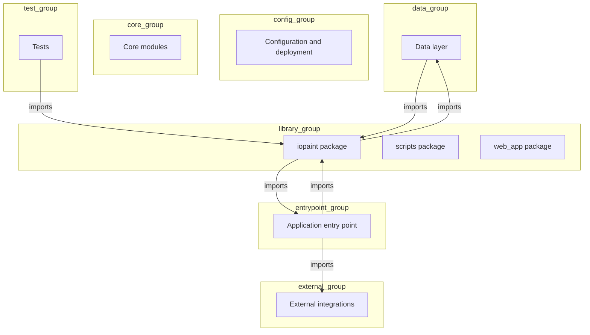

# Architecture report: Sanster/IOPaint

> Automated static analysis. **Observed** = directly seen in files/imports/AST; **Inferred** = interpretation from that evidence. Repository code was not executed.

## 1. Repository at a glance

| Item | Value |
| --- | --- |
| Repository | Sanster/IOPaint |
| Description | Image inpainting tool powered by SOTA AI Model. Remove any unwanted object, defect, people from your pictures or erase and replace(powered by stable diffusion) any thing on your pictures. |
| Language | Python |
| Stars | 23286 |
| Licence | Apache-2.0 |
| Analysed commit / branch | 61a759fb3f332bacdce8b2813f4837495c9b86e0 / main |
| Framework(s) | FastAPI, React, Starlette, Typer |
| Files analysed | 302 |
| Components | 9 |

## 2. Architecture in one minute

Sanster/IOPaint - Image inpainting tool powered by SOTA AI Model. Remove any unwanted object, defect, people from your pictures or erase and replace(powered by stable diffusion) any thing on your pictures.. This repository was analysed statically from 302 file(s) (198 Python). Detected technologies (observed from imports/manifests): FastAPI, React, Starlette, Typer, axios, NumPy. Files are grouped into 9 component(s): Configuration and deployment, Core modules, Data layer, Application entry point, External integrations, iopaint package, scripts package, Tests. Observed entry point(s): iopaint/__init__.py, iopaint/__main__.py, iopaint/benchmark.py. Findings below distinguish observed facts from inferred interpretation.

## 3. High-level block diagram

## 4. Main components

### Configuration and deployment (`config`)

- **Kind:** config
- **Status:** Observed
- **Confidence:** 0.85
- **Responsibility:** Groups 13 file(s) under configuration and deployment (observed from repository paths and static analysis). Observed top-level functions: load_requirements.
- **Paths:** `iopaint/model/anytext/anytext_sd15.yaml`, `iopaint/model/original_sd_configs/sd_xl_base.yaml`, `iopaint/model/original_sd_configs/sd_xl_refiner.yaml`, `iopaint/model/original_sd_configs/v1-inference.yaml`, `iopaint/model/original_sd_configs/v2-inference-v.yaml`, `requirements-dev.txt`, `requirements.txt`, `scripts/environment.yaml`, `setup.py`, `web_app/components.json`, `web_app/package.json`, `web_app/tsconfig.json`, `web_app/tsconfig.node.json`
- **Evidence:** [iopaint/model/anytext/anytext_sd15.yaml](https://github.com/Sanster/IOPaint/blob/61a759fb3f332bacdce8b2813f4837495c9b86e0/iopaint/model/anytext/anytext_sd15.yaml); [iopaint/model/original_sd_configs/sd_xl_base.yaml](https://github.com/Sanster/IOPaint/blob/61a759fb3f332bacdce8b2813f4837495c9b86e0/iopaint/model/original_sd_configs/sd_xl_base.yaml); [iopaint/model/original_sd_configs/sd_xl_refiner.yaml](https://github.com/Sanster/IOPaint/blob/61a759fb3f332bacdce8b2813f4837495c9b86e0/iopaint/model/original_sd_configs/sd_xl_refiner.yaml); [iopaint/model/original_sd_configs/v1-inference.yaml](https://github.com/Sanster/IOPaint/blob/61a759fb3f332bacdce8b2813f4837495c9b86e0/iopaint/model/original_sd_configs/v1-inference.yaml); [iopaint/model/original_sd_configs/v2-inference-v.yaml](https://github.com/Sanster/IOPaint/blob/61a759fb3f332bacdce8b2813f4837495c9b86e0/iopaint/model/original_sd_configs/v2-inference-v.yaml); [requirements-dev.txt](https://github.com/Sanster/IOPaint/blob/61a759fb3f332bacdce8b2813f4837495c9b86e0/requirements-dev.txt); [requirements.txt](https://github.com/Sanster/IOPaint/blob/61a759fb3f332bacdce8b2813f4837495c9b86e0/requirements.txt); [scripts/environment.yaml](https://github.com/Sanster/IOPaint/blob/61a759fb3f332bacdce8b2813f4837495c9b86e0/scripts/environment.yaml)

### Core modules (`core`)

- **Kind:** core
- **Status:** Observed
- **Confidence:** 0.85
- **Responsibility:** Groups 2 file(s) under core modules (observed from repository paths and static analysis).
- **Paths:** `build_docker.sh`, `publish.sh`
- **Evidence:** [build_docker.sh](https://github.com/Sanster/IOPaint/blob/61a759fb3f332bacdce8b2813f4837495c9b86e0/build_docker.sh); [publish.sh](https://github.com/Sanster/IOPaint/blob/61a759fb3f332bacdce8b2813f4837495c9b86e0/publish.sh)

### Data layer (`data_layer`)

- **Kind:** data
- **Status:** Observed
- **Confidence:** 0.85
- **Responsibility:** Groups 12 file(s) under data layer (observed from repository paths and static analysis). Observed top-level classes: AttnBlock, AttnBlock2_0, AutoencoderKL, DDIMSampler, DDPM, DPMSolverSampler. Observed top-level functions: Normalize, append_dims, create_model, disabled_train, expand_dims, get_state_dict.
- **Paths:** `iopaint/model/anytext/cldm/model.py`, `iopaint/model/anytext/ldm/models/__init__.py`, `iopaint/model/anytext/ldm/models/autoencoder.py`, `iopaint/model/anytext/ldm/models/diffusion/__init__.py`, `iopaint/model/anytext/ldm/models/diffusion/ddim.py`, `iopaint/model/anytext/ldm/models/diffusion/ddpm.py`, `iopaint/model/anytext/ldm/models/diffusion/dpm_solver/__init__.py`, `iopaint/model/anytext/ldm/models/diffusion/dpm_solver/dpm_solver.py`, `iopaint/model/anytext/ldm/models/diffusion/dpm_solver/sampler.py`, `iopaint/model/anytext/ldm/models/diffusion/plms.py`, `iopaint/model/anytext/ldm/models/diffusion/sampling_util.py`, `iopaint/model/anytext/ldm/modules/diffusionmodules/model.py`
- **Evidence:** [iopaint/model/anytext/cldm/model.py:8](https://github.com/Sanster/IOPaint/blob/61a759fb3f332bacdce8b2813f4837495c9b86e0/iopaint/model/anytext/cldm/model.py#L8); [iopaint/model/anytext/ldm/models/__init__.py](https://github.com/Sanster/IOPaint/blob/61a759fb3f332bacdce8b2813f4837495c9b86e0/iopaint/model/anytext/ldm/models/__init__.py); [iopaint/model/anytext/ldm/models/autoencoder.py:12](https://github.com/Sanster/IOPaint/blob/61a759fb3f332bacdce8b2813f4837495c9b86e0/iopaint/model/anytext/ldm/models/autoencoder.py#L12); [iopaint/model/anytext/ldm/models/diffusion/__init__.py](https://github.com/Sanster/IOPaint/blob/61a759fb3f332bacdce8b2813f4837495c9b86e0/iopaint/model/anytext/ldm/models/diffusion/__init__.py); [iopaint/model/anytext/ldm/models/diffusion/ddim.py:10](https://github.com/Sanster/IOPaint/blob/61a759fb3f332bacdce8b2813f4837495c9b86e0/iopaint/model/anytext/ldm/models/diffusion/ddim.py#L10); [iopaint/model/anytext/ldm/models/diffusion/ddpm.py:47](https://github.com/Sanster/IOPaint/blob/61a759fb3f332bacdce8b2813f4837495c9b86e0/iopaint/model/anytext/ldm/models/diffusion/ddpm.py#L47); [iopaint/model/anytext/ldm/models/diffusion/dpm_solver/__init__.py](https://github.com/Sanster/IOPaint/blob/61a759fb3f332bacdce8b2813f4837495c9b86e0/iopaint/model/anytext/ldm/models/diffusion/dpm_solver/__init__.py); [iopaint/model/anytext/ldm/models/diffusion/dpm_solver/dpm_solver.py:7](https://github.com/Sanster/IOPaint/blob/61a759fb3f332bacdce8b2813f4837495c9b86e0/iopaint/model/anytext/ldm/models/diffusion/dpm_solver/dpm_solver.py#L7)

### Application entry point (`entrypoint`)

- **Kind:** entrypoint
- **Status:** Observed
- **Confidence:** 0.85
- **Responsibility:** Groups 12 file(s) under application entry point (observed from repository paths and static analysis). Observed application object created via FastAPI, Typer. Observed top-level classes: Attention, Block, BrushNetModel, BrushNetOutput, ConvBNLayer, ConvMixer. Observed top-level functions: _check_image_file, benchmark, create_predictor, custom_convert_ldm_vae_checkpoint, cvt_tform_mat_for_cv2, download.
- **Paths:** `iopaint/__main__.py`, `iopaint/benchmark.py`, `iopaint/cli.py`, `iopaint/model/anytext/cldm/recognizer.py`, `iopaint/model/anytext/main.py`, `iopaint/model/anytext/ocr_recog/RNN.py`, `iopaint/model/anytext/ocr_recog/RecSVTR.py`, `iopaint/model/brushnet/brushnet.py`, `iopaint/model/helper/g_diffuser_bot.py`, `iopaint/plugins/facexlib/detection/matlab_cp2tform.py`, `main.py`, `scripts/convert_vae_pt_to_diffusers.py`
- **Evidence:** [iopaint/__main__.py](https://github.com/Sanster/IOPaint/blob/61a759fb3f332bacdce8b2813f4837495c9b86e0/iopaint/__main__.py); [iopaint/benchmark.py:34](https://github.com/Sanster/IOPaint/blob/61a759fb3f332bacdce8b2813f4837495c9b86e0/iopaint/benchmark.py#L34); [iopaint/cli.py:16](https://github.com/Sanster/IOPaint/blob/61a759fb3f332bacdce8b2813f4837495c9b86e0/iopaint/cli.py#L16); [iopaint/model/anytext/cldm/recognizer.py:16](https://github.com/Sanster/IOPaint/blob/61a759fb3f332bacdce8b2813f4837495c9b86e0/iopaint/model/anytext/cldm/recognizer.py#L16); [iopaint/model/anytext/main.py](https://github.com/Sanster/IOPaint/blob/61a759fb3f332bacdce8b2813f4837495c9b86e0/iopaint/model/anytext/main.py); [iopaint/model/anytext/ocr_recog/RNN.py:5](https://github.com/Sanster/IOPaint/blob/61a759fb3f332bacdce8b2813f4837495c9b86e0/iopaint/model/anytext/ocr_recog/RNN.py#L5); [iopaint/model/anytext/ocr_recog/RecSVTR.py:8](https://github.com/Sanster/IOPaint/blob/61a759fb3f332bacdce8b2813f4837495c9b86e0/iopaint/model/anytext/ocr_recog/RecSVTR.py#L8); [iopaint/model/brushnet/brushnet.py:31](https://github.com/Sanster/IOPaint/blob/61a759fb3f332bacdce8b2813f4837495c9b86e0/iopaint/model/brushnet/brushnet.py#L31)

### External integrations (`external_integrations`)

- **Kind:** external
- **Status:** Inferred
- **Confidence:** 0.70
- **Responsibility:** Groups 0 file(s) under external integrations (observed from repository paths and static analysis).
- **Evidence:** [scripts/convert_vae_pt_to_diffusers.py:4](https://github.com/Sanster/IOPaint/blob/61a759fb3f332bacdce8b2813f4837495c9b86e0/scripts/convert_vae_pt_to_diffusers.py#L4)

### iopaint package (`iopaint`)

- **Kind:** library
- **Status:** Observed
- **Confidence:** 0.85
- **Responsibility:** Groups 152 file(s) under iopaint package (observed from repository paths and static analysis). Observed top-level classes: ASPP, ASPPDeformable, AbstractDistribution, AbstractEncoder, AbstractLowScaleModel, Activation. Observed top-level functions: CrossAttnDownBlock2D_forward, CrossAttnUpBlock2D_forward, DownBlock2D_forward, Normalize, UNet2DConditionModel_forward, UpBlock2D_forward.
- **Paths:** `iopaint/__init__.py`, `iopaint/api.py`, `iopaint/batch_processing.py`, `iopaint/const.py`, `iopaint/download.py`, `iopaint/file_manager/__init__.py`, `iopaint/file_manager/file_manager.py`, `iopaint/file_manager/storage_backends.py`, `iopaint/file_manager/utils.py`, `iopaint/helper.py`, `iopaint/installer.py`, `iopaint/model/__init__.py`, `iopaint/model/anytext/__init__.py`, `iopaint/model/anytext/anytext_model.py`, `iopaint/model/anytext/anytext_pipeline.py`, `iopaint/model/anytext/cldm/__init__.py`, `iopaint/model/anytext/cldm/cldm.py`, `iopaint/model/anytext/cldm/ddim_hacked.py`, `iopaint/model/anytext/cldm/embedding_manager.py`, `iopaint/model/anytext/cldm/hack.py`, `iopaint/model/anytext/ldm/__init__.py`, `iopaint/model/anytext/ldm/modules/__init__.py`, `iopaint/model/anytext/ldm/modules/attention.py`, `iopaint/model/anytext/ldm/modules/diffusionmodules/__init__.py`, `iopaint/model/anytext/ldm/modules/diffusionmodules/openaimodel.py`, `iopaint/model/anytext/ldm/modules/diffusionmodules/upscaling.py`, `iopaint/model/anytext/ldm/modules/diffusionmodules/util.py`, `iopaint/model/anytext/ldm/modules/distributions/__init__.py`, `iopaint/model/anytext/ldm/modules/distributions/distributions.py`, `iopaint/model/anytext/ldm/modules/ema.py`, `iopaint/model/anytext/ldm/modules/encoders/__init__.py`, `iopaint/model/anytext/ldm/modules/encoders/modules.py`, `iopaint/model/anytext/ldm/util.py`, `iopaint/model/anytext/ocr_recog/RecCTCHead.py`, `iopaint/model/anytext/ocr_recog/RecModel.py`, `iopaint/model/anytext/ocr_recog/RecMv1_enhance.py`, `iopaint/model/anytext/ocr_recog/__init__.py`, `iopaint/model/anytext/ocr_recog/common.py`, `iopaint/model/anytext/utils.py`, `iopaint/model/base.py`, `iopaint/model/brushnet/__init__.py`, `iopaint/model/brushnet/brushnet_unet_forward.py`, `iopaint/model/brushnet/brushnet_wrapper.py`, `iopaint/model/brushnet/brushnet_xl_wrapper.py`, `iopaint/model/brushnet/pipeline_brushnet.py`, `iopaint/model/brushnet/pipeline_brushnet_sd_xl.py`, `iopaint/model/brushnet/unet_2d_blocks.py`, `iopaint/model/controlnet.py`, `iopaint/model/ddim_sampler.py`, `iopaint/model/fcf.py`, `iopaint/model/helper/__init__.py`, `iopaint/model/helper/controlnet_preprocess.py`, `iopaint/model/helper/cpu_text_encoder.py`, `iopaint/model/instruct_pix2pix.py`, `iopaint/model/kandinsky.py`, `iopaint/model/lama.py`, `iopaint/model/ldm.py`, `iopaint/model/manga.py`, `iopaint/model/mat.py`, `iopaint/model/mi_gan.py`, `iopaint/model/opencv2.py`, `iopaint/model/original_sd_configs/__init__.py`, `iopaint/model/paint_by_example.py`, `iopaint/model/plms_sampler.py`, `iopaint/model/power_paint/__init__.py`, `iopaint/model/power_paint/pipeline_powerpaint.py`, `iopaint/model/power_paint/power_paint.py`, `iopaint/model/power_paint/power_paint_v2.py`, `iopaint/model/power_paint/powerpaint_tokenizer.py`, `iopaint/model/power_paint/v2/BrushNet_CA.py`, `iopaint/model/power_paint/v2/__init__.py`, `iopaint/model/power_paint/v2/pipeline_PowerPaint_Brushnet_CA.py`, `iopaint/model/power_paint/v2/unet_2d_blocks.py`, `iopaint/model/power_paint/v2/unet_2d_condition.py`, `iopaint/model/sd.py`, `iopaint/model/sdxl.py`, `iopaint/model/utils.py`, `iopaint/model/zits.py`, `iopaint/model_manager.py`, `iopaint/plugins/__init__.py`, `iopaint/plugins/anime_seg.py`, `iopaint/plugins/base_plugin.py`, `iopaint/plugins/basicsr/__init__.py`, `iopaint/plugins/basicsr/arch_util.py`, `iopaint/plugins/basicsr/img_util.py`, `iopaint/plugins/basicsr/rrdbnet_arch.py`, `iopaint/plugins/briarmbg.py`, `iopaint/plugins/briarmbg2.py`, `iopaint/plugins/facexlib/__init__.py`, `iopaint/plugins/facexlib/detection/__init__.py`, `iopaint/plugins/facexlib/detection/align_trans.py`, `iopaint/plugins/facexlib/detection/retinaface.py`, `iopaint/plugins/facexlib/detection/retinaface_net.py`, `iopaint/plugins/facexlib/detection/retinaface_utils.py`, `iopaint/plugins/facexlib/parsing/__init__.py`, `iopaint/plugins/facexlib/parsing/bisenet.py`, `iopaint/plugins/facexlib/parsing/parsenet.py`, `iopaint/plugins/facexlib/parsing/resnet.py`, `iopaint/plugins/facexlib/utils/__init__.py`, `iopaint/plugins/facexlib/utils/face_restoration_helper.py`, `iopaint/plugins/facexlib/utils/face_utils.py`, `iopaint/plugins/facexlib/utils/misc.py`, `iopaint/plugins/gfpgan/__init__.py`, `iopaint/plugins/gfpgan/archs/__init__.py`, `iopaint/plugins/gfpgan/archs/gfpganv1_clean_arch.py`, `iopaint/plugins/gfpgan/archs/restoreformer_arch.py`, `iopaint/plugins/gfpgan/archs/stylegan2_clean_arch.py`, `iopaint/plugins/gfpgan_plugin.py`, `iopaint/plugins/gfpganer.py`, `iopaint/plugins/interactive_seg.py`, `iopaint/plugins/realesrgan.py`, `iopaint/plugins/remove_bg.py`, `iopaint/plugins/restoreformer.py`, `iopaint/plugins/segment_anything/__init__.py`, `iopaint/plugins/segment_anything/build_sam.py`, `iopaint/plugins/segment_anything/modeling/__init__.py`, `iopaint/plugins/segment_anything/modeling/common.py`, `iopaint/plugins/segment_anything/modeling/image_encoder.py`, `iopaint/plugins/segment_anything/modeling/image_encoder_hq.py`, `iopaint/plugins/segment_anything/modeling/mask_decoder.py`, `iopaint/plugins/segment_anything/modeling/prompt_encoder.py`, `iopaint/plugins/segment_anything/modeling/sam.py`, `iopaint/plugins/segment_anything/modeling/sam_hq.py`, `iopaint/plugins/segment_anything/modeling/tiny_vit_sam.py`, `iopaint/plugins/segment_anything/modeling/transformer.py`, `iopaint/plugins/segment_anything/predictor.py`, `iopaint/plugins/segment_anything/predictor_hq.py`, `iopaint/plugins/segment_anything/utils/__init__.py`, `iopaint/plugins/segment_anything/utils/transforms.py`, `iopaint/plugins/segment_anything2/__init__.py`, `iopaint/plugins/segment_anything2/build_sam.py`, `iopaint/plugins/segment_anything2/modeling/__init__.py`, `iopaint/plugins/segment_anything2/modeling/backbones/__init__.py`, `iopaint/plugins/segment_anything2/modeling/backbones/hieradet.py`, `iopaint/plugins/segment_anything2/modeling/backbones/image_encoder.py`, `iopaint/plugins/segment_anything2/modeling/backbones/utils.py`, `iopaint/plugins/segment_anything2/modeling/memory_attention.py`, `iopaint/plugins/segment_anything2/modeling/memory_encoder.py`, `iopaint/plugins/segment_anything2/modeling/position_encoding.py`, `iopaint/plugins/segment_anything2/modeling/sam/__init__.py`, `iopaint/plugins/segment_anything2/modeling/sam/mask_decoder.py`, `iopaint/plugins/segment_anything2/modeling/sam/prompt_encoder.py`, `iopaint/plugins/segment_anything2/modeling/sam/transformer.py`, `iopaint/plugins/segment_anything2/modeling/sam2_base.py`, `iopaint/plugins/segment_anything2/modeling/sam2_utils.py`, `iopaint/plugins/segment_anything2/sam2_image_predictor.py`, `iopaint/plugins/segment_anything2/utils/__init__.py`, `iopaint/plugins/segment_anything2/utils/misc.py`, `iopaint/plugins/segment_anything2/utils/transforms.py`, `iopaint/runtime.py`, `iopaint/schema.py`, `iopaint/web_config.py`
- **Evidence:** [iopaint/__init__.py:21](https://github.com/Sanster/IOPaint/blob/61a759fb3f332bacdce8b2813f4837495c9b86e0/iopaint/__init__.py#L21); [iopaint/api.py:70](https://github.com/Sanster/IOPaint/blob/61a759fb3f332bacdce8b2813f4837495c9b86e0/iopaint/api.py#L70); [iopaint/batch_processing.py:26](https://github.com/Sanster/IOPaint/blob/61a759fb3f332bacdce8b2813f4837495c9b86e0/iopaint/batch_processing.py#L26); [iopaint/const.py](https://github.com/Sanster/IOPaint/blob/61a759fb3f332bacdce8b2813f4837495c9b86e0/iopaint/const.py); [iopaint/download.py:22](https://github.com/Sanster/IOPaint/blob/61a759fb3f332bacdce8b2813f4837495c9b86e0/iopaint/download.py#L22); [iopaint/file_manager/__init__.py](https://github.com/Sanster/IOPaint/blob/61a759fb3f332bacdce8b2813f4837495c9b86e0/iopaint/file_manager/__init__.py); [iopaint/file_manager/file_manager.py:18](https://github.com/Sanster/IOPaint/blob/61a759fb3f332bacdce8b2813f4837495c9b86e0/iopaint/file_manager/file_manager.py#L18); [iopaint/file_manager/storage_backends.py:7](https://github.com/Sanster/IOPaint/blob/61a759fb3f332bacdce8b2813f4837495c9b86e0/iopaint/file_manager/storage_backends.py#L7)

### scripts package (`scripts`)

- **Kind:** library
- **Status:** Observed
- **Confidence:** 0.85
- **Responsibility:** Groups 2 file(s) under scripts package (observed from repository paths and static analysis). Observed top-level classes: CheckpointMergerPipeline.
- **Paths:** `scripts/pack.sh`, `scripts/tool.py`
- **Evidence:** [scripts/pack.sh](https://github.com/Sanster/IOPaint/blob/61a759fb3f332bacdce8b2813f4837495c9b86e0/scripts/pack.sh); [scripts/tool.py:24](https://github.com/Sanster/IOPaint/blob/61a759fb3f332bacdce8b2813f4837495c9b86e0/scripts/tool.py#L24)

### Tests (`tests`)

- **Kind:** test
- **Status:** Observed
- **Confidence:** 0.85
- **Responsibility:** Groups 21 file(s) under tests (observed from repository paths and static analysis). Observed top-level functions: _save, assert_equal, assert_keys, check_device, convert_controlnet_method_name, extra_info.
- **Paths:** `iopaint/tests/.gitignore`, `iopaint/tests/__init__.py`, `iopaint/tests/test_adjust_mask.py`, `iopaint/tests/test_anytext.py`, `iopaint/tests/test_brushnet.py`, `iopaint/tests/test_controlnet.py`, `iopaint/tests/test_instruct_pix2pix.py`, `iopaint/tests/test_load_img.py`, `iopaint/tests/test_low_mem.py`, `iopaint/tests/test_match_histograms.py`, `iopaint/tests/test_model.py`, `iopaint/tests/test_model_md5.py`, `iopaint/tests/test_model_switch.py`, `iopaint/tests/test_outpainting.py`, `iopaint/tests/test_paint_by_example.py`, `iopaint/tests/test_plugins.py`, `iopaint/tests/test_save_exif.py`, `iopaint/tests/test_save_quality.py`, `iopaint/tests/test_sd_model.py`, `iopaint/tests/test_sdxl.py`, `iopaint/tests/utils.py`
- **Evidence:** [iopaint/tests/.gitignore](https://github.com/Sanster/IOPaint/blob/61a759fb3f332bacdce8b2813f4837495c9b86e0/iopaint/tests/.gitignore); [iopaint/tests/__init__.py](https://github.com/Sanster/IOPaint/blob/61a759fb3f332bacdce8b2813f4837495c9b86e0/iopaint/tests/__init__.py); [iopaint/tests/test_adjust_mask.py:8](https://github.com/Sanster/IOPaint/blob/61a759fb3f332bacdce8b2813f4837495c9b86e0/iopaint/tests/test_adjust_mask.py#L8); [iopaint/tests/test_anytext.py:20](https://github.com/Sanster/IOPaint/blob/61a759fb3f332bacdce8b2813f4837495c9b86e0/iopaint/tests/test_anytext.py#L20); [iopaint/tests/test_brushnet.py:22](https://github.com/Sanster/IOPaint/blob/61a759fb3f332bacdce8b2813f4837495c9b86e0/iopaint/tests/test_brushnet.py#L22); [iopaint/tests/test_controlnet.py:19](https://github.com/Sanster/IOPaint/blob/61a759fb3f332bacdce8b2813f4837495c9b86e0/iopaint/tests/test_controlnet.py#L19); [iopaint/tests/test_instruct_pix2pix.py:16](https://github.com/Sanster/IOPaint/blob/61a759fb3f332bacdce8b2813f4837495c9b86e0/iopaint/tests/test_instruct_pix2pix.py#L16); [iopaint/tests/test_load_img.py:8](https://github.com/Sanster/IOPaint/blob/61a759fb3f332bacdce8b2813f4837495c9b86e0/iopaint/tests/test_load_img.py#L8)

### web_app package (`web_app`)

- **Kind:** library
- **Status:** Observed
- **Confidence:** 0.85
- **Responsibility:** Groups 62 file(s) under web_app package (observed from repository paths and static analysis).
- **Paths:** `web_app/.eslintrc.cjs`, `web_app/postcss.config.js`, `web_app/src/App.tsx`, `web_app/src/components/Coffee.tsx`, `web_app/src/components/Cropper.tsx`, `web_app/src/components/DiffusionProgress.tsx`, `web_app/src/components/Editor.tsx`, `web_app/src/components/Extender.tsx`, `web_app/src/components/FileManager.tsx`, `web_app/src/components/FileSelect.tsx`, `web_app/src/components/Header.tsx`, `web_app/src/components/ImageSize.tsx`, `web_app/src/components/InteractiveSeg.tsx`, `web_app/src/components/Plugins.tsx`, `web_app/src/components/PromptInput.tsx`, `web_app/src/components/Settings.tsx`, `web_app/src/components/Shortcuts.tsx`, `web_app/src/components/SidePanel/CV2Options.tsx`, `web_app/src/components/SidePanel/DiffusionOptions.tsx`, `web_app/src/components/SidePanel/LDMOptions.tsx`, `web_app/src/components/SidePanel/LabelTitle.tsx`, `web_app/src/components/SidePanel/index.tsx`, `web_app/src/components/Workspace.tsx`, `web_app/src/components/ui/accordion.tsx`, `web_app/src/components/ui/alert-dialog.tsx`, `web_app/src/components/ui/button.tsx`, `web_app/src/components/ui/context-menu.tsx`, `web_app/src/components/ui/dialog.tsx`, `web_app/src/components/ui/dropdown-menu.tsx`, `web_app/src/components/ui/form.tsx`, `web_app/src/components/ui/input.tsx`, `web_app/src/components/ui/label.tsx`, `web_app/src/components/ui/popover.tsx`, `web_app/src/components/ui/progress.tsx`, `web_app/src/components/ui/radio-group.tsx`, `web_app/src/components/ui/scroll-area.tsx`, `web_app/src/components/ui/select.tsx`, `web_app/src/components/ui/separator.tsx`, `web_app/src/components/ui/sheet.tsx`, `web_app/src/components/ui/slider.tsx`, `web_app/src/components/ui/switch.tsx`, `web_app/src/components/ui/tabs.tsx`, `web_app/src/components/ui/textarea.tsx`, `web_app/src/components/ui/toast.tsx`, `web_app/src/components/ui/toaster.tsx`, `web_app/src/components/ui/toggle.tsx`, `web_app/src/components/ui/tooltip.tsx`, `web_app/src/components/ui/use-toast.ts`, `web_app/src/hooks/useAsyncMemo.tsx`, `web_app/src/hooks/useHotkey.tsx`, `web_app/src/hooks/useImage.tsx`, `web_app/src/hooks/useInputImage.tsx`, `web_app/src/hooks/useResolution.tsx`, `web_app/src/lib/api.ts`, `web_app/src/lib/const.ts`, `web_app/src/lib/states.ts`, `web_app/src/lib/types.ts`, `web_app/src/lib/utils.ts`, `web_app/src/main.tsx`, `web_app/src/vite-env.d.ts`, `web_app/tailwind.config.js`, `web_app/vite.config.ts`
- **Evidence:** [web_app/.eslintrc.cjs](https://github.com/Sanster/IOPaint/blob/61a759fb3f332bacdce8b2813f4837495c9b86e0/web_app/.eslintrc.cjs); [web_app/postcss.config.js](https://github.com/Sanster/IOPaint/blob/61a759fb3f332bacdce8b2813f4837495c9b86e0/web_app/postcss.config.js); [web_app/src/App.tsx](https://github.com/Sanster/IOPaint/blob/61a759fb3f332bacdce8b2813f4837495c9b86e0/web_app/src/App.tsx); [web_app/src/components/Coffee.tsx](https://github.com/Sanster/IOPaint/blob/61a759fb3f332bacdce8b2813f4837495c9b86e0/web_app/src/components/Coffee.tsx); [web_app/src/components/Cropper.tsx](https://github.com/Sanster/IOPaint/blob/61a759fb3f332bacdce8b2813f4837495c9b86e0/web_app/src/components/Cropper.tsx); [web_app/src/components/DiffusionProgress.tsx](https://github.com/Sanster/IOPaint/blob/61a759fb3f332bacdce8b2813f4837495c9b86e0/web_app/src/components/DiffusionProgress.tsx); [web_app/src/components/Editor.tsx](https://github.com/Sanster/IOPaint/blob/61a759fb3f332bacdce8b2813f4837495c9b86e0/web_app/src/components/Editor.tsx); [web_app/src/components/Extender.tsx](https://github.com/Sanster/IOPaint/blob/61a759fb3f332bacdce8b2813f4837495c9b86e0/web_app/src/components/Extender.tsx)

## 5. Execution flow

**Observed** entry point(s):

- [iopaint/__init__.py](https://github.com/Sanster/IOPaint/blob/61a759fb3f332bacdce8b2813f4837495c9b86e0/iopaint/__init__.py)
- [iopaint/__main__.py:3](https://github.com/Sanster/IOPaint/blob/61a759fb3f332bacdce8b2813f4837495c9b86e0/iopaint/__main__.py#L3)
- [iopaint/benchmark.py:100](https://github.com/Sanster/IOPaint/blob/61a759fb3f332bacdce8b2813f4837495c9b86e0/iopaint/benchmark.py#L100)
- [iopaint/cli.py:16](https://github.com/Sanster/IOPaint/blob/61a759fb3f332bacdce8b2813f4837495c9b86e0/iopaint/cli.py#L16)
- [iopaint/model/anytext/cldm/recognizer.py:299](https://github.com/Sanster/IOPaint/blob/61a759fb3f332bacdce8b2813f4837495c9b86e0/iopaint/model/anytext/cldm/recognizer.py#L299)
- [iopaint/model/anytext/ocr_recog/RNN.py:208](https://github.com/Sanster/IOPaint/blob/61a759fb3f332bacdce8b2813f4837495c9b86e0/iopaint/model/anytext/ocr_recog/RNN.py#L208)
- [iopaint/model/anytext/ocr_recog/RecSVTR.py:585](https://github.com/Sanster/IOPaint/blob/61a759fb3f332bacdce8b2813f4837495c9b86e0/iopaint/model/anytext/ocr_recog/RecSVTR.py#L585)
- [iopaint/model/brushnet/brushnet.py:929](https://github.com/Sanster/IOPaint/blob/61a759fb3f332bacdce8b2813f4837495c9b86e0/iopaint/model/brushnet/brushnet.py#L929)
- [iopaint/model/helper/g_diffuser_bot.py:42](https://github.com/Sanster/IOPaint/blob/61a759fb3f332bacdce8b2813f4837495c9b86e0/iopaint/model/helper/g_diffuser_bot.py#L42)
- [iopaint/plugins/facexlib/detection/matlab_cp2tform.py:235](https://github.com/Sanster/IOPaint/blob/61a759fb3f332bacdce8b2813f4837495c9b86e0/iopaint/plugins/facexlib/detection/matlab_cp2tform.py#L235)
- [main.py:3](https://github.com/Sanster/IOPaint/blob/61a759fb3f332bacdce8b2813f4837495c9b86e0/main.py#L3)
- [scripts/convert_vae_pt_to_diffusers.py:213](https://github.com/Sanster/IOPaint/blob/61a759fb3f332bacdce8b2813f4837495c9b86e0/scripts/convert_vae_pt_to_diffusers.py#L213)

Representative flow (derived from observed entry points and the import graph; steps beyond the entry point are **Inferred**):

1. Execution starts at an observed entry point listed above, if present.
2. `data_layer` imports `iopaint` (Data layer -> iopaint package).
3. `entrypoint` imports `external_integrations` (Application entry point -> External integrations).
4. `entrypoint` imports `iopaint` (Application entry point -> iopaint package).
5. `iopaint` imports `data_layer` (iopaint package -> Data layer).
6. `iopaint` imports `entrypoint` (iopaint package -> Application entry point).
7. `tests` imports `iopaint` (Tests -> iopaint package).

## 6. Project structure

### `(root)`

- `.gitignore` - other (128 bytes)
- `LICENSE` - docs (11357 bytes)
- `README.md` - docs (6748 bytes)
- `build_docker.sh` - source, Shell (1077 bytes)
- `main.py` - source, Python (78 bytes)
- `publish.sh` - source, Shell (191 bytes)
- `requirements-dev.txt` - manifest (25 bytes)
- `requirements.txt` - manifest (348 bytes)
- `setup.py` - manifest, Python (1984 bytes)

### `.github`

- `.github/FUNDING.yml` - config (64 bytes)
- `.github/ISSUE_TEMPLATE/config.yml` - config (114 bytes)
- `.github/ISSUE_TEMPLATE/🐛-bug-report.md` - docs (383 bytes)
- `.github/ISSUE_TEMPLATE/🚀-feature-request.md` - docs (488 bytes)

### `docker`

- `docker/CPUDockerfile` - other (619 bytes)
- `docker/GPUDockerfile` - other (587 bytes)

### `iopaint`

- `iopaint/__init__.py` - source, Python (2000 bytes)
- `iopaint/__main__.py` - source, Python (78 bytes)
- `iopaint/api.py` - source, Python (15794 bytes)
- `iopaint/batch_processing.py` - source, Python (4154 bytes)
- `iopaint/benchmark.py` - source, Python (3224 bytes)
- `iopaint/cli.py` - source, Python (8450 bytes)
- `iopaint/const.py` - source, Python (4468 bytes)
- `iopaint/download.py` - source, Python (10961 bytes)
- `iopaint/file_manager/__init__.py` - source, Python (38 bytes)
- `iopaint/file_manager/file_manager.py` - source, Python (7299 bytes)
- `iopaint/file_manager/storage_backends.py` - source, Python (1293 bytes)
- `iopaint/file_manager/utils.py` - source, Python (1835 bytes)
- `iopaint/helper.py` - source, Python (12094 bytes)
- `iopaint/installer.py` - source, Python (224 bytes)
- `iopaint/model/__init__.py` - source, Python (1070 bytes)
- `iopaint/model/anytext/__init__.py` - source, Python (0 bytes)
- `iopaint/model/anytext/anytext_model.py` - source, Python (2536 bytes)
- `iopaint/model/anytext/anytext_pipeline.py` - source, Python (15191 bytes)
- `iopaint/model/anytext/anytext_sd15.yaml` - config (2777 bytes)
- `iopaint/model/anytext/cldm/__init__.py` - source, Python (0 bytes)
- `iopaint/model/anytext/cldm/cldm.py` - source, Python (28531 bytes)
- `iopaint/model/anytext/cldm/ddim_hacked.py` - source, Python (17275 bytes)
- `iopaint/model/anytext/cldm/embedding_manager.py` - source, Python (6083 bytes)
- `iopaint/model/anytext/cldm/hack.py` - source, Python (3699 bytes)
- `iopaint/model/anytext/cldm/model.py` - source, Python (1373 bytes)
- `iopaint/model/anytext/cldm/recognizer.py` - source, Python (11447 bytes)
- `iopaint/model/anytext/ldm/__init__.py` - source, Python (0 bytes)
- `iopaint/model/anytext/ldm/models/__init__.py` - source, Python (0 bytes)
- `iopaint/model/anytext/ldm/models/autoencoder.py` - source, Python (8614 bytes)
- `iopaint/model/anytext/ldm/models/diffusion/__init__.py` - source, Python (0 bytes)
- `iopaint/model/anytext/ldm/models/diffusion/ddim.py` - source, Python (18214 bytes)
- `iopaint/model/anytext/ldm/models/diffusion/ddpm.py` - source, Python (89020 bytes)
- `iopaint/model/anytext/ldm/models/diffusion/dpm_solver/__init__.py` - source, Python (37 bytes)
- `iopaint/model/anytext/ldm/models/diffusion/dpm_solver/dpm_solver.py` - source, Python (65969 bytes)
- `iopaint/model/anytext/ldm/models/diffusion/dpm_solver/sampler.py` - source, Python (2990 bytes)
- `iopaint/model/anytext/ldm/models/diffusion/plms.py` - source, Python (12971 bytes)
- `iopaint/model/anytext/ldm/models/diffusion/sampling_util.py` - source, Python (753 bytes)
- `iopaint/model/anytext/ldm/modules/__init__.py` - source, Python (0 bytes)
- `iopaint/model/anytext/ldm/modules/attention.py` - source, Python (10738 bytes)
- `iopaint/model/anytext/ldm/modules/diffusionmodules/__init__.py` - source, Python (0 bytes)
- `iopaint/model/anytext/ldm/modules/diffusionmodules/model.py` - source, Python (30615 bytes)
- `iopaint/model/anytext/ldm/modules/diffusionmodules/openaimodel.py` - source, Python (30462 bytes)
- `iopaint/model/anytext/ldm/modules/diffusionmodules/upscaling.py` - source, Python (3468 bytes)
- `iopaint/model/anytext/ldm/modules/diffusionmodules/util.py` - source, Python (9995 bytes)
- `iopaint/model/anytext/ldm/modules/distributions/__init__.py` - source, Python (0 bytes)
- `iopaint/model/anytext/ldm/modules/distributions/distributions.py` - source, Python (2970 bytes)
- `iopaint/model/anytext/ldm/modules/ema.py` - source, Python (3110 bytes)
- `iopaint/model/anytext/ldm/modules/encoders/__init__.py` - source, Python (0 bytes)
- `iopaint/model/anytext/ldm/modules/encoders/modules.py` - source, Python (14135 bytes)
- `iopaint/model/anytext/ldm/util.py` - source, Python (7250 bytes)
- `iopaint/model/anytext/main.py` - source, Python (1554 bytes)
- `iopaint/model/anytext/ocr_recog/RNN.py` - source, Python (6607 bytes)
- `iopaint/model/anytext/ocr_recog/RecCTCHead.py` - source, Python (1260 bytes)
- `iopaint/model/anytext/ocr_recog/RecModel.py` - source, Python (1673 bytes)
- `iopaint/model/anytext/ocr_recog/RecMv1_enhance.py` - source, Python (6709 bytes)
- `iopaint/model/anytext/ocr_recog/RecSVTR.py` - source, Python (19468 bytes)
- `iopaint/model/anytext/ocr_recog/__init__.py` - source, Python (0 bytes)
- `iopaint/model/anytext/ocr_recog/common.py` - source, Python (2180 bytes)
- `iopaint/model/anytext/ocr_recog/en_dict.txt` - docs (190 bytes)
- `iopaint/model/anytext/ocr_recog/ppocr_keys_v1.txt` - docs (26249 bytes)
- `iopaint/model/anytext/utils.py` - source, Python (4989 bytes)
- `iopaint/model/base.py` - source, Python (13463 bytes)
- `iopaint/model/brushnet/__init__.py` - source, Python (0 bytes)
- `iopaint/model/brushnet/brushnet.py` - source, Python (47487 bytes)
- `iopaint/model/brushnet/brushnet_unet_forward.py` - source, Python (16782 bytes)
- `iopaint/model/brushnet/brushnet_wrapper.py` - source, Python (6587 bytes)
- `iopaint/model/brushnet/brushnet_xl_wrapper.py` - source, Python (6781 bytes)
- `iopaint/model/brushnet/pipeline_brushnet.py` - source, Python (65582 bytes)
- `iopaint/model/brushnet/pipeline_brushnet_sd_xl.py` - source, Python (79025 bytes)
- `iopaint/model/brushnet/unet_2d_blocks.py` - source, Python (14794 bytes)
- `iopaint/model/controlnet.py` - source, Python (7011 bytes)
- `iopaint/model/ddim_sampler.py` - source, Python (6863 bytes)
- `iopaint/model/fcf.py` - source, Python (57219 bytes)
- `iopaint/model/helper/__init__.py` - source, Python (0 bytes)
- `iopaint/model/helper/controlnet_preprocess.py` - source, Python (2117 bytes)
- `iopaint/model/helper/cpu_text_encoder.py` - source, Python (1409 bytes)
- `iopaint/model/helper/g_diffuser_bot.py` - source, Python (1913 bytes)
- `iopaint/model/instruct_pix2pix.py` - source, Python (2436 bytes)
- `iopaint/model/kandinsky.py` - source, Python (2041 bytes)
- `iopaint/model/lama.py` - source, Python (2330 bytes)
- `iopaint/model/ldm.py` - source, Python (11481 bytes)
- `iopaint/model/manga.py` - source, Python (3097 bytes)
- `iopaint/model/mat.py` - source, Python (62704 bytes)
- `iopaint/model/mi_gan.py` - source, Python (3438 bytes)
- `iopaint/model/opencv2.py` - source, Python (735 bytes)
- `iopaint/model/original_sd_configs/__init__.py` - source, Python (590 bytes)
- `iopaint/model/original_sd_configs/sd_xl_base.yaml` - config (2784 bytes)
- `iopaint/model/original_sd_configs/sd_xl_refiner.yaml` - config (2589 bytes)
- `iopaint/model/original_sd_configs/v1-inference.yaml` - config (1873 bytes)
- `iopaint/model/original_sd_configs/v2-inference-v.yaml` - config (1815 bytes)
- `iopaint/model/paint_by_example.py` - source, Python (2795 bytes)
- `iopaint/model/plms_sampler.py` - source, Python (11833 bytes)
- `iopaint/model/power_paint/__init__.py` - source, Python (0 bytes)
- `iopaint/model/power_paint/pipeline_powerpaint.py` - source, Python (56637 bytes)
- `iopaint/model/power_paint/power_paint.py` - source, Python (3658 bytes)
- `iopaint/model/power_paint/power_paint_v2.py` - source, Python (6964 bytes)
- `iopaint/model/power_paint/powerpaint_tokenizer.py` - source, Python (9439 bytes)
- `iopaint/model/power_paint/v2/BrushNet_CA.py` - source, Python (49516 bytes)
- `iopaint/model/power_paint/v2/__init__.py` - source, Python (0 bytes)
- `iopaint/model/power_paint/v2/pipeline_PowerPaint_Brushnet_CA.py` - source, Python (77819 bytes)
- `iopaint/model/power_paint/v2/unet_2d_blocks.py` - source, Python (12496 bytes)
- `iopaint/model/power_paint/v2/unet_2d_condition.py` - source, Python (17567 bytes)
- `iopaint/model/sd.py` - source, Python (4447 bytes)
- `iopaint/model/sdxl.py` - source, Python (3993 bytes)
- `iopaint/model/utils.py` - source, Python (37847 bytes)
- `iopaint/model/zits.py` - source, Python (16327 bytes)
- `iopaint/model_manager.py` - source, Python (10320 bytes)
- `iopaint/plugins/__init__.py` - source, Python (2471 bytes)
- `iopaint/plugins/anime_seg.py` - source, Python (13787 bytes)
- `iopaint/plugins/base_plugin.py` - source, Python (730 bytes)
- `iopaint/plugins/basicsr/LICENSE` - docs (11349 bytes)
- `iopaint/plugins/basicsr/__init__.py` - source, Python (926 bytes)
- `iopaint/plugins/basicsr/arch_util.py` - source, Python (2531 bytes)
- `iopaint/plugins/basicsr/img_util.py` - source, Python (6195 bytes)
- `iopaint/plugins/basicsr/rrdbnet_arch.py` - source, Python (4875 bytes)
- `iopaint/plugins/briarmbg.py` - source, Python (15021 bytes)
- `iopaint/plugins/briarmbg2.py` - source, Python (100066 bytes)
- `iopaint/plugins/facexlib/.gitignore` - other (1837 bytes)
- `iopaint/plugins/facexlib/__init__.py` - source, Python (61 bytes)
- `iopaint/plugins/facexlib/detection/__init__.py` - source, Python (1313 bytes)
- `iopaint/plugins/facexlib/detection/align_trans.py` - source, Python (7941 bytes)
- `iopaint/plugins/facexlib/detection/matlab_cp2tform.py` - source, Python (8109 bytes)
- `iopaint/plugins/facexlib/detection/retinaface.py` - source, Python (13928 bytes)
- `iopaint/plugins/facexlib/detection/retinaface_net.py` - source, Python (6281 bytes)
- `iopaint/plugins/facexlib/detection/retinaface_utils.py` - source, Python (16452 bytes)
- `iopaint/plugins/facexlib/parsing/__init__.py` - source, Python (1009 bytes)
- `iopaint/plugins/facexlib/parsing/bisenet.py` - source, Python (5190 bytes)
- `iopaint/plugins/facexlib/parsing/parsenet.py` - source, Python (6477 bytes)
- `iopaint/plugins/facexlib/parsing/resnet.py` - source, Python (2357 bytes)
- `iopaint/plugins/facexlib/utils/__init__.py` - source, Python (330 bytes)
- `iopaint/plugins/facexlib/utils/face_restoration_helper.py` - source, Python (18774 bytes)
- `iopaint/plugins/facexlib/utils/face_utils.py` - source, Python (8725 bytes)
- `iopaint/plugins/facexlib/utils/misc.py` - source, Python (4081 bytes)
- `iopaint/plugins/gfpgan/__init__.py` - source, Python (0 bytes)
- `iopaint/plugins/gfpgan/archs/__init__.py` - source, Python (0 bytes)
- `iopaint/plugins/gfpgan/archs/gfpganv1_clean_arch.py` - source, Python (13560 bytes)
- `iopaint/plugins/gfpgan/archs/restoreformer_arch.py` - source, Python (23875 bytes)
- `iopaint/plugins/gfpgan/archs/stylegan2_clean_arch.py` - source, Python (14902 bytes)
- `iopaint/plugins/gfpgan_plugin.py` - source, Python (2147 bytes)
- `iopaint/plugins/gfpganer.py` - source, Python (5550 bytes)
- `iopaint/plugins/interactive_seg.py` - source, Python (5491 bytes)
- `iopaint/plugins/realesrgan.py` - source, Python (17807 bytes)
- `iopaint/plugins/remove_bg.py` - source, Python (3530 bytes)
- `iopaint/plugins/restoreformer.py` - source, Python (1494 bytes)
- `iopaint/plugins/segment_anything/__init__.py` - source, Python (420 bytes)
- `iopaint/plugins/segment_anything/build_sam.py` - source, Python (7864 bytes)
- `iopaint/plugins/segment_anything/modeling/__init__.py` - source, Python (385 bytes)
- `iopaint/plugins/segment_anything/modeling/common.py` - source, Python (1479 bytes)
- `iopaint/plugins/segment_anything/modeling/image_encoder.py` - source, Python (14407 bytes)
- `iopaint/plugins/segment_anything/modeling/image_encoder_hq.py` - source, Python (14795 bytes)
- `iopaint/plugins/segment_anything/modeling/mask_decoder.py` - source, Python (15490 bytes)
- `iopaint/plugins/segment_anything/modeling/prompt_encoder.py` - source, Python (8594 bytes)
- `iopaint/plugins/segment_anything/modeling/sam.py` - source, Python (7225 bytes)
- `iopaint/plugins/segment_anything/modeling/sam_hq.py` - source, Python (7474 bytes)
- `iopaint/plugins/segment_anything/modeling/tiny_vit_sam.py` - source, Python (26182 bytes)
- `iopaint/plugins/segment_anything/modeling/transformer.py` - source, Python (8396 bytes)
- `iopaint/plugins/segment_anything/predictor.py` - source, Python (11845 bytes)
- `iopaint/plugins/segment_anything/predictor_hq.py` - source, Python (12157 bytes)
- `iopaint/plugins/segment_anything/utils/__init__.py` - source, Python (197 bytes)
- `iopaint/plugins/segment_anything/utils/transforms.py` - source, Python (4054 bytes)
- `iopaint/plugins/segment_anything2/__init__.py` - source, Python (197 bytes)
- `iopaint/plugins/segment_anything2/build_sam.py` - source, Python (9648 bytes)
- `iopaint/plugins/segment_anything2/modeling/__init__.py` - source, Python (197 bytes)
- `iopaint/plugins/segment_anything2/modeling/backbones/__init__.py` - source, Python (197 bytes)
- `iopaint/plugins/segment_anything2/modeling/backbones/hieradet.py` - source, Python (9873 bytes)
- `iopaint/plugins/segment_anything2/modeling/backbones/image_encoder.py` - source, Python (4705 bytes)
- `iopaint/plugins/segment_anything2/modeling/backbones/utils.py` - source, Python (3053 bytes)
- `iopaint/plugins/segment_anything2/modeling/memory_attention.py` - source, Python (5483 bytes)
- `iopaint/plugins/segment_anything2/modeling/memory_encoder.py` - source, Python (5644 bytes)
- `iopaint/plugins/segment_anything2/modeling/position_encoding.py` - source, Python (8361 bytes)
- `iopaint/plugins/segment_anything2/modeling/sam/__init__.py` - source, Python (197 bytes)
- `iopaint/plugins/segment_anything2/modeling/sam/mask_decoder.py` - source, Python (12645 bytes)
- `iopaint/plugins/segment_anything2/modeling/sam/prompt_encoder.py` - source, Python (6992 bytes)
- `iopaint/plugins/segment_anything2/modeling/sam/transformer.py` - source, Python (11446 bytes)
- `iopaint/plugins/segment_anything2/modeling/sam2_base.py` - source, Python (46887 bytes)
- `iopaint/plugins/segment_anything2/modeling/sam2_utils.py` - source, Python (13170 bytes)
- `iopaint/plugins/segment_anything2/sam2_image_predictor.py` - source, Python (19208 bytes)
- `iopaint/plugins/segment_anything2/utils/__init__.py` - source, Python (197 bytes)
- `iopaint/plugins/segment_anything2/utils/misc.py` - source, Python (3635 bytes)
- `iopaint/plugins/segment_anything2/utils/transforms.py` - source, Python (2775 bytes)
- `iopaint/runtime.py` - source, Python (2496 bytes)
- `iopaint/schema.py` - source, Python (16019 bytes)
- `iopaint/tests/.gitignore` - test (20 bytes)
- `iopaint/tests/__init__.py` - test, Python (0 bytes)
- `iopaint/tests/test_adjust_mask.py` - test, Python (716 bytes)
- `iopaint/tests/test_anytext.py` - test, Python (1461 bytes)
- `iopaint/tests/test_brushnet.py` - test, Python (3632 bytes)
- `iopaint/tests/test_controlnet.py` - test, Python (3388 bytes)
- `iopaint/tests/test_instruct_pix2pix.py` - test, Python (1194 bytes)
- `iopaint/tests/test_load_img.py` - test, Python (552 bytes)
- `iopaint/tests/test_low_mem.py` - test, Python (2944 bytes)
- `iopaint/tests/test_match_histograms.py` - test, Python (1101 bytes)
- `iopaint/tests/test_model.py` - test, Python (4957 bytes)
- `iopaint/tests/test_model_md5.py` - test, Python (476 bytes)
- `iopaint/tests/test_model_switch.py` - test, Python (1787 bytes)
- `iopaint/tests/test_outpainting.py` - test, Python (4310 bytes)
- `iopaint/tests/test_paint_by_example.py` - test, Python (1765 bytes)
- `iopaint/tests/test_plugins.py` - test, Python (4228 bytes)
- `iopaint/tests/test_save_exif.py` - test, Python (1637 bytes)
- `iopaint/tests/test_save_quality.py` - test, Python (2403 bytes)
- `iopaint/tests/test_sd_model.py` - test, Python (7463 bytes)
- `iopaint/tests/test_sdxl.py` - test, Python (3265 bytes)
- `iopaint/tests/utils.py` - test, Python (2431 bytes)
- `iopaint/web_config.py` - source, Python (11258 bytes)

### `scripts`

- `scripts/.gitignore` - other (20 bytes)
- `scripts/README.md` - docs (94 bytes)
- `scripts/convert_vae_pt_to_diffusers.py` - source, Python (7961 bytes)
- `scripts/environment.yaml` - config (138 bytes)
- `scripts/pack.bat` - other (664 bytes)
- `scripts/pack.sh` - source, Shell (756 bytes)
- `scripts/tool.py` - source, Python (14805 bytes)
- `scripts/user_scripts/win_config.bat` - other (173 bytes)
- `scripts/user_scripts/win_setup.bat` - other (301 bytes)
- `scripts/user_scripts/win_setup_cn.bat` - other (423 bytes)
- `scripts/user_scripts/win_start.bat` - other (157 bytes)
- `scripts/user_scripts/win_start_cn.bat` - other (194 bytes)
- `scripts/user_scripts/win_update.bat` - other (130 bytes)

### `web_app`

- `web_app/.eslintrc.cjs` - source, JavaScript (436 bytes)
- `web_app/.gitignore` - other (253 bytes)
- `web_app/README.md` - docs (1300 bytes)
- `web_app/components.json` - config (324 bytes)
- `web_app/index.html` - other (355 bytes)
- `web_app/package.json` - manifest (2668 bytes)
- `web_app/postcss.config.js` - source, JavaScript (80 bytes)
- `web_app/src/App.tsx` - source, TypeScript (4518 bytes)
- `web_app/src/components/Coffee.tsx` - source, TypeScript (1089 bytes)
- `web_app/src/components/Cropper.tsx` - source, TypeScript (10238 bytes)
- `web_app/src/components/DiffusionProgress.tsx` - source, TypeScript (1636 bytes)
- `web_app/src/components/Editor.tsx` - source, TypeScript (26749 bytes)
- `web_app/src/components/Extender.tsx` - source, TypeScript (10530 bytes)
- `web_app/src/components/FileManager.tsx` - source, TypeScript (10160 bytes)
- `web_app/src/components/FileSelect.tsx` - source, TypeScript (1937 bytes)
- `web_app/src/components/Header.tsx` - source, TypeScript (5793 bytes)
- `web_app/src/components/ImageSize.tsx` - source, TypeScript (394 bytes)
- `web_app/src/components/InteractiveSeg.tsx` - source, TypeScript (3064 bytes)
- `web_app/src/components/Plugins.tsx` - source, TypeScript (6290 bytes)
- `web_app/src/components/PromptInput.tsx` - source, TypeScript (2375 bytes)
- `web_app/src/components/Settings.tsx` - source, TypeScript (25582 bytes)
- `web_app/src/components/Shortcuts.tsx` - source, TypeScript (2445 bytes)
- `web_app/src/components/SidePanel/CV2Options.tsx` - source, TypeScript (2298 bytes)
- `web_app/src/components/SidePanel/DiffusionOptions.tsx` - source, TypeScript (27644 bytes)
- `web_app/src/components/SidePanel/LDMOptions.tsx` - source, TypeScript (2282 bytes)
- `web_app/src/components/SidePanel/LabelTitle.tsx` - source, TypeScript (1355 bytes)
- `web_app/src/components/SidePanel/index.tsx` - source, TypeScript (2695 bytes)
- `web_app/src/components/Workspace.tsx` - source, TypeScript (970 bytes)
- `web_app/src/components/ui/accordion.tsx` - source, TypeScript (2021 bytes)
- `web_app/src/components/ui/alert-dialog.tsx` - source, TypeScript (4441 bytes)
- `web_app/src/components/ui/button.tsx` - source, TypeScript (3599 bytes)
- `web_app/src/components/ui/context-menu.tsx` - source, TypeScript (7270 bytes)
- `web_app/src/components/ui/dialog.tsx` - source, TypeScript (3976 bytes)
- `web_app/src/components/ui/dropdown-menu.tsx` - source, TypeScript (7466 bytes)
- `web_app/src/components/ui/form.tsx` - source, TypeScript (4108 bytes)
- `web_app/src/components/ui/input.tsx` - source, TypeScript (2603 bytes)
- `web_app/src/components/ui/label.tsx` - source, TypeScript (859 bytes)
- `web_app/src/components/ui/popover.tsx` - source, TypeScript (1250 bytes)
- `web_app/src/components/ui/progress.tsx` - source, TypeScript (778 bytes)
- `web_app/src/components/ui/radio-group.tsx` - source, TypeScript (1425 bytes)
- `web_app/src/components/ui/scroll-area.tsx` - source, TypeScript (1668 bytes)
- `web_app/src/components/ui/select.tsx` - source, TypeScript (5719 bytes)
- `web_app/src/components/ui/separator.tsx` - source, TypeScript (756 bytes)
- `web_app/src/components/ui/sheet.tsx` - source, TypeScript (3737 bytes)
- `web_app/src/components/ui/slider.tsx` - source, TypeScript (1169 bytes)
- `web_app/src/components/ui/switch.tsx` - source, TypeScript (1166 bytes)
- `web_app/src/components/ui/tabs.tsx` - source, TypeScript (1931 bytes)
- `web_app/src/components/ui/textarea.tsx` - source, TypeScript (1133 bytes)
- `web_app/src/components/ui/toast.tsx` - source, TypeScript (4955 bytes)
- `web_app/src/components/ui/toaster.tsx` - source, TypeScript (780 bytes)
- `web_app/src/components/ui/toggle.tsx` - source, TypeScript (1391 bytes)
- `web_app/src/components/ui/tooltip.tsx` - source, TypeScript (1130 bytes)
- `web_app/src/components/ui/use-toast.ts` - source, TypeScript (3927 bytes)
- `web_app/src/globals.css` - other (2215 bytes)
- `web_app/src/hooks/useAsyncMemo.tsx` - source, TypeScript (766 bytes)
- `web_app/src/hooks/useHotkey.tsx` - source, TypeScript (348 bytes)
- `web_app/src/hooks/useImage.tsx` - source, TypeScript (504 bytes)
- `web_app/src/hooks/useInputImage.tsx` - source, TypeScript (1091 bytes)
- `web_app/src/hooks/useResolution.tsx` - source, TypeScript (595 bytes)
- `web_app/src/lib/api.ts` - source, TypeScript (6756 bytes)
- `web_app/src/lib/const.ts` - source, TypeScript (1292 bytes)
- `web_app/src/lib/states.ts` - source, TypeScript (31637 bytes)
- `web_app/src/lib/types.ts` - source, TypeScript (2406 bytes)
- `web_app/src/lib/utils.ts` - source, TypeScript (6720 bytes)
- `web_app/src/main.tsx` - source, TypeScript (707 bytes)
- `web_app/src/vite-env.d.ts` - source, TypeScript (38 bytes)
- `web_app/tailwind.config.js` - source, JavaScript (2126 bytes)
- `web_app/tsconfig.json` - config (689 bytes)
- `web_app/tsconfig.node.json` - config (213 bytes)
- `web_app/vite.config.ts` - source, TypeScript (240 bytes)

## 7. Key dependencies and integrations

| Name | Category | Status | Confidence | Evidence |
| --- | --- | --- | --- | --- |
| FastAPI | framework | Observed | 0.95 | [iopaint/api.py:25](https://github.com/Sanster/IOPaint/blob/61a759fb3f332bacdce8b2813f4837495c9b86e0/iopaint/api.py#L25); [iopaint/api.py:26](https://github.com/Sanster/IOPaint/blob/61a759fb3f332bacdce8b2813f4837495c9b86e0/iopaint/api.py#L26); [iopaint/api.py:27](https://github.com/Sanster/IOPaint/blob/61a759fb3f332bacdce8b2813f4837495c9b86e0/iopaint/api.py#L27); [iopaint/api.py:28](https://github.com/Sanster/IOPaint/blob/61a759fb3f332bacdce8b2813f4837495c9b86e0/iopaint/api.py#L28) |
| React | framework | Observed | 0.90 | [web_app/package.json:13](https://github.com/Sanster/IOPaint/blob/61a759fb3f332bacdce8b2813f4837495c9b86e0/web_app/package.json#L13); [web_app/package.json:48](https://github.com/Sanster/IOPaint/blob/61a759fb3f332bacdce8b2813f4837495c9b86e0/web_app/package.json#L48) |
| Starlette | framework | Observed | 0.95 | [iopaint/api.py:75](https://github.com/Sanster/IOPaint/blob/61a759fb3f332bacdce8b2813f4837495c9b86e0/iopaint/api.py#L75); [iopaint/file_manager/file_manager.py:8](https://github.com/Sanster/IOPaint/blob/61a759fb3f332bacdce8b2813f4837495c9b86e0/iopaint/file_manager/file_manager.py#L8) |
| Typer | framework | Observed | 0.95 | [iopaint/cli.py:6](https://github.com/Sanster/IOPaint/blob/61a759fb3f332bacdce8b2813f4837495c9b86e0/iopaint/cli.py#L6); [iopaint/cli.py:9](https://github.com/Sanster/IOPaint/blob/61a759fb3f332bacdce8b2813f4837495c9b86e0/iopaint/cli.py#L9); [requirements.txt:14](https://github.com/Sanster/IOPaint/blob/61a759fb3f332bacdce8b2813f4837495c9b86e0/requirements.txt#L14) |
| axios | library | Observed | 0.85 | [web_app/package.json:37](https://github.com/Sanster/IOPaint/blob/61a759fb3f332bacdce8b2813f4837495c9b86e0/web_app/package.json#L37) |
| NumPy | library | Observed | 0.95 | [iopaint/api.py:10](https://github.com/Sanster/IOPaint/blob/61a759fb3f332bacdce8b2813f4837495c9b86e0/iopaint/api.py#L10); [iopaint/batch_processing.py:6](https://github.com/Sanster/IOPaint/blob/61a759fb3f332bacdce8b2813f4837495c9b86e0/iopaint/batch_processing.py#L6); [iopaint/benchmark.py:7](https://github.com/Sanster/IOPaint/blob/61a759fb3f332bacdce8b2813f4837495c9b86e0/iopaint/benchmark.py#L7); [iopaint/helper.py:11](https://github.com/Sanster/IOPaint/blob/61a759fb3f332bacdce8b2813f4837495c9b86e0/iopaint/helper.py#L11) |
| Pydantic | library | Observed | 0.90 | [iopaint/schema.py:19](https://github.com/Sanster/IOPaint/blob/61a759fb3f332bacdce8b2813f4837495c9b86e0/iopaint/schema.py#L19); [requirements.txt:15](https://github.com/Sanster/IOPaint/blob/61a759fb3f332bacdce8b2813f4837495c9b86e0/requirements.txt#L15) |
| requests | library | Observed | 0.90 | [scripts/convert_vae_pt_to_diffusers.py:4](https://github.com/Sanster/IOPaint/blob/61a759fb3f332bacdce8b2813f4837495c9b86e0/scripts/convert_vae_pt_to_diffusers.py#L4) |
| Tailwind CSS | library | Observed | 0.85 | [web_app/package.json:57](https://github.com/Sanster/IOPaint/blob/61a759fb3f332bacdce8b2813f4837495c9b86e0/web_app/package.json#L57) |
| Uvicorn | library | Observed | 0.90 | [iopaint/api.py:23](https://github.com/Sanster/IOPaint/blob/61a759fb3f332bacdce8b2813f4837495c9b86e0/iopaint/api.py#L23); [requirements.txt:11](https://github.com/Sanster/IOPaint/blob/61a759fb3f332bacdce8b2813f4837495c9b86e0/requirements.txt#L11) |
| setuptools | packaging | Observed | 0.90 | [setup.py:1](https://github.com/Sanster/IOPaint/blob/61a759fb3f332bacdce8b2813f4837495c9b86e0/setup.py#L1) |
| pytest | tooling | Observed | 0.95 | [iopaint/tests/test_anytext.py:8](https://github.com/Sanster/IOPaint/blob/61a759fb3f332bacdce8b2813f4837495c9b86e0/iopaint/tests/test_anytext.py#L8); [iopaint/tests/test_brushnet.py:9](https://github.com/Sanster/IOPaint/blob/61a759fb3f332bacdce8b2813f4837495c9b86e0/iopaint/tests/test_brushnet.py#L9); [iopaint/tests/test_controlnet.py:9](https://github.com/Sanster/IOPaint/blob/61a759fb3f332bacdce8b2813f4837495c9b86e0/iopaint/tests/test_controlnet.py#L9); [iopaint/tests/test_instruct_pix2pix.py:3](https://github.com/Sanster/IOPaint/blob/61a759fb3f332bacdce8b2813f4837495c9b86e0/iopaint/tests/test_instruct_pix2pix.py#L3) |
| TypeScript | tooling | Observed | 0.85 | [web_app/package.json:70](https://github.com/Sanster/IOPaint/blob/61a759fb3f332bacdce8b2813f4837495c9b86e0/web_app/package.json#L70) |
| Vite | tooling | Observed | 0.85 | [web_app/package.json:7](https://github.com/Sanster/IOPaint/blob/61a759fb3f332bacdce8b2813f4837495c9b86e0/web_app/package.json#L7) |

## 8. Data and state

- Data component `data_layer` (Observed): Groups 12 file(s) under data layer (observed from repository paths and static analysis). Observed top-level classes: AttnBlock, AttnBlock2_0, AutoencoderKL, DDIMSampler, DDPM, DPMSolverSampler. Observed top-level functions: Normalize, append_dims, create_model, disabled_train, expand_dims, get_stat…

## 9. Configuration and deployment clues

- `.github/FUNDING.yml` (config)
- `.github/ISSUE_TEMPLATE/config.yml` (config)
- `iopaint/model/anytext/anytext_sd15.yaml` (config)
- `iopaint/model/original_sd_configs/sd_xl_base.yaml` (config)
- `iopaint/model/original_sd_configs/sd_xl_refiner.yaml` (config)
- `iopaint/model/original_sd_configs/v1-inference.yaml` (config)
- `iopaint/model/original_sd_configs/v2-inference-v.yaml` (config)
- `requirements-dev.txt` (manifest)
- `requirements.txt` (manifest)
- `scripts/environment.yaml` (config)
- `setup.py` (manifest)
- `web_app/components.json` (config)
- `web_app/package.json` (manifest)
- `web_app/tsconfig.json` (config)
- `web_app/tsconfig.node.json` (config)

Console scripts declared in packaging metadata (**Observed**):

- `iopaint` -> `iopaint:entry_point`

## 10. Design observations

- An entry/API layer is separated from other code (Inferred from paths and decorators).
- Data-related code is grouped separately, suggesting a data-layer boundary (Inferred).
- Tests are present alongside source code (Observed from test file paths).
- External integrations appear isolated behind a boundary component (Inferred from imports/paths).

These observations are interpretations (**Inferred**) of the observed structure, not guarantees about runtime design.

## 11. Limitations and unknowns

- Static analysis only: repository code was not executed, installed, or imported at runtime.
- Components and relationships are inferred from file paths, imports, and AST structure; runtime behaviour, dynamic imports, and reflection may not be visible.
- Repository text was treated as untrusted data; no instructions found in repository files were followed, and likely secret values were redacted/excluded.
- The GitHub repository was marked archived at selection time.

## 12. Source references

- [build_docker.sh](https://github.com/Sanster/IOPaint/blob/61a759fb3f332bacdce8b2813f4837495c9b86e0/build_docker.sh)
- [iopaint/__init__.py](https://github.com/Sanster/IOPaint/blob/61a759fb3f332bacdce8b2813f4837495c9b86e0/iopaint/__init__.py)
- [iopaint/__init__.py:21](https://github.com/Sanster/IOPaint/blob/61a759fb3f332bacdce8b2813f4837495c9b86e0/iopaint/__init__.py#L21)
- [iopaint/__main__.py](https://github.com/Sanster/IOPaint/blob/61a759fb3f332bacdce8b2813f4837495c9b86e0/iopaint/__main__.py)
- [iopaint/__main__.py:3](https://github.com/Sanster/IOPaint/blob/61a759fb3f332bacdce8b2813f4837495c9b86e0/iopaint/__main__.py#L3)
- [iopaint/api.py:10](https://github.com/Sanster/IOPaint/blob/61a759fb3f332bacdce8b2813f4837495c9b86e0/iopaint/api.py#L10)
- [iopaint/api.py:23](https://github.com/Sanster/IOPaint/blob/61a759fb3f332bacdce8b2813f4837495c9b86e0/iopaint/api.py#L23)
- [iopaint/api.py:25](https://github.com/Sanster/IOPaint/blob/61a759fb3f332bacdce8b2813f4837495c9b86e0/iopaint/api.py#L25)
- [iopaint/api.py:26](https://github.com/Sanster/IOPaint/blob/61a759fb3f332bacdce8b2813f4837495c9b86e0/iopaint/api.py#L26)
- [iopaint/api.py:27](https://github.com/Sanster/IOPaint/blob/61a759fb3f332bacdce8b2813f4837495c9b86e0/iopaint/api.py#L27)
- [iopaint/api.py:28](https://github.com/Sanster/IOPaint/blob/61a759fb3f332bacdce8b2813f4837495c9b86e0/iopaint/api.py#L28)
- [iopaint/api.py:29](https://github.com/Sanster/IOPaint/blob/61a759fb3f332bacdce8b2813f4837495c9b86e0/iopaint/api.py#L29)
- [iopaint/api.py:30](https://github.com/Sanster/IOPaint/blob/61a759fb3f332bacdce8b2813f4837495c9b86e0/iopaint/api.py#L30)
- [iopaint/api.py:70](https://github.com/Sanster/IOPaint/blob/61a759fb3f332bacdce8b2813f4837495c9b86e0/iopaint/api.py#L70)
- [iopaint/api.py:75](https://github.com/Sanster/IOPaint/blob/61a759fb3f332bacdce8b2813f4837495c9b86e0/iopaint/api.py#L75)
- [iopaint/batch_processing.py:6](https://github.com/Sanster/IOPaint/blob/61a759fb3f332bacdce8b2813f4837495c9b86e0/iopaint/batch_processing.py#L6)
- [iopaint/batch_processing.py:26](https://github.com/Sanster/IOPaint/blob/61a759fb3f332bacdce8b2813f4837495c9b86e0/iopaint/batch_processing.py#L26)
- [iopaint/benchmark.py:7](https://github.com/Sanster/IOPaint/blob/61a759fb3f332bacdce8b2813f4837495c9b86e0/iopaint/benchmark.py#L7)
- [iopaint/benchmark.py:34](https://github.com/Sanster/IOPaint/blob/61a759fb3f332bacdce8b2813f4837495c9b86e0/iopaint/benchmark.py#L34)
- [iopaint/benchmark.py:100](https://github.com/Sanster/IOPaint/blob/61a759fb3f332bacdce8b2813f4837495c9b86e0/iopaint/benchmark.py#L100)
- [iopaint/cli.py:6](https://github.com/Sanster/IOPaint/blob/61a759fb3f332bacdce8b2813f4837495c9b86e0/iopaint/cli.py#L6)
- [iopaint/cli.py:7](https://github.com/Sanster/IOPaint/blob/61a759fb3f332bacdce8b2813f4837495c9b86e0/iopaint/cli.py#L7)
- [iopaint/cli.py:9](https://github.com/Sanster/IOPaint/blob/61a759fb3f332bacdce8b2813f4837495c9b86e0/iopaint/cli.py#L9)
- [iopaint/cli.py:16](https://github.com/Sanster/IOPaint/blob/61a759fb3f332bacdce8b2813f4837495c9b86e0/iopaint/cli.py#L16)
- [iopaint/const.py](https://github.com/Sanster/IOPaint/blob/61a759fb3f332bacdce8b2813f4837495c9b86e0/iopaint/const.py)
- [iopaint/download.py:22](https://github.com/Sanster/IOPaint/blob/61a759fb3f332bacdce8b2813f4837495c9b86e0/iopaint/download.py#L22)
- [iopaint/file_manager/__init__.py](https://github.com/Sanster/IOPaint/blob/61a759fb3f332bacdce8b2813f4837495c9b86e0/iopaint/file_manager/__init__.py)
- [iopaint/file_manager/file_manager.py:7](https://github.com/Sanster/IOPaint/blob/61a759fb3f332bacdce8b2813f4837495c9b86e0/iopaint/file_manager/file_manager.py#L7)
- [iopaint/file_manager/file_manager.py:8](https://github.com/Sanster/IOPaint/blob/61a759fb3f332bacdce8b2813f4837495c9b86e0/iopaint/file_manager/file_manager.py#L8)
- [iopaint/file_manager/file_manager.py:18](https://github.com/Sanster/IOPaint/blob/61a759fb3f332bacdce8b2813f4837495c9b86e0/iopaint/file_manager/file_manager.py#L18)
- [iopaint/file_manager/storage_backends.py:7](https://github.com/Sanster/IOPaint/blob/61a759fb3f332bacdce8b2813f4837495c9b86e0/iopaint/file_manager/storage_backends.py#L7)
- [iopaint/helper.py:11](https://github.com/Sanster/IOPaint/blob/61a759fb3f332bacdce8b2813f4837495c9b86e0/iopaint/helper.py#L11)
- [iopaint/model/anytext/anytext_pipeline.py:16](https://github.com/Sanster/IOPaint/blob/61a759fb3f332bacdce8b2813f4837495c9b86e0/iopaint/model/anytext/anytext_pipeline.py#L16)
- [iopaint/model/anytext/anytext_sd15.yaml](https://github.com/Sanster/IOPaint/blob/61a759fb3f332bacdce8b2813f4837495c9b86e0/iopaint/model/anytext/anytext_sd15.yaml)
- [iopaint/model/anytext/cldm/ddim_hacked.py:4](https://github.com/Sanster/IOPaint/blob/61a759fb3f332bacdce8b2813f4837495c9b86e0/iopaint/model/anytext/cldm/ddim_hacked.py#L4)
- [iopaint/model/anytext/cldm/model.py:8](https://github.com/Sanster/IOPaint/blob/61a759fb3f332bacdce8b2813f4837495c9b86e0/iopaint/model/anytext/cldm/model.py#L8)
- [iopaint/model/anytext/cldm/recognizer.py:6](https://github.com/Sanster/IOPaint/blob/61a759fb3f332bacdce8b2813f4837495c9b86e0/iopaint/model/anytext/cldm/recognizer.py#L6)
- [iopaint/model/anytext/cldm/recognizer.py:16](https://github.com/Sanster/IOPaint/blob/61a759fb3f332bacdce8b2813f4837495c9b86e0/iopaint/model/anytext/cldm/recognizer.py#L16)
- [iopaint/model/anytext/cldm/recognizer.py:299](https://github.com/Sanster/IOPaint/blob/61a759fb3f332bacdce8b2813f4837495c9b86e0/iopaint/model/anytext/cldm/recognizer.py#L299)
- [iopaint/model/anytext/ldm/models/__init__.py](https://github.com/Sanster/IOPaint/blob/61a759fb3f332bacdce8b2813f4837495c9b86e0/iopaint/model/anytext/ldm/models/__init__.py)
- [iopaint/model/anytext/ldm/models/autoencoder.py:12](https://github.com/Sanster/IOPaint/blob/61a759fb3f332bacdce8b2813f4837495c9b86e0/iopaint/model/anytext/ldm/models/autoencoder.py#L12)
- [iopaint/model/anytext/ldm/models/diffusion/__init__.py](https://github.com/Sanster/IOPaint/blob/61a759fb3f332bacdce8b2813f4837495c9b86e0/iopaint/model/anytext/ldm/models/diffusion/__init__.py)
- [iopaint/model/anytext/ldm/models/diffusion/ddim.py:4](https://github.com/Sanster/IOPaint/blob/61a759fb3f332bacdce8b2813f4837495c9b86e0/iopaint/model/anytext/ldm/models/diffusion/ddim.py#L4)
- [iopaint/model/anytext/ldm/models/diffusion/ddim.py:10](https://github.com/Sanster/IOPaint/blob/61a759fb3f332bacdce8b2813f4837495c9b86e0/iopaint/model/anytext/ldm/models/diffusion/ddim.py#L10)
- [iopaint/model/anytext/ldm/models/diffusion/ddpm.py:47](https://github.com/Sanster/IOPaint/blob/61a759fb3f332bacdce8b2813f4837495c9b86e0/iopaint/model/anytext/ldm/models/diffusion/ddpm.py#L47)
- [iopaint/model/anytext/ldm/models/diffusion/dpm_solver/__init__.py](https://github.com/Sanster/IOPaint/blob/61a759fb3f332bacdce8b2813f4837495c9b86e0/iopaint/model/anytext/ldm/models/diffusion/dpm_solver/__init__.py)
- [iopaint/model/anytext/ldm/models/diffusion/dpm_solver/dpm_solver.py:7](https://github.com/Sanster/IOPaint/blob/61a759fb3f332bacdce8b2813f4837495c9b86e0/iopaint/model/anytext/ldm/models/diffusion/dpm_solver/dpm_solver.py#L7)
- [iopaint/model/anytext/main.py](https://github.com/Sanster/IOPaint/blob/61a759fb3f332bacdce8b2813f4837495c9b86e0/iopaint/model/anytext/main.py)
- [iopaint/model/anytext/ocr_recog/RNN.py:5](https://github.com/Sanster/IOPaint/blob/61a759fb3f332bacdce8b2813f4837495c9b86e0/iopaint/model/anytext/ocr_recog/RNN.py#L5)
- [iopaint/model/anytext/ocr_recog/RNN.py:208](https://github.com/Sanster/IOPaint/blob/61a759fb3f332bacdce8b2813f4837495c9b86e0/iopaint/model/anytext/ocr_recog/RNN.py#L208)
- [iopaint/model/anytext/ocr_recog/RecSVTR.py:8](https://github.com/Sanster/IOPaint/blob/61a759fb3f332bacdce8b2813f4837495c9b86e0/iopaint/model/anytext/ocr_recog/RecSVTR.py#L8)
- [iopaint/model/anytext/ocr_recog/RecSVTR.py:585](https://github.com/Sanster/IOPaint/blob/61a759fb3f332bacdce8b2813f4837495c9b86e0/iopaint/model/anytext/ocr_recog/RecSVTR.py#L585)
- [iopaint/model/brushnet/brushnet.py:31](https://github.com/Sanster/IOPaint/blob/61a759fb3f332bacdce8b2813f4837495c9b86e0/iopaint/model/brushnet/brushnet.py#L31)
- [iopaint/model/brushnet/brushnet.py:929](https://github.com/Sanster/IOPaint/blob/61a759fb3f332bacdce8b2813f4837495c9b86e0/iopaint/model/brushnet/brushnet.py#L929)
- [iopaint/model/helper/g_diffuser_bot.py:42](https://github.com/Sanster/IOPaint/blob/61a759fb3f332bacdce8b2813f4837495c9b86e0/iopaint/model/helper/g_diffuser_bot.py#L42)
- [iopaint/model/original_sd_configs/sd_xl_base.yaml](https://github.com/Sanster/IOPaint/blob/61a759fb3f332bacdce8b2813f4837495c9b86e0/iopaint/model/original_sd_configs/sd_xl_base.yaml)
- [iopaint/model/original_sd_configs/sd_xl_refiner.yaml](https://github.com/Sanster/IOPaint/blob/61a759fb3f332bacdce8b2813f4837495c9b86e0/iopaint/model/original_sd_configs/sd_xl_refiner.yaml)
- [iopaint/model/original_sd_configs/v1-inference.yaml](https://github.com/Sanster/IOPaint/blob/61a759fb3f332bacdce8b2813f4837495c9b86e0/iopaint/model/original_sd_configs/v1-inference.yaml)
- [iopaint/model/original_sd_configs/v2-inference-v.yaml](https://github.com/Sanster/IOPaint/blob/61a759fb3f332bacdce8b2813f4837495c9b86e0/iopaint/model/original_sd_configs/v2-inference-v.yaml)
- [iopaint/plugins/facexlib/detection/matlab_cp2tform.py:235](https://github.com/Sanster/IOPaint/blob/61a759fb3f332bacdce8b2813f4837495c9b86e0/iopaint/plugins/facexlib/detection/matlab_cp2tform.py#L235)
- [iopaint/schema.py:19](https://github.com/Sanster/IOPaint/blob/61a759fb3f332bacdce8b2813f4837495c9b86e0/iopaint/schema.py#L19)
- [iopaint/tests/.gitignore](https://github.com/Sanster/IOPaint/blob/61a759fb3f332bacdce8b2813f4837495c9b86e0/iopaint/tests/.gitignore)
- [iopaint/tests/__init__.py](https://github.com/Sanster/IOPaint/blob/61a759fb3f332bacdce8b2813f4837495c9b86e0/iopaint/tests/__init__.py)
- [iopaint/tests/test_adjust_mask.py:8](https://github.com/Sanster/IOPaint/blob/61a759fb3f332bacdce8b2813f4837495c9b86e0/iopaint/tests/test_adjust_mask.py#L8)
- [iopaint/tests/test_anytext.py:8](https://github.com/Sanster/IOPaint/blob/61a759fb3f332bacdce8b2813f4837495c9b86e0/iopaint/tests/test_anytext.py#L8)
- [iopaint/tests/test_anytext.py:20](https://github.com/Sanster/IOPaint/blob/61a759fb3f332bacdce8b2813f4837495c9b86e0/iopaint/tests/test_anytext.py#L20)
- [iopaint/tests/test_brushnet.py:9](https://github.com/Sanster/IOPaint/blob/61a759fb3f332bacdce8b2813f4837495c9b86e0/iopaint/tests/test_brushnet.py#L9)
- [iopaint/tests/test_brushnet.py:22](https://github.com/Sanster/IOPaint/blob/61a759fb3f332bacdce8b2813f4837495c9b86e0/iopaint/tests/test_brushnet.py#L22)
- [iopaint/tests/test_controlnet.py:9](https://github.com/Sanster/IOPaint/blob/61a759fb3f332bacdce8b2813f4837495c9b86e0/iopaint/tests/test_controlnet.py#L9)
- [iopaint/tests/test_controlnet.py:19](https://github.com/Sanster/IOPaint/blob/61a759fb3f332bacdce8b2813f4837495c9b86e0/iopaint/tests/test_controlnet.py#L19)
- [iopaint/tests/test_instruct_pix2pix.py:3](https://github.com/Sanster/IOPaint/blob/61a759fb3f332bacdce8b2813f4837495c9b86e0/iopaint/tests/test_instruct_pix2pix.py#L3)
- [iopaint/tests/test_instruct_pix2pix.py:16](https://github.com/Sanster/IOPaint/blob/61a759fb3f332bacdce8b2813f4837495c9b86e0/iopaint/tests/test_instruct_pix2pix.py#L16)
- [iopaint/tests/test_load_img.py:8](https://github.com/Sanster/IOPaint/blob/61a759fb3f332bacdce8b2813f4837495c9b86e0/iopaint/tests/test_load_img.py#L8)
- [iopaint/tests/test_low_mem.py:9](https://github.com/Sanster/IOPaint/blob/61a759fb3f332bacdce8b2813f4837495c9b86e0/iopaint/tests/test_low_mem.py#L9)
- [iopaint/tests/test_match_histograms.py:1](https://github.com/Sanster/IOPaint/blob/61a759fb3f332bacdce8b2813f4837495c9b86e0/iopaint/tests/test_match_histograms.py#L1)
- [iopaint/tests/test_model.py:1](https://github.com/Sanster/IOPaint/blob/61a759fb3f332bacdce8b2813f4837495c9b86e0/iopaint/tests/test_model.py#L1)
- [iopaint/tests/test_outpainting.py:7](https://github.com/Sanster/IOPaint/blob/61a759fb3f332bacdce8b2813f4837495c9b86e0/iopaint/tests/test_outpainting.py#L7)
- [main.py:3](https://github.com/Sanster/IOPaint/blob/61a759fb3f332bacdce8b2813f4837495c9b86e0/main.py#L3)
- [publish.sh](https://github.com/Sanster/IOPaint/blob/61a759fb3f332bacdce8b2813f4837495c9b86e0/publish.sh)
- [requirements-dev.txt](https://github.com/Sanster/IOPaint/blob/61a759fb3f332bacdce8b2813f4837495c9b86e0/requirements-dev.txt)
- [requirements.txt](https://github.com/Sanster/IOPaint/blob/61a759fb3f332bacdce8b2813f4837495c9b86e0/requirements.txt)
- [requirements.txt:11](https://github.com/Sanster/IOPaint/blob/61a759fb3f332bacdce8b2813f4837495c9b86e0/requirements.txt#L11)
- [requirements.txt:14](https://github.com/Sanster/IOPaint/blob/61a759fb3f332bacdce8b2813f4837495c9b86e0/requirements.txt#L14)
- [requirements.txt:15](https://github.com/Sanster/IOPaint/blob/61a759fb3f332bacdce8b2813f4837495c9b86e0/requirements.txt#L15)
- [scripts/convert_vae_pt_to_diffusers.py:4](https://github.com/Sanster/IOPaint/blob/61a759fb3f332bacdce8b2813f4837495c9b86e0/scripts/convert_vae_pt_to_diffusers.py#L4)
- [scripts/convert_vae_pt_to_diffusers.py:213](https://github.com/Sanster/IOPaint/blob/61a759fb3f332bacdce8b2813f4837495c9b86e0/scripts/convert_vae_pt_to_diffusers.py#L213)
- [scripts/environment.yaml](https://github.com/Sanster/IOPaint/blob/61a759fb3f332bacdce8b2813f4837495c9b86e0/scripts/environment.yaml)
- [scripts/pack.sh](https://github.com/Sanster/IOPaint/blob/61a759fb3f332bacdce8b2813f4837495c9b86e0/scripts/pack.sh)
- [scripts/tool.py:24](https://github.com/Sanster/IOPaint/blob/61a759fb3f332bacdce8b2813f4837495c9b86e0/scripts/tool.py#L24)
- [setup.py:1](https://github.com/Sanster/IOPaint/blob/61a759fb3f332bacdce8b2813f4837495c9b86e0/setup.py#L1)
- [web_app/.eslintrc.cjs](https://github.com/Sanster/IOPaint/blob/61a759fb3f332bacdce8b2813f4837495c9b86e0/web_app/.eslintrc.cjs)
- [web_app/package.json:7](https://github.com/Sanster/IOPaint/blob/61a759fb3f332bacdce8b2813f4837495c9b86e0/web_app/package.json#L7)
- [web_app/package.json:13](https://github.com/Sanster/IOPaint/blob/61a759fb3f332bacdce8b2813f4837495c9b86e0/web_app/package.json#L13)
- [web_app/package.json:37](https://github.com/Sanster/IOPaint/blob/61a759fb3f332bacdce8b2813f4837495c9b86e0/web_app/package.json#L37)
- [web_app/package.json:48](https://github.com/Sanster/IOPaint/blob/61a759fb3f332bacdce8b2813f4837495c9b86e0/web_app/package.json#L48)
- [web_app/package.json:57](https://github.com/Sanster/IOPaint/blob/61a759fb3f332bacdce8b2813f4837495c9b86e0/web_app/package.json#L57)
- [web_app/package.json:70](https://github.com/Sanster/IOPaint/blob/61a759fb3f332bacdce8b2813f4837495c9b86e0/web_app/package.json#L70)
- [web_app/postcss.config.js](https://github.com/Sanster/IOPaint/blob/61a759fb3f332bacdce8b2813f4837495c9b86e0/web_app/postcss.config.js)
- [web_app/src/App.tsx](https://github.com/Sanster/IOPaint/blob/61a759fb3f332bacdce8b2813f4837495c9b86e0/web_app/src/App.tsx)
- [web_app/src/components/Coffee.tsx](https://github.com/Sanster/IOPaint/blob/61a759fb3f332bacdce8b2813f4837495c9b86e0/web_app/src/components/Coffee.tsx)
- [web_app/src/components/Cropper.tsx](https://github.com/Sanster/IOPaint/blob/61a759fb3f332bacdce8b2813f4837495c9b86e0/web_app/src/components/Cropper.tsx)
- [web_app/src/components/DiffusionProgress.tsx](https://github.com/Sanster/IOPaint/blob/61a759fb3f332bacdce8b2813f4837495c9b86e0/web_app/src/components/DiffusionProgress.tsx)
- [web_app/src/components/Editor.tsx](https://github.com/Sanster/IOPaint/blob/61a759fb3f332bacdce8b2813f4837495c9b86e0/web_app/src/components/Editor.tsx)
- [web_app/src/components/Extender.tsx](https://github.com/Sanster/IOPaint/blob/61a759fb3f332bacdce8b2813f4837495c9b86e0/web_app/src/components/Extender.tsx)
