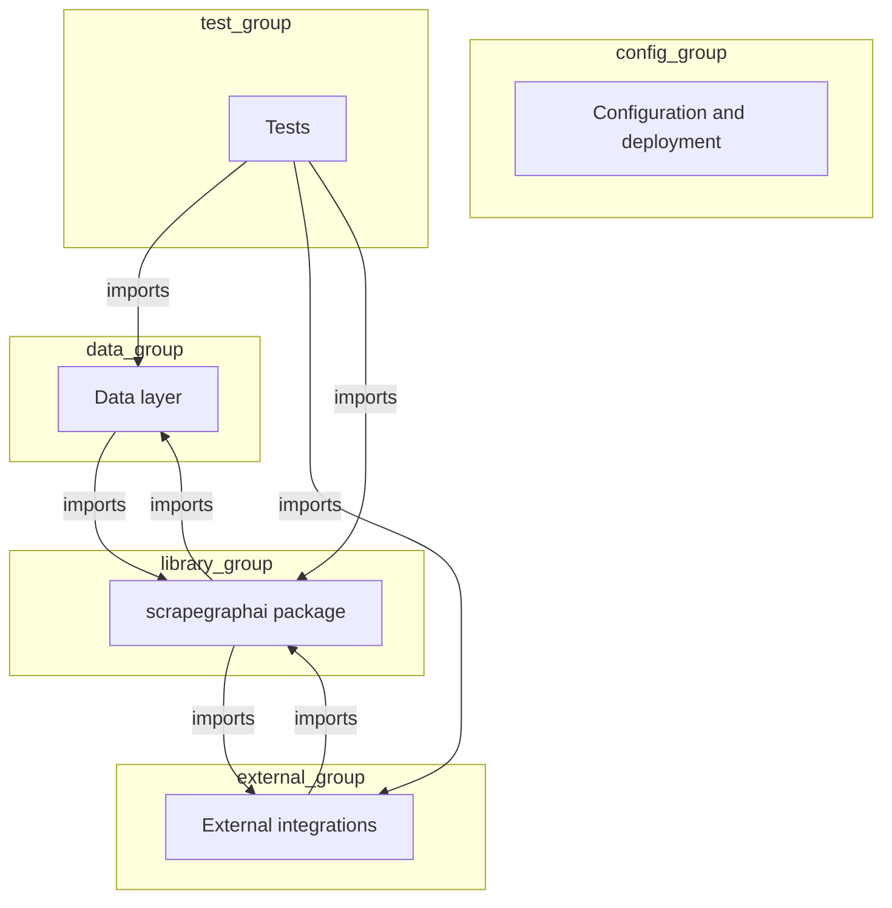

# Architecture report: ScrapeGraphAI/Scrapegraph-ai

> Automated static analysis. **Observed** = directly seen in files/imports/AST; **Inferred** = interpretation from that evidence. Repository code was not executed.

## 1. Repository at a glance

| Item | Value |
| --- | --- |
| Repository | ScrapeGraphAI/Scrapegraph-ai |
| Description | Python scraper based on AI |
| Language | Python |
| Stars | 32779 |
| Licence | MIT |
| Analysed commit / branch | 194055e203afce41ed4e70365dbc416bad756115 / main |
| Framework(s) | None detected |
| Files analysed | 368 |
| Components | 5 |

## 2. Architecture in one minute

ScrapeGraphAI/Scrapegraph-ai - Python scraper based on AI. This repository was analysed statically from 368 file(s) (269 Python). Detected technologies (observed from imports/manifests): GitHub Actions, aiohttp, AWS (boto3), httpx, NumPy, pandas. Files are grouped into 5 component(s): Configuration and deployment, Data layer, External integrations, scrapegraphai package, Tests. Findings below distinguish observed facts from inferred interpretation.

## 3. High-level block diagram

## 4. Main components

### Configuration and deployment (`config`)

- **Kind:** config
- **Status:** Observed
- **Confidence:** 0.85
- **Responsibility:** Groups 5 file(s) under configuration and deployment (observed from repository paths and static analysis).
- **Paths:** `Dockerfile`, `codebeaver.yml`, `docker-compose.yml`, `pyproject.toml`, `pytest.ini`
- **Evidence:** [Dockerfile](https://github.com/ScrapeGraphAI/Scrapegraph-ai/blob/194055e203afce41ed4e70365dbc416bad756115/Dockerfile); [codebeaver.yml](https://github.com/ScrapeGraphAI/Scrapegraph-ai/blob/194055e203afce41ed4e70365dbc416bad756115/codebeaver.yml); [docker-compose.yml](https://github.com/ScrapeGraphAI/Scrapegraph-ai/blob/194055e203afce41ed4e70365dbc416bad756115/docker-compose.yml); [pyproject.toml](https://github.com/ScrapeGraphAI/Scrapegraph-ai/blob/194055e203afce41ed4e70365dbc416bad756115/pyproject.toml); [pytest.ini](https://github.com/ScrapeGraphAI/Scrapegraph-ai/blob/194055e203afce41ed4e70365dbc416bad756115/pytest.ini)

### Data layer (`data_layer`)

- **Kind:** data
- **Status:** Observed
- **Confidence:** 0.85
- **Responsibility:** Groups 12 file(s) under data layer (observed from repository paths and static analysis). Observed top-level classes: AtlasCloud, CLoD, CheaperInference, DeepSeek, MiniMax, Nvidia.
- **Paths:** `scrapegraphai/helpers/schemas.py`, `scrapegraphai/models/__init__.py`, `scrapegraphai/models/atlascloud.py`, `scrapegraphai/models/cheaperinference.py`, `scrapegraphai/models/clod.py`, `scrapegraphai/models/deepseek.py`, `scrapegraphai/models/minimax.py`, `scrapegraphai/models/nvidia.py`, `scrapegraphai/models/oneapi.py`, `scrapegraphai/models/openai_itt.py`, `scrapegraphai/models/openai_tts.py`, `scrapegraphai/models/xai.py`
- **Evidence:** [scrapegraphai/helpers/schemas.py](https://github.com/ScrapeGraphAI/Scrapegraph-ai/blob/194055e203afce41ed4e70365dbc416bad756115/scrapegraphai/helpers/schemas.py); [scrapegraphai/models/__init__.py](https://github.com/ScrapeGraphAI/Scrapegraph-ai/blob/194055e203afce41ed4e70365dbc416bad756115/scrapegraphai/models/__init__.py); [scrapegraphai/models/atlascloud.py:8](https://github.com/ScrapeGraphAI/Scrapegraph-ai/blob/194055e203afce41ed4e70365dbc416bad756115/scrapegraphai/models/atlascloud.py#L8); [scrapegraphai/models/cheaperinference.py:8](https://github.com/ScrapeGraphAI/Scrapegraph-ai/blob/194055e203afce41ed4e70365dbc416bad756115/scrapegraphai/models/cheaperinference.py#L8); [scrapegraphai/models/clod.py:8](https://github.com/ScrapeGraphAI/Scrapegraph-ai/blob/194055e203afce41ed4e70365dbc416bad756115/scrapegraphai/models/clod.py#L8); [scrapegraphai/models/deepseek.py:8](https://github.com/ScrapeGraphAI/Scrapegraph-ai/blob/194055e203afce41ed4e70365dbc416bad756115/scrapegraphai/models/deepseek.py#L8); [scrapegraphai/models/minimax.py:11](https://github.com/ScrapeGraphAI/Scrapegraph-ai/blob/194055e203afce41ed4e70365dbc416bad756115/scrapegraphai/models/minimax.py#L11); [scrapegraphai/models/nvidia.py:6](https://github.com/ScrapeGraphAI/Scrapegraph-ai/blob/194055e203afce41ed4e70365dbc416bad756115/scrapegraphai/models/nvidia.py#L6)

### External integrations (`external_integrations`)

- **Kind:** external
- **Status:** Observed
- **Confidence:** 0.85
- **Responsibility:** Groups 5 file(s) under external integrations (observed from repository paths and static analysis). Observed top-level classes: BatchJobInfo, BatchRequest, BatchResult, BurrBridge, BurrNodeBridge, IndexifyNode. Observed top-level functions: _detect_api, _schema_to_dict, _unwrap_result, create_batch, extract, get_batch_status.
- **Paths:** `scrapegraphai/integrations/__init__.py`, `scrapegraphai/integrations/burr_bridge.py`, `scrapegraphai/integrations/indexify_node.py`, `scrapegraphai/integrations/scrapegraph_py_compat.py`, `scrapegraphai/utils/batch_api.py`
- **Evidence:** [scrapegraphai/integrations/__init__.py](https://github.com/ScrapeGraphAI/Scrapegraph-ai/blob/194055e203afce41ed4e70365dbc416bad756115/scrapegraphai/integrations/__init__.py); [scrapegraphai/integrations/burr_bridge.py:33](https://github.com/ScrapeGraphAI/Scrapegraph-ai/blob/194055e203afce41ed4e70365dbc416bad756115/scrapegraphai/integrations/burr_bridge.py#L33); [scrapegraphai/integrations/indexify_node.py:10](https://github.com/ScrapeGraphAI/Scrapegraph-ai/blob/194055e203afce41ed4e70365dbc416bad756115/scrapegraphai/integrations/indexify_node.py#L10); [scrapegraphai/integrations/scrapegraph_py_compat.py:15](https://github.com/ScrapeGraphAI/Scrapegraph-ai/blob/194055e203afce41ed4e70365dbc416bad756115/scrapegraphai/integrations/scrapegraph_py_compat.py#L15); [scrapegraphai/utils/batch_api.py:29](https://github.com/ScrapeGraphAI/Scrapegraph-ai/blob/194055e203afce41ed4e70365dbc416bad756115/scrapegraphai/utils/batch_api.py#L29)

### scrapegraphai package (`scrapegraphai`)

- **Kind:** library
- **Status:** Observed
- **Confidence:** 0.85
- **Responsibility:** Groups 123 file(s) under scrapegraphai package (observed from repository paths and static analysis). Observed top-level classes: AbstractGraph, AnalysisError, BaseGraph, BaseNode, BatchGenerateAnswerNode, CSVScraperGraph. Observed top-level functions: __getattr__, _base_model_v1_output_parser, _base_model_v2_output_parser, _build_telemetry_payload, _check_config_and_environ_for_telemetry_flag, _check_plasmate.
- **Paths:** `scrapegraphai/__init__.py`, `scrapegraphai/builders/__init__.py`, `scrapegraphai/builders/graph_builder.py`, `scrapegraphai/docloaders/__init__.py`, `scrapegraphai/docloaders/browser_base.py`, `scrapegraphai/docloaders/chromium.py`, `scrapegraphai/docloaders/plasmate.py`, `scrapegraphai/docloaders/scrape_do.py`, `scrapegraphai/graphs/__init__.py`, `scrapegraphai/graphs/abstract_graph.py`, `scrapegraphai/graphs/base_graph.py`, `scrapegraphai/graphs/code_generator_graph.py`, `scrapegraphai/graphs/csv_scraper_graph.py`, `scrapegraphai/graphs/csv_scraper_multi_graph.py`, `scrapegraphai/graphs/depth_search_graph.py`, `scrapegraphai/graphs/document_scraper_graph.py`, `scrapegraphai/graphs/document_scraper_multi_graph.py`, `scrapegraphai/graphs/json_scraper_graph.py`, `scrapegraphai/graphs/json_scraper_multi_graph.py`, `scrapegraphai/graphs/markdownify_graph.py`, `scrapegraphai/graphs/omni_scraper_graph.py`, `scrapegraphai/graphs/omni_search_graph.py`, `scrapegraphai/graphs/screenshot_scraper_graph.py`, `scrapegraphai/graphs/script_creator_graph.py`, `scrapegraphai/graphs/script_creator_multi_graph.py`, `scrapegraphai/graphs/search_graph.py`, `scrapegraphai/graphs/search_link_graph.py`, `scrapegraphai/graphs/smart_scraper_graph.py`, `scrapegraphai/graphs/smart_scraper_lite_graph.py`, `scrapegraphai/graphs/smart_scraper_multi_batch_graph.py`, `scrapegraphai/graphs/smart_scraper_multi_concat_graph.py`, `scrapegraphai/graphs/smart_scraper_multi_graph.py`, `scrapegraphai/graphs/smart_scraper_multi_lite_graph.py`, `scrapegraphai/graphs/speech_graph.py`, `scrapegraphai/graphs/xml_scraper_graph.py`, `scrapegraphai/graphs/xml_scraper_multi_graph.py`, `scrapegraphai/helpers/__init__.py`, `scrapegraphai/helpers/default_filters.py`, `scrapegraphai/helpers/models_tokens.py`, `scrapegraphai/helpers/nodes_metadata.py`, `scrapegraphai/helpers/robots.py`, `scrapegraphai/nodes/__init__.py`, `scrapegraphai/nodes/base_node.py`, `scrapegraphai/nodes/batch_generate_answer_node.py`, `scrapegraphai/nodes/concat_answers_node.py`, `scrapegraphai/nodes/conditional_node.py`, `scrapegraphai/nodes/description_node.py`, `scrapegraphai/nodes/fetch_node.py`, `scrapegraphai/nodes/fetch_node_level_k.py`, `scrapegraphai/nodes/fetch_screen_node.py`, `scrapegraphai/nodes/generate_answer_csv_node.py`, `scrapegraphai/nodes/generate_answer_from_image_node.py`, `scrapegraphai/nodes/generate_answer_node.py`, `scrapegraphai/nodes/generate_answer_node_k_level.py`, `scrapegraphai/nodes/generate_answer_omni_node.py`, `scrapegraphai/nodes/generate_code_node.py`, `scrapegraphai/nodes/generate_scraper_node.py`, `scrapegraphai/nodes/get_probable_tags_node.py`, `scrapegraphai/nodes/graph_iterator_node.py`, `scrapegraphai/nodes/html_analyzer_node.py`, `scrapegraphai/nodes/image_to_text_node.py`, `scrapegraphai/nodes/markdownify_node.py`, `scrapegraphai/nodes/merge_answers_node.py`, `scrapegraphai/nodes/merge_generated_scripts_node.py`, `scrapegraphai/nodes/parse_node.py`, `scrapegraphai/nodes/parse_node_depth_k_node.py`, `scrapegraphai/nodes/prompt_refiner_node.py`, `scrapegraphai/nodes/rag_node.py`, `scrapegraphai/nodes/reasoning_node.py`, `scrapegraphai/nodes/robots_node.py`, `scrapegraphai/nodes/search_internet_node.py`, `scrapegraphai/nodes/search_link_node.py`, `scrapegraphai/nodes/search_node_with_context.py`, `scrapegraphai/nodes/text_to_speech_node.py`, `scrapegraphai/prompts/__init__.py`, `scrapegraphai/prompts/description_node_prompts.py`, `scrapegraphai/prompts/generate_answer_node_csv_prompts.py`, `scrapegraphai/prompts/generate_answer_node_omni_prompts.py`, `scrapegraphai/prompts/generate_answer_node_pdf_prompts.py`, `scrapegraphai/prompts/generate_answer_node_prompts.py`, `scrapegraphai/prompts/generate_code_node_prompts.py`, `scrapegraphai/prompts/get_probable_tags_node_prompts.py`, `scrapegraphai/prompts/html_analyzer_node_prompts.py`, `scrapegraphai/prompts/merge_answer_node_prompts.py`, `scrapegraphai/prompts/merge_generated_scripts_prompts.py`, `scrapegraphai/prompts/prompt_refiner_node_prompts.py`, `scrapegraphai/prompts/reasoning_node_prompts.py`, `scrapegraphai/prompts/robots_node_prompts.py`, `scrapegraphai/prompts/search_internet_node_prompts.py`, `scrapegraphai/prompts/search_link_node_prompts.py`, `scrapegraphai/prompts/search_node_with_context_prompts.py`, `scrapegraphai/telemetry/__init__.py`, `scrapegraphai/telemetry/telemetry.py`, `scrapegraphai/utils/__init__.py`, `scrapegraphai/utils/cleanup_code.py`, `scrapegraphai/utils/cleanup_html.py`, `scrapegraphai/utils/code_error_analysis.py`, `scrapegraphai/utils/code_error_correction.py`, `scrapegraphai/utils/convert_to_md.py`, `scrapegraphai/utils/copy.py`, `scrapegraphai/utils/custom_callback.py`, `scrapegraphai/utils/data_export.py`, `scrapegraphai/utils/dict_content_compare.py`, `scrapegraphai/utils/llm_callback_manager.py`, `scrapegraphai/utils/logging.py`, `scrapegraphai/utils/model_costs.py`, `scrapegraphai/utils/output_parser.py`, `scrapegraphai/utils/parse_state_keys.py`, `scrapegraphai/utils/prettify_exec_info.py`, `scrapegraphai/utils/proxy_rotation.py`, `scrapegraphai/utils/research_web.py`, `scrapegraphai/utils/save_audio_from_bytes.py`, `scrapegraphai/utils/save_code_to_file.py`, `scrapegraphai/utils/schema_trasform.py`, `scrapegraphai/utils/screenshot_scraping/__init__.py`, `scrapegraphai/utils/screenshot_scraping/screenshot_preparation.py`, `scrapegraphai/utils/screenshot_scraping/text_detection.py`, `scrapegraphai/utils/split_text_into_chunks.py`, `scrapegraphai/utils/sys_dynamic_import.py`, `scrapegraphai/utils/tokenizer.py`, `scrapegraphai/utils/tokenizers/tokenizer_mistral.py`, `scrapegraphai/utils/tokenizers/tokenizer_ollama.py`, `scrapegraphai/utils/tokenizers/tokenizer_openai.py`
- **Evidence:** [scrapegraphai/__init__.py](https://github.com/ScrapeGraphAI/Scrapegraph-ai/blob/194055e203afce41ed4e70365dbc416bad756115/scrapegraphai/__init__.py); [scrapegraphai/builders/__init__.py](https://github.com/ScrapeGraphAI/Scrapegraph-ai/blob/194055e203afce41ed4e70365dbc416bad756115/scrapegraphai/builders/__init__.py); [scrapegraphai/builders/graph_builder.py:13](https://github.com/ScrapeGraphAI/Scrapegraph-ai/blob/194055e203afce41ed4e70365dbc416bad756115/scrapegraphai/builders/graph_builder.py#L13); [scrapegraphai/docloaders/__init__.py:17](https://github.com/ScrapeGraphAI/Scrapegraph-ai/blob/194055e203afce41ed4e70365dbc416bad756115/scrapegraphai/docloaders/__init__.py#L17); [scrapegraphai/docloaders/browser_base.py:9](https://github.com/ScrapeGraphAI/Scrapegraph-ai/blob/194055e203afce41ed4e70365dbc416bad756115/scrapegraphai/docloaders/browser_base.py#L9); [scrapegraphai/docloaders/chromium.py:13](https://github.com/ScrapeGraphAI/Scrapegraph-ai/blob/194055e203afce41ed4e70365dbc416bad756115/scrapegraphai/docloaders/chromium.py#L13); [scrapegraphai/docloaders/plasmate.py:31](https://github.com/ScrapeGraphAI/Scrapegraph-ai/blob/194055e203afce41ed4e70365dbc416bad756115/scrapegraphai/docloaders/plasmate.py#L31); [scrapegraphai/docloaders/scrape_do.py:14](https://github.com/ScrapeGraphAI/Scrapegraph-ai/blob/194055e203afce41ed4e70365dbc416bad756115/scrapegraphai/docloaders/scrape_do.py#L14)

### Tests (`tests`)

- **Kind:** test
- **Status:** Observed
- **Confidence:** 0.85
- **Responsibility:** Groups 75 file(s) under tests (observed from repository paths and static analysis). Observed routes: PATCH scrapegraphai.docloaders.chromium.dynamic_import, PATCH scrapegraphai.nodes.fetch_node.requests, PATCH scrapegraphai.nodes.fetch_node.requests, PATCH scrapegraphai.nodes.fetch_node.ChromiumLoader, PATCH scrapegraphai.nodes.fetch_node.ChromiumLoader. Observed top-level classes: BenchmarkResult, BenchmarkSummary, BenchmarkTracker, Company, DummyBaseGraph, DummyChain. Observed top-level functions: _config, _create_sample_file, _delete_sample_file, _make_loader, _mock_run, _parse_node.
- **Paths:** `test`, `tests/QUICKSTART.md`, `tests/README_TESTING.md`, `tests/Readme.md`, `tests/conftest.py`, `tests/fixtures/benchmarking.py`, `tests/fixtures/helpers.py`, `tests/fixtures/mock_server/__init__.py`, `tests/fixtures/mock_server/server.py`, `tests/graphs/.env.example`, `tests/graphs/abstract_graph_test.py`, `tests/graphs/code_generator_graph_openai_test.py`, `tests/graphs/depth_search_graph_openai_test.py`, `tests/graphs/inputs/books.xml`, `tests/graphs/inputs/example.json`, `tests/graphs/inputs/plain_html_example.txt`, `tests/graphs/inputs/username.csv`, `tests/graphs/scrape_plain_text_mistral_test.py`, `tests/graphs/scrape_xml_ollama_test.py`, `tests/graphs/screenshot_scraper_test.py`, `tests/graphs/script_generator_test.py`, `tests/graphs/search_graph_openai_test.py`, `tests/graphs/search_link_ollama.py`, `tests/graphs/smart_scraper_clod_test.py`, `tests/graphs/smart_scraper_ernie_test.py`, `tests/graphs/smart_scraper_fireworks_test.py`, `tests/graphs/smart_scraper_multi_lite_graph_openai_test.py`, `tests/graphs/smart_scraper_ollama_test.py`, `tests/graphs/smart_scraper_openai_test.py`, `tests/graphs/xml_scraper_openai_test.py`, `tests/inputs/books.xml`, `tests/inputs/example.json`, `tests/inputs/plain_html_example.txt`, `tests/inputs/username.csv`, `tests/integration/__init__.py`, `tests/integration/test_file_formats_integration.py`, `tests/integration/test_multi_graph_integration.py`, `tests/integration/test_smart_scraper_integration.py`, `tests/nodes/fetch_node_test.py`, `tests/nodes/inputs/books.xml`, `tests/nodes/inputs/example.json`, `tests/nodes/inputs/plain_html_example.txt`, `tests/nodes/inputs/username.csv`, `tests/nodes/robot_node_test.py`, `tests/nodes/search_internet_node_test.py`, `tests/nodes/search_link_node_test.py`, `tests/test_atlascloud_model.py`, `tests/test_batch_api.py`, `tests/test_cheaperinference_model.py`, `tests/test_chromium.py`, `tests/test_cleanup_html.py`, `tests/test_csv_scraper_multi_graph.py`, `tests/test_depth_search_graph.py`, `tests/test_error_page_detection.py`, `tests/test_fetch_node_timeout.py`, `tests/test_generate_answer_node.py`, `tests/test_json_scraper_graph.py`, `tests/test_json_scraper_multi_graph.py`, `tests/test_minimax_models.py`, `tests/test_models_tokens.py`, `tests/test_omni_search_graph.py`, `tests/test_plasmate.py`, `tests/test_scrape_do.py`, `tests/test_script_creator_multi_graph.py`, `tests/test_search_graph.py`, `tests/test_smart_scraper_multi_concat_graph.py`, `tests/test_telemetry_flag.py`, `tests/utils/convert_to_md_test.py`, `tests/utils/copy_utils_test.py`, `tests/utils/output_parser_test.py`, `tests/utils/parse_state_keys_test.py`, `tests/utils/research_web_test.py`, `tests/utils/schema_transform_test.py`, `tests/utils/test_proxy_rotation.py`, `tests/utils/test_sys_dynamic_import.py`
- **Evidence:** [test](https://github.com/ScrapeGraphAI/Scrapegraph-ai/blob/194055e203afce41ed4e70365dbc416bad756115/test); [tests/QUICKSTART.md](https://github.com/ScrapeGraphAI/Scrapegraph-ai/blob/194055e203afce41ed4e70365dbc416bad756115/tests/QUICKSTART.md); [tests/README_TESTING.md](https://github.com/ScrapeGraphAI/Scrapegraph-ai/blob/194055e203afce41ed4e70365dbc416bad756115/tests/README_TESTING.md); [tests/Readme.md](https://github.com/ScrapeGraphAI/Scrapegraph-ai/blob/194055e203afce41ed4e70365dbc416bad756115/tests/Readme.md); [tests/conftest.py:49](https://github.com/ScrapeGraphAI/Scrapegraph-ai/blob/194055e203afce41ed4e70365dbc416bad756115/tests/conftest.py#L49); [tests/fixtures/benchmarking.py:23](https://github.com/ScrapeGraphAI/Scrapegraph-ai/blob/194055e203afce41ed4e70365dbc416bad756115/tests/fixtures/benchmarking.py#L23); [tests/fixtures/helpers.py:22](https://github.com/ScrapeGraphAI/Scrapegraph-ai/blob/194055e203afce41ed4e70365dbc416bad756115/tests/fixtures/helpers.py#L22); [tests/fixtures/mock_server/__init__.py](https://github.com/ScrapeGraphAI/Scrapegraph-ai/blob/194055e203afce41ed4e70365dbc416bad756115/tests/fixtures/mock_server/__init__.py)

## 5. Execution flow

No entry point was observed; the startup flow below is therefore limited.

**Observed** routes (from decorators):

- `PATCH scrapegraphai.docloaders.chromium.dynamic_import` -> `test_init_dynamic_import_called` in `tests/test_chromium.py:1204`
- `PATCH scrapegraphai.nodes.fetch_node.requests` -> `test_requests_get_with_timeout` in `tests/test_fetch_node_timeout.py:102`
- `PATCH scrapegraphai.nodes.fetch_node.requests` -> `test_requests_get_without_timeout_when_none` in `tests/test_fetch_node_timeout.py:125`
- `PATCH scrapegraphai.nodes.fetch_node.ChromiumLoader` -> `test_timeout_propagated_to_chromium_loader` in `tests/test_fetch_node_timeout.py:189`
- `PATCH scrapegraphai.nodes.fetch_node.ChromiumLoader` -> `test_timeout_not_overridden_in_loader_kwargs` in `tests/test_fetch_node_timeout.py:213`
- `PATCH scrapegraphai.graphs.json_scraper_graph.FetchNode` -> `test_json_scraper_graph_with_directory` in `tests/test_json_scraper_graph.py:21`
- `PATCH scrapegraphai.graphs.json_scraper_graph.GenerateAnswerNode` -> `test_json_scraper_graph_with_directory` in `tests/test_json_scraper_graph.py:21`
- `PATCH scrapegraphai.graphs.json_scraper_graph.FetchNode` -> `test_json_scraper_graph_with_single_file` in `tests/test_json_scraper_graph.py:78`
- `PATCH scrapegraphai.graphs.json_scraper_graph.GenerateAnswerNode` -> `test_json_scraper_graph_with_single_file` in `tests/test_json_scraper_graph.py:78`
- `PATCH scrapegraphai.graphs.json_scraper_graph.FetchNode` -> `test_json_scraper_graph_no_answer_found` in `tests/test_json_scraper_graph.py:135`
- `PATCH scrapegraphai.graphs.json_scraper_graph.GenerateAnswerNode` -> `test_json_scraper_graph_no_answer_found` in `tests/test_json_scraper_graph.py:135`
- `PATCH scrapegraphai.graphs.json_scraper_graph.FetchNode` -> `test_json_scraper_graph_with_custom_schema` in `tests/test_json_scraper_graph.py:189`
- `PATCH scrapegraphai.graphs.json_scraper_graph.GenerateAnswerNode` -> `test_json_scraper_graph_with_custom_schema` in `tests/test_json_scraper_graph.py:189`
- `PATCH shutil.which` -> `test_lazy_load_yields_document` in `tests/test_plasmate.py:103`
- `PATCH subprocess.run` -> `test_lazy_load_yields_document` in `tests/test_plasmate.py:103`
- `PATCH shutil.which` -> `test_lazy_load_multiple_urls` in `tests/test_plasmate.py:117`
- `PATCH subprocess.run` -> `test_lazy_load_multiple_urls` in `tests/test_plasmate.py:117`
- `PATCH shutil.which` -> `test_lazy_load_markdown_format` in `tests/test_plasmate.py:131`
- `PATCH subprocess.run` -> `test_lazy_load_markdown_format` in `tests/test_plasmate.py:131`
- `PATCH shutil.which` -> `test_lazy_load_skips_empty_content` in `tests/test_plasmate.py:145`
- `PATCH subprocess.run` -> `test_lazy_load_skips_empty_content` in `tests/test_plasmate.py:145`
- `PATCH shutil.which` -> `test_lazy_load_nonzero_returncode_skips` in `tests/test_plasmate.py:155`
- `PATCH subprocess.run` -> `test_lazy_load_nonzero_returncode_skips` in `tests/test_plasmate.py:155`
- `PATCH shutil.which` -> `test_lazy_load_timeout_skips` in `tests/test_plasmate.py:164`
- `PATCH subprocess.run` -> `test_lazy_load_timeout_skips` in `tests/test_plasmate.py:164`
- `PATCH shutil.which` -> `test_lazy_load_no_binary_raises` in `tests/test_plasmate.py:173`
- `PATCH shutil.which` -> `test_fallback_to_chrome_on_empty` in `tests/test_plasmate.py:185`
- `PATCH subprocess.run` -> `test_fallback_to_chrome_on_empty` in `tests/test_plasmate.py:185`
- `PATCH shutil.which` -> `test_no_fallback_when_content_present` in `tests/test_plasmate.py:208`
- `PATCH subprocess.run` -> `test_no_fallback_when_content_present` in `tests/test_plasmate.py:208`
- `PATCH shutil.which` -> `test_alazy_load_yields_documents` in `tests/test_plasmate.py:227`
- `PATCH subprocess.run` -> `test_alazy_load_yields_documents` in `tests/test_plasmate.py:227`
- `PATCH shutil.which` -> `test_alazy_load_skips_empty` in `tests/test_plasmate.py:246`
- `PATCH subprocess.run` -> `test_alazy_load_skips_empty` in `tests/test_plasmate.py:246`
- `PATCH shutil.which` -> `test_lazy_load_empty_urls` in `tests/test_plasmate.py:262`
- `PATCH shutil.which` -> `test_alazy_load_empty_urls` in `tests/test_plasmate.py:269`
- `PATCH scrapegraphai.graphs.search_graph.BaseGraph` -> `test_get_considered_urls` in `tests/test_search_graph.py:17`
- `PATCH scrapegraphai.graphs.abstract_graph.AbstractGraph._create_llm` -> `test_get_considered_urls` in `tests/test_search_graph.py:17`
- `PATCH scrapegraphai.graphs.search_graph.BaseGraph` -> `test_run_no_answer_found` in `tests/test_search_graph.py:41`
- `PATCH scrapegraphai.graphs.abstract_graph.AbstractGraph._create_llm` -> `test_run_no_answer_found` in `tests/test_search_graph.py:41`
- `PATCH scrapegraphai.graphs.search_graph.SearchInternetNode` -> `test_max_results_config` in `tests/test_search_graph.py:68`
- `PATCH scrapegraphai.graphs.search_graph.GraphIteratorNode` -> `test_max_results_config` in `tests/test_search_graph.py:68`
- `PATCH scrapegraphai.graphs.search_graph.MergeAnswersNode` -> `test_max_results_config` in `tests/test_search_graph.py:68`
- `PATCH scrapegraphai.graphs.search_graph.BaseGraph` -> `test_max_results_config` in `tests/test_search_graph.py:68`
- `PATCH scrapegraphai.graphs.abstract_graph.AbstractGraph._create_llm` -> `test_max_results_config` in `tests/test_search_graph.py:68`
- `PATCH scrapegraphai.graphs.search_graph.SearchInternetNode` -> `test_custom_search_engine_config` in `tests/test_search_graph.py:97`
- `PATCH scrapegraphai.graphs.search_graph.GraphIteratorNode` -> `test_custom_search_engine_config` in `tests/test_search_graph.py:97`
- `PATCH scrapegraphai.graphs.search_graph.MergeAnswersNode` -> `test_custom_search_engine_config` in `tests/test_search_graph.py:97`
- `PATCH scrapegraphai.graphs.search_graph.BaseGraph` -> `test_custom_search_engine_config` in `tests/test_search_graph.py:97`
- `PATCH scrapegraphai.graphs.abstract_graph.AbstractGraph._create_llm` -> `test_custom_search_engine_config` in `tests/test_search_graph.py:97`
- `PATCH scrapegraphai.utils.proxy_rotation.search_proxy_servers` -> `test_search_proxy_success` in `tests/utils/test_proxy_rotation.py:63`
- `PATCH scrapegraphai.utils.proxy_rotation.search_proxy_servers` -> `test_parse_or_search_proxy_success` in `tests/utils/test_proxy_rotation.py:78`

Representative flow (derived from observed entry points and the import graph; steps beyond the entry point are **Inferred**):

1. Execution starts at an observed entry point listed above, if present.
2. `data_layer` imports `scrapegraphai` (Data layer -> scrapegraphai package).
3. `external_integrations` imports `scrapegraphai` (External integrations -> scrapegraphai package).
4. `scrapegraphai` imports `data_layer` (scrapegraphai package -> Data layer).
5. `scrapegraphai` imports `external_integrations` (scrapegraphai package -> External integrations).
6. `tests` imports `data_layer` (Tests -> Data layer).
7. `tests` imports `external_integrations` (Tests -> External integrations).
8. `tests` imports `scrapegraphai` (Tests -> scrapegraphai package).

## 6. Project structure

### `(root)`

- `.gitattributes` - other (66 bytes)
- `.gitignore` - other (2139 bytes)
- `.pre-commit-config.yaml` - config (480 bytes)
- `.releaserc.yml` - config (1402 bytes)
- `.semantic-commits-applied` - other (461 bytes)
- `AGENTS.md` - docs (5217 bytes)
- `CODE_OF_CONDUCT.md` - docs (5221 bytes)
- `CONTRIBUTING.md` - docs (1197 bytes)
- `Dockerfile` - container (266 bytes)
- `LICENSE` - docs (1066 bytes)
- `Makefile` - other (954 bytes)
- `README.md` - docs (13890 bytes)
- `SECURITY.md` - docs (116 bytes)
- `SEMANTIC_COMMITS.md` - docs (3948 bytes)
- `TESTING_INFRASTRUCTURE.md` - docs (9777 bytes)
- `citation.cff` - other (398 bytes)
- `codebeaver.yml` - config (117 bytes)
- `docker-compose.yml` - container (224 bytes)
- `pyproject.toml` - manifest (2904 bytes)
- `pytest.ini` - config (1619 bytes)
- `test` - test (6 bytes)

### `.github`

- `.github/FUNDING.yml` - config (750 bytes)
- `.github/ISSUE_TEMPLATE/bug_report.md` - docs (834 bytes)
- `.github/ISSUE_TEMPLATE/custom.md` - docs (124 bytes)
- `.github/ISSUE_TEMPLATE/feature_request.md` - docs (595 bytes)
- `.github/workflows/codeql.yml` - ci, YAML (2593 bytes)
- `.github/workflows/dependency-review.yml` - ci, YAML (1729 bytes)
- `.github/workflows/release.yml` - ci, YAML (2802 bytes)
- `.github/workflows/test-suite.yml` - ci, YAML (1599 bytes)

### `PullRequests`

- `PullRequests/PR_1027_reviews.md` - docs (804 bytes)

### `docs`

- `docs/assets/scrapegraphai_logo.svg` - docs (6581 bytes)
- `docs/chinese.md` - docs (11045 bytes)
- `docs/french.md` - docs (12649 bytes)
- `docs/german.md` - docs (12491 bytes)
- `docs/italian.md` - docs (12347 bytes)
- `docs/japanese.md` - docs (13195 bytes)
- `docs/korean.md` - docs (12498 bytes)
- `docs/portuguese.md` - docs (12117 bytes)
- `docs/russian.md` - docs (15791 bytes)
- `docs/spanish.md` - docs (12144 bytes)
- `docs/timeout_configuration.md` - docs (6543 bytes)
- `docs/turkish.md` - docs (12513 bytes)

### `examples`

- `examples/code_generator_graph/.env.example` - config (285 bytes)
- `examples/code_generator_graph/README.md` - docs (662 bytes)
- `examples/code_generator_graph/ollama/code_generator_graph_ollama.py` - source, Python (1589 bytes)
- `examples/code_generator_graph/openai/code_generator_graph_openai.py` - source, Python (1577 bytes)
- `examples/csv_scraper_graph/.env.example` - config (210 bytes)
- `examples/csv_scraper_graph/README.md` - docs (608 bytes)
- `examples/csv_scraper_graph/ollama/csv_scraper_graph_multi_ollama.py` - source, Python (1705 bytes)
- `examples/csv_scraper_graph/ollama/csv_scraper_ollama.py` - source, Python (1725 bytes)
- `examples/csv_scraper_graph/ollama/inputs/username.csv` - data (175 bytes)
- `examples/csv_scraper_graph/openai/csv_scraper_graph_multi_openai.py` - source, Python (1441 bytes)
- `examples/csv_scraper_graph/openai/csv_scraper_openai.py` - source, Python (1463 bytes)
- `examples/csv_scraper_graph/openai/inputs/username.csv` - data (175 bytes)
- `examples/custom_graph/.env.example` - config (249 bytes)
- `examples/custom_graph/README.md` - docs (608 bytes)
- `examples/custom_graph/ollama/custom_graph_ollama.py` - source, Python (2469 bytes)
- `examples/custom_graph/openai/custom_graph_openai.py` - source, Python (2629 bytes)
- `examples/depth_search_graph/.env.example` - config (279 bytes)
- `examples/depth_search_graph/README.md` - docs (598 bytes)
- `examples/depth_search_graph/ollama/depth_search_graph_ollama.py` - source, Python (749 bytes)
- `examples/depth_search_graph/openai/depth_search_graph_openai.py` - source, Python (601 bytes)
- `examples/document_scraper_graph/.env.example` - config (290 bytes)
- `examples/document_scraper_graph/README.md` - docs (633 bytes)
- `examples/document_scraper_graph/ollama/document_scraper_ollama.py` - source, Python (1655 bytes)
- `examples/document_scraper_graph/ollama/inputs/plain_html_example.txt` - docs (7289 bytes)
- `examples/document_scraper_graph/openai/document_scraper_openai.py` - source, Python (1414 bytes)
- `examples/document_scraper_graph/openai/inputs/markdown_example.md` - docs (1036 bytes)
- `examples/document_scraper_graph/openai/inputs/plain_html_example.txt` - docs (7289 bytes)
- `examples/extras/.env.example` - config (183 bytes)
- `examples/extras/authenticated_playwright.py` - source, Python (2950 bytes)
- `examples/extras/browser_base_integration.py` - source, Python (1336 bytes)
- `examples/extras/chromium_selenium.py` - source, Python (4947 bytes)
- `examples/extras/cond_smartscraper_usage.py` - source, Python (1024 bytes)
- `examples/extras/conditional_usage.py` - source, Python (980 bytes)
- `examples/extras/custom_prompt.py` - source, Python (1341 bytes)
- `examples/extras/example.yml` - config (346 bytes)
- `examples/extras/force_mode.py` - source, Python (1569 bytes)
- `examples/extras/html_mode.py` - source, Python (1349 bytes)
- `examples/extras/load_yml.py` - source, Python (990 bytes)
- `examples/extras/no_cut.py` - source, Python (1151 bytes)
- `examples/extras/proxy_rotation.py` - source, Python (1317 bytes)
- `examples/extras/rag_caching.py` - source, Python (1227 bytes)
- `examples/extras/reasoning.py` - source, Python (1216 bytes)
- `examples/extras/scrape_do.py` - source, Python (956 bytes)
- `examples/extras/screenshot_scaping.py` - source, Python (1057 bytes)
- `examples/extras/serch_graph_scehma.py` - source, Python (985 bytes)
- `examples/extras/slow_mo.py` - source, Python (1473 bytes)
- `examples/extras/undected_playwright.py` - source, Python (1255 bytes)
- `examples/json_scraper_graph/.env.example` - config (204 bytes)
- `examples/json_scraper_graph/README.md` - docs (614 bytes)
- `examples/json_scraper_graph/ollama/inputs/example.json` - config (6456 bytes)
- `examples/json_scraper_graph/ollama/json_scraper_multi_ollama.py` - source, Python (879 bytes)
- `examples/json_scraper_graph/ollama/json_scraper_ollama.py` - source, Python (1803 bytes)
- `examples/json_scraper_graph/openai/inputs/example.json` - config (6456 bytes)
- `examples/json_scraper_graph/openai/json_scraper_multi_openai.py` - source, Python (817 bytes)
- `examples/json_scraper_graph/openai/json_scraper_openai.py` - source, Python (1636 bytes)
- `examples/json_scraper_graph/openai/md_scraper_openai.py` - source, Python (1619 bytes)
- `examples/json_scraper_graph/openai/omni_scraper_openai.py` - source, Python (1317 bytes)
- `examples/markdownify/.env.example` - config (44 bytes)
- `examples/markdownify/markdownify_scrapegraphai.py` - source, Python (501 bytes)
- `examples/markdownify/markdownify_scrapegraphai_v3.py` - source, Python (723 bytes)
- `examples/markdownify/readme.md` - docs (1907 bytes)
- `examples/omni_scraper_graph/.env.example` - config (249 bytes)
- `examples/omni_scraper_graph/README.md` - docs (656 bytes)
- `examples/omni_scraper_graph/omni_search_openai.py` - source, Python (1158 bytes)
- `examples/readme.md` - docs (2871 bytes)
- `examples/script_generator_graph/.env.example` - config (267 bytes)
- `examples/script_generator_graph/README.md` - docs (628 bytes)
- `examples/script_generator_graph/ollama/script_generator_ollama.py` - source, Python (1298 bytes)
- `examples/script_generator_graph/ollama/script_multi_generator_ollama.py` - source, Python (1586 bytes)
- `examples/script_generator_graph/openai/script_generator_multi_openai.py` - source, Python (1499 bytes)
- `examples/script_generator_graph/openai/script_generator_openai.py` - source, Python (1282 bytes)
- `examples/script_generator_graph/openai/script_generator_schema_openai.py` - source, Python (1683 bytes)
- `examples/search_graph/.env.example` - config (242 bytes)
- `examples/search_graph/README.md` - docs (647 bytes)
- `examples/search_graph/ollama/search_graph_ollama.py` - source, Python (1223 bytes)
- `examples/search_graph/ollama/search_graph_schema_ollama.py` - source, Python (1643 bytes)
- `examples/search_graph/openai/search_graph_openai.py` - source, Python (759 bytes)
- `examples/search_graph/openai/search_graph_schema_openai.py` - source, Python (1563 bytes)
- `examples/search_graph/openai/search_link_graph_openai.py` - source, Python (1097 bytes)
- `examples/search_graph/scrapegraphai/.env.example` - config (44 bytes)
- `examples/search_graph/scrapegraphai/readme.md` - docs (0 bytes)
- `examples/search_graph/scrapegraphai/searchscraper_scrapegraphai.py` - source, Python (531 bytes)
- `examples/search_graph/scrapegraphai/searchscraper_scrapegraphai_v3.py` - source, Python (719 bytes)
- `examples/smart_scraper_graph/.env.example` - config (156 bytes)
- `examples/smart_scraper_graph/nvidia/smart_scraper_nvidia.py` - source, Python (1219 bytes)
- `examples/smart_scraper_graph/ollama/smart_scraper_lite_ollama.py` - source, Python (702 bytes)
- `examples/smart_scraper_graph/ollama/smart_scraper_multi_concat_ollama.py` - source, Python (996 bytes)
- `examples/smart_scraper_graph/ollama/smart_scraper_multi_lite_ollama.py` - source, Python (1222 bytes)
- `examples/smart_scraper_graph/ollama/smart_scraper_multi_ollama.py` - source, Python (938 bytes)
- `examples/smart_scraper_graph/ollama/smart_scraper_ollama.py` - source, Python (1164 bytes)
- `examples/smart_scraper_graph/ollama/smart_scraper_schema_ollama.py` - source, Python (1402 bytes)
- `examples/smart_scraper_graph/openai/smart_scraper_lite_openai.py` - source, Python (732 bytes)
- `examples/smart_scraper_graph/openai/smart_scraper_multi_concat_openai.py` - source, Python (973 bytes)
- `examples/smart_scraper_graph/openai/smart_scraper_multi_lite_openai.py` - source, Python (1224 bytes)
- `examples/smart_scraper_graph/openai/smart_scraper_multi_openai.py` - source, Python (962 bytes)
- `examples/smart_scraper_graph/openai/smart_scraper_openai.py` - source, Python (1158 bytes)
- `examples/smart_scraper_graph/openai/smart_scraper_schema_openai.py` - source, Python (1359 bytes)
- `examples/smart_scraper_graph/scrapegraphai/.env.example` - config (44 bytes)
- `examples/smart_scraper_graph/scrapegraphai/readme.md` - docs (3957 bytes)
- `examples/smart_scraper_graph/scrapegraphai/smartscraper_scrapegraphai.py` - source, Python (586 bytes)
- `examples/smart_scraper_graph/scrapegraphai/smartscraper_scrapegraphai_v3.py` - source, Python (822 bytes)
- `examples/speech_graph/.env.example` - config (292 bytes)
- `examples/speech_graph/README.md` - docs (617 bytes)
- `examples/speech_graph/speech_graph_openai.py` - source, Python (1504 bytes)
- `examples/xml_scraper_graph/.env.example` - config (215 bytes)
- `examples/xml_scraper_graph/README.md` - docs (605 bytes)
- `examples/xml_scraper_graph/ollama/inputs/books.xml` - other (4412 bytes)
- `examples/xml_scraper_graph/ollama/xml_scraper_graph_multi_ollama.py` - source, Python (1771 bytes)
- `examples/xml_scraper_graph/ollama/xml_scraper_ollama.py` - source, Python (1710 bytes)
- `examples/xml_scraper_graph/openai/inputs/books.xml` - other (4412 bytes)
- `examples/xml_scraper_graph/openai/xml_scraper_graph_multi_openai.py` - source, Python (1695 bytes)
- `examples/xml_scraper_graph/openai/xml_scraper_openai.py` - source, Python (1524 bytes)

### `scrapegraphai`

- `scrapegraphai/__init__.py` - source, Python (161 bytes)
- `scrapegraphai/builders/__init__.py` - source, Python (188 bytes)
- `scrapegraphai/builders/graph_builder.py` - source, Python (6820 bytes)
- `scrapegraphai/docloaders/__init__.py` - source, Python (817 bytes)
- `scrapegraphai/docloaders/browser_base.py` - source, Python (1784 bytes)
- `scrapegraphai/docloaders/chromium.py` - source, Python (22735 bytes)
- `scrapegraphai/docloaders/plasmate.py` - source, Python (7659 bytes)
- `scrapegraphai/docloaders/scrape_do.py` - source, Python (1644 bytes)
- `scrapegraphai/graphs/__init__.py` - source, Python (2366 bytes)
- `scrapegraphai/graphs/abstract_graph.py` - source, Python (12407 bytes)
- `scrapegraphai/graphs/base_graph.py` - source, Python (14365 bytes)
- `scrapegraphai/graphs/code_generator_graph.py` - source, Python (6715 bytes)
- `scrapegraphai/graphs/csv_scraper_graph.py` - source, Python (3793 bytes)
- `scrapegraphai/graphs/csv_scraper_multi_graph.py` - source, Python (3286 bytes)
- `scrapegraphai/graphs/depth_search_graph.py` - source, Python (5173 bytes)
- `scrapegraphai/graphs/document_scraper_graph.py` - source, Python (3972 bytes)
- `scrapegraphai/graphs/document_scraper_multi_graph.py` - source, Python (3437 bytes)
- `scrapegraphai/graphs/json_scraper_graph.py` - source, Python (3157 bytes)
- `scrapegraphai/graphs/json_scraper_multi_graph.py` - source, Python (3329 bytes)
- `scrapegraphai/graphs/markdownify_graph.py` - source, Python (2290 bytes)
- `scrapegraphai/graphs/omni_scraper_graph.py` - source, Python (4632 bytes)
- `scrapegraphai/graphs/omni_search_graph.py` - source, Python (3688 bytes)
- `scrapegraphai/graphs/screenshot_scraper_graph.py` - source, Python (2550 bytes)
- `scrapegraphai/graphs/script_creator_graph.py` - source, Python (4116 bytes)
- `scrapegraphai/graphs/script_creator_multi_graph.py` - source, Python (3429 bytes)
- `scrapegraphai/graphs/search_graph.py` - source, Python (4415 bytes)
- `scrapegraphai/graphs/search_link_graph.py` - source, Python (3536 bytes)
- `scrapegraphai/graphs/smart_scraper_graph.py` - source, Python (10465 bytes)
- `scrapegraphai/graphs/smart_scraper_lite_graph.py` - source, Python (3360 bytes)
- `scrapegraphai/graphs/smart_scraper_multi_batch_graph.py` - source, Python (7695 bytes)
- `scrapegraphai/graphs/smart_scraper_multi_concat_graph.py` - source, Python (4243 bytes)
- `scrapegraphai/graphs/smart_scraper_multi_graph.py` - source, Python (3720 bytes)
- `scrapegraphai/graphs/smart_scraper_multi_lite_graph.py` - source, Python (3752 bytes)
- `scrapegraphai/graphs/speech_graph.py` - source, Python (4404 bytes)
- `scrapegraphai/graphs/xml_scraper_graph.py` - source, Python (3252 bytes)
- `scrapegraphai/graphs/xml_scraper_multi_graph.py` - source, Python (3319 bytes)
- `scrapegraphai/helpers/__init__.py` - source, Python (355 bytes)
- `scrapegraphai/helpers/default_filters.py` - source, Python (498 bytes)
- `scrapegraphai/helpers/models_tokens.py` - source, Python (14752 bytes)
- `scrapegraphai/helpers/nodes_metadata.py` - source, Python (3727 bytes)
- `scrapegraphai/helpers/robots.py` - source, Python (399 bytes)
- `scrapegraphai/helpers/schemas.py` - source, Python (2320 bytes)
- `scrapegraphai/integrations/__init__.py` - source, Python (172 bytes)
- `scrapegraphai/integrations/burr_bridge.py` - source, Python (7591 bytes)
- `scrapegraphai/integrations/indexify_node.py` - source, Python (1961 bytes)
- `scrapegraphai/integrations/scrapegraph_py_compat.py` - source, Python (3280 bytes)
- `scrapegraphai/models/__init__.py` - source, Python (563 bytes)
- `scrapegraphai/models/atlascloud.py` - source, Python (547 bytes)
- `scrapegraphai/models/cheaperinference.py` - source, Python (635 bytes)
- `scrapegraphai/models/clod.py` - source, Python (612 bytes)
- `scrapegraphai/models/deepseek.py` - source, Python (627 bytes)
- `scrapegraphai/models/minimax.py` - source, Python (781 bytes)
- `scrapegraphai/models/nvidia.py` - source, Python (1137 bytes)
- `scrapegraphai/models/oneapi.py` - source, Python (509 bytes)
- `scrapegraphai/models/openai_itt.py` - source, Python (1302 bytes)
- `scrapegraphai/models/openai_tts.py` - source, Python (1223 bytes)
- `scrapegraphai/models/xai.py` - source, Python (615 bytes)
- `scrapegraphai/nodes/__init__.py` - source, Python (2665 bytes)
- `scrapegraphai/nodes/base_node.py` - source, Python (8188 bytes)
- `scrapegraphai/nodes/batch_generate_answer_node.py` - source, Python (8849 bytes)
- `scrapegraphai/nodes/concat_answers_node.py` - source, Python (2279 bytes)
- `scrapegraphai/nodes/conditional_node.py` - source, Python (3891 bytes)
- `scrapegraphai/nodes/description_node.py` - source, Python (2483 bytes)
- `scrapegraphai/nodes/fetch_node.py` - source, Python (15691 bytes)
- `scrapegraphai/nodes/fetch_node_level_k.py` - source, Python (11654 bytes)
- `scrapegraphai/nodes/fetch_screen_node.py` - source, Python (1650 bytes)
- `scrapegraphai/nodes/generate_answer_csv_node.py` - source, Python (6457 bytes)
- `scrapegraphai/nodes/generate_answer_from_image_node.py` - source, Python (3921 bytes)
- `scrapegraphai/nodes/generate_answer_node.py` - source, Python (10274 bytes)
- `scrapegraphai/nodes/generate_answer_node_k_level.py` - source, Python (6599 bytes)
- `scrapegraphai/nodes/generate_answer_omni_node.py` - source, Python (6226 bytes)
- `scrapegraphai/nodes/generate_code_node.py` - source, Python (17689 bytes)
- `scrapegraphai/nodes/generate_scraper_node.py` - source, Python (5530 bytes)
- `scrapegraphai/nodes/get_probable_tags_node.py` - source, Python (3171 bytes)
- `scrapegraphai/nodes/graph_iterator_node.py` - source, Python (4714 bytes)
- `scrapegraphai/nodes/html_analyzer_node.py` - source, Python (3898 bytes)
- `scrapegraphai/nodes/image_to_text_node.py` - source, Python (3065 bytes)
- `scrapegraphai/nodes/markdownify_node.py` - source, Python (2209 bytes)
- `scrapegraphai/nodes/merge_answers_node.py` - source, Python (4519 bytes)
- `scrapegraphai/nodes/merge_generated_scripts_node.py` - source, Python (2967 bytes)
- `scrapegraphai/nodes/parse_node.py` - source, Python (15927 bytes)
- `scrapegraphai/nodes/parse_node_depth_k_node.py` - source, Python (2380 bytes)
- `scrapegraphai/nodes/prompt_refiner_node.py` - source, Python (3899 bytes)
- `scrapegraphai/nodes/rag_node.py` - source, Python (3570 bytes)
- `scrapegraphai/nodes/reasoning_node.py` - source, Python (3670 bytes)
- `scrapegraphai/nodes/robots_node.py` - source, Python (5193 bytes)
- `scrapegraphai/nodes/search_internet_node.py` - source, Python (4254 bytes)
- `scrapegraphai/nodes/search_link_node.py` - source, Python (5832 bytes)
- `scrapegraphai/nodes/search_node_with_context.py` - source, Python (3880 bytes)
- `scrapegraphai/nodes/text_to_speech_node.py` - source, Python (2151 bytes)
- `scrapegraphai/prompts/__init__.py` - source, Python (3508 bytes)
- `scrapegraphai/prompts/description_node_prompts.py` - source, Python (312 bytes)
- `scrapegraphai/prompts/generate_answer_node_csv_prompts.py` - source, Python (1812 bytes)
- `scrapegraphai/prompts/generate_answer_node_omni_prompts.py` - source, Python (2107 bytes)
- `scrapegraphai/prompts/generate_answer_node_pdf_prompts.py` - source, Python (2225 bytes)
- `scrapegraphai/prompts/generate_answer_node_prompts.py` - source, Python (4877 bytes)
- `scrapegraphai/prompts/generate_code_node_prompts.py` - source, Python (6192 bytes)
- `scrapegraphai/prompts/get_probable_tags_node_prompts.py` - source, Python (441 bytes)
- `scrapegraphai/prompts/html_analyzer_node_prompts.py` - source, Python (4123 bytes)
- `scrapegraphai/prompts/merge_answer_node_prompts.py` - source, Python (847 bytes)
- `scrapegraphai/prompts/merge_generated_scripts_prompts.py` - source, Python (792 bytes)
- `scrapegraphai/prompts/prompt_refiner_node_prompts.py` - source, Python (2325 bytes)
- `scrapegraphai/prompts/reasoning_node_prompts.py` - source, Python (3031 bytes)
- `scrapegraphai/prompts/robots_node_prompts.py` - source, Python (719 bytes)
- `scrapegraphai/prompts/search_internet_node_prompts.py` - source, Python (733 bytes)
- `scrapegraphai/prompts/search_link_node_prompts.py` - source, Python (675 bytes)
- `scrapegraphai/prompts/search_node_with_context_prompts.py` - source, Python (1024 bytes)
- `scrapegraphai/telemetry/__init__.py` - source, Python (239 bytes)
- `scrapegraphai/telemetry/telemetry.py` - source, Python (6328 bytes)
- `scrapegraphai/utils/__init__.py` - source, Python (3370 bytes)
- `scrapegraphai/utils/batch_api.py` - source, Python (9073 bytes)
- `scrapegraphai/utils/cleanup_code.py` - source, Python (302 bytes)
- `scrapegraphai/utils/cleanup_html.py` - source, Python (5382 bytes)
- `scrapegraphai/utils/code_error_analysis.py` - source, Python (11577 bytes)
- `scrapegraphai/utils/code_error_correction.py` - source, Python (10761 bytes)
- `scrapegraphai/utils/convert_to_md.py` - source, Python (826 bytes)
- `scrapegraphai/utils/copy.py` - source, Python (1580 bytes)
- `scrapegraphai/utils/custom_callback.py` - source, Python (6563 bytes)
- `scrapegraphai/utils/data_export.py` - source, Python (1981 bytes)
- `scrapegraphai/utils/dict_content_compare.py` - source, Python (2380 bytes)
- `scrapegraphai/utils/llm_callback_manager.py` - source, Python (2698 bytes)
- `scrapegraphai/utils/logging.py` - source, Python (6016 bytes)
- `scrapegraphai/utils/model_costs.py` - source, Python (5864 bytes)
- `scrapegraphai/utils/output_parser.py` - source, Python (4457 bytes)
- `scrapegraphai/utils/parse_state_keys.py` - source, Python (3512 bytes)
- `scrapegraphai/utils/prettify_exec_info.py` - source, Python (1581 bytes)
- `scrapegraphai/utils/proxy_rotation.py` - source, Python (5734 bytes)
- `scrapegraphai/utils/research_web.py` - source, Python (14667 bytes)
- `scrapegraphai/utils/save_audio_from_bytes.py` - source, Python (845 bytes)
- `scrapegraphai/utils/save_code_to_file.py` - source, Python (329 bytes)
- `scrapegraphai/utils/schema_trasform.py` - source, Python (2523 bytes)
- `scrapegraphai/utils/screenshot_scraping/__init__.py` - source, Python (318 bytes)
- `scrapegraphai/utils/screenshot_scraping/screenshot_preparation.py` - source, Python (8410 bytes)
- `scrapegraphai/utils/screenshot_scraping/text_detection.py` - source, Python (1581 bytes)
- `scrapegraphai/utils/split_text_into_chunks.py` - source, Python (1492 bytes)
- `scrapegraphai/utils/sys_dynamic_import.py` - source, Python (1631 bytes)
- `scrapegraphai/utils/tokenizer.py` - source, Python (341 bytes)
- `scrapegraphai/utils/tokenizers/tokenizer_mistral.py` - source, Python (1690 bytes)
- `scrapegraphai/utils/tokenizers/tokenizer_ollama.py` - source, Python (870 bytes)
- `scrapegraphai/utils/tokenizers/tokenizer_openai.py` - source, Python (638 bytes)

### `tests`

- `tests/QUICKSTART.md` - test (4396 bytes)
- `tests/README_TESTING.md` - test (10054 bytes)
- `tests/Readme.md` - test (417 bytes)
- `tests/conftest.py` - test, Python (11946 bytes)
- `tests/fixtures/benchmarking.py` - test, Python (8925 bytes)
- `tests/fixtures/helpers.py` - test, Python (11244 bytes)
- `tests/fixtures/mock_server/__init__.py` - test, Python (50 bytes)
- `tests/fixtures/mock_server/server.py` - test, Python (11702 bytes)
- `tests/graphs/.env.example` - test (108 bytes)
- `tests/graphs/abstract_graph_test.py` - test, Python (13904 bytes)
- `tests/graphs/code_generator_graph_openai_test.py` - test, Python (2088 bytes)
- `tests/graphs/depth_search_graph_openai_test.py` - test, Python (1325 bytes)
- `tests/graphs/inputs/books.xml` - test (4412 bytes)
- `tests/graphs/inputs/example.json` - test (6456 bytes)
- `tests/graphs/inputs/plain_html_example.txt` - test (7289 bytes)
- `tests/graphs/inputs/username.csv` - test (175 bytes)
- `tests/graphs/scrape_plain_text_mistral_test.py` - test, Python (1339 bytes)
- `tests/graphs/scrape_xml_ollama_test.py` - test, Python (1083 bytes)
- `tests/graphs/screenshot_scraper_test.py` - test, Python (881 bytes)
- `tests/graphs/script_generator_test.py` - test, Python (929 bytes)
- `tests/graphs/search_graph_openai_test.py` - test, Python (1395 bytes)
- `tests/graphs/search_link_ollama.py` - test, Python (484 bytes)
- `tests/graphs/smart_scraper_clod_test.py` - test, Python (1292 bytes)
- `tests/graphs/smart_scraper_ernie_test.py` - test, Python (1225 bytes)
- `tests/graphs/smart_scraper_fireworks_test.py` - test, Python (1334 bytes)
- `tests/graphs/smart_scraper_multi_lite_graph_openai_test.py` - test, Python (1335 bytes)
- `tests/graphs/smart_scraper_ollama_test.py` - test, Python (1190 bytes)
- `tests/graphs/smart_scraper_openai_test.py` - test, Python (1937 bytes)
- `tests/graphs/xml_scraper_openai_test.py` - test, Python (2621 bytes)
- `tests/inputs/books.xml` - test (4412 bytes)
- `tests/inputs/example.json` - test (6456 bytes)
- `tests/inputs/plain_html_example.txt` - test (7289 bytes)
- `tests/inputs/username.csv` - test (175 bytes)
- `tests/integration/__init__.py` - test, Python (43 bytes)
- `tests/integration/test_file_formats_integration.py` - test, Python (3984 bytes)
- `tests/integration/test_multi_graph_integration.py` - test, Python (2588 bytes)
- `tests/integration/test_smart_scraper_integration.py` - test, Python (6329 bytes)
- `tests/nodes/fetch_node_test.py` - test, Python (2191 bytes)
- `tests/nodes/inputs/books.xml` - test (4412 bytes)
- `tests/nodes/inputs/example.json` - test (6456 bytes)
- `tests/nodes/inputs/plain_html_example.txt` - test (7289 bytes)
- `tests/nodes/inputs/username.csv` - test (175 bytes)
- `tests/nodes/robot_node_test.py` - test, Python (2370 bytes)
- `tests/nodes/search_internet_node_test.py` - test, Python (1661 bytes)
- `tests/nodes/search_link_node_test.py` - test, Python (1986 bytes)
- `tests/test_atlascloud_model.py` - test, Python (1467 bytes)
- `tests/test_batch_api.py` - test, Python (12703 bytes)
- `tests/test_cheaperinference_model.py` - test, Python (1517 bytes)
- `tests/test_chromium.py` - test, Python (76219 bytes)
- `tests/test_cleanup_html.py` - test, Python (4808 bytes)
- `tests/test_csv_scraper_multi_graph.py` - test, Python (5378 bytes)
- `tests/test_depth_search_graph.py` - test, Python (1346 bytes)
- `tests/test_error_page_detection.py` - test, Python (10669 bytes)
- `tests/test_fetch_node_timeout.py` - test, Python (8621 bytes)
- `tests/test_generate_answer_node.py` - test, Python (9146 bytes)
- `tests/test_json_scraper_graph.py` - test, Python (9297 bytes)
- `tests/test_json_scraper_multi_graph.py` - test, Python (0 bytes)
- `tests/test_minimax_models.py` - test, Python (8583 bytes)
- `tests/test_models_tokens.py` - test, Python (10585 bytes)
- `tests/test_omni_search_graph.py` - test, Python (4579 bytes)
- `tests/test_plasmate.py` - test, Python (9147 bytes)
- `tests/test_scrape_do.py` - test, Python (10472 bytes)
- `tests/test_script_creator_multi_graph.py` - test, Python (9752 bytes)
- `tests/test_search_graph.py` - test, Python (4255 bytes)
- `tests/test_smart_scraper_multi_concat_graph.py` - test, Python (0 bytes)
- `tests/test_telemetry_flag.py` - test, Python (2819 bytes)
- `tests/utils/convert_to_md_test.py` - test, Python (1694 bytes)
- `tests/utils/copy_utils_test.py` - test, Python (5420 bytes)
- `tests/utils/output_parser_test.py` - test, Python (1378 bytes)
- `tests/utils/parse_state_keys_test.py` - test, Python (546 bytes)
- `tests/utils/research_web_test.py` - test, Python (1175 bytes)
- `tests/utils/schema_transform_test.py` - test, Python (784 bytes)
- `tests/utils/test_proxy_rotation.py` - test, Python (3460 bytes)
- `tests/utils/test_sys_dynamic_import.py` - test, Python (2203 bytes)

## 7. Key dependencies and integrations

| Name | Category | Status | Confidence | Evidence |
| --- | --- | --- | --- | --- |
| GitHub Actions | ci | Observed | 0.90 | [.github/workflows/codeql.yml](https://github.com/ScrapeGraphAI/Scrapegraph-ai/blob/194055e203afce41ed4e70365dbc416bad756115/.github/workflows/codeql.yml); [.github/workflows/dependency-review.yml](https://github.com/ScrapeGraphAI/Scrapegraph-ai/blob/194055e203afce41ed4e70365dbc416bad756115/.github/workflows/dependency-review.yml); [.github/workflows/release.yml](https://github.com/ScrapeGraphAI/Scrapegraph-ai/blob/194055e203afce41ed4e70365dbc416bad756115/.github/workflows/release.yml); [.github/workflows/test-suite.yml](https://github.com/ScrapeGraphAI/Scrapegraph-ai/blob/194055e203afce41ed4e70365dbc416bad756115/.github/workflows/test-suite.yml) |
| aiohttp | library | Observed | 0.95 | [examples/extras/chromium_selenium.py:5](https://github.com/ScrapeGraphAI/Scrapegraph-ai/blob/194055e203afce41ed4e70365dbc416bad756115/examples/extras/chromium_selenium.py#L5); [scrapegraphai/docloaders/chromium.py:4](https://github.com/ScrapeGraphAI/Scrapegraph-ai/blob/194055e203afce41ed4e70365dbc416bad756115/scrapegraphai/docloaders/chromium.py#L4); [scrapegraphai/nodes/generate_answer_from_image_node.py:9](https://github.com/ScrapeGraphAI/Scrapegraph-ai/blob/194055e203afce41ed4e70365dbc416bad756115/scrapegraphai/nodes/generate_answer_from_image_node.py#L9); [tests/test_chromium.py:6](https://github.com/ScrapeGraphAI/Scrapegraph-ai/blob/194055e203afce41ed4e70365dbc416bad756115/tests/test_chromium.py#L6) |
| AWS (boto3) | library | Observed | 0.90 | [tests/utils/copy_utils_test.py:193](https://github.com/ScrapeGraphAI/Scrapegraph-ai/blob/194055e203afce41ed4e70365dbc416bad756115/tests/utils/copy_utils_test.py#L193) |
| httpx | library | Observed | 0.90 | [tests/test_minimax_models.py:8](https://github.com/ScrapeGraphAI/Scrapegraph-ai/blob/194055e203afce41ed4e70365dbc416bad756115/tests/test_minimax_models.py#L8) |
| NumPy | library | Observed | 0.95 | [scrapegraphai/utils/screenshot_scraping/screenshot_preparation.py:7](https://github.com/ScrapeGraphAI/Scrapegraph-ai/blob/194055e203afce41ed4e70365dbc416bad756115/scrapegraphai/utils/screenshot_scraping/screenshot_preparation.py#L7); [scrapegraphai/utils/screenshot_scraping/screenshot_preparation.py:149](https://github.com/ScrapeGraphAI/Scrapegraph-ai/blob/194055e203afce41ed4e70365dbc416bad756115/scrapegraphai/utils/screenshot_scraping/screenshot_preparation.py#L149) |
| pandas | library | Observed | 0.90 | [scrapegraphai/nodes/fetch_node.py:201](https://github.com/ScrapeGraphAI/Scrapegraph-ai/blob/194055e203afce41ed4e70365dbc416bad756115/scrapegraphai/nodes/fetch_node.py#L201) |
| Pydantic | library | Observed | 0.95 | [examples/code_generator_graph/ollama/code_generator_graph_ollama.py:8](https://github.com/ScrapeGraphAI/Scrapegraph-ai/blob/194055e203afce41ed4e70365dbc416bad756115/examples/code_generator_graph/ollama/code_generator_graph_ollama.py#L8); [examples/code_generator_graph/openai/code_generator_graph_openai.py:9](https://github.com/ScrapeGraphAI/Scrapegraph-ai/blob/194055e203afce41ed4e70365dbc416bad756115/examples/code_generator_graph/openai/code_generator_graph_openai.py#L9); [examples/extras/serch_graph_scehma.py:9](https://github.com/ScrapeGraphAI/Scrapegraph-ai/blob/194055e203afce41ed4e70365dbc416bad756115/examples/extras/serch_graph_scehma.py#L9); [examples/script_generator_graph/openai/script_generator_schema_openai.py:9](https://github.com/ScrapeGraphAI/Scrapegraph-ai/blob/194055e203afce41ed4e70365dbc416bad756115/examples/script_generator_graph/openai/script_generator_schema_openai.py#L9) |
| requests | library | Observed | 0.95 | [scrapegraphai/docloaders/scrape_do.py:8](https://github.com/ScrapeGraphAI/Scrapegraph-ai/blob/194055e203afce41ed4e70365dbc416bad756115/scrapegraphai/docloaders/scrape_do.py#L8); [scrapegraphai/nodes/fetch_node.py:9](https://github.com/ScrapeGraphAI/Scrapegraph-ai/blob/194055e203afce41ed4e70365dbc416bad756115/scrapegraphai/nodes/fetch_node.py#L9); [scrapegraphai/nodes/generate_answer_node.py:14](https://github.com/ScrapeGraphAI/Scrapegraph-ai/blob/194055e203afce41ed4e70365dbc416bad756115/scrapegraphai/nodes/generate_answer_node.py#L14); [scrapegraphai/utils/proxy_rotation.py:11](https://github.com/ScrapeGraphAI/Scrapegraph-ai/blob/194055e203afce41ed4e70365dbc416bad756115/scrapegraphai/utils/proxy_rotation.py#L11) |
| Poetry | packaging | Observed | 0.85 | [pyproject.toml](https://github.com/ScrapeGraphAI/Scrapegraph-ai/blob/194055e203afce41ed4e70365dbc416bad756115/pyproject.toml) |
| Docker | tooling | Observed | 0.85 | [Dockerfile](https://github.com/ScrapeGraphAI/Scrapegraph-ai/blob/194055e203afce41ed4e70365dbc416bad756115/Dockerfile) |
| Docker Compose | tooling | Observed | 0.85 | [docker-compose.yml](https://github.com/ScrapeGraphAI/Scrapegraph-ai/blob/194055e203afce41ed4e70365dbc416bad756115/docker-compose.yml) |
| pytest | tooling | Observed | 0.95 | [.github/workflows/test-suite.yml:40](https://github.com/ScrapeGraphAI/Scrapegraph-ai/blob/194055e203afce41ed4e70365dbc416bad756115/.github/workflows/test-suite.yml#L40); [tests/conftest.py:20](https://github.com/ScrapeGraphAI/Scrapegraph-ai/blob/194055e203afce41ed4e70365dbc416bad756115/tests/conftest.py#L20); [tests/fixtures/benchmarking.py:19](https://github.com/ScrapeGraphAI/Scrapegraph-ai/blob/194055e203afce41ed4e70365dbc416bad756115/tests/fixtures/benchmarking.py#L19); [tests/graphs/abstract_graph_test.py:3](https://github.com/ScrapeGraphAI/Scrapegraph-ai/blob/194055e203afce41ed4e70365dbc416bad756115/tests/graphs/abstract_graph_test.py#L3) |
| unittest | tooling | Observed | 0.95 | [tests/conftest.py:15](https://github.com/ScrapeGraphAI/Scrapegraph-ai/blob/194055e203afce41ed4e70365dbc416bad756115/tests/conftest.py#L15); [tests/fixtures/helpers.py:14](https://github.com/ScrapeGraphAI/Scrapegraph-ai/blob/194055e203afce41ed4e70365dbc416bad756115/tests/fixtures/helpers.py#L14); [tests/graphs/abstract_graph_test.py:1](https://github.com/ScrapeGraphAI/Scrapegraph-ai/blob/194055e203afce41ed4e70365dbc416bad756115/tests/graphs/abstract_graph_test.py#L1); [tests/nodes/robot_node_test.py:1](https://github.com/ScrapeGraphAI/Scrapegraph-ai/blob/194055e203afce41ed4e70365dbc416bad756115/tests/nodes/robot_node_test.py#L1) |

## 8. Data and state

- Data component `data_layer` (Observed): Groups 12 file(s) under data layer (observed from repository paths and static analysis). Observed top-level classes: AtlasCloud, CLoD, CheaperInference, DeepSeek, MiniMax, Nvidia.

## 9. Configuration and deployment clues

- `.github/FUNDING.yml` (config)
- `.github/workflows/codeql.yml` (ci)
- `.github/workflows/dependency-review.yml` (ci)
- `.github/workflows/release.yml` (ci)
- `.github/workflows/test-suite.yml` (ci)
- `.pre-commit-config.yaml` (config)
- `.releaserc.yml` (config)
- `Dockerfile` (container)
- `codebeaver.yml` (config)
- `docker-compose.yml` (container)
- `examples/code_generator_graph/.env.example` (config)
- `examples/csv_scraper_graph/.env.example` (config)
- `examples/custom_graph/.env.example` (config)
- `examples/depth_search_graph/.env.example` (config)
- `examples/document_scraper_graph/.env.example` (config)
- `examples/extras/.env.example` (config)
- `examples/extras/example.yml` (config)
- `examples/json_scraper_graph/.env.example` (config)
- `examples/json_scraper_graph/ollama/inputs/example.json` (config)
- `examples/json_scraper_graph/openai/inputs/example.json` (config)
- `examples/markdownify/.env.example` (config)
- `examples/omni_scraper_graph/.env.example` (config)
- `examples/script_generator_graph/.env.example` (config)
- `examples/search_graph/.env.example` (config)
- `examples/search_graph/scrapegraphai/.env.example` (config)
- `examples/smart_scraper_graph/.env.example` (config)
- `examples/smart_scraper_graph/scrapegraphai/.env.example` (config)
- `examples/speech_graph/.env.example` (config)
- `examples/xml_scraper_graph/.env.example` (config)
- `pyproject.toml` (manifest)
- `pytest.ini` (config)

Environment variable *names* seen in example env files (values never recorded):

- `examples/code_generator_graph/.env.example`: `ADD_DOCUMENTATION`, `CODE_STYLE`, `DEFAULT_LANGUAGE`, `GENERATE_TESTS`, `MAX_TOKENS`, `MODEL_NAME`, `OPENAI_API_KEY`, `TEMPERATURE`, `TYPE_CHECKING`
- `examples/csv_scraper_graph/.env.example`: `CSV_DELIMITER`, `MAX_ROWS`, `MAX_TOKENS`, `MODEL_NAME`, `OPENAI_API_KEY`, `TEMPERATURE`
- `examples/custom_graph/.env.example`: `CUSTOM_NODE_TIMEOUT`, `DEBUG_MODE`, `LOG_LEVEL`, `MAX_NODES`, `MAX_TOKENS`, `MODEL_NAME`, `OPENAI_API_KEY`, `TEMPERATURE`
- `examples/depth_search_graph/.env.example`: `CRAWL_DELAY`, `MAX_DEPTH`, `MAX_PAGES_PER_DOMAIN`, `MAX_TOKENS`, `MODEL_NAME`, `OPENAI_API_KEY`, `RESPECT_ROBOTS_TXT`, `TEMPERATURE`, `USER_AGENT`
- `examples/document_scraper_graph/.env.example`: `EXTRACT_METADATA`, `MAX_FILE_SIZE`, `MAX_TOKENS`, `MODEL_NAME`, `OCR_ENABLED`, `OPENAI_API_KEY`, `SUPPORTED_FORMATS`, `TEMPERATURE`
- `examples/extras/.env.example`: `BROWSER_BASE_API_KEY`, `BROWSER_BASE_PROJECT_ID`, `OPENAI_API_KEY`, `SCRAPE_DO_API_KEY`
- `examples/json_scraper_graph/.env.example`: `MAX_DEPTH`, `MAX_TOKENS`, `MODEL_NAME`, `OPENAI_API_KEY`, `TEMPERATURE`, `TIMEOUT`
- `examples/markdownify/.env.example`: `SCRAPEGRAPH_API_KEY`
- `examples/omni_scraper_graph/.env.example`: `DEFAULT_FORMAT`, `MAX_RETRIES`, `MAX_TOKENS`, `MODEL_NAME`, `OPENAI_API_KEY`, `TEMPERATURE`, `TIMEOUT`, `USER_AGENT`
- `examples/script_generator_graph/.env.example`: `ADD_TYPE_HINTS`, `CODE_STYLE`, `DEFAULT_LANGUAGE`, `INCLUDE_COMMENTS`, `MAX_TOKENS`, `MODEL_NAME`, `OPENAI_API_KEY`, `TEMPERATURE`
- `examples/search_graph/.env.example`: `MAX_SEARCH_RESULTS`, `MAX_TOKENS`, `MODEL_NAME`, `OPENAI_API_KEY`, `SERP_API_KEY`, `TEMPERATURE`
- `examples/search_graph/scrapegraphai/.env.example`: `SCRAPEGRAPH_API_KEY`
- `examples/smart_scraper_graph/.env.example`: `MAX_TOKENS`, `MODEL_NAME`, `OPENAI_API_KEY`, `TEMPERATURE`
- `examples/smart_scraper_graph/scrapegraphai/.env.example`: `SCRAPEGRAPH_API_KEY`
- `examples/speech_graph/.env.example`: `AUDIO_FORMAT`, `MAX_TOKENS`, `MODEL_NAME`, `OPENAI_API_KEY`, `SAMPLE_RATE`, `TEMPERATURE`, `WHISPER_API_KEY`
- `examples/xml_scraper_graph/.env.example`: `MAX_TOKENS`, `MODEL_NAME`, `OPENAI_API_KEY`, `TEMPERATURE`, `VALIDATE_XML`, `XPATH_TIMEOUT`
- `tests/graphs/.env.example`: `CLOD_API_KEY`, `FIREWORKS_APIKEY`, `OPENAI_API_KEY`

## 10. Design observations

- Data-related code is grouped separately, suggesting a data-layer boundary (Inferred).
- Tests are present alongside source code (Observed from test file paths).
- External integrations appear isolated behind a boundary component (Inferred from imports/paths).

These observations are interpretations (**Inferred**) of the observed structure, not guarantees about runtime design.

## 11. Limitations and unknowns

- Static analysis only: repository code was not executed, installed, or imported at runtime.
- Components and relationships are inferred from file paths, imports, and AST structure; runtime behaviour, dynamic imports, and reflection may not be visible.
- No clear application entry point was observed in the analysed files.
- Repository text was treated as untrusted data; no instructions found in repository files were followed, and likely secret values were redacted/excluded.

## 12. Source references

- [.github/workflows/codeql.yml](https://github.com/ScrapeGraphAI/Scrapegraph-ai/blob/194055e203afce41ed4e70365dbc416bad756115/.github/workflows/codeql.yml)
- [.github/workflows/dependency-review.yml](https://github.com/ScrapeGraphAI/Scrapegraph-ai/blob/194055e203afce41ed4e70365dbc416bad756115/.github/workflows/dependency-review.yml)
- [.github/workflows/release.yml](https://github.com/ScrapeGraphAI/Scrapegraph-ai/blob/194055e203afce41ed4e70365dbc416bad756115/.github/workflows/release.yml)
- [.github/workflows/test-suite.yml](https://github.com/ScrapeGraphAI/Scrapegraph-ai/blob/194055e203afce41ed4e70365dbc416bad756115/.github/workflows/test-suite.yml)
- [.github/workflows/test-suite.yml:40](https://github.com/ScrapeGraphAI/Scrapegraph-ai/blob/194055e203afce41ed4e70365dbc416bad756115/.github/workflows/test-suite.yml#L40)
- [Dockerfile](https://github.com/ScrapeGraphAI/Scrapegraph-ai/blob/194055e203afce41ed4e70365dbc416bad756115/Dockerfile)
- [codebeaver.yml](https://github.com/ScrapeGraphAI/Scrapegraph-ai/blob/194055e203afce41ed4e70365dbc416bad756115/codebeaver.yml)
- [docker-compose.yml](https://github.com/ScrapeGraphAI/Scrapegraph-ai/blob/194055e203afce41ed4e70365dbc416bad756115/docker-compose.yml)
- [examples/code_generator_graph/ollama/code_generator_graph_ollama.py:8](https://github.com/ScrapeGraphAI/Scrapegraph-ai/blob/194055e203afce41ed4e70365dbc416bad756115/examples/code_generator_graph/ollama/code_generator_graph_ollama.py#L8)
- [examples/code_generator_graph/openai/code_generator_graph_openai.py:9](https://github.com/ScrapeGraphAI/Scrapegraph-ai/blob/194055e203afce41ed4e70365dbc416bad756115/examples/code_generator_graph/openai/code_generator_graph_openai.py#L9)
- [examples/extras/chromium_selenium.py:5](https://github.com/ScrapeGraphAI/Scrapegraph-ai/blob/194055e203afce41ed4e70365dbc416bad756115/examples/extras/chromium_selenium.py#L5)
- [examples/extras/serch_graph_scehma.py:9](https://github.com/ScrapeGraphAI/Scrapegraph-ai/blob/194055e203afce41ed4e70365dbc416bad756115/examples/extras/serch_graph_scehma.py#L9)
- [examples/script_generator_graph/openai/script_generator_schema_openai.py:9](https://github.com/ScrapeGraphAI/Scrapegraph-ai/blob/194055e203afce41ed4e70365dbc416bad756115/examples/script_generator_graph/openai/script_generator_schema_openai.py#L9)
- [examples/search_graph/ollama/search_graph_schema_ollama.py:7](https://github.com/ScrapeGraphAI/Scrapegraph-ai/blob/194055e203afce41ed4e70365dbc416bad756115/examples/search_graph/ollama/search_graph_schema_ollama.py#L7)
- [examples/search_graph/openai/search_graph_schema_openai.py:9](https://github.com/ScrapeGraphAI/Scrapegraph-ai/blob/194055e203afce41ed4e70365dbc416bad756115/examples/search_graph/openai/search_graph_schema_openai.py#L9)
- [examples/smart_scraper_graph/ollama/smart_scraper_schema_ollama.py:7](https://github.com/ScrapeGraphAI/Scrapegraph-ai/blob/194055e203afce41ed4e70365dbc416bad756115/examples/smart_scraper_graph/ollama/smart_scraper_schema_ollama.py#L7)
- [examples/smart_scraper_graph/openai/smart_scraper_schema_openai.py:9](https://github.com/ScrapeGraphAI/Scrapegraph-ai/blob/194055e203afce41ed4e70365dbc416bad756115/examples/smart_scraper_graph/openai/smart_scraper_schema_openai.py#L9)
- [pyproject.toml](https://github.com/ScrapeGraphAI/Scrapegraph-ai/blob/194055e203afce41ed4e70365dbc416bad756115/pyproject.toml)
- [pytest.ini](https://github.com/ScrapeGraphAI/Scrapegraph-ai/blob/194055e203afce41ed4e70365dbc416bad756115/pytest.ini)
- [scrapegraphai/__init__.py](https://github.com/ScrapeGraphAI/Scrapegraph-ai/blob/194055e203afce41ed4e70365dbc416bad756115/scrapegraphai/__init__.py)
- [scrapegraphai/builders/__init__.py](https://github.com/ScrapeGraphAI/Scrapegraph-ai/blob/194055e203afce41ed4e70365dbc416bad756115/scrapegraphai/builders/__init__.py)
- [scrapegraphai/builders/graph_builder.py:13](https://github.com/ScrapeGraphAI/Scrapegraph-ai/blob/194055e203afce41ed4e70365dbc416bad756115/scrapegraphai/builders/graph_builder.py#L13)
- [scrapegraphai/docloaders/__init__.py:17](https://github.com/ScrapeGraphAI/Scrapegraph-ai/blob/194055e203afce41ed4e70365dbc416bad756115/scrapegraphai/docloaders/__init__.py#L17)
- [scrapegraphai/docloaders/browser_base.py:9](https://github.com/ScrapeGraphAI/Scrapegraph-ai/blob/194055e203afce41ed4e70365dbc416bad756115/scrapegraphai/docloaders/browser_base.py#L9)
- [scrapegraphai/docloaders/chromium.py:4](https://github.com/ScrapeGraphAI/Scrapegraph-ai/blob/194055e203afce41ed4e70365dbc416bad756115/scrapegraphai/docloaders/chromium.py#L4)
- [scrapegraphai/docloaders/chromium.py:13](https://github.com/ScrapeGraphAI/Scrapegraph-ai/blob/194055e203afce41ed4e70365dbc416bad756115/scrapegraphai/docloaders/chromium.py#L13)
- [scrapegraphai/docloaders/plasmate.py:31](https://github.com/ScrapeGraphAI/Scrapegraph-ai/blob/194055e203afce41ed4e70365dbc416bad756115/scrapegraphai/docloaders/plasmate.py#L31)
- [scrapegraphai/docloaders/scrape_do.py:8](https://github.com/ScrapeGraphAI/Scrapegraph-ai/blob/194055e203afce41ed4e70365dbc416bad756115/scrapegraphai/docloaders/scrape_do.py#L8)
- [scrapegraphai/docloaders/scrape_do.py:14](https://github.com/ScrapeGraphAI/Scrapegraph-ai/blob/194055e203afce41ed4e70365dbc416bad756115/scrapegraphai/docloaders/scrape_do.py#L14)
- [scrapegraphai/helpers/schemas.py](https://github.com/ScrapeGraphAI/Scrapegraph-ai/blob/194055e203afce41ed4e70365dbc416bad756115/scrapegraphai/helpers/schemas.py)
- [scrapegraphai/integrations/__init__.py](https://github.com/ScrapeGraphAI/Scrapegraph-ai/blob/194055e203afce41ed4e70365dbc416bad756115/scrapegraphai/integrations/__init__.py)
- [scrapegraphai/integrations/burr_bridge.py:33](https://github.com/ScrapeGraphAI/Scrapegraph-ai/blob/194055e203afce41ed4e70365dbc416bad756115/scrapegraphai/integrations/burr_bridge.py#L33)
- [scrapegraphai/integrations/indexify_node.py:10](https://github.com/ScrapeGraphAI/Scrapegraph-ai/blob/194055e203afce41ed4e70365dbc416bad756115/scrapegraphai/integrations/indexify_node.py#L10)
- [scrapegraphai/integrations/scrapegraph_py_compat.py:15](https://github.com/ScrapeGraphAI/Scrapegraph-ai/blob/194055e203afce41ed4e70365dbc416bad756115/scrapegraphai/integrations/scrapegraph_py_compat.py#L15)
- [scrapegraphai/models/__init__.py](https://github.com/ScrapeGraphAI/Scrapegraph-ai/blob/194055e203afce41ed4e70365dbc416bad756115/scrapegraphai/models/__init__.py)
- [scrapegraphai/models/atlascloud.py:8](https://github.com/ScrapeGraphAI/Scrapegraph-ai/blob/194055e203afce41ed4e70365dbc416bad756115/scrapegraphai/models/atlascloud.py#L8)
- [scrapegraphai/models/cheaperinference.py:8](https://github.com/ScrapeGraphAI/Scrapegraph-ai/blob/194055e203afce41ed4e70365dbc416bad756115/scrapegraphai/models/cheaperinference.py#L8)
- [scrapegraphai/models/clod.py:8](https://github.com/ScrapeGraphAI/Scrapegraph-ai/blob/194055e203afce41ed4e70365dbc416bad756115/scrapegraphai/models/clod.py#L8)
- [scrapegraphai/models/deepseek.py:8](https://github.com/ScrapeGraphAI/Scrapegraph-ai/blob/194055e203afce41ed4e70365dbc416bad756115/scrapegraphai/models/deepseek.py#L8)
- [scrapegraphai/models/minimax.py:11](https://github.com/ScrapeGraphAI/Scrapegraph-ai/blob/194055e203afce41ed4e70365dbc416bad756115/scrapegraphai/models/minimax.py#L11)
- [scrapegraphai/models/nvidia.py:6](https://github.com/ScrapeGraphAI/Scrapegraph-ai/blob/194055e203afce41ed4e70365dbc416bad756115/scrapegraphai/models/nvidia.py#L6)
- [scrapegraphai/nodes/fetch_node.py:9](https://github.com/ScrapeGraphAI/Scrapegraph-ai/blob/194055e203afce41ed4e70365dbc416bad756115/scrapegraphai/nodes/fetch_node.py#L9)
- [scrapegraphai/nodes/fetch_node.py:201](https://github.com/ScrapeGraphAI/Scrapegraph-ai/blob/194055e203afce41ed4e70365dbc416bad756115/scrapegraphai/nodes/fetch_node.py#L201)
- [scrapegraphai/nodes/generate_answer_from_image_node.py:9](https://github.com/ScrapeGraphAI/Scrapegraph-ai/blob/194055e203afce41ed4e70365dbc416bad756115/scrapegraphai/nodes/generate_answer_from_image_node.py#L9)
- [scrapegraphai/nodes/generate_answer_node.py:14](https://github.com/ScrapeGraphAI/Scrapegraph-ai/blob/194055e203afce41ed4e70365dbc416bad756115/scrapegraphai/nodes/generate_answer_node.py#L14)
- [scrapegraphai/utils/batch_api.py:29](https://github.com/ScrapeGraphAI/Scrapegraph-ai/blob/194055e203afce41ed4e70365dbc416bad756115/scrapegraphai/utils/batch_api.py#L29)
- [scrapegraphai/utils/proxy_rotation.py:11](https://github.com/ScrapeGraphAI/Scrapegraph-ai/blob/194055e203afce41ed4e70365dbc416bad756115/scrapegraphai/utils/proxy_rotation.py#L11)
- [scrapegraphai/utils/research_web.py:12](https://github.com/ScrapeGraphAI/Scrapegraph-ai/blob/194055e203afce41ed4e70365dbc416bad756115/scrapegraphai/utils/research_web.py#L12)
- [scrapegraphai/utils/screenshot_scraping/screenshot_preparation.py:7](https://github.com/ScrapeGraphAI/Scrapegraph-ai/blob/194055e203afce41ed4e70365dbc416bad756115/scrapegraphai/utils/screenshot_scraping/screenshot_preparation.py#L7)
- [scrapegraphai/utils/screenshot_scraping/screenshot_preparation.py:149](https://github.com/ScrapeGraphAI/Scrapegraph-ai/blob/194055e203afce41ed4e70365dbc416bad756115/scrapegraphai/utils/screenshot_scraping/screenshot_preparation.py#L149)
- [test](https://github.com/ScrapeGraphAI/Scrapegraph-ai/blob/194055e203afce41ed4e70365dbc416bad756115/test)
- [tests/QUICKSTART.md](https://github.com/ScrapeGraphAI/Scrapegraph-ai/blob/194055e203afce41ed4e70365dbc416bad756115/tests/QUICKSTART.md)
- [tests/README_TESTING.md](https://github.com/ScrapeGraphAI/Scrapegraph-ai/blob/194055e203afce41ed4e70365dbc416bad756115/tests/README_TESTING.md)
- [tests/Readme.md](https://github.com/ScrapeGraphAI/Scrapegraph-ai/blob/194055e203afce41ed4e70365dbc416bad756115/tests/Readme.md)
- [tests/conftest.py:15](https://github.com/ScrapeGraphAI/Scrapegraph-ai/blob/194055e203afce41ed4e70365dbc416bad756115/tests/conftest.py#L15)
- [tests/conftest.py:20](https://github.com/ScrapeGraphAI/Scrapegraph-ai/blob/194055e203afce41ed4e70365dbc416bad756115/tests/conftest.py#L20)
- [tests/conftest.py:49](https://github.com/ScrapeGraphAI/Scrapegraph-ai/blob/194055e203afce41ed4e70365dbc416bad756115/tests/conftest.py#L49)
- [tests/fixtures/benchmarking.py:19](https://github.com/ScrapeGraphAI/Scrapegraph-ai/blob/194055e203afce41ed4e70365dbc416bad756115/tests/fixtures/benchmarking.py#L19)
- [tests/fixtures/benchmarking.py:23](https://github.com/ScrapeGraphAI/Scrapegraph-ai/blob/194055e203afce41ed4e70365dbc416bad756115/tests/fixtures/benchmarking.py#L23)
- [tests/fixtures/helpers.py:14](https://github.com/ScrapeGraphAI/Scrapegraph-ai/blob/194055e203afce41ed4e70365dbc416bad756115/tests/fixtures/helpers.py#L14)
- [tests/fixtures/helpers.py:22](https://github.com/ScrapeGraphAI/Scrapegraph-ai/blob/194055e203afce41ed4e70365dbc416bad756115/tests/fixtures/helpers.py#L22)
- [tests/fixtures/mock_server/__init__.py](https://github.com/ScrapeGraphAI/Scrapegraph-ai/blob/194055e203afce41ed4e70365dbc416bad756115/tests/fixtures/mock_server/__init__.py)
- [tests/graphs/abstract_graph_test.py:1](https://github.com/ScrapeGraphAI/Scrapegraph-ai/blob/194055e203afce41ed4e70365dbc416bad756115/tests/graphs/abstract_graph_test.py#L1)
- [tests/graphs/abstract_graph_test.py:3](https://github.com/ScrapeGraphAI/Scrapegraph-ai/blob/194055e203afce41ed4e70365dbc416bad756115/tests/graphs/abstract_graph_test.py#L3)
- [tests/graphs/code_generator_graph_openai_test.py:8](https://github.com/ScrapeGraphAI/Scrapegraph-ai/blob/194055e203afce41ed4e70365dbc416bad756115/tests/graphs/code_generator_graph_openai_test.py#L8)
- [tests/graphs/depth_search_graph_openai_test.py:7](https://github.com/ScrapeGraphAI/Scrapegraph-ai/blob/194055e203afce41ed4e70365dbc416bad756115/tests/graphs/depth_search_graph_openai_test.py#L7)
- [tests/graphs/scrape_plain_text_mistral_test.py:7](https://github.com/ScrapeGraphAI/Scrapegraph-ai/blob/194055e203afce41ed4e70365dbc416bad756115/tests/graphs/scrape_plain_text_mistral_test.py#L7)
- [tests/graphs/scrape_xml_ollama_test.py:7](https://github.com/ScrapeGraphAI/Scrapegraph-ai/blob/194055e203afce41ed4e70365dbc416bad756115/tests/graphs/scrape_xml_ollama_test.py#L7)
- [tests/nodes/robot_node_test.py:1](https://github.com/ScrapeGraphAI/Scrapegraph-ai/blob/194055e203afce41ed4e70365dbc416bad756115/tests/nodes/robot_node_test.py#L1)
- [tests/nodes/search_internet_node_test.py:1](https://github.com/ScrapeGraphAI/Scrapegraph-ai/blob/194055e203afce41ed4e70365dbc416bad756115/tests/nodes/search_internet_node_test.py#L1)
- [tests/nodes/search_link_node_test.py:1](https://github.com/ScrapeGraphAI/Scrapegraph-ai/blob/194055e203afce41ed4e70365dbc416bad756115/tests/nodes/search_link_node_test.py#L1)
- [tests/test_chromium.py:4](https://github.com/ScrapeGraphAI/Scrapegraph-ai/blob/194055e203afce41ed4e70365dbc416bad756115/tests/test_chromium.py#L4)
- [tests/test_chromium.py:6](https://github.com/ScrapeGraphAI/Scrapegraph-ai/blob/194055e203afce41ed4e70365dbc416bad756115/tests/test_chromium.py#L6)
- [tests/test_depth_search_graph.py:1](https://github.com/ScrapeGraphAI/Scrapegraph-ai/blob/194055e203afce41ed4e70365dbc416bad756115/tests/test_depth_search_graph.py#L1)
- [tests/test_generate_answer_node.py:10](https://github.com/ScrapeGraphAI/Scrapegraph-ai/blob/194055e203afce41ed4e70365dbc416bad756115/tests/test_generate_answer_node.py#L10)
- [tests/test_minimax_models.py:8](https://github.com/ScrapeGraphAI/Scrapegraph-ai/blob/194055e203afce41ed4e70365dbc416bad756115/tests/test_minimax_models.py#L8)
- [tests/utils/copy_utils_test.py:193](https://github.com/ScrapeGraphAI/Scrapegraph-ai/blob/194055e203afce41ed4e70365dbc416bad756115/tests/utils/copy_utils_test.py#L193)
