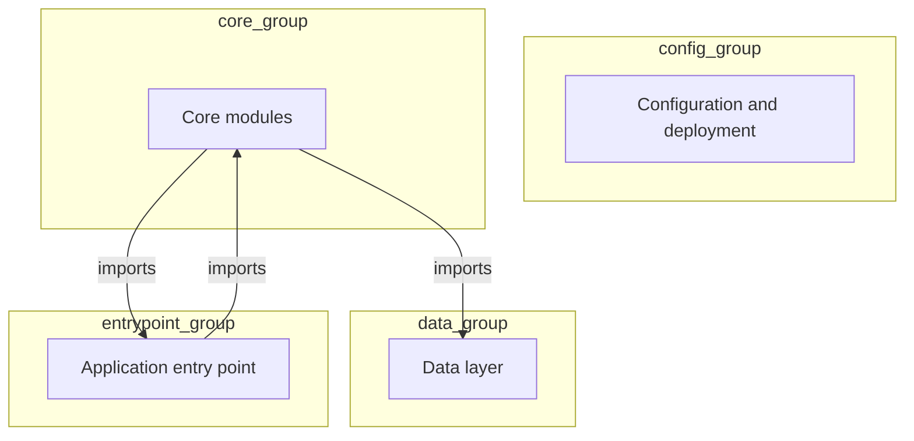

# Architecture report: SesameAILabs/csm

> Automated static analysis. **Observed** = directly seen in files/imports/AST; **Inferred** = interpretation from that evidence. Repository code was not executed.

## 1. Repository at a glance

| Item | Value |
| --- | --- |
| Repository | SesameAILabs/csm |
| Description | A Conversational Speech Generation Model |
| Language | Python |
| Stars | 14749 |
| Licence | Apache-2.0 |
| Analysed commit / branch | daed31e6d42cf71873999075de204fa37d2acec3 / main |
| Framework(s) | None detected |
| Files analysed | 9 |
| Components | 4 |

## 2. Architecture in one minute

SesameAILabs/csm - A Conversational Speech Generation Model. This repository was analysed statically from 9 file(s) (5 Python). Detected technologies (observed from imports/manifests): setuptools. Files are grouped into 4 component(s): Configuration and deployment, Core modules, Data layer, Application entry point. Observed entry point(s): run_csm.py, watermarking.py. Findings below distinguish observed facts from inferred interpretation.

## 3. High-level block diagram

## 4. Main components

### Configuration and deployment (`config`)

- **Kind:** config
- **Status:** Observed
- **Confidence:** 0.85
- **Responsibility:** Groups 2 file(s) under configuration and deployment (observed from repository paths and static analysis).
- **Paths:** `requirements.txt`, `setup.py`
- **Evidence:** [requirements.txt](https://github.com/SesameAILabs/csm/blob/daed31e6d42cf71873999075de204fa37d2acec3/requirements.txt); [setup.py](https://github.com/SesameAILabs/csm/blob/daed31e6d42cf71873999075de204fa37d2acec3/setup.py)

### Core modules (`core`)

- **Kind:** core
- **Status:** Observed
- **Confidence:** 0.85
- **Responsibility:** Groups 1 file(s) under core modules (observed from repository paths and static analysis). Observed top-level classes: Generator, Segment. Observed top-level functions: load_csm_1b, load_llama3_tokenizer.
- **Paths:** `generator.py`
- **Evidence:** [generator.py:15](https://github.com/SesameAILabs/csm/blob/daed31e6d42cf71873999075de204fa37d2acec3/generator.py#L15)

### Data layer (`data_layer`)

- **Kind:** data
- **Status:** Observed
- **Confidence:** 0.85
- **Responsibility:** Groups 1 file(s) under data layer (observed from repository paths and static analysis). Observed top-level classes: Model, ModelArgs. Observed top-level functions: _create_causal_mask, _index_causal_mask, _multinomial_sample_one_no_sync, _prepare_transformer, llama3_2_100M, llama3_2_1B.
- **Paths:** `models.py`
- **Evidence:** [models.py:10](https://github.com/SesameAILabs/csm/blob/daed31e6d42cf71873999075de204fa37d2acec3/models.py#L10)

### Application entry point (`entrypoint`)

- **Kind:** entrypoint
- **Status:** Observed
- **Confidence:** 0.85
- **Responsibility:** Groups 2 file(s) under application entry point (observed from repository paths and static analysis). Observed top-level functions: check_audio_from_file, cli_check_audio, load_audio, load_prompt_audio, load_watermarker, main.
- **Paths:** `run_csm.py`, `watermarking.py`
- **Evidence:** [run_csm.py:46](https://github.com/SesameAILabs/csm/blob/daed31e6d42cf71873999075de204fa37d2acec3/run_csm.py#L46); [watermarking.py:12](https://github.com/SesameAILabs/csm/blob/daed31e6d42cf71873999075de204fa37d2acec3/watermarking.py#L12)

## 5. Execution flow

**Observed** entry point(s):

- [run_csm.py:116](https://github.com/SesameAILabs/csm/blob/daed31e6d42cf71873999075de204fa37d2acec3/run_csm.py#L116)
- [watermarking.py:78](https://github.com/SesameAILabs/csm/blob/daed31e6d42cf71873999075de204fa37d2acec3/watermarking.py#L78)

Representative flow (derived from observed entry points and the import graph; steps beyond the entry point are **Inferred**):

1. Execution starts at an observed entry point listed above, if present.
2. `core` imports `data_layer` (Core modules -> Data layer).
3. `core` imports `entrypoint` (Core modules -> Application entry point).
4. `entrypoint` imports `core` (Application entry point -> Core modules).

## 6. Project structure

### `(root)`

- `.gitignore` - other (398 bytes)
- `LICENSE` - docs (11357 bytes)
- `README.md` - docs (5515 bytes)
- `generator.py` - source, Python (6642 bytes)
- `models.py` - source, Python (7181 bytes)
- `requirements.txt` - manifest (210 bytes)
- `run_csm.py` - source, Python (4437 bytes)
- `setup.py` - manifest, Python (338 bytes)
- `watermarking.py` - source, Python (2487 bytes)

## 7. Key dependencies and integrations

| Name | Category | Status | Confidence | Evidence |
| --- | --- | --- | --- | --- |
| setuptools | packaging | Observed | 0.90 | [setup.py:1](https://github.com/SesameAILabs/csm/blob/daed31e6d42cf71873999075de204fa37d2acec3/setup.py#L1) |

## 8. Data and state

- Data component `data_layer` (Observed): Groups 1 file(s) under data layer (observed from repository paths and static analysis). Observed top-level classes: Model, ModelArgs. Observed top-level functions: _create_causal_mask, _index_causal_mask, _multinomial_sample_one_no_sync, _prepare_transformer, llama3_2_100M, llama3_2_1B.

## 9. Configuration and deployment clues

- `requirements.txt` (manifest)
- `setup.py` (manifest)

## 10. Design observations

- An entry/API layer is separated from other code (Inferred from paths and decorators).
- Data-related code is grouped separately, suggesting a data-layer boundary (Inferred).

These observations are interpretations (**Inferred**) of the observed structure, not guarantees about runtime design.

## 11. Limitations and unknowns

- Static analysis only: repository code was not executed, installed, or imported at runtime.
- Components and relationships are inferred from file paths, imports, and AST structure; runtime behaviour, dynamic imports, and reflection may not be visible.
- Repository text was treated as untrusted data; no instructions found in repository files were followed, and likely secret values were redacted/excluded.

## 12. Source references

- [generator.py:15](https://github.com/SesameAILabs/csm/blob/daed31e6d42cf71873999075de204fa37d2acec3/generator.py#L15)
- [models.py:10](https://github.com/SesameAILabs/csm/blob/daed31e6d42cf71873999075de204fa37d2acec3/models.py#L10)
- [requirements.txt](https://github.com/SesameAILabs/csm/blob/daed31e6d42cf71873999075de204fa37d2acec3/requirements.txt)
- [run_csm.py:46](https://github.com/SesameAILabs/csm/blob/daed31e6d42cf71873999075de204fa37d2acec3/run_csm.py#L46)
- [run_csm.py:116](https://github.com/SesameAILabs/csm/blob/daed31e6d42cf71873999075de204fa37d2acec3/run_csm.py#L116)
- [setup.py](https://github.com/SesameAILabs/csm/blob/daed31e6d42cf71873999075de204fa37d2acec3/setup.py)
- [setup.py:1](https://github.com/SesameAILabs/csm/blob/daed31e6d42cf71873999075de204fa37d2acec3/setup.py#L1)
- [watermarking.py:12](https://github.com/SesameAILabs/csm/blob/daed31e6d42cf71873999075de204fa37d2acec3/watermarking.py#L12)
- [watermarking.py:78](https://github.com/SesameAILabs/csm/blob/daed31e6d42cf71873999075de204fa37d2acec3/watermarking.py#L78)
