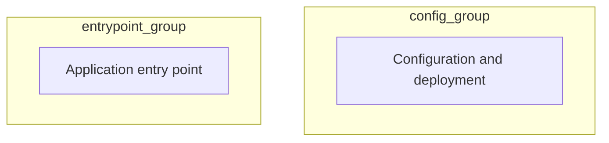

# Architecture report: ShangtongZhang/reinforcement-learning-an-introduction

> Automated static analysis. **Observed** = directly seen in files/imports/AST; **Inferred** = interpretation from that evidence. Repository code was not executed.

## 1. Repository at a glance

| Item | Value |
| --- | --- |
| Repository | ShangtongZhang/reinforcement-learning-an-introduction |
| Description | Python Implementation of Reinforcement Learning: An Introduction |
| Language | Python |
| Stars | 14805 |
| Licence | MIT |
| Analysed commit / branch | 96bc203617a70eba6b7784a8f876aaf218b2c914 / master |
| Framework(s) | None detected |
| Files analysed | 31 |
| Components | 2 |

## 2. Architecture in one minute

ShangtongZhang/reinforcement-learning-an-introduction - Python Implementation of Reinforcement Learning: An Introduction. This repository was analysed statically from 31 file(s) (26 Python). Detected technologies (observed from imports/manifests): NumPy, pandas. Files are grouped into 2 component(s): Configuration and deployment, Application entry point. Observed entry point(s): chapter01/tic_tac_toe.py, chapter02/ten_armed_testbed.py, chapter03/grid_world.py. Findings below distinguish observed facts from inferred interpretation.

## 3. High-level block diagram

## 4. Main components

### Configuration and deployment (`config`)

- **Kind:** config
- **Status:** Observed
- **Confidence:** 0.85
- **Responsibility:** Groups 1 file(s) under configuration and deployment (observed from repository paths and static analysis).
- **Paths:** `requirements.txt`
- **Evidence:** [requirements.txt](https://github.com/ShangtongZhang/reinforcement-learning-an-introduction/blob/96bc203617a70eba6b7784a8f876aaf218b2c914/requirements.txt)

### Application entry point (`entrypoint`)

- **Kind:** entrypoint
- **Status:** Observed
- **Confidence:** 0.85
- **Responsibility:** Groups 26 file(s) under application entry point (observed from repository paths and static analysis). Observed top-level classes: Bandit, BasesValueFunction, CartPole, CartPoleAgent, CartPoleEnvironment, DynaParams. Observed top-level functions: TDC, accumulating_trace, approximate, argmax, b_steps, batch_updating.
- **Paths:** `chapter01/tic_tac_toe.py`, `chapter02/ten_armed_testbed.py`, `chapter03/grid_world.py`, `chapter04/car_rental.py`, `chapter04/car_rental_synchronous.py`, `chapter04/gamblers_problem.py`, `chapter04/grid_world.py`, `chapter05/blackjack.py`, `chapter05/infinite_variance.py`, `chapter06/cliff_walking.py`, `chapter06/maximization_bias.py`, `chapter06/random_walk.py`, `chapter06/windy_grid_world.py`, `chapter07/random_walk.py`, `chapter08/expectation_vs_sample.py`, `chapter08/maze.py`, `chapter08/trajectory_sampling.py`, `chapter09/random_walk.py`, `chapter09/square_wave.py`, `chapter10/access_control.py`, `chapter10/mountain_car.py`, `chapter11/counterexample.py`, `chapter12/lambda_effect.py`, `chapter12/mountain_car.py`, `chapter12/random_walk.py`, `chapter13/short_corridor.py`
- **Evidence:** [chapter01/tic_tac_toe.py:19](https://github.com/ShangtongZhang/reinforcement-learning-an-introduction/blob/96bc203617a70eba6b7784a8f876aaf218b2c914/chapter01/tic_tac_toe.py#L19); [chapter02/ten_armed_testbed.py:19](https://github.com/ShangtongZhang/reinforcement-learning-an-introduction/blob/96bc203617a70eba6b7784a8f876aaf218b2c914/chapter02/ten_armed_testbed.py#L19); [chapter03/grid_world.py:34](https://github.com/ShangtongZhang/reinforcement-learning-an-introduction/blob/96bc203617a70eba6b7784a8f876aaf218b2c914/chapter03/grid_world.py#L34); [chapter04/car_rental.py:56](https://github.com/ShangtongZhang/reinforcement-learning-an-introduction/blob/96bc203617a70eba6b7784a8f876aaf218b2c914/chapter04/car_rental.py#L56); [chapter04/car_rental_synchronous.py:43](https://github.com/ShangtongZhang/reinforcement-learning-an-introduction/blob/96bc203617a70eba6b7784a8f876aaf218b2c914/chapter04/car_rental_synchronous.py#L43); [chapter04/gamblers_problem.py:25](https://github.com/ShangtongZhang/reinforcement-learning-an-introduction/blob/96bc203617a70eba6b7784a8f876aaf218b2c914/chapter04/gamblers_problem.py#L25); [chapter04/grid_world.py:25](https://github.com/ShangtongZhang/reinforcement-learning-an-introduction/blob/96bc203617a70eba6b7784a8f876aaf218b2c914/chapter04/grid_world.py#L25); [chapter05/blackjack.py:30](https://github.com/ShangtongZhang/reinforcement-learning-an-introduction/blob/96bc203617a70eba6b7784a8f876aaf218b2c914/chapter05/blackjack.py#L30)

## 5. Execution flow

**Observed** entry point(s):

- [chapter01/tic_tac_toe.py:343](https://github.com/ShangtongZhang/reinforcement-learning-an-introduction/blob/96bc203617a70eba6b7784a8f876aaf218b2c914/chapter01/tic_tac_toe.py#L343)
- [chapter02/ten_armed_testbed.py:238](https://github.com/ShangtongZhang/reinforcement-learning-an-introduction/blob/96bc203617a70eba6b7784a8f876aaf218b2c914/chapter02/ten_armed_testbed.py#L238)
- [chapter03/grid_world.py:192](https://github.com/ShangtongZhang/reinforcement-learning-an-introduction/blob/96bc203617a70eba6b7784a8f876aaf218b2c914/chapter03/grid_world.py#L192)
- [chapter04/car_rental.py:182](https://github.com/ShangtongZhang/reinforcement-learning-an-introduction/blob/96bc203617a70eba6b7784a8f876aaf218b2c914/chapter04/car_rental.py#L182)
- [chapter04/car_rental_synchronous.py:202](https://github.com/ShangtongZhang/reinforcement-learning-an-introduction/blob/96bc203617a70eba6b7784a8f876aaf218b2c914/chapter04/car_rental_synchronous.py#L202)
- [chapter04/gamblers_problem.py:82](https://github.com/ShangtongZhang/reinforcement-learning-an-introduction/blob/96bc203617a70eba6b7784a8f876aaf218b2c914/chapter04/gamblers_problem.py#L82)
- [chapter04/grid_world.py:106](https://github.com/ShangtongZhang/reinforcement-learning-an-introduction/blob/96bc203617a70eba6b7784a8f876aaf218b2c914/chapter04/grid_world.py#L106)
- [chapter05/blackjack.py:367](https://github.com/ShangtongZhang/reinforcement-learning-an-introduction/blob/96bc203617a70eba6b7784a8f876aaf218b2c914/chapter05/blackjack.py#L367)
- [chapter05/infinite_variance.py:59](https://github.com/ShangtongZhang/reinforcement-learning-an-introduction/blob/96bc203617a70eba6b7784a8f876aaf218b2c914/chapter05/infinite_variance.py#L59)
- [chapter06/cliff_walking.py:256](https://github.com/ShangtongZhang/reinforcement-learning-an-introduction/blob/96bc203617a70eba6b7784a8f876aaf218b2c914/chapter06/cliff_walking.py#L256)
- [chapter06/maximization_bias.py:129](https://github.com/ShangtongZhang/reinforcement-learning-an-introduction/blob/96bc203617a70eba6b7784a8f876aaf218b2c914/chapter06/maximization_bias.py#L129)
- [chapter06/random_walk.py:199](https://github.com/ShangtongZhang/reinforcement-learning-an-introduction/blob/96bc203617a70eba6b7784a8f876aaf218b2c914/chapter06/random_walk.py#L199)

Representative flow (derived from observed entry points and the import graph; steps beyond the entry point are **Inferred**):

1. Execution starts at an observed entry point listed above, if present.
2. No internal import relationships between components were observed.

## 6. Project structure

### `(root)`

- `.gitignore` - other (49 bytes)
- `.travis.yml` - ci, YAML (148 bytes)
- `LICENSE` - docs (1072 bytes)
- `README.md` - docs (10500 bytes)
- `requirements.txt` - manifest (36 bytes)

### `chapter01`

- `chapter01/tic_tac_toe.py` - source, Python (11069 bytes)

### `chapter02`

- `chapter02/ten_armed_testbed.py` - source, Python (9105 bytes)

### `chapter03`

- `chapter03/grid_world.py` - source, Python (6312 bytes)

### `chapter04`

- `chapter04/car_rental.py` - source, Python (7647 bytes)
- `chapter04/car_rental_synchronous.py` - source, Python (8747 bytes)
- `chapter04/gamblers_problem.py` - source, Python (2677 bytes)
- `chapter04/grid_world.py` - source, Python (3331 bytes)

### `chapter05`

- `chapter05/blackjack.py` - source, Python (13474 bytes)
- `chapter05/infinite_variance.py` - source, Python (1814 bytes)

### `chapter06`

- `chapter06/cliff_walking.py` - source, Python (9355 bytes)
- `chapter06/maximization_bias.py` - source, Python (4269 bytes)
- `chapter06/random_walk.py` - source, Python (6830 bytes)
- `chapter06/windy_grid_world.py` - source, Python (4018 bytes)

### `chapter07`

- `chapter07/random_walk.py` - source, Python (4222 bytes)

### `chapter08`

- `chapter08/expectation_vs_sample.py` - source, Python (1627 bytes)
- `chapter08/maze.py` - source, Python (23222 bytes)
- `chapter08/trajectory_sampling.py` - source, Python (4918 bytes)

### `chapter09`

- `chapter09/random_walk.py` - source, Python (15941 bytes)
- `chapter09/square_wave.py` - source, Python (4262 bytes)

### `chapter10`

- `chapter10/access_control.py` - source, Python (9605 bytes)
- `chapter10/mountain_car.py` - source, Python (13682 bytes)

### `chapter11`

- `chapter11/counterexample.py` - source, Python (11839 bytes)

### `chapter12`

- `chapter12/lambda_effect.py` - source, Python (46557 bytes)
- `chapter12/mountain_car.py` - source, Python (12140 bytes)
- `chapter12/random_walk.py` - source, Python (9637 bytes)

### `chapter13`

- `chapter13/short_corridor.py` - source, Python (8401 bytes)

## 7. Key dependencies and integrations

| Name | Category | Status | Confidence | Evidence |
| --- | --- | --- | --- | --- |
| NumPy | library | Observed | 0.95 | [chapter01/tic_tac_toe.py:11](https://github.com/ShangtongZhang/reinforcement-learning-an-introduction/blob/96bc203617a70eba6b7784a8f876aaf218b2c914/chapter01/tic_tac_toe.py#L11); [chapter02/ten_armed_testbed.py:13](https://github.com/ShangtongZhang/reinforcement-learning-an-introduction/blob/96bc203617a70eba6b7784a8f876aaf218b2c914/chapter02/ten_armed_testbed.py#L13); [chapter03/grid_world.py:11](https://github.com/ShangtongZhang/reinforcement-learning-an-introduction/blob/96bc203617a70eba6b7784a8f876aaf218b2c914/chapter03/grid_world.py#L11); [chapter04/car_rental.py:12](https://github.com/ShangtongZhang/reinforcement-learning-an-introduction/blob/96bc203617a70eba6b7784a8f876aaf218b2c914/chapter04/car_rental.py#L12) |
| pandas | library | Observed | 0.90 | [chapter12/lambda_effect.py:42](https://github.com/ShangtongZhang/reinforcement-learning-an-introduction/blob/96bc203617a70eba6b7784a8f876aaf218b2c914/chapter12/lambda_effect.py#L42) |

## 8. Data and state

No database, cache, queue, or persistent-state usage was observed in the analysed files. State handling, if any, may be in-memory or in files that were not analysed.

## 9. Configuration and deployment clues

- `.travis.yml` (ci)
- `requirements.txt` (manifest)

## 10. Design observations

- An entry/API layer is separated from other code (Inferred from paths and decorators).

These observations are interpretations (**Inferred**) of the observed structure, not guarantees about runtime design.

## 11. Limitations and unknowns

- Static analysis only: repository code was not executed, installed, or imported at runtime.
- Components and relationships are inferred from file paths, imports, and AST structure; runtime behaviour, dynamic imports, and reflection may not be visible.
- Repository text was treated as untrusted data; no instructions found in repository files were followed, and likely secret values were redacted/excluded.

## 12. Source references

- [chapter01/tic_tac_toe.py:11](https://github.com/ShangtongZhang/reinforcement-learning-an-introduction/blob/96bc203617a70eba6b7784a8f876aaf218b2c914/chapter01/tic_tac_toe.py#L11)
- [chapter01/tic_tac_toe.py:19](https://github.com/ShangtongZhang/reinforcement-learning-an-introduction/blob/96bc203617a70eba6b7784a8f876aaf218b2c914/chapter01/tic_tac_toe.py#L19)
- [chapter01/tic_tac_toe.py:343](https://github.com/ShangtongZhang/reinforcement-learning-an-introduction/blob/96bc203617a70eba6b7784a8f876aaf218b2c914/chapter01/tic_tac_toe.py#L343)
- [chapter02/ten_armed_testbed.py:13](https://github.com/ShangtongZhang/reinforcement-learning-an-introduction/blob/96bc203617a70eba6b7784a8f876aaf218b2c914/chapter02/ten_armed_testbed.py#L13)
- [chapter02/ten_armed_testbed.py:19](https://github.com/ShangtongZhang/reinforcement-learning-an-introduction/blob/96bc203617a70eba6b7784a8f876aaf218b2c914/chapter02/ten_armed_testbed.py#L19)
- [chapter02/ten_armed_testbed.py:238](https://github.com/ShangtongZhang/reinforcement-learning-an-introduction/blob/96bc203617a70eba6b7784a8f876aaf218b2c914/chapter02/ten_armed_testbed.py#L238)
- [chapter03/grid_world.py:11](https://github.com/ShangtongZhang/reinforcement-learning-an-introduction/blob/96bc203617a70eba6b7784a8f876aaf218b2c914/chapter03/grid_world.py#L11)
- [chapter03/grid_world.py:34](https://github.com/ShangtongZhang/reinforcement-learning-an-introduction/blob/96bc203617a70eba6b7784a8f876aaf218b2c914/chapter03/grid_world.py#L34)
- [chapter03/grid_world.py:192](https://github.com/ShangtongZhang/reinforcement-learning-an-introduction/blob/96bc203617a70eba6b7784a8f876aaf218b2c914/chapter03/grid_world.py#L192)
- [chapter04/car_rental.py:12](https://github.com/ShangtongZhang/reinforcement-learning-an-introduction/blob/96bc203617a70eba6b7784a8f876aaf218b2c914/chapter04/car_rental.py#L12)
- [chapter04/car_rental.py:56](https://github.com/ShangtongZhang/reinforcement-learning-an-introduction/blob/96bc203617a70eba6b7784a8f876aaf218b2c914/chapter04/car_rental.py#L56)
- [chapter04/car_rental.py:182](https://github.com/ShangtongZhang/reinforcement-learning-an-introduction/blob/96bc203617a70eba6b7784a8f876aaf218b2c914/chapter04/car_rental.py#L182)
- [chapter04/car_rental_synchronous.py:14](https://github.com/ShangtongZhang/reinforcement-learning-an-introduction/blob/96bc203617a70eba6b7784a8f876aaf218b2c914/chapter04/car_rental_synchronous.py#L14)
- [chapter04/car_rental_synchronous.py:43](https://github.com/ShangtongZhang/reinforcement-learning-an-introduction/blob/96bc203617a70eba6b7784a8f876aaf218b2c914/chapter04/car_rental_synchronous.py#L43)
- [chapter04/car_rental_synchronous.py:202](https://github.com/ShangtongZhang/reinforcement-learning-an-introduction/blob/96bc203617a70eba6b7784a8f876aaf218b2c914/chapter04/car_rental_synchronous.py#L202)
- [chapter04/gamblers_problem.py:11](https://github.com/ShangtongZhang/reinforcement-learning-an-introduction/blob/96bc203617a70eba6b7784a8f876aaf218b2c914/chapter04/gamblers_problem.py#L11)
- [chapter04/gamblers_problem.py:25](https://github.com/ShangtongZhang/reinforcement-learning-an-introduction/blob/96bc203617a70eba6b7784a8f876aaf218b2c914/chapter04/gamblers_problem.py#L25)
- [chapter04/gamblers_problem.py:82](https://github.com/ShangtongZhang/reinforcement-learning-an-introduction/blob/96bc203617a70eba6b7784a8f876aaf218b2c914/chapter04/gamblers_problem.py#L82)
- [chapter04/grid_world.py:11](https://github.com/ShangtongZhang/reinforcement-learning-an-introduction/blob/96bc203617a70eba6b7784a8f876aaf218b2c914/chapter04/grid_world.py#L11)
- [chapter04/grid_world.py:25](https://github.com/ShangtongZhang/reinforcement-learning-an-introduction/blob/96bc203617a70eba6b7784a8f876aaf218b2c914/chapter04/grid_world.py#L25)
- [chapter04/grid_world.py:106](https://github.com/ShangtongZhang/reinforcement-learning-an-introduction/blob/96bc203617a70eba6b7784a8f876aaf218b2c914/chapter04/grid_world.py#L106)
- [chapter05/blackjack.py:10](https://github.com/ShangtongZhang/reinforcement-learning-an-introduction/blob/96bc203617a70eba6b7784a8f876aaf218b2c914/chapter05/blackjack.py#L10)
- [chapter05/blackjack.py:30](https://github.com/ShangtongZhang/reinforcement-learning-an-introduction/blob/96bc203617a70eba6b7784a8f876aaf218b2c914/chapter05/blackjack.py#L30)
- [chapter05/blackjack.py:367](https://github.com/ShangtongZhang/reinforcement-learning-an-introduction/blob/96bc203617a70eba6b7784a8f876aaf218b2c914/chapter05/blackjack.py#L367)
- [chapter05/infinite_variance.py:59](https://github.com/ShangtongZhang/reinforcement-learning-an-introduction/blob/96bc203617a70eba6b7784a8f876aaf218b2c914/chapter05/infinite_variance.py#L59)
- [chapter06/cliff_walking.py:256](https://github.com/ShangtongZhang/reinforcement-learning-an-introduction/blob/96bc203617a70eba6b7784a8f876aaf218b2c914/chapter06/cliff_walking.py#L256)
- [chapter06/maximization_bias.py:129](https://github.com/ShangtongZhang/reinforcement-learning-an-introduction/blob/96bc203617a70eba6b7784a8f876aaf218b2c914/chapter06/maximization_bias.py#L129)
- [chapter06/random_walk.py:199](https://github.com/ShangtongZhang/reinforcement-learning-an-introduction/blob/96bc203617a70eba6b7784a8f876aaf218b2c914/chapter06/random_walk.py#L199)
- [chapter12/lambda_effect.py:42](https://github.com/ShangtongZhang/reinforcement-learning-an-introduction/blob/96bc203617a70eba6b7784a8f876aaf218b2c914/chapter12/lambda_effect.py#L42)
- [requirements.txt](https://github.com/ShangtongZhang/reinforcement-learning-an-introduction/blob/96bc203617a70eba6b7784a8f876aaf218b2c914/requirements.txt)
