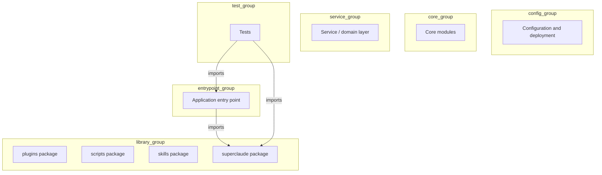

# Architecture report: SuperClaude-Org/SuperClaude_Framework

> Automated static analysis. **Observed** = directly seen in files/imports/AST; **Inferred** = interpretation from that evidence. Repository code was not executed.

## 1. Repository at a glance

| Item | Value |
| --- | --- |
| Repository | SuperClaude-Org/SuperClaude_Framework |
| Description | A configuration framework that enhances Claude Code with specialized commands, cognitive personas, and development methodologies. |
| Language | Python |
| Stars | 23937 |
| Licence | MIT |
| Analysed commit / branch | fe68862c8ed9e2afb8120c2d9e27d0c3a7ce73a2 / master |
| Framework(s) | None detected |
| Files analysed | 410 |
| Components | 9 |

## 2. Architecture in one minute

SuperClaude-Org/SuperClaude_Framework - A configuration framework that enhances Claude Code with specialized commands, cognitive personas, and development methodologies.. This repository was analysed statically from 410 file(s) (52 Python). Detected technologies (observed from imports/manifests): GitHub Actions, Click, Poetry, setuptools, pytest. Files are grouped into 9 component(s): Configuration and deployment, Core modules, Application entry point, plugins package, scripts package, Service / domain layer, skills package, superclaude package. Observed entry point(s): plugins/superclaude/scripts/clean_command_names.py, scripts/ab_test_workflows.py, scripts/analyze_workflow_metrics.py. Findings below distinguish observed facts from inferred interpretation.

## 3. High-level block diagram

## 4. Main components

### Configuration and deployment (`config`)

- **Kind:** config
- **Status:** Observed
- **Confidence:** 0.85
- **Responsibility:** Groups 28 file(s) under configuration and deployment (observed from repository paths and static analysis).
- **Paths:** `MANIFEST.in`, `PROJECT_INDEX.json`, `package.json`, `plugins/superclaude/.claude-plugin/plugin.json`, `plugins/superclaude/.mcp.json`, `plugins/superclaude/hooks/hooks.json`, `plugins/superclaude/mcp/configs/context7.json`, `plugins/superclaude/mcp/configs/magic.json`, `plugins/superclaude/mcp/configs/morphllm.json`, `plugins/superclaude/mcp/configs/playwright.json`, `plugins/superclaude/mcp/configs/sequential.json`, `plugins/superclaude/mcp/configs/serena-docker.json`, `plugins/superclaude/mcp/configs/serena.json`, `plugins/superclaude/mcp/configs/tavily.json`, `pyproject.toml`, `setup.py`, `src/superclaude/hooks/hooks.json`, `src/superclaude/mcp/configs/__init__.py`, `src/superclaude/mcp/configs/airis-agent.json`, `src/superclaude/mcp/configs/context7.json`, `src/superclaude/mcp/configs/magic.json`, `src/superclaude/mcp/configs/mindbase.json`, `src/superclaude/mcp/configs/morphllm.json`, `src/superclaude/mcp/configs/playwright.json`, `src/superclaude/mcp/configs/sequential.json`, `src/superclaude/mcp/configs/serena-docker.json`, `src/superclaude/mcp/configs/serena.json`, `src/superclaude/mcp/configs/tavily.json`
- **Evidence:** [MANIFEST.in](https://github.com/SuperClaude-Org/SuperClaude_Framework/blob/fe68862c8ed9e2afb8120c2d9e27d0c3a7ce73a2/MANIFEST.in); [PROJECT_INDEX.json](https://github.com/SuperClaude-Org/SuperClaude_Framework/blob/fe68862c8ed9e2afb8120c2d9e27d0c3a7ce73a2/PROJECT_INDEX.json); [package.json](https://github.com/SuperClaude-Org/SuperClaude_Framework/blob/fe68862c8ed9e2afb8120c2d9e27d0c3a7ce73a2/package.json); [plugins/superclaude/.claude-plugin/plugin.json](https://github.com/SuperClaude-Org/SuperClaude_Framework/blob/fe68862c8ed9e2afb8120c2d9e27d0c3a7ce73a2/plugins/superclaude/.claude-plugin/plugin.json); [plugins/superclaude/.mcp.json](https://github.com/SuperClaude-Org/SuperClaude_Framework/blob/fe68862c8ed9e2afb8120c2d9e27d0c3a7ce73a2/plugins/superclaude/.mcp.json); [plugins/superclaude/hooks/hooks.json](https://github.com/SuperClaude-Org/SuperClaude_Framework/blob/fe68862c8ed9e2afb8120c2d9e27d0c3a7ce73a2/plugins/superclaude/hooks/hooks.json); [plugins/superclaude/mcp/configs/context7.json](https://github.com/SuperClaude-Org/SuperClaude_Framework/blob/fe68862c8ed9e2afb8120c2d9e27d0c3a7ce73a2/plugins/superclaude/mcp/configs/context7.json); [plugins/superclaude/mcp/configs/magic.json](https://github.com/SuperClaude-Org/SuperClaude_Framework/blob/fe68862c8ed9e2afb8120c2d9e27d0c3a7ce73a2/plugins/superclaude/mcp/configs/magic.json)

### Core modules (`core`)

- **Kind:** core
- **Status:** Observed
- **Confidence:** 0.85
- **Responsibility:** Groups 1 file(s) under core modules (observed from repository paths and static analysis).
- **Paths:** `install.sh`
- **Evidence:** [install.sh](https://github.com/SuperClaude-Org/SuperClaude_Framework/blob/fe68862c8ed9e2afb8120c2d9e27d0c3a7ce73a2/install.sh)

### Application entry point (`entrypoint`)

- **Kind:** entrypoint
- **Status:** Observed
- **Confidence:** 0.85
- **Responsibility:** Groups 8 file(s) under application entry point (observed from repository paths and static analysis). Observed top-level classes: ABTestAnalyzer, ContentTransformer, ExecutionPlan, FileSyncer, FrameworkSyncer, McpMerger. Observed top-level functions: clean_name_attributes, copy_tree, doctor, example_dependent_tasks, example_parallel_read, find_project_root.
- **Paths:** `plugins/superclaude/scripts/clean_command_names.py`, `scripts/ab_test_workflows.py`, `scripts/analyze_workflow_metrics.py`, `scripts/build_superclaude_plugin.py`, `scripts/sync_from_framework.py`, `src/superclaude/cli/main.py`, `src/superclaude/execution/parallel.py`, `src/superclaude/scripts/clean_command_names.py`
- **Evidence:** [plugins/superclaude/scripts/clean_command_names.py:23](https://github.com/SuperClaude-Org/SuperClaude_Framework/blob/fe68862c8ed9e2afb8120c2d9e27d0c3a7ce73a2/plugins/superclaude/scripts/clean_command_names.py#L23); [scripts/ab_test_workflows.py:23](https://github.com/SuperClaude-Org/SuperClaude_Framework/blob/fe68862c8ed9e2afb8120c2d9e27d0c3a7ce73a2/scripts/ab_test_workflows.py#L23); [scripts/analyze_workflow_metrics.py:22](https://github.com/SuperClaude-Org/SuperClaude_Framework/blob/fe68862c8ed9e2afb8120c2d9e27d0c3a7ce73a2/scripts/analyze_workflow_metrics.py#L22); [scripts/build_superclaude_plugin.py:21](https://github.com/SuperClaude-Org/SuperClaude_Framework/blob/fe68862c8ed9e2afb8120c2d9e27d0c3a7ce73a2/scripts/build_superclaude_plugin.py#L21); [scripts/sync_from_framework.py:42](https://github.com/SuperClaude-Org/SuperClaude_Framework/blob/fe68862c8ed9e2afb8120c2d9e27d0c3a7ce73a2/scripts/sync_from_framework.py#L42); [src/superclaude/cli/main.py:17](https://github.com/SuperClaude-Org/SuperClaude_Framework/blob/fe68862c8ed9e2afb8120c2d9e27d0c3a7ce73a2/src/superclaude/cli/main.py#L17); [src/superclaude/execution/parallel.py:21](https://github.com/SuperClaude-Org/SuperClaude_Framework/blob/fe68862c8ed9e2afb8120c2d9e27d0c3a7ce73a2/src/superclaude/execution/parallel.py#L21); [src/superclaude/scripts/clean_command_names.py:23](https://github.com/SuperClaude-Org/SuperClaude_Framework/blob/fe68862c8ed9e2afb8120c2d9e27d0c3a7ce73a2/src/superclaude/scripts/clean_command_names.py#L23)

### plugins package (`plugins`)

- **Kind:** library
- **Status:** Observed
- **Confidence:** 0.85
- **Responsibility:** Groups 2 file(s) under plugins package (observed from repository paths and static analysis).
- **Paths:** `plugins/superclaude/scripts/session-init.sh`, `plugins/superclaude/skills/confidence-check/confidence.ts`
- **Evidence:** [plugins/superclaude/scripts/session-init.sh](https://github.com/SuperClaude-Org/SuperClaude_Framework/blob/fe68862c8ed9e2afb8120c2d9e27d0c3a7ce73a2/plugins/superclaude/scripts/session-init.sh); [plugins/superclaude/skills/confidence-check/confidence.ts](https://github.com/SuperClaude-Org/SuperClaude_Framework/blob/fe68862c8ed9e2afb8120c2d9e27d0c3a7ce73a2/plugins/superclaude/skills/confidence-check/confidence.ts)

### scripts package (`scripts`)

- **Kind:** library
- **Status:** Observed
- **Confidence:** 0.85
- **Responsibility:** Groups 3 file(s) under scripts package (observed from repository paths and static analysis).
- **Paths:** `scripts/cleanup.sh`, `scripts/publish.sh`, `scripts/uninstall_legacy.sh`
- **Evidence:** [scripts/cleanup.sh](https://github.com/SuperClaude-Org/SuperClaude_Framework/blob/fe68862c8ed9e2afb8120c2d9e27d0c3a7ce73a2/scripts/cleanup.sh); [scripts/publish.sh](https://github.com/SuperClaude-Org/SuperClaude_Framework/blob/fe68862c8ed9e2afb8120c2d9e27d0c3a7ce73a2/scripts/publish.sh); [scripts/uninstall_legacy.sh](https://github.com/SuperClaude-Org/SuperClaude_Framework/blob/fe68862c8ed9e2afb8120c2d9e27d0c3a7ce73a2/scripts/uninstall_legacy.sh)

### Service / domain layer (`service_layer`)

- **Kind:** service
- **Status:** Observed
- **Confidence:** 0.85
- **Responsibility:** Groups 1 file(s) under service / domain layer (observed from repository paths and static analysis).
- **Paths:** `src/superclaude/core/__init__.py`
- **Evidence:** [src/superclaude/core/__init__.py](https://github.com/SuperClaude-Org/SuperClaude_Framework/blob/fe68862c8ed9e2afb8120c2d9e27d0c3a7ce73a2/src/superclaude/core/__init__.py)

### skills package (`skills`)

- **Kind:** library
- **Status:** Observed
- **Confidence:** 0.85
- **Responsibility:** Groups 1 file(s) under skills package (observed from repository paths and static analysis).
- **Paths:** `skills/confidence-check/confidence.ts`
- **Evidence:** [skills/confidence-check/confidence.ts](https://github.com/SuperClaude-Org/SuperClaude_Framework/blob/fe68862c8ed9e2afb8120c2d9e27d0c3a7ce73a2/skills/confidence-check/confidence.ts)

### superclaude package (`superclaude`)

- **Kind:** library
- **Status:** Observed
- **Confidence:** 0.85
- **Responsibility:** Groups 27 file(s) under superclaude package (observed from repository paths and static analysis). Observed top-level classes: ConfidenceChecker, ConfidenceScore, FailureEntry, ReflectionEngine, ReflectionResult, ReflexionPattern. Observed top-level functions: _check_configuration, _check_pytest_plugin, _check_skills_installed, _get_agents_source, _get_commands_source, _get_skill_source.
- **Paths:** `src/superclaude/__init__.py`, `src/superclaude/__version__.py`, `src/superclaude/agents/__init__.py`, `src/superclaude/cli/__init__.py`, `src/superclaude/cli/doctor.py`, `src/superclaude/cli/install_commands.py`, `src/superclaude/cli/install_mcp.py`, `src/superclaude/cli/install_skill.py`, `src/superclaude/commands/__init__.py`, `src/superclaude/examples/__init__.py`, `src/superclaude/execution/__init__.py`, `src/superclaude/execution/reflection.py`, `src/superclaude/execution/self_correction.py`, `src/superclaude/hooks/__init__.py`, `src/superclaude/mcp/__init__.py`, `src/superclaude/modes/__init__.py`, `src/superclaude/pm_agent/__init__.py`, `src/superclaude/pm_agent/confidence.py`, `src/superclaude/pm_agent/reflexion.py`, `src/superclaude/pm_agent/self_check.py`, `src/superclaude/pm_agent/token_budget.py`, `src/superclaude/pytest_plugin.py`, `src/superclaude/scripts/__init__.py`, `src/superclaude/scripts/session-init.sh`, `src/superclaude/skills/__init__.py`, `src/superclaude/skills/confidence-check/__init__.py`, `src/superclaude/skills/confidence-check/confidence.ts`
- **Evidence:** [src/superclaude/__init__.py](https://github.com/SuperClaude-Org/SuperClaude_Framework/blob/fe68862c8ed9e2afb8120c2d9e27d0c3a7ce73a2/src/superclaude/__init__.py); [src/superclaude/__version__.py](https://github.com/SuperClaude-Org/SuperClaude_Framework/blob/fe68862c8ed9e2afb8120c2d9e27d0c3a7ce73a2/src/superclaude/__version__.py); [src/superclaude/agents/__init__.py](https://github.com/SuperClaude-Org/SuperClaude_Framework/blob/fe68862c8ed9e2afb8120c2d9e27d0c3a7ce73a2/src/superclaude/agents/__init__.py); [src/superclaude/cli/__init__.py](https://github.com/SuperClaude-Org/SuperClaude_Framework/blob/fe68862c8ed9e2afb8120c2d9e27d0c3a7ce73a2/src/superclaude/cli/__init__.py); [src/superclaude/cli/doctor.py:11](https://github.com/SuperClaude-Org/SuperClaude_Framework/blob/fe68862c8ed9e2afb8120c2d9e27d0c3a7ce73a2/src/superclaude/cli/doctor.py#L11); [src/superclaude/cli/install_commands.py:12](https://github.com/SuperClaude-Org/SuperClaude_Framework/blob/fe68862c8ed9e2afb8120c2d9e27d0c3a7ce73a2/src/superclaude/cli/install_commands.py#L12); [src/superclaude/cli/install_mcp.py:101](https://github.com/SuperClaude-Org/SuperClaude_Framework/blob/fe68862c8ed9e2afb8120c2d9e27d0c3a7ce73a2/src/superclaude/cli/install_mcp.py#L101); [src/superclaude/cli/install_skill.py:12](https://github.com/SuperClaude-Org/SuperClaude_Framework/blob/fe68862c8ed9e2afb8120c2d9e27d0c3a7ce73a2/src/superclaude/cli/install_skill.py#L12)

### Tests (`tests`)

- **Kind:** test
- **Status:** Observed
- **Confidence:** 0.85
- **Responsibility:** Groups 22 file(s) under tests (observed from repository paths and static analysis). Observed top-level classes: TestConfidenceChecker, TestConvenienceFunctions, TestFailureEntry, TestInstallCommands, TestInstallCommandsEdgeCases, TestIntelligentExecute. Observed top-level functions: correction_engine, engine_with_history, engine_with_mistakes, failing_implementation, low_confidence_context, reflection_engine.
- **Paths:** `TEST_PLUGIN.md`, `docs/mistakes/test_database_connection-2025-11-11.md`, `docs/mistakes/test_database_connection-2025-11-14.md`, `docs/mistakes/test_database_connection-2026-03-22.md`, `docs/mistakes/test_reflexion_with_real_exception-2025-11-11.md`, `docs/mistakes/test_reflexion_with_real_exception-2025-11-14.md`, `docs/mistakes/test_reflexion_with_real_exception-2026-03-22.md`, `tests/__init__.py`, `tests/conftest.py`, `tests/integration/__init__.py`, `tests/integration/test_execution_engine.py`, `tests/integration/test_pytest_plugin.py`, `tests/unit/__init__.py`, `tests/unit/test_cli_install.py`, `tests/unit/test_confidence.py`, `tests/unit/test_install_mcp_registry.py`, `tests/unit/test_parallel.py`, `tests/unit/test_reflection.py`, `tests/unit/test_reflexion.py`, `tests/unit/test_self_check.py`, `tests/unit/test_self_correction.py`, `tests/unit/test_token_budget.py`
- **Evidence:** [TEST_PLUGIN.md](https://github.com/SuperClaude-Org/SuperClaude_Framework/blob/fe68862c8ed9e2afb8120c2d9e27d0c3a7ce73a2/TEST_PLUGIN.md); [docs/mistakes/test_database_connection-2025-11-11.md](https://github.com/SuperClaude-Org/SuperClaude_Framework/blob/fe68862c8ed9e2afb8120c2d9e27d0c3a7ce73a2/docs/mistakes/test_database_connection-2025-11-11.md); [docs/mistakes/test_database_connection-2025-11-14.md](https://github.com/SuperClaude-Org/SuperClaude_Framework/blob/fe68862c8ed9e2afb8120c2d9e27d0c3a7ce73a2/docs/mistakes/test_database_connection-2025-11-14.md); [docs/mistakes/test_database_connection-2026-03-22.md](https://github.com/SuperClaude-Org/SuperClaude_Framework/blob/fe68862c8ed9e2afb8120c2d9e27d0c3a7ce73a2/docs/mistakes/test_database_connection-2026-03-22.md); [docs/mistakes/test_reflexion_with_real_exception-2025-11-11.md](https://github.com/SuperClaude-Org/SuperClaude_Framework/blob/fe68862c8ed9e2afb8120c2d9e27d0c3a7ce73a2/docs/mistakes/test_reflexion_with_real_exception-2025-11-11.md); [docs/mistakes/test_reflexion_with_real_exception-2025-11-14.md](https://github.com/SuperClaude-Org/SuperClaude_Framework/blob/fe68862c8ed9e2afb8120c2d9e27d0c3a7ce73a2/docs/mistakes/test_reflexion_with_real_exception-2025-11-14.md); [docs/mistakes/test_reflexion_with_real_exception-2026-03-22.md](https://github.com/SuperClaude-Org/SuperClaude_Framework/blob/fe68862c8ed9e2afb8120c2d9e27d0c3a7ce73a2/docs/mistakes/test_reflexion_with_real_exception-2026-03-22.md); [tests/__init__.py](https://github.com/SuperClaude-Org/SuperClaude_Framework/blob/fe68862c8ed9e2afb8120c2d9e27d0c3a7ce73a2/tests/__init__.py)

## 5. Execution flow

**Observed** entry point(s):

- [plugins/superclaude/scripts/clean_command_names.py:166](https://github.com/SuperClaude-Org/SuperClaude_Framework/blob/fe68862c8ed9e2afb8120c2d9e27d0c3a7ce73a2/plugins/superclaude/scripts/clean_command_names.py#L166)
- [scripts/ab_test_workflows.py:309](https://github.com/SuperClaude-Org/SuperClaude_Framework/blob/fe68862c8ed9e2afb8120c2d9e27d0c3a7ce73a2/scripts/ab_test_workflows.py#L309)
- [scripts/analyze_workflow_metrics.py:330](https://github.com/SuperClaude-Org/SuperClaude_Framework/blob/fe68862c8ed9e2afb8120c2d9e27d0c3a7ce73a2/scripts/analyze_workflow_metrics.py#L330)
- [scripts/build_superclaude_plugin.py:96](https://github.com/SuperClaude-Org/SuperClaude_Framework/blob/fe68862c8ed9e2afb8120c2d9e27d0c3a7ce73a2/scripts/build_superclaude_plugin.py#L96)
- [scripts/sync_from_framework.py:958](https://github.com/SuperClaude-Org/SuperClaude_Framework/blob/fe68862c8ed9e2afb8120c2d9e27d0c3a7ce73a2/scripts/sync_from_framework.py#L958)
- [src/superclaude/cli/main.py](https://github.com/SuperClaude-Org/SuperClaude_Framework/blob/fe68862c8ed9e2afb8120c2d9e27d0c3a7ce73a2/src/superclaude/cli/main.py)
- [src/superclaude/execution/parallel.py:334](https://github.com/SuperClaude-Org/SuperClaude_Framework/blob/fe68862c8ed9e2afb8120c2d9e27d0c3a7ce73a2/src/superclaude/execution/parallel.py#L334)
- [src/superclaude/scripts/clean_command_names.py:167](https://github.com/SuperClaude-Org/SuperClaude_Framework/blob/fe68862c8ed9e2afb8120c2d9e27d0c3a7ce73a2/src/superclaude/scripts/clean_command_names.py#L167)

Representative flow (derived from observed entry points and the import graph; steps beyond the entry point are **Inferred**):

1. Execution starts at an observed entry point listed above, if present.
2. `entrypoint` imports `superclaude` (Application entry point -> superclaude package).
3. `tests` imports `entrypoint` (Tests -> Application entry point).
4. `tests` imports `superclaude` (Tests -> superclaude package).

## 6. Project structure

### `(root)`

- `.env.example` - config (427 bytes)
- `.gitignore` - other (1949 bytes)
- `.pre-commit-config.yaml` - config (2882 bytes)
- `AGENTS.md` - docs (2860 bytes)
- `CHANGELOG.md` - docs (12734 bytes)
- `CLAUDE.md` - docs (12982 bytes)
- `CODEOWNERS` - other (21 bytes)
- `CODE_OF_CONDUCT.md` - docs (28173 bytes)
- `CONTRIBUTING.md` - docs (17655 bytes)
- `DELETION_RATIONALE.md` - docs (10842 bytes)
- `KNOWLEDGE.md` - docs (17004 bytes)
- `LICENSE` - docs (1090 bytes)
- `MANIFEST.in` - manifest (1388 bytes)
- `Makefile` - other (5280 bytes)
- `PARALLEL_INDEXING_PLAN.md` - docs (4475 bytes)
- `PLANNING.md` - docs (11936 bytes)
- `PLUGIN_INSTALL.md` - docs (3983 bytes)
- `PROJECT_INDEX.json` - config (7273 bytes)
- `PROJECT_INDEX.md` - docs (9992 bytes)
- `PR_DOCUMENTATION.md` - docs (7956 bytes)
- `QUALITY_COMPARISON.md` - docs (6737 bytes)
- `README-ja.md` - docs (20445 bytes)
- `README-kr.md` - docs (18295 bytes)
- `README-zh.md` - docs (15894 bytes)
- `README.md` - docs (19554 bytes)
- `SECURITY.md` - docs (33080 bytes)
- `TASK.md` - docs (9707 bytes)
- `TEST_PLUGIN.md` - test (1267 bytes)
- `VERSION` - other (6 bytes)
- `install.sh` - source, Shell (10853 bytes)
- `package.json` - manifest (1340 bytes)
- `pyproject.toml` - manifest (4225 bytes)
- `setup.py` - manifest, Python (283 bytes)

### `.claude`

- `.claude/settings.json` - config (3 bytes)
- `.claude/skills/confidence-check/SKILL.md` - docs (3365 bytes)
- `.claude/skills/confidence-check/confidence.ts` - source, TypeScript (5052 bytes)

### `.github`

- `.github/FUNDING.yml` - config (799 bytes)
- `.github/PULL_REQUEST_TEMPLATE.md` - docs (1407 bytes)
- `.github/workflows/README.md` - ci, YAML (5284 bytes)
- `.github/workflows/publish-pypi.yml` - ci, YAML (5750 bytes)
- `.github/workflows/pull-sync-framework.yml` - ci, YAML (5380 bytes)
- `.github/workflows/quick-check.yml` - ci, YAML (1242 bytes)
- `.github/workflows/readme-quality-check.yml` - ci, YAML (13923 bytes)
- `.github/workflows/test.yml` - ci, YAML (4616 bytes)

### `docs`

- `docs/Development/ARCHITECTURE.md` - docs (15496 bytes)
- `docs/Development/PROJECT_STATUS.md` - docs (4362 bytes)
- `docs/Development/ROADMAP.md` - docs (11098 bytes)
- `docs/Development/TASKS.md` - docs (3790 bytes)
- `docs/Development/hypothesis-pm-autonomous-enhancement-2025-10-14.md` - docs (10446 bytes)
- `docs/Development/installation-flow-understanding.md` - docs (8945 bytes)
- `docs/Development/pm-agent-ideal-workflow.md` - docs (9798 bytes)
- `docs/Development/pm-agent-integration.md` - docs (11426 bytes)
- `docs/Development/project-structure-understanding.md` - docs (9418 bytes)
- `docs/Development/tasks/current-tasks.md` - docs (4895 bytes)
- `docs/PR_STRATEGY.md` - docs (10195 bytes)
- `docs/README.md` - docs (5555 bytes)
- `docs/Templates/__init__.py` - docs (0 bytes)
- `docs/agents/pm-agent-guide.md` - docs (9098 bytes)
- `docs/architecture/CONTEXT_WINDOW_ANALYSIS.md` - docs (9995 bytes)
- `docs/architecture/MIGRATION_TO_CLEAN_ARCHITECTURE.md` - docs (19041 bytes)
- `docs/architecture/PHASE_1_COMPLETE.md` - docs (7904 bytes)
- `docs/architecture/PHASE_2_COMPLETE.md` - docs (7277 bytes)
- `docs/architecture/PHASE_3_COMPLETE.md` - docs (13249 bytes)
- `docs/architecture/PM_AGENT_COMPARISON.md` - docs (12657 bytes)
- `docs/architecture/SKILLS_CLEANUP.md` - docs (5200 bytes)
- `docs/architecture/pm-agent-auto-activation.md` - docs (12971 bytes)
- `docs/architecture/pm-agent-responsibility-cleanup.md` - docs (8945 bytes)
- `docs/capability-mapping-v5.md` - docs (9263 bytes)
- `docs/developer-guide/README.md` - docs (8333 bytes)
- `docs/developer-guide/contributing-code.md` - docs (12053 bytes)
- `docs/developer-guide/documentation-index.md` - docs (12047 bytes)
- `docs/developer-guide/technical-architecture.md` - docs (13073 bytes)
- `docs/developer-guide/testing-debugging.md` - docs (8136 bytes)
- `docs/getting-started/installation.md` - docs (10221 bytes)
- `docs/getting-started/quick-start.md` - docs (10777 bytes)
- `docs/getting-started/windows-installation.md` - docs (4208 bytes)
- `docs/mcp/mcp-integration-policy.md` - docs (13412 bytes)
- `docs/mcp/mcp-optional-design.md` - docs (10313 bytes)
- `docs/memory/README.md` - docs (7300 bytes)
- `docs/memory/WORKFLOW_METRICS_SCHEMA.md` - docs (10779 bytes)
- `docs/memory/last_session.md` - docs (8666 bytes)
- `docs/memory/next_actions.md` - docs (7025 bytes)
- `docs/memory/patterns_learned.jsonl` - docs (132 bytes)
- `docs/memory/pm_context.md` - docs (4009 bytes)
- `docs/memory/reflexion.jsonl.example` - docs (7312 bytes)
- `docs/memory/solutions_learned.jsonl` - docs (23235 bytes)
- `docs/memory/token_efficiency_validation.md` - docs (6716 bytes)
- `docs/memory/workflow_metrics.jsonl` - docs (443 bytes)
- `docs/mistakes/test_database_connection-2025-11-11.md` - test (435 bytes)
- `docs/mistakes/test_database_connection-2025-11-14.md` - test (435 bytes)
- `docs/mistakes/test_database_connection-2026-03-22.md` - test (435 bytes)
- `docs/mistakes/test_reflexion_with_real_exception-2025-11-11.md` - test (432 bytes)
- `docs/mistakes/test_reflexion_with_real_exception-2025-11-14.md` - test (432 bytes)
- `docs/mistakes/test_reflexion_with_real_exception-2026-03-22.md` - test (432 bytes)
- `docs/mistakes/unknown-2025-11-11.md` - docs (392 bytes)
- `docs/mistakes/unknown-2025-11-14.md` - docs (392 bytes)
- `docs/mistakes/unknown-2026-03-22.md` - docs (392 bytes)
- `docs/next-refactor-plan.md` - docs (9983 bytes)
- `docs/plugin-reorg.md` - docs (2668 bytes)
- `docs/pm-agent-implementation-status.md` - docs (10146 bytes)
- `docs/reference/README.md` - docs (11057 bytes)
- `docs/reference/advanced-patterns.md` - docs (8695 bytes)
- `docs/reference/advanced-workflows.md` - docs (8135 bytes)
- `docs/reference/basic-examples.md` - docs (17274 bytes)
- `docs/reference/claude-code-history-management.md` - docs (16820 bytes)
- `docs/reference/commands-list.md` - docs (2416 bytes)
- `docs/reference/common-issues.md` - docs (1786 bytes)
- `docs/reference/comprehensive-features.md` - docs (6101 bytes)
- `docs/reference/diagnostic-reference.md` - docs (8797 bytes)
- `docs/reference/examples-cookbook.md` - docs (9055 bytes)
- `docs/reference/integration-patterns.md` - docs (8375 bytes)
- `docs/reference/mcp-server-guide.md` - docs (20576 bytes)
- `docs/reference/pm-agent-autonomous-reflection.md` - docs (18231 bytes)
- `docs/reference/suggested-commands.md` - docs (2883 bytes)
- `docs/reference/troubleshooting.md` - docs (2964 bytes)
- `docs/research/complete-python-skills-migration.md` - docs (27501 bytes)
- `docs/research/intelligent-execution-architecture.md` - docs (15260 bytes)
- `docs/research/llm-agent-token-efficiency-2025.md` - docs (10778 bytes)
- `docs/research/markdown-to-python-migration-plan.md` - docs (11191 bytes)
- `docs/research/mcp-installer-fix-summary.md` - docs (4261 bytes)
- `docs/research/parallel-execution-complete-findings.md` - docs (18645 bytes)
- `docs/research/parallel-execution-findings.md` - docs (10896 bytes)
- `docs/research/phase1-implementation-strategy.md` - docs (10426 bytes)
- `docs/research/pm-mode-performance-analysis.md` - docs (9195 bytes)
- `docs/research/pm-mode-validation-methodology.md` - docs (9798 bytes)
- `docs/research/pm-skills-migration-results.md` - docs (6411 bytes)
- `docs/research/pm_agent_roi_analysis_2025-10-21.md` - docs (8413 bytes)
- `docs/research/python_src_layout_research_20251021.md` - docs (7514 bytes)
- `docs/research/reflexion-integration-2025.md` - docs (8085 bytes)
- `docs/research/repository-understanding-proposal.md` - docs (13147 bytes)
- `docs/research/research_git_branch_integration_2025.md` - docs (8292 bytes)
- `docs/research/research_installer_improvements_20251017.md` - docs (28667 bytes)
- `docs/research/research_oss_fork_workflow_2025.md` - docs (11504 bytes)
- `docs/research/research_python_directory_naming_20251015.md` - docs (12514 bytes)
- `docs/research/research_python_directory_naming_automation_2025.md` - docs (23482 bytes)
- `docs/research/research_repository_scoped_memory_2025-10-16.md` - docs (17737 bytes)
- `docs/research/research_serena_mcp_2025-01-16.md` - docs (12926 bytes)
- `docs/research/skills-migration-test.md` - docs (2991 bytes)
- `docs/research/task-tool-parallel-execution-results.md` - docs (11782 bytes)
- `docs/sessions/2025-10-14-summary.md` - docs (2111 bytes)
- `docs/testing/pm-workflow-test-results.md` - docs (2478 bytes)
- `docs/testing/procedures.md` - docs (2841 bytes)
- `docs/troubleshooting/serena-installation.md` - docs (3351 bytes)
- `docs/user-guide-jp/agents.md` - docs (60114 bytes)
- `docs/user-guide-jp/commands.md` - docs (20102 bytes)
- `docs/user-guide-jp/flags.md` - docs (17647 bytes)
- `docs/user-guide-jp/mcp-servers.md` - docs (12407 bytes)
- `docs/user-guide-jp/modes.md` - docs (36769 bytes)
- `docs/user-guide-jp/session-management.md` - docs (18472 bytes)
- `docs/user-guide-kr/agents.md` - docs (43477 bytes)
- `docs/user-guide-kr/commands.md` - docs (16310 bytes)
- `docs/user-guide-kr/flags.md` - docs (11473 bytes)
- `docs/user-guide-kr/mcp-servers.md` - docs (11139 bytes)
- `docs/user-guide-kr/modes.md` - docs (29397 bytes)
- `docs/user-guide-kr/session-management.md` - docs (11566 bytes)
- `docs/user-guide-zh/agents.md` - docs (34333 bytes)
- `docs/user-guide-zh/commands.md` - docs (11328 bytes)
- `docs/user-guide-zh/flags.md` - docs (10442 bytes)
- `docs/user-guide-zh/mcp-servers.md` - docs (7660 bytes)
- `docs/user-guide-zh/modes.md` - docs (22656 bytes)
- `docs/user-guide-zh/session-management.md` - docs (9326 bytes)
- `docs/user-guide/agents.md` - docs (45103 bytes)
- `docs/user-guide/claude-code-integration.md` - docs (12058 bytes)
- `docs/user-guide/commands.md` - docs (52159 bytes)
- `docs/user-guide/flags.md` - docs (11349 bytes)
- `docs/user-guide/mcp-installation.md` - docs (5838 bytes)
- `docs/user-guide/mcp-servers.md` - docs (12012 bytes)
- `docs/user-guide/memory-system.md` - docs (8384 bytes)
- `docs/user-guide/modes.md` - docs (28371 bytes)
- `docs/user-guide/session-management.md` - docs (10940 bytes)

### `plugins`

- `plugins/superclaude/.claude-plugin/plugin.json` - config (841 bytes)
- `plugins/superclaude/.mcp.json` - config (260 bytes)
- `plugins/superclaude/README.md` - docs (2061 bytes)
- `plugins/superclaude/agents/backend-architect.md` - docs (2346 bytes)
- `plugins/superclaude/agents/business-panel-experts.md` - docs (9822 bytes)
- `plugins/superclaude/agents/deep-research-agent.md` - docs (4702 bytes)
- `plugins/superclaude/agents/deep-research.md` - docs (1373 bytes)
- `plugins/superclaude/agents/devops-architect.md` - docs (2534 bytes)
- `plugins/superclaude/agents/frontend-architect.md` - docs (2402 bytes)
- `plugins/superclaude/agents/learning-guide.md` - docs (2982 bytes)
- `plugins/superclaude/agents/performance-engineer.md` - docs (2700 bytes)
- `plugins/superclaude/agents/pm-agent.md` - docs (22176 bytes)
- `plugins/superclaude/agents/python-expert.md` - docs (3127 bytes)
- `plugins/superclaude/agents/quality-engineer.md` - docs (2787 bytes)
- `plugins/superclaude/agents/refactoring-expert.md` - docs (2946 bytes)
- `plugins/superclaude/agents/repo-index.md` - docs (1454 bytes)
- `plugins/superclaude/agents/requirements-analyst.md` - docs (2977 bytes)
- `plugins/superclaude/agents/root-cause-analyst.md` - docs (3022 bytes)
- `plugins/superclaude/agents/security-engineer.md` - docs (3064 bytes)
- `plugins/superclaude/agents/self-review.md` - docs (1412 bytes)
- `plugins/superclaude/agents/socratic-mentor.md` - docs (12061 bytes)
- `plugins/superclaude/agents/system-architect.md` - docs (2580 bytes)
- `plugins/superclaude/agents/technical-writer.md` - docs (2847 bytes)
- `plugins/superclaude/commands/agent.md` - docs (2802 bytes)
- `plugins/superclaude/commands/analyze.md` - docs (3266 bytes)
- `plugins/superclaude/commands/brainstorm.md` - docs (5265 bytes)
- `plugins/superclaude/commands/build.md` - docs (3383 bytes)
- `plugins/superclaude/commands/business-panel.md` - docs (2788 bytes)
- `plugins/superclaude/commands/cleanup.md` - docs (3946 bytes)
- `plugins/superclaude/commands/design.md` - docs (3320 bytes)
- `plugins/superclaude/commands/document.md` - docs (3286 bytes)
- `plugins/superclaude/commands/estimate.md` - docs (4262 bytes)
- `plugins/superclaude/commands/explain.md` - docs (4101 bytes)
- `plugins/superclaude/commands/git.md` - docs (2476 bytes)
- `plugins/superclaude/commands/help.md` - docs (8196 bytes)
- `plugins/superclaude/commands/implement.md` - docs (4706 bytes)
- `plugins/superclaude/commands/improve.md` - docs (4290 bytes)
- `plugins/superclaude/commands/index-repo.md` - docs (2745 bytes)
- `plugins/superclaude/commands/index.md` - docs (4147 bytes)
- `plugins/superclaude/commands/load.md` - docs (3575 bytes)
- `plugins/superclaude/commands/pm.md` - docs (21019 bytes)
- `plugins/superclaude/commands/recommend.md` - docs (32488 bytes)
- `plugins/superclaude/commands/reflect.md` - docs (3957 bytes)
- `plugins/superclaude/commands/research.md` - docs (3178 bytes)
- `plugins/superclaude/commands/save.md` - docs (3680 bytes)
- `plugins/superclaude/commands/sc.md` - docs (2654 bytes)
- `plugins/superclaude/commands/select-tool.md` - docs (3717 bytes)
- `plugins/superclaude/commands/spawn.md` - docs (3752 bytes)
- `plugins/superclaude/commands/spec-panel.md` - docs (18279 bytes)
- `plugins/superclaude/commands/task.md` - docs (4335 bytes)
- `plugins/superclaude/commands/test.md` - docs (3088 bytes)
- `plugins/superclaude/commands/troubleshoot.md` - docs (3430 bytes)
- `plugins/superclaude/commands/workflow.md` - docs (4886 bytes)
- `plugins/superclaude/core/BUSINESS_PANEL_EXAMPLES.md` - docs (8253 bytes)
- `plugins/superclaude/core/BUSINESS_SYMBOLS.md` - docs (7653 bytes)
- `plugins/superclaude/core/FLAGS.md` - docs (5457 bytes)
- `plugins/superclaude/core/PRINCIPLES.md` - docs (2573 bytes)
- `plugins/superclaude/core/RESEARCH_CONFIG.md` - docs (9607 bytes)
- `plugins/superclaude/core/RULES.md` - docs (16132 bytes)
- `plugins/superclaude/examples/deep_research_workflows.md` - docs (11763 bytes)
- `plugins/superclaude/hooks/hooks.json` - config (845 bytes)
- `plugins/superclaude/mcp/MCP_Chrome-DevTools.md` - docs (1604 bytes)
- `plugins/superclaude/mcp/MCP_Context7.md` - docs (1364 bytes)
- `plugins/superclaude/mcp/MCP_Magic.md` - docs (1342 bytes)
- `plugins/superclaude/mcp/MCP_Morphllm.md` - docs (1476 bytes)
- `plugins/superclaude/mcp/MCP_Playwright.md` - docs (1465 bytes)
- `plugins/superclaude/mcp/MCP_Sequential.md` - docs (1651 bytes)
- `plugins/superclaude/mcp/MCP_Serena.md` - docs (1563 bytes)
- `plugins/superclaude/mcp/MCP_Tavily.md` - docs (7079 bytes)
- `plugins/superclaude/mcp/configs/context7.json` - config (114 bytes)
- `plugins/superclaude/mcp/configs/magic.json` - config (160 bytes)
- `plugins/superclaude/mcp/configs/morphllm.json` - config (201 bytes)
- `plugins/superclaude/mcp/configs/playwright.json` - config (98 bytes)
- `plugins/superclaude/mcp/configs/sequential.json` - config (145 bytes)
- `plugins/superclaude/mcp/configs/serena-docker.json` - config (344 bytes)
- `plugins/superclaude/mcp/configs/serena.json` - config (231 bytes)
- `plugins/superclaude/mcp/configs/tavily.json` - config (226 bytes)
- `plugins/superclaude/modes/MODE_Brainstorming.md` - docs (2132 bytes)
- `plugins/superclaude/modes/MODE_Business_Panel.md` - docs (11761 bytes)
- `plugins/superclaude/modes/MODE_DeepResearch.md` - docs (1599 bytes)
- `plugins/superclaude/modes/MODE_Introspection.md` - docs (1862 bytes)
- `plugins/superclaude/modes/MODE_Orchestration.md` - docs (2759 bytes)
- `plugins/superclaude/modes/MODE_Task_Management.md` - docs (3574 bytes)
- `plugins/superclaude/modes/MODE_Token_Efficiency.md` - docs (3029 bytes)
- `plugins/superclaude/scripts/clean_command_names.py` - source, Python (4649 bytes)
- `plugins/superclaude/scripts/session-init.sh` - source, Shell (817 bytes)
- `plugins/superclaude/skills/brainstorm/SKILL.md` - docs (1127 bytes)
- `plugins/superclaude/skills/confidence-check/SKILL.md` - docs (3312 bytes)
- `plugins/superclaude/skills/confidence-check/confidence.ts` - source, TypeScript (10125 bytes)
- `plugins/superclaude/skills/deep-research/SKILL.md` - docs (1311 bytes)
- `plugins/superclaude/skills/pm/SKILL.md` - docs (1475 bytes)
- `plugins/superclaude/skills/token-efficiency/SKILL.md` - docs (663 bytes)
- `plugins/superclaude/skills/troubleshoot/SKILL.md` - docs (1373 bytes)

### `scripts`

- `scripts/README.md` - docs (3451 bytes)
- `scripts/ab_test_workflows.py` - source, Python (10370 bytes)
- `scripts/analyze_workflow_metrics.py` - source, Python (11905 bytes)
- `scripts/build_superclaude_plugin.py` - source, Python (3041 bytes)
- `scripts/cleanup.sh` - source, Shell (3761 bytes)
- `scripts/publish.sh` - source, Shell (2978 bytes)
- `scripts/sync_from_framework.py` - source, Python (33389 bytes)
- `scripts/uninstall_legacy.sh` - source, Shell (3169 bytes)

### `skills`

- `skills/confidence-check/SKILL.md` - docs (3312 bytes)
- `skills/confidence-check/confidence.ts` - source, TypeScript (10125 bytes)

### `src`

- `src/superclaude/__init__.py` - source, Python (501 bytes)
- `src/superclaude/__version__.py` - source, Python (65 bytes)
- `src/superclaude/agents/README.md` - docs (589 bytes)
- `src/superclaude/agents/__init__.py` - source, Python (0 bytes)
- `src/superclaude/agents/backend-architect.md` - docs (2346 bytes)
- `src/superclaude/agents/business-panel-experts.md` - docs (9822 bytes)
- `src/superclaude/agents/deep-research-agent.md` - docs (4702 bytes)
- `src/superclaude/agents/deep-research.md` - docs (1373 bytes)
- `src/superclaude/agents/devops-architect.md` - docs (2534 bytes)
- `src/superclaude/agents/frontend-architect.md` - docs (2402 bytes)
- `src/superclaude/agents/learning-guide.md` - docs (2982 bytes)
- `src/superclaude/agents/performance-engineer.md` - docs (2700 bytes)
- `src/superclaude/agents/pm-agent.md` - docs (22176 bytes)
- `src/superclaude/agents/python-expert.md` - docs (3127 bytes)
- `src/superclaude/agents/quality-engineer.md` - docs (2787 bytes)
- `src/superclaude/agents/refactoring-expert.md` - docs (2946 bytes)
- `src/superclaude/agents/repo-index.md` - docs (1454 bytes)
- `src/superclaude/agents/requirements-analyst.md` - docs (2977 bytes)
- `src/superclaude/agents/root-cause-analyst.md` - docs (3022 bytes)
- `src/superclaude/agents/security-engineer.md` - docs (3064 bytes)
- `src/superclaude/agents/self-review.md` - docs (1412 bytes)
- `src/superclaude/agents/socratic-mentor.md` - docs (12061 bytes)
- `src/superclaude/agents/system-architect.md` - docs (2580 bytes)
- `src/superclaude/agents/technical-writer.md` - docs (2847 bytes)
- `src/superclaude/cli/__init__.py` - source, Python (275 bytes)
- `src/superclaude/cli/doctor.py` - source, Python (3790 bytes)
- `src/superclaude/cli/install_commands.py` - source, Python (7940 bytes)
- `src/superclaude/cli/install_mcp.py` - source, Python (28934 bytes)
- `src/superclaude/cli/install_skill.py` - source, Python (4197 bytes)
- `src/superclaude/cli/main.py` - source, Python (7051 bytes)
- `src/superclaude/commands/README.md` - docs (755 bytes)
- `src/superclaude/commands/__init__.py` - source, Python (0 bytes)
- `src/superclaude/commands/agent.md` - docs (2802 bytes)
- `src/superclaude/commands/analyze.md` - docs (3537 bytes)
- `src/superclaude/commands/brainstorm.md` - docs (5969 bytes)
- `src/superclaude/commands/build.md` - docs (3383 bytes)
- `src/superclaude/commands/business-panel.md` - docs (3719 bytes)
- `src/superclaude/commands/cleanup.md` - docs (4425 bytes)
- `src/superclaude/commands/design.md` - docs (3579 bytes)
- `src/superclaude/commands/document.md` - docs (3286 bytes)
- `src/superclaude/commands/estimate.md` - docs (4837 bytes)
- `src/superclaude/commands/explain.md` - docs (4101 bytes)
- `src/superclaude/commands/git.md` - docs (2476 bytes)
- `src/superclaude/commands/help.md` - docs (8196 bytes)
- `src/superclaude/commands/implement.md` - docs (5084 bytes)
- `src/superclaude/commands/improve.md` - docs (4825 bytes)
- `src/superclaude/commands/index-repo.md` - docs (2745 bytes)
- `src/superclaude/commands/index.md` - docs (4147 bytes)
- `src/superclaude/commands/load.md` - docs (3575 bytes)
- `src/superclaude/commands/pm.md` - docs (21019 bytes)
- `src/superclaude/commands/recommend.md` - docs (32575 bytes)
- `src/superclaude/commands/reflect.md` - docs (3957 bytes)
- `src/superclaude/commands/research.md` - docs (3782 bytes)
- `src/superclaude/commands/save.md` - docs (3680 bytes)
- `src/superclaude/commands/sc.md` - docs (2654 bytes)
- `src/superclaude/commands/select-tool.md` - docs (3717 bytes)
- `src/superclaude/commands/spawn.md` - docs (4351 bytes)
- `src/superclaude/commands/spec-panel.md` - docs (18613 bytes)
- `src/superclaude/commands/task.md` - docs (5174 bytes)
- `src/superclaude/commands/test.md` - docs (3088 bytes)
- `src/superclaude/commands/troubleshoot.md` - docs (4307 bytes)
- `src/superclaude/commands/workflow.md` - docs (5467 bytes)
- `src/superclaude/core/BUSINESS_PANEL_EXAMPLES.md` - docs (8253 bytes)
- `src/superclaude/core/BUSINESS_SYMBOLS.md` - docs (7653 bytes)
- `src/superclaude/core/FLAGS.md` - docs (5457 bytes)
- `src/superclaude/core/PRINCIPLES.md` - docs (2573 bytes)
- `src/superclaude/core/RESEARCH_CONFIG.md` - docs (9607 bytes)
- `src/superclaude/core/RULES.md` - docs (16132 bytes)
- `src/superclaude/core/__init__.py` - source, Python (0 bytes)
- `src/superclaude/examples/__init__.py` - source, Python (0 bytes)
- `src/superclaude/examples/deep_research_workflows.md` - docs (11763 bytes)
- `src/superclaude/execution/__init__.py` - source, Python (7382 bytes)
- `src/superclaude/execution/parallel.py` - source, Python (9667 bytes)
- `src/superclaude/execution/reflection.py` - source, Python (12245 bytes)
- `src/superclaude/execution/self_correction.py` - source, Python (13132 bytes)
- `src/superclaude/hooks/README.md` - docs (450 bytes)
- `src/superclaude/hooks/__init__.py` - source, Python (0 bytes)
- `src/superclaude/hooks/hooks.json` - config (227 bytes)
- `src/superclaude/mcp/MCP_Airis-Agent.md` - docs (1011 bytes)
- `src/superclaude/mcp/MCP_Chrome-DevTools.md` - docs (1604 bytes)
- `src/superclaude/mcp/MCP_Context7.md` - docs (1364 bytes)
- `src/superclaude/mcp/MCP_Magic.md` - docs (1342 bytes)
- `src/superclaude/mcp/MCP_Mindbase.md` - docs (1294 bytes)
- `src/superclaude/mcp/MCP_Morphllm.md` - docs (1476 bytes)
- `src/superclaude/mcp/MCP_Playwright.md` - docs (1465 bytes)
- `src/superclaude/mcp/MCP_Sequential.md` - docs (1651 bytes)
- `src/superclaude/mcp/MCP_Serena.md` - docs (1563 bytes)
- `src/superclaude/mcp/MCP_Tavily.md` - docs (7079 bytes)
- `src/superclaude/mcp/__init__.py` - source, Python (0 bytes)
- `src/superclaude/mcp/configs/__init__.py` - source, Python (0 bytes)
- `src/superclaude/mcp/configs/airis-agent.json` - config (279 bytes)
- `src/superclaude/mcp/configs/context7.json` - config (114 bytes)
- `src/superclaude/mcp/configs/magic.json` - config (160 bytes)
- `src/superclaude/mcp/configs/mindbase.json` - config (343 bytes)
- `src/superclaude/mcp/configs/morphllm.json` - config (201 bytes)
- `src/superclaude/mcp/configs/playwright.json` - config (98 bytes)
- `src/superclaude/mcp/configs/sequential.json` - config (145 bytes)
- `src/superclaude/mcp/configs/serena-docker.json` - config (344 bytes)
- `src/superclaude/mcp/configs/serena.json` - config (231 bytes)
- `src/superclaude/mcp/configs/tavily.json` - config (226 bytes)
- `src/superclaude/modes/MODE_Brainstorming.md` - docs (2132 bytes)
- `src/superclaude/modes/MODE_Business_Panel.md` - docs (11761 bytes)
- `src/superclaude/modes/MODE_DeepResearch.md` - docs (1599 bytes)
- `src/superclaude/modes/MODE_Introspection.md` - docs (1862 bytes)
- `src/superclaude/modes/MODE_Orchestration.md` - docs (2759 bytes)
- `src/superclaude/modes/MODE_Task_Management.md` - docs (3574 bytes)
- `src/superclaude/modes/MODE_Token_Efficiency.md` - docs (3029 bytes)
- `src/superclaude/modes/__init__.py` - source, Python (0 bytes)
- `src/superclaude/pm_agent/__init__.py` - source, Python (425 bytes)
- `src/superclaude/pm_agent/confidence.py` - source, Python (12861 bytes)
- `src/superclaude/pm_agent/reflexion.py` - source, Python (11706 bytes)
- `src/superclaude/pm_agent/self_check.py` - source, Python (8452 bytes)
- `src/superclaude/pm_agent/token_budget.py` - source, Python (2263 bytes)
- `src/superclaude/pytest_plugin.py` - source, Python (6385 bytes)
- `src/superclaude/scripts/README.md` - docs (504 bytes)
- `src/superclaude/scripts/__init__.py` - source, Python (0 bytes)
- `src/superclaude/scripts/clean_command_names.py` - source, Python (4654 bytes)
- `src/superclaude/scripts/session-init.sh` - source, Shell (817 bytes)
- `src/superclaude/skills/__init__.py` - source, Python (0 bytes)
- `src/superclaude/skills/confidence-check/SKILL.md` - docs (3312 bytes)
- `src/superclaude/skills/confidence-check/__init__.py` - source, Python (0 bytes)
- `src/superclaude/skills/confidence-check/confidence.ts` - source, TypeScript (8721 bytes)

### `tests`

- `tests/__init__.py` - test, Python (240 bytes)
- `tests/conftest.py` - test, Python (3275 bytes)
- `tests/integration/__init__.py` - test, Python (113 bytes)
- `tests/integration/test_execution_engine.py` - test, Python (5507 bytes)
- `tests/integration/test_pytest_plugin.py` - test, Python (5315 bytes)
- `tests/unit/__init__.py` - test, Python (129 bytes)
- `tests/unit/test_cli_install.py` - test, Python (6029 bytes)
- `tests/unit/test_confidence.py` - test, Python (6159 bytes)
- `tests/unit/test_install_mcp_registry.py` - test, Python (1311 bytes)
- `tests/unit/test_parallel.py` - test, Python (9512 bytes)
- `tests/unit/test_reflection.py` - test, Python (7315 bytes)
- `tests/unit/test_reflexion.py` - test, Python (5772 bytes)
- `tests/unit/test_self_check.py` - test, Python (7900 bytes)
- `tests/unit/test_self_correction.py` - test, Python (10622 bytes)
- `tests/unit/test_token_budget.py` - test, Python (4086 bytes)

## 7. Key dependencies and integrations

| Name | Category | Status | Confidence | Evidence |
| --- | --- | --- | --- | --- |
| GitHub Actions | ci | Observed | 0.90 | [.github/workflows/README.md](https://github.com/SuperClaude-Org/SuperClaude_Framework/blob/fe68862c8ed9e2afb8120c2d9e27d0c3a7ce73a2/.github/workflows/README.md); [.github/workflows/publish-pypi.yml](https://github.com/SuperClaude-Org/SuperClaude_Framework/blob/fe68862c8ed9e2afb8120c2d9e27d0c3a7ce73a2/.github/workflows/publish-pypi.yml); [.github/workflows/pull-sync-framework.yml](https://github.com/SuperClaude-Org/SuperClaude_Framework/blob/fe68862c8ed9e2afb8120c2d9e27d0c3a7ce73a2/.github/workflows/pull-sync-framework.yml); [.github/workflows/quick-check.yml](https://github.com/SuperClaude-Org/SuperClaude_Framework/blob/fe68862c8ed9e2afb8120c2d9e27d0c3a7ce73a2/.github/workflows/quick-check.yml) |
| Click | library | Observed | 0.95 | [pyproject.toml:36](https://github.com/SuperClaude-Org/SuperClaude_Framework/blob/fe68862c8ed9e2afb8120c2d9e27d0c3a7ce73a2/pyproject.toml#L36); [src/superclaude/cli/install_mcp.py:16](https://github.com/SuperClaude-Org/SuperClaude_Framework/blob/fe68862c8ed9e2afb8120c2d9e27d0c3a7ce73a2/src/superclaude/cli/install_mcp.py#L16); [src/superclaude/cli/main.py:10](https://github.com/SuperClaude-Org/SuperClaude_Framework/blob/fe68862c8ed9e2afb8120c2d9e27d0c3a7ce73a2/src/superclaude/cli/main.py#L10) |
| Poetry | packaging | Observed | 0.85 | [pyproject.toml](https://github.com/SuperClaude-Org/SuperClaude_Framework/blob/fe68862c8ed9e2afb8120c2d9e27d0c3a7ce73a2/pyproject.toml) |
| setuptools | packaging | Observed | 0.90 | [setup.py:8](https://github.com/SuperClaude-Org/SuperClaude_Framework/blob/fe68862c8ed9e2afb8120c2d9e27d0c3a7ce73a2/setup.py#L8) |
| pytest | tooling | Observed | 0.95 | [.github/workflows/README.md:16](https://github.com/SuperClaude-Org/SuperClaude_Framework/blob/fe68862c8ed9e2afb8120c2d9e27d0c3a7ce73a2/.github/workflows/README.md#L16); [.github/workflows/quick-check.yml:33](https://github.com/SuperClaude-Org/SuperClaude_Framework/blob/fe68862c8ed9e2afb8120c2d9e27d0c3a7ce73a2/.github/workflows/quick-check.yml#L33); [.github/workflows/test.yml:44](https://github.com/SuperClaude-Org/SuperClaude_Framework/blob/fe68862c8ed9e2afb8120c2d9e27d0c3a7ce73a2/.github/workflows/test.yml#L44); [pyproject.toml:8](https://github.com/SuperClaude-Org/SuperClaude_Framework/blob/fe68862c8ed9e2afb8120c2d9e27d0c3a7ce73a2/pyproject.toml#L8) |

## 8. Data and state

No database, cache, queue, or persistent-state usage was observed in the analysed files. State handling, if any, may be in-memory or in files that were not analysed.

## 9. Configuration and deployment clues

- `.claude/settings.json` (config)
- `.env.example` (config)
- `.github/FUNDING.yml` (config)
- `.github/workflows/README.md` (ci)
- `.github/workflows/publish-pypi.yml` (ci)
- `.github/workflows/pull-sync-framework.yml` (ci)
- `.github/workflows/quick-check.yml` (ci)
- `.github/workflows/readme-quality-check.yml` (ci)
- `.github/workflows/test.yml` (ci)
- `.pre-commit-config.yaml` (config)
- `MANIFEST.in` (manifest)
- `PROJECT_INDEX.json` (config)
- `package.json` (manifest)
- `plugins/superclaude/.claude-plugin/plugin.json` (config)
- `plugins/superclaude/.mcp.json` (config)
- `plugins/superclaude/hooks/hooks.json` (config)
- `plugins/superclaude/mcp/configs/context7.json` (config)
- `plugins/superclaude/mcp/configs/magic.json` (config)
- `plugins/superclaude/mcp/configs/morphllm.json` (config)
- `plugins/superclaude/mcp/configs/playwright.json` (config)
- `plugins/superclaude/mcp/configs/sequential.json` (config)
- `plugins/superclaude/mcp/configs/serena-docker.json` (config)
- `plugins/superclaude/mcp/configs/serena.json` (config)
- `plugins/superclaude/mcp/configs/tavily.json` (config)
- `pyproject.toml` (manifest)
- `setup.py` (manifest)
- `src/superclaude/hooks/hooks.json` (config)
- `src/superclaude/mcp/configs/airis-agent.json` (config)
- `src/superclaude/mcp/configs/context7.json` (config)
- `src/superclaude/mcp/configs/magic.json` (config)
- `src/superclaude/mcp/configs/mindbase.json` (config)
- `src/superclaude/mcp/configs/morphllm.json` (config)
- `src/superclaude/mcp/configs/playwright.json` (config)
- `src/superclaude/mcp/configs/sequential.json` (config)
- `src/superclaude/mcp/configs/serena-docker.json` (config)
- `src/superclaude/mcp/configs/serena.json` (config)
- `src/superclaude/mcp/configs/tavily.json` (config)

Environment variable *names* seen in example env files (values never recorded):

- `.env.example`: `PYPI_API_TOKEN`, `TEST_PYPI_API_TOKEN`

Console scripts declared in packaging metadata (**Observed**):

- `superclaude` -> `superclaude.cli.main:main`

## 10. Design observations

- An entry/API layer is separated from other code (Inferred from paths and decorators).
- Service/domain code is distinct from entry and data code, suggesting layered separation (Inferred).
- Tests are present alongside source code (Observed from test file paths).

These observations are interpretations (**Inferred**) of the observed structure, not guarantees about runtime design.

## 11. Limitations and unknowns

- Static analysis only: repository code was not executed, installed, or imported at runtime.
- Components and relationships are inferred from file paths, imports, and AST structure; runtime behaviour, dynamic imports, and reflection may not be visible.
- Repository text was treated as untrusted data; no instructions found in repository files were followed, and likely secret values were redacted/excluded.

## 12. Source references

- [.github/workflows/README.md](https://github.com/SuperClaude-Org/SuperClaude_Framework/blob/fe68862c8ed9e2afb8120c2d9e27d0c3a7ce73a2/.github/workflows/README.md)
- [.github/workflows/README.md:16](https://github.com/SuperClaude-Org/SuperClaude_Framework/blob/fe68862c8ed9e2afb8120c2d9e27d0c3a7ce73a2/.github/workflows/README.md#L16)
- [.github/workflows/publish-pypi.yml](https://github.com/SuperClaude-Org/SuperClaude_Framework/blob/fe68862c8ed9e2afb8120c2d9e27d0c3a7ce73a2/.github/workflows/publish-pypi.yml)
- [.github/workflows/pull-sync-framework.yml](https://github.com/SuperClaude-Org/SuperClaude_Framework/blob/fe68862c8ed9e2afb8120c2d9e27d0c3a7ce73a2/.github/workflows/pull-sync-framework.yml)
- [.github/workflows/quick-check.yml](https://github.com/SuperClaude-Org/SuperClaude_Framework/blob/fe68862c8ed9e2afb8120c2d9e27d0c3a7ce73a2/.github/workflows/quick-check.yml)
- [.github/workflows/quick-check.yml:33](https://github.com/SuperClaude-Org/SuperClaude_Framework/blob/fe68862c8ed9e2afb8120c2d9e27d0c3a7ce73a2/.github/workflows/quick-check.yml#L33)
- [.github/workflows/readme-quality-check.yml](https://github.com/SuperClaude-Org/SuperClaude_Framework/blob/fe68862c8ed9e2afb8120c2d9e27d0c3a7ce73a2/.github/workflows/readme-quality-check.yml)
- [.github/workflows/test.yml](https://github.com/SuperClaude-Org/SuperClaude_Framework/blob/fe68862c8ed9e2afb8120c2d9e27d0c3a7ce73a2/.github/workflows/test.yml)
- [.github/workflows/test.yml:44](https://github.com/SuperClaude-Org/SuperClaude_Framework/blob/fe68862c8ed9e2afb8120c2d9e27d0c3a7ce73a2/.github/workflows/test.yml#L44)
- [MANIFEST.in](https://github.com/SuperClaude-Org/SuperClaude_Framework/blob/fe68862c8ed9e2afb8120c2d9e27d0c3a7ce73a2/MANIFEST.in)
- [PROJECT_INDEX.json](https://github.com/SuperClaude-Org/SuperClaude_Framework/blob/fe68862c8ed9e2afb8120c2d9e27d0c3a7ce73a2/PROJECT_INDEX.json)
- [TEST_PLUGIN.md](https://github.com/SuperClaude-Org/SuperClaude_Framework/blob/fe68862c8ed9e2afb8120c2d9e27d0c3a7ce73a2/TEST_PLUGIN.md)
- [docs/mistakes/test_database_connection-2025-11-11.md](https://github.com/SuperClaude-Org/SuperClaude_Framework/blob/fe68862c8ed9e2afb8120c2d9e27d0c3a7ce73a2/docs/mistakes/test_database_connection-2025-11-11.md)
- [docs/mistakes/test_database_connection-2025-11-14.md](https://github.com/SuperClaude-Org/SuperClaude_Framework/blob/fe68862c8ed9e2afb8120c2d9e27d0c3a7ce73a2/docs/mistakes/test_database_connection-2025-11-14.md)
- [docs/mistakes/test_database_connection-2026-03-22.md](https://github.com/SuperClaude-Org/SuperClaude_Framework/blob/fe68862c8ed9e2afb8120c2d9e27d0c3a7ce73a2/docs/mistakes/test_database_connection-2026-03-22.md)
- [docs/mistakes/test_reflexion_with_real_exception-2025-11-11.md](https://github.com/SuperClaude-Org/SuperClaude_Framework/blob/fe68862c8ed9e2afb8120c2d9e27d0c3a7ce73a2/docs/mistakes/test_reflexion_with_real_exception-2025-11-11.md)
- [docs/mistakes/test_reflexion_with_real_exception-2025-11-14.md](https://github.com/SuperClaude-Org/SuperClaude_Framework/blob/fe68862c8ed9e2afb8120c2d9e27d0c3a7ce73a2/docs/mistakes/test_reflexion_with_real_exception-2025-11-14.md)
- [docs/mistakes/test_reflexion_with_real_exception-2026-03-22.md](https://github.com/SuperClaude-Org/SuperClaude_Framework/blob/fe68862c8ed9e2afb8120c2d9e27d0c3a7ce73a2/docs/mistakes/test_reflexion_with_real_exception-2026-03-22.md)
- [install.sh](https://github.com/SuperClaude-Org/SuperClaude_Framework/blob/fe68862c8ed9e2afb8120c2d9e27d0c3a7ce73a2/install.sh)
- [package.json](https://github.com/SuperClaude-Org/SuperClaude_Framework/blob/fe68862c8ed9e2afb8120c2d9e27d0c3a7ce73a2/package.json)
- [plugins/superclaude/.claude-plugin/plugin.json](https://github.com/SuperClaude-Org/SuperClaude_Framework/blob/fe68862c8ed9e2afb8120c2d9e27d0c3a7ce73a2/plugins/superclaude/.claude-plugin/plugin.json)
- [plugins/superclaude/.mcp.json](https://github.com/SuperClaude-Org/SuperClaude_Framework/blob/fe68862c8ed9e2afb8120c2d9e27d0c3a7ce73a2/plugins/superclaude/.mcp.json)
- [plugins/superclaude/hooks/hooks.json](https://github.com/SuperClaude-Org/SuperClaude_Framework/blob/fe68862c8ed9e2afb8120c2d9e27d0c3a7ce73a2/plugins/superclaude/hooks/hooks.json)
- [plugins/superclaude/mcp/configs/context7.json](https://github.com/SuperClaude-Org/SuperClaude_Framework/blob/fe68862c8ed9e2afb8120c2d9e27d0c3a7ce73a2/plugins/superclaude/mcp/configs/context7.json)
- [plugins/superclaude/mcp/configs/magic.json](https://github.com/SuperClaude-Org/SuperClaude_Framework/blob/fe68862c8ed9e2afb8120c2d9e27d0c3a7ce73a2/plugins/superclaude/mcp/configs/magic.json)
- [plugins/superclaude/scripts/clean_command_names.py:23](https://github.com/SuperClaude-Org/SuperClaude_Framework/blob/fe68862c8ed9e2afb8120c2d9e27d0c3a7ce73a2/plugins/superclaude/scripts/clean_command_names.py#L23)
- [plugins/superclaude/scripts/clean_command_names.py:166](https://github.com/SuperClaude-Org/SuperClaude_Framework/blob/fe68862c8ed9e2afb8120c2d9e27d0c3a7ce73a2/plugins/superclaude/scripts/clean_command_names.py#L166)
- [plugins/superclaude/scripts/session-init.sh](https://github.com/SuperClaude-Org/SuperClaude_Framework/blob/fe68862c8ed9e2afb8120c2d9e27d0c3a7ce73a2/plugins/superclaude/scripts/session-init.sh)
- [plugins/superclaude/skills/confidence-check/confidence.ts](https://github.com/SuperClaude-Org/SuperClaude_Framework/blob/fe68862c8ed9e2afb8120c2d9e27d0c3a7ce73a2/plugins/superclaude/skills/confidence-check/confidence.ts)
- [pyproject.toml](https://github.com/SuperClaude-Org/SuperClaude_Framework/blob/fe68862c8ed9e2afb8120c2d9e27d0c3a7ce73a2/pyproject.toml)
- [pyproject.toml:8](https://github.com/SuperClaude-Org/SuperClaude_Framework/blob/fe68862c8ed9e2afb8120c2d9e27d0c3a7ce73a2/pyproject.toml#L8)
- [pyproject.toml:36](https://github.com/SuperClaude-Org/SuperClaude_Framework/blob/fe68862c8ed9e2afb8120c2d9e27d0c3a7ce73a2/pyproject.toml#L36)
- [scripts/ab_test_workflows.py:23](https://github.com/SuperClaude-Org/SuperClaude_Framework/blob/fe68862c8ed9e2afb8120c2d9e27d0c3a7ce73a2/scripts/ab_test_workflows.py#L23)
- [scripts/ab_test_workflows.py:309](https://github.com/SuperClaude-Org/SuperClaude_Framework/blob/fe68862c8ed9e2afb8120c2d9e27d0c3a7ce73a2/scripts/ab_test_workflows.py#L309)
- [scripts/analyze_workflow_metrics.py:22](https://github.com/SuperClaude-Org/SuperClaude_Framework/blob/fe68862c8ed9e2afb8120c2d9e27d0c3a7ce73a2/scripts/analyze_workflow_metrics.py#L22)
- [scripts/analyze_workflow_metrics.py:330](https://github.com/SuperClaude-Org/SuperClaude_Framework/blob/fe68862c8ed9e2afb8120c2d9e27d0c3a7ce73a2/scripts/analyze_workflow_metrics.py#L330)
- [scripts/build_superclaude_plugin.py:21](https://github.com/SuperClaude-Org/SuperClaude_Framework/blob/fe68862c8ed9e2afb8120c2d9e27d0c3a7ce73a2/scripts/build_superclaude_plugin.py#L21)
- [scripts/build_superclaude_plugin.py:96](https://github.com/SuperClaude-Org/SuperClaude_Framework/blob/fe68862c8ed9e2afb8120c2d9e27d0c3a7ce73a2/scripts/build_superclaude_plugin.py#L96)
- [scripts/cleanup.sh](https://github.com/SuperClaude-Org/SuperClaude_Framework/blob/fe68862c8ed9e2afb8120c2d9e27d0c3a7ce73a2/scripts/cleanup.sh)
- [scripts/publish.sh](https://github.com/SuperClaude-Org/SuperClaude_Framework/blob/fe68862c8ed9e2afb8120c2d9e27d0c3a7ce73a2/scripts/publish.sh)
- [scripts/sync_from_framework.py:42](https://github.com/SuperClaude-Org/SuperClaude_Framework/blob/fe68862c8ed9e2afb8120c2d9e27d0c3a7ce73a2/scripts/sync_from_framework.py#L42)
- [scripts/sync_from_framework.py:958](https://github.com/SuperClaude-Org/SuperClaude_Framework/blob/fe68862c8ed9e2afb8120c2d9e27d0c3a7ce73a2/scripts/sync_from_framework.py#L958)
- [scripts/uninstall_legacy.sh](https://github.com/SuperClaude-Org/SuperClaude_Framework/blob/fe68862c8ed9e2afb8120c2d9e27d0c3a7ce73a2/scripts/uninstall_legacy.sh)
- [setup.py:8](https://github.com/SuperClaude-Org/SuperClaude_Framework/blob/fe68862c8ed9e2afb8120c2d9e27d0c3a7ce73a2/setup.py#L8)
- [skills/confidence-check/confidence.ts](https://github.com/SuperClaude-Org/SuperClaude_Framework/blob/fe68862c8ed9e2afb8120c2d9e27d0c3a7ce73a2/skills/confidence-check/confidence.ts)
- [src/superclaude/__init__.py](https://github.com/SuperClaude-Org/SuperClaude_Framework/blob/fe68862c8ed9e2afb8120c2d9e27d0c3a7ce73a2/src/superclaude/__init__.py)
- [src/superclaude/__version__.py](https://github.com/SuperClaude-Org/SuperClaude_Framework/blob/fe68862c8ed9e2afb8120c2d9e27d0c3a7ce73a2/src/superclaude/__version__.py)
- [src/superclaude/agents/__init__.py](https://github.com/SuperClaude-Org/SuperClaude_Framework/blob/fe68862c8ed9e2afb8120c2d9e27d0c3a7ce73a2/src/superclaude/agents/__init__.py)
- [src/superclaude/cli/__init__.py](https://github.com/SuperClaude-Org/SuperClaude_Framework/blob/fe68862c8ed9e2afb8120c2d9e27d0c3a7ce73a2/src/superclaude/cli/__init__.py)
- [src/superclaude/cli/doctor.py:11](https://github.com/SuperClaude-Org/SuperClaude_Framework/blob/fe68862c8ed9e2afb8120c2d9e27d0c3a7ce73a2/src/superclaude/cli/doctor.py#L11)
- [src/superclaude/cli/doctor.py:49](https://github.com/SuperClaude-Org/SuperClaude_Framework/blob/fe68862c8ed9e2afb8120c2d9e27d0c3a7ce73a2/src/superclaude/cli/doctor.py#L49)
- [src/superclaude/cli/install_commands.py:12](https://github.com/SuperClaude-Org/SuperClaude_Framework/blob/fe68862c8ed9e2afb8120c2d9e27d0c3a7ce73a2/src/superclaude/cli/install_commands.py#L12)
- [src/superclaude/cli/install_mcp.py:16](https://github.com/SuperClaude-Org/SuperClaude_Framework/blob/fe68862c8ed9e2afb8120c2d9e27d0c3a7ce73a2/src/superclaude/cli/install_mcp.py#L16)
- [src/superclaude/cli/install_mcp.py:101](https://github.com/SuperClaude-Org/SuperClaude_Framework/blob/fe68862c8ed9e2afb8120c2d9e27d0c3a7ce73a2/src/superclaude/cli/install_mcp.py#L101)
- [src/superclaude/cli/install_skill.py:12](https://github.com/SuperClaude-Org/SuperClaude_Framework/blob/fe68862c8ed9e2afb8120c2d9e27d0c3a7ce73a2/src/superclaude/cli/install_skill.py#L12)
- [src/superclaude/cli/main.py](https://github.com/SuperClaude-Org/SuperClaude_Framework/blob/fe68862c8ed9e2afb8120c2d9e27d0c3a7ce73a2/src/superclaude/cli/main.py)
- [src/superclaude/cli/main.py:10](https://github.com/SuperClaude-Org/SuperClaude_Framework/blob/fe68862c8ed9e2afb8120c2d9e27d0c3a7ce73a2/src/superclaude/cli/main.py#L10)
- [src/superclaude/cli/main.py:17](https://github.com/SuperClaude-Org/SuperClaude_Framework/blob/fe68862c8ed9e2afb8120c2d9e27d0c3a7ce73a2/src/superclaude/cli/main.py#L17)
- [src/superclaude/core/__init__.py](https://github.com/SuperClaude-Org/SuperClaude_Framework/blob/fe68862c8ed9e2afb8120c2d9e27d0c3a7ce73a2/src/superclaude/core/__init__.py)
- [src/superclaude/execution/parallel.py:21](https://github.com/SuperClaude-Org/SuperClaude_Framework/blob/fe68862c8ed9e2afb8120c2d9e27d0c3a7ce73a2/src/superclaude/execution/parallel.py#L21)
- [src/superclaude/execution/parallel.py:334](https://github.com/SuperClaude-Org/SuperClaude_Framework/blob/fe68862c8ed9e2afb8120c2d9e27d0c3a7ce73a2/src/superclaude/execution/parallel.py#L334)
- [src/superclaude/pytest_plugin.py:12](https://github.com/SuperClaude-Org/SuperClaude_Framework/blob/fe68862c8ed9e2afb8120c2d9e27d0c3a7ce73a2/src/superclaude/pytest_plugin.py#L12)
- [src/superclaude/scripts/clean_command_names.py:23](https://github.com/SuperClaude-Org/SuperClaude_Framework/blob/fe68862c8ed9e2afb8120c2d9e27d0c3a7ce73a2/src/superclaude/scripts/clean_command_names.py#L23)
- [src/superclaude/scripts/clean_command_names.py:167](https://github.com/SuperClaude-Org/SuperClaude_Framework/blob/fe68862c8ed9e2afb8120c2d9e27d0c3a7ce73a2/src/superclaude/scripts/clean_command_names.py#L167)
- [tests/__init__.py](https://github.com/SuperClaude-Org/SuperClaude_Framework/blob/fe68862c8ed9e2afb8120c2d9e27d0c3a7ce73a2/tests/__init__.py)
- [tests/conftest.py:8](https://github.com/SuperClaude-Org/SuperClaude_Framework/blob/fe68862c8ed9e2afb8120c2d9e27d0c3a7ce73a2/tests/conftest.py#L8)
- [tests/integration/test_pytest_plugin.py:7](https://github.com/SuperClaude-Org/SuperClaude_Framework/blob/fe68862c8ed9e2afb8120c2d9e27d0c3a7ce73a2/tests/integration/test_pytest_plugin.py#L7)
