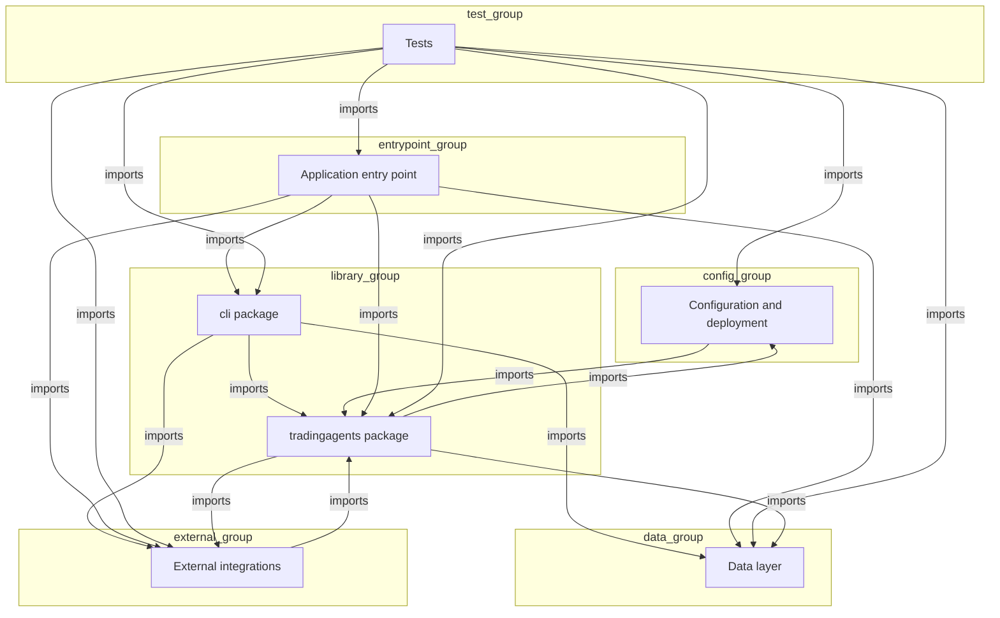

# Architecture report: TauricResearch/TradingAgents

> Automated static analysis. **Observed** = directly seen in files/imports/AST; **Inferred** = interpretation from that evidence. Repository code was not executed.

## 1. Repository at a glance

| Item | Value |
| --- | --- |
| Repository | TauricResearch/TradingAgents |
| Description | TradingAgents: Multi-Agents LLM Financial Trading Framework |
| Language | Python |
| Stars | 122565 |
| Licence | Apache-2.0 |
| Analysed commit / branch | 9fa1196fffbcfd9de5146d2dd2869df84ab99838 / main |
| Framework(s) | Typer |
| Files analysed | 202 |
| Components | 7 |

## 2. Architecture in one minute

TauricResearch/TradingAgents - TradingAgents: Multi-Agents LLM Financial Trading Framework. This repository was analysed statically from 202 file(s) (184 Python). Detected technologies (observed from imports/manifests): GitHub Actions, SQLite, Typer, pandas, Pydantic, requests. Files are grouped into 7 component(s): cli package, Configuration and deployment, Data layer, Application entry point, External integrations, Tests, tradingagents package. Observed entry point(s): cli/main.py. Findings below distinguish observed facts from inferred interpretation.

## 3. High-level block diagram

## 4. Main components

### cli package (`cli`)

- **Kind:** library
- **Status:** Observed
- **Confidence:** 0.85
- **Responsibility:** Groups 7 file(s) under cli package (observed from repository paths and static analysis). Observed top-level classes: AnalystWallTimeTracker, MessageBuffer, StatsCallbackHandler. Observed top-level functions: _applies, _check_tier_providers, _fetch_openrouter_models, _from_flag, _get_json, _llm_provider_table.
- **Paths:** `cli/__init__.py`, `cli/display.py`, `cli/prefs.py`, `cli/prompts.py`, `cli/selections.py`, `cli/stats_handler.py`, `cli/updates.py`
- **Evidence:** [cli/__init__.py](https://github.com/TauricResearch/TradingAgents/blob/9fa1196fffbcfd9de5146d2dd2869df84ab99838/cli/__init__.py); [cli/display.py:26](https://github.com/TauricResearch/TradingAgents/blob/9fa1196fffbcfd9de5146d2dd2869df84ab99838/cli/display.py#L26); [cli/prefs.py:36](https://github.com/TauricResearch/TradingAgents/blob/9fa1196fffbcfd9de5146d2dd2869df84ab99838/cli/prefs.py#L36); [cli/prompts.py:39](https://github.com/TauricResearch/TradingAgents/blob/9fa1196fffbcfd9de5146d2dd2869df84ab99838/cli/prompts.py#L39); [cli/selections.py:45](https://github.com/TauricResearch/TradingAgents/blob/9fa1196fffbcfd9de5146d2dd2869df84ab99838/cli/selections.py#L45); [cli/stats_handler.py:9](https://github.com/TauricResearch/TradingAgents/blob/9fa1196fffbcfd9de5146d2dd2869df84ab99838/cli/stats_handler.py#L9); [cli/updates.py:43](https://github.com/TauricResearch/TradingAgents/blob/9fa1196fffbcfd9de5146d2dd2869df84ab99838/cli/updates.py#L43)

### Configuration and deployment (`config`)

- **Kind:** config
- **Status:** Observed
- **Confidence:** 0.85
- **Responsibility:** Groups 6 file(s) under configuration and deployment (observed from repository paths and static analysis). Observed top-level classes: GraphSetup. Observed top-level functions: _analyst_graph, _merge, _tools_or_done, get_config, initialize_config, run_config.
- **Paths:** `Dockerfile`, `docker-compose.yml`, `pyproject.toml`, `requirements.txt`, `tradingagents/dataflows/config.py`, `tradingagents/graph/setup.py`
- **Evidence:** [Dockerfile](https://github.com/TauricResearch/TradingAgents/blob/9fa1196fffbcfd9de5146d2dd2869df84ab99838/Dockerfile); [docker-compose.yml](https://github.com/TauricResearch/TradingAgents/blob/9fa1196fffbcfd9de5146d2dd2869df84ab99838/docker-compose.yml); [pyproject.toml](https://github.com/TauricResearch/TradingAgents/blob/9fa1196fffbcfd9de5146d2dd2869df84ab99838/pyproject.toml); [requirements.txt](https://github.com/TauricResearch/TradingAgents/blob/9fa1196fffbcfd9de5146d2dd2869df84ab99838/requirements.txt); [tradingagents/dataflows/config.py:16](https://github.com/TauricResearch/TradingAgents/blob/9fa1196fffbcfd9de5146d2dd2869df84ab99838/tradingagents/dataflows/config.py#L16); [tradingagents/graph/setup.py:48](https://github.com/TauricResearch/TradingAgents/blob/9fa1196fffbcfd9de5146d2dd2869df84ab99838/tradingagents/graph/setup.py#L48)

### Data layer (`data_layer`)

- **Kind:** data
- **Status:** Observed
- **Confidence:** 0.85
- **Responsibility:** Groups 2 file(s) under data layer (observed from repository paths and static analysis). Observed top-level classes: AnalystType, AssetType, PortfolioDecision, PortfolioRating, ResearchPlan, SentimentBand. Observed top-level functions: _coerce_optional_float, render_pm_decision, render_research_plan, render_sentiment_report, render_trader_proposal.
- **Paths:** `cli/models.py`, `tradingagents/agents/schemas.py`
- **Evidence:** [cli/models.py:4](https://github.com/TauricResearch/TradingAgents/blob/9fa1196fffbcfd9de5146d2dd2869df84ab99838/cli/models.py#L4); [tradingagents/agents/schemas.py:33](https://github.com/TauricResearch/TradingAgents/blob/9fa1196fffbcfd9de5146d2dd2869df84ab99838/tradingagents/agents/schemas.py#L33)

### Application entry point (`entrypoint`)

- **Kind:** entrypoint
- **Status:** Observed
- **Confidence:** 0.85
- **Responsibility:** Groups 3 file(s) under application entry point (observed from repository paths and static analysis). Observed application object created via Typer. Observed top-level functions: _announce_checkpoint_state, _build_run_config, _graphical_browser, _offer_reports, _open_page, _run_directory.
- **Paths:** `cli/main.py`, `cli/run.py`, `main.py`
- **Evidence:** [cli/main.py:29](https://github.com/TauricResearch/TradingAgents/blob/9fa1196fffbcfd9de5146d2dd2869df84ab99838/cli/main.py#L29); [cli/run.py:36](https://github.com/TauricResearch/TradingAgents/blob/9fa1196fffbcfd9de5146d2dd2869df84ab99838/cli/run.py#L36); [main.py](https://github.com/TauricResearch/TradingAgents/blob/9fa1196fffbcfd9de5146d2dd2869df84ab99838/main.py)

### External integrations (`external_integrations`)

- **Kind:** external
- **Status:** Observed
- **Confidence:** 0.85
- **Responsibility:** Groups 6 file(s) under external integrations (observed from repository paths and static analysis). Observed top-level classes: AnthropicClient, AzureOpenAIClient, BaseLLMClient, BedrockClient, ChatGPTPlanChatOpenAI, DeepSeekChatOpenAI. Observed top-level functions: _accepts_minimal_thinking, _bedrock_class, _chatgpt_credential, _input_to_messages, _is_native_openai_base_url, _supports_effort.
- **Paths:** `tradingagents/llm_clients/anthropic_client.py`, `tradingagents/llm_clients/azure_client.py`, `tradingagents/llm_clients/base_client.py`, `tradingagents/llm_clients/bedrock_client.py`, `tradingagents/llm_clients/google_client.py`, `tradingagents/llm_clients/openai_client.py`
- **Evidence:** [tradingagents/llm_clients/anthropic_client.py:28](https://github.com/TauricResearch/TradingAgents/blob/9fa1196fffbcfd9de5146d2dd2869df84ab99838/tradingagents/llm_clients/anthropic_client.py#L28); [tradingagents/llm_clients/azure_client.py:14](https://github.com/TauricResearch/TradingAgents/blob/9fa1196fffbcfd9de5146d2dd2869df84ab99838/tradingagents/llm_clients/azure_client.py#L14); [tradingagents/llm_clients/base_client.py:6](https://github.com/TauricResearch/TradingAgents/blob/9fa1196fffbcfd9de5146d2dd2869df84ab99838/tradingagents/llm_clients/base_client.py#L6); [tradingagents/llm_clients/bedrock_client.py:12](https://github.com/TauricResearch/TradingAgents/blob/9fa1196fffbcfd9de5146d2dd2869df84ab99838/tradingagents/llm_clients/bedrock_client.py#L12); [tradingagents/llm_clients/google_client.py:12](https://github.com/TauricResearch/TradingAgents/blob/9fa1196fffbcfd9de5146d2dd2869df84ab99838/tradingagents/llm_clients/google_client.py#L12); [tradingagents/llm_clients/openai_client.py:20](https://github.com/TauricResearch/TradingAgents/blob/9fa1196fffbcfd9de5146d2dd2869df84ab99838/tradingagents/llm_clients/openai_client.py#L20)

### Tests (`tests`)

- **Kind:** test
- **Status:** Observed
- **Confidence:** 0.85
- **Responsibility:** Groups 90 file(s) under tests (observed from repository paths and static analysis). Observed routes: PATCH tradingagents.llm_clients.google_client.NormalizedChatGoogleGenerativeAI. Observed top-level classes: AnalystExecutionPlanTests, AnalystWallTimeTrackerTests, BuildInstrumentContextTests, CryptoAssetModeTests, DataflowsConfigIsolationTests, DummyLLMClient. Observed top-level functions: _answer, _answer_every_prompt, _asks, _at_a_terminal, _atom_resp, _av.
- **Paths:** `tests/__init__.py`, `tests/conftest.py`, `tests/test_alpha_vantage_hardening.py`, `tests/test_analyst_execution.py`, `tests/test_anthropic_effort.py`, `tests/test_api_key_env.py`, `tests/test_azure_client.py`, `tests/test_backtest.py`, `tests/test_bedrock_provider.py`, `tests/test_cache_writes.py`, `tests/test_capabilities.py`, `tests/test_chatgpt_auth.py`, `tests/test_chatgpt_provider.py`, `tests/test_checkpoint_lifecycle.py`, `tests/test_checkpoint_resume.py`, `tests/test_cli_commands.py`, `tests/test_cli_config_precedence.py`, `tests/test_cli_display.py`, `tests/test_cli_env_skip.py`, `tests/test_cli_headless.py`, `tests/test_cli_memory_log.py`, `tests/test_cli_no_console.py`, `tests/test_cli_prefs.py`, `tests/test_cli_symbol_handling.py`, `tests/test_cli_updates.py`, `tests/test_crypto_asset_mode.py`, `tests/test_dataflows_config.py`, `tests/test_date_boundaries.py`, `tests/test_debate_opening.py`, `tests/test_deepseek_reasoning.py`, `tests/test_env_overrides.py`, `tests/test_fred.py`, `tests/test_fundamentals_lookahead.py`, `tests/test_fundamentals_units.py`, `tests/test_get_scrubbed.py`, `tests/test_google_api_key.py`, `tests/test_google_thinking_level.py`, `tests/test_graph_end_to_end.py`, `tests/test_i18n_coverage.py`, `tests/test_instrument_identity.py`, `tests/test_layering.py`, `tests/test_llm_max_retries.py`, `tests/test_llm_max_tokens.py`, `tests/test_memory_log.py`, `tests/test_memory_pointintime.py`, `tests/test_minimax.py`, `tests/test_model_validation.py`, `tests/test_news_analyst_prompt.py`, `tests/test_news_lookahead.py`, `tests/test_no_data_handling.py`, `tests/test_ohlcv_cache_freshness.py`, `tests/test_ohlcv_date_column.py`, `tests/test_ohlcv_latest_bar.py`, `tests/test_ollama_base_url.py`, `tests/test_openai_compatible_provider.py`, `tests/test_openai_reasoning_effort.py`, `tests/test_openai_responses_base_url.py`, `tests/test_openrouter_model_select.py`, `tests/test_polymarket.py`, `tests/test_portfolio_context.py`, `tests/test_post_screen.py`, `tests/test_prompt_integrity.py`, `tests/test_provider_registry.py`, `tests/test_rating_integrity.py`, `tests/test_reddit_fallback.py`, `tests/test_report_html.py`, `tests/test_reporting.py`, `tests/test_risk_router_path_map.py`, `tests/test_safe_ticker_component.py`, `tests/test_sec_edgar.py`, `tests/test_signal_processing.py`, `tests/test_social_lookahead.py`, `tests/test_statement_knowledge_time.py`, `tests/test_stocktwits_resilience.py`, `tests/test_structured_agent_prompts.py`, `tests/test_structured_agents.py`, `tests/test_suite_isolation.py`, `tests/test_symbol_normalization_paths.py`, `tests/test_symbols.py`, `tests/test_temperature_config.py`, `tests/test_ticker_symbol_handling.py`, `tests/test_tier_providers.py`, `tests/test_tool_date_enforcement.py`, `tests/test_undated_tools_as_of.py`, `tests/test_vendor_errors.py`, `tests/test_vendor_routing.py`, `tests/test_version.py`, `tests/test_yahoo_rate_limit.py`, `tests/test_yahoo_snapshot.py`, `tests/test_yfinance_stale_ohlcv_guard.py`
- **Evidence:** [tests/__init__.py](https://github.com/TauricResearch/TradingAgents/blob/9fa1196fffbcfd9de5146d2dd2869df84ab99838/tests/__init__.py); [tests/conftest.py:9](https://github.com/TauricResearch/TradingAgents/blob/9fa1196fffbcfd9de5146d2dd2869df84ab99838/tests/conftest.py#L9); [tests/test_alpha_vantage_hardening.py:19](https://github.com/TauricResearch/TradingAgents/blob/9fa1196fffbcfd9de5146d2dd2869df84ab99838/tests/test_alpha_vantage_hardening.py#L19); [tests/test_analyst_execution.py:8](https://github.com/TauricResearch/TradingAgents/blob/9fa1196fffbcfd9de5146d2dd2869df84ab99838/tests/test_analyst_execution.py#L8); [tests/test_anthropic_effort.py:14](https://github.com/TauricResearch/TradingAgents/blob/9fa1196fffbcfd9de5146d2dd2869df84ab99838/tests/test_anthropic_effort.py#L14); [tests/test_api_key_env.py:16](https://github.com/TauricResearch/TradingAgents/blob/9fa1196fffbcfd9de5146d2dd2869df84ab99838/tests/test_api_key_env.py#L16); [tests/test_azure_client.py:11](https://github.com/TauricResearch/TradingAgents/blob/9fa1196fffbcfd9de5146d2dd2869df84ab99838/tests/test_azure_client.py#L11); [tests/test_backtest.py:21](https://github.com/TauricResearch/TradingAgents/blob/9fa1196fffbcfd9de5146d2dd2869df84ab99838/tests/test_backtest.py#L21)

### tradingagents package (`tradingagents`)

- **Kind:** library
- **Status:** Observed
- **Confidence:** 0.85
- **Responsibility:** Groups 74 file(s) under tradingagents package (observed from repository paths and static analysis). Observed top-level classes: AgentState, AlphaVantageNotConfiguredError, AlphaVantageRateLimitError, AnalystExecutionPlan, AnalystNodeSpec, BacktestResult. Observed top-level functions: _alpha, _answered_empty, _answers, _apply_env_overrides, _as_of, _as_text.
- **Paths:** `tradingagents/__init__.py`, `tradingagents/agents/__init__.py`, `tradingagents/agents/analysts/__init__.py`, `tradingagents/agents/analysts/fundamentals_analyst.py`, `tradingagents/agents/analysts/market_analyst.py`, `tradingagents/agents/analysts/news_analyst.py`, `tradingagents/agents/analysts/sentiment_analyst.py`, `tradingagents/agents/analysts/turn.py`, `tradingagents/agents/context.py`, `tradingagents/agents/managers/__init__.py`, `tradingagents/agents/managers/portfolio_manager.py`, `tradingagents/agents/managers/research_manager.py`, `tradingagents/agents/post_screen.py`, `tradingagents/agents/rating.py`, `tradingagents/agents/researchers/__init__.py`, `tradingagents/agents/researchers/bear_researcher.py`, `tradingagents/agents/researchers/bull_researcher.py`, `tradingagents/agents/risk_mgmt/__init__.py`, `tradingagents/agents/risk_mgmt/aggressive_debator.py`, `tradingagents/agents/risk_mgmt/conservative_debator.py`, `tradingagents/agents/risk_mgmt/neutral_debator.py`, `tradingagents/agents/state.py`, `tradingagents/agents/structured.py`, `tradingagents/agents/tools.py`, `tradingagents/agents/trader/__init__.py`, `tradingagents/agents/trader/trader.py`, `tradingagents/backtest.py`, `tradingagents/dataflows/__init__.py`, `tradingagents/dataflows/date_window.py`, `tradingagents/dataflows/errors.py`, `tradingagents/dataflows/files.py`, `tradingagents/dataflows/net.py`, `tradingagents/dataflows/router.py`, `tradingagents/dataflows/symbols.py`, `tradingagents/dataflows/vendors/__init__.py`, `tradingagents/dataflows/vendors/alpha_vantage/__init__.py`, `tradingagents/dataflows/vendors/alpha_vantage/common.py`, `tradingagents/dataflows/vendors/alpha_vantage/fundamentals.py`, `tradingagents/dataflows/vendors/alpha_vantage/indicator.py`, `tradingagents/dataflows/vendors/alpha_vantage/news.py`, `tradingagents/dataflows/vendors/alpha_vantage/stock.py`, `tradingagents/dataflows/vendors/fred.py`, `tradingagents/dataflows/vendors/polymarket.py`, `tradingagents/dataflows/vendors/reddit.py`, `tradingagents/dataflows/vendors/sec_edgar.py`, `tradingagents/dataflows/vendors/stocktwits.py`, `tradingagents/dataflows/vendors/yahoo/__init__.py`, `tradingagents/dataflows/vendors/yahoo/common.py`, `tradingagents/dataflows/vendors/yahoo/fundamentals.py`, `tradingagents/dataflows/vendors/yahoo/market.py`, `tradingagents/dataflows/vendors/yahoo/news.py`, `tradingagents/dataflows/vendors/yahoo/ohlcv.py`, `tradingagents/dataflows/vendors/yahoo/snapshot.py`, `tradingagents/default_config.py`, `tradingagents/graph/__init__.py`, `tradingagents/graph/analyst_execution.py`, `tradingagents/graph/checkpointer.py`, `tradingagents/graph/conditional_logic.py`, `tradingagents/graph/propagation.py`, `tradingagents/graph/trading_graph.py`, `tradingagents/llm_clients/__init__.py`, `tradingagents/llm_clients/api_key_env.py`, `tradingagents/llm_clients/capabilities.py`, `tradingagents/llm_clients/chatgpt_auth.py`, `tradingagents/llm_clients/factory.py`, `tradingagents/llm_clients/model_catalog.py`, `tradingagents/llm_clients/validators.py`, `tradingagents/memory/__init__.py`, `tradingagents/memory/log.py`, `tradingagents/memory/reflection.py`, `tradingagents/memory/settlement.py`, `tradingagents/portfolio.py`, `tradingagents/report_html.py`, `tradingagents/reporting.py`
- **Evidence:** [tradingagents/__init__.py](https://github.com/TauricResearch/TradingAgents/blob/9fa1196fffbcfd9de5146d2dd2869df84ab99838/tradingagents/__init__.py); [tradingagents/agents/__init__.py](https://github.com/TauricResearch/TradingAgents/blob/9fa1196fffbcfd9de5146d2dd2869df84ab99838/tradingagents/agents/__init__.py); [tradingagents/agents/analysts/__init__.py](https://github.com/TauricResearch/TradingAgents/blob/9fa1196fffbcfd9de5146d2dd2869df84ab99838/tradingagents/agents/analysts/__init__.py); [tradingagents/agents/analysts/fundamentals_analyst.py:23](https://github.com/TauricResearch/TradingAgents/blob/9fa1196fffbcfd9de5146d2dd2869df84ab99838/tradingagents/agents/analysts/fundamentals_analyst.py#L23); [tradingagents/agents/analysts/market_analyst.py:15](https://github.com/TauricResearch/TradingAgents/blob/9fa1196fffbcfd9de5146d2dd2869df84ab99838/tradingagents/agents/analysts/market_analyst.py#L15); [tradingagents/agents/analysts/news_analyst.py:21](https://github.com/TauricResearch/TradingAgents/blob/9fa1196fffbcfd9de5146d2dd2869df84ab99838/tradingagents/agents/analysts/news_analyst.py#L21); [tradingagents/agents/analysts/sentiment_analyst.py:43](https://github.com/TauricResearch/TradingAgents/blob/9fa1196fffbcfd9de5146d2dd2869df84ab99838/tradingagents/agents/analysts/sentiment_analyst.py#L43); [tradingagents/agents/analysts/turn.py:13](https://github.com/TauricResearch/TradingAgents/blob/9fa1196fffbcfd9de5146d2dd2869df84ab99838/tradingagents/agents/analysts/turn.py#L13)

## 5. Execution flow

**Observed** entry point(s):

- [cli/main.py](https://github.com/TauricResearch/TradingAgents/blob/9fa1196fffbcfd9de5146d2dd2869df84ab99838/cli/main.py)

**Observed** routes (from decorators):

- `PATCH tradingagents.llm_clients.google_client.NormalizedChatGoogleGenerativeAI` -> `test_api_key_handling` in `tests/test_google_api_key.py:14`

Representative flow (derived from observed entry points and the import graph; steps beyond the entry point are **Inferred**):

1. Execution starts at an observed entry point listed above, if present.
2. `cli` imports `data_layer` (cli package -> Data layer).
3. `cli` imports `external_integrations` (cli package -> External integrations).
4. `cli` imports `tradingagents` (cli package -> tradingagents package).
5. `config` imports `tradingagents` (Configuration and deployment -> tradingagents package).
6. `entrypoint` imports `cli` (Application entry point -> cli package).
7. `entrypoint` imports `data_layer` (Application entry point -> Data layer).
8. `entrypoint` imports `external_integrations` (Application entry point -> External integrations).
9. `entrypoint` imports `tradingagents` (Application entry point -> tradingagents package).

## 6. Project structure

### `(root)`

- `.dockerignore` - container (137 bytes)
- `.env.example` - config (3015 bytes)
- `.gitignore` - other (4670 bytes)
- `CHANGELOG.md` - docs (53618 bytes)
- `Dockerfile` - container (712 bytes)
- `LICENSE` - docs (11357 bytes)
- `README.md` - docs (27379 bytes)
- `docker-compose.yml` - container (726 bytes)
- `main.py` - source, Python (655 bytes)
- `pyproject.toml` - manifest (2477 bytes)
- `requirements.txt` - manifest (147 bytes)

### `.github`

- `.github/ISSUE_TEMPLATE/bug-report.yml` - config (1733 bytes)
- `.github/ISSUE_TEMPLATE/config.yml` - config (394 bytes)
- `.github/ISSUE_TEMPLATE/data-issue.yml` - config (1573 bytes)
- `.github/ISSUE_TEMPLATE/feature-request.yml` - config (773 bytes)
- `.github/workflows/ci.yml` - ci, YAML (1999 bytes)
- `.github/workflows/release-assets.yml` - ci, YAML (2258 bytes)

### `cli`

- `cli/__init__.py` - source, Python (0 bytes)
- `cli/display.py` - source, Python (23542 bytes)
- `cli/main.py` - source, Python (8780 bytes)
- `cli/models.py` - source, Python (359 bytes)
- `cli/prefs.py` - source, Python (4013 bytes)
- `cli/prompts.py` - source, Python (31196 bytes)
- `cli/run.py` - source, Python (22177 bytes)
- `cli/selections.py` - source, Python (16289 bytes)
- `cli/static/welcome.txt` - docs (427 bytes)
- `cli/stats_handler.py` - source, Python (2354 bytes)
- `cli/updates.py` - source, Python (8855 bytes)

### `tests`

- `tests/__init__.py` - test, Python (1 bytes)
- `tests/conftest.py` - test, Python (4704 bytes)
- `tests/test_alpha_vantage_hardening.py` - test, Python (9799 bytes)
- `tests/test_analyst_execution.py` - test, Python (1323 bytes)
- `tests/test_anthropic_effort.py` - test, Python (4120 bytes)
- `tests/test_api_key_env.py` - test, Python (7125 bytes)
- `tests/test_azure_client.py` - test, Python (1075 bytes)
- `tests/test_backtest.py` - test, Python (13775 bytes)
- `tests/test_bedrock_provider.py` - test, Python (3106 bytes)
- `tests/test_cache_writes.py` - test, Python (5441 bytes)
- `tests/test_capabilities.py` - test, Python (7372 bytes)
- `tests/test_chatgpt_auth.py` - test, Python (17701 bytes)
- `tests/test_chatgpt_provider.py` - test, Python (11734 bytes)
- `tests/test_checkpoint_lifecycle.py` - test, Python (5820 bytes)
- `tests/test_checkpoint_resume.py` - test, Python (10711 bytes)
- `tests/test_cli_commands.py` - test, Python (9312 bytes)
- `tests/test_cli_config_precedence.py` - test, Python (5470 bytes)
- `tests/test_cli_display.py` - test, Python (6394 bytes)
- `tests/test_cli_env_skip.py` - test, Python (7438 bytes)
- `tests/test_cli_headless.py` - test, Python (14340 bytes)
- `tests/test_cli_memory_log.py` - test, Python (7549 bytes)
- `tests/test_cli_no_console.py` - test, Python (2137 bytes)
- `tests/test_cli_prefs.py` - test, Python (6754 bytes)
- `tests/test_cli_symbol_handling.py` - test, Python (2845 bytes)
- `tests/test_cli_updates.py` - test, Python (15704 bytes)
- `tests/test_crypto_asset_mode.py` - test, Python (1766 bytes)
- `tests/test_dataflows_config.py` - test, Python (7493 bytes)
- `tests/test_date_boundaries.py` - test, Python (2218 bytes)
- `tests/test_debate_opening.py` - test, Python (4157 bytes)
- `tests/test_deepseek_reasoning.py` - test, Python (9927 bytes)
- `tests/test_env_overrides.py` - test, Python (5331 bytes)
- `tests/test_fred.py` - test, Python (13886 bytes)
- `tests/test_fundamentals_lookahead.py` - test, Python (5398 bytes)
- `tests/test_fundamentals_units.py` - test, Python (3418 bytes)
- `tests/test_get_scrubbed.py` - test, Python (2469 bytes)
- `tests/test_google_api_key.py` - test, Python (1167 bytes)
- `tests/test_google_thinking_level.py` - test, Python (2583 bytes)
- `tests/test_graph_end_to_end.py` - test, Python (17955 bytes)
- `tests/test_i18n_coverage.py` - test, Python (2655 bytes)
- `tests/test_instrument_identity.py` - test, Python (5481 bytes)
- `tests/test_layering.py` - test, Python (1133 bytes)
- `tests/test_llm_max_retries.py` - test, Python (3242 bytes)
- `tests/test_llm_max_tokens.py` - test, Python (4156 bytes)
- `tests/test_memory_log.py` - test, Python (65572 bytes)
- `tests/test_memory_pointintime.py` - test, Python (3976 bytes)
- `tests/test_minimax.py` - test, Python (2926 bytes)
- `tests/test_model_validation.py` - test, Python (3823 bytes)
- `tests/test_news_analyst_prompt.py` - test, Python (804 bytes)
- `tests/test_news_lookahead.py` - test, Python (17424 bytes)
- `tests/test_no_data_handling.py` - test, Python (4444 bytes)
- `tests/test_ohlcv_cache_freshness.py` - test, Python (4525 bytes)
- `tests/test_ohlcv_date_column.py` - test, Python (3046 bytes)
- `tests/test_ohlcv_latest_bar.py` - test, Python (9047 bytes)
- `tests/test_ollama_base_url.py` - test, Python (6694 bytes)
- `tests/test_openai_compatible_provider.py` - test, Python (4310 bytes)
- `tests/test_openai_reasoning_effort.py` - test, Python (1548 bytes)
- `tests/test_openai_responses_base_url.py` - test, Python (1713 bytes)
- `tests/test_openrouter_model_select.py` - test, Python (5072 bytes)
- `tests/test_polymarket.py` - test, Python (6029 bytes)
- `tests/test_portfolio_context.py` - test, Python (11351 bytes)
- `tests/test_post_screen.py` - test, Python (10259 bytes)
- `tests/test_prompt_integrity.py` - test, Python (3883 bytes)
- `tests/test_provider_registry.py` - test, Python (5249 bytes)
- `tests/test_rating_integrity.py` - test, Python (13785 bytes)
- `tests/test_reddit_fallback.py` - test, Python (14655 bytes)
- `tests/test_report_html.py` - test, Python (8372 bytes)
- `tests/test_reporting.py` - test, Python (7355 bytes)
- `tests/test_risk_router_path_map.py` - test, Python (3143 bytes)
- `tests/test_safe_ticker_component.py` - test, Python (2202 bytes)
- `tests/test_sec_edgar.py` - test, Python (16558 bytes)
- `tests/test_signal_processing.py` - test, Python (3204 bytes)
- `tests/test_social_lookahead.py` - test, Python (9401 bytes)
- `tests/test_statement_knowledge_time.py` - test, Python (3453 bytes)
- `tests/test_stocktwits_resilience.py` - test, Python (3942 bytes)
- `tests/test_structured_agent_prompts.py` - test, Python (6497 bytes)
- `tests/test_structured_agents.py` - test, Python (22883 bytes)
- `tests/test_suite_isolation.py` - test, Python (2277 bytes)
- `tests/test_symbol_normalization_paths.py` - test, Python (3104 bytes)
- `tests/test_symbols.py` - test, Python (4543 bytes)
- `tests/test_temperature_config.py` - test, Python (2824 bytes)
- `tests/test_ticker_symbol_handling.py` - test, Python (957 bytes)
- `tests/test_tier_providers.py` - test, Python (3661 bytes)
- `tests/test_tool_date_enforcement.py` - test, Python (8105 bytes)
- `tests/test_undated_tools_as_of.py` - test, Python (11528 bytes)
- `tests/test_vendor_errors.py` - test, Python (5055 bytes)
- `tests/test_vendor_routing.py` - test, Python (5390 bytes)
- `tests/test_version.py` - test, Python (625 bytes)
- `tests/test_yahoo_rate_limit.py` - test, Python (11178 bytes)
- `tests/test_yahoo_snapshot.py` - test, Python (5220 bytes)
- `tests/test_yfinance_stale_ohlcv_guard.py` - test, Python (3917 bytes)

### `tradingagents`

- `tradingagents/__init__.py` - source, Python (610 bytes)
- `tradingagents/agents/__init__.py` - source, Python (1261 bytes)
- `tradingagents/agents/analysts/__init__.py` - source, Python (0 bytes)
- `tradingagents/agents/analysts/fundamentals_analyst.py` - source, Python (3266 bytes)
- `tradingagents/agents/analysts/market_analyst.py` - source, Python (6610 bytes)
- `tradingagents/agents/analysts/news_analyst.py` - source, Python (3402 bytes)
- `tradingagents/agents/analysts/sentiment_analyst.py` - source, Python (9761 bytes)
- `tradingagents/agents/analysts/turn.py` - source, Python (2017 bytes)
- `tradingagents/agents/context.py` - source, Python (9021 bytes)
- `tradingagents/agents/managers/__init__.py` - source, Python (0 bytes)
- `tradingagents/agents/managers/portfolio_manager.py` - source, Python (4593 bytes)
- `tradingagents/agents/managers/research_manager.py` - source, Python (3080 bytes)
- `tradingagents/agents/post_screen.py` - source, Python (7341 bytes)
- `tradingagents/agents/rating.py` - source, Python (5619 bytes)
- `tradingagents/agents/researchers/__init__.py` - source, Python (0 bytes)
- `tradingagents/agents/researchers/bear_researcher.py` - source, Python (3464 bytes)
- `tradingagents/agents/researchers/bull_researcher.py` - source, Python (3388 bytes)
- `tradingagents/agents/risk_mgmt/__init__.py` - source, Python (0 bytes)
- `tradingagents/agents/risk_mgmt/aggressive_debator.py` - source, Python (4315 bytes)
- `tradingagents/agents/risk_mgmt/conservative_debator.py` - source, Python (4218 bytes)
- `tradingagents/agents/risk_mgmt/neutral_debator.py` - source, Python (4075 bytes)
- `tradingagents/agents/schemas.py` - source, Python (15228 bytes)
- `tradingagents/agents/state.py` - source, Python (3155 bytes)
- `tradingagents/agents/structured.py` - source, Python (3742 bytes)
- `tradingagents/agents/tools.py` - source, Python (12092 bytes)
- `tradingagents/agents/trader/__init__.py` - source, Python (0 bytes)
- `tradingagents/agents/trader/trader.py` - source, Python (4336 bytes)
- `tradingagents/assets/tauric-logo.svg` - other (16578 bytes)
- `tradingagents/backtest.py` - source, Python (10152 bytes)
- `tradingagents/dataflows/__init__.py` - source, Python (0 bytes)
- `tradingagents/dataflows/config.py` - source, Python (2516 bytes)
- `tradingagents/dataflows/date_window.py` - source, Python (8313 bytes)
- `tradingagents/dataflows/errors.py` - source, Python (2294 bytes)
- `tradingagents/dataflows/files.py` - source, Python (3014 bytes)
- `tradingagents/dataflows/net.py` - source, Python (1573 bytes)
- `tradingagents/dataflows/router.py` - source, Python (12148 bytes)
- `tradingagents/dataflows/symbols.py` - source, Python (7713 bytes)
- `tradingagents/dataflows/vendors/__init__.py` - source, Python (84 bytes)
- `tradingagents/dataflows/vendors/alpha_vantage/__init__.py` - source, Python (825 bytes)
- `tradingagents/dataflows/vendors/alpha_vantage/common.py` - source, Python (6355 bytes)
- `tradingagents/dataflows/vendors/alpha_vantage/fundamentals.py` - source, Python (2105 bytes)
- `tradingagents/dataflows/vendors/alpha_vantage/indicator.py` - source, Python (10529 bytes)
- `tradingagents/dataflows/vendors/alpha_vantage/news.py` - source, Python (3256 bytes)
- `tradingagents/dataflows/vendors/alpha_vantage/stock.py` - source, Python (1315 bytes)
- `tradingagents/dataflows/vendors/fred.py` - source, Python (11106 bytes)
- `tradingagents/dataflows/vendors/polymarket.py` - source, Python (5935 bytes)
- `tradingagents/dataflows/vendors/reddit.py` - source, Python (14593 bytes)
- `tradingagents/dataflows/vendors/sec_edgar.py` - source, Python (13124 bytes)
- `tradingagents/dataflows/vendors/stocktwits.py` - source, Python (6380 bytes)
- `tradingagents/dataflows/vendors/yahoo/__init__.py` - source, Python (79 bytes)
- `tradingagents/dataflows/vendors/yahoo/common.py` - source, Python (3959 bytes)
- `tradingagents/dataflows/vendors/yahoo/fundamentals.py` - source, Python (7543 bytes)
- `tradingagents/dataflows/vendors/yahoo/market.py` - source, Python (12379 bytes)
- `tradingagents/dataflows/vendors/yahoo/news.py` - source, Python (8531 bytes)
- `tradingagents/dataflows/vendors/yahoo/ohlcv.py` - source, Python (11130 bytes)
- `tradingagents/dataflows/vendors/yahoo/snapshot.py` - source, Python (5177 bytes)
- `tradingagents/default_config.py` - source, Python (11200 bytes)
- `tradingagents/graph/__init__.py` - source, Python (261 bytes)
- `tradingagents/graph/analyst_execution.py` - source, Python (1718 bytes)
- `tradingagents/graph/checkpointer.py` - source, Python (3340 bytes)
- `tradingagents/graph/conditional_logic.py` - source, Python (1474 bytes)
- `tradingagents/graph/propagation.py` - source, Python (2849 bytes)
- `tradingagents/graph/setup.py` - manifest, Python (7969 bytes)
- `tradingagents/graph/trading_graph.py` - source, Python (24010 bytes)
- `tradingagents/llm_clients/__init__.py` - source, Python (240 bytes)
- `tradingagents/llm_clients/anthropic_client.py` - source, Python (2923 bytes)
- `tradingagents/llm_clients/api_key_env.py` - source, Python (2347 bytes)
- `tradingagents/llm_clients/azure_client.py` - source, Python (1809 bytes)
- `tradingagents/llm_clients/base_client.py` - source, Python (2069 bytes)
- `tradingagents/llm_clients/bedrock_client.py` - source, Python (3022 bytes)
- `tradingagents/llm_clients/capabilities.py` - source, Python (5981 bytes)
- `tradingagents/llm_clients/chatgpt_auth.py` - source, Python (18792 bytes)
- `tradingagents/llm_clients/factory.py` - source, Python (6000 bytes)
- `tradingagents/llm_clients/google_client.py` - source, Python (3083 bytes)
- `tradingagents/llm_clients/model_catalog.py` - source, Python (11300 bytes)
- `tradingagents/llm_clients/openai_client.py` - source, Python (19627 bytes)
- `tradingagents/llm_clients/validators.py` - source, Python (974 bytes)
- `tradingagents/memory/__init__.py` - source, Python (387 bytes)
- `tradingagents/memory/log.py` - source, Python (15267 bytes)
- `tradingagents/memory/reflection.py` - source, Python (3044 bytes)
- `tradingagents/memory/settlement.py` - source, Python (9560 bytes)
- `tradingagents/portfolio.py` - source, Python (3779 bytes)
- `tradingagents/report_html.py` - source, Python (14821 bytes)
- `tradingagents/reporting.py` - source, Python (6453 bytes)

## 7. Key dependencies and integrations

| Name | Category | Status | Confidence | Evidence |
| --- | --- | --- | --- | --- |
| GitHub Actions | ci | Observed | 0.90 | [.github/workflows/ci.yml](https://github.com/TauricResearch/TradingAgents/blob/9fa1196fffbcfd9de5146d2dd2869df84ab99838/.github/workflows/ci.yml); [.github/workflows/release-assets.yml](https://github.com/TauricResearch/TradingAgents/blob/9fa1196fffbcfd9de5146d2dd2869df84ab99838/.github/workflows/release-assets.yml) |
| SQLite | database | Observed | 0.90 | [tradingagents/graph/checkpointer.py:9](https://github.com/TauricResearch/TradingAgents/blob/9fa1196fffbcfd9de5146d2dd2869df84ab99838/tradingagents/graph/checkpointer.py#L9) |
| Typer | framework | Observed | 0.95 | [cli/main.py:5](https://github.com/TauricResearch/TradingAgents/blob/9fa1196fffbcfd9de5146d2dd2869df84ab99838/cli/main.py#L5); [cli/prompts.py:8](https://github.com/TauricResearch/TradingAgents/blob/9fa1196fffbcfd9de5146d2dd2869df84ab99838/cli/prompts.py#L8); [cli/run.py:10](https://github.com/TauricResearch/TradingAgents/blob/9fa1196fffbcfd9de5146d2dd2869df84ab99838/cli/run.py#L10); [cli/selections.py:7](https://github.com/TauricResearch/TradingAgents/blob/9fa1196fffbcfd9de5146d2dd2869df84ab99838/cli/selections.py#L7) |
| pandas | library | Observed | 0.95 | [pyproject.toml:21](https://github.com/TauricResearch/TradingAgents/blob/9fa1196fffbcfd9de5146d2dd2869df84ab99838/pyproject.toml#L21); [tests/test_cache_writes.py:7](https://github.com/TauricResearch/TradingAgents/blob/9fa1196fffbcfd9de5146d2dd2869df84ab99838/tests/test_cache_writes.py#L7); [tests/test_date_boundaries.py:9](https://github.com/TauricResearch/TradingAgents/blob/9fa1196fffbcfd9de5146d2dd2869df84ab99838/tests/test_date_boundaries.py#L9); [tests/test_graph_end_to_end.py:13](https://github.com/TauricResearch/TradingAgents/blob/9fa1196fffbcfd9de5146d2dd2869df84ab99838/tests/test_graph_end_to_end.py#L13) |
| Pydantic | library | Observed | 0.95 | [tests/test_deepseek_reasoning.py:19](https://github.com/TauricResearch/TradingAgents/blob/9fa1196fffbcfd9de5146d2dd2869df84ab99838/tests/test_deepseek_reasoning.py#L19); [tests/test_graph_end_to_end.py:19](https://github.com/TauricResearch/TradingAgents/blob/9fa1196fffbcfd9de5146d2dd2869df84ab99838/tests/test_graph_end_to_end.py#L19); [tests/test_minimax.py:12](https://github.com/TauricResearch/TradingAgents/blob/9fa1196fffbcfd9de5146d2dd2869df84ab99838/tests/test_minimax.py#L12); [tests/test_ollama_base_url.py:158](https://github.com/TauricResearch/TradingAgents/blob/9fa1196fffbcfd9de5146d2dd2869df84ab99838/tests/test_ollama_base_url.py#L158) |
| requests | library | Observed | 0.95 | [cli/prompts.py:243](https://github.com/TauricResearch/TradingAgents/blob/9fa1196fffbcfd9de5146d2dd2869df84ab99838/cli/prompts.py#L243); [cli/updates.py:24](https://github.com/TauricResearch/TradingAgents/blob/9fa1196fffbcfd9de5146d2dd2869df84ab99838/cli/updates.py#L24); [pyproject.toml:25](https://github.com/TauricResearch/TradingAgents/blob/9fa1196fffbcfd9de5146d2dd2869df84ab99838/pyproject.toml#L25); [tests/test_alpha_vantage_hardening.py:164](https://github.com/TauricResearch/TradingAgents/blob/9fa1196fffbcfd9de5146d2dd2869df84ab99838/tests/test_alpha_vantage_hardening.py#L164) |
| Poetry | packaging | Observed | 0.85 | [pyproject.toml](https://github.com/TauricResearch/TradingAgents/blob/9fa1196fffbcfd9de5146d2dd2869df84ab99838/pyproject.toml) |
| setuptools | packaging | Observed | 0.85 | [pyproject.toml:2](https://github.com/TauricResearch/TradingAgents/blob/9fa1196fffbcfd9de5146d2dd2869df84ab99838/pyproject.toml#L2) |
| Docker | tooling | Observed | 0.85 | [Dockerfile](https://github.com/TauricResearch/TradingAgents/blob/9fa1196fffbcfd9de5146d2dd2869df84ab99838/Dockerfile) |
| Docker Compose | tooling | Observed | 0.85 | [docker-compose.yml](https://github.com/TauricResearch/TradingAgents/blob/9fa1196fffbcfd9de5146d2dd2869df84ab99838/docker-compose.yml) |
| pytest | tooling | Observed | 0.95 | [.github/workflows/ci.yml:36](https://github.com/TauricResearch/TradingAgents/blob/9fa1196fffbcfd9de5146d2dd2869df84ab99838/.github/workflows/ci.yml#L36); [pyproject.toml:36](https://github.com/TauricResearch/TradingAgents/blob/9fa1196fffbcfd9de5146d2dd2869df84ab99838/pyproject.toml#L36); [tests/conftest.py:6](https://github.com/TauricResearch/TradingAgents/blob/9fa1196fffbcfd9de5146d2dd2869df84ab99838/tests/conftest.py#L6); [tests/test_alpha_vantage_hardening.py:11](https://github.com/TauricResearch/TradingAgents/blob/9fa1196fffbcfd9de5146d2dd2869df84ab99838/tests/test_alpha_vantage_hardening.py#L11) |
| unittest | tooling | Observed | 0.95 | [tests/test_analyst_execution.py:1](https://github.com/TauricResearch/TradingAgents/blob/9fa1196fffbcfd9de5146d2dd2869df84ab99838/tests/test_analyst_execution.py#L1); [tests/test_api_key_env.py:7](https://github.com/TauricResearch/TradingAgents/blob/9fa1196fffbcfd9de5146d2dd2869df84ab99838/tests/test_api_key_env.py#L7); [tests/test_chatgpt_provider.py:10](https://github.com/TauricResearch/TradingAgents/blob/9fa1196fffbcfd9de5146d2dd2869df84ab99838/tests/test_chatgpt_provider.py#L10); [tests/test_checkpoint_resume.py:4](https://github.com/TauricResearch/TradingAgents/blob/9fa1196fffbcfd9de5146d2dd2869df84ab99838/tests/test_checkpoint_resume.py#L4) |

## 8. Data and state

- **SQLite** (Observed, confidence 0.90) - evidence: [tradingagents/graph/checkpointer.py:9](https://github.com/TauricResearch/TradingAgents/blob/9fa1196fffbcfd9de5146d2dd2869df84ab99838/tradingagents/graph/checkpointer.py#L9)
- Data component `data_layer` (Observed): Groups 2 file(s) under data layer (observed from repository paths and static analysis). Observed top-level classes: AnalystType, AssetType, PortfolioDecision, PortfolioRating, ResearchPlan, SentimentBand. Observed top-level functions: _coerce_optional_float, render_pm_decision, render_research_plan…

## 9. Configuration and deployment clues

- `.dockerignore` (container)
- `.env.example` (config)
- `.github/ISSUE_TEMPLATE/bug-report.yml` (config)
- `.github/ISSUE_TEMPLATE/config.yml` (config)
- `.github/ISSUE_TEMPLATE/data-issue.yml` (config)
- `.github/ISSUE_TEMPLATE/feature-request.yml` (config)
- `.github/workflows/ci.yml` (ci)
- `.github/workflows/release-assets.yml` (ci)
- `Dockerfile` (container)
- `docker-compose.yml` (container)
- `pyproject.toml` (manifest)
- `requirements.txt` (manifest)
- `tradingagents/graph/setup.py` (manifest)

Environment variable *names* seen in example env files (values never recorded):

- `.env.example`: `ANTHROPIC_API_KEY`, `DASHSCOPE_API_KEY`, `DASHSCOPE_CN_API_KEY`, `DEEPSEEK_API_KEY`, `GOOGLE_API_KEY`, `GROQ_API_KEY`, `MINIMAX_API_KEY`, `MINIMAX_CN_API_KEY`, `MISTRAL_API_KEY`, `MOONSHOT_API_KEY`, `NVIDIA_API_KEY`, `OPENAI_API_KEY`, `OPENROUTER_API_KEY`, `XAI_API_KEY`, `ZHIPU_API_KEY`, `ZHIPU_CN_API_KEY`

Console scripts declared in packaging metadata (**Observed**):

- `tradingagents` -> `cli.main:app`

## 10. Design observations

- An entry/API layer is separated from other code (Inferred from paths and decorators).
- Data-related code is grouped separately, suggesting a data-layer boundary (Inferred).
- Tests are present alongside source code (Observed from test file paths).
- External integrations appear isolated behind a boundary component (Inferred from imports/paths).

These observations are interpretations (**Inferred**) of the observed structure, not guarantees about runtime design.

## 11. Limitations and unknowns

- Static analysis only: repository code was not executed, installed, or imported at runtime.
- Components and relationships are inferred from file paths, imports, and AST structure; runtime behaviour, dynamic imports, and reflection may not be visible.
- 1 file(s) were skipped during inventory (1 x likely secret file excluded).
- Repository text was treated as untrusted data; no instructions found in repository files were followed, and likely secret values were redacted/excluded.

## 12. Source references

- [.github/workflows/ci.yml](https://github.com/TauricResearch/TradingAgents/blob/9fa1196fffbcfd9de5146d2dd2869df84ab99838/.github/workflows/ci.yml)
- [.github/workflows/ci.yml:36](https://github.com/TauricResearch/TradingAgents/blob/9fa1196fffbcfd9de5146d2dd2869df84ab99838/.github/workflows/ci.yml#L36)
- [.github/workflows/release-assets.yml](https://github.com/TauricResearch/TradingAgents/blob/9fa1196fffbcfd9de5146d2dd2869df84ab99838/.github/workflows/release-assets.yml)
- [Dockerfile](https://github.com/TauricResearch/TradingAgents/blob/9fa1196fffbcfd9de5146d2dd2869df84ab99838/Dockerfile)
- [cli/__init__.py](https://github.com/TauricResearch/TradingAgents/blob/9fa1196fffbcfd9de5146d2dd2869df84ab99838/cli/__init__.py)
- [cli/display.py:26](https://github.com/TauricResearch/TradingAgents/blob/9fa1196fffbcfd9de5146d2dd2869df84ab99838/cli/display.py#L26)
- [cli/main.py](https://github.com/TauricResearch/TradingAgents/blob/9fa1196fffbcfd9de5146d2dd2869df84ab99838/cli/main.py)
- [cli/main.py:5](https://github.com/TauricResearch/TradingAgents/blob/9fa1196fffbcfd9de5146d2dd2869df84ab99838/cli/main.py#L5)
- [cli/main.py:29](https://github.com/TauricResearch/TradingAgents/blob/9fa1196fffbcfd9de5146d2dd2869df84ab99838/cli/main.py#L29)
- [cli/models.py:4](https://github.com/TauricResearch/TradingAgents/blob/9fa1196fffbcfd9de5146d2dd2869df84ab99838/cli/models.py#L4)
- [cli/prefs.py:36](https://github.com/TauricResearch/TradingAgents/blob/9fa1196fffbcfd9de5146d2dd2869df84ab99838/cli/prefs.py#L36)
- [cli/prompts.py:8](https://github.com/TauricResearch/TradingAgents/blob/9fa1196fffbcfd9de5146d2dd2869df84ab99838/cli/prompts.py#L8)
- [cli/prompts.py:39](https://github.com/TauricResearch/TradingAgents/blob/9fa1196fffbcfd9de5146d2dd2869df84ab99838/cli/prompts.py#L39)
- [cli/prompts.py:243](https://github.com/TauricResearch/TradingAgents/blob/9fa1196fffbcfd9de5146d2dd2869df84ab99838/cli/prompts.py#L243)
- [cli/run.py:10](https://github.com/TauricResearch/TradingAgents/blob/9fa1196fffbcfd9de5146d2dd2869df84ab99838/cli/run.py#L10)
- [cli/run.py:36](https://github.com/TauricResearch/TradingAgents/blob/9fa1196fffbcfd9de5146d2dd2869df84ab99838/cli/run.py#L36)
- [cli/selections.py:7](https://github.com/TauricResearch/TradingAgents/blob/9fa1196fffbcfd9de5146d2dd2869df84ab99838/cli/selections.py#L7)
- [cli/selections.py:45](https://github.com/TauricResearch/TradingAgents/blob/9fa1196fffbcfd9de5146d2dd2869df84ab99838/cli/selections.py#L45)
- [cli/stats_handler.py:9](https://github.com/TauricResearch/TradingAgents/blob/9fa1196fffbcfd9de5146d2dd2869df84ab99838/cli/stats_handler.py#L9)
- [cli/updates.py:24](https://github.com/TauricResearch/TradingAgents/blob/9fa1196fffbcfd9de5146d2dd2869df84ab99838/cli/updates.py#L24)
- [cli/updates.py:43](https://github.com/TauricResearch/TradingAgents/blob/9fa1196fffbcfd9de5146d2dd2869df84ab99838/cli/updates.py#L43)
- [docker-compose.yml](https://github.com/TauricResearch/TradingAgents/blob/9fa1196fffbcfd9de5146d2dd2869df84ab99838/docker-compose.yml)
- [main.py](https://github.com/TauricResearch/TradingAgents/blob/9fa1196fffbcfd9de5146d2dd2869df84ab99838/main.py)
- [pyproject.toml](https://github.com/TauricResearch/TradingAgents/blob/9fa1196fffbcfd9de5146d2dd2869df84ab99838/pyproject.toml)
- [pyproject.toml:2](https://github.com/TauricResearch/TradingAgents/blob/9fa1196fffbcfd9de5146d2dd2869df84ab99838/pyproject.toml#L2)
- [pyproject.toml:21](https://github.com/TauricResearch/TradingAgents/blob/9fa1196fffbcfd9de5146d2dd2869df84ab99838/pyproject.toml#L21)
- [pyproject.toml:25](https://github.com/TauricResearch/TradingAgents/blob/9fa1196fffbcfd9de5146d2dd2869df84ab99838/pyproject.toml#L25)
- [pyproject.toml:27](https://github.com/TauricResearch/TradingAgents/blob/9fa1196fffbcfd9de5146d2dd2869df84ab99838/pyproject.toml#L27)
- [pyproject.toml:36](https://github.com/TauricResearch/TradingAgents/blob/9fa1196fffbcfd9de5146d2dd2869df84ab99838/pyproject.toml#L36)
- [requirements.txt](https://github.com/TauricResearch/TradingAgents/blob/9fa1196fffbcfd9de5146d2dd2869df84ab99838/requirements.txt)
- [tests/__init__.py](https://github.com/TauricResearch/TradingAgents/blob/9fa1196fffbcfd9de5146d2dd2869df84ab99838/tests/__init__.py)
- [tests/conftest.py:6](https://github.com/TauricResearch/TradingAgents/blob/9fa1196fffbcfd9de5146d2dd2869df84ab99838/tests/conftest.py#L6)
- [tests/conftest.py:9](https://github.com/TauricResearch/TradingAgents/blob/9fa1196fffbcfd9de5146d2dd2869df84ab99838/tests/conftest.py#L9)
- [tests/test_alpha_vantage_hardening.py:11](https://github.com/TauricResearch/TradingAgents/blob/9fa1196fffbcfd9de5146d2dd2869df84ab99838/tests/test_alpha_vantage_hardening.py#L11)
- [tests/test_alpha_vantage_hardening.py:19](https://github.com/TauricResearch/TradingAgents/blob/9fa1196fffbcfd9de5146d2dd2869df84ab99838/tests/test_alpha_vantage_hardening.py#L19)
- [tests/test_alpha_vantage_hardening.py:164](https://github.com/TauricResearch/TradingAgents/blob/9fa1196fffbcfd9de5146d2dd2869df84ab99838/tests/test_alpha_vantage_hardening.py#L164)
- [tests/test_analyst_execution.py:1](https://github.com/TauricResearch/TradingAgents/blob/9fa1196fffbcfd9de5146d2dd2869df84ab99838/tests/test_analyst_execution.py#L1)
- [tests/test_analyst_execution.py:8](https://github.com/TauricResearch/TradingAgents/blob/9fa1196fffbcfd9de5146d2dd2869df84ab99838/tests/test_analyst_execution.py#L8)
- [tests/test_anthropic_effort.py:9](https://github.com/TauricResearch/TradingAgents/blob/9fa1196fffbcfd9de5146d2dd2869df84ab99838/tests/test_anthropic_effort.py#L9)
- [tests/test_anthropic_effort.py:14](https://github.com/TauricResearch/TradingAgents/blob/9fa1196fffbcfd9de5146d2dd2869df84ab99838/tests/test_anthropic_effort.py#L14)
- [tests/test_api_key_env.py:7](https://github.com/TauricResearch/TradingAgents/blob/9fa1196fffbcfd9de5146d2dd2869df84ab99838/tests/test_api_key_env.py#L7)
- [tests/test_api_key_env.py:9](https://github.com/TauricResearch/TradingAgents/blob/9fa1196fffbcfd9de5146d2dd2869df84ab99838/tests/test_api_key_env.py#L9)
- [tests/test_api_key_env.py:16](https://github.com/TauricResearch/TradingAgents/blob/9fa1196fffbcfd9de5146d2dd2869df84ab99838/tests/test_api_key_env.py#L16)
- [tests/test_azure_client.py:5](https://github.com/TauricResearch/TradingAgents/blob/9fa1196fffbcfd9de5146d2dd2869df84ab99838/tests/test_azure_client.py#L5)
- [tests/test_azure_client.py:11](https://github.com/TauricResearch/TradingAgents/blob/9fa1196fffbcfd9de5146d2dd2869df84ab99838/tests/test_azure_client.py#L11)
- [tests/test_backtest.py:11](https://github.com/TauricResearch/TradingAgents/blob/9fa1196fffbcfd9de5146d2dd2869df84ab99838/tests/test_backtest.py#L11)
- [tests/test_backtest.py:21](https://github.com/TauricResearch/TradingAgents/blob/9fa1196fffbcfd9de5146d2dd2869df84ab99838/tests/test_backtest.py#L21)
- [tests/test_cache_writes.py:7](https://github.com/TauricResearch/TradingAgents/blob/9fa1196fffbcfd9de5146d2dd2869df84ab99838/tests/test_cache_writes.py#L7)
- [tests/test_chatgpt_provider.py:10](https://github.com/TauricResearch/TradingAgents/blob/9fa1196fffbcfd9de5146d2dd2869df84ab99838/tests/test_chatgpt_provider.py#L10)
- [tests/test_chatgpt_provider.py:13](https://github.com/TauricResearch/TradingAgents/blob/9fa1196fffbcfd9de5146d2dd2869df84ab99838/tests/test_chatgpt_provider.py#L13)
- [tests/test_checkpoint_resume.py:4](https://github.com/TauricResearch/TradingAgents/blob/9fa1196fffbcfd9de5146d2dd2869df84ab99838/tests/test_checkpoint_resume.py#L4)
- [tests/test_cli_commands.py:10](https://github.com/TauricResearch/TradingAgents/blob/9fa1196fffbcfd9de5146d2dd2869df84ab99838/tests/test_cli_commands.py#L10)
- [tests/test_cli_config_precedence.py:8](https://github.com/TauricResearch/TradingAgents/blob/9fa1196fffbcfd9de5146d2dd2869df84ab99838/tests/test_cli_config_precedence.py#L8)
- [tests/test_cli_display.py:10](https://github.com/TauricResearch/TradingAgents/blob/9fa1196fffbcfd9de5146d2dd2869df84ab99838/tests/test_cli_display.py#L10)
- [tests/test_cli_env_skip.py:9](https://github.com/TauricResearch/TradingAgents/blob/9fa1196fffbcfd9de5146d2dd2869df84ab99838/tests/test_cli_env_skip.py#L9)
- [tests/test_cli_env_skip.py:10](https://github.com/TauricResearch/TradingAgents/blob/9fa1196fffbcfd9de5146d2dd2869df84ab99838/tests/test_cli_env_skip.py#L10)
- [tests/test_cli_headless.py:7](https://github.com/TauricResearch/TradingAgents/blob/9fa1196fffbcfd9de5146d2dd2869df84ab99838/tests/test_cli_headless.py#L7)
- [tests/test_date_boundaries.py:9](https://github.com/TauricResearch/TradingAgents/blob/9fa1196fffbcfd9de5146d2dd2869df84ab99838/tests/test_date_boundaries.py#L9)
- [tests/test_deepseek_reasoning.py:19](https://github.com/TauricResearch/TradingAgents/blob/9fa1196fffbcfd9de5146d2dd2869df84ab99838/tests/test_deepseek_reasoning.py#L19)
- [tests/test_fred.py:11](https://github.com/TauricResearch/TradingAgents/blob/9fa1196fffbcfd9de5146d2dd2869df84ab99838/tests/test_fred.py#L11)
- [tests/test_fred.py:302](https://github.com/TauricResearch/TradingAgents/blob/9fa1196fffbcfd9de5146d2dd2869df84ab99838/tests/test_fred.py#L302)
- [tests/test_get_scrubbed.py:11](https://github.com/TauricResearch/TradingAgents/blob/9fa1196fffbcfd9de5146d2dd2869df84ab99838/tests/test_get_scrubbed.py#L11)
- [tests/test_graph_end_to_end.py:13](https://github.com/TauricResearch/TradingAgents/blob/9fa1196fffbcfd9de5146d2dd2869df84ab99838/tests/test_graph_end_to_end.py#L13)
- [tests/test_graph_end_to_end.py:19](https://github.com/TauricResearch/TradingAgents/blob/9fa1196fffbcfd9de5146d2dd2869df84ab99838/tests/test_graph_end_to_end.py#L19)
- [tests/test_memory_log.py:5](https://github.com/TauricResearch/TradingAgents/blob/9fa1196fffbcfd9de5146d2dd2869df84ab99838/tests/test_memory_log.py#L5)
- [tests/test_memory_log.py:1058](https://github.com/TauricResearch/TradingAgents/blob/9fa1196fffbcfd9de5146d2dd2869df84ab99838/tests/test_memory_log.py#L1058)
- [tests/test_minimax.py:12](https://github.com/TauricResearch/TradingAgents/blob/9fa1196fffbcfd9de5146d2dd2869df84ab99838/tests/test_minimax.py#L12)
- [tests/test_no_data_handling.py:14](https://github.com/TauricResearch/TradingAgents/blob/9fa1196fffbcfd9de5146d2dd2869df84ab99838/tests/test_no_data_handling.py#L14)
- [tests/test_ohlcv_cache_freshness.py:13](https://github.com/TauricResearch/TradingAgents/blob/9fa1196fffbcfd9de5146d2dd2869df84ab99838/tests/test_ohlcv_cache_freshness.py#L13)
- [tests/test_ollama_base_url.py:158](https://github.com/TauricResearch/TradingAgents/blob/9fa1196fffbcfd9de5146d2dd2869df84ab99838/tests/test_ollama_base_url.py#L158)
- [tests/test_openai_compatible_provider.py:81](https://github.com/TauricResearch/TradingAgents/blob/9fa1196fffbcfd9de5146d2dd2869df84ab99838/tests/test_openai_compatible_provider.py#L81)
- [tests/test_polymarket.py:11](https://github.com/TauricResearch/TradingAgents/blob/9fa1196fffbcfd9de5146d2dd2869df84ab99838/tests/test_polymarket.py#L11)
- [tests/test_structured_agents.py:14](https://github.com/TauricResearch/TradingAgents/blob/9fa1196fffbcfd9de5146d2dd2869df84ab99838/tests/test_structured_agents.py#L14)
- [tradingagents/__init__.py](https://github.com/TauricResearch/TradingAgents/blob/9fa1196fffbcfd9de5146d2dd2869df84ab99838/tradingagents/__init__.py)
- [tradingagents/agents/__init__.py](https://github.com/TauricResearch/TradingAgents/blob/9fa1196fffbcfd9de5146d2dd2869df84ab99838/tradingagents/agents/__init__.py)
- [tradingagents/agents/analysts/__init__.py](https://github.com/TauricResearch/TradingAgents/blob/9fa1196fffbcfd9de5146d2dd2869df84ab99838/tradingagents/agents/analysts/__init__.py)
- [tradingagents/agents/analysts/fundamentals_analyst.py:23](https://github.com/TauricResearch/TradingAgents/blob/9fa1196fffbcfd9de5146d2dd2869df84ab99838/tradingagents/agents/analysts/fundamentals_analyst.py#L23)
- [tradingagents/agents/analysts/market_analyst.py:15](https://github.com/TauricResearch/TradingAgents/blob/9fa1196fffbcfd9de5146d2dd2869df84ab99838/tradingagents/agents/analysts/market_analyst.py#L15)
- [tradingagents/agents/analysts/news_analyst.py:21](https://github.com/TauricResearch/TradingAgents/blob/9fa1196fffbcfd9de5146d2dd2869df84ab99838/tradingagents/agents/analysts/news_analyst.py#L21)
- [tradingagents/agents/analysts/sentiment_analyst.py:43](https://github.com/TauricResearch/TradingAgents/blob/9fa1196fffbcfd9de5146d2dd2869df84ab99838/tradingagents/agents/analysts/sentiment_analyst.py#L43)
- [tradingagents/agents/analysts/turn.py:13](https://github.com/TauricResearch/TradingAgents/blob/9fa1196fffbcfd9de5146d2dd2869df84ab99838/tradingagents/agents/analysts/turn.py#L13)
- [tradingagents/agents/schemas.py:24](https://github.com/TauricResearch/TradingAgents/blob/9fa1196fffbcfd9de5146d2dd2869df84ab99838/tradingagents/agents/schemas.py#L24)
- [tradingagents/agents/schemas.py:33](https://github.com/TauricResearch/TradingAgents/blob/9fa1196fffbcfd9de5146d2dd2869df84ab99838/tradingagents/agents/schemas.py#L33)
- [tradingagents/agents/structured.py:25](https://github.com/TauricResearch/TradingAgents/blob/9fa1196fffbcfd9de5146d2dd2869df84ab99838/tradingagents/agents/structured.py#L25)
- [tradingagents/dataflows/config.py:16](https://github.com/TauricResearch/TradingAgents/blob/9fa1196fffbcfd9de5146d2dd2869df84ab99838/tradingagents/dataflows/config.py#L16)
- [tradingagents/graph/checkpointer.py:9](https://github.com/TauricResearch/TradingAgents/blob/9fa1196fffbcfd9de5146d2dd2869df84ab99838/tradingagents/graph/checkpointer.py#L9)
- [tradingagents/graph/setup.py:48](https://github.com/TauricResearch/TradingAgents/blob/9fa1196fffbcfd9de5146d2dd2869df84ab99838/tradingagents/graph/setup.py#L48)
- [tradingagents/llm_clients/anthropic_client.py:28](https://github.com/TauricResearch/TradingAgents/blob/9fa1196fffbcfd9de5146d2dd2869df84ab99838/tradingagents/llm_clients/anthropic_client.py#L28)
- [tradingagents/llm_clients/azure_client.py:14](https://github.com/TauricResearch/TradingAgents/blob/9fa1196fffbcfd9de5146d2dd2869df84ab99838/tradingagents/llm_clients/azure_client.py#L14)
- [tradingagents/llm_clients/base_client.py:6](https://github.com/TauricResearch/TradingAgents/blob/9fa1196fffbcfd9de5146d2dd2869df84ab99838/tradingagents/llm_clients/base_client.py#L6)
- [tradingagents/llm_clients/bedrock_client.py:12](https://github.com/TauricResearch/TradingAgents/blob/9fa1196fffbcfd9de5146d2dd2869df84ab99838/tradingagents/llm_clients/bedrock_client.py#L12)
- [tradingagents/llm_clients/google_client.py:12](https://github.com/TauricResearch/TradingAgents/blob/9fa1196fffbcfd9de5146d2dd2869df84ab99838/tradingagents/llm_clients/google_client.py#L12)
- [tradingagents/llm_clients/openai_client.py:20](https://github.com/TauricResearch/TradingAgents/blob/9fa1196fffbcfd9de5146d2dd2869df84ab99838/tradingagents/llm_clients/openai_client.py#L20)
