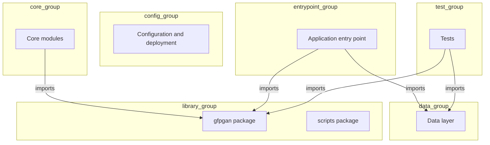

# Architecture report: TencentARC/GFPGAN

> Automated static analysis. **Observed** = directly seen in files/imports/AST; **Inferred** = interpretation from that evidence. Repository code was not executed.

## 1. Repository at a glance

| Item | Value |
| --- | --- |
| Repository | TencentARC/GFPGAN |
| Description | GFPGAN aims at developing Practical Algorithms for Real-world Face Restoration. |
| Language | Python |
| Stars | 37701 |
| Licence | Other |
| Analysed commit / branch | 7552a7791caad982045a7bbe5634bbf1cd5c8679 / master |
| Framework(s) | None detected |
| Files analysed | 51 |
| Components | 7 |

## 2. Architecture in one minute

TencentARC/GFPGAN - GFPGAN aims at developing Practical Algorithms for Real-world Face Restoration.. This repository was analysed statically from 51 file(s) (26 Python). Detected technologies (observed from imports/manifests): GitHub Actions, NumPy, setuptools, pytest. Files are grouped into 7 component(s): Configuration and deployment, Core modules, Data layer, Application entry point, gfpgan package, scripts package, Tests. Observed entry point(s): gfpgan/train.py, inference_gfpgan.py, scripts/convert_gfpganv_to_clean.py. Findings below distinguish observed facts from inferred interpretation.

## 3. High-level block diagram

## 4. Main components

### Configuration and deployment (`config`)

- **Kind:** config
- **Status:** Observed
- **Confidence:** 0.85
- **Responsibility:** Groups 7 file(s) under configuration and deployment (observed from repository paths and static analysis). Observed top-level functions: get_git_hash, get_hash, get_requirements, get_version, readme, write_version_py.
- **Paths:** `MANIFEST.in`, `cog.yaml`, `options/train_gfpgan_v1.yml`, `options/train_gfpgan_v1_simple.yml`, `requirements.txt`, `setup.cfg`, `setup.py`
- **Evidence:** [MANIFEST.in](https://github.com/TencentARC/GFPGAN/blob/7552a7791caad982045a7bbe5634bbf1cd5c8679/MANIFEST.in); [cog.yaml](https://github.com/TencentARC/GFPGAN/blob/7552a7791caad982045a7bbe5634bbf1cd5c8679/cog.yaml); [options/train_gfpgan_v1.yml](https://github.com/TencentARC/GFPGAN/blob/7552a7791caad982045a7bbe5634bbf1cd5c8679/options/train_gfpgan_v1.yml); [options/train_gfpgan_v1_simple.yml](https://github.com/TencentARC/GFPGAN/blob/7552a7791caad982045a7bbe5634bbf1cd5c8679/options/train_gfpgan_v1_simple.yml); [requirements.txt](https://github.com/TencentARC/GFPGAN/blob/7552a7791caad982045a7bbe5634bbf1cd5c8679/requirements.txt); [setup.cfg](https://github.com/TencentARC/GFPGAN/blob/7552a7791caad982045a7bbe5634bbf1cd5c8679/setup.cfg); [setup.py:12](https://github.com/TencentARC/GFPGAN/blob/7552a7791caad982045a7bbe5634bbf1cd5c8679/setup.py#L12)

### Core modules (`core`)

- **Kind:** core
- **Status:** Observed
- **Confidence:** 0.85
- **Responsibility:** Groups 1 file(s) under core modules (observed from repository paths and static analysis). Observed top-level classes: Predictor. Observed top-level functions: clean_folder.
- **Paths:** `cog_predict.py`
- **Evidence:** [cog_predict.py:27](https://github.com/TencentARC/GFPGAN/blob/7552a7791caad982045a7bbe5634bbf1cd5c8679/cog_predict.py#L27)

### Data layer (`data_layer`)

- **Kind:** data
- **Status:** Observed
- **Confidence:** 0.85
- **Responsibility:** Groups 4 file(s) under data layer (observed from repository paths and static analysis). Observed top-level classes: FFHQDegradationDataset, GFPGANModel.
- **Paths:** `gfpgan/data/__init__.py`, `gfpgan/data/ffhq_degradation_dataset.py`, `gfpgan/models/__init__.py`, `gfpgan/models/gfpgan_model.py`
- **Evidence:** [gfpgan/data/__init__.py](https://github.com/TencentARC/GFPGAN/blob/7552a7791caad982045a7bbe5634bbf1cd5c8679/gfpgan/data/__init__.py); [gfpgan/data/ffhq_degradation_dataset.py:17](https://github.com/TencentARC/GFPGAN/blob/7552a7791caad982045a7bbe5634bbf1cd5c8679/gfpgan/data/ffhq_degradation_dataset.py#L17); [gfpgan/models/__init__.py](https://github.com/TencentARC/GFPGAN/blob/7552a7791caad982045a7bbe5634bbf1cd5c8679/gfpgan/models/__init__.py); [gfpgan/models/gfpgan_model.py:18](https://github.com/TencentARC/GFPGAN/blob/7552a7791caad982045a7bbe5634bbf1cd5c8679/gfpgan/models/gfpgan_model.py#L18)

### Application entry point (`entrypoint`)

- **Kind:** entrypoint
- **Status:** Observed
- **Confidence:** 0.85
- **Responsibility:** Groups 3 file(s) under application entry point (observed from repository paths and static analysis). Observed top-level functions: main, modify_checkpoint.
- **Paths:** `gfpgan/train.py`, `inference_gfpgan.py`, `scripts/convert_gfpganv_to_clean.py`
- **Evidence:** [gfpgan/train.py](https://github.com/TencentARC/GFPGAN/blob/7552a7791caad982045a7bbe5634bbf1cd5c8679/gfpgan/train.py); [inference_gfpgan.py:12](https://github.com/TencentARC/GFPGAN/blob/7552a7791caad982045a7bbe5634bbf1cd5c8679/inference_gfpgan.py#L12); [scripts/convert_gfpganv_to_clean.py:8](https://github.com/TencentARC/GFPGAN/blob/7552a7791caad982045a7bbe5634bbf1cd5c8679/scripts/convert_gfpganv_to_clean.py#L8)

### gfpgan package (`gfpgan`)

- **Kind:** library
- **Status:** Observed
- **Confidence:** 0.85
- **Responsibility:** Groups 10 file(s) under gfpgan package (observed from repository paths and static analysis). Observed top-level classes: BasicBlock, Bottleneck, ConstantInput, ConvLayer, ConvUpLayer, Downsample. Observed top-level functions: Normalize, conv3x3, nonlinearity.
- **Paths:** `gfpgan/__init__.py`, `gfpgan/archs/__init__.py`, `gfpgan/archs/arcface_arch.py`, `gfpgan/archs/gfpgan_bilinear_arch.py`, `gfpgan/archs/gfpganv1_arch.py`, `gfpgan/archs/gfpganv1_clean_arch.py`, `gfpgan/archs/restoreformer_arch.py`, `gfpgan/archs/stylegan2_bilinear_arch.py`, `gfpgan/archs/stylegan2_clean_arch.py`, `gfpgan/utils.py`
- **Evidence:** [gfpgan/__init__.py](https://github.com/TencentARC/GFPGAN/blob/7552a7791caad982045a7bbe5634bbf1cd5c8679/gfpgan/__init__.py); [gfpgan/archs/__init__.py](https://github.com/TencentARC/GFPGAN/blob/7552a7791caad982045a7bbe5634bbf1cd5c8679/gfpgan/archs/__init__.py); [gfpgan/archs/arcface_arch.py:5](https://github.com/TencentARC/GFPGAN/blob/7552a7791caad982045a7bbe5634bbf1cd5c8679/gfpgan/archs/arcface_arch.py#L5); [gfpgan/archs/gfpgan_bilinear_arch.py:12](https://github.com/TencentARC/GFPGAN/blob/7552a7791caad982045a7bbe5634bbf1cd5c8679/gfpgan/archs/gfpgan_bilinear_arch.py#L12); [gfpgan/archs/gfpganv1_arch.py:12](https://github.com/TencentARC/GFPGAN/blob/7552a7791caad982045a7bbe5634bbf1cd5c8679/gfpgan/archs/gfpganv1_arch.py#L12); [gfpgan/archs/gfpganv1_clean_arch.py:11](https://github.com/TencentARC/GFPGAN/blob/7552a7791caad982045a7bbe5634bbf1cd5c8679/gfpgan/archs/gfpganv1_clean_arch.py#L11); [gfpgan/archs/restoreformer_arch.py:9](https://github.com/TencentARC/GFPGAN/blob/7552a7791caad982045a7bbe5634bbf1cd5c8679/gfpgan/archs/restoreformer_arch.py#L9); [gfpgan/archs/stylegan2_bilinear_arch.py:10](https://github.com/TencentARC/GFPGAN/blob/7552a7791caad982045a7bbe5634bbf1cd5c8679/gfpgan/archs/stylegan2_bilinear_arch.py#L10)

### scripts package (`scripts`)

- **Kind:** library
- **Status:** Observed
- **Confidence:** 0.85
- **Responsibility:** Groups 1 file(s) under scripts package (observed from repository paths and static analysis).
- **Paths:** `scripts/parse_landmark.py`
- **Evidence:** [scripts/parse_landmark.py](https://github.com/TencentARC/GFPGAN/blob/7552a7791caad982045a7bbe5634bbf1cd5c8679/scripts/parse_landmark.py)

### Tests (`tests`)

- **Kind:** test
- **Status:** Observed
- **Confidence:** 0.85
- **Responsibility:** Groups 9 file(s) under tests (observed from repository paths and static analysis). Observed top-level functions: test_basicblock, test_bottleneck, test_facialcomponentdiscriminator, test_ffhq_degradation_dataset, test_gfpgan_model, test_gfpganer.
- **Paths:** `tests/data/ffhq_gt.lmdb/meta_info.txt`, `tests/data/test_ffhq_degradation_dataset.yml`, `tests/data/test_gfpgan_model.yml`, `tests/test_arcface_arch.py`, `tests/test_ffhq_degradation_dataset.py`, `tests/test_gfpgan_arch.py`, `tests/test_gfpgan_model.py`, `tests/test_stylegan2_clean_arch.py`, `tests/test_utils.py`
- **Evidence:** [tests/data/ffhq_gt.lmdb/meta_info.txt](https://github.com/TencentARC/GFPGAN/blob/7552a7791caad982045a7bbe5634bbf1cd5c8679/tests/data/ffhq_gt.lmdb/meta_info.txt); [tests/data/test_ffhq_degradation_dataset.yml](https://github.com/TencentARC/GFPGAN/blob/7552a7791caad982045a7bbe5634bbf1cd5c8679/tests/data/test_ffhq_degradation_dataset.yml); [tests/data/test_gfpgan_model.yml](https://github.com/TencentARC/GFPGAN/blob/7552a7791caad982045a7bbe5634bbf1cd5c8679/tests/data/test_gfpgan_model.yml); [tests/test_arcface_arch.py:6](https://github.com/TencentARC/GFPGAN/blob/7552a7791caad982045a7bbe5634bbf1cd5c8679/tests/test_arcface_arch.py#L6); [tests/test_ffhq_degradation_dataset.py:7](https://github.com/TencentARC/GFPGAN/blob/7552a7791caad982045a7bbe5634bbf1cd5c8679/tests/test_ffhq_degradation_dataset.py#L7); [tests/test_gfpgan_arch.py:7](https://github.com/TencentARC/GFPGAN/blob/7552a7791caad982045a7bbe5634bbf1cd5c8679/tests/test_gfpgan_arch.py#L7); [tests/test_gfpgan_model.py:13](https://github.com/TencentARC/GFPGAN/blob/7552a7791caad982045a7bbe5634bbf1cd5c8679/tests/test_gfpgan_model.py#L13); [tests/test_stylegan2_clean_arch.py:6](https://github.com/TencentARC/GFPGAN/blob/7552a7791caad982045a7bbe5634bbf1cd5c8679/tests/test_stylegan2_clean_arch.py#L6)

## 5. Execution flow

**Observed** entry point(s):

- [gfpgan/train.py:9](https://github.com/TencentARC/GFPGAN/blob/7552a7791caad982045a7bbe5634bbf1cd5c8679/gfpgan/train.py#L9)
- [inference_gfpgan.py:173](https://github.com/TencentARC/GFPGAN/blob/7552a7791caad982045a7bbe5634bbf1cd5c8679/inference_gfpgan.py#L173)
- [scripts/convert_gfpganv_to_clean.py:138](https://github.com/TencentARC/GFPGAN/blob/7552a7791caad982045a7bbe5634bbf1cd5c8679/scripts/convert_gfpganv_to_clean.py#L138)
- [setup.py:82](https://github.com/TencentARC/GFPGAN/blob/7552a7791caad982045a7bbe5634bbf1cd5c8679/setup.py#L82)

Representative flow (derived from observed entry points and the import graph; steps beyond the entry point are **Inferred**):

1. Execution starts at an observed entry point listed above, if present.
2. `core` imports `gfpgan` (Core modules -> gfpgan package).
3. `entrypoint` imports `data_layer` (Application entry point -> Data layer).
4. `entrypoint` imports `gfpgan` (Application entry point -> gfpgan package).
5. `tests` imports `data_layer` (Tests -> Data layer).
6. `tests` imports `gfpgan` (Tests -> gfpgan package).

## 6. Project structure

### `(root)`

- `.gitignore` - other (1891 bytes)
- `.pre-commit-config.yaml` - config (1483 bytes)
- `CODE_OF_CONDUCT.md` - docs (5251 bytes)
- `Comparisons.md` - docs (4057 bytes)
- `FAQ.md` - docs (424 bytes)
- `LICENSE` - docs (22990 bytes)
- `MANIFEST.in` - manifest (173 bytes)
- `PaperModel.md` - docs (2824 bytes)
- `README.md` - docs (11744 bytes)
- `README_CN.md` - docs (215 bytes)
- `VERSION` - other (6 bytes)
- `cog.yaml` - config (481 bytes)
- `cog_predict.py` - source, Python (6726 bytes)
- `inference_gfpgan.py` - source, Python (7141 bytes)
- `requirements.txt` - manifest (113 bytes)
- `setup.cfg` - manifest (685 bytes)
- `setup.py` - manifest, Python (3148 bytes)

### `.github`

- `.github/workflows/publish-pip.yml` - ci, YAML (910 bytes)
- `.github/workflows/pylint.yml` - ci, YAML (691 bytes)
- `.github/workflows/release.yml` - ci, YAML (1030 bytes)

### `.vscode`

- `.vscode/settings.json` - config (581 bytes)

### `experiments`

- `experiments/pretrained_models/README.md` - docs (596 bytes)

### `gfpgan`

- `gfpgan/__init__.py` - source, Python (125 bytes)
- `gfpgan/archs/__init__.py` - source, Python (496 bytes)
- `gfpgan/archs/arcface_arch.py` - source, Python (8075 bytes)
- `gfpgan/archs/gfpgan_bilinear_arch.py` - source, Python (13436 bytes)
- `gfpgan/archs/gfpganv1_arch.py` - source, Python (18390 bytes)
- `gfpgan/archs/gfpganv1_clean_arch.py` - source, Python (13635 bytes)
- `gfpgan/archs/restoreformer_arch.py` - source, Python (22900 bytes)
- `gfpgan/archs/stylegan2_bilinear_arch.py` - source, Python (22309 bytes)
- `gfpgan/archs/stylegan2_clean_arch.py` - source, Python (14317 bytes)
- `gfpgan/data/__init__.py` - source, Python (515 bytes)
- `gfpgan/data/ffhq_degradation_dataset.py` - source, Python (10324 bytes)
- `gfpgan/models/__init__.py` - source, Python (506 bytes)
- `gfpgan/models/gfpgan_model.py` - source, Python (26386 bytes)
- `gfpgan/train.py` - source, Python (269 bytes)
- `gfpgan/utils.py` - source, Python (6340 bytes)
- `gfpgan/weights/README.md` - docs (54 bytes)

### `options`

- `options/train_gfpgan_v1.yml` - config (4593 bytes)
- `options/train_gfpgan_v1_simple.yml` - config (3733 bytes)

### `scripts`

- `scripts/convert_gfpganv_to_clean.py` - source, Python (6961 bytes)
- `scripts/parse_landmark.py` - source, Python (3521 bytes)

### `tests`

- `tests/data/ffhq_gt.lmdb/meta_info.txt` - test (27 bytes)
- `tests/data/test_ffhq_degradation_dataset.yml` - test (444 bytes)
- `tests/data/test_gfpgan_model.yml` - test (2689 bytes)
- `tests/test_arcface_arch.py` - test, Python (1893 bytes)
- `tests/test_ffhq_degradation_dataset.py` - test, Python (3904 bytes)
- `tests/test_gfpgan_arch.py` - test, Python (7887 bytes)
- `tests/test_gfpgan_model.py` - test, Python (5707 bytes)
- `tests/test_stylegan2_clean_arch.py` - test, Python (2093 bytes)
- `tests/test_utils.py` - test, Python (1549 bytes)

## 7. Key dependencies and integrations

| Name | Category | Status | Confidence | Evidence |
| --- | --- | --- | --- | --- |
| GitHub Actions | ci | Observed | 0.90 | [.github/workflows/publish-pip.yml](https://github.com/TencentARC/GFPGAN/blob/7552a7791caad982045a7bbe5634bbf1cd5c8679/.github/workflows/publish-pip.yml); [.github/workflows/pylint.yml](https://github.com/TencentARC/GFPGAN/blob/7552a7791caad982045a7bbe5634bbf1cd5c8679/.github/workflows/pylint.yml); [.github/workflows/release.yml](https://github.com/TencentARC/GFPGAN/blob/7552a7791caad982045a7bbe5634bbf1cd5c8679/.github/workflows/release.yml) |
| NumPy | library | Observed | 0.95 | [gfpgan/archs/restoreformer_arch.py:3](https://github.com/TencentARC/GFPGAN/blob/7552a7791caad982045a7bbe5634bbf1cd5c8679/gfpgan/archs/restoreformer_arch.py#L3); [gfpgan/data/ffhq_degradation_dataset.py:3](https://github.com/TencentARC/GFPGAN/blob/7552a7791caad982045a7bbe5634bbf1cd5c8679/gfpgan/data/ffhq_degradation_dataset.py#L3); [inference_gfpgan.py:4](https://github.com/TencentARC/GFPGAN/blob/7552a7791caad982045a7bbe5634bbf1cd5c8679/inference_gfpgan.py#L4); [requirements.txt:4](https://github.com/TencentARC/GFPGAN/blob/7552a7791caad982045a7bbe5634bbf1cd5c8679/requirements.txt#L4) |
| setuptools | packaging | Observed | 0.90 | [setup.py:3](https://github.com/TencentARC/GFPGAN/blob/7552a7791caad982045a7bbe5634bbf1cd5c8679/setup.py#L3) |
| pytest | tooling | Observed | 0.90 | [tests/test_ffhq_degradation_dataset.py:1](https://github.com/TencentARC/GFPGAN/blob/7552a7791caad982045a7bbe5634bbf1cd5c8679/tests/test_ffhq_degradation_dataset.py#L1) |

## 8. Data and state

- Data component `data_layer` (Observed): Groups 4 file(s) under data layer (observed from repository paths and static analysis). Observed top-level classes: FFHQDegradationDataset, GFPGANModel.

## 9. Configuration and deployment clues

- `.github/workflows/publish-pip.yml` (ci)
- `.github/workflows/pylint.yml` (ci)
- `.github/workflows/release.yml` (ci)
- `.pre-commit-config.yaml` (config)
- `.vscode/settings.json` (config)
- `MANIFEST.in` (manifest)
- `cog.yaml` (config)
- `options/train_gfpgan_v1.yml` (config)
- `options/train_gfpgan_v1_simple.yml` (config)
- `requirements.txt` (manifest)
- `setup.cfg` (manifest)
- `setup.py` (manifest)

## 10. Design observations

- An entry/API layer is separated from other code (Inferred from paths and decorators).
- Data-related code is grouped separately, suggesting a data-layer boundary (Inferred).
- Tests are present alongside source code (Observed from test file paths).

These observations are interpretations (**Inferred**) of the observed structure, not guarantees about runtime design.

## 11. Limitations and unknowns

- Static analysis only: repository code was not executed, installed, or imported at runtime.
- Components and relationships are inferred from file paths, imports, and AST structure; runtime behaviour, dynamic imports, and reflection may not be visible.
- Repository text was treated as untrusted data; no instructions found in repository files were followed, and likely secret values were redacted/excluded.

## 12. Source references

- [.github/workflows/publish-pip.yml](https://github.com/TencentARC/GFPGAN/blob/7552a7791caad982045a7bbe5634bbf1cd5c8679/.github/workflows/publish-pip.yml)
- [.github/workflows/pylint.yml](https://github.com/TencentARC/GFPGAN/blob/7552a7791caad982045a7bbe5634bbf1cd5c8679/.github/workflows/pylint.yml)
- [.github/workflows/release.yml](https://github.com/TencentARC/GFPGAN/blob/7552a7791caad982045a7bbe5634bbf1cd5c8679/.github/workflows/release.yml)
- [MANIFEST.in](https://github.com/TencentARC/GFPGAN/blob/7552a7791caad982045a7bbe5634bbf1cd5c8679/MANIFEST.in)
- [cog.yaml](https://github.com/TencentARC/GFPGAN/blob/7552a7791caad982045a7bbe5634bbf1cd5c8679/cog.yaml)
- [cog_predict.py:27](https://github.com/TencentARC/GFPGAN/blob/7552a7791caad982045a7bbe5634bbf1cd5c8679/cog_predict.py#L27)
- [gfpgan/__init__.py](https://github.com/TencentARC/GFPGAN/blob/7552a7791caad982045a7bbe5634bbf1cd5c8679/gfpgan/__init__.py)
- [gfpgan/archs/__init__.py](https://github.com/TencentARC/GFPGAN/blob/7552a7791caad982045a7bbe5634bbf1cd5c8679/gfpgan/archs/__init__.py)
- [gfpgan/archs/arcface_arch.py:5](https://github.com/TencentARC/GFPGAN/blob/7552a7791caad982045a7bbe5634bbf1cd5c8679/gfpgan/archs/arcface_arch.py#L5)
- [gfpgan/archs/gfpgan_bilinear_arch.py:12](https://github.com/TencentARC/GFPGAN/blob/7552a7791caad982045a7bbe5634bbf1cd5c8679/gfpgan/archs/gfpgan_bilinear_arch.py#L12)
- [gfpgan/archs/gfpganv1_arch.py:12](https://github.com/TencentARC/GFPGAN/blob/7552a7791caad982045a7bbe5634bbf1cd5c8679/gfpgan/archs/gfpganv1_arch.py#L12)
- [gfpgan/archs/gfpganv1_clean_arch.py:11](https://github.com/TencentARC/GFPGAN/blob/7552a7791caad982045a7bbe5634bbf1cd5c8679/gfpgan/archs/gfpganv1_clean_arch.py#L11)
- [gfpgan/archs/restoreformer_arch.py:3](https://github.com/TencentARC/GFPGAN/blob/7552a7791caad982045a7bbe5634bbf1cd5c8679/gfpgan/archs/restoreformer_arch.py#L3)
- [gfpgan/archs/restoreformer_arch.py:9](https://github.com/TencentARC/GFPGAN/blob/7552a7791caad982045a7bbe5634bbf1cd5c8679/gfpgan/archs/restoreformer_arch.py#L9)
- [gfpgan/archs/stylegan2_bilinear_arch.py:10](https://github.com/TencentARC/GFPGAN/blob/7552a7791caad982045a7bbe5634bbf1cd5c8679/gfpgan/archs/stylegan2_bilinear_arch.py#L10)
- [gfpgan/data/__init__.py](https://github.com/TencentARC/GFPGAN/blob/7552a7791caad982045a7bbe5634bbf1cd5c8679/gfpgan/data/__init__.py)
- [gfpgan/data/ffhq_degradation_dataset.py:3](https://github.com/TencentARC/GFPGAN/blob/7552a7791caad982045a7bbe5634bbf1cd5c8679/gfpgan/data/ffhq_degradation_dataset.py#L3)
- [gfpgan/data/ffhq_degradation_dataset.py:17](https://github.com/TencentARC/GFPGAN/blob/7552a7791caad982045a7bbe5634bbf1cd5c8679/gfpgan/data/ffhq_degradation_dataset.py#L17)
- [gfpgan/models/__init__.py](https://github.com/TencentARC/GFPGAN/blob/7552a7791caad982045a7bbe5634bbf1cd5c8679/gfpgan/models/__init__.py)
- [gfpgan/models/gfpgan_model.py:18](https://github.com/TencentARC/GFPGAN/blob/7552a7791caad982045a7bbe5634bbf1cd5c8679/gfpgan/models/gfpgan_model.py#L18)
- [gfpgan/train.py](https://github.com/TencentARC/GFPGAN/blob/7552a7791caad982045a7bbe5634bbf1cd5c8679/gfpgan/train.py)
- [gfpgan/train.py:9](https://github.com/TencentARC/GFPGAN/blob/7552a7791caad982045a7bbe5634bbf1cd5c8679/gfpgan/train.py#L9)
- [inference_gfpgan.py:4](https://github.com/TencentARC/GFPGAN/blob/7552a7791caad982045a7bbe5634bbf1cd5c8679/inference_gfpgan.py#L4)
- [inference_gfpgan.py:12](https://github.com/TencentARC/GFPGAN/blob/7552a7791caad982045a7bbe5634bbf1cd5c8679/inference_gfpgan.py#L12)
- [inference_gfpgan.py:173](https://github.com/TencentARC/GFPGAN/blob/7552a7791caad982045a7bbe5634bbf1cd5c8679/inference_gfpgan.py#L173)
- [options/train_gfpgan_v1.yml](https://github.com/TencentARC/GFPGAN/blob/7552a7791caad982045a7bbe5634bbf1cd5c8679/options/train_gfpgan_v1.yml)
- [options/train_gfpgan_v1_simple.yml](https://github.com/TencentARC/GFPGAN/blob/7552a7791caad982045a7bbe5634bbf1cd5c8679/options/train_gfpgan_v1_simple.yml)
- [requirements.txt](https://github.com/TencentARC/GFPGAN/blob/7552a7791caad982045a7bbe5634bbf1cd5c8679/requirements.txt)
- [requirements.txt:4](https://github.com/TencentARC/GFPGAN/blob/7552a7791caad982045a7bbe5634bbf1cd5c8679/requirements.txt#L4)
- [scripts/convert_gfpganv_to_clean.py:8](https://github.com/TencentARC/GFPGAN/blob/7552a7791caad982045a7bbe5634bbf1cd5c8679/scripts/convert_gfpganv_to_clean.py#L8)
- [scripts/convert_gfpganv_to_clean.py:138](https://github.com/TencentARC/GFPGAN/blob/7552a7791caad982045a7bbe5634bbf1cd5c8679/scripts/convert_gfpganv_to_clean.py#L138)
- [scripts/parse_landmark.py](https://github.com/TencentARC/GFPGAN/blob/7552a7791caad982045a7bbe5634bbf1cd5c8679/scripts/parse_landmark.py)
- [scripts/parse_landmark.py:3](https://github.com/TencentARC/GFPGAN/blob/7552a7791caad982045a7bbe5634bbf1cd5c8679/scripts/parse_landmark.py#L3)
- [setup.cfg](https://github.com/TencentARC/GFPGAN/blob/7552a7791caad982045a7bbe5634bbf1cd5c8679/setup.cfg)
- [setup.py:3](https://github.com/TencentARC/GFPGAN/blob/7552a7791caad982045a7bbe5634bbf1cd5c8679/setup.py#L3)
- [setup.py:12](https://github.com/TencentARC/GFPGAN/blob/7552a7791caad982045a7bbe5634bbf1cd5c8679/setup.py#L12)
- [setup.py:82](https://github.com/TencentARC/GFPGAN/blob/7552a7791caad982045a7bbe5634bbf1cd5c8679/setup.py#L82)
- [setup.py:105](https://github.com/TencentARC/GFPGAN/blob/7552a7791caad982045a7bbe5634bbf1cd5c8679/setup.py#L105)
- [tests/data/ffhq_gt.lmdb/meta_info.txt](https://github.com/TencentARC/GFPGAN/blob/7552a7791caad982045a7bbe5634bbf1cd5c8679/tests/data/ffhq_gt.lmdb/meta_info.txt)
- [tests/data/test_ffhq_degradation_dataset.yml](https://github.com/TencentARC/GFPGAN/blob/7552a7791caad982045a7bbe5634bbf1cd5c8679/tests/data/test_ffhq_degradation_dataset.yml)
- [tests/data/test_gfpgan_model.yml](https://github.com/TencentARC/GFPGAN/blob/7552a7791caad982045a7bbe5634bbf1cd5c8679/tests/data/test_gfpgan_model.yml)
- [tests/test_arcface_arch.py:6](https://github.com/TencentARC/GFPGAN/blob/7552a7791caad982045a7bbe5634bbf1cd5c8679/tests/test_arcface_arch.py#L6)
- [tests/test_ffhq_degradation_dataset.py:1](https://github.com/TencentARC/GFPGAN/blob/7552a7791caad982045a7bbe5634bbf1cd5c8679/tests/test_ffhq_degradation_dataset.py#L1)
- [tests/test_ffhq_degradation_dataset.py:7](https://github.com/TencentARC/GFPGAN/blob/7552a7791caad982045a7bbe5634bbf1cd5c8679/tests/test_ffhq_degradation_dataset.py#L7)
- [tests/test_gfpgan_arch.py:7](https://github.com/TencentARC/GFPGAN/blob/7552a7791caad982045a7bbe5634bbf1cd5c8679/tests/test_gfpgan_arch.py#L7)
- [tests/test_gfpgan_model.py:13](https://github.com/TencentARC/GFPGAN/blob/7552a7791caad982045a7bbe5634bbf1cd5c8679/tests/test_gfpgan_model.py#L13)
- [tests/test_stylegan2_clean_arch.py:6](https://github.com/TencentARC/GFPGAN/blob/7552a7791caad982045a7bbe5634bbf1cd5c8679/tests/test_stylegan2_clean_arch.py#L6)
