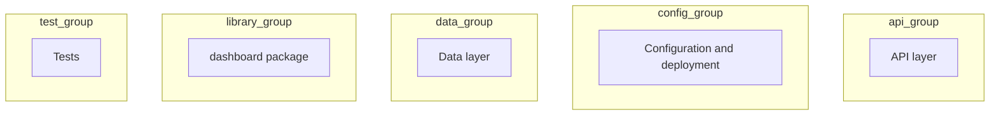

# Architecture report: TencentCloud/Octop

> Automated static analysis. **Observed** = directly seen in files/imports/AST; **Inferred** = interpretation from that evidence. Repository code was not executed.

## 1. Repository at a glance

| Item | Value |
| --- | --- |
| Repository | TencentCloud/Octop |
| Description | A smarter, self-hosted AI assistant — multi-user, multi-agent. |
| Language | Python |
| Stars | 12043 |
| Licence | MIT |
| Analysed commit / branch | cd17e8d3551a22e6757f11e030879420243c089f / main |
| Framework(s) | React |
| Files analysed | 799 |
| Components | 5 |

## 2. Architecture in one minute

TencentCloud/Octop - A smarter, self-hosted AI assistant — multi-user, multi-agent.. This repository was analysed statically from 799 file(s) (2 Python). Detected technologies (observed from imports/manifests): GitHub Actions, React, React Router, Docker, pytest, TypeScript. Files are grouped into 5 component(s): API layer, Configuration and deployment, dashboard package, Data layer, Tests. Findings below distinguish observed facts from inferred interpretation.

## 3. High-level block diagram

## 4. Main components

### API layer (`api_layer`)

- **Kind:** api
- **Status:** Observed
- **Confidence:** 0.85
- **Responsibility:** Groups 84 file(s) under api layer (observed from repository paths and static analysis).
- **Paths:** `dashboard/src/api/config.ts`, `dashboard/src/api/desktopSession.ts`, `dashboard/src/api/index.ts`, `dashboard/src/api/modules/acp.ts`, `dashboard/src/api/modules/agent.ts`, `dashboard/src/api/modules/agentChat.ts`, `dashboard/src/api/modules/agentTools.ts`, `dashboard/src/api/modules/auth.ts`, `dashboard/src/api/modules/backup.ts`, `dashboard/src/api/modules/bridge.ts`, `dashboard/src/api/modules/browser.ts`, `dashboard/src/api/modules/channel.ts`, `dashboard/src/api/modules/connectors.ts`, `dashboard/src/api/modules/cronjob.ts`, `dashboard/src/api/modules/decision.ts`, `dashboard/src/api/modules/desktop.ts`, `dashboard/src/api/modules/embedding.ts`, `dashboard/src/api/modules/env.ts`, `dashboard/src/api/modules/expertMarket.ts`, `dashboard/src/api/modules/i18n.ts`, `dashboard/src/api/modules/invites.ts`, `dashboard/src/api/modules/knowledgeBases.test.ts`, `dashboard/src/api/modules/knowledgeBases.ts`, `dashboard/src/api/modules/mbti.ts`, `dashboard/src/api/modules/mediaGeneration.ts`, `dashboard/src/api/modules/memoryDashboard.ts`, `dashboard/src/api/modules/memoryPortable.ts`, `dashboard/src/api/modules/mobile.test.ts`, `dashboard/src/api/modules/mobile.ts`, `dashboard/src/api/modules/observability.ts`, `dashboard/src/api/modules/octopAgents.ts`, `dashboard/src/api/modules/octopThreads.ts`, `dashboard/src/api/modules/ollamaModel.ts`, `dashboard/src/api/modules/onnxDownloadWatcher.ts`, `dashboard/src/api/modules/onnxModel.ts`, `dashboard/src/api/modules/plugins.ts`, `dashboard/src/api/modules/preferences.ts`, `dashboard/src/api/modules/provider.ts`, `dashboard/src/api/modules/publishedExperts.test.ts`, `dashboard/src/api/modules/publishedExperts.ts`, `dashboard/src/api/modules/root.ts`, `dashboard/src/api/modules/security.ts`, `dashboard/src/api/modules/settings.ts`, `dashboard/src/api/modules/skillPackages.test.ts`, `dashboard/src/api/modules/skillPackages.ts`, `dashboard/src/api/modules/slash.ts`, `dashboard/src/api/modules/sso.test.ts`, `dashboard/src/api/modules/sso.ts`, `dashboard/src/api/modules/subagents.ts`, `dashboard/src/api/modules/teams.ts`, `dashboard/src/api/modules/terminalAi.ts`, `dashboard/src/api/modules/textAssist.ts`, `dashboard/src/api/modules/tls.ts`, `dashboard/src/api/modules/trajectory.ts`, `dashboard/src/api/modules/update.ts`, `dashboard/src/api/modules/upload.ts`, `dashboard/src/api/modules/userGroups.ts`, `dashboard/src/api/modules/userRoles.ts`, `dashboard/src/api/modules/voice.ts`, `dashboard/src/api/modules/workspace.ts`, `dashboard/src/api/modules/wsChat.ts`, `dashboard/src/api/modules/wsNotifications.ts`, `dashboard/src/api/probeHealth.ts`, `dashboard/src/api/request.authToken.test.ts`, `dashboard/src/api/request.desktopSession.test.ts`, `dashboard/src/api/request.setup.test.ts`, `dashboard/src/api/request.ts`, `dashboard/src/api/request.unauthorized.test.ts`, `dashboard/src/api/types/acp.ts`, `dashboard/src/api/types/agent.ts`, `dashboard/src/api/types/browser.ts`, `dashboard/src/api/types/channel.ts`, `dashboard/src/api/types/chat.ts`, `dashboard/src/api/types/cronjob.ts`, `dashboard/src/api/types/embedding.ts`, `dashboard/src/api/types/env.ts`, `dashboard/src/api/types/hitl.test.ts`, `dashboard/src/api/types/hitl.ts`, `dashboard/src/api/types/index.ts`, `dashboard/src/api/types/mbti.ts`, `dashboard/src/api/types/provider.ts`, `dashboard/src/api/types/skill.ts`, `dashboard/src/api/types/skillPackage.ts`, `dashboard/src/api/types/workspace.ts`
- **Evidence:** [dashboard/src/api/config.ts](https://github.com/TencentCloud/Octop/blob/cd17e8d3551a22e6757f11e030879420243c089f/dashboard/src/api/config.ts); [dashboard/src/api/desktopSession.ts](https://github.com/TencentCloud/Octop/blob/cd17e8d3551a22e6757f11e030879420243c089f/dashboard/src/api/desktopSession.ts); [dashboard/src/api/index.ts](https://github.com/TencentCloud/Octop/blob/cd17e8d3551a22e6757f11e030879420243c089f/dashboard/src/api/index.ts); [dashboard/src/api/modules/acp.ts](https://github.com/TencentCloud/Octop/blob/cd17e8d3551a22e6757f11e030879420243c089f/dashboard/src/api/modules/acp.ts); [dashboard/src/api/modules/agent.ts](https://github.com/TencentCloud/Octop/blob/cd17e8d3551a22e6757f11e030879420243c089f/dashboard/src/api/modules/agent.ts); [dashboard/src/api/modules/agentChat.ts](https://github.com/TencentCloud/Octop/blob/cd17e8d3551a22e6757f11e030879420243c089f/dashboard/src/api/modules/agentChat.ts); [dashboard/src/api/modules/agentTools.ts](https://github.com/TencentCloud/Octop/blob/cd17e8d3551a22e6757f11e030879420243c089f/dashboard/src/api/modules/agentTools.ts); [dashboard/src/api/modules/auth.ts](https://github.com/TencentCloud/Octop/blob/cd17e8d3551a22e6757f11e030879420243c089f/dashboard/src/api/modules/auth.ts)

### Configuration and deployment (`config`)

- **Kind:** config
- **Status:** Observed
- **Confidence:** 0.85
- **Responsibility:** Groups 4 file(s) under configuration and deployment (observed from repository paths and static analysis).
- **Paths:** `dashboard/package.json`, `dashboard/public/manifest.json`, `dashboard/src/pages/Agent/Config/index.test.tsx`, `dashboard/src/pages/Agent/Config/index.tsx`
- **Evidence:** [dashboard/package.json](https://github.com/TencentCloud/Octop/blob/cd17e8d3551a22e6757f11e030879420243c089f/dashboard/package.json); [dashboard/public/manifest.json](https://github.com/TencentCloud/Octop/blob/cd17e8d3551a22e6757f11e030879420243c089f/dashboard/public/manifest.json); [dashboard/src/pages/Agent/Config/index.test.tsx](https://github.com/TencentCloud/Octop/blob/cd17e8d3551a22e6757f11e030879420243c089f/dashboard/src/pages/Agent/Config/index.test.tsx); [dashboard/src/pages/Agent/Config/index.tsx](https://github.com/TencentCloud/Octop/blob/cd17e8d3551a22e6757f11e030879420243c089f/dashboard/src/pages/Agent/Config/index.tsx)

### dashboard package (`dashboard`)

- **Kind:** library
- **Status:** Observed
- **Confidence:** 0.85
- **Responsibility:** Groups 441 file(s) under dashboard package (observed from repository paths and static analysis).
- **Paths:** `dashboard/eslint.config.js`, `dashboard/public/notify-sw.js`, `dashboard/public/pcm-processor.js`, `dashboard/scripts/gen-asset-index.mjs`, `dashboard/src/App.tsx`, `dashboard/src/assets/connectors/index.ts`, `dashboard/src/assets/mascot.ts`, `dashboard/src/assets/providers/__init__.py`, `dashboard/src/assets/providers/index.test.ts`, `dashboard/src/assets/providers/index.ts`, `dashboard/src/browserCompatibility.test.ts`, `dashboard/src/components/AccountSecurityDrawer.tsx`, `dashboard/src/components/AgentAdvancedConfigFields.tsx`, `dashboard/src/components/AgentProfileDrawer.test.tsx`, `dashboard/src/components/AgentProfileDrawer.tsx`, `dashboard/src/components/AgentSelector.test.tsx`, `dashboard/src/components/AgentSelector.tsx`, `dashboard/src/components/AntdAppProvider.tsx`, `dashboard/src/components/AppVersionBadge/index.tsx`, `dashboard/src/components/AssistantFrame/AssistantFrame.tsx`, `dashboard/src/components/AuthFileDownloadLink.tsx`, `dashboard/src/components/AuthGuard.test.tsx`, `dashboard/src/components/AuthGuard.tsx`, `dashboard/src/components/AuthImage.tsx`, `dashboard/src/components/AvatarDropdown.displayName.test.tsx`, `dashboard/src/components/AvatarDropdown.tsx`, `dashboard/src/components/AvatarPicker/ResourceAvatar.tsx`, `dashboard/src/components/AvatarPicker/ResourceAvatarPicker.tsx`, `dashboard/src/components/AvatarPicker/index.ts`, `dashboard/src/components/AvatarPicker/presets/bridge.ts`, `dashboard/src/components/AvatarPicker/presets/expert.ts`, `dashboard/src/components/AvatarPicker/presets/knowledge.ts`, `dashboard/src/components/AvatarPicker/presets/role.ts`, `dashboard/src/components/AvatarPicker/presets/skillPackage.ts`, `dashboard/src/components/AvatarPicker/presets/team.ts`, `dashboard/src/components/AvatarPicker/presets/user.ts`, `dashboard/src/components/AvatarPicker/types.ts`, `dashboard/src/components/AvatarPicker/url.ts`, `dashboard/src/components/AvatarPicker/validate.ts`, `dashboard/src/components/BackendBuilder.tsx`, `dashboard/src/components/BetaBadge/index.tsx`, `dashboard/src/components/BootOfflinePanel/index.tsx`, `dashboard/src/components/BrandLoading/index.tsx`, `dashboard/src/components/BrowserAiPanel.tsx`, `dashboard/src/components/BrowserViewer/index.tsx`, `dashboard/src/components/BrowserWorkspace/ChatBrowserPanel.tsx`, `dashboard/src/components/BrowserWorkspace/ChatDockPanelShell.test.tsx`, `dashboard/src/components/BrowserWorkspace/ChatDockPanelShell.tsx`, `dashboard/src/components/BrowserWorkspace/index.tsx`, `dashboard/src/components/CatalogTypeCard/index.tsx`, `dashboard/src/components/ChatPicker/SearchablePickerPanel.tsx`, `dashboard/src/components/ChromeTabBar/index.tsx`, `dashboard/src/components/CopyableResourceId.tsx`, `dashboard/src/components/CurrentVersionBadge/index.tsx`, `dashboard/src/components/DesktopWindowDragBand.test.tsx`, `dashboard/src/components/DesktopWindowDragBand.tsx`, `dashboard/src/components/DocumentPreviewCore.docxSanitize.test.ts`, `dashboard/src/components/DocumentPreviewCore.pdfSkeleton.test.tsx`, `dashboard/src/components/DocumentPreviewCore.tsx`, `dashboard/src/components/DocumentPreviewLoading.tsx`, `dashboard/src/components/EmojiPicker.test.tsx`, `dashboard/src/components/EmojiPicker.tsx`, `dashboard/src/components/EmptyState/OctopEmptyMascot.tsx`, `dashboard/src/components/EmptyState/index.tsx`, `dashboard/src/components/ErrorBoundary/ErrorFallback.tsx`, `dashboard/src/components/ErrorBoundary/index.test.tsx`, `dashboard/src/components/ErrorBoundary/index.tsx`, `dashboard/src/components/ExpertColorPicker.tsx`, `dashboard/src/components/FadeInImg.tsx`, `dashboard/src/components/ForbiddenPage.tsx`, `dashboard/src/components/LanguageSwitcher.tsx`, `dashboard/src/components/LinuxWindowControls.test.tsx`, `dashboard/src/components/LinuxWindowControls.tsx`, `dashboard/src/components/Markdown/LazyMarkdown.tsx`, `dashboard/src/components/Markdown/index.tsx`, `dashboard/src/components/Markdown/mathPlugins.ts`, `dashboard/src/components/Markdown/mermaidLoader.ts`, `dashboard/src/components/Markdown/stabilizeStreamingMarkdown.test.ts`, `dashboard/src/components/Markdown/stabilizeStreamingMarkdown.ts`, `dashboard/src/components/Markdown/syntaxHighlight.tsx`, `dashboard/src/components/MarkdownCopy/MarkdownCopy.tsx`, `dashboard/src/components/MbtiPersonaTag.tsx`, `dashboard/src/components/MobileAiPanel.tsx`, `dashboard/src/components/NotFoundPage.test.tsx`, `dashboard/src/components/NotFoundPage.tsx`, `dashboard/src/components/OctopSpinner/index.tsx`, `dashboard/src/components/PageLoading/index.tsx`, `dashboard/src/components/PaletteSwitcher.tsx`, `dashboard/src/components/PdfDocumentPreview.tsx`, `dashboard/src/components/PdfDocumentPreview.windowed.test.tsx`, `dashboard/src/components/PeerOnlyRemoteAlert.tsx`, `dashboard/src/components/PillScroller/index.tsx`, `dashboard/src/components/PwaInstallPrompt/index.test.tsx`, `dashboard/src/components/PwaInstallPrompt/index.tsx`, `dashboard/src/components/PwaUpdatePrompt/index.tsx`, `dashboard/src/components/RailEdgeControl.test.tsx`, `dashboard/src/components/RailEdgeControl.tsx`, `dashboard/src/components/RemoteDisconnectBanner.tsx`, `dashboard/src/components/RequirePermission.tsx`, `dashboard/src/components/ResizableTable/index.tsx`, `dashboard/src/components/ResourceAudienceFilter/index.tsx`, `dashboard/src/components/ResourceVisibilityFields/index.tsx`, `dashboard/src/components/ResourceVisibilityFields/visibilityChrome.test.ts`, `dashboard/src/components/ResourceVisibilityFields/visibilityChrome.ts`, `dashboard/src/components/ServiceRestartOverlay.tsx`, `dashboard/src/components/SharedResourceBadge/index.tsx`, `dashboard/src/components/Skeleton/CardSkeleton.tsx`, `dashboard/src/components/Skeleton/ListSkeleton.tsx`, `dashboard/src/components/Skeleton/TableSkeleton.tsx`, `dashboard/src/components/Skeleton/index.ts`, `dashboard/src/components/SkillRecordGuideModal.tsx`, `dashboard/src/components/StreamConnectingIndicator/index.tsx`, `dashboard/src/components/StreamEdgeControls/StreamEdgeControls.tsx`, `dashboard/src/components/StreamSetupGuide/StreamSetupGuide.test.tsx`, `dashboard/src/components/StreamSetupGuide/StreamSetupGuide.tsx`, `dashboard/src/components/TabLabel/TabBar.tsx`, `dashboard/src/components/TabLabel/index.tsx`, `dashboard/src/components/TextAssistBar/index.tsx`, `dashboard/src/components/ThemeSwitcher.tsx`, `dashboard/src/components/TodoListInline.tsx`, `dashboard/src/components/TodoProgressPanel.tsx`, `dashboard/src/components/TokenCountInput.tsx`, `dashboard/src/components/WindowsAppMenu.test.tsx`, `dashboard/src/components/WindowsAppMenu.tsx`, `dashboard/src/components/monaco.ts`, `dashboard/src/context/AgentContext.test.ts`, `dashboard/src/context/AgentContext.tsx`, `dashboard/src/context/BackupOperationContext.tsx`, `dashboard/src/context/LayoutModeContext.tsx`, `dashboard/src/context/ScrollContext.tsx`, `dashboard/src/context/ServiceRestartContext.tsx`, `dashboard/src/context/ThemeContext.tsx`, `dashboard/src/context/VoiceOutputContext.tsx`, `dashboard/src/hooks/useAgentFormResources.test.ts`, `dashboard/src/hooks/useAgentFormResources.ts`, `dashboard/src/hooks/useAgentThreadChat.ts`, `dashboard/src/hooks/useAsyncResource.ts`, `dashboard/src/hooks/useAudioUnlock.ts`, `dashboard/src/hooks/useAuthImageSrc.test.ts`, `dashboard/src/hooks/useAuthImageSrc.ts`, `dashboard/src/hooks/useAutoViewportResize.ts`, `dashboard/src/hooks/useBrowserCanvasInteraction.test.ts`, `dashboard/src/hooks/useBrowserCanvasInteraction.ts`, `dashboard/src/hooks/useBrowserKeyboard.test.tsx`, `dashboard/src/hooks/useBrowserKeyboard.ts`, `dashboard/src/hooks/useBrowserSessionState.ts`, `dashboard/src/hooks/useBrowserStream.ts`, `dashboard/src/hooks/useBrowserViewController.ts`, `dashboard/src/hooks/useCanvasRemotePointer.test.ts`, `dashboard/src/hooks/useCanvasRemotePointer.ts`, `dashboard/src/hooks/useCardTableView.ts`, `dashboard/src/hooks/useCurrentUser.tsx`, `dashboard/src/hooks/useCvmOpsExpert.ts`, `dashboard/src/hooks/useDashboardPushToast.tsx`, `dashboard/src/hooks/useDesktopCanvasInteraction.ts`, `dashboard/src/hooks/useDesktopChrome.ts`, `dashboard/src/hooks/useDesktopInstall.ts`, `dashboard/src/hooks/useDesktopStream.ts`, `dashboard/src/hooks/useElapsedSeconds.test.ts`, `dashboard/src/hooks/useElapsedSeconds.ts`, `dashboard/src/hooks/useEmbeddingDownloadWS.ts`, `dashboard/src/hooks/useFilteredList.ts`, `dashboard/src/hooks/useGatedSearchTabs.ts`, `dashboard/src/hooks/useHitlEnabled.test.ts`, `dashboard/src/hooks/useHitlEnabled.ts`, `dashboard/src/hooks/useHorizontalResize.ts`, `dashboard/src/hooks/useIsMobile.ts`, `dashboard/src/hooks/useKeepInVisualViewport.test.ts`, `dashboard/src/hooks/useKeepInVisualViewport.ts`, `dashboard/src/hooks/useKeyboardOffset.test.ts`, `dashboard/src/hooks/useKeyboardOffset.ts`, `dashboard/src/hooks/useLandscapeFullscreen.ts`, `dashboard/src/hooks/useListPanelCollapsed.test.ts`, `dashboard/src/hooks/useListPanelCollapsed.ts`, `dashboard/src/hooks/useMobileStream.ts`, `dashboard/src/hooks/useNativeWindowChrome.ts`, `dashboard/src/hooks/usePathTabs.ts`, `dashboard/src/hooks/usePointerDragSession.ts`, `dashboard/src/hooks/useRailShortcuts.test.tsx`, `dashboard/src/hooks/useRailShortcuts.ts`, `dashboard/src/hooks/useRemoteBrowserBookmarks.ts`, `dashboard/src/hooks/useServerCapabilities.ts`, `dashboard/src/hooks/useServerTimezone.test.ts`, `dashboard/src/hooks/useServerTimezone.ts`, `dashboard/src/hooks/useServerUploadLimit.test.ts`, `dashboard/src/hooks/useServerUploadLimit.ts`, `dashboard/src/hooks/useServiceRestart.test.ts`, `dashboard/src/hooks/useServiceRestart.ts`, `dashboard/src/hooks/useSlashCommands.ts`, `dashboard/src/hooks/useTerminalAutopilot.ts`, `dashboard/src/hooks/useUnauthorizedRedirect.test.tsx`, `dashboard/src/hooks/useUnauthorizedRedirect.ts`, `dashboard/src/hooks/useUpdateStatus.test.ts`, `dashboard/src/hooks/useUpdateStatus.ts`, `dashboard/src/hooks/useUserRole.ts`, `dashboard/src/hooks/useViewportMode.ts`, `dashboard/src/hooks/useVoiceConfig.ts`, `dashboard/src/hooks/useVoiceInput.ts`, `dashboard/src/hooks/useVoiceOutput.ts`, `dashboard/src/hooks/useWindowFullscreen.ts`, `dashboard/src/hooks/viewport.ts`, `dashboard/src/i18n.ts`, `dashboard/src/layouts/Header.test.tsx`, `dashboard/src/layouts/Header.tsx`, `dashboard/src/layouts/MainLayout/index.test.tsx`, `dashboard/src/layouts/MainLayout/index.tsx`, `dashboard/src/layouts/MainLayout/seamHandle.test.tsx`, `dashboard/src/layouts/MinimalRecordsHost.tsx`, `dashboard/src/layouts/PageShell.tsx`, `dashboard/src/layouts/Sidebar.railCollapse.test.tsx`, `dashboard/src/layouts/Sidebar.tsx`, `dashboard/src/layouts/SidebarCollapsedIconNav.test.tsx`, `dashboard/src/layouts/SidebarCollapsedIconNav.tsx`, `dashboard/src/layouts/SidebarMinimalPaneToggle.tsx`, `dashboard/src/layouts/SidebarNavCustomizer.tsx`, `dashboard/src/layouts/chatHistoryRail.ts`, `dashboard/src/layouts/layoutModeStorage.test.ts`, `dashboard/src/layouts/layoutModeStorage.ts`, `dashboard/src/layouts/sidebarNav.test.ts`, `dashboard/src/layouts/sidebarNav.tsx`, `dashboard/src/layouts/sidebarNavLayout.test.ts`, `dashboard/src/layouts/sidebarNavLayout.ts`, `dashboard/src/main.tsx`, `dashboard/src/pages/Admin/Placeholder.tsx`, `dashboard/src/pages/Admin/Plugins/InstalledPluginsPanel.tsx`, `dashboard/src/pages/Admin/Plugins/PluginCardMeta.tsx`, `dashboard/src/pages/Admin/Plugins/PluginGroupTag.tsx`, `dashboard/src/pages/Admin/Plugins/PluginIconView.tsx`, `dashboard/src/pages/Admin/Plugins/PluginMarketPanel.tsx`, `dashboard/src/pages/Admin/Plugins/index.tsx`, `dashboard/src/pages/Admin/Plugins/pluginGroups.ts`, `dashboard/src/pages/Admin/Plugins/pluginsEvents.ts`, `dashboard/src/pages/Admin/SharedModels/index.tsx`, `dashboard/src/pages/Admin/Users/GroupsPanel.tsx`, `dashboard/src/pages/Admin/Users/InviteDrawer.tsx`, `dashboard/src/pages/Admin/Users/LdapPanel.test.tsx`, `dashboard/src/pages/Admin/Users/LdapPanel.tsx`, `dashboard/src/pages/Admin/Users/OauthProviderCard.tsx`, `dashboard/src/pages/Admin/Users/PermissionCheckboxPicker.test.tsx`, `dashboard/src/pages/Admin/Users/ProfileAvatar.test.tsx`, `dashboard/src/pages/Admin/Users/ProfileAvatar.tsx`, `dashboard/src/pages/Admin/Users/RolesPanel.tsx`, `dashboard/src/pages/Admin/Users/SsoAppProviderShell.tsx`, `dashboard/src/pages/Admin/Users/SsoPanel.test.tsx`, `dashboard/src/pages/Admin/Users/SsoPanel.tsx`, `dashboard/src/pages/Admin/Users/SsoProviderCard.tsx`, `dashboard/src/pages/Admin/Users/UsersListPanel.tsx`, `dashboard/src/pages/Admin/Users/index.tsx`, `dashboard/src/pages/Admin/Users/oauthProviders.ts`, `dashboard/src/pages/Admin/Users/permissionPickerLayout.test.ts`, `dashboard/src/pages/Admin/Users/permissionPickerLayout.ts`, `dashboard/src/pages/Agent/ACP/components/ACPCard.tsx`, `dashboard/src/pages/Agent/ACP/components/ACPDrawer.tsx`, `dashboard/src/pages/Agent/ACP/constants.ts`, `dashboard/src/pages/Agent/ACP/index.tsx`, `dashboard/src/pages/Agent/Channels/ChannelsPanel.qr.test.tsx`, `dashboard/src/pages/Agent/Channels/ChannelsPanel.test.tsx`, `dashboard/src/pages/Agent/Channels/ChannelsPanel.tsx`, `dashboard/src/pages/Agent/Channels/components/ChannelCard.tsx`, `dashboard/src/pages/Agent/Channels/components/ChannelDrawer.tsx`, `dashboard/src/pages/Agent/Channels/components/constants.test.ts`, `dashboard/src/pages/Agent/Channels/components/constants.ts`, `dashboard/src/pages/Agent/Channels/components/index.ts`, `dashboard/src/pages/Agent/Channels/index.tsx`, `dashboard/src/pages/Agent/Channels/useChannels.ts`, `dashboard/src/pages/Agent/Connectors/AgentlyAuth.test.tsx`, `dashboard/src/pages/Agent/Connectors/AgentlyAuth.tsx`, `dashboard/src/pages/Agent/Connectors/ConnectorCard.test.tsx`, `dashboard/src/pages/Agent/Connectors/ConnectorCard.tsx`, `dashboard/src/pages/Agent/Connectors/ConnectorInstanceCard.test.tsx`, `dashboard/src/pages/Agent/Connectors/ConnectorInstanceCard.tsx`, `dashboard/src/pages/Agent/Connectors/ConnectorsPage.category.test.tsx`, `dashboard/src/pages/Agent/Connectors/CustomMcpServerCard.tsx`, `dashboard/src/pages/Agent/Connectors/CustomMcpTab.tsx`, `dashboard/src/pages/Agent/Connectors/connectorCategories.test.ts`, `dashboard/src/pages/Agent/Connectors/connectorCategories.ts`, `dashboard/src/pages/Agent/Connectors/connectorDefs.tsx`, `dashboard/src/pages/Agent/Connectors/customMcpUtils.test.ts`, `dashboard/src/pages/Agent/Connectors/customMcpUtils.ts`, `dashboard/src/pages/Agent/Connectors/guidedConnectorUtils.test.ts`, `dashboard/src/pages/Agent/Connectors/guidedConnectorUtils.ts`, `dashboard/src/pages/Agent/Connectors/index.tsx`, `dashboard/src/pages/Agent/Connectors/oauthCallback.test.ts`, `dashboard/src/pages/Agent/Connectors/oauthCallback.ts`, `dashboard/src/pages/Agent/Connectors/openAuthWindow.test.ts`, `dashboard/src/pages/Agent/Connectors/openAuthWindow.ts`, `dashboard/src/pages/Agent/Connectors/useConnectors.ts`, `dashboard/src/pages/Agent/Memory/AtomsList.test.tsx`, `dashboard/src/pages/Agent/Memory/AtomsList.tsx`, `dashboard/src/pages/Agent/Memory/CandidatesReview.test.tsx`, `dashboard/src/pages/Agent/Memory/CandidatesReview.tsx`, `dashboard/src/pages/Agent/Memory/ConversationRecords.tsx`, `dashboard/src/pages/Agent/Memory/EpisodesList.test.tsx`, `dashboard/src/pages/Agent/Memory/EpisodesList.tsx`, `dashboard/src/pages/Agent/Memory/ExtractTriggerConfig.test.tsx`, `dashboard/src/pages/Agent/Memory/ExtractTriggerConfig.tsx`, `dashboard/src/pages/Agent/Memory/JournalList.test.tsx`, `dashboard/src/pages/Agent/Memory/JournalList.tsx`, `dashboard/src/pages/Agent/Memory/LastExtractionStatus.test.tsx`, `dashboard/src/pages/Agent/Memory/LastExtractionStatus.tsx`, `dashboard/src/pages/Agent/Memory/MemoryPanel.tsx`, `dashboard/src/pages/Agent/Memory/MemorySettings.tsx`, `dashboard/src/pages/Agent/Memory/MemoryStorage.test.tsx`, `dashboard/src/pages/Agent/Memory/MemoryStorage.tsx`, `dashboard/src/pages/Agent/Memory/MemoryTree.test.tsx`, `dashboard/src/pages/Agent/Memory/MemoryTree.tsx`, `dashboard/src/pages/Agent/Memory/MigrateMemory.tsx`, `dashboard/src/pages/Agent/Memory/Overview.test.tsx`, `dashboard/src/pages/Agent/Memory/Overview.tsx`, `dashboard/src/pages/Agent/Memory/ProactiveConfig.tsx`, `dashboard/src/pages/Agent/Memory/ProfileOverview.test.tsx`, `dashboard/src/pages/Agent/Memory/ProfileOverview.tsx`, `dashboard/src/pages/Agent/Memory/RawEventsList.test.tsx`, `dashboard/src/pages/Agent/Memory/RawEventsList.tsx`, `dashboard/src/pages/Agent/Memory/SqliteBackups.test.tsx`, `dashboard/src/pages/Agent/Memory/SqliteBackups.tsx`, `dashboard/src/pages/Agent/Memory/SqliteStorageDetails.test.tsx`, `dashboard/src/pages/Agent/Memory/SqliteStorageDetails.tsx`, `dashboard/src/pages/Agent/Memory/StrongMemory.test.tsx`, `dashboard/src/pages/Agent/Memory/StrongMemory.tsx`, `dashboard/src/pages/Agent/Memory/VectorSearchConfig.tsx`, `dashboard/src/pages/Agent/Memory/shared/LineageStrip.tsx`, `dashboard/src/pages/Agent/Memory/shared/MemoryLayerView.tsx`, `dashboard/src/pages/Agent/Memory/shared/MemoryPipelineEmpty.test.tsx`, `dashboard/src/pages/Agent/Memory/shared/MemoryPipelineEmpty.tsx`, `dashboard/src/pages/Agent/Memory/shared/createAtom.tsx`, `dashboard/src/pages/Agent/Memory/shared/deprecateAtom.tsx`, `dashboard/src/pages/Agent/Memory/shared/editAtom.tsx`, `dashboard/src/pages/Agent/Personalization/components/AgentPluginsPanel.tsx`, `dashboard/src/pages/Agent/Personalization/components/EditDrawer.tsx`, `dashboard/src/pages/Agent/Personalization/components/MBTISelector.test.tsx`, `dashboard/src/pages/Agent/Personalization/components/MBTISelector.tsx`, `dashboard/src/pages/Agent/Personalization/components/MBTITest.tsx`, `dashboard/src/pages/Agent/Personalization/hooks/useFileEditor.ts`, `dashboard/src/pages/Agent/Personalization/index.tsx`, `dashboard/src/pages/Agent/Skills/builtinSkillIcon.test.tsx`, `dashboard/src/pages/Agent/Skills/builtinSkillIcon.tsx`, `dashboard/src/pages/Agent/Skills/components/AgentPickerModal.tsx`, `dashboard/src/pages/Agent/Skills/components/InstalledSkillsTab.tsx`, `dashboard/src/pages/Agent/Skills/components/PushSkillToPackageModal.tsx`, `dashboard/src/pages/Agent/Skills/components/SectionHeader.tsx`, `dashboard/src/pages/Agent/Skills/components/SkillCard.tsx`, `dashboard/src/pages/Agent/Skills/components/SkillDrawer.test.ts`, `dashboard/src/pages/Agent/Skills/components/SkillDrawer.tsx`, `dashboard/src/pages/Agent/Skills/components/SkillFileTree.test.ts`, `dashboard/src/pages/Agent/Skills/components/SkillFileTree.tsx`, `dashboard/src/pages/Agent/Skills/components/SkillHubDetailDrawer.tsx`, `dashboard/src/pages/Agent/Skills/components/SkillHubTab.tsx`, `dashboard/src/pages/Agent/Skills/components/SkillImportModal.test.tsx`, `dashboard/src/pages/Agent/Skills/components/SkillImportModal.tsx`, `dashboard/src/pages/Agent/Skills/components/SkillPackagesTab.test.tsx`, `dashboard/src/pages/Agent/Skills/components/SkillPackagesTab.tsx`, `dashboard/src/pages/Agent/Skills/components/SkillsTable.tsx`, `dashboard/src/pages/Agent/Skills/components/SkillsTabs.tsx`, `dashboard/src/pages/Agent/Skills/components/index.ts`, `dashboard/src/pages/Agent/Skills/components/parseSkillZip.test.ts`, `dashboard/src/pages/Agent/Skills/components/parseSkillZip.ts`, `dashboard/src/pages/Agent/Skills/components/skillHubCache.ts`, `dashboard/src/pages/Agent/Skills/components/skillInstallTarget.ts`, `dashboard/src/pages/Agent/Skills/skillDisplayNames.test.ts`, `dashboard/src/pages/Agent/Skills/skillDisplayNames.ts`, `dashboard/src/pages/Agent/Skills/skillMarkdown.test.ts`, `dashboard/src/pages/Agent/Skills/skillMarkdown.ts`, `dashboard/src/pages/Agent/Skills/useSkills.ts`, `dashboard/src/pages/Agent/Tools/ToolsPanel.tsx`, `dashboard/src/pages/Agent/Tools/ToolsTabs.tsx`, `dashboard/src/pages/Agent/Workspace/components/CodeEditor.tsx`, `dashboard/src/pages/Agent/Workspace/components/DocumentPreview.tsx`, `dashboard/src/pages/Agent/Workspace/components/FilePreview.tsx`, `dashboard/src/pages/Agent/Workspace/components/FileViewer.tsx`, `dashboard/src/pages/Agent/Workspace/components/MediaPreview.tsx`, `dashboard/src/pages/Agent/Workspace/components/WorkspaceDrawer.test.tsx`, `dashboard/src/pages/Agent/Workspace/components/WorkspaceDrawer.tsx`, `dashboard/src/pages/Agent/Workspace/components/htmlPreviewDoc.test.ts`, `dashboard/src/pages/Agent/Workspace/components/htmlPreviewDoc.ts`, `dashboard/src/pages/Agent/Workspace/utils/docKind.test.ts`, `dashboard/src/pages/Agent/Workspace/utils/docKind.ts`, `dashboard/src/pages/Agent/Workspace/utils/editorLanguage.ts`, `dashboard/src/pages/Agent/Workspace/utils/fileKind.ts`, `dashboard/src/pages/Agent/Workspace/utils/mediaKind.ts`, `dashboard/src/pages/Agent/Workspace/utils/workspaceMove.test.ts`, `dashboard/src/pages/Agent/Workspace/utils/workspaceMove.ts`, `dashboard/src/pages/Chat/ChatAgentProfileContext.tsx`, `dashboard/src/pages/Chat/ChatFilePreviewContext.tsx`, `dashboard/src/pages/Chat/ChatToolDockContext.tsx`, `dashboard/src/pages/Chat/Weather/index.tsx`, `dashboard/src/pages/Chat/chatRailEvents.ts`, `dashboard/src/pages/Chat/components/AgentNotReadyScreen.test.tsx`, `dashboard/src/pages/Chat/components/AgentNotReadyScreen.tsx`, `dashboard/src/pages/Chat/components/AgentUnreadBadge.tsx`, `dashboard/src/pages/Chat/components/AskQuestionCard.test.tsx`, `dashboard/src/pages/Chat/components/AskQuestionCard.tsx`, `dashboard/src/pages/Chat/components/AssistantProcessSummary.test.tsx`, `dashboard/src/pages/Chat/components/AssistantProcessSummary.tsx`, `dashboard/src/pages/Chat/components/AssistantTurnView.hitl.test.tsx`, `dashboard/src/pages/Chat/components/AssistantTurnView.tsx`, `dashboard/src/pages/Chat/components/ChatComposerChrome.tsx`, `dashboard/src/pages/Chat/components/ChatDockFileList.tsx`, `dashboard/src/pages/Chat/components/ChatDockPanel.addTab.test.tsx`, `dashboard/src/pages/Chat/components/ChatDockPanel.tsx`, `dashboard/src/pages/Chat/components/ChatDockPanels.keepAlive.test.tsx`, `dashboard/src/pages/Chat/components/ChatDockPanels.tsx`, `dashboard/src/pages/Chat/components/ChatDockToolUiContent.tsx`, `dashboard/src/pages/Chat/components/ChatEditExpertDrawer.tsx`, `dashboard/src/pages/Chat/components/ChatInput.prefill.test.tsx`, `dashboard/src/pages/Chat/components/ChatInput.tsx`, `dashboard/src/pages/Chat/components/ChatInputActionsRow.test.tsx`, `dashboard/src/pages/Chat/components/ChatInputActionsRow.tsx`, `dashboard/src/pages/Chat/components/ChatInputPreviewBar.tsx`, `dashboard/src/pages/Chat/components/ChatMediaPlayer.tsx`, `dashboard/src/pages/Chat/components/ChatNavScopeTabs.tsx`, `dashboard/src/pages/Chat/components/ChatQueuedMessages.tsx`, `dashboard/src/pages/Chat/components/ChatSidebarPanel.edge.test.tsx`, `dashboard/src/pages/Chat/components/ChatSidebarPanel.tsx`, `dashboard/src/pages/Chat/components/ChatTitleBar.test.tsx`, `dashboard/src/pages/Chat/components/ChatTitleBar.tsx`, `dashboard/src/pages/Chat/components/ConnectorPickerPopover.tsx`, `dashboard/src/pages/Chat/components/ContextChip.tsx`, `dashboard/src/pages/Chat/components/ContextWindowRing.tsx`, `dashboard/src/pages/Chat/components/ConversationModePicker.test.tsx`, `dashboard/src/pages/Chat/components/ConversationModePicker.tsx`, `dashboard/src/pages/Chat/components/ExpertAgentAvatar.tsx`, `dashboard/src/pages/Chat/components/ExpertNameLabel.tsx`, `dashboard/src/pages/Chat/components/ExpertNavActions.tsx`, `dashboard/src/pages/Chat/components/ExpertPickerPopover.test.tsx`, `dashboard/src/pages/Chat/components/ExpertPickerPopover.tsx`, `dashboard/src/pages/Chat/components/FilePanelContent.tsx`, `dashboard/src/pages/Chat/components/GeneratingIndicator.tsx`, `dashboard/src/pages/Chat/components/HiddenExpertsToggle.tsx`, `dashboard/src/pages/Chat/components/HistoryMigrationBanner.test.tsx`, `dashboard/src/pages/Chat/components/HistoryMigrationBanner.tsx`, `dashboard/src/pages/Chat/components/HitlApprovalCard.test.tsx`, `dashboard/src/pages/Chat/components/HitlApprovalCard.tsx`, `dashboard/src/pages/Chat/components/HitlPolicyPicker.test.tsx`, `dashboard/src/pages/Chat/components/HitlPolicyPicker.tsx`, `dashboard/src/pages/Chat/components/KnowledgeCitationPanelContent.tsx`, `dashboard/src/pages/Chat/components/KnowledgeCitationsStrip.tsx`, `dashboard/src/pages/Chat/components/KnowledgePickerPopover.tsx`, `dashboard/src/pages/Chat/components/MemoryMaintenanceBanner.test.tsx`, `dashboard/src/pages/Chat/components/MemoryMaintenanceBanner.tsx`, `dashboard/src/pages/Chat/components/MentionPickerMenu.test.ts`
- **Evidence:** [dashboard/eslint.config.js](https://github.com/TencentCloud/Octop/blob/cd17e8d3551a22e6757f11e030879420243c089f/dashboard/eslint.config.js); [dashboard/public/notify-sw.js](https://github.com/TencentCloud/Octop/blob/cd17e8d3551a22e6757f11e030879420243c089f/dashboard/public/notify-sw.js); [dashboard/public/pcm-processor.js](https://github.com/TencentCloud/Octop/blob/cd17e8d3551a22e6757f11e030879420243c089f/dashboard/public/pcm-processor.js); [dashboard/scripts/gen-asset-index.mjs](https://github.com/TencentCloud/Octop/blob/cd17e8d3551a22e6757f11e030879420243c089f/dashboard/scripts/gen-asset-index.mjs); [dashboard/src/App.tsx](https://github.com/TencentCloud/Octop/blob/cd17e8d3551a22e6757f11e030879420243c089f/dashboard/src/App.tsx); [dashboard/src/assets/connectors/index.ts](https://github.com/TencentCloud/Octop/blob/cd17e8d3551a22e6757f11e030879420243c089f/dashboard/src/assets/connectors/index.ts); [dashboard/src/assets/mascot.ts](https://github.com/TencentCloud/Octop/blob/cd17e8d3551a22e6757f11e030879420243c089f/dashboard/src/assets/mascot.ts); [dashboard/src/assets/providers/__init__.py](https://github.com/TencentCloud/Octop/blob/cd17e8d3551a22e6757f11e030879420243c089f/dashboard/src/assets/providers/__init__.py)

### Data layer (`data_layer`)

- **Kind:** data
- **Status:** Observed
- **Confidence:** 0.85
- **Responsibility:** Groups 10 file(s) under data layer (observed from repository paths and static analysis).
- **Paths:** `dashboard/src/assets/storage/index.ts`, `dashboard/src/pages/Admin/Storage/DockerEnvFooter.tsx`, `dashboard/src/pages/Admin/Storage/StorageBackendCard.tsx`, `dashboard/src/pages/Admin/Storage/StorageBackendModal.tsx`, `dashboard/src/pages/Admin/Storage/StorageBrowseDrawer.tsx`, `dashboard/src/pages/Admin/Storage/StorageTypeCard.tsx`, `dashboard/src/pages/Admin/Storage/index.tsx`, `dashboard/src/pages/Admin/Storage/storageProbeMessage.test.ts`, `dashboard/src/pages/Admin/Storage/storageProbeMessage.ts`, `dashboard/src/pages/Admin/Storage/useStorageBackends.tsx`
- **Evidence:** [dashboard/src/assets/storage/index.ts](https://github.com/TencentCloud/Octop/blob/cd17e8d3551a22e6757f11e030879420243c089f/dashboard/src/assets/storage/index.ts); [dashboard/src/pages/Admin/Storage/DockerEnvFooter.tsx](https://github.com/TencentCloud/Octop/blob/cd17e8d3551a22e6757f11e030879420243c089f/dashboard/src/pages/Admin/Storage/DockerEnvFooter.tsx); [dashboard/src/pages/Admin/Storage/StorageBackendCard.tsx](https://github.com/TencentCloud/Octop/blob/cd17e8d3551a22e6757f11e030879420243c089f/dashboard/src/pages/Admin/Storage/StorageBackendCard.tsx); [dashboard/src/pages/Admin/Storage/StorageBackendModal.tsx](https://github.com/TencentCloud/Octop/blob/cd17e8d3551a22e6757f11e030879420243c089f/dashboard/src/pages/Admin/Storage/StorageBackendModal.tsx); [dashboard/src/pages/Admin/Storage/StorageBrowseDrawer.tsx](https://github.com/TencentCloud/Octop/blob/cd17e8d3551a22e6757f11e030879420243c089f/dashboard/src/pages/Admin/Storage/StorageBrowseDrawer.tsx); [dashboard/src/pages/Admin/Storage/StorageTypeCard.tsx](https://github.com/TencentCloud/Octop/blob/cd17e8d3551a22e6757f11e030879420243c089f/dashboard/src/pages/Admin/Storage/StorageTypeCard.tsx); [dashboard/src/pages/Admin/Storage/index.tsx](https://github.com/TencentCloud/Octop/blob/cd17e8d3551a22e6757f11e030879420243c089f/dashboard/src/pages/Admin/Storage/index.tsx); [dashboard/src/pages/Admin/Storage/storageProbeMessage.test.ts](https://github.com/TencentCloud/Octop/blob/cd17e8d3551a22e6757f11e030879420243c089f/dashboard/src/pages/Admin/Storage/storageProbeMessage.test.ts)

### Tests (`tests`)

- **Kind:** test
- **Status:** Observed
- **Confidence:** 0.85
- **Responsibility:** Groups 1 file(s) under tests (observed from repository paths and static analysis).
- **Paths:** `conftest.py`
- **Evidence:** [conftest.py](https://github.com/TencentCloud/Octop/blob/cd17e8d3551a22e6757f11e030879420243c089f/conftest.py)

## 5. Execution flow

**Observed** entry point(s):

- [dashboard/src/App.tsx](https://github.com/TencentCloud/Octop/blob/cd17e8d3551a22e6757f11e030879420243c089f/dashboard/src/App.tsx)
- [dashboard/src/api/index.ts](https://github.com/TencentCloud/Octop/blob/cd17e8d3551a22e6757f11e030879420243c089f/dashboard/src/api/index.ts)
- [dashboard/src/main.tsx](https://github.com/TencentCloud/Octop/blob/cd17e8d3551a22e6757f11e030879420243c089f/dashboard/src/main.tsx)

Representative flow (derived from observed entry points and the import graph; steps beyond the entry point are **Inferred**):

1. Execution starts at an observed entry point listed above, if present.
2. No internal import relationships between components were observed.

## 6. Project structure

### `(root)`

- `.dockerignore` - container (680 bytes)
- `.env.example` - config (6514 bytes)
- `.gitignore` - other (1997 bytes)
- `.pre-commit-config.yaml` - config (152 bytes)
- `AGENTS.md` - docs (32513 bytes)
- `CHANGELOG.md` - docs (60708 bytes)
- `CONTRIBUTING.md` - docs (12683 bytes)
- `LICENSE` - docs (1062 bytes)
- `Makefile` - other (13086 bytes)
- `README.md` - docs (31391 bytes)
- `README_CN.md` - docs (29579 bytes)
- `SECURITY.md` - docs (935 bytes)
- `conftest.py` - test, Python (438 bytes)

### `.cursor`

- `.cursor/skills/publish/SKILL.md` - docs (13609 bytes)

### `.githooks`

- `.githooks/pre-commit` - other (2028 bytes)

### `.github`

- `.github/ISSUE_TEMPLATE/bug_report.md` - docs (470 bytes)
- `.github/ISSUE_TEMPLATE/config.yml` - config (367 bytes)
- `.github/ISSUE_TEMPLATE/feature_request.md` - docs (296 bytes)
- `.github/codeql/codeql-config.yml` - config (367 bytes)
- `.github/pr-author-allowlist.txt` - docs (617 bytes)
- `.github/pull_request_template.md` - docs (577 bytes)
- `.github/workflows/anti-spam-issues.yml` - ci, YAML (12576 bytes)
- `.github/workflows/auto-tag-on-release.yml` - ci, YAML (3006 bytes)
- `.github/workflows/ci.yml` - ci, YAML (5148 bytes)
- `.github/workflows/codeql.yml` - ci, YAML (602 bytes)
- `.github/workflows/docker-publish.yml` - ci, YAML (10344 bytes)
- `.github/workflows/fnos-build-fpk.yml` - ci, YAML (20496 bytes)
- `.github/workflows/octop-desktop.yml` - ci, YAML (18251 bytes)
- `.github/workflows/release.yml` - ci, YAML (5225 bytes)
- `.github/workflows/restrict-pr-authors.yml` - ci, YAML (10532 bytes)
- `.github/workflows/sync-main-to-develop.yml` - ci, YAML (4882 bytes)
- `.github/workflows/upload-release-cos.yml` - ci, YAML (4250 bytes)

### `.vscode`

- `.vscode/css-custom-data.json` - config (667 bytes)
- `.vscode/settings.json` - config (112 bytes)

### `dashboard`

- `dashboard/eslint.config.js` - source, JavaScript (1017 bytes)
- `dashboard/index.html` - other (13418 bytes)
- `dashboard/package.json` - manifest (2820 bytes)
- `dashboard/public/assets/mbti/ENFJ.svg` - other (12496 bytes)
- `dashboard/public/assets/mbti/ENFP.svg` - other (14141 bytes)
- `dashboard/public/assets/mbti/ENTJ.svg` - other (13682 bytes)
- `dashboard/public/assets/mbti/ENTP.svg` - other (12048 bytes)
- `dashboard/public/assets/mbti/ESFJ.svg` - other (17474 bytes)
- `dashboard/public/assets/mbti/ESFP.svg` - other (16652 bytes)
- `dashboard/public/assets/mbti/ESTJ.svg` - other (18756 bytes)
- `dashboard/public/assets/mbti/ESTP.svg` - other (15349 bytes)
- `dashboard/public/assets/mbti/INFJ.svg` - other (16591 bytes)
- `dashboard/public/assets/mbti/INFP.svg` - other (16022 bytes)
- `dashboard/public/assets/mbti/INTJ.svg` - other (15777 bytes)
- `dashboard/public/assets/mbti/INTP.svg` - other (16311 bytes)
- `dashboard/public/assets/mbti/ISFJ.svg` - other (10788 bytes)
- `dashboard/public/assets/mbti/ISFP.svg` - other (18679 bytes)
- `dashboard/public/assets/mbti/ISTJ.svg` - other (14782 bytes)
- `dashboard/public/assets/mbti/ISTP.svg` - other (17330 bytes)
- `dashboard/public/experts/avatars/ai-coding-coach.svg` - other (2050 bytes)
- `dashboard/public/experts/avatars/ai-safety-guardian.svg` - other (2070 bytes)
- `dashboard/public/experts/avatars/business-operations.svg` - other (2300 bytes)
- `dashboard/public/experts/avatars/clinical-learning-subscription.svg` - other (2226 bytes)
- `dashboard/public/experts/avatars/cvm-ai-doctor.svg` - other (2040 bytes)
- `dashboard/public/experts/avatars/cvm-cluster-doctor.svg` - other (2149 bytes)
- `dashboard/public/experts/avatars/default.svg` - other (1971 bytes)
- `dashboard/public/experts/avatars/general-assistant.svg` - other (2000 bytes)
- `dashboard/public/experts/avatars/karpathy-knowledge-base.svg` - other (2152 bytes)
- `dashboard/public/experts/avatars/meituan-living-assistant.svg` - other (2273 bytes)
- `dashboard/public/experts/avatars/multi-agent-orchestrator.svg` - other (2145 bytes)
- `dashboard/public/experts/avatars/news-trend.svg` - other (2103 bytes)
- `dashboard/public/experts/avatars/office-automation.svg` - other (2207 bytes)
- `dashboard/public/experts/avatars/parenting-companion.svg` - other (2157 bytes)
- `dashboard/public/experts/avatars/scene-content-creation.svg` - other (2147 bytes)
- `dashboard/public/experts/avatars/scene-data.svg` - other (1977 bytes)
- `dashboard/public/experts/avatars/scene-default.svg` - other (1814 bytes)
- `dashboard/public/experts/avatars/scene-design.svg` - other (1996 bytes)
- `dashboard/public/experts/avatars/scene-ecommerce.svg` - other (1895 bytes)
- `dashboard/public/experts/avatars/scene-education.svg` - other (2082 bytes)
- `dashboard/public/experts/avatars/scene-finance.svg` - other (1989 bytes)
- `dashboard/public/experts/avatars/scene-healthcare.svg` - other (2052 bytes)
- `dashboard/public/experts/avatars/scene-hr.svg` - other (2019 bytes)
- `dashboard/public/experts/avatars/scene-legal.svg` - other (1935 bytes)
- `dashboard/public/experts/avatars/scene-marketing.svg` - other (1992 bytes)
- `dashboard/public/experts/avatars/scene-media.svg` - other (1980 bytes)
- `dashboard/public/experts/avatars/scene-office.svg` - other (1931 bytes)
- `dashboard/public/experts/avatars/scene-tech.svg` - other (2088 bytes)
- `dashboard/public/experts/avatars/stock-assistant.svg` - other (2121 bytes)
- `dashboard/public/experts/avatars/superpowers-methodology.svg` - other (2218 bytes)
- `dashboard/public/experts/avatars/team-brainstorm.svg` - other (3113 bytes)
- `dashboard/public/experts/avatars/team-circle.svg` - other (2692 bytes)
- `dashboard/public/experts/avatars/team-crew.svg` - other (2806 bytes)
- `dashboard/public/experts/avatars/team-host.svg` - other (3228 bytes)
- `dashboard/public/experts/avatars/team-lead.svg` - other (3201 bytes)
- `dashboard/public/experts/avatars/team-pair.svg` - other (2228 bytes)
- `dashboard/public/experts/avatars/team-remote.svg` - other (2146 bytes)
- `dashboard/public/experts/avatars/team-standup.svg` - other (3042 bytes)
- `dashboard/public/experts/avatars/tencentcloud-api.svg` - other (2067 bytes)
- `dashboard/public/experts/avatars/wechat-ops.svg` - other (2157 bytes)
- `dashboard/public/favico.svg` - other (3528 bytes)
- `dashboard/public/logo_mark.svg` - other (6385 bytes)
- `dashboard/public/logo_vertical_dark.svg` - other (7928 bytes)
- `dashboard/public/logo_vertical_white.svg` - other (7928 bytes)
- `dashboard/public/manifest.json` - config (898 bytes)
- `dashboard/public/notify-sw.js` - source, JavaScript (1423 bytes)
- `dashboard/public/offline.html` - other (4377 bytes)
- `dashboard/public/pcm-processor.js` - source, JavaScript (2273 bytes)
- `dashboard/scripts/gen-asset-index.mjs` - source, JavaScript (3609 bytes)
- `dashboard/src/App.tsx` - source, TypeScript (6802 bytes)
- `dashboard/src/api/config.ts` - source, TypeScript (1547 bytes)
- `dashboard/src/api/desktopSession.ts` - source, TypeScript (3715 bytes)
- `dashboard/src/api/index.ts` - source, TypeScript (1837 bytes)
- `dashboard/src/api/modules/acp.ts` - source, TypeScript (2502 bytes)
- `dashboard/src/api/modules/agent.ts` - source, TypeScript (3852 bytes)
- `dashboard/src/api/modules/agentChat.ts` - source, TypeScript (618 bytes)
- `dashboard/src/api/modules/agentTools.ts` - source, TypeScript (1892 bytes)
- `dashboard/src/api/modules/auth.ts` - source, TypeScript (20782 bytes)
- `dashboard/src/api/modules/backup.ts` - source, TypeScript (3332 bytes)
- `dashboard/src/api/modules/bridge.ts` - source, TypeScript (6652 bytes)
- `dashboard/src/api/modules/browser.ts` - source, TypeScript (6669 bytes)
- `dashboard/src/api/modules/channel.ts` - source, TypeScript (7738 bytes)
- `dashboard/src/api/modules/connectors.ts` - source, TypeScript (11675 bytes)
- `dashboard/src/api/modules/cronjob.ts` - source, TypeScript (1204 bytes)
- `dashboard/src/api/modules/decision.ts` - source, TypeScript (4089 bytes)
- `dashboard/src/api/modules/desktop.ts` - source, TypeScript (3016 bytes)
- `dashboard/src/api/modules/embedding.ts` - source, TypeScript (1468 bytes)
- `dashboard/src/api/modules/env.ts` - source, TypeScript (544 bytes)
- `dashboard/src/api/modules/expertMarket.ts` - source, TypeScript (3162 bytes)
- `dashboard/src/api/modules/i18n.ts` - source, TypeScript (296 bytes)
- `dashboard/src/api/modules/invites.ts` - source, TypeScript (2013 bytes)
- `dashboard/src/api/modules/knowledgeBases.test.ts` - source, TypeScript (3114 bytes)
- `dashboard/src/api/modules/knowledgeBases.ts` - source, TypeScript (9503 bytes)
- `dashboard/src/api/modules/mbti.ts` - source, TypeScript (1592 bytes)
- `dashboard/src/api/modules/mediaGeneration.ts` - source, TypeScript (2003 bytes)
- `dashboard/src/api/modules/memoryDashboard.ts` - source, TypeScript (20064 bytes)
- `dashboard/src/api/modules/memoryPortable.ts` - source, TypeScript (3959 bytes)
- `dashboard/src/api/modules/mobile.test.ts` - source, TypeScript (2788 bytes)
- `dashboard/src/api/modules/mobile.ts` - source, TypeScript (3978 bytes)
- `dashboard/src/api/modules/observability.ts` - source, TypeScript (859 bytes)
- `dashboard/src/api/modules/octopAgents.ts` - source, TypeScript (601 bytes)
- `dashboard/src/api/modules/octopThreads.ts` - source, TypeScript (9458 bytes)
- `dashboard/src/api/modules/ollamaModel.ts` - source, TypeScript (1382 bytes)
- `dashboard/src/api/modules/onnxDownloadWatcher.ts` - source, TypeScript (2950 bytes)
- `dashboard/src/api/modules/onnxModel.ts` - source, TypeScript (2423 bytes)
- `dashboard/src/api/modules/plugins.ts` - source, TypeScript (4940 bytes)
- `dashboard/src/api/modules/preferences.ts` - source, TypeScript (1351 bytes)
- `dashboard/src/api/modules/provider.ts` - source, TypeScript (3716 bytes)
- `dashboard/src/api/modules/publishedExperts.test.ts` - source, TypeScript (1946 bytes)
- `dashboard/src/api/modules/publishedExperts.ts` - source, TypeScript (3170 bytes)
- `dashboard/src/api/modules/root.ts` - source, TypeScript (182 bytes)
- `dashboard/src/api/modules/security.ts` - source, TypeScript (2797 bytes)
- `dashboard/src/api/modules/settings.ts` - source, TypeScript (2123 bytes)
- `dashboard/src/api/modules/skillPackages.test.ts` - source, TypeScript (3421 bytes)
- `dashboard/src/api/modules/skillPackages.ts` - source, TypeScript (5235 bytes)
- `dashboard/src/api/modules/slash.ts` - source, TypeScript (720 bytes)
- `dashboard/src/api/modules/sso.test.ts` - source, TypeScript (2226 bytes)
- `dashboard/src/api/modules/sso.ts` - source, TypeScript (4522 bytes)
- `dashboard/src/api/modules/subagents.ts` - source, TypeScript (2378 bytes)
- `dashboard/src/api/modules/teams.ts` - source, TypeScript (1816 bytes)
- `dashboard/src/api/modules/terminalAi.ts` - source, TypeScript (850 bytes)
- `dashboard/src/api/modules/textAssist.ts` - source, TypeScript (1216 bytes)
- `dashboard/src/api/modules/tls.ts` - source, TypeScript (1126 bytes)
- `dashboard/src/api/modules/trajectory.ts` - source, TypeScript (2990 bytes)
- `dashboard/src/api/modules/update.ts` - source, TypeScript (2247 bytes)
- `dashboard/src/api/modules/upload.ts` - source, TypeScript (628 bytes)
- `dashboard/src/api/modules/userGroups.ts` - source, TypeScript (2760 bytes)
- `dashboard/src/api/modules/userRoles.ts` - source, TypeScript (4650 bytes)
- `dashboard/src/api/modules/voice.ts` - source, TypeScript (4033 bytes)
- `dashboard/src/api/modules/workspace.ts` - source, TypeScript (6861 bytes)
- `dashboard/src/api/modules/wsChat.ts` - source, TypeScript (461 bytes)
- `dashboard/src/api/modules/wsNotifications.ts` - source, TypeScript (333 bytes)
- `dashboard/src/api/probeHealth.ts` - source, TypeScript (1081 bytes)
- `dashboard/src/api/request.authToken.test.ts` - source, TypeScript (2285 bytes)
- `dashboard/src/api/request.desktopSession.test.ts` - source, TypeScript (5093 bytes)
- `dashboard/src/api/request.setup.test.ts` - source, TypeScript (2819 bytes)
- `dashboard/src/api/request.ts` - source, TypeScript (21453 bytes)
- `dashboard/src/api/request.unauthorized.test.ts` - source, TypeScript (2850 bytes)
- `dashboard/src/api/types/acp.ts` - source, TypeScript (1358 bytes)
- `dashboard/src/api/types/agent.ts` - source, TypeScript (2766 bytes)
- `dashboard/src/api/types/browser.ts` - source, TypeScript (2363 bytes)
- `dashboard/src/api/types/channel.ts` - source, TypeScript (2787 bytes)
- `dashboard/src/api/types/chat.ts` - source, TypeScript (2314 bytes)
- `dashboard/src/api/types/cronjob.ts` - source, TypeScript (2696 bytes)
- `dashboard/src/api/types/embedding.ts` - source, TypeScript (777 bytes)
- `dashboard/src/api/types/env.ts` - source, TypeScript (60 bytes)
- `dashboard/src/api/types/hitl.test.ts` - source, TypeScript (1126 bytes)
- `dashboard/src/api/types/hitl.ts` - source, TypeScript (4377 bytes)
- `dashboard/src/api/types/index.ts` - source, TypeScript (283 bytes)
- `dashboard/src/api/types/mbti.ts` - source, TypeScript (1203 bytes)
- `dashboard/src/api/types/provider.ts` - source, TypeScript (4260 bytes)
- `dashboard/src/api/types/skill.ts` - source, TypeScript (1056 bytes)
- `dashboard/src/api/types/skillPackage.ts` - source, TypeScript (2030 bytes)
- `dashboard/src/api/types/workspace.ts` - source, TypeScript (1056 bytes)
- `dashboard/src/assets/acp/opencode.svg` - other (631 bytes)
- `dashboard/src/assets/channels/console.svg` - other (2015 bytes)
- `dashboard/src/assets/channels/dashboard.svg` - other (2015 bytes)
- `dashboard/src/assets/channels/dingtalk.svg` - other (1211 bytes)
- `dashboard/src/assets/channels/discord.svg` - other (1675 bytes)
- `dashboard/src/assets/channels/feishu.svg` - other (16241 bytes)
- `dashboard/src/assets/channels/octop.svg` - other (8808 bytes)
- `dashboard/src/assets/channels/qq.svg` - other (3805 bytes)
- `dashboard/src/assets/channels/telegram.svg` - other (218 bytes)
- `dashboard/src/assets/channels/wecom.svg` - other (2570 bytes)
- `dashboard/src/assets/channels/weixin.svg` - other (1434 bytes)
- `dashboard/src/assets/channels/yuanbao.svg` - other (1055 bytes)
- `dashboard/src/assets/connectors/didi.svg` - other (303 bytes)
- `dashboard/src/assets/connectors/dify.svg` - other (229 bytes)
- `dashboard/src/assets/connectors/index.ts` - source, TypeScript (2752 bytes)
- `dashboard/src/assets/connectors/notion.svg` - other (1103 bytes)
- `dashboard/src/assets/connectors/obsidian-cli.svg` - other (4872 bytes)
- `dashboard/src/assets/connectors/openalex.svg` - other (4815 bytes)
- `dashboard/src/assets/connectors/qq-mail.svg` - other (502 bytes)
- `dashboard/src/assets/connectors/qq.svg` - other (658 bytes)
- `dashboard/src/assets/connectors/ragflow.svg` - other (3042 bytes)
- `dashboard/src/assets/connectors/tencent-docs.svg` - other (409 bytes)
- `dashboard/src/assets/connectors/tencent-ima.svg` - other (626 bytes)
- `dashboard/src/assets/connectors/tencent-meeting.svg` - other (313 bytes)
- `dashboard/src/assets/connectors/tencent-news.svg` - other (429 bytes)
- `dashboard/src/assets/connectors/tencent-weiyun.svg` - other (468 bytes)
- `dashboard/src/assets/connectors/tencent.svg` - other (658 bytes)
- `dashboard/src/assets/connectors/wechat-reading.svg` - other (444 bytes)
- `dashboard/src/assets/connectors/wechat.svg` - other (1330 bytes)
- `dashboard/src/assets/connectors/weknora.svg` - other (207 bytes)
- `dashboard/src/assets/connectors/youdao-note.svg` - other (324 bytes)
- `dashboard/src/assets/mascot.ts` - source, TypeScript (220 bytes)
- `dashboard/src/assets/providers/__init__.py` - source, Python (0 bytes)
- `dashboard/src/assets/providers/brave.svg` - other (819 bytes)
- `dashboard/src/assets/providers/browser.svg` - other (570 bytes)
- `dashboard/src/assets/providers/custom-provider.svg` - other (835 bytes)
- `dashboard/src/assets/providers/edge.svg` - other (1104 bytes)
- `dashboard/src/assets/providers/google.svg` - other (777 bytes)
- `dashboard/src/assets/providers/hunyuan.svg` - other (2065 bytes)
- `dashboard/src/assets/providers/index.test.ts` - source, TypeScript (381 bytes)
- `dashboard/src/assets/providers/index.ts` - source, TypeScript (5404 bytes)
- `dashboard/src/assets/providers/llamacpp.svg` - other (420 bytes)
- `dashboard/src/assets/providers/mimo.svg` - other (6354 bytes)
- `dashboard/src/assets/providers/mlx.svg` - other (458 bytes)
- `dashboard/src/assets/providers/onnx.svg` - other (382 bytes)
- `dashboard/src/assets/providers/opencode.svg` - other (578 bytes)
- `dashboard/src/assets/providers/openid.svg` - other (404 bytes)
- `dashboard/src/assets/providers/tavily.svg` - other (422 bytes)
- `dashboard/src/assets/providers/volces.svg` - other (1603 bytes)
- `dashboard/src/assets/skills/cloud.svg` - other (455 bytes)
- `dashboard/src/assets/skills/code.svg` - other (568 bytes)
- `dashboard/src/assets/skills/files.svg` - other (371 bytes)
- `dashboard/src/assets/skills/generic.svg` - other (474 bytes)
- `dashboard/src/assets/skills/install-skill.svg` - other (490 bytes)
- `dashboard/src/assets/skills/memory.svg` - other (608 bytes)
- `dashboard/src/assets/skills/news.svg` - other (385 bytes)
- `dashboard/src/assets/skills/settings.svg` - other (834 bytes)
- `dashboard/src/assets/skills/sheets.svg` - other (362 bytes)
- `dashboard/src/assets/skills/shield.svg` - other (367 bytes)
- `dashboard/src/assets/skills/skill-manager.svg` - other (531 bytes)
- `dashboard/src/assets/skills/slides.svg` - other (526 bytes)
- `dashboard/src/assets/skills/web-search.svg` - other (354 bytes)
- `dashboard/src/assets/storage/custom.svg` - other (1176 bytes)
- `dashboard/src/assets/storage/docker.svg` - other (896 bytes)
- `dashboard/src/assets/storage/filesystem.svg` - other (317 bytes)
- `dashboard/src/assets/storage/index.ts` - source, TypeScript (681 bytes)
- `dashboard/src/assets/storage/obs.svg` - other (1445 bytes)
- `dashboard/src/assets/storage/opensandbox.svg` - other (401 bytes)
- `dashboard/src/assets/storage/oss.svg` - other (648 bytes)
- `dashboard/src/assets/storage/postgres.svg` - other (4468 bytes)
- `dashboard/src/assets/storage/s3.svg` - other (3196 bytes)
- `dashboard/src/assets/storage/shell.svg` - other (323 bytes)
- `dashboard/src/assets/storage/tos.svg` - other (1437 bytes)
- `dashboard/src/assets/window-controls/close.svg` - other (221 bytes)
- `dashboard/src/assets/window-controls/maximize.svg` - other (199 bytes)
- `dashboard/src/assets/window-controls/minimize.svg` - other (195 bytes)
- `dashboard/src/assets/window-controls/restore.svg` - other (250 bytes)
- `dashboard/src/browserCompatibility.test.ts` - source, TypeScript (1350 bytes)
- `dashboard/src/components/AccountSecurityDrawer.module.less` - other (6031 bytes)
- `dashboard/src/components/AccountSecurityDrawer.tsx` - source, TypeScript (30956 bytes)
- `dashboard/src/components/AgentAdvancedConfigFields.tsx` - source, TypeScript (2496 bytes)
- `dashboard/src/components/AgentProfileDrawer.module.less` - other (1924 bytes)
- `dashboard/src/components/AgentProfileDrawer.test.tsx` - source, TypeScript (7124 bytes)
- `dashboard/src/components/AgentProfileDrawer.tsx` - source, TypeScript (27823 bytes)
- `dashboard/src/components/AgentSelector.module.less` - other (4032 bytes)
- `dashboard/src/components/AgentSelector.test.tsx` - source, TypeScript (4272 bytes)
- `dashboard/src/components/AgentSelector.tsx` - source, TypeScript (15373 bytes)
- `dashboard/src/components/AntdAppProvider.tsx` - source, TypeScript (946 bytes)
- `dashboard/src/components/AppVersionBadge/index.module.less` - other (503 bytes)
- `dashboard/src/components/AppVersionBadge/index.tsx` - source, TypeScript (1595 bytes)
- `dashboard/src/components/AssistantFrame/AssistantFrame.module.less` - other (4099 bytes)
- `dashboard/src/components/AssistantFrame/AssistantFrame.tsx` - source, TypeScript (13274 bytes)
- `dashboard/src/components/AuthFileDownloadLink.tsx` - source, TypeScript (3513 bytes)
- `dashboard/src/components/AuthGuard.test.tsx` - source, TypeScript (3960 bytes)
- `dashboard/src/components/AuthGuard.tsx` - source, TypeScript (4804 bytes)
- `dashboard/src/components/AuthImage.module.less` - other (301 bytes)
- `dashboard/src/components/AuthImage.tsx` - source, TypeScript (927 bytes)
- `dashboard/src/components/AvatarDropdown.displayName.test.tsx` - source, TypeScript (3892 bytes)
- `dashboard/src/components/AvatarDropdown.module.less` - other (5236 bytes)
- `dashboard/src/components/AvatarDropdown.tsx` - source, TypeScript (22418 bytes)
- `dashboard/src/components/AvatarPicker/AvatarPicker.module.less` - other (2344 bytes)
- `dashboard/src/components/AvatarPicker/ResourceAvatar.tsx` - source, TypeScript (1785 bytes)
- `dashboard/src/components/AvatarPicker/ResourceAvatarPicker.tsx` - source, TypeScript (6284 bytes)
- `dashboard/src/components/AvatarPicker/index.ts` - source, TypeScript (981 bytes)
- `dashboard/src/components/AvatarPicker/presets/bridge.ts` - source, TypeScript (1883 bytes)
- `dashboard/src/components/AvatarPicker/presets/expert.ts` - source, TypeScript (1373 bytes)
- `dashboard/src/components/AvatarPicker/presets/knowledge.ts` - source, TypeScript (1906 bytes)
- `dashboard/src/components/AvatarPicker/presets/role.ts` - source, TypeScript (1137 bytes)
- `dashboard/src/components/AvatarPicker/presets/skillPackage.ts` - source, TypeScript (1552 bytes)
- `dashboard/src/components/AvatarPicker/presets/team.ts` - source, TypeScript (743 bytes)
- `dashboard/src/components/AvatarPicker/presets/user.ts` - source, TypeScript (1964 bytes)
- `dashboard/src/components/AvatarPicker/types.ts` - source, TypeScript (797 bytes)
- `dashboard/src/components/AvatarPicker/url.ts` - source, TypeScript (1238 bytes)
- `dashboard/src/components/AvatarPicker/validate.ts` - source, TypeScript (883 bytes)
- `dashboard/src/components/BackendBuilder.tsx` - source, TypeScript (13253 bytes)
- `dashboard/src/components/BetaBadge/index.module.less` - other (460 bytes)
- `dashboard/src/components/BetaBadge/index.tsx` - source, TypeScript (595 bytes)
- `dashboard/src/components/BootOfflinePanel/BootOfflinePanel.module.less` - other (287 bytes)
- `dashboard/src/components/BootOfflinePanel/index.tsx` - source, TypeScript (1084 bytes)
- `dashboard/src/components/BrandLoading/BrandLoading.module.less` - other (1156 bytes)
- `dashboard/src/components/BrandLoading/index.tsx` - source, TypeScript (1401 bytes)
- `dashboard/src/components/BrowserAiPanel.module.less` - other (4257 bytes)
- `dashboard/src/components/BrowserAiPanel.tsx` - source, TypeScript (24286 bytes)
- `dashboard/src/components/BrowserViewer/index.module.less` - other (2079 bytes)
- `dashboard/src/components/BrowserViewer/index.tsx` - source, TypeScript (10898 bytes)
- `dashboard/src/components/BrowserWorkspace/ChatBrowserPanel.module.less` - other (6422 bytes)
- `dashboard/src/components/BrowserWorkspace/ChatBrowserPanel.tsx` - source, TypeScript (1676 bytes)
- `dashboard/src/components/BrowserWorkspace/ChatDockPanelShell.test.tsx` - source, TypeScript (4905 bytes)
- `dashboard/src/components/BrowserWorkspace/ChatDockPanelShell.tsx` - source, TypeScript (18473 bytes)
- `dashboard/src/components/BrowserWorkspace/index.module.less` - other (6510 bytes)
- `dashboard/src/components/BrowserWorkspace/index.tsx` - source, TypeScript (15365 bytes)
- `dashboard/src/components/CatalogTypeCard/catalogTypeCard.module.less` - other (2273 bytes)
- `dashboard/src/components/CatalogTypeCard/index.tsx` - source, TypeScript (1672 bytes)
- `dashboard/src/components/ChatPicker/SearchablePickerPanel.tsx` - source, TypeScript (2950 bytes)
- `dashboard/src/components/ChatPicker/picker.module.less` - other (2165 bytes)
- `dashboard/src/components/ChromeTabBar/index.module.less` - other (2277 bytes)
- `dashboard/src/components/ChromeTabBar/index.tsx` - source, TypeScript (3145 bytes)
- `dashboard/src/components/CopyableResourceId.module.less` - other (1290 bytes)
- `dashboard/src/components/CopyableResourceId.tsx` - source, TypeScript (1626 bytes)
- `dashboard/src/components/CurrentVersionBadge/index.module.less` - other (847 bytes)
- `dashboard/src/components/CurrentVersionBadge/index.tsx` - source, TypeScript (1686 bytes)
- `dashboard/src/components/DesktopWindowDragBand.test.tsx` - source, TypeScript (1928 bytes)
- `dashboard/src/components/DesktopWindowDragBand.tsx` - source, TypeScript (1224 bytes)
- `dashboard/src/components/DocumentPreviewCore.docxSanitize.test.ts` - source, TypeScript (892 bytes)
- `dashboard/src/components/DocumentPreviewCore.module.less` - other (3643 bytes)
- `dashboard/src/components/DocumentPreviewCore.pdfSkeleton.test.tsx` - source, TypeScript (1197 bytes)
- `dashboard/src/components/DocumentPreviewCore.tsx` - source, TypeScript (24442 bytes)
- `dashboard/src/components/DocumentPreviewLoading.module.less` - other (573 bytes)
- `dashboard/src/components/DocumentPreviewLoading.tsx` - source, TypeScript (1719 bytes)
- `dashboard/src/components/EmojiPicker.module.less` - other (2078 bytes)
- `dashboard/src/components/EmojiPicker.test.tsx` - source, TypeScript (836 bytes)
- `dashboard/src/components/EmojiPicker.tsx` - source, TypeScript (2986 bytes)
- `dashboard/src/components/EmptyState/EmptyState.module.less` - other (170 bytes)
- `dashboard/src/components/EmptyState/OctopEmptyMascot.tsx` - source, TypeScript (726 bytes)
- `dashboard/src/components/EmptyState/index.tsx` - source, TypeScript (2515 bytes)
- `dashboard/src/components/ErrorBoundary/ErrorFallback.module.less` - other (2533 bytes)
- `dashboard/src/components/ErrorBoundary/ErrorFallback.tsx` - source, TypeScript (2699 bytes)
- `dashboard/src/components/ErrorBoundary/index.test.tsx` - source, TypeScript (2892 bytes)
- `dashboard/src/components/ErrorBoundary/index.tsx` - source, TypeScript (3204 bytes)
- `dashboard/src/components/ExpertColorPicker.tsx` - source, TypeScript (2846 bytes)
- `dashboard/src/components/FadeInImg.module.less` - other (170 bytes)
- `dashboard/src/components/FadeInImg.tsx` - source, TypeScript (1122 bytes)
- `dashboard/src/components/ForbiddenPage.tsx` - source, TypeScript (900 bytes)
- `dashboard/src/components/LanguageSwitcher.tsx` - source, TypeScript (2207 bytes)
- `dashboard/src/components/LinuxWindowControls.test.tsx` - source, TypeScript (3610 bytes)
- `dashboard/src/components/LinuxWindowControls.tsx` - source, TypeScript (2911 bytes)
- `dashboard/src/components/Markdown/LazyMarkdown.tsx` - source, TypeScript (520 bytes)
- `dashboard/src/components/Markdown/index.module.less` - other (5304 bytes)
- `dashboard/src/components/Markdown/index.tsx` - source, TypeScript (13305 bytes)
- `dashboard/src/components/Markdown/mathPlugins.ts` - source, TypeScript (2319 bytes)
- `dashboard/src/components/Markdown/mermaidLoader.ts` - source, TypeScript (560 bytes)
- `dashboard/src/components/Markdown/stabilizeStreamingMarkdown.test.ts` - source, TypeScript (805 bytes)
- `dashboard/src/components/Markdown/stabilizeStreamingMarkdown.ts` - source, TypeScript (813 bytes)
- `dashboard/src/components/Markdown/syntaxHighlight.tsx` - source, TypeScript (6021 bytes)
- `dashboard/src/components/MarkdownCopy/MarkdownCopy.tsx` - source, TypeScript (4769 bytes)
- `dashboard/src/components/MarkdownCopy/index.module.less` - other (1293 bytes)
- `dashboard/src/components/MbtiPersonaTag.tsx` - source, TypeScript (1371 bytes)
- `dashboard/src/components/MobileAiPanel.tsx` - source, TypeScript (7310 bytes)
- `dashboard/src/components/NotFoundPage.module.less` - other (530 bytes)
- `dashboard/src/components/NotFoundPage.test.tsx` - source, TypeScript (757 bytes)
- `dashboard/src/components/NotFoundPage.tsx` - source, TypeScript (842 bytes)
- `dashboard/src/components/OctopSpinner/OctopSpinner.module.less` - other (1393 bytes)
- `dashboard/src/components/OctopSpinner/index.tsx` - source, TypeScript (655 bytes)
- `dashboard/src/components/PageLoading/PageLoading.module.less` - other (395 bytes)
- `dashboard/src/components/PageLoading/index.tsx` - source, TypeScript (292 bytes)
- `dashboard/src/components/PaletteSwitcher.module.less` - other (1768 bytes)
- `dashboard/src/components/PaletteSwitcher.tsx` - source, TypeScript (2367 bytes)
- `dashboard/src/components/PdfDocumentPreview.module.less` - other (5609 bytes)
- `dashboard/src/components/PdfDocumentPreview.tsx` - source, TypeScript (33615 bytes)
- `dashboard/src/components/PdfDocumentPreview.windowed.test.tsx` - source, TypeScript (10883 bytes)
- `dashboard/src/components/PeerOnlyRemoteAlert.tsx` - source, TypeScript (896 bytes)
- `dashboard/src/components/PillScroller/index.module.less` - other (2344 bytes)
- `dashboard/src/components/PillScroller/index.tsx` - source, TypeScript (5174 bytes)
- `dashboard/src/components/PwaInstallPrompt/index.module.less` - other (6323 bytes)
- `dashboard/src/components/PwaInstallPrompt/index.test.tsx` - source, TypeScript (844 bytes)
- `dashboard/src/components/PwaInstallPrompt/index.tsx` - source, TypeScript (9916 bytes)
- `dashboard/src/components/PwaUpdatePrompt/index.module.less` - other (1503 bytes)
- `dashboard/src/components/PwaUpdatePrompt/index.tsx` - source, TypeScript (3474 bytes)
- `dashboard/src/components/RailEdgeControl.module.less` - other (3257 bytes)
- `dashboard/src/components/RailEdgeControl.test.tsx` - source, TypeScript (1338 bytes)
- `dashboard/src/components/RailEdgeControl.tsx` - source, TypeScript (3160 bytes)
- `dashboard/src/components/RemoteDisconnectBanner.tsx` - source, TypeScript (1333 bytes)
- `dashboard/src/components/RequirePermission.tsx` - source, TypeScript (990 bytes)
- `dashboard/src/components/ResizableTable/ResizableTable.module.css` - other (718 bytes)
- `dashboard/src/components/ResizableTable/index.tsx` - source, TypeScript (5809 bytes)
- `dashboard/src/components/ResourceAudienceFilter/index.tsx` - source, TypeScript (904 bytes)
- `dashboard/src/components/ResourceVisibilityFields/ResourceVisibilityFields.module.less` - other (1975 bytes)
- `dashboard/src/components/ResourceVisibilityFields/index.tsx` - source, TypeScript (10291 bytes)
- `dashboard/src/components/ResourceVisibilityFields/visibilityChrome.test.ts` - source, TypeScript (3118 bytes)
- `dashboard/src/components/ResourceVisibilityFields/visibilityChrome.ts` - source, TypeScript (1796 bytes)
- `dashboard/src/components/ServiceRestartOverlay.module.less` - other (878 bytes)
- `dashboard/src/components/ServiceRestartOverlay.tsx` - source, TypeScript (4505 bytes)
- `dashboard/src/components/SharedResourceBadge/SharedResourceBadge.module.less` - other (1190 bytes)
- `dashboard/src/components/SharedResourceBadge/index.tsx` - source, TypeScript (2314 bytes)
- `dashboard/src/components/Skeleton/CardSkeleton.tsx` - source, TypeScript (787 bytes)
- `dashboard/src/components/Skeleton/ListSkeleton.tsx` - source, TypeScript (928 bytes)
- `dashboard/src/components/Skeleton/TableSkeleton.tsx` - source, TypeScript (1779 bytes)
- `dashboard/src/components/Skeleton/index.ts` - source, TypeScript (143 bytes)
- `dashboard/src/components/SkillRecordGuideModal.tsx` - source, TypeScript (4461 bytes)
- `dashboard/src/components/StreamConnectingIndicator/StreamConnectingIndicator.module.less` - other (854 bytes)
- `dashboard/src/components/StreamConnectingIndicator/index.tsx` - source, TypeScript (1297 bytes)
- `dashboard/src/components/StreamEdgeControls/StreamEdgeControls.module.less` - other (2166 bytes)
- `dashboard/src/components/StreamEdgeControls/StreamEdgeControls.tsx` - source, TypeScript (2081 bytes)
- `dashboard/src/components/StreamSetupGuide/StreamSetupGuide.module.less` - other (2974 bytes)
- `dashboard/src/components/StreamSetupGuide/StreamSetupGuide.test.tsx` - source, TypeScript (1504 bytes)
- `dashboard/src/components/StreamSetupGuide/StreamSetupGuide.tsx` - source, TypeScript (3536 bytes)
- `dashboard/src/components/TabLabel/TabBar.tsx` - source, TypeScript (892 bytes)
- `dashboard/src/components/TabLabel/index.module.less` - other (192 bytes)
- `dashboard/src/components/TabLabel/index.tsx` - source, TypeScript (1029 bytes)
- `dashboard/src/components/TextAssistBar/TextAssistBar.module.less` - other (435 bytes)
- `dashboard/src/components/TextAssistBar/index.tsx` - source, TypeScript (2310 bytes)
- `dashboard/src/components/ThemeSwitcher.tsx` - source, TypeScript (2187 bytes)
- `dashboard/src/components/TodoListInline.tsx` - source, TypeScript (628 bytes)
- `dashboard/src/components/TodoProgressPanel.module.less` - other (1816 bytes)
- `dashboard/src/components/TodoProgressPanel.tsx` - source, TypeScript (3123 bytes)
- `dashboard/src/components/TokenCountInput.module.less` - other (1033 bytes)
- `dashboard/src/components/TokenCountInput.tsx` - source, TypeScript (3007 bytes)
- `dashboard/src/components/WindowsAppMenu.test.tsx` - source, TypeScript (4203 bytes)
- `dashboard/src/components/WindowsAppMenu.tsx` - source, TypeScript (6052 bytes)
- `dashboard/src/components/monaco.ts` - source, TypeScript (377 bytes)
- `dashboard/src/context/AgentContext.test.ts` - source, TypeScript (10698 bytes)
- `dashboard/src/context/AgentContext.tsx` - source, TypeScript (19572 bytes)
- `dashboard/src/context/BackupOperationContext.tsx` - source, TypeScript (6877 bytes)
- `dashboard/src/context/LayoutModeContext.tsx` - source, TypeScript (1659 bytes)
- `dashboard/src/context/ScrollContext.tsx` - source, TypeScript (4997 bytes)
- `dashboard/src/context/ServiceRestartContext.tsx` - source, TypeScript (1289 bytes)
- `dashboard/src/context/ThemeContext.tsx` - source, TypeScript (6612 bytes)
- `dashboard/src/context/VoiceOutputContext.tsx` - source, TypeScript (862 bytes)
- `dashboard/src/hooks/useAgentFormResources.test.ts` - source, TypeScript (1933 bytes)
- `dashboard/src/hooks/useAgentFormResources.ts` - source, TypeScript (2459 bytes)
- `dashboard/src/hooks/useAgentThreadChat.ts` - source, TypeScript (9742 bytes)
- `dashboard/src/hooks/useAsyncResource.ts` - source, TypeScript (1616 bytes)
- `dashboard/src/hooks/useAudioUnlock.ts` - source, TypeScript (1596 bytes)
- `dashboard/src/hooks/useAuthImageSrc.test.ts` - source, TypeScript (1179 bytes)
- `dashboard/src/hooks/useAuthImageSrc.ts` - source, TypeScript (5047 bytes)
- `dashboard/src/hooks/useAutoViewportResize.ts` - source, TypeScript (2329 bytes)
- `dashboard/src/hooks/useBrowserCanvasInteraction.test.ts` - source, TypeScript (2508 bytes)
- `dashboard/src/hooks/useBrowserCanvasInteraction.ts` - source, TypeScript (537 bytes)
- `dashboard/src/hooks/useBrowserKeyboard.test.tsx` - source, TypeScript (4445 bytes)
- `dashboard/src/hooks/useBrowserKeyboard.ts` - source, TypeScript (2882 bytes)
- `dashboard/src/hooks/useBrowserSessionState.ts` - source, TypeScript (9852 bytes)
- `dashboard/src/hooks/useBrowserStream.ts` - source, TypeScript (8319 bytes)
- `dashboard/src/hooks/useBrowserViewController.ts` - source, TypeScript (4461 bytes)
- `dashboard/src/hooks/useCanvasRemotePointer.test.ts` - source, TypeScript (7817 bytes)
- `dashboard/src/hooks/useCanvasRemotePointer.ts` - source, TypeScript (8241 bytes)
- `dashboard/src/hooks/useCardTableView.ts` - source, TypeScript (600 bytes)
- `dashboard/src/hooks/useCurrentUser.tsx` - source, TypeScript (1202 bytes)
- `dashboard/src/hooks/useCvmOpsExpert.ts` - source, TypeScript (4055 bytes)
- `dashboard/src/hooks/useDashboardPushToast.module.less` - other (2213 bytes)
- `dashboard/src/hooks/useDashboardPushToast.tsx` - source, TypeScript (11183 bytes)
- `dashboard/src/hooks/useDesktopCanvasInteraction.ts` - source, TypeScript (1937 bytes)
- `dashboard/src/hooks/useDesktopChrome.ts` - source, TypeScript (1732 bytes)
- `dashboard/src/hooks/useDesktopInstall.ts` - source, TypeScript (1859 bytes)
- `dashboard/src/hooks/useDesktopStream.ts` - source, TypeScript (7977 bytes)
- `dashboard/src/hooks/useElapsedSeconds.test.ts` - source, TypeScript (1302 bytes)
- `dashboard/src/hooks/useElapsedSeconds.ts` - source, TypeScript (558 bytes)
- `dashboard/src/hooks/useEmbeddingDownloadWS.ts` - source, TypeScript (2320 bytes)
- `dashboard/src/hooks/useFilteredList.ts` - source, TypeScript (422 bytes)
- `dashboard/src/hooks/useGatedSearchTabs.ts` - source, TypeScript (2256 bytes)
- `dashboard/src/hooks/useHitlEnabled.test.ts` - source, TypeScript (2533 bytes)
- `dashboard/src/hooks/useHitlEnabled.ts` - source, TypeScript (666 bytes)
- `dashboard/src/hooks/useHorizontalResize.ts` - source, TypeScript (5093 bytes)
- `dashboard/src/hooks/useIsMobile.ts` - source, TypeScript (609 bytes)
- `dashboard/src/hooks/useKeepInVisualViewport.test.ts` - source, TypeScript (1959 bytes)
- `dashboard/src/hooks/useKeepInVisualViewport.ts` - source, TypeScript (1779 bytes)
- `dashboard/src/hooks/useKeyboardOffset.test.ts` - source, TypeScript (3072 bytes)
- `dashboard/src/hooks/useKeyboardOffset.ts` - source, TypeScript (1433 bytes)
- `dashboard/src/hooks/useLandscapeFullscreen.ts` - source, TypeScript (1633 bytes)
- `dashboard/src/hooks/useListPanelCollapsed.test.ts` - source, TypeScript (1143 bytes)
- `dashboard/src/hooks/useListPanelCollapsed.ts` - source, TypeScript (990 bytes)
- `dashboard/src/hooks/useMobileStream.ts` - source, TypeScript (5069 bytes)
- `dashboard/src/hooks/useNativeWindowChrome.ts` - source, TypeScript (598 bytes)
- `dashboard/src/hooks/usePathTabs.ts` - source, TypeScript (3829 bytes)
- `dashboard/src/hooks/usePointerDragSession.ts` - source, TypeScript (1968 bytes)
- `dashboard/src/hooks/useRailShortcuts.test.tsx` - source, TypeScript (2261 bytes)
- `dashboard/src/hooks/useRailShortcuts.ts` - source, TypeScript (1436 bytes)
- `dashboard/src/hooks/useRemoteBrowserBookmarks.ts` - source, TypeScript (3151 bytes)
- `dashboard/src/hooks/useServerCapabilities.ts` - source, TypeScript (969 bytes)
- `dashboard/src/hooks/useServerTimezone.test.ts` - source, TypeScript (1889 bytes)
- `dashboard/src/hooks/useServerTimezone.ts` - source, TypeScript (1910 bytes)
- `dashboard/src/hooks/useServerUploadLimit.test.ts` - source, TypeScript (685 bytes)
- `dashboard/src/hooks/useServerUploadLimit.ts` - source, TypeScript (1835 bytes)
- `dashboard/src/hooks/useServiceRestart.test.ts` - source, TypeScript (2444 bytes)
- `dashboard/src/hooks/useServiceRestart.ts` - source, TypeScript (5804 bytes)
- `dashboard/src/hooks/useSlashCommands.ts` - source, TypeScript (1353 bytes)
- `dashboard/src/hooks/useTerminalAutopilot.ts` - source, TypeScript (6796 bytes)
- `dashboard/src/hooks/useUnauthorizedRedirect.test.tsx` - source, TypeScript (1445 bytes)
- `dashboard/src/hooks/useUnauthorizedRedirect.ts` - source, TypeScript (779 bytes)
- `dashboard/src/hooks/useUpdateStatus.test.ts` - source, TypeScript (5455 bytes)
- `dashboard/src/hooks/useUpdateStatus.ts` - source, TypeScript (3718 bytes)
- `dashboard/src/hooks/useUserRole.ts` - source, TypeScript (361 bytes)
- `dashboard/src/hooks/useViewportMode.ts` - source, TypeScript (3033 bytes)
- `dashboard/src/hooks/useVoiceConfig.ts` - source, TypeScript (1491 bytes)
- `dashboard/src/hooks/useVoiceInput.ts` - source, TypeScript (16607 bytes)
- `dashboard/src/hooks/useVoiceOutput.ts` - source, TypeScript (7907 bytes)
- `dashboard/src/hooks/useWindowFullscreen.ts` - source, TypeScript (599 bytes)
- `dashboard/src/hooks/viewport.ts` - source, TypeScript (2585 bytes)
- `dashboard/src/i18n.ts` - source, TypeScript (3510 bytes)
- `dashboard/src/layouts/Header.test.tsx` - source, TypeScript (1283 bytes)
- `dashboard/src/layouts/Header.tsx` - source, TypeScript (3576 bytes)
- `dashboard/src/layouts/MainLayout/index.test.tsx` - source, TypeScript (8923 bytes)
- `dashboard/src/layouts/MainLayout/index.tsx` - source, TypeScript (15785 bytes)
- `dashboard/src/layouts/MainLayout/seamHandle.test.tsx` - source, TypeScript (4871 bytes)
- `dashboard/src/layouts/MinimalRecordsHost.tsx` - source, TypeScript (4930 bytes)
- `dashboard/src/layouts/PageShell.module.less` - other (3438 bytes)
- `dashboard/src/layouts/PageShell.tsx` - source, TypeScript (7993 bytes)
- `dashboard/src/layouts/Sidebar.module.less` - other (7351 bytes)
- `dashboard/src/layouts/Sidebar.railCollapse.test.tsx` - source, TypeScript (3531 bytes)
- `dashboard/src/layouts/Sidebar.tsx` - source, TypeScript (26379 bytes)
- `dashboard/src/layouts/SidebarCollapsedIconNav.test.tsx` - source, TypeScript (3233 bytes)
- `dashboard/src/layouts/SidebarCollapsedIconNav.tsx` - source, TypeScript (2321 bytes)
- `dashboard/src/layouts/SidebarMinimalPaneToggle.tsx` - source, TypeScript (1840 bytes)
- `dashboard/src/layouts/SidebarNavCustomizer.module.less` - other (1700 bytes)
- `dashboard/src/layouts/SidebarNavCustomizer.tsx` - source, TypeScript (10965 bytes)
- `dashboard/src/layouts/chatHistoryRail.ts` - source, TypeScript (389 bytes)
- `dashboard/src/layouts/layoutModeStorage.test.ts` - source, TypeScript (1325 bytes)
- `dashboard/src/layouts/layoutModeStorage.ts` - source, TypeScript (1345 bytes)
- `dashboard/src/layouts/sidebarNav.test.ts` - source, TypeScript (1784 bytes)
- `dashboard/src/layouts/sidebarNav.tsx` - source, TypeScript (8854 bytes)
- `dashboard/src/layouts/sidebarNavLayout.test.ts` - source, TypeScript (5005 bytes)
- `dashboard/src/layouts/sidebarNavLayout.ts` - source, TypeScript (10535 bytes)
- `dashboard/src/main.tsx` - source, TypeScript (3091 bytes)
- `dashboard/src/pages/Admin/Placeholder.tsx` - source, TypeScript (648 bytes)
- `dashboard/src/pages/Admin/Plugins/InstalledPluginsPanel.tsx` - source, TypeScript (23709 bytes)
- `dashboard/src/pages/Admin/Plugins/PluginCardMeta.tsx` - source, TypeScript (1595 bytes)
- `dashboard/src/pages/Admin/Plugins/PluginGroupTag.tsx` - source, TypeScript (542 bytes)
- `dashboard/src/pages/Admin/Plugins/PluginIconView.tsx` - source, TypeScript (3472 bytes)
- `dashboard/src/pages/Admin/Plugins/PluginMarketPanel.tsx` - source, TypeScript (10590 bytes)
- `dashboard/src/pages/Admin/Plugins/index.module.less` - other (13099 bytes)
- `dashboard/src/pages/Admin/Plugins/index.tsx` - source, TypeScript (2822 bytes)
- `dashboard/src/pages/Admin/Plugins/pluginGroups.ts` - source, TypeScript (458 bytes)
- `dashboard/src/pages/Admin/Plugins/pluginsEvents.ts` - source, TypeScript (255 bytes)
- `dashboard/src/pages/Admin/SharedModels/index.tsx` - source, TypeScript (3432 bytes)
- `dashboard/src/pages/Admin/Storage/DockerEnvFooter.tsx` - source, TypeScript (6958 bytes)
- `dashboard/src/pages/Admin/Storage/StorageBackendCard.tsx` - source, TypeScript (10607 bytes)
- `dashboard/src/pages/Admin/Storage/StorageBackendModal.tsx` - source, TypeScript (21565 bytes)
- `dashboard/src/pages/Admin/Storage/StorageBrowseDrawer.tsx` - source, TypeScript (12345 bytes)
- `dashboard/src/pages/Admin/Storage/StorageTypeCard.tsx` - source, TypeScript (1660 bytes)
- `dashboard/src/pages/Admin/Storage/dockerEnvFooter.module.less` - other (1809 bytes)
- `dashboard/src/pages/Admin/Storage/index.tsx` - source, TypeScript (5953 bytes)
- `dashboard/src/pages/Admin/Storage/storage.module.less` - other (8788 bytes)
- `dashboard/src/pages/Admin/Storage/storageProbeMessage.test.ts` - source, TypeScript (2274 bytes)
- `dashboard/src/pages/Admin/Storage/storageProbeMessage.ts` - source, TypeScript (1084 bytes)
- `dashboard/src/pages/Admin/Storage/useStorageBackends.tsx` - source, TypeScript (12890 bytes)
- `dashboard/src/pages/Admin/Users/GroupsPanel.tsx` - source, TypeScript (29117 bytes)
- `dashboard/src/pages/Admin/Users/InviteDrawer.tsx` - source, TypeScript (12610 bytes)
- `dashboard/src/pages/Admin/Users/LdapPanel.test.tsx` - source, TypeScript (3559 bytes)
- `dashboard/src/pages/Admin/Users/LdapPanel.tsx` - source, TypeScript (30531 bytes)
- `dashboard/src/pages/Admin/Users/OauthProviderCard.tsx` - source, TypeScript (15759 bytes)
- `dashboard/src/pages/Admin/Users/PermissionCheckboxPicker.test.tsx` - source, TypeScript (4507 bytes)
- `dashboard/src/pages/Admin/Users/ProfileAvatar.test.tsx` - source, TypeScript (2393 bytes)
- `dashboard/src/pages/Admin/Users/ProfileAvatar.tsx` - source, TypeScript (2458 bytes)
- `dashboard/src/pages/Admin/Users/RolesPanel.tsx` - source, TypeScript (26838 bytes)
- `dashboard/src/pages/Admin/Users/SsoAppProviderShell.tsx` - source, TypeScript (6513 bytes)
- `dashboard/src/pages/Admin/Users/SsoPanel.test.tsx` - source, TypeScript (2673 bytes)
- `dashboard/src/pages/Admin/Users/SsoPanel.tsx` - source, TypeScript (23128 bytes)
- `dashboard/src/pages/Admin/Users/SsoProviderCard.tsx` - source, TypeScript (1343 bytes)
- `dashboard/src/pages/Admin/Users/UsersListPanel.tsx` - source, TypeScript (102339 bytes)
- `dashboard/src/pages/Admin/Users/index.module.less` - other (46688 bytes)
- `dashboard/src/pages/Admin/Users/index.tsx` - source, TypeScript (4869 bytes)
- `dashboard/src/pages/Admin/Users/oauthProviders.ts` - source, TypeScript (1997 bytes)
- `dashboard/src/pages/Admin/Users/permissionPickerLayout.test.ts` - source, TypeScript (8602 bytes)
- `dashboard/src/pages/Admin/Users/permissionPickerLayout.ts` - source, TypeScript (8773 bytes)
- `dashboard/src/pages/Agent/ACP/components/ACPCard.tsx` - source, TypeScript (3931 bytes)
- `dashboard/src/pages/Agent/ACP/components/ACPDrawer.tsx` - source, TypeScript (4685 bytes)
- `dashboard/src/pages/Agent/ACP/constants.ts` - source, TypeScript (2081 bytes)
- `dashboard/src/pages/Agent/ACP/index.module.less` - other (1227 bytes)
- `dashboard/src/pages/Agent/ACP/index.tsx` - source, TypeScript (11778 bytes)
- `dashboard/src/pages/Agent/Channels/ChannelsPanel.qr.test.tsx` - source, TypeScript (5875 bytes)
- `dashboard/src/pages/Agent/Channels/ChannelsPanel.test.tsx` - source, TypeScript (10772 bytes)
- `dashboard/src/pages/Agent/Channels/ChannelsPanel.tsx` - source, TypeScript (16943 bytes)
- `dashboard/src/pages/Agent/Channels/components/ChannelCard.tsx` - source, TypeScript (4793 bytes)
- `dashboard/src/pages/Agent/Channels/components/ChannelDrawer.tsx` - source, TypeScript (60207 bytes)
- `dashboard/src/pages/Agent/Channels/components/constants.test.ts` - source, TypeScript (4690 bytes)
- `dashboard/src/pages/Agent/Channels/components/constants.ts` - source, TypeScript (17752 bytes)
- `dashboard/src/pages/Agent/Channels/components/index.ts` - source, TypeScript (925 bytes)
- `dashboard/src/pages/Agent/Channels/index.module.less` - other (12862 bytes)
- `dashboard/src/pages/Agent/Channels/index.tsx` - source, TypeScript (244 bytes)
- `dashboard/src/pages/Agent/Channels/useChannels.ts` - source, TypeScript (6388 bytes)
- `dashboard/src/pages/Agent/Config/index.module.less` - other (1642 bytes)
- `dashboard/src/pages/Agent/Config/index.test.tsx` - source, TypeScript (2194 bytes)
- `dashboard/src/pages/Agent/Config/index.tsx` - source, TypeScript (3285 bytes)
- `dashboard/src/pages/Agent/Connectors/AgentlyAuth.test.tsx` - source, TypeScript (4176 bytes)
- `dashboard/src/pages/Agent/Connectors/AgentlyAuth.tsx` - source, TypeScript (5750 bytes)
- `dashboard/src/pages/Agent/Connectors/ConnectorCard.test.tsx` - source, TypeScript (1780 bytes)
- `dashboard/src/pages/Agent/Connectors/ConnectorCard.tsx` - source, TypeScript (2248 bytes)
- `dashboard/src/pages/Agent/Connectors/ConnectorInstanceCard.test.tsx` - source, TypeScript (2587 bytes)
- `dashboard/src/pages/Agent/Connectors/ConnectorInstanceCard.tsx` - source, TypeScript (5249 bytes)
- `dashboard/src/pages/Agent/Connectors/ConnectorsPage.category.test.tsx` - source, TypeScript (4609 bytes)
- `dashboard/src/pages/Agent/Connectors/CustomMcpServerCard.tsx` - source, TypeScript (23472 bytes)
- `dashboard/src/pages/Agent/Connectors/CustomMcpTab.tsx` - source, TypeScript (24963 bytes)
- `dashboard/src/pages/Agent/Connectors/connectorCategories.test.ts` - source, TypeScript (1615 bytes)
- `dashboard/src/pages/Agent/Connectors/connectorCategories.ts` - source, TypeScript (1436 bytes)
- `dashboard/src/pages/Agent/Connectors/connectorDefs.tsx` - source, TypeScript (2072 bytes)
- `dashboard/src/pages/Agent/Connectors/customMcpUtils.test.ts` - source, TypeScript (2284 bytes)
- `dashboard/src/pages/Agent/Connectors/customMcpUtils.ts` - source, TypeScript (9042 bytes)
- `dashboard/src/pages/Agent/Connectors/guidedConnectorUtils.test.ts` - source, TypeScript (1228 bytes)
- `dashboard/src/pages/Agent/Connectors/guidedConnectorUtils.ts` - source, TypeScript (1149 bytes)
- `dashboard/src/pages/Agent/Connectors/index.module.less` - other (22123 bytes)
- `dashboard/src/pages/Agent/Connectors/index.tsx` - source, TypeScript (95178 bytes)
- `dashboard/src/pages/Agent/Connectors/oauthCallback.test.ts` - source, TypeScript (731 bytes)
- `dashboard/src/pages/Agent/Connectors/oauthCallback.ts` - source, TypeScript (633 bytes)
- `dashboard/src/pages/Agent/Connectors/openAuthWindow.test.ts` - source, TypeScript (2696 bytes)
- `dashboard/src/pages/Agent/Connectors/openAuthWindow.ts` - source, TypeScript (1125 bytes)
- `dashboard/src/pages/Agent/Connectors/useConnectors.ts` - source, TypeScript (893 bytes)
- `dashboard/src/pages/Agent/Memory/AtomsList.test.tsx` - source, TypeScript (6114 bytes)
- `dashboard/src/pages/Agent/Memory/AtomsList.tsx` - source, TypeScript (12887 bytes)
- `dashboard/src/pages/Agent/Memory/CandidatesReview.module.less` - other (1719 bytes)
- `dashboard/src/pages/Agent/Memory/CandidatesReview.test.tsx` - source, TypeScript (5376 bytes)
- `dashboard/src/pages/Agent/Memory/CandidatesReview.tsx` - source, TypeScript (16523 bytes)
- `dashboard/src/pages/Agent/Memory/ConversationRecords.tsx` - source, TypeScript (19446 bytes)
- `dashboard/src/pages/Agent/Memory/EpisodesList.test.tsx` - source, TypeScript (2937 bytes)
- `dashboard/src/pages/Agent/Memory/EpisodesList.tsx` - source, TypeScript (9955 bytes)
- `dashboard/src/pages/Agent/Memory/ExtractTriggerConfig.test.tsx` - source, TypeScript (10022 bytes)
- `dashboard/src/pages/Agent/Memory/ExtractTriggerConfig.tsx` - source, TypeScript (118 bytes)
- `dashboard/src/pages/Agent/Memory/JournalList.test.tsx` - source, TypeScript (3954 bytes)
- `dashboard/src/pages/Agent/Memory/JournalList.tsx` - source, TypeScript (18911 bytes)
- `dashboard/src/pages/Agent/Memory/LastExtractionStatus.test.tsx` - source, TypeScript (1426 bytes)
- `dashboard/src/pages/Agent/Memory/LastExtractionStatus.tsx` - source, TypeScript (2166 bytes)
- `dashboard/src/pages/Agent/Memory/MemoryPanel.tsx` - source, TypeScript (8756 bytes)
- `dashboard/src/pages/Agent/Memory/MemorySettings.module.less` - other (3633 bytes)
- `dashboard/src/pages/Agent/Memory/MemorySettings.tsx` - source, TypeScript (28236 bytes)
- `dashboard/src/pages/Agent/Memory/MemoryStorage.test.tsx` - source, TypeScript (10924 bytes)
- `dashboard/src/pages/Agent/Memory/MemoryStorage.tsx` - source, TypeScript (21460 bytes)
- `dashboard/src/pages/Agent/Memory/MemoryTree.test.tsx` - source, TypeScript (2685 bytes)
- `dashboard/src/pages/Agent/Memory/MemoryTree.tsx` - source, TypeScript (29654 bytes)
- `dashboard/src/pages/Agent/Memory/MigrateMemory.tsx` - source, TypeScript (18329 bytes)
- `dashboard/src/pages/Agent/Memory/Overview.module.less` - other (24803 bytes)
- `dashboard/src/pages/Agent/Memory/Overview.test.tsx` - source, TypeScript (4846 bytes)
- `dashboard/src/pages/Agent/Memory/Overview.tsx` - source, TypeScript (16387 bytes)
- `dashboard/src/pages/Agent/Memory/ProactiveConfig.module.less` - other (3705 bytes)
- `dashboard/src/pages/Agent/Memory/ProactiveConfig.tsx` - source, TypeScript (11024 bytes)
- `dashboard/src/pages/Agent/Memory/ProfileOverview.test.tsx` - source, TypeScript (5676 bytes)
- `dashboard/src/pages/Agent/Memory/ProfileOverview.tsx` - source, TypeScript (16402 bytes)
- `dashboard/src/pages/Agent/Memory/RawEventsList.test.tsx` - source, TypeScript (4843 bytes)
- `dashboard/src/pages/Agent/Memory/RawEventsList.tsx` - source, TypeScript (6023 bytes)
- `dashboard/src/pages/Agent/Memory/SqliteBackups.test.tsx` - source, TypeScript (5477 bytes)
- `dashboard/src/pages/Agent/Memory/SqliteBackups.tsx` - source, TypeScript (6615 bytes)
- `dashboard/src/pages/Agent/Memory/SqliteStorageDetails.test.tsx` - source, TypeScript (2753 bytes)
- `dashboard/src/pages/Agent/Memory/SqliteStorageDetails.tsx` - source, TypeScript (5409 bytes)
- `dashboard/src/pages/Agent/Memory/StrongMemory.module.less` - other (307 bytes)
- `dashboard/src/pages/Agent/Memory/StrongMemory.test.tsx` - source, TypeScript (9104 bytes)
- `dashboard/src/pages/Agent/Memory/StrongMemory.tsx` - source, TypeScript (10056 bytes)
- `dashboard/src/pages/Agent/Memory/VectorSearchConfig.module.less` - other (5630 bytes)
- `dashboard/src/pages/Agent/Memory/VectorSearchConfig.tsx` - source, TypeScript (22141 bytes)
- `dashboard/src/pages/Agent/Memory/index.module.less` - other (14159 bytes)
- `dashboard/src/pages/Agent/Memory/shared/LineageStrip.tsx` - source, TypeScript (5290 bytes)
- `dashboard/src/pages/Agent/Memory/shared/MemoryLayerView.tsx` - source, TypeScript (3733 bytes)
- `dashboard/src/pages/Agent/Memory/shared/MemoryPipelineEmpty.test.tsx` - source, TypeScript (2676 bytes)
- `dashboard/src/pages/Agent/Memory/shared/MemoryPipelineEmpty.tsx` - source, TypeScript (3038 bytes)
- `dashboard/src/pages/Agent/Memory/shared/createAtom.tsx` - source, TypeScript (6382 bytes)
- `dashboard/src/pages/Agent/Memory/shared/deprecateAtom.tsx` - source, TypeScript (1788 bytes)
- `dashboard/src/pages/Agent/Memory/shared/editAtom.tsx` - source, TypeScript (1616 bytes)
- `dashboard/src/pages/Agent/Personalization/components/AgentPluginsPanel.module.less` - other (886 bytes)
- `dashboard/src/pages/Agent/Personalization/components/AgentPluginsPanel.tsx` - source, TypeScript (13494 bytes)
- `dashboard/src/pages/Agent/Personalization/components/EditDrawer.tsx` - source, TypeScript (4461 bytes)
- `dashboard/src/pages/Agent/Personalization/components/MBTISelector.module.less` - other (12054 bytes)
- `dashboard/src/pages/Agent/Personalization/components/MBTISelector.test.tsx` - source, TypeScript (2955 bytes)
- `dashboard/src/pages/Agent/Personalization/components/MBTISelector.tsx` - source, TypeScript (20820 bytes)
- `dashboard/src/pages/Agent/Personalization/components/MBTITest.module.less` - other (6875 bytes)
- `dashboard/src/pages/Agent/Personalization/components/MBTITest.tsx` - source, TypeScript (12562 bytes)
- `dashboard/src/pages/Agent/Personalization/hooks/useFileEditor.ts` - source, TypeScript (3354 bytes)
- `dashboard/src/pages/Agent/Personalization/index.module.less` - other (226 bytes)
- `dashboard/src/pages/Agent/Personalization/index.tsx` - source, TypeScript (8068 bytes)
- `dashboard/src/pages/Agent/Skills/builtinSkillIcon.test.tsx` - source, TypeScript (2071 bytes)
- `dashboard/src/pages/Agent/Skills/builtinSkillIcon.tsx` - source, TypeScript (4522 bytes)
- `dashboard/src/pages/Agent/Skills/components/AgentPickerModal.tsx` - source, TypeScript (1986 bytes)
- `dashboard/src/pages/Agent/Skills/components/InstalledSkillsTab.tsx` - source, TypeScript (12685 bytes)
- `dashboard/src/pages/Agent/Skills/components/PushSkillToPackageModal.tsx` - source, TypeScript (3346 bytes)
- `dashboard/src/pages/Agent/Skills/components/SectionHeader.tsx` - source, TypeScript (1006 bytes)
- `dashboard/src/pages/Agent/Skills/components/SkillCard.tsx` - source, TypeScript (8916 bytes)
- `dashboard/src/pages/Agent/Skills/components/SkillDrawer.module.less` - other (6049 bytes)
- `dashboard/src/pages/Agent/Skills/components/SkillDrawer.test.ts` - source, TypeScript (2327 bytes)
- `dashboard/src/pages/Agent/Skills/components/SkillDrawer.tsx` - source, TypeScript (34468 bytes)
- `dashboard/src/pages/Agent/Skills/components/SkillFileTree.module.less` - other (1752 bytes)
- `dashboard/src/pages/Agent/Skills/components/SkillFileTree.test.ts` - source, TypeScript (698 bytes)
- `dashboard/src/pages/Agent/Skills/components/SkillFileTree.tsx` - source, TypeScript (7953 bytes)
- `dashboard/src/pages/Agent/Skills/components/SkillHubDetailDrawer.tsx` - source, TypeScript (7782 bytes)
- `dashboard/src/pages/Agent/Skills/components/SkillHubTab.tsx` - source, TypeScript (16301 bytes)
- `dashboard/src/pages/Agent/Skills/components/SkillImportModal.test.tsx` - source, TypeScript (5709 bytes)
- `dashboard/src/pages/Agent/Skills/components/SkillImportModal.tsx` - source, TypeScript (11163 bytes)
- `dashboard/src/pages/Agent/Skills/components/SkillPackagesTab.test.tsx` - source, TypeScript (5774 bytes)
- `dashboard/src/pages/Agent/Skills/components/SkillPackagesTab.tsx` - source, TypeScript (20525 bytes)
- `dashboard/src/pages/Agent/Skills/components/SkillsTable.tsx` - source, TypeScript (4555 bytes)
- `dashboard/src/pages/Agent/Skills/components/SkillsTabs.tsx` - source, TypeScript (4102 bytes)
- `dashboard/src/pages/Agent/Skills/components/index.ts` - source, TypeScript (156 bytes)
- `dashboard/src/pages/Agent/Skills/components/parseSkillZip.test.ts` - source, TypeScript (9132 bytes)
- `dashboard/src/pages/Agent/Skills/components/parseSkillZip.ts` - source, TypeScript (7455 bytes)
- `dashboard/src/pages/Agent/Skills/components/skillHubCache.ts` - source, TypeScript (969 bytes)
- `dashboard/src/pages/Agent/Skills/components/skillInstallTarget.ts` - source, TypeScript (1603 bytes)
- `dashboard/src/pages/Agent/Skills/index.module.less` - other (19370 bytes)
- `dashboard/src/pages/Agent/Skills/skillDisplayNames.test.ts` - source, TypeScript (1257 bytes)
- `dashboard/src/pages/Agent/Skills/skillDisplayNames.ts` - source, TypeScript (3133 bytes)
- `dashboard/src/pages/Agent/Skills/skillMarkdown.test.ts` - source, TypeScript (1379 bytes)
- `dashboard/src/pages/Agent/Skills/skillMarkdown.ts` - source, TypeScript (1700 bytes)
- `dashboard/src/pages/Agent/Skills/useSkills.ts` - source, TypeScript (11572 bytes)
- `dashboard/src/pages/Agent/Tools/ToolsPanel.module.less` - other (3470 bytes)
- `dashboard/src/pages/Agent/Tools/ToolsPanel.tsx` - source, TypeScript (17636 bytes)
- `dashboard/src/pages/Agent/Tools/ToolsTabs.module.less` - other (359 bytes)
- `dashboard/src/pages/Agent/Tools/ToolsTabs.tsx` - source, TypeScript (1943 bytes)
- `dashboard/src/pages/Agent/Workspace/components/CodeEditor.tsx` - source, TypeScript (3342 bytes)
- `dashboard/src/pages/Agent/Workspace/components/DocumentPreview.tsx` - source, TypeScript (2277 bytes)
- `dashboard/src/pages/Agent/Workspace/components/FilePreview.tsx` - source, TypeScript (4021 bytes)
- `dashboard/src/pages/Agent/Workspace/components/FileViewer.tsx` - source, TypeScript (4073 bytes)
- `dashboard/src/pages/Agent/Workspace/components/MediaPreview.tsx` - source, TypeScript (7534 bytes)
- `dashboard/src/pages/Agent/Workspace/components/WorkspaceDrawer.test.tsx` - source, TypeScript (2125 bytes)
- `dashboard/src/pages/Agent/Workspace/components/WorkspaceDrawer.tsx` - source, TypeScript (51306 bytes)
- `dashboard/src/pages/Agent/Workspace/components/htmlPreviewDoc.test.ts` - source, TypeScript (779 bytes)
- `dashboard/src/pages/Agent/Workspace/components/htmlPreviewDoc.ts` - source, TypeScript (1145 bytes)
- `dashboard/src/pages/Agent/Workspace/index.module.less` - other (13089 bytes)
- `dashboard/src/pages/Agent/Workspace/utils/docKind.test.ts` - source, TypeScript (1543 bytes)
- `dashboard/src/pages/Agent/Workspace/utils/docKind.ts` - source, TypeScript (187 bytes)
- `dashboard/src/pages/Agent/Workspace/utils/editorLanguage.ts` - source, TypeScript (1253 bytes)
- `dashboard/src/pages/Agent/Workspace/utils/fileKind.ts` - source, TypeScript (1421 bytes)
- `dashboard/src/pages/Agent/Workspace/utils/mediaKind.ts` - source, TypeScript (659 bytes)
- `dashboard/src/pages/Agent/Workspace/utils/workspaceMove.test.ts` - source, TypeScript (1677 bytes)
- `dashboard/src/pages/Agent/Workspace/utils/workspaceMove.ts` - source, TypeScript (1326 bytes)
- `dashboard/src/pages/Chat/ChatAgentProfileContext.tsx` - source, TypeScript (903 bytes)
- `dashboard/src/pages/Chat/ChatFilePreviewContext.tsx` - source, TypeScript (1142 bytes)
- `dashboard/src/pages/Chat/ChatToolDockContext.tsx` - source, TypeScript (2121 bytes)
- `dashboard/src/pages/Chat/Weather/index.tsx` - source, TypeScript (6030 bytes)
- `dashboard/src/pages/Chat/chatAgentCard.partial.less` - other (10164 bytes)
- `dashboard/src/pages/Chat/chatBrowserPanel.partial.less` - other (19989 bytes)
- `dashboard/src/pages/Chat/chatContextChips.partial.less` - other (4059 bytes)
- `dashboard/src/pages/Chat/chatFloatingCircleBtn.mixin.less` - other (1169 bytes)
- `dashboard/src/pages/Chat/chatInputCore.partial.less` - other (18081 bytes)
- `dashboard/src/pages/Chat/chatInputPickers.partial.less` - other (21429 bytes)
- `dashboard/src/pages/Chat/chatMessages.partial.less` - other (31944 bytes)
- `dashboard/src/pages/Chat/chatRailEvents.ts` - source, TypeScript (430 bytes)
- `dashboard/src/pages/Chat/chatSidebar.partial.less` - other (5806 bytes)
- `dashboard/src/pages/Chat/chatSlashMention.partial.less` - other (5220 bytes)
- `dashboard/src/pages/Chat/chatThemeOverrides.partial.less` - other (21245 bytes)
- `dashboard/src/pages/Chat/chatWelcome.partial.less` - other (7825 bytes)
- `dashboard/src/pages/Chat/components/AgentNotReadyScreen.test.tsx` - source, TypeScript (2794 bytes)
- `dashboard/src/pages/Chat/components/AgentNotReadyScreen.tsx` - source, TypeScript (4575 bytes)
- `dashboard/src/pages/Chat/components/AgentUnreadBadge.tsx` - source, TypeScript (660 bytes)
- `dashboard/src/pages/Chat/components/AskQuestionCard.module.less` - other (7679 bytes)
- `dashboard/src/pages/Chat/components/AskQuestionCard.test.tsx` - source, TypeScript (3410 bytes)
- `dashboard/src/pages/Chat/components/AskQuestionCard.tsx` - source, TypeScript (10745 bytes)
- `dashboard/src/pages/Chat/components/AssistantProcessSummary.test.tsx` - source, TypeScript (10521 bytes)
- `dashboard/src/pages/Chat/components/AssistantProcessSummary.tsx` - source, TypeScript (12093 bytes)
- `dashboard/src/pages/Chat/components/AssistantTurnView.hitl.test.tsx` - source, TypeScript (4450 bytes)
- `dashboard/src/pages/Chat/components/AssistantTurnView.tsx` - source, TypeScript (17252 bytes)
- `dashboard/src/pages/Chat/components/ChatComposerChrome.tsx` - source, TypeScript (475 bytes)
- `dashboard/src/pages/Chat/components/ChatDockFileList.tsx` - source, TypeScript (9829 bytes)
- `dashboard/src/pages/Chat/components/ChatDockPanel.addTab.test.tsx` - source, TypeScript (3971 bytes)
- `dashboard/src/pages/Chat/components/ChatDockPanel.tsx` - source, TypeScript (21105 bytes)
- `dashboard/src/pages/Chat/components/ChatDockPanels.keepAlive.test.tsx` - source, TypeScript (1870 bytes)
- `dashboard/src/pages/Chat/components/ChatDockPanels.tsx` - source, TypeScript (4209 bytes)
- `dashboard/src/pages/Chat/components/ChatDockToolUiContent.tsx` - source, TypeScript (1122 bytes)
- `dashboard/src/pages/Chat/components/ChatEditExpertDrawer.tsx` - source, TypeScript (1557 bytes)
- `dashboard/src/pages/Chat/components/ChatInput.prefill.test.tsx` - source, TypeScript (7836 bytes)
- `dashboard/src/pages/Chat/components/ChatInput.tsx` - source, TypeScript (37193 bytes)
- `dashboard/src/pages/Chat/components/ChatInputActionsRow.test.tsx` - source, TypeScript (9876 bytes)
- `dashboard/src/pages/Chat/components/ChatInputActionsRow.tsx` - source, TypeScript (45442 bytes)
- `dashboard/src/pages/Chat/components/ChatInputPreviewBar.tsx` - source, TypeScript (8196 bytes)
- `dashboard/src/pages/Chat/components/ChatMediaPlayer.tsx` - source, TypeScript (4244 bytes)
- `dashboard/src/pages/Chat/components/ChatNavScopeTabs.tsx` - source, TypeScript (2986 bytes)
- `dashboard/src/pages/Chat/components/ChatQueuedMessages.tsx` - source, TypeScript (3320 bytes)
- `dashboard/src/pages/Chat/components/ChatSidebarPanel.edge.test.tsx` - source, TypeScript (1904 bytes)
- `dashboard/src/pages/Chat/components/ChatSidebarPanel.tsx` - source, TypeScript (5968 bytes)
- `dashboard/src/pages/Chat/components/ChatTitleBar.test.tsx` - source, TypeScript (13856 bytes)
- `dashboard/src/pages/Chat/components/ChatTitleBar.tsx` - source, TypeScript (6236 bytes)
- `dashboard/src/pages/Chat/components/ConnectorPickerPopover.tsx` - source, TypeScript (3107 bytes)
- `dashboard/src/pages/Chat/components/ContextChip.tsx` - source, TypeScript (1370 bytes)
- `dashboard/src/pages/Chat/components/ContextWindowRing.tsx` - source, TypeScript (12441 bytes)
- `dashboard/src/pages/Chat/components/ConversationModePicker.test.tsx` - source, TypeScript (940 bytes)
- `dashboard/src/pages/Chat/components/ConversationModePicker.tsx` - source, TypeScript (3118 bytes)
- `dashboard/src/pages/Chat/components/ExpertAgentAvatar.tsx` - source, TypeScript (1666 bytes)
- `dashboard/src/pages/Chat/components/ExpertNameLabel.tsx` - source, TypeScript (366 bytes)
- `dashboard/src/pages/Chat/components/ExpertNavActions.tsx` - source, TypeScript (3367 bytes)
- `dashboard/src/pages/Chat/components/ExpertPickerPopover.test.tsx` - source, TypeScript (3347 bytes)
- `dashboard/src/pages/Chat/components/ExpertPickerPopover.tsx` - source, TypeScript (6506 bytes)
- `dashboard/src/pages/Chat/components/FilePanelContent.tsx` - source, TypeScript (10762 bytes)
- `dashboard/src/pages/Chat/components/GeneratingIndicator.tsx` - source, TypeScript (4217 bytes)
- `dashboard/src/pages/Chat/components/HiddenExpertsToggle.tsx` - source, TypeScript (1168 bytes)
- `dashboard/src/pages/Chat/components/HistoryMigrationBanner.module.less` - other (1325 bytes)
- `dashboard/src/pages/Chat/components/HistoryMigrationBanner.test.tsx` - source, TypeScript (1370 bytes)
- `dashboard/src/pages/Chat/components/HistoryMigrationBanner.tsx` - source, TypeScript (2370 bytes)
- `dashboard/src/pages/Chat/components/HitlApprovalCard.module.less` - other (4396 bytes)
- `dashboard/src/pages/Chat/components/HitlApprovalCard.test.tsx` - source, TypeScript (3291 bytes)
- `dashboard/src/pages/Chat/components/HitlApprovalCard.tsx` - source, TypeScript (6013 bytes)
- `dashboard/src/pages/Chat/components/HitlPolicyPicker.test.tsx` - source, TypeScript (1584 bytes)
- `dashboard/src/pages/Chat/components/HitlPolicyPicker.tsx` - source, TypeScript (4370 bytes)
- `dashboard/src/pages/Chat/components/KnowledgeCitationPanelContent.module.less` - other (1077 bytes)
- `dashboard/src/pages/Chat/components/KnowledgeCitationPanelContent.tsx` - source, TypeScript (10961 bytes)
- `dashboard/src/pages/Chat/components/KnowledgeCitationsStrip.tsx` - source, TypeScript (2926 bytes)
- `dashboard/src/pages/Chat/components/KnowledgePickerPopover.tsx` - source, TypeScript (3904 bytes)
- `dashboard/src/pages/Chat/components/MemoryMaintenanceBanner.module.less` - other (658 bytes)
- `dashboard/src/pages/Chat/components/MemoryMaintenanceBanner.test.tsx` - source, TypeScript (3518 bytes)
- `dashboard/src/pages/Chat/components/MemoryMaintenanceBanner.tsx` - source, TypeScript (3878 bytes)
- `dashboard/src/pages/Chat/components/MentionPickerMenu.test.ts` - source, TypeScript (1585 bytes)

## 7. Key dependencies and integrations

| Name | Category | Status | Confidence | Evidence |
| --- | --- | --- | --- | --- |
| GitHub Actions | ci | Observed | 0.90 | [.github/workflows/anti-spam-issues.yml](https://github.com/TencentCloud/Octop/blob/cd17e8d3551a22e6757f11e030879420243c089f/.github/workflows/anti-spam-issues.yml); [.github/workflows/auto-tag-on-release.yml](https://github.com/TencentCloud/Octop/blob/cd17e8d3551a22e6757f11e030879420243c089f/.github/workflows/auto-tag-on-release.yml); [.github/workflows/ci.yml](https://github.com/TencentCloud/Octop/blob/cd17e8d3551a22e6757f11e030879420243c089f/.github/workflows/ci.yml); [.github/workflows/codeql.yml](https://github.com/TencentCloud/Octop/blob/cd17e8d3551a22e6757f11e030879420243c089f/.github/workflows/codeql.yml) |
| React | framework | Observed | 0.90 | [dashboard/package.json:27](https://github.com/TencentCloud/Octop/blob/cd17e8d3551a22e6757f11e030879420243c089f/dashboard/package.json#L27); [dashboard/package.json:47](https://github.com/TencentCloud/Octop/blob/cd17e8d3551a22e6757f11e030879420243c089f/dashboard/package.json#L47) |
| React Router | library | Observed | 0.85 | [dashboard/package.json:52](https://github.com/TencentCloud/Octop/blob/cd17e8d3551a22e6757f11e030879420243c089f/dashboard/package.json#L52) |
| Docker | tooling | Observed | 0.75 | [.github/workflows/auto-tag-on-release.yml:67](https://github.com/TencentCloud/Octop/blob/cd17e8d3551a22e6757f11e030879420243c089f/.github/workflows/auto-tag-on-release.yml#L67); [.github/workflows/docker-publish.yml:1](https://github.com/TencentCloud/Octop/blob/cd17e8d3551a22e6757f11e030879420243c089f/.github/workflows/docker-publish.yml#L1); [.github/workflows/fnos-build-fpk.yml:10](https://github.com/TencentCloud/Octop/blob/cd17e8d3551a22e6757f11e030879420243c089f/.github/workflows/fnos-build-fpk.yml#L10); [.github/workflows/octop-desktop.yml:3](https://github.com/TencentCloud/Octop/blob/cd17e8d3551a22e6757f11e030879420243c089f/.github/workflows/octop-desktop.yml#L3) |
| pytest | tooling | Observed | 0.75 | [.github/workflows/docker-publish.yml:184](https://github.com/TencentCloud/Octop/blob/cd17e8d3551a22e6757f11e030879420243c089f/.github/workflows/docker-publish.yml#L184) |
| TypeScript | tooling | Observed | 0.85 | [dashboard/package.json:87](https://github.com/TencentCloud/Octop/blob/cd17e8d3551a22e6757f11e030879420243c089f/dashboard/package.json#L87) |
| Vite | tooling | Observed | 0.85 | [dashboard/package.json:7](https://github.com/TencentCloud/Octop/blob/cd17e8d3551a22e6757f11e030879420243c089f/dashboard/package.json#L7) |
| Vitest | tooling | Observed | 0.85 | [dashboard/package.json:16](https://github.com/TencentCloud/Octop/blob/cd17e8d3551a22e6757f11e030879420243c089f/dashboard/package.json#L16) |

## 8. Data and state

- Data component `data_layer` (Observed): Groups 10 file(s) under data layer (observed from repository paths and static analysis).

## 9. Configuration and deployment clues

- `.dockerignore` (container)
- `.env.example` (config)
- `.github/ISSUE_TEMPLATE/config.yml` (config)
- `.github/codeql/codeql-config.yml` (config)
- `.github/workflows/anti-spam-issues.yml` (ci)
- `.github/workflows/auto-tag-on-release.yml` (ci)
- `.github/workflows/ci.yml` (ci)
- `.github/workflows/codeql.yml` (ci)
- `.github/workflows/docker-publish.yml` (ci)
- `.github/workflows/fnos-build-fpk.yml` (ci)
- `.github/workflows/octop-desktop.yml` (ci)
- `.github/workflows/release.yml` (ci)
- `.github/workflows/restrict-pr-authors.yml` (ci)
- `.github/workflows/sync-main-to-develop.yml` (ci)
- `.github/workflows/upload-release-cos.yml` (ci)
- `.pre-commit-config.yaml` (config)
- `.vscode/css-custom-data.json` (config)
- `.vscode/settings.json` (config)
- `dashboard/package.json` (manifest)
- `dashboard/public/manifest.json` (config)

Environment variable *names* seen in example env files (values never recorded):

- `.env.example`: `ALI_OSS_ACCESS_KEY`, `ALI_OSS_BUCKET`, `ALI_OSS_ENDPOINT`, `ALI_OSS_KIND`, `ALI_OSS_PREFIX`, `ALI_OSS_REGION`, `ALI_OSS_SECRET_KEY`, `CONNECTOR_BAIDU_MAP_TOKEN`, `CONNECTOR_CTRIP_WENDAO_TOKEN`, `CONNECTOR_FLIGGY_TOKEN`, `CONNECTOR_MEITUAN_TRAVEL_TOKEN`, `CONNECTOR_QQ_MUSIC_TOKEN`, `CONNECTOR_TENCENT_DOCS_TOKEN`, `CONNECTOR_TENCENT_IMA_CLIENT_ID`, `CONNECTOR_TENCENT_IMA_TOKEN`, `CONNECTOR_TENCENT_LEXIANG_COMPANY_FROM`, `CONNECTOR_TENCENT_LEXIANG_TOKEN`, `CONNECTOR_TENCENT_MEETING_TOKEN`, `CONNECTOR_TENCENT_NEWS_TOKEN`, `CONNECTOR_TENCENT_WEIYUN_TOKEN`, `CONNECTOR_WECHAT_READING_TOKEN`, `CONNECTOR_YOUDAO_NOTE_TOKEN`, `CONNECTOR_YUANDIAN_TOKEN`, `DASHSCOPE_API_KEY`, `LANGFUSE_BASE_URL`, `LANGFUSE_PUBLIC_KEY`, `LANGFUSE_SECRET_KEY`, `LANGFUSE_TRACING_ENABLED`, `OCTOP_ADMIN_DISPLAY_NAME`, `OCTOP_ADMIN_USERNAME`, `OCTOP_BIND_HOST`, `OCTOP_DEFAULT_PASSWORD`, `OCTOP_LOG_LEVEL`, `OCTOP_PORT`, `OPENAI_API_KEY`, `OPENAI_BASE_URL`, `OPENAI_MODEL_NAME`, `OSS_ACCESS_KEY`, `OSS_BUCKET`, `OSS_ENDPOINT`, `OSS_KIND`, `OSS_PREFIX`, `OSS_REGION`, `OSS_SECRET_KEY`

## 10. Design observations

- An entry/API layer is separated from other code (Inferred from paths and decorators).
- Data-related code is grouped separately, suggesting a data-layer boundary (Inferred).
- Tests are present alongside source code (Observed from test file paths).

These observations are interpretations (**Inferred**) of the observed structure, not guarantees about runtime design.

## 11. Limitations and unknowns

- Static analysis only: repository code was not executed, installed, or imported at runtime.
- Components and relationships are inferred from file paths, imports, and AST structure; runtime behaviour, dynamic imports, and reflection may not be visible.
- 1 file(s) were skipped during inventory (1 x likely secret file excluded).
- No clear application entry point was observed in the analysed files.
- Repository text was treated as untrusted data; no instructions found in repository files were followed, and likely secret values were redacted/excluded.

## 12. Source references

- [.github/workflows/anti-spam-issues.yml](https://github.com/TencentCloud/Octop/blob/cd17e8d3551a22e6757f11e030879420243c089f/.github/workflows/anti-spam-issues.yml)
- [.github/workflows/auto-tag-on-release.yml](https://github.com/TencentCloud/Octop/blob/cd17e8d3551a22e6757f11e030879420243c089f/.github/workflows/auto-tag-on-release.yml)
- [.github/workflows/auto-tag-on-release.yml:67](https://github.com/TencentCloud/Octop/blob/cd17e8d3551a22e6757f11e030879420243c089f/.github/workflows/auto-tag-on-release.yml#L67)
- [.github/workflows/ci.yml](https://github.com/TencentCloud/Octop/blob/cd17e8d3551a22e6757f11e030879420243c089f/.github/workflows/ci.yml)
- [.github/workflows/codeql.yml](https://github.com/TencentCloud/Octop/blob/cd17e8d3551a22e6757f11e030879420243c089f/.github/workflows/codeql.yml)
- [.github/workflows/docker-publish.yml](https://github.com/TencentCloud/Octop/blob/cd17e8d3551a22e6757f11e030879420243c089f/.github/workflows/docker-publish.yml)
- [.github/workflows/docker-publish.yml:1](https://github.com/TencentCloud/Octop/blob/cd17e8d3551a22e6757f11e030879420243c089f/.github/workflows/docker-publish.yml#L1)
- [.github/workflows/docker-publish.yml:184](https://github.com/TencentCloud/Octop/blob/cd17e8d3551a22e6757f11e030879420243c089f/.github/workflows/docker-publish.yml#L184)
- [.github/workflows/fnos-build-fpk.yml](https://github.com/TencentCloud/Octop/blob/cd17e8d3551a22e6757f11e030879420243c089f/.github/workflows/fnos-build-fpk.yml)
- [.github/workflows/fnos-build-fpk.yml:10](https://github.com/TencentCloud/Octop/blob/cd17e8d3551a22e6757f11e030879420243c089f/.github/workflows/fnos-build-fpk.yml#L10)
- [.github/workflows/octop-desktop.yml](https://github.com/TencentCloud/Octop/blob/cd17e8d3551a22e6757f11e030879420243c089f/.github/workflows/octop-desktop.yml)
- [.github/workflows/octop-desktop.yml:3](https://github.com/TencentCloud/Octop/blob/cd17e8d3551a22e6757f11e030879420243c089f/.github/workflows/octop-desktop.yml#L3)
- [.github/workflows/release.yml](https://github.com/TencentCloud/Octop/blob/cd17e8d3551a22e6757f11e030879420243c089f/.github/workflows/release.yml)
- [.github/workflows/release.yml:5](https://github.com/TencentCloud/Octop/blob/cd17e8d3551a22e6757f11e030879420243c089f/.github/workflows/release.yml#L5)
- [conftest.py](https://github.com/TencentCloud/Octop/blob/cd17e8d3551a22e6757f11e030879420243c089f/conftest.py)
- [dashboard/eslint.config.js](https://github.com/TencentCloud/Octop/blob/cd17e8d3551a22e6757f11e030879420243c089f/dashboard/eslint.config.js)
- [dashboard/package.json](https://github.com/TencentCloud/Octop/blob/cd17e8d3551a22e6757f11e030879420243c089f/dashboard/package.json)
- [dashboard/package.json:7](https://github.com/TencentCloud/Octop/blob/cd17e8d3551a22e6757f11e030879420243c089f/dashboard/package.json#L7)
- [dashboard/package.json:16](https://github.com/TencentCloud/Octop/blob/cd17e8d3551a22e6757f11e030879420243c089f/dashboard/package.json#L16)
- [dashboard/package.json:27](https://github.com/TencentCloud/Octop/blob/cd17e8d3551a22e6757f11e030879420243c089f/dashboard/package.json#L27)
- [dashboard/package.json:47](https://github.com/TencentCloud/Octop/blob/cd17e8d3551a22e6757f11e030879420243c089f/dashboard/package.json#L47)
- [dashboard/package.json:52](https://github.com/TencentCloud/Octop/blob/cd17e8d3551a22e6757f11e030879420243c089f/dashboard/package.json#L52)
- [dashboard/package.json:87](https://github.com/TencentCloud/Octop/blob/cd17e8d3551a22e6757f11e030879420243c089f/dashboard/package.json#L87)
- [dashboard/public/manifest.json](https://github.com/TencentCloud/Octop/blob/cd17e8d3551a22e6757f11e030879420243c089f/dashboard/public/manifest.json)
- [dashboard/public/notify-sw.js](https://github.com/TencentCloud/Octop/blob/cd17e8d3551a22e6757f11e030879420243c089f/dashboard/public/notify-sw.js)
- [dashboard/public/pcm-processor.js](https://github.com/TencentCloud/Octop/blob/cd17e8d3551a22e6757f11e030879420243c089f/dashboard/public/pcm-processor.js)
- [dashboard/scripts/gen-asset-index.mjs](https://github.com/TencentCloud/Octop/blob/cd17e8d3551a22e6757f11e030879420243c089f/dashboard/scripts/gen-asset-index.mjs)
- [dashboard/src/App.tsx](https://github.com/TencentCloud/Octop/blob/cd17e8d3551a22e6757f11e030879420243c089f/dashboard/src/App.tsx)
- [dashboard/src/api/config.ts](https://github.com/TencentCloud/Octop/blob/cd17e8d3551a22e6757f11e030879420243c089f/dashboard/src/api/config.ts)
- [dashboard/src/api/desktopSession.ts](https://github.com/TencentCloud/Octop/blob/cd17e8d3551a22e6757f11e030879420243c089f/dashboard/src/api/desktopSession.ts)
- [dashboard/src/api/index.ts](https://github.com/TencentCloud/Octop/blob/cd17e8d3551a22e6757f11e030879420243c089f/dashboard/src/api/index.ts)
- [dashboard/src/api/modules/acp.ts](https://github.com/TencentCloud/Octop/blob/cd17e8d3551a22e6757f11e030879420243c089f/dashboard/src/api/modules/acp.ts)
- [dashboard/src/api/modules/agent.ts](https://github.com/TencentCloud/Octop/blob/cd17e8d3551a22e6757f11e030879420243c089f/dashboard/src/api/modules/agent.ts)
- [dashboard/src/api/modules/agentChat.ts](https://github.com/TencentCloud/Octop/blob/cd17e8d3551a22e6757f11e030879420243c089f/dashboard/src/api/modules/agentChat.ts)
- [dashboard/src/api/modules/agentTools.ts](https://github.com/TencentCloud/Octop/blob/cd17e8d3551a22e6757f11e030879420243c089f/dashboard/src/api/modules/agentTools.ts)
- [dashboard/src/api/modules/auth.ts](https://github.com/TencentCloud/Octop/blob/cd17e8d3551a22e6757f11e030879420243c089f/dashboard/src/api/modules/auth.ts)
- [dashboard/src/assets/connectors/index.ts](https://github.com/TencentCloud/Octop/blob/cd17e8d3551a22e6757f11e030879420243c089f/dashboard/src/assets/connectors/index.ts)
- [dashboard/src/assets/mascot.ts](https://github.com/TencentCloud/Octop/blob/cd17e8d3551a22e6757f11e030879420243c089f/dashboard/src/assets/mascot.ts)
- [dashboard/src/assets/providers/__init__.py](https://github.com/TencentCloud/Octop/blob/cd17e8d3551a22e6757f11e030879420243c089f/dashboard/src/assets/providers/__init__.py)
- [dashboard/src/assets/storage/index.ts](https://github.com/TencentCloud/Octop/blob/cd17e8d3551a22e6757f11e030879420243c089f/dashboard/src/assets/storage/index.ts)
- [dashboard/src/main.tsx](https://github.com/TencentCloud/Octop/blob/cd17e8d3551a22e6757f11e030879420243c089f/dashboard/src/main.tsx)
- [dashboard/src/pages/Admin/Storage/DockerEnvFooter.tsx](https://github.com/TencentCloud/Octop/blob/cd17e8d3551a22e6757f11e030879420243c089f/dashboard/src/pages/Admin/Storage/DockerEnvFooter.tsx)
- [dashboard/src/pages/Admin/Storage/StorageBackendCard.tsx](https://github.com/TencentCloud/Octop/blob/cd17e8d3551a22e6757f11e030879420243c089f/dashboard/src/pages/Admin/Storage/StorageBackendCard.tsx)
- [dashboard/src/pages/Admin/Storage/StorageBackendModal.tsx](https://github.com/TencentCloud/Octop/blob/cd17e8d3551a22e6757f11e030879420243c089f/dashboard/src/pages/Admin/Storage/StorageBackendModal.tsx)
- [dashboard/src/pages/Admin/Storage/StorageBrowseDrawer.tsx](https://github.com/TencentCloud/Octop/blob/cd17e8d3551a22e6757f11e030879420243c089f/dashboard/src/pages/Admin/Storage/StorageBrowseDrawer.tsx)
- [dashboard/src/pages/Admin/Storage/StorageTypeCard.tsx](https://github.com/TencentCloud/Octop/blob/cd17e8d3551a22e6757f11e030879420243c089f/dashboard/src/pages/Admin/Storage/StorageTypeCard.tsx)
- [dashboard/src/pages/Admin/Storage/index.tsx](https://github.com/TencentCloud/Octop/blob/cd17e8d3551a22e6757f11e030879420243c089f/dashboard/src/pages/Admin/Storage/index.tsx)
- [dashboard/src/pages/Admin/Storage/storageProbeMessage.test.ts](https://github.com/TencentCloud/Octop/blob/cd17e8d3551a22e6757f11e030879420243c089f/dashboard/src/pages/Admin/Storage/storageProbeMessage.test.ts)
- [dashboard/src/pages/Agent/Config/index.test.tsx](https://github.com/TencentCloud/Octop/blob/cd17e8d3551a22e6757f11e030879420243c089f/dashboard/src/pages/Agent/Config/index.test.tsx)
- [dashboard/src/pages/Agent/Config/index.tsx](https://github.com/TencentCloud/Octop/blob/cd17e8d3551a22e6757f11e030879420243c089f/dashboard/src/pages/Agent/Config/index.tsx)
